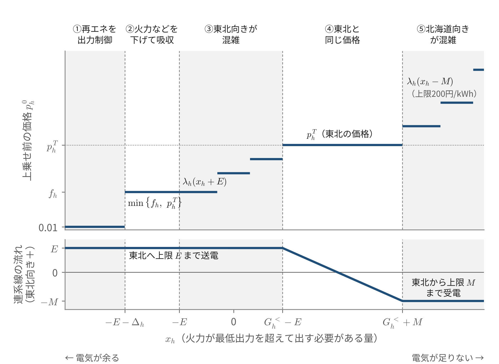

## 4.2節 書き換え案（案A：表、案B：図）

### 案A　式(4.2)を表にする

（表の直前に置く文の例）

運転中の号機はふだんの最低出力までは必ず発電する。そこで $q_h$ から運転中の号機の通常時の最低出力の合計を引いた量を $x_h$ とする。$x_h$ が正なら火力が最低出力からさらに出す必要がある量、負なら最低出力まで下げてもまだ余る電気の量である。東北へは $E$ まで送れ、東北からは $M$ まで受けられる。$x_h$ が小さい（電気が余っている）順に、上乗せ前の価格 $p^0_h$ は表4.Xのように決まる。

表4.X　上乗せ前の価格 $p^0_h$ の決まり方（$x_h$ が小さい順）

| | $x_h$ の範囲 | 状況 | 東北との連系線 | 価格 $p^0_h$（円/kWh） | 価格を決めるもの |
|:-:|:------------------------|:----------------------------------|:------------------|:-------------------|:--------------|
| ① | $x_h < -E-\Delta_h$ | 東北へ上限まで送り、火力などを下げきってもまだ余る | 東北へ $E$（上限） | $0.01$ | 再エネの出力制御 |
| ② | $-E-\Delta_h \le x_h < -E$ | 東北へ上限まで送り、残りの余りは火力などを最低出力より下げて吸収する | 東北へ $E$（上限） | $\min\{f_h,\ p^T_h\}$ | 運転中で最も安い燃料費 |
| ③ | $-E \le x_h < G^<_h-E$ | 東北向きが混雑し、北海道だけ安くなる | 東北へ $E$（上限） | $\lambda_h(x_h+E)$ | 北海道の火力の限界燃料費 |
| ④ | $G^<_h-E \le x_h < G^<_h+M$ | 連系線に空きがあり、東北と同じ価格になる | 送電 $E$ 〜 受電 $M$ の間 | $p^T_h$ | 東北の価格 |
| ⑤ | $G^<_h+M \le x_h$ | 北海道向きが混雑し、北海道が高くなる | 東北から $M$（上限） | $\lambda_h(x_h-M)$ | 北海道の火力の限界燃料費 |

注：$\Delta_h$ は火力（技術的な最低出力まで）と自家発などを下げられる幅、$f_h$ は運転中の号機で最も安い燃料費、$\lambda_h(\cdot)$ は最低出力を超える出力を燃料費の安い順に積んだときの限界燃料費、$G^<_h$ は燃料費が東北の価格以下の号機が最低出力を超えて出せる量。供給力が足りない時間は 200円/kWh とする。

### 案B　模式図

（図の直前に置く文の例）

図4.X は表4.X の5つの場合を、横軸に $x_h$ をとって並べたものである。上段は価格、下段は東北との連系線の流れを示す。連系線が上限に張り付く区間（①〜③と⑤）では北海道の価格が東北から切り離され、北海道の需給で決まる。上限に達していない区間（④）では東北と同じ価格になる。

{width=15.5cm}
