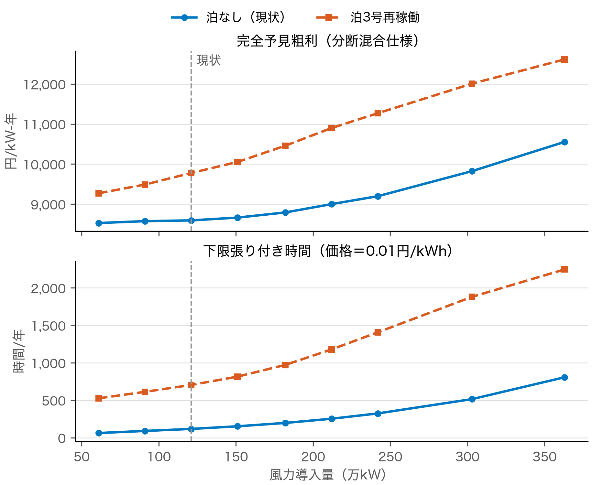
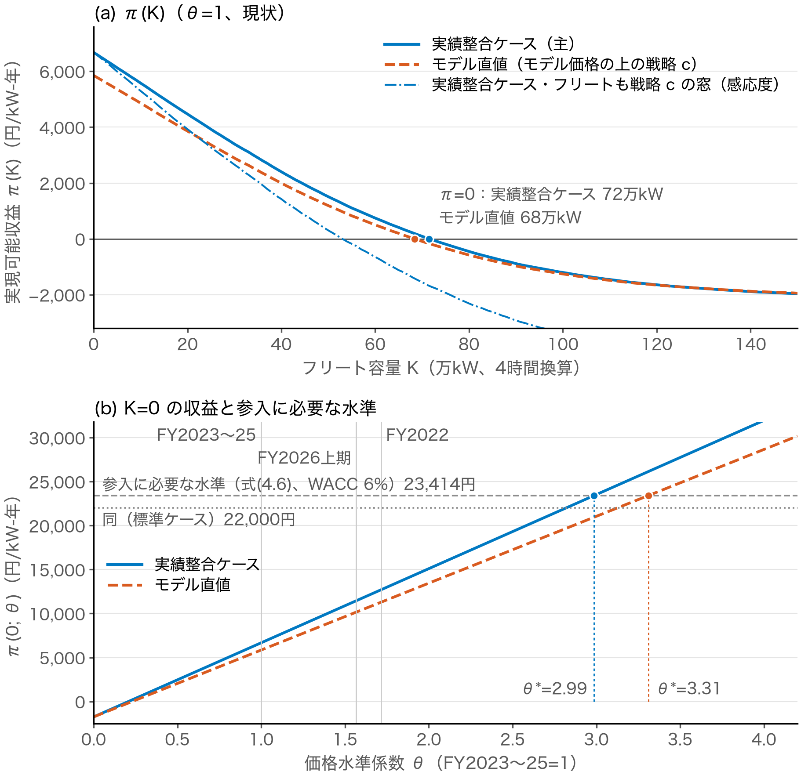
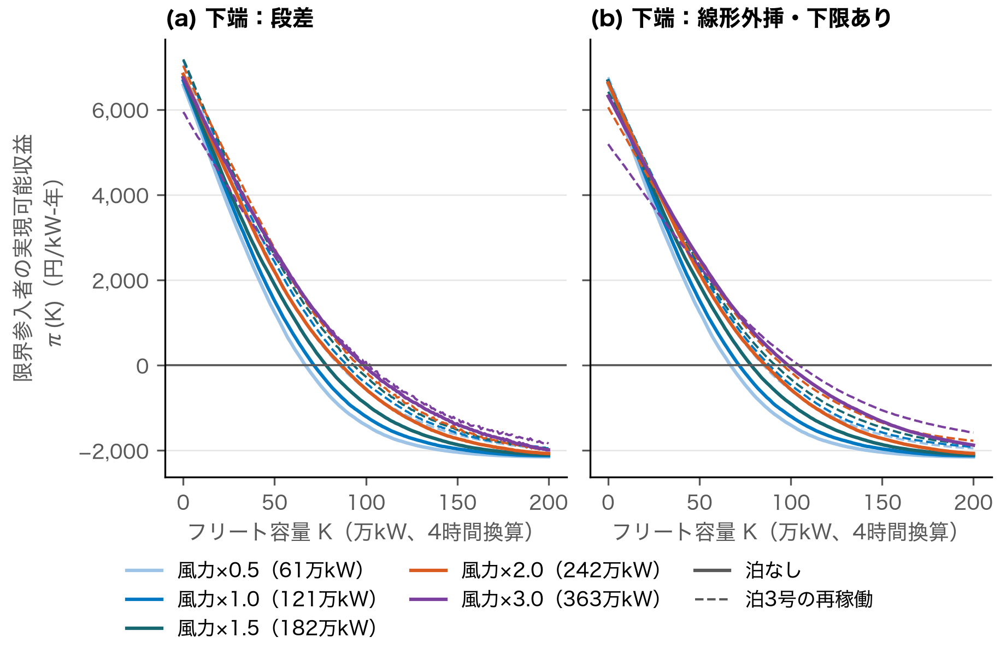
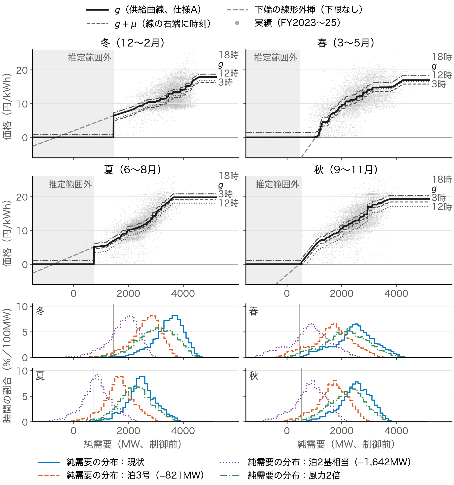
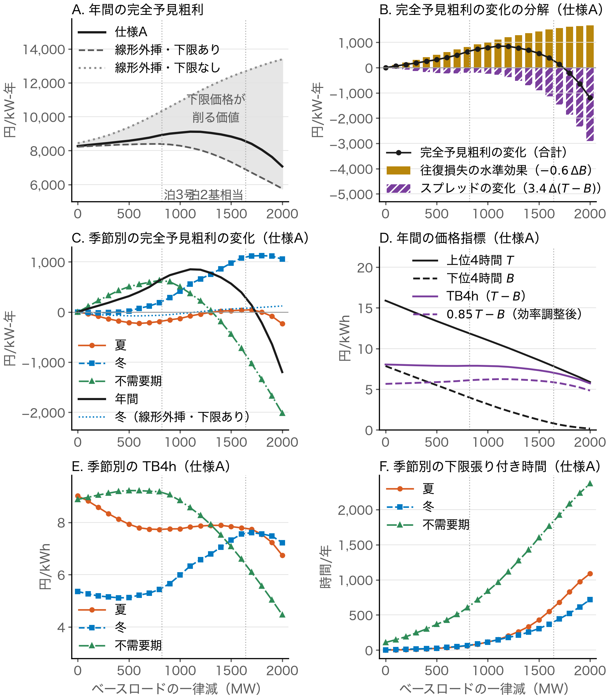
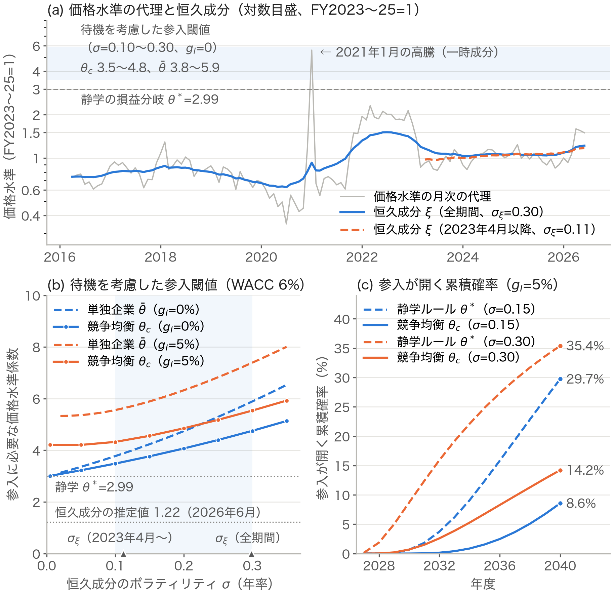

# 第7章　構造型価格モデルと自由参入均衡

本章は、蓄電池自身の参入によってスポット裁定価値がどれだけ速く減るか（RQ2 の後半）と、市場収入だけで運営するマーチャントの自由参入均衡でどれだけの容量が成り立つか（RQ3 の前半）を問う。第6章の価値は実績価格の上で単独の蓄電池を評価したもので、充放電が価格を動かす効果を含まない。そこで本章は、純需要を供給曲線に写す構造型価格モデルの上で蓄電池フリートを内生化し、限界参入者の収益曲線、ゼロレント条件による均衡容量 $K^*$、参入に必要な価格水準 $\theta^*$ を求め、実物オプションの参入閾値で静学の判定を補う。7.1節で方法を、7.2節で価格モデルの検証を、7.3〜7.5節で構造イベント・収益曲線・均衡容量を、7.6節で頑健性を、7.7節で下限価格の機構（RQ6 の一部）を、7.8節で参入閾値を示し、7.9節で小括する。

## 7.1　分析の方法

### 7.1.1　構造型価格モデル

本章の価格過程は、第4章の式(4.3)のとおり、純需要 $\mathrm{net}_t$（需要から出力制御前の太陽光・風力と原子力を引いたもの）の局所供給曲線 $g$ と時刻別のプレミアム $\mu$ を、年度別の価格水準係数 $\theta_{\mathrm{FY}}$ で伸縮させたものである。$g$ は季節ごとに純需要のビンの中央値を単調化した局所供給曲線、$\mu$ はその残差の季節×時刻別の中央値で、夕方のランプや希少性のプレミアムを表す[^c7-1]。$g$ と $\mu$ だけからなるこの単一曲線の仕様を仕様A と呼び、$\theta_{\mathrm{FY}}=1$ と置く版を水準固定、年度別の $\theta_{\mathrm{FY}}$ を当てる版を水準係数付きと呼ぶ。推定期間は FY2023〜25 で、最下位ビンの中心より低い純需要（推定範囲外）では価格を0.01円/kWh とする。出力制御前の発電量は設備利用率と導入量の積で表すので、気象のパスを保ったまま導入量を動かせる。市場分断を扱うため、システムプライスに対する安値・同価格・高値の3レジーム（5.1.3項）を純需要の多項ロジットで確率化し、同価格の時間にはシステムプライスを外生に当てる分断混合仕様も推定する。形状を固定したまま、FY2022 と FY2026上期（4〜6月）の $\theta$ を当該期間の価格で1パラメータ推定して、形状の期間外の検証とする。推定の手順は付録B.4.1 に示す。

この定式化は、需要を供給曲線に当てて価格を導く構造型電力価格モデルの系譜にある（Barlow, 2002; Carmona et al., 2013; Kanamura & Ohashi, 2007）。ホッケースティック型の供給曲線では需要が供給力に近づくと価格が急騰してスパイクが生じるが（Weron, 2014）、北海道の裁定価値には、純需要の低い時間にゼロ限界費用の電源へ切り替わる下端の急勾配も効き、その終点の下限価格は充電側の値下がりを止める（7.7節）。Weron（2014）の類型でいえば、$g$ は基礎（fundamental）モデル、$\mu$ と分断レジームの混合は統計・レジームスイッチの要素であり、後者は JEPX の買い主導・売り主導のレジーム転換（Kanamura & Bunn, 2022）を分断の3レジームに置き換えたものにあたる。負の価格を明示的に生成する欧州の簡約形モデル（Fanone et al., 2013）と違い、本研究は0.01円の下限を分布の左側の打ち切りとして扱う。

反実仮想で動かすのは風力の導入量なので、無条件の分布の再現に加えて、風力への条件付き応答を検証する。FY2023〜25 の1,096日について、実績価格とモデル価格の日次の指標に第5章の主仕様（表5.2）と年月固定効果の仕様を当て、差（モデル−実績）を同じ右辺に回帰して検定する（EWC、$\nu=42$。風力の3季節の族には Holm（1979）の補正を当てる）。両仕様の全季節・全指標で差の p が0.10を上回ることを基準とし、仕様A がこれを満たさないので（7.2.2項）、$\mu$ を日次の風力発電量の三分位にも依存させた仕様A′ を作る。現行の風力水準での収益曲線と $\theta^*$ は水準の再現がよい仕様A を主とし、風力の導入量を動かす反実仮想は仕様A′ を主とする。

### 7.1.2　完全予見粗利の分解

完全予見粗利は、充電脚と放電脚を持つ日次のスプレッド・オプションのペイオフであり、価格の比例的な変化には1次同次だが、加法的な変化には往復損失の分だけ反応する（第4章）。この性質を構造イベントの効果の読み解きに使う。粗利が正で稼働する日について、上位4時間・下位4時間の平均価格を第6章と同じく $T$・$B$ とすると、

$$4\,(0.85\,T-B)=3.4\,(T-B)-0.6\,B$$

（式番号 7.1）

が成り立つ（円/kW-日）。右辺の第1項はスプレッド $T-B$（TB4h）の価値、第2項は往復損失の費用である。失われる0.6kWh も下位4時間の価格で買うので、スプレッドが変わらなくても価格水準が下がれば粗利は増える。そこで構造イベントによる完全予見粗利の変化を、スプレッドの変化（3.4·ΔTB4h）、往復損失の水準効果（−0.6·Δ$B$）、休止の切替（どちらかの状態で粗利が負となり休止する日の差）に分ける。損失を上位4時間の価格で評価する別の分け方でも、以下の結論は変わらない。また、約定価格は潜在価格 $\tilde p_t$ を用いて $\max(\tilde p_t,0.01)=\tilde p_t+\max(0.01-\tilde p_t,0)$ と書けるので、充電する蓄電池は行使価格0.01円のプットを売った形になる（7.7節）。

### 7.1.3　フリートの内生化と実績整合ケース

フリート容量 $K$ の影響は、蓄電池を1万kW 刻みで逐次投入する増分貪欲ディスパッチで内生化する。各増分はその時点の価格で最安4時間に充電し、最高4時間に放電して（粗利が正の日のみ）、純需要と価格を更新する。これは各参入者が残されたスプレッドを順に取る競争均衡の近似であり、裁定ポジションの価格インパクト[^c7-2]を供給曲線から計算するものである。価格テイカーのモデルが貯蔵の価値を過大評価する問題に対して Emmanuel and Denholm（2022）が提案した市場フィードバックの枠組みを、供給曲線モデルの上で実装したものにあたる。Karaduman（2023）は、南豪州で価格インパクトを無視すると収益性を約2倍過大評価することを示している。

限界参入者の収益は、第4章の実績整合ケース（式(4.4)）で測る。すなわち、フリート投入後のモデル価格の上で戦略 c（4.2.2項）が実際に得る粗利 $c_{\mathrm{model}}(K)$ に、$K=0$・$\theta=1$ で実績に一致させる校正係数 $\lambda=1.108$（95%区間1.03〜1.19）を掛け、充電側の託送従量負担 $w_{\mathrm{chg}}$（1,752円/kW-年）を控除した $\pi(K)=\lambda\,c_{\mathrm{model}}(K)-w_{\mathrm{chg}}$ である。実績価格で測った実現率をモデルの完全予見粗利に掛けない理由は4.2.4項で述べた。$\lambda=1$ とした値（モデル直値）は下側の参考とする。$K>0$ ではフリートが価格の山谷を先に削るので、$\lambda$ を一定とする実績整合ケースは上側の値になりうる。主仕様のフリートは完全予見で配分し、フリート自身も戦略 c の窓で動く場合を感応度とする（7.4節）。

### 7.1.4　均衡条件

均衡容量 $K^*$ は第4章のゼロレント条件（式(4.5)）の解であり、$\pi(0)+\kappa P_{\mathrm{cap}}$ が参入必要収益 $c_{\mathrm{req}}$（式(4.6)）に届かなければ $K^*=0$ である。WACC 6%では $c_{\mathrm{req}}=3.59$万円/kW-年、実効容量収入 $\kappa P_{\mathrm{cap}}$ は1.25万円/kW-年である。粗収益が $\theta$ にほぼ比例するので、$K=0$ で参入が開く価格水準係数 $\theta^*$（式(4.8)）は、$a=\lambda\,c_{\mathrm{model}}(0)$（8,427円/kW-年）と $F=c_{\mathrm{fix}}+w_{\mathrm{chg}}-\kappa P_{\mathrm{cap}}$（1,452円/kW-年）を用いて $\theta^*=[I\cdot\mathrm{CRF}(r,20)+F]/a$ と書ける。比較のため、$c_{\mathrm{req}}$ を3.45万・3.2万・3.7万円とする標準・楽観・保守の3ケース（保守は実効容量収入も0.83万円とする。式(4.6)の割引率では約5.3%・3.9%・6.6%にあたる）を併記する。本章の $K^*$ は、スポット裁定と容量収入だけに依存するマーチャントの均衡容量であり、需給調整市場のレントは0と置く。ΔkW を供出する時間はスポット裁定に使えないので、そのレントは $\pi(K)$ に足すものではなく、置き換えて比べるものである。この置き方と、契約型の容量 $K_{\mathrm{exo}}$ を0とする置き方に対しては、7.6節で感応度を示す。

このゼロレント条件は、Butters et al.（2025）の動学的参入均衡を定常・確定的にした版にあたり、競争が進むほど個別の利潤が消えて総容量が決まるという Zhao et al.（2022）の極限に対応する。価格水準が不確実で投資が不可逆なら、競争が消すのは参入時点の超過 NPV であり、静学の損益分岐に対する閾値の上乗せは残る（Dixit & Pindyck, 1994; Leahy, 1993）。寡占の均衡で投資がゼロ NPV の近くで起きるという結果（Grenadier, 2002）も、先取りを含む均衡（Back & Paulsen, 2009; Fudenberg & Tirole, 1985; Weeds, 2002）も、将来の参入を織り込んだ NPV についての命題である。将来の参入は収入を下げる方向にしか働かないので、いずれの均衡でも、参入者が見込む価格経路で評価した静学のゼロレント条件は動学的な参入閾値の下限を与え、静学の $K^*$ は動学的な均衡容量の上限にあたる。価格水準の期待成長を0と置く主仕様では、この下限は価格水準一定の条件、すなわち $\theta^*$ そのものである。需給調整市場の収入や成長オプションに依存する参入は、この命題の対象外である。$K_{\mathrm{exo}}=0$ と静学の条件は、いずれも参入に有利な側の置き方なので、その下でも $K^*=0$ となれば、この結論は結論にとって不利な側の仮定の下で確かめられたことになる。これに対し、需給調整市場のレントを0と置くことは参入に不利な側の置き方なので、その影響は7.6節で別に評価する。

### 7.1.5　不確実性の下での参入閾値

不可逆な投資の機会は、価格水準を原資産とするアメリカン型のコール・オプションである（Dixit & Pindyck, 1994; McDonald & Siegel, 1986）。価格水準の代理として、月平均システムプライスを FY2023〜25 の同月平均で割った値（2016年4月〜2026年6月、123か月）を用いる。この代理は北海道エリアプライスで作る代理よりボラティリティを大きく出すので、参入が開く確率を高めに出す点では参入に有利な側に、参入閾値を高めに出す点では $K^*=0$ の結論を強める側に働く。その対数を、ランダムウォークに従う恒久成分 $\xi$ と1次の自己回帰過程（AR(1)）に従う一時成分 $\chi$ の和として、カルマンフィルタを用いた最尤法で推定する。Schwartz and Smith（2000）の2因子モデルを、先物を使わずに推定した形である。年間のキャッシュフローは

$$\mathrm{CF}_t=a\,\theta_t\,\frac{c_{\mathrm{model}}(K_t)}{c_{\mathrm{model}}(0)}-F$$

（式番号 7.2）

とする。資本費は年率 $g_I$（0〜8%）で下がって揚水並みの2.3万円/kWh で止まり、寿命は20年、判断は年1回、建設ラグは1年、恒久成分は期待成長 $\alpha=0$ の対数正規マルチンゲールとする。式(7.2)のキャッシュフローの下で比べる閾値は、式(4.8)の静学の損益分岐 $\theta^*$、排他的な参入権を持つ単独企業の最適行使閾値 $\bar\theta$（年次の動的計画法で求める）、競争均衡の参入閾値 $\theta_c$ の三つである。$\theta_c$ は、閾値で参入した者の NPV を、後続の参入で収入が閾値に押さえられることを織り込んで計算し、それが0になる水準であり、Dixit and Pindyck（1994, Chapter 8）の産業均衡を年次・有限寿命に置き換えたものにあたる。割引は実物確率の下で WACC によって行う。北海道の価格水準を複製できる取引商品がなく、リスクの市場価格を校正できないためであり（Dixit & Pindyck, 1994, Chapter 4）、基準の6%（契約型の資本コストの水準）に、マーチャントの資産の資本コストに近い8%（8.7.2項）を併記する。割引率を上げれば閾値は上がるので、6%は参入に有利な側の置き方である。数値解法と検算は付録B.4.5 に示す。

## 7.2　価格モデルの再現と検証

### 7.2.1　水準と分布の再現

標本内では、分断混合仕様は TB4h の中央値（実績8.3〜9.6円/kWh）を8.0〜8.3円とほぼ再現する。しかし分布の裾が圧縮されるため、完全予見粗利は実績より9〜24%過小で、0.01円/kWh に張り付く時間（以下、下限張り付き時間）も実績の5〜6割にとどまる（表C.21）。時刻別プレミアム $\mu$ を外すと、仕様A の完全予見粗利は25%下がる。夕方のランプや希少性のプレミアムは、純需要だけでは説明できない一次的な要素である。

FY2026 の4〜6月には、定常な仕様（$\theta=1$）の価格は実績の TB4h の中央値と95パーセンタイル（p95）を大きく下回る（表7.1）。同じ期間に北海道エリアプライスは同じ純需要水準で約1.6〜1.7倍、システムプライスも約1.5〜1.6倍に上がっており、上側の水準のシフトは全国的な燃料・供給構造の変化である。年度別の水準係数は、FY2023〜25 の0.94・1.07・1.00に対し、FY2026上期が1.57、FY2022 が1.72である。形状を固定して $\theta$ だけを推定すると、FY2026上期の完全予見粗利は実績の78%まで再現される（直前の水準を与えると50〜51%）。これは水準を合わせたうえでの形状の検証であり、予測力の検証ではない。また $\theta$ は基準価格3円/kWh 以上の価格の水準を表す指数であり、年度間の完全予見粗利の違いは説明しない。残る乖離は下限張り付き時間とスパイクの裾の圧縮による定常的な過小評価で、FY2022 は連系線増強前の厚い裾のため56%しか再現できない。

: 表7.1　年度別の水準係数と価格過程の再現

| | FY2022 | FY2023 | FY2024 | FY2025 | FY2026（4〜6月） |
|---|---:|---:|---:|---:|---:|
| 水準係数 $\theta_{\mathrm{FY}}$ | 1.72 | 0.94 | 1.07 | 1.00 | 1.57 |
| **パネルA：TB4h の中央値（円/kWh）** | | | | | |
| 実績 | 19.3 | 8.3 | 8.7 | 9.6 | 18.7 |
| 仕様A（$\theta=1$） | 7.8 | 7.8 | 7.8 | 8.3 | 9.2 |
| 仕様A（水準係数付き） | 13.4 | 7.3 | 8.3 | 8.3 | 14.3 |
| **パネルB：p95（円/kWh）** | | | | | |
| 実績 | 42.2 | 18.1 | 19.6 | 19.6 | 26.1 |
| 仕様A（$\theta=1$） | 18.7 | 18.2 | 17.9 | 18.2 | 14.5 |
| 仕様A（水準係数付き） | 32.1 | 17.1 | 19.0 | 18.1 | 22.7 |
| **パネルC：完全予見粗利（円/kW-年）** | | | | | |
| 実績 | 25,160 | 9,873 | 9,586 | 11,493 | 5,425 |
| 仕様A（$\theta=1$） | 8,262 | 7,989 | 8,319 | 8,489 | 2,707 |
| 仕様A（水準係数付き） | 14,173 | 7,495 | 8,860 | 8,463 | 4,241 |

注）p95 は95パーセンタイル。FY2026 は4〜6月の3か月分で、完全予見粗利も3か月分の値である。形状は FY2023〜25 で推定し、FY2022 と FY2026 は形状の期間外検証で、水準係数は当該期間の価格で推定した。仕様A（$\theta=1$）は水準を固定した値、仕様A（水準係数付き）は各年度の $\theta_{\mathrm{FY}}$ を当てた値である。

出所）日本卸電力取引所『スポット市場取引結果』、北海道電力ネットワーク『エリア需給実績』より筆者作成。

実績とモデルの比は、完全予見粗利ではどの期間でも1を上回り（標本内1.25、年度抜き取り1.28、FY2026 の4〜6月1.28、FY2022 1.78）、戦略 c でも FY2024（0.94）を除いて1を上回る（標本内1.11、FY2026 の4〜6月1.23、FY2022 1.60）。比が期間外で小さくならないので、$K=0$ の実績整合ケースは上限ではなく中心の推定とみなせる。

### 7.2.2　風力への条件付き応答と仕様A′

仕様A は不需要期で実績と有意に異なる。風力1GWh/日あたりの差は、TB4h で+0.180円/kWh（p=0.010）、完全予見粗利で+0.60円/kW-日（p=0.012）であり、Holm の補正後も p=0.024〜0.037で残る。高風日の夕方の高値の低下を、実績の半分以下しか再現しないためである。水準係数を入れても同じ向きにずれる（完全予見粗利で+0.57円/kW-日、p=0.018）ので、ずれは水準の扱いでは解消しない。原因は時刻別プレミアム $\mu$ が日々の風力で変わることにあり、不需要期の高風日には夕方（17〜20時）のプレミアムが1〜2円/kWh 小さい。仕様A′ では、両仕様の全季節・全指標で差の p が0.10を上回る（最小0.14）。ただし有意でないことは一致を意味しない。不需要期の完全予見粗利の差の点推定+0.35（95%区間−0.13〜+0.82）は残り、$\mu$ を年度抜き取りで推定すると p は0.09になる。仕様A′ は状態変数などの組合せを試して選んだので、この検証は標本内の確認にとどまる（表C.22）。風力1GWh/日あたりの年間の完全予見粗利の応答は、実績+37円、仕様A+139円、仕様A′+79円/kW-年である。仕様A′ もなお実績の約2倍の応答を示すので、仕様A′ で求めた風力の増加の効果も、参入に有利な側に偏った値である。なお、太陽光については両仕様とも不需要期の下位4時間を実績より深く下げており、ベースロード減の効果（7.7節）を読むときの留意点になる。

## 7.3　構造イベントの部分均衡効果

FY2023〜25 の気象・需要パスの上で、分断混合仕様の価格過程に構造イベントを加えた（共通乱数。年度別の結果は表C.23）。風力の現行値121万kW は、推定期間の認定容量の平均である。

泊原子力発電所3号機（以下、泊3号）の再稼働（91.2万kW×稼働率90%）は、下限張り付き時間を5〜7倍に増やし、完全予見粗利を3年度平均で+1,184円/kW-年増やす。ただしその約7割（+812円）は、価格水準が下がって往復損失が安くなる効果であり、夏にはスプレッドがむしろ縮む。収益曲線と同じ決定論の仕様A でも、増分+662円は往復損失の水準効果+847円とスプレッドの変化−197円などからなる。全時間一定のデータセンター等の需要+80万kW は完全予見粗利を797円減らし、泊3号と合わせるとほぼ相殺するが、その単独の効果の大きさは供給曲線の上端の置き方に依存し、分断混合仕様では符号も識別できない（表C.23）。

どの仕様・下端の扱いでも、$K^*=0$ は変わらない。下限を残す三つの扱い（仕様A、下端の線形外挿、分断混合仕様）の価格の上で戦略 c を計算して現状に校正すると、泊3号から泊1〜3号の全基まで（泊3号の2基分を以下、泊2基相当と呼ぶ）の再稼働で、$\pi(0)$ は4,625〜7,384円/kW-年、$\theta^*$（式(4.8)、WACC 6%）は2.75〜3.95であり、FY2026上期の1.57と FY2022 の1.72を大きく上回る。分断混合仕様では泊2基相当と全基で完全予見粗利が大きく増えるが、増分は時間ごとに独立に引くレジームの切り替わりから生じるので、戦略 c はほとんど取れない（実現率0.80→0.52・0.41）。実現可能収益はむしろ下がる。

風力導入量を現行の0.5〜3倍に振ると（表C.24、図7.1）、仕様A′ の完全予見粗利は現行の9,036円/kW-年から、2倍で+334円、3倍で+1,001円増える。現行水準の近くでは風力の効果はほぼ一様で、1.25倍の増分+35円は往復損失の水準効果+98円とスプレッドの変化−63円からなる。構造モデルの上では、導入量が増えると低純需要の時間が供給曲線の下端の急な部分に入り、安い時間ほど大きく下がる非平行の効果でスプレッドが開く（この機構は標本内の回帰では確認できない。7.7節）。しかし仕様A′ では、その効果は3倍でも+258円にとどまる。仕様A（3倍で+1,481円）と分断混合仕様（+1,961円）は増分をさらに大きく出すが、仕様A′ を含めいずれも風力への応答を実績より大きく出すので（7.2.2項）、これらの増分は上側の値である。

{width=15cm}

注）FY2023〜25 の気象・需要パス、$K=0$ の部分均衡。風力導入量は、出力制御前の設備利用率の過程を保って一律に伸縮させた。上は完全予見粗利（円/kW-年）、下は下限張り付き時間（時間/年）。系列は泊なし（現状）と泊3号の再稼働、縦の破線は風力導入量の現状（121万kW）。価格過程は水準係数を入れない分断混合仕様である。蓄電池フリートの応答、システムプライスの変化、供給側の内生的な反応は含まず、レジームの確率の推定範囲外への外挿を含む。分断混合仕様は風力の効果を実績より有利に出す仕様であり、主とする仕様A′ と仕様A の値は表C.24 に示す。

出所）日本卸電力取引所『スポット市場取引結果』、北海道電力ネットワーク『エリア需給実績』より筆者作成。

より重要なのは、完全予見粗利が増えても、実行可能な粗利はほとんど増えないことである。風力3倍でのモデル価格の上の戦略 c の粗利の変化は、仕様A′ で−241円、仕様A で+168円にとどまる。増える完全予見粗利の大半は、前日の気候値では予測できない日々の深い安値から来るからである。泊と組み合わせると、仕様A′ の完全予見粗利は風力2倍を頂点に下がる。いずれも $K=0$ の上の形であり、価値を大きく動かすのは蓄電池自身の競合である。

## 7.4　限界参入者の収益曲線

蓄電池フリートを内生化した限界参入者の実現可能収益 $\pi(K)$ を、表7.2 と図7.2(a) に示す。

: 表7.2　限界参入者の実現可能スポット収益 $\pi(K)$

| $K$（万kW、4時間） | 現状 | 泊3号の再稼働 | 泊＋風力2倍 |
|---|---:|---:|---:|
| 0 | 6,675（5,886） | 7,384（6,529） | 7,249（6,406） |
| 10 | 5,577（4,891） | 6,336（5,579） | 6,320（5,564） |
| 20 | 4,500（3,915） | 5,337（4,674） | 5,467（4,792） |
| 25 | 3,964（3,429） | 4,837（4,221） | 5,038（4,403） |
| 30 | 3,448（2,961） | 4,353（3,782） | 4,626（4,029） |
| 50 | 1,592（1,279） | 2,638（2,227） | 2,920（2,482） |
| 70 | 159（−20） | 1,189（913） | 1,486（1,183） |
| 100 | −1,190（−1,243） | −333（−465） | −81（−238） |
| 150 | −1,993（−1,970） | −1,571（−1,588） | −1,472（−1,498） |
| $\pi=0$ となる $K$（万kW） | 72.6（69.6） | 91.9（88.0） | 98.4（94.2） |

注）円/kW-年。各セルは実績整合ケース（括弧内はモデル直値）。仕様A（水準固定。校正係数は1.103で、$K=0$ で実績の戦略 c 8,427円に一致させる。7.1.3項の $\lambda=1.108$ は水準係数付きの仕様A の値）、増分貪欲（1万kW 刻み）、フリートは完全予見で配分、充電従量負担を控除、FY2023〜25 パスの平均。泊＋風力2倍の列は仕様A による（風力への条件付き応答を標本内で修正した仕様A′ では、泊＋風力2倍の $\pi(0)$ は6,629円、$\pi=0$ となる $K$ は98.2万kW）。

出所）表7.1 と同じ。

{width=15cm}

注）(a) は $\theta=1$ の現状の $\pi(K)$、(b) は $K=0$ の収益と価格水準係数 $\theta$ の関係および参入に必要な水準。水準係数付きの仕様A、FY2023〜25 パス、増分貪欲（1万kW 刻み）、充電従量負担を控除。実線は実績整合ケース、破線はモデル直値、一点鎖線はフリートも戦略 c の窓で動く感応度。

出所）表7.1 と同じ。

カニバリゼーションは速い。$\pi(K)$ は25万kW で $K=0$ の59%、約31万kW で半減し、50万kW で24%、約72万kW で負に転じる。泊の再稼働や風力の倍増は曲線を上方に移すが、負に転じる点は約92〜98万kW に動くにとどまる。この減衰は、1GW の貯蔵で裁定価値が2割超減るとした Sioshansi et al.（2009）以来の自己共食いの議論と整合する（Karaduman, 2023; Lamont, 2013; Lamp & Samano, 2022）。海外の市場の実績との比較は10.2.3項で行う。

限界参入者の戦略 c の実現率は、$K\le50$万kW で0.91〜0.94とほぼ一定で、100万kW で0.59〜0.67に下がる。フリート自身も戦略 c の窓で動くと仮定すると実現率はより速く下がり、$\pi=0$ となる容量は約53万kW に前倒しになる。フリートの情報の仮定によって負に転じる点は53〜72万kW の幅で動くが、$K^*=0$ は $\pi(0)$ だけで決まるので、この仮定にも、$K>0$ で $\lambda$ を一定とする仮定にも左右されない。

## 7.5　均衡容量と損益分岐の価格水準

参入に必要なスポット収益 $c_{\mathrm{req}}-\kappa P_{\mathrm{cap}}$ は、式(4.6)（WACC 6%）の $c_{\mathrm{req}}$ で23,414円、標準・楽観・保守ケースで22,000円・19,500円・28,700円/kW-年である。これに対し $\pi(0)$ は6,675〜7,384円（モデル直値5,886〜6,529円）にすぎず、いずれのシナリオ・ケースでも参入に必要な水準に達しない。したがって現行の資本費と価格構造の下では、スポット裁定と容量収入だけに依存するマーチャントの均衡容量は $K^*=0$ である（需給調整市場のレントは7.6節で扱う）。これは私的な参入誘因についての命題である。価格上限が停電価値を下回らなければ競争的な貯蔵のゼロ利潤均衡がシステム費用の最小化と一致するという Schmalensee（2022）の同値は、価格が歪められていない場合のものである。下限価格が拘束力を持ち、出力制御が無補償で、容量市場と LTDA がある本研究の設定では、$K^*=0$ からシステム費用についての含意は導けない（本研究は厚生分析を扱わない）。

価格水準を上げても判定は変わらない（図7.2(b)）。$\pi(0)$ は FY2026上期の水準（$\theta=1.57$）で11,452円、燃料危機の FY2022 の水準（$\theta=1.72$）で12,705円にとどまり、楽観ケースの19,500円に届かない（$K>0$ は表C.25）。式(4.8)の損益分岐は $\theta^*=2.99$（モデル直値3.31、$\lambda$ の95%区間で2.78〜3.21、3ケースで2.52〜3.61）であり、FY2026上期の水準の1.91倍、FY2022 の1.74倍にあたる。

ただしこの $\theta^*$ は、推定期間で校正した $\lambda$ を高い価格水準でも一定とし、収益を $\theta$ に比例させて求めた値である。期間外の実績とモデルの比は、戦略 c で FY2026上期1.23、FY2022 1.60と $\lambda$ を上回る（7.2.1項）。価格水準が高い局面では、モデルが実績の取り分を過小に見て、$\theta^*$ を高めに出している可能性がある。この比を $\lambda$ の代わりに当てると、$\theta^*$ は約2.7・約2.1に下がる。$\lambda$ の95%区間による幅は推定期間内の標本誤差だけを表し、この下側の不確実性を含まない。FY2023〜25 の実績価格の上で実現率を1とする極端な場合でも、式(4.8)の $\theta^*$ は2.44である（付録C.2.7）。いずれも FY2022 の水準1.72を上回るが、必要な価格水準は、収益の基準の置き方によって2倍強から約3倍の幅を持つ。

例外に近いのは FY2022 の実績価格そのものである。連系線増強前の分断構造の上で戦略 c が実際に得た粗利21,017円を用いれば、実現可能収益は19,265円で、参入に必要なスポット収益の82%（式(4.6)）、88%（標準ケース）、99%（楽観ケース）に達する。マーチャントの参入は、燃料危機の水準と当時の分断構造が同時に恒常化する場合にのみ開く。なお、以上は価格水準が一定のまま続くと置いた静学の判定であり、待機の価値を考慮すると参入閾値はさらに上がる（7.8節）。

資本費の側からみると、$K=0$ で参入が立つ年間固定費（資本費の年額と運転維持・廃止費の合計）は約1.23万円/kW-年で、資本費に換算すると約2.0万円/kWh、現行の6.8万円/kWh の3割弱である。資本費が蓄電池産業戦略の長期目標である揚水並みの2.3万円/kWh まで下がれば、$\theta^*$ は1.12となる。FY2023〜25 の水準では参入は開かないが余裕は小さく、恒久成分の推定値1.22（7.8節）や FY2026上期の水準1.57が続けば開く（$\theta=1.22$ での損益分岐の資本費は2.5万円/kWh）。Butters et al.（2025）は CAISO で資本費が30%下がれば導入が大きく進むと報告したが、北海道では資本費の約7割の低下か、価格水準の約3倍への上昇が必要である。系統利用料が裁定価値を20〜50%削るという Mercier et al.（2023）の指摘のとおり、託送等固定費と充電従量負担も損益分岐に一次的に効く。

## 7.6　頑健性の確認

主要な感応度を表7.3 にまとめる。需給調整市場のレント（後述）を除き、どの前提の変更でも $K^*=0$ の判定は変わらない。

: 表7.3　均衡の判定の感応度

| 変える前提 | 置き方 | 主な結果 | $K^*=0$ |
|---|---|---|---|
| 価格過程の仕様と下端の扱い | 仕様A、線形外挿、分断混合（泊3号〜全基） | $\pi(0)$ 4,625〜7,384円、$\theta^*$ 2.75〜3.95 | 不変 |
| 風力導入量と泊の組合せ | 風力0.5〜3倍、泊の有無 | $\pi(0)$ の最大7,177円 | 不変 |
| フリートの情報の仮定 | 完全予見、戦略 c の窓、半々 | $\pi=0$ の $K$ 53〜72万kW | 不変 |
| 校正係数 $\lambda$ | 95%区間1.03〜1.19、$\lambda=1$、期間外の比1.23・1.60 | $\theta^*$ 2.78〜3.21、3.31、約2.7・約2.1 | 不変 |
| 割引率 | 5%〜9% | $\theta^*$ 2.76〜3.71 | 不変 |
| 容量市場の参加区分 | 発動指令電源（実効0.83万円） | $\theta^*$ 3.48 | 不変 |
| 既設・契約型の容量 | $K_{\mathrm{exo}}=20$万kW、87.4万kW | $\theta^*$ 4.05、約26 | 不変 |
| 容量市場価格の $K$ 依存 | 北海道ブロック按分、全国連系 | 按分では約27万kW で約定価格0 | 不変 |
| 需給調整市場のレント | 上限 $\min(Q/K,1)\times 2p_{\Delta}\times8{,}760$ | 50万kW で17,520〜262,800円 | 覆りうる（支えうる容量は $Q$ 程度まで） |

注）$\theta^*$ は式(4.8)（WACC 6%、実績整合ケース）による。校正係数の期間外の比は、FY2026上期と FY2022 の戦略 c の実績とモデルの比（7.2.1項）を $\lambda$ の代わりに当てた場合である。容量市場の参加区分の比較の対象は安定電源（実効1.25万円）。容量市場価格の $K$ 依存は $K>0$ の収入だけを下げるので、$K=0$ で決まる判定には効かない。$Q$ は北海道の調達量（10〜50万kW の仮定）、$p_{\Delta}$ は ΔkW 価格（5〜15円/ΔkW・h）で、レントはスポット裁定と排他的なので、$\pi(K)$ と置き換えて比べる上限である。詳細は付録C.3.6 に示す。

出所）表7.1 の出所、電力広域的運営推進機関『容量市場メインオークション約定結果』『メインオークション需要曲線』より筆者作成。

風力導入量と蓄電池容量の2次元の感応度面では、仕様A′ で風力を3倍にしても $\pi(0)$ は6,434円にむしろ下がる。フリート50万kW 分のカニバリゼーション（6,675円から1,888円）のほうが、風力の効果よりはるかに大きい（表C.26、図7.3）。既設・契約型の容量を外生に置くと $\theta^*$ は大きく上がるが、推定期間の価格には当時稼働していた蓄電池の影響がすでに入っているので、その値は二重計上を含む上限側である。容量市場の約定価格は、需要曲線を北海道の需要シェアで按分した近似では、蓄電池の追加4.4万kW で指標価格まで下がる（表C.27）。容量市場側のカニバリゼーションはスポット側より速く、2030年度向けの指標価格の引上げによる容量収入の上振れを打ち消す側に働く。

{width=15cm}

注）(a) は供給曲線の下端を段差とする仕様A、(b) は下端を線形外挿し下限を残した仕様A。実線は泊なし、破線は泊3号の再稼働で、色は風力導入量（現状の0.5〜3倍）。水準係数付きの価格過程（$\theta=1$）、FY2023〜25 パス、増分貪欲（1万kW 刻み）。実績整合ケースは各下端の扱いの現状・$K=0$ で実績の戦略 c（8,427円/kW-年）に校正し、充電従量負担を控除した。参入に必要なスポット収益（容量収入1.25万円のとき、式(4.6)（WACC 6%）で約2.34万円、楽観ケースで1.95万円）には、どの組合せでも届かない。仕様A′ は含まない。

出所）図7.1 と同じ。

需給調整市場のレントの上限は、フリートが小さいうちは参入に必要なスポット収益（23,414円）を埋めうる大きさである（表C.28）。表7.3 の前提のうち、$K^*=0$ の判定を覆しうるのは、このレントを0と置く主の置き方だけである。ただしこの上限は、$K$ が調達量 $Q$ を超えても ΔkW 価格が $p_{\Delta}$ に保たれると置いた値である。$K$ が $Q$ を超えると、蓄電池どうしが $Q$ の枠を争うので、ΔkW 価格はスポット裁定の機会費用まで下がり、スポット裁定を上回るレントは残らない。蓄電池の落札単価が急速に下がった実績（3.4節）は、この競争が速く進むことを示している。既設や契約型の蓄電池も同じ枠を争うので、需給調整市場のレントで支えうるマーチャントの容量は、多くとも調達量 $Q$ の程度（仮定の幅で10〜50万kW）で頭打ちになり、契約申込の234万kW には遠く及ばない。北海道エリアの商品別の約定量と約定価格によるレントの実測は行っていないので、本章の $K^*=0$ は、スポット裁定と容量収入だけに依存するマーチャントについての判定として読む必要がある。

最後に、割引率の選び方について述べる。補助金のないマーチャントの事業 IRR は $\theta$ が1〜1.72の範囲で負なので、実効容量収入が1.25万円にとどまる限り、判定は割引率の選び方によらない（8.7.1項）。判定が割引率に依存するのは、FY2022 の実績価格そのもの（IRR は3.75%）、2030年度向け以降の容量収入の上振れ、補助金を受けるマーチャントの場合である（7.8節・8.7節）。

## 7.7　価格モデルの曲線と下限価格の機構

7.3〜7.6節の構造イベントと風力の効果は、供給曲線の低純需要の側の形と下限価格の扱いに依存する。本節はその機構を示す。ただし下端の機構は構造モデル上のもので、標本内の回帰では確認できない。春の風力の TB4h への係数（5.3.1項）を日の純需要の三分位で分けても、低純需要の日ほど大きく正になる形は現れない。

図7.4 は仕様A の供給曲線と純需要の分布である。$g$ は各季節の最下位ビンの中心より低い純需要では識別できず、仕様A はこの推定範囲外を0.01円とする。推定範囲外の時間は現状では全時間の0.2%にすぎないが、泊3号（−821MW）で5.2%、泊2基相当（−1,642MW）で29%に増える。推定範囲内の下端の傾きは、春と秋で急（1.14円・0.70円/kWh per 100MW）、冬と夏で緩やか（0.31円・0.35円）である。仕様A で冬・夏に現れる急な落ち込みは、推定範囲外を0.01円とする段差の仮定による。

{width=15cm}

注）上段は季節別の供給曲線 $g$、時刻別の $g+\mu$（3時・12時・18時）、下端の線形外挿と実績（FY2023〜25）で、網掛けは推定範囲外。下段は FY2023〜25 の気象・需要パスの純需要の分布（現状、泊3号、泊2基相当、風力2倍）。

出所）表7.1 と同じ。

ベースロードを一律に減らした応答を図7.5 に示す（分解は表C.29）。仕様A では、泊3号の再稼働で上位4時間の平均価格は15.9円から11.9円/kWh、下位4時間は7.9円から4.0円/kWh へほぼ同じ幅で下がり、TB4h は8.04円から7.89円へわずかに縮む。夏は上位4時間の帯の供給曲線が下位4時間の帯より急なので、完全予見粗利は179円減る。ベースロードをさらに減らすと、完全予見粗利は約1,100MW で頂点に達した後に下がり、泊1〜3号の全基（1,863MW）では7,782円と現状の8,266円を下回る。上位4時間が下がり続ける一方で、下位4時間は下限価格に張り付いてそれ以上下がらなくなるためである。山の高さは推定範囲外の置き方にも依存し、下端を線形外挿して下限を残すと、泊3号の増分は+662円から+163円に、泊2基相当は−1,342円になる。どちらの置き方が正しいかは、データからは判定できない。

{width=15cm}

注）FY2023〜25 パスの部分均衡。A は年間の完全予見粗利（仕様A、線形外挿の下限あり・下限なし）、B は仕様A の変化の式(7.1)による分解、C は季節別の変化、D〜F は仕様A の価格指標、季節別の TB4h、下限張り付き時間。縦の点線は泊3号と泊2基相当。季節は夏7〜9月、冬12〜2月、不需要期3〜6月と10〜11月。

出所）表7.1 と同じ。

下限価格そのものの役割は、まず実績価格で確かめられる（表7.4 のパネルA）。FY2023〜25 の実績価格を一様に $\Delta p$ 円/kWh 下げると、0.01円で打ち切らない限り、完全予見粗利は1円あたり219円/kW-年（0.6×365日）増えるだけである。加法的な水準の変化への反応は、往復損失を通じた弱いものにとどまる。0.01円で打ち切ると、完全予見粗利はほぼ横ばいの後に下がる。平行に下がる価格が下限で打ち切られると、安い側だけが下がらなくなり、スプレッドが縮むからである。充電脚でプットを売っているので、潜在価格が下限を下回るほど、得られたはずの値下がりを失う。

: 表7.4　下限価格の機構の検証

| | 仕様A | 下限あり | 下限なし | 段差の効果 | 下限価格の効果 | 0.01円以下の時間 |
|---|---:|---:|---:|---:|---:|---:|
| **パネルA：実績価格を一様に $\Delta p$ 円/kWh 下げた場合（水準）** | | | | | | |
| $\Delta p=0$ | — | 10,317 | 10,317 | — | 0 | 203 |
| $\Delta p=1$ | — | 10,339 | 10,535 | — | −196 | 309 |
| $\Delta p=2$ | — | 10,316 | 10,754 | — | −437 | 366 |
| $\Delta p=3$ | — | 10,263 | 10,972 | — | −709 | 430 |
| $\Delta p=5$ | — | 10,053 | 11,410 | — | −1,357 | 557 |
| $\Delta p=8$ | — | 9,259 | 12,067 | — | −2,808 | 1,152 |
| $\Delta p=10$ | — | 7,967 | 12,506 | — | −4,539 | 2,625 |
| **パネルB：価格過程のシナリオ（現状からの変化）** | | | | | | |
| 風力2倍 | +605（+236） | +412（+72） | +1,054（+618） | +193 | −642 | — |
| 風力3倍 | +1,481（+740） | +975（+312） | +2,808（+1,869） | +506 | −1,833 | — |
| 泊3号（−821MW） | +662（−197） | +163（−621） | +1,887（+844） | +499 | −1,723 | — |
| 泊2基相当（−1,642MW） | +293（−1,269） | −1,342（−2,653） | +4,245（+2,072） | +1,635 | −5,587 | — |
| 泊1〜3号全基（−1,863MW） | −484（−2,155） | −2,027（−3,435） | +4,709（+2,228） | +1,543 | −6,737 | — |

注）値は完全予見粗利（円/kW-年。FY2023〜25 の年度合計の3年平均）。下限ありは0.01円で打ち切った価格、下限なしは打ち切らない価格の上の値であり、下限価格の効果は下限ありと下限なしの差（負の値は下限価格が削る価値）である。パネルA は実績価格の上の水準で、下限なしの増分は往復損失の水準効果だけからなる。0.01円以下の時間は、引き下げた価格が0.01円以下となる年間の時間数（時間/年）である。パネルB は仕様A（水準固定）の上の現状からの変化で、括弧内はうちスプレッドの変化（3.4·ΔTB4h）。パネルB の下限あり・下限なしは下端を線形外挿した価格過程の値であり、段差の効果は仕様A と線形外挿・下限ありの差である。風力の行は、風力の効果を実績より有利に出す仕様A の値である。—は該当しないことを示す。

出所）表7.1 と同じ。

価格過程でも同じことが言える（パネルB）。下端を線形外挿したうえで下限も外すと、下限価格が削る価値は泊3号で1,723円、泊2基相当で5,587円、風力3倍で1,833円である。この反実仮想の負の価格は浅い（泊3号で平均−5.0円）。泊3号で削る1,723円は、第9章の段差モデルで負の価格の深さを約4.5円と置いた場合の値にあたるので、これは下限価格が削る価値の上限ではない。それでも符号は明確であり、下限価格は裁定価値を作るのではなく削る。下限を外すと山型は消え（図7.5 のA）、単一曲線の仕様で山型を作っているのは下限価格である。分断混合仕様ではベースロードの減少とともに完全予見粗利が単調に増えるが、これは連系時にシステムプライスを外生に置く外挿によるもので、戦略 c ではほとんど取れない（7.3節）。原子力の日次発電量が変動する九州の日次回帰も、原子力がスプレッドを広げる証拠を示さないが（表C.30）、年月固定効果の仕様の片側95%上限は泊の規模で1〜3円/kWh の拡大を排除しないので、「泊の再稼働はスプレッドをほとんど広げない」という記述の根拠は主に北海道の価格モデルである。量的な大きさは推定範囲外の扱いと仕様に依存するが、どの扱いでも $K^*=0$ は変わらない。下限価格が余剰の価値を市場から隠すという第9章の議論は、この機構の上に立つ。

## 7.8　不確実性の下での参入閾値

### 7.8.1　価格水準の2因子分解

全期間の推定では、恒久成分のボラティリティ $\sigma_\xi$ は年0.30、一時成分の半減期は1.2か月である（図7.6(a)、表C.31）。ただし $\sigma_\xi$ はほぼ FY2021〜22 の燃料危機で決まり、2016年4月〜2021年3月では0、2023年4月以降では0.11である。プロファイル尤度による95%区間は全期間で0〜0.64と広く、$\sigma_\xi=0$ も棄却できない。単位根の検定も決め手にならず、ADF 検定（Dickey & Fuller, 1979）は単位根を5%で棄却できず（p=0.055）、KPSS 検定（Kwiatkowski et al., 1992）は定常性を棄却する（p=0.022）。分散比も、Lo and MacKinlay（1988）の頑健な統計量ではランダムウォークを棄却できない。ショックが恒久的か一時的かは識別できないので、以下では $\sigma$ を0.10〜0.30の幅で示す。FY2026（4〜6月）の代理の水準1.55のうち、FY2023〜25 の水準からの上昇幅0.55に占める恒久成分の上昇は3〜4割にとどまる。20年の投資判断に効くのは恒久成分なので、2026年6月の推定値 $\xi=1.22$ を出発点とする。

{width=15cm}

注）(a) は価格水準の代理（月平均システムプライス÷FY2023〜25 の同月平均、対数目盛）と恒久成分の推定値、(b) は恒久成分のボラティリティ $\sigma$ と参入閾値（WACC 6%）で、$\theta_c$ は競争均衡の閾値、$\bar\theta$ は排他的な権利を持つ単独企業の閾値、$g_I$ は資本費の年低下率である。(c) は資本費低下5%/年の下でマーチャント参入が開く累積確率（$\sigma=0.15$、$0.30$、静学と競争均衡の規則）。粗収益は実績整合ケース。

出所）日本卸電力取引所『スポット市場取引結果』より筆者作成。

### 7.8.2　参入閾値

参入に必要な価格水準係数を図7.6(b) に示す（$\sigma$・資本費の低下率・WACC の組合せごとの値は表C.32）。資本費一定・WACC 6%では、$\sigma$ が0.10〜0.30の範囲で、競争均衡の閾値 $\theta_c$ は3.5〜4.8（静学の1.17〜1.59倍）、単独企業の閾値 $\bar\theta$ は3.8〜5.9（1.26〜1.97倍）である。資本費が年5%下がる見込みの下では、$\sigma\to0$ でも閾値は競争均衡で4.2、単独企業で5.3に上がる。後から安く参入する者が価格を押し下げるので、資本費の低下は競争の下でも待つ理由になる（$\sigma\to0$ の単独企業の値5.33は、Jorgenson（1963）型の使用者費用による閉形式と一致する）。$\sigma$ が0.10〜0.30で、WACC 6〜8%、$g_I$ が0〜5%のいずれの組合せでも、競争均衡の閾値は恒久成分の推定値1.22の2.9〜5.1倍である。

閾値の計算は、年1回判断の補正（Broadie et al., 1997; Howison, 2007）を掛けた連続時間の閉形式との比較、連続時間・無限寿命の競争均衡のモンテカルロによる再現、$\sigma\to0$ での閉形式との比較の三通りで検算した（付録B.4.5）。寿命を100年に延ばすと $\theta_c$ と $\bar\theta$ が一致し、近視眼的な閾値が競争均衡の閾値になるという Leahy（1993）の命題が再現される。$\theta_c$ で参入した者の NPV は、将来の参入を織り込めば0だが、静学で計算すれば投資額の18〜63%になる。

### 7.8.3　参入が開く確率

恒久成分の推定値1.22を出発点に $\theta$ を年次のマルチンゲールとして動かし、補助金のないマーチャントについて、実効容量収入1.25万円の下で、既設の容量のない市場に参入が開く確率と、2040年度のフリート容量の期待値を求めた（図7.6(c)。$\sigma$ と資本費の置き方ごとの値は表C.33）。

資本費一定では、2040年度までに参入が開く確率は、競争均衡の閾値で $\sigma=0.30$ でも7.3%であり、$\sigma$ が0.15〜0.30では静学の規則の3分の1から4割程度にあたる。資本費が年5%下がると、静学の規則では確率が23.2〜35.4%に上がる。しかし資本費が下がり続ける間は待つことが合理的になるので、競争均衡では3.6〜14.2%にとどまる。2030年度までの確率は、競争均衡ではどの場合も0.69%以下である。2040年度の期待容量は最大3.95万kW で、契約申込234万kW の約60分の1である。

前提を参入に有利な側へ動かすと、確率は上がる（表C.34・表C.35）。2040年度までの確率の最大は、FY2030 以降に実効容量収入1.75万円が続けば24%、価格水準の期待成長を年2%と置けば22%、2因子モデルどおり対数のドリフトを0とすれば34%である。期待成長は、参入の時期を左右する最大の不確定要因である。環境共創イニシアチブ（SII）の系統用蓄電池の導入支援事業による1/2補助（上限なし）を受ける参入者では、静学の損益分岐は1.58と FY2026上期の水準にほぼ等しく、確率は最大48%に上がる。ただし北海道の交付額で賄える容量で打ち切ると、2040年度の期待容量は5万kW 以下である。

### 7.8.4　参入閾値の解釈

以上の結果は三点に整理できる。第一に、7.1.4項で述べたとおり、静学のゼロレント条件は動学的な参入閾値の下限であり、競争が消すのは参入時点の超過 NPV であって閾値の上乗せではない。不確実性と資本費の低下を考慮すると、7.5節の $K^*=0$ はより強く成り立つ。第二に、$K^*=0$ は参入が永久に起きないという意味ではなく、資本費の低下と価格水準の恒久的な上昇が重なるまで普及が遅れると読むのが正確である。第三に、恒久成分の識別には1世紀規模の価格系列（Pindyck, 1999）か先物の期間構造（Schwartz & Smith, 2000）が要るが、北海道にはどちらもなく、ボラティリティと期待成長はデータから識別できない。それでも補助金がなければ、2030年度までの確率は容量収入を上限近傍の2.5万円と置く場合を除いて3%以下と小さく、2040年度の期待容量は12万kW 未満で、契約申込の234万kW とは桁が違う。この二点は、どの置き方でも頑健である。

ただし、待機の価値による閾値の上乗せの大きさは推定値ではない。$\sigma_\xi=0$ も棄却できないので（7.8.1項）、静学の損益分岐に対する1.17〜1.59倍という倍率は、$\sigma$ に置いた0.10〜0.30の幅で決まっている。また状態変数は価格水準 $\theta$ だけであるが、1年の収入の変動でみると、その主因は $\theta$ ではない。マーチャントの年間の市場収入の CFaR を要因に分けると、容量価格の約定水準が51%、他者の参入が35%を占め、$\theta$ は8%にとどまる（8.7.5項）。不可逆な投資では、収入の不確実性が増えるほど待機の価値は大きくなるのが通常なので、容量価格・他者の参入・価格の形状の不確実性を状態変数に加えれば、閾値はさらに上がる方向に動く。その意味で、1.17〜1.59倍は閾値の上乗せの下側の値とみなせる。

札幌市の Helios（5万kW/10.4万kWh、2025年12月運開）は、長期の買取契約を持たないマーチャントの蓄電池であり（ESS News, 2025; HD Renewable Energy, 2025）、$K^*=0$ と矛盾するように見える。しかし duration は約2時間で、容量市場の安定電源の要件（3時間以上）を満たさず、容量収入を見込まない静学の損益分岐 $\theta^*$ は5.0と、同じく容量収入を0とした4時間仕様の4.5より高い（表C.17）。短い duration はスポット裁定だけでは参入を有利にせず、差を埋めうるのは需給調整市場の収入である。推測を含むが、Helios は需給調整市場の移行期のレントや成長オプションに依存する案件と読むのが自然であり、スポット裁定と容量収入だけに依存するマーチャント容量についての $K^*=0$ とは両立する（8.4.3項）。

## 7.9　小括

本章の主要な結果は次の5点である。

1. 構造型価格モデルは、年度別の水準係数を入れると価格の水準と形状をおおむね再現するが、分布の裾を圧縮する。そこで限界参入者の収益は、モデル価格の上で戦略 c を直接計算し、$K=0$ で実績に校正した実績整合ケースで測った。風力を動かす反実仮想に用いた仕様A′ も、なお風力の効果を実績より大きく出す。
2. 限界参入者の実現可能収益は、フリートの拡大に対して速く減衰し、約31万kW で半減、約72万kW で負に転じる。泊の再稼働や風力の倍増は、負に転じる点を約92〜98万kW に動かすにとどまる。
3. 現行の資本費と価格構造の下で、スポット裁定と容量収入だけに依存するマーチャントの均衡容量は $K^*=0$ である。参入には FY2023〜25 の2倍強から約3倍の価格水準が必要であり、FY2026上期や燃料危機期の価格水準を与えても、価格過程の仕様、風力導入量、割引率、既設容量のいずれの感応度でも、判定は変わらない。例外に近いのは燃料危機期の実績価格そのものと、調達量の程度で頭打ちになる需給調整市場のレントである。
4. 泊の再稼働による完全予見粗利の増分の大半は往復損失の水準効果であり、風力の増加で増える完全予見粗利は前日には予測できない安値から来るので、実行可能な粗利はほとんど増えない。下限価格は、充電脚のプットの売りとして裁定価値を削る。
5. 価格水準の不確実性と資本費の低下を考慮すると、静学の損益分岐は動学的な参入閾値の下限にあたり、$K^*=0$ はより強く成り立つ。補助金のないマーチャントの参入が2030年度までに開く確率はどの置き方でも小さく、2040年度のフリート容量の期待値は契約申込と桁が違う。

仮説2の後半（裁定価値はフリートの拡大とともに減衰する）は支持される。仮説3のうち、マーチャントの均衡容量が接続済みと契約申込の容量を大きく下回ること、価格水準の不確実性と投資の不可逆性を考えてもこの判定が弱まらないことは支持される。仮説6の前半（下限価格が充電脚のプットの売りとして裁定価値を削る）も支持される。

RQ2 の後半と RQ3 の前半への答えは、北海道の蓄電池のスポット裁定価値はフリートの拡大とともに急速に減衰し、スポット裁定と容量収入だけに依存するマーチャントの自由参入均衡の容量はゼロである、というものである。ところが、実際の接続済み容量（約20万kW）と契約申込（約234万kW）は、いずれもこの均衡を超えている。次章では、この乖離を市場外の収入と契約の評価によって分解する。

[^c7-1]: ここでの季節は気象学的な4区分（12〜2月、3〜5月、6〜8月、9〜11月）であり、第5章の報告用の季節区分（夏7〜9月、冬12〜2月、不需要期）とは異なる。

[^c7-2]: 取引量あたりの価格の動きで測る市場の深さであり、Kyle（1985）のラムダ（価格インパクト係数）と同じ尺度である。ただし本研究は Kyle のラムダを取引データから推定してはおらず、本研究の価格インパクトは、情報の非対称ではなく供給曲線の傾きから生じる。
