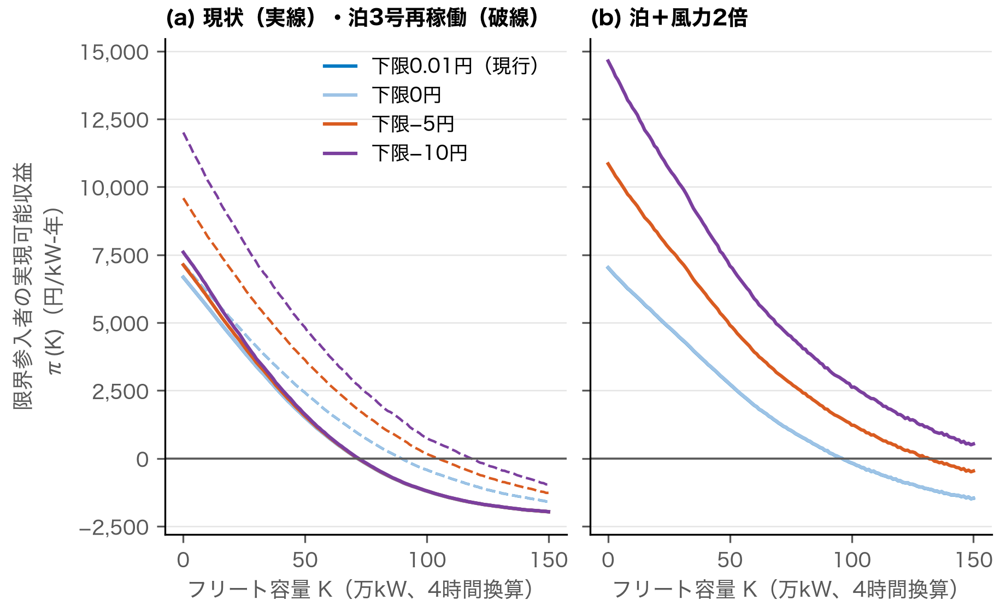

# 第9章　下限価格と負の価格

本章は、JEPX スポット市場の下限価格0.01円/kWh が蓄電池の価値と参入条件をどう歪めるか、また下限を負の価格に置き換えると裁定価値、参入に必要な価格水準、再エネ側の収入がどれだけ変わるかを問う（RQ6）。第7章は下限価格が充電側の値下がりを止めて裁定価値を削ることを、第8章は下限に張り付いた後の余剰が無補償の出力制御に現れることを示した。本章はこれらを一つの機構として読み直す。そのうえで、第7章の価格過程の上で下限の時間の価格を負の一定値に置く段差モデルを用い、限界参入者の収益曲線と損益分岐の価格水準係数 $\theta^*$ を求め直す。9.1節で方法、9.2節で下限価格の役割、9.3節で段差モデルの結果、9.4節で再エネ側からの移転、9.5節で価格による調整と数量による調整の比較を述べる。9.6節で結果の頑健性を確かめ、9.7節で小括する。

## 9.1　分析の方法

### 9.1.1　負の価格の段差モデル

第7章の価格過程（7.1.1項）は0.01円で打ち切られた価格から推定しているので、負の領域の供給曲線は識別できない。そこで、モデル価格が下限価格に張り付く時間（純需要が下限張り付きの閾値を下回る時間）の集合を $\mathcal{F}$ とし、その時間の価格だけを $-\delta$ 円/kWh に置く段差モデル（式(9.1)）を用いる。

$$p_t^{(\delta)}=p_t-(0.01+\delta)\,\mathbf{1}\{t\in\mathcal{F}\}$$

（式番号 9.1）

$p_t$ は第7章の感応度（7.5節・7.6節）と同じ水準係数付きの価格過程（式(4.3)）によるモデル価格で（仕様の使い分けは9.1.2項）、$t\in\mathcal{F}$ では0.01円である。負の価格の深さ $\delta$ は外生とし、0（下限の撤廃のみ）、5、10円に振る。蓄電池のフリートが $\mathcal{F}$ の時間に充電すると純需要が上がって価格は下限を離れるので、$\mathcal{F}$ はフリートの規模とともに縮む。第7章の下端の線形外挿（7.7節）で生じる負の価格は下端の傾きで決まる浅いもので、下限が削る価値の上限を与えないので、段差モデルは深さを外生に置く別の反実仮想として用いる（付録B.6.2）。

$\delta$ の目安は、余剰時に運転を続ける電源の支払意思である。抑制が無補償の FIT 電源は0円までしか耐えず、FIP 電源はプレミアム（基準価格と参照価格の差）まで、起動費のある火力・原子力はそれ以上の負値を提示しうる。ドイツの日前市場の負のスパイクは約−38ユーロ/MWh を閾値とする厚い裾をもつと推定されており（Fanone et al., 2013）、$\delta$=5〜10円（1ユーロ＝160円で約−30〜−60ユーロ/MWh）はこの閾値の近傍にあって、極端な負のスパイクは含めていない。

### 9.1.2　シナリオと損益分岐の直接解

シナリオは、現状（FY2023〜25 の気象・需要パス、$\theta=1$）、FY2026上期の価格水準（$\theta=1.57$）、泊3号機の再稼働、泊と風力2倍の4通りである（7.3節）。泊と風力2倍は、風力への条件付き応答と実績との差が標本内で有意でなくなるよう修正した仕様A′（7.2.2項。風力への応答はなお実績の約2倍）を主とし、単一曲線の仕様A を感応度とする。その他のシナリオは仕様A による。限界参入者の収益 $\pi(K)$（式(4.4)）は、第7章と同じ増分貪欲ディスパッチ（刻み1万kW。7.4節）の下で、各シナリオのモデル価格の上で戦略 c を直接計算し、現状・$K=0$ で実績の戦略 c に校正した実績整合ケースで測る（校正係数 $\lambda$ は仕様A で1.108、仕様A′ で1.0015）。

$-\delta$ は $\theta$ で伸縮させない。余剰時の支払意思は燃料価格の水準に依存しないと置くからである。このため粗収益は $\theta$ に比例せず、$\theta$ によらない正の部分をもつので、比例を前提とする第4章の閉じた式（式(4.8)）は、$\theta^*$ が1を超える局面で $\theta^*$ を過小に出す。そこで各 $\theta$ で戦略 c を計算し直し、$K=0$ のゼロレント条件

$$\lambda\,c_{\mathrm{model}}(0;\theta,\delta)-w_{\mathrm{chg}}+\kappa P_{\mathrm{cap}}=c_{\mathrm{req}}$$

（式番号 9.2）

を $\theta$ について直接解く（付録B.6.1）。$c_{\mathrm{model}}(0;\theta,\delta)$ は水準係数 $\theta$・深さ $\delta$ のモデル価格の上での戦略 c の粗利（$K=0$）、$c_{\mathrm{req}}$ は第4章の参入必要収益（式(4.6)）で、本章では WACC 6%・寿命20年で評価する（8.6節）。

モデルの下限張り付き時間は、現状で年115時間と、実績（FY2023〜25 の平均約203時間）の57%にとどまる。負の価格の効果は下限張り付き時間にほぼ比例するので、実績価格の下限の時間を使う場合、供給曲線の下端を線形外挿する場合、下限張り付き時間を実績に合わせて較正する場合の三つの感応度と仕様A による結果を、9.6節で示す。

### 9.1.3　再エネ側からの移転の計測

負の価格は、蓄電池への支払いであると同時に、余剰の時間に発電する再エネ事業者からの移転でもある。そこで実績から、下限張り付きの時間に発電し販売された太陽光・風力の電力量に $0.01+\delta$ 円を掛けた再エネ側の収入減と、出力制御量に $\delta$ 円を掛けた抑制の影の価格の価値を年度別に求めて比べる。抑制された電力量は販売されないので、収入減には含めない。いずれも実績の発電量と出力制御量を固定した静学の計算である。

## 9.2　下限価格の役割

蓄電池の側からみると、下限価格は充電価格を、潜在価格 $\tilde p_t$（下限がなければ成立する価格）と0.01円の大きいほうにする。

$$\max\{\tilde p_t,\,0.01\}=\tilde p_t+\max\{0.01-\tilde p_t,\,0\}$$

（式番号 9.3）

式(9.3)の右辺の第2項は行使価格0.01円のプットのペイオフであり、充電する蓄電池はこれを支払う側、すなわちプットの売り手にあたる（7.7節）。潜在価格が下限を下回る時間ほど、蓄電池は得られたはずの値下がりを失う。このため価格が一様に下がる局面では、下限での打ち切りは価値を削る。実績価格（FY2023〜25）を一様に8円/kWh 下げると、完全予見粗利は、0.01円で打ち切らなければ10,317円から12,067円/kW-年に上がるが、打ち切ると9,259円に下がる（表7.4）。

前章までの結果も、この機構でつながる。太陽光は昼の純需要を彫って裁定価値を作るが、その底は下限価格で止まる（5.7節）。風力とベースロードの追加は供給曲線の下端の急勾配と往復損失の水準効果を通じて裁定価値を増やしうるが（7.7節）、標本内で差が有意でなくなるよう修正した仕様A′ でも、風力を3倍にしても戦略 c の粗利はほとんど増えない（7.3節）。下限に張り付いた後の余剰は、価格ではなく無補償の出力制御という数量に現れ、北海道の風力の抑制電力量の7割強は下限張り付きの時間に生じている（8.5節）。

すなわち下限価格は、余剰時の価格発見を止め、余剰の配分を優先給電ルールという数量割当に置き換える制度である。下限より下にあるはずの吸収の価値はスポット価格に現れず、マーチャントの参入条件からも抜け落ちる。ただし、現状の余剰の量の下では、下限での打ち切りは第7章の $K^*=0$ の主因ではなく（9.3.1項）、この機構は余剰が増えるほど重みを増す。

## 9.3　段差モデルによる収益と損益分岐

### 9.3.1　余剰の量と収益曲線

下限価格のシナリオ別に、$K=0$ の収益 $\pi(0)$ と参入が開く $\theta^*$ を表9.1 に、限界参入者の収益曲線 $\pi(K)$ を図9.1 に示す。フリート容量50万・100万kW の収益と、下限0円と FY2026上期の水準の結果は表C.49 に示す。

: 表9.1　下限価格のシナリオ別の $\pi(0)$ と $\theta^*$

| シナリオ | 下限 | 負の価格の時間（時間/年） | $\pi(0)$ | $\theta^*$ |
|---|---|---:|---:|---:|
| 現状 | 0.01円（現行） | 0 | 6,675 | 2.99 |
|  | −5円 | 115 | 7,131 | 2.93 |
|  | −10円 | 115 | 7,596 | 2.88 |
| 泊3号再稼働 | 0.01円（現行） | 0 | 7,156 | 2.82 |
|  | −5円 | 762 | 9,587 | 2.55 |
|  | −10円 | 762 | 12,006 | 2.28 |
| 泊＋風力2倍（仕様A′） | 0.01円（現行） | 0 | 6,629 | 3.00 |
|  | −5円 | 1,537 | 10,006 | 2.60 |
|  | −10円 | 1,537 | 13,453 | 2.20 |

注）$\pi(0)$ はフリート容量が0のときの実績整合ケースの収益（円/kW-年）で、充電従量負担を控除した。負の価格の時間は、$K=0$ で価格を $-\delta$ に置く時間（モデルの下限張り付き時間）。$\theta=1$、FY2023〜25 パス、増分貪欲（刻み1万kW）。泊＋風力2倍は仕様A′（$\lambda=1.0015$）、現状と泊3号再稼働は水準係数付きの仕様A（$\lambda=1.108$）による。$\theta^*$ は、資本費6.8万円/kWh・実効容量収入1.25万円/kW-年・WACC 6% で式(9.2)を直接解いた値。仕様と下限張り付き時間の置き方を変えた結果は表9.3 に示す。

出所）日本卸電力取引所『スポット市場取引結果』、北海道電力ネットワーク『エリア需給実績』、電力広域的運営推進機関『容量市場メインオークション約定結果』より筆者作成。

{width=15cm}

注）段差モデル・仕様A・実績整合ケース（$\lambda=1.108$）。(a) は現状（実線）と泊3号再稼働（破線）、(b) は泊＋風力2倍である。(b) は表9.3 の仕様A の行にあたり、表9.1 の泊＋風力2倍（仕様A′）とは異なる。その他の条件は表9.1 と同じ。

出所）表9.1 と同じ。

結果は三つある。第一に、現状の余剰の量では効果は小さい。モデルの下限張り付き時間は年115時間であり、−10円でも $\pi(0)$ の増加は14%にとどまり、$\theta^*$ は2.99から2.88に下がるにすぎない。下限を0円にするだけでは何も変わらない（表C.49）。第二に、効果は余剰の量とともに拡大する。泊3号の再稼働で下限張り付き時間が年762時間になると、−10円で $\pi(0)$ は1.7倍になり、$\theta^*$ は2.82から2.28へ19%下がる。泊と風力2倍（仕様A′）では下限張り付き時間が1,537時間となり、−10円で $\theta^*$ は3.00から2.20へ27%下がる。第三に、カニバリゼーションによる収益の低下が比率でみて緩む。充電が支払いを受けるので、泊と風力2倍（仕様A′）・−10円では、現行の下限で負になる $K=100$ 万kW でも正の収益が残る（現行の下限の−86円に対し2,502円/kW-年。表C.49）。

これらは、下限が充電脚のプットの売りにあたること（式(9.3)）の裏返しである。下限を $-\delta$ に置き換えることはプットの行使価格を下げることにあたり、その効果は深さ $\delta$ にほぼ比例し、プットが行使される時間、すなわち下限張り付き時間が長いほど大きい。

### 9.3.2　参入条件との関係

現行の資本費と容量収入の下では、どのシナリオでも $\theta^*$ は1を超え、負の価格だけではマーチャントの参入は開かない。この結論は、仕様と下限張り付き時間の置き方を変えても変わらない（9.6節）。容量収入が上限近傍の2.5万円で続けば、泊＋風力2倍・−10円では、現行の資本費でも $\theta^*=0.69$（仕様A′。仕様A では0.57）となり、FY2023〜25 の価格水準（$\theta=1$）で参入が開く。資本費が揚水並みの2.3万円/kWh なら、容量収入1.25万円・−10円でも、$\theta^*$ は泊3号で0.52、泊＋風力2倍で0.31（仕様A′。仕様A では0.22）、現状で1.01 である。負の価格が参入を開くのは、資本費の低下か容量収入の上振れと組み合わさる場合であり、しかも動学的な参入閾値はこの静学の $\theta^*$ より高い（7.1.4項）。

負の価格は、損益分岐面（8.6節）を資本費・容量収入と同じ方向に動かす第三の政策レバーであり、その効きは将来の余剰の大きさで決まる。資源エネルギー庁（2026a）は、太陽光・風力が2026年度供給計画の見通しの約1.3倍まで導入される前提で、2035年度の北海道の出力制御率（無制限・無補償ルールの太陽光・風力の合計）を37%と見通す。これが実現すれば、効果は泊と風力2倍のシナリオに近いか、それを超えうるが、その余剰の量は価格過程の推定範囲の外にある。

## 9.4　出力制御の影の価格と再エネ側からの移転

表9.2 に、再エネ側の収入減と抑制の影の価格の価値を示す。

: 表9.2　下限張り付き時間の再エネ発電と出力制御の影の価格

| 年度 | 下限張り付き（時間） | 再エネ発電（GWh） | 収入減 $\delta$=5／10（億円） | 出力制御（GWh） | 影の価格の価値 $\delta$=5／10（億円） | 比 |
|---|---:|---:|---:|---:|---:|---:|
| FY2023 | 265 | 442.1 | 22.1／44.3 | 0.8 | 0.04／0.08 | 546倍 |
| FY2024 | 138 | 272.0 | 13.6／27.2 | 2.7 | 0.13／0.27 | 101倍 |
| FY2025 | 205 | 374.7 | 18.8／37.5 | 16.2 | 0.81／1.62 | 23倍 |
| FY2026（4〜6月） | 216 | 380.4 | 19.1／38.1 | 65.3 | 3.26／6.53 | 5.8倍 |

注）北海道の実績。再エネは太陽光と風力の合計。再エネ発電は下限張り付きの時間に販売された電力量で、抑制された電力量を含まない。比は収入減÷影の価格の価値で、$\delta$ にほぼ依存しない（抑制前の出力で測った比は9.6節、抑制時間は付録C.5.3）。FY2026 は4〜6月の3か月分。

出所）日本卸電力取引所『スポット市場取引結果』、北海道電力ネットワーク『エリア需給実績』より筆者作成。

FY2025 には、負の価格が−5円なら年19億円、−10円なら38億円が再エネ事業者から蓄電池と需要側に移るが、影の価格で測った抑制の価値は0.8〜1.6億円にすぎない。負の価格は、捨てられた電気に値段を付けるだけでなく、下限の時間に発電していたすべての再エネに支払いを求めるからである。移転額と抑制の価値の比は、抑制の増加とともに FY2023 の約550倍から FY2026 の4〜6月の約6倍に下がったが、それでも移転額は抑制の価値を大きく上回る（表9.2）。

FIT 電源の電気の多くは送配電事業者が買い取って市場に出すので、その分の負担は発電事業者ではなく賦課金を通じて需要家に帰着する。したがって負の価格の導入は、FIP 電源のプレミアムを負の価格の時間に停止する規則（ドイツの再生可能エネルギー法にある）や FIT 電源の扱いと一体で設計しなければ、再エネ側の収入と賦課金の負担を大きく動かす。

## 9.5　価格による調整と数量による調整

現行制度は余剰時の調整を優先給電ルールという数量割当で行っており、その見直し（FIT 電源を先に制御し、FIP に移行して蓄電池を併設した電源の抑制率を下げる）が進んでいる。資源エネルギー庁（2026a）の試算では、北海道の太陽光の2035年度の出力制御率は、従来の制御順の43%に対し、見直し後（FIP 比率25%）は FIP に移行しない FIT 太陽光で53%、FIP に移行し1kW あたり3kWh の蓄電池を併設した太陽光で3%となる。これは数量規制の側で併設蓄電池を誘導する設計であり、負の価格は同じ目的を価格で達成する設計である。

価格と数量のどちらで調整するかという問いには、Weitzman（1974）の価格と数量の比較という観点がある。Weitzman（1974）は、規制者が限界費用を確実には知らないとき、規制する量に対する限界便益の曲線の傾きが限界費用の曲線の傾きより緩やかなら価格による規制が、急なら数量による規制が期待厚生で勝ることを示した。ただし本研究は、この基準でどちらの調整が勝るかを判定しない。第一に、ここで規制される量は抑制量、裏返せば余剰の吸収量であり、その社会的な限界便益と限界費用の傾きを測るには厚生分析が要るが、本研究は厚生分析を扱わない（1.6節・7.5節）。本研究が測る $\pi(K)$ は、下限価格・無補償の出力制御・容量市場の下での私的な限界参入者の収益にとどまる[^c9-1]。第二に、負の価格の許容は、規制者が価格を固定することではなく市場に価格の発見を任せることであり、Weitzman（1974）のいう価格による規制とは異なる。本章は Weitzman（1974）を、二つの調整を対比する観点として参照するにとどめる。

[^c9-1]: 実績整合の現状で、$\pi(K)$ の $K=0$ から50万kW までの傾きは1万kW あたり約−100円/kW-年（$\pi(0)$ の約1.5%）で、$\pi(K)$ は約31万kW で半減する。泊＋風力2倍でも−78〜−86円（仕様A′・仕様A）である。蓄電池の資本費は世界市場で決まるので、北海道の導入規模では $K$ に対してほぼ水平と置ける。これらは蓄電池の容量 $K$ に対する私的な収益と費用の傾きであり、抑制量を規制する量とみた場合の社会的な限界便益・限界費用の傾きではない。

この観点に照らしたとき、負の価格の利点は、価格の発見と透明性にある。負の価格の下では、どの電源をどれだけ止めるかを行政が決める代わりに、支払意思の低い電源から順に止まり、蓄電池には吸収の価値が直接支払われる。透明性の面でも、出力制御の実績は事後に需給実績や月次の検証資料で把握するしかないのに対し、負の価格は30分ごとに公表される。

ただし負の価格には限界が二つある。第一に、負の価格が拾うのはエリア全体の余剰だけである。ローカル系統の混雑による制御は、現状では太陽光のノンファーム電源に限られて小さいが（各系統で最大0.25万kW、太陽光の抑制の1.5%以下。8.5.1項・付録C.4.2）、ゾーン価格には映らず、ノーダル価格か混雑管理の制度なしには解消しない。第二に、負の価格の深さは希少性ではなく補助制度で決まる。FIT の無補償ルールと FIP のプレミアムが残れば、負の価格はプレミアムの大きさを映すだけで、余剰の限界価値を示す指標にはならない。透明性の高い指標として働くのは、補助の設計と組み合わせた場合に限られる。

## 9.6　頑健性の確認

本節では、9.3節と9.4節の結果が、段差モデルの仕様、余剰の量の置き方、損益分岐の解き方、移転の計測の定義に依存しないかを確かめる。表9.3 に、泊と風力2倍のシナリオで仕様と下限張り付き時間の置き方を変えた結果と、現状で実績価格の下限の時間を負の価格に置いた結果を示す（その他の組合せは表C.49）。

: 表9.3　段差モデルの仕様と余剰の量の置き方への感応度

| シナリオ・扱い | 下限 | 負の価格の時間（時間/年） | $\pi(0)$ | $\theta^*$ |
|---|---|---:|---:|---:|
| 泊＋風力2倍・仕様A | 0.01円（現行） | 0 | 7,026 | 2.87 |
|  | −5円 | 1,478 | 10,851 | 2.43 |
|  | −10円 | 1,478 | 14,639 | 2.00 |
| 泊＋風力2倍・下端の線形外挿 | 0.01円（現行） | 0 | 6,027 | 3.23 |
|  | −10円 | 1,092 | 10,693 | 2.63 |
| 泊＋風力2倍・下限時間の較正 | 0.01円（現行） | 0 | 7,296 | 2.78 |
|  | −10円 | 2,103 | 16,251 | 1.79 |
| 現状・実績価格 | −5円 | 203 | 7,421 | 2.90 |
|  | −10円 | 203 | 8,166 | 2.81 |

注）$\pi(0)$ は円/kW-年。表9.1 と同じ条件で、仕様と下限張り付き時間の置き方だけを変えた。実績価格の行を除き、水準係数付きの仕様A（$\lambda=1.108$）による。仕様A の行は表9.1 と同じ段差モデル、下端の線形外挿の行は、供給曲線の下端を線形に延ばし、下限のない潜在価格が0.01円以下になる時間だけを $-\delta$ に置いたもの。下限時間の較正の行は、季節別の閾値で現状の下限張り付き時間を実績（約203時間/年）に合わせたもの。実績価格の行は、FY2023〜25 の実績価格の下限の時間（年平均203時間）をそのまま $-\delta$ に置いて戦略 c を直接計算した値で、$K=0$ だけを示す。

出所）表9.1 と同じ。

主な結論は変わらない。第一に、現状の効果が小さいという結論は、モデルの下限張り付き時間が実績を下回ることによるものではない。実績価格の下限の時間を−10円に置くと、$\pi(0)$ の増分はモデルの約1.6倍の+1,491円で、完全予見粗利の増分の96%を捕捉するが、$\theta^*$ は2.81 にとどまる。第二に、余剰の大きい局面で $\theta^*$ が下がる向きは、仕様と下端の置き方によらない。泊と風力2倍・−10円の $\theta^*$ の低下は、仕様A で30%、下端の線形外挿で19%、下限時間の較正で36%であり、主の仕様A′ の27%はこの19〜36%の幅の中にある。第三に、どの扱いでも $\theta^*$ は1を超え、最小でも下限時間を較正した泊＋風力2倍・−10円の1.79 であるので、負の価格だけではマーチャントの参入は開かない。導入容量の計上時期を補正しても $\theta^*$ はほとんど変わらない（付録C.5.2）。

損益分岐の解き方は低下の幅を左右する。比例の式（式(4.8)）で解くと $-\delta$ も $\theta$ とともに伸縮すると置くことになり、−10円では、仕様A の泊＋風力2倍で直接解の2.00 に対し1.54、泊3号で2.28 に対し1.83 と、低下を大きく見せる。本章が直接解を用いるのはこのためであるが（9.1.2項）、比例の式で解いても $\theta^*$ は1を超える。

再エネ側からの移転と抑制の価値の比較も、計測の定義に左右されない。収入減を抑制前の出力で測ると、抑制された電力量を収入減と影の価格の価値の両方に数えることになるが、その場合でも比は FY2025 で23.8倍、FY2026 の4〜6月で6.7倍であり、移転額が抑制の価値を大きく上回るという結論は変わらない（付録C.5.3）。

留保が二つある。第一に、余剰の量そのものが段差の仮定に依存する。泊のシナリオの下限張り付き時間の6〜7割は、推定範囲外の純需要で価格を0.01円とする仮定から生じる。第二に、現状・$K=0$ で推定した $\lambda$ を負の価格のシナリオに当てるのは仮定である。仕様A の泊＋風力2倍・−10円では校正後の粗利が完全予見粗利の0.97倍に達しており、余剰の大きいシナリオの $\theta^*$ は、参入に有利な側に偏っている可能性がある。この偏りがあれば、$\theta^*$ の低下の幅は過大に出ているが、負の価格だけでは参入が開かないという結論はむしろ強まる。

## 9.7　小括

本章の主要な結果は次の5点である。

1. 下限価格0.01円/kWh の下で、充電する蓄電池は行使価格0.01円のプットを売っている形になる。下限価格は裁定価値を削り、下限より下にあるはずの余剰の価値を無補償の出力制御という数量に置き換えて、スポット価格から隠す。
2. 負の価格の導入はこのプットの行使価格を下げることにあたり、効果は深さと下限張り付き時間とともに大きくなる。現在の余剰の量では効果は小さいが、泊と風力2倍・−10円の局面では、参入に必要な価格水準を27%（下端の置き方・仕様により19〜36%）下げる。
3. 現行の資本費と容量収入の下では、どのシナリオでも、また仕様と余剰の量の置き方を変えても $\theta^*$ は1を超え、負の価格だけではマーチャントの参入は開かない。負の価格は、資本費・容量収入と並ぶ第三の政策レバーである。
4. 再エネ側からの移転額は、抑制の増加とともに比が下がっているものの、抑制の影の価格の価値を大きく上回る。負の価格には、FIP のプレミアムの停止規則や FIT 電源の扱いと一体の設計が要る。
5. 負の価格の利点は、余剰の配分を行政による数量割当から価格の発見に移し、吸収の価値を公表される価格として示す透明性にある。ただし負の価格はエリア全体の余剰しか映さず、ローカル系統の混雑による抑制はゾーン価格に現れない。

仮説6は支持される。下限価格は充電脚のプットの売りとして裁定価値を削り、負の価格の効果は余剰の量に依存して、現在の余剰ではマーチャントの参入を単独で開かない。

RQ6 への答えは次のとおりである。下限価格は充電脚のプットの売りとして蓄電池の裁定価値を削り、余剰の価値を市場から隠しているが、負の価格が裁定価値と参入条件を動かす幅は将来の余剰の大きさで決まり、現在の余剰の量と現行の費用の下ではマーチャントの参入を単独で開くには足りない。次章では、第5章から本章までの結果を統合し、先行研究との関係、機構、外的妥当性と限界を考察する。
