```{=openxml}
<w:p><w:pPr><w:pStyle w:val="CoverLine"/><w:jc w:val="right"/></w:pPr><w:r><w:t xml:space="preserve">学籍番号　【要記入】</w:t></w:r></w:p>
```

::: {custom-style="Cover Line"}
\ 

\ 
:::

::: {custom-style="Cover Line"}
修士論文　【要確認】（様式にない表記。表紙に記載するか）
:::

::: {custom-style="Cover Line"}
\ 
:::

::: {custom-style="Cover Title"}
風力主導電力市場における蓄電池の価値形成と自由参入均衡
:::

::: {custom-style="Cover Line"}
－北海道の実証と下限価格・市場外収入の定量分析－
:::

::: {custom-style="Cover Line"}
\ 
:::

::: {custom-style="Cover Line"}
**Battery Storage Value and Free-Entry Equilibrium in a Wind-Dominated Electricity Market: Evidence from Hokkaido on the Price Floor and Out-of-Market Revenues**
:::

::: {custom-style="Cover Line"}
\ 

\ 
:::

::: {custom-style="Cover Line"}
一橋大学大学院 経営管理研究科 経営管理専攻\
修士課程 経営学修士コース 金融戦略・経営財務プログラム　【要確認】
:::

::: {custom-style="Cover Line"}
\ 
:::

::: {custom-style="Cover Line"}
松葉 大希
:::

::: {custom-style="Cover Line"}
指導教員　【要記入】（表紙に記載するか【要確認】）
:::

::: {custom-style="Cover Line"}
2028年1月　【要確認】（仮置きの提出年月。表紙に記載するか）
:::

〔SECTION-BREAK:cover〕

::: {custom-style="Front Heading"}
要旨
:::

再生可能エネルギーの増加は卸電力価格の変動性を高め、蓄電池の裁定価値を高めるという通説がある。しかし通説は、電源種と時間スケール（価格の水準・日内の形状・多日の変動）を区別していない。本研究は、風力主導の市場である北海道エリアを対象に、系統用蓄電池の自由参入均衡の容量はどこにあり、現実の参入との乖離は何によって、いくらで説明されるのかを問う。2016年4月から2026年6月までの需給実績と日本卸電力取引所のエリアプライスからなる時間単位のパネルを用いて、再生可能エネルギーの発電量が価格に与える効果を推定し、構造型の電力価格モデルの上で蓄電池の参入が価格を動かす効果を内生化して、限界参入者のゼロレント条件で均衡を判定する。その際、蓄電池の1日の裁定を日次のスプレッド・オプションの束として評価し、価格カーブを債券の期間構造と同じ方法で因子に分け、参入を実物オプションで判定し、契約を事業の内部収益率・調整現在価値・Cash-Flow-at-Risk で評価するという、ファイナンスの標準的な手法を用いる。

主要な結果は四つである。第一に、太陽光は不需要期を中心に日内の価格差を広げるが、風力は一日の価格をほぼ一様に引き下げ、日内の価格差を広げるという頑健な証拠はない。蓄電池は価格カーブの形状に対するロング・ポジションであり、風力の増加が価値を動かす頑健な証拠はない。第二に、限界参入者の収益は蓄電池の総容量の拡大とともに速く減衰し、スポット裁定と容量収入だけで運営する蓄電池（マーチャント）の均衡容量は、需給調整市場のレントを0と置く限りゼロである。このレントは、競争の下では調達量の程度の容量しか支えない。参入が採算に乗るには2023〜2025年度の2倍強から約3倍の価格水準が要り、燃料危機期の2022年度の実績価格でも必要な収入の82〜99%にとどまる。価格水準の不確実性を考えると、参入の閾値はさらに上がる。第三に、接続済みと契約申込を合わせた254万kW のうち市場外収入で説明できるのは、長期脱炭素電源オークションの落札分にあたる2〜3割にとどまる。同オークションは固定収入と市場収入を交換するレベニュースワップにあたり、同じ蓄電池でも落札すれば事業の内部収益率は負から正に転じるが、この差を生むスワップの価値のうちリスクの移転は約1割で、大半は容量拠出金を通じた需要家からの期待値の移転である。第四に、0.01円/kWh の下限価格は充電側のプットの売りとして裁定価値を削るが、これを負の価格に置き換える効果は現状の余剰の下では小さく、それだけでは参入は開かない。以上から、均衡を超える参入のうち市場外収入で説明できる部分を支えているのは、資産の収益性ではなく、主に契約が上乗せする期待収入である。導入の見通しや支援策の評価には、市場均衡との距離を kW と円で測る視点が要る。

**キーワード**：系統用蓄電池、風力発電、日本卸電力取引所、自由参入均衡、スプレッド・オプション、実物オプション、下限価格、北海道

**JEL 分類**：L94、Q41、Q42、G31、G13


```{=openxml}
<w:p><w:r><w:br w:type="page"/></w:r></w:p>
```


::: {custom-style="Front Heading"}
Abstract
:::

A common view holds that renewables make wholesale electricity prices more volatile, raising the arbitrage value of batteries, but it distinguishes neither generation technologies nor time scales. This thesis asks where the free-entry equilibrium capacity of grid-scale batteries lies in Hokkaido, a wind-dominated market in Japan, and what explains the gap between it and actual entry. Using hourly Japan Electric Power Exchange area prices and supply–demand records for April 2016–June 2026, it estimates the price effects of wind and solar and finds the equilibrium from the marginal entrant's zero-rent condition in a structural price model with an endogenous battery fleet. Finance tools are used throughout: spread options for daily arbitrage, term-structure factors for the 24-hour price curve, real options for entry, and the project internal rate of return (IRR), adjusted present value and Cash-Flow-at-Risk for contracts.

Four results stand out. First, solar widens intraday spreads, mainly in low-demand months, whereas wind lowers prices almost uniformly. Because a battery is long the shape of the price curve, there is no robust evidence that more wind changes its value; any effect is small. Second, the marginal entrant's revenue decays quickly as the fleet grows. Counting spot arbitrage and capacity payments only, with balancing-market rents set to zero, merchant batteries have zero equilibrium capacity: entry requires price levels just over two to about three times those of fiscal 2023–2025, and even fiscal 2022 actual prices cover only 82–99% of the required revenue. Third, of the 2.54 GW connected or applying for connection, out-of-market revenues explain only the 20–30% of this capacity that was awarded in the Long-Term Decarbonization Auction. The auction is a revenue swap: winning it turns a battery's IRR from negative to positive, but risk transfer is only about one-tenth of the swap value. The rest is an expected-value transfer from consumers, so this entry rests on the expected revenue that contracts add rather than on the profitability of the asset. Fourth, the 0.01 yen/kWh price floor acts as a short put on the charging leg, but replacing it with negative prices would not by itself open entry.

**Keywords**: grid-scale battery storage, wind power, JEPX, free-entry equilibrium, spread option, real option, price floor, Hokkaido

**JEL codes**: L94, Q41, Q42, G31, G13


```{=openxml}
<w:p><w:r><w:br w:type="page"/></w:r></w:p>
```


::: {custom-style="Front Heading"}
目次
:::

```{=openxml}
<w:p><w:r><w:fldChar w:fldCharType="begin" w:dirty="true"/></w:r><w:r><w:instrText xml:space="preserve"> TOC \o "1-3" \h \z \u </w:instrText></w:r><w:r><w:fldChar w:fldCharType="separate"/></w:r><w:r><w:t>（Word で開いたときに更新されます）</w:t></w:r><w:r><w:fldChar w:fldCharType="end"/></w:r></w:p>
```

```{=openxml}
<w:p><w:r><w:br w:type="page"/></w:r></w:p>
```

::: {custom-style="Front Heading"}
図目次
:::

```{=openxml}
<w:p><w:r><w:fldChar w:fldCharType="begin" w:dirty="true"/></w:r><w:r><w:instrText xml:space="preserve"> TOC \h \z \t "Image Caption,1" </w:instrText></w:r><w:r><w:fldChar w:fldCharType="separate"/></w:r><w:r><w:t>（Word で開いたときに更新されます）</w:t></w:r><w:r><w:fldChar w:fldCharType="end"/></w:r></w:p>
```

```{=openxml}
<w:p><w:r><w:br w:type="page"/></w:r></w:p>
```

::: {custom-style="Front Heading"}
表目次
:::

```{=openxml}
<w:p><w:r><w:fldChar w:fldCharType="begin" w:dirty="true"/></w:r><w:r><w:instrText xml:space="preserve"> TOC \h \z \t "Table Caption,1" </w:instrText></w:r><w:r><w:fldChar w:fldCharType="separate"/></w:r><w:r><w:t>（Word で開いたときに更新されます）</w:t></w:r><w:r><w:fldChar w:fldCharType="end"/></w:r></w:p>
```

```{=openxml}
<w:p><w:r><w:br w:type="page"/></w:r></w:p>
```

::: {custom-style="Front Heading"}
略語一覧
:::

本文と付録で用いる略語を、アルファベット順に示す。略語は本文の初出でも正式名称とともに示す。

| 略語 | 意味 | 原語 |
|---|---|---|
| ADF 検定 | 拡張ディッキー–フラー検定（単位根の検定） | augmented Dickey–Fuller test |
| AFC | 年間固定費（資本費の年額と運転維持費などの合計） | annual fixed cost |
| APV | 調整現在価値 | adjusted present value |
| AR(1) | 1次の自己回帰過程 | first-order autoregressive process |
| CAISO | カリフォルニア独立系統運用機関（カリフォルニア州の卸電力市場） | California Independent System Operator |
| CAPM | 資本資産価格モデル | capital asset pricing model |
| CFaR | 年間のキャッシュフローの下方リスクの尺度 | Cash-Flow-at-Risk |
| CfD | 差金決済契約 | contract for difference |
| CONE | 新規参入電源の費用。Gross CONE はガス火力を新設する場合の年間固定費、Net CONE はそこから他市場の収益を差し引いた容量市場の指標価格 | cost of new entry |
| CRF | 資本回収係数 | capital recovery factor |
| DL1・DL3・DL5 | 1・3・5個の因子による Diebold–Li 型の動的因子予測 | — |
| DM 検定 | Diebold–Mariano の予測精度の比較の検定 | Diebold–Mariano test |
| EEX | 欧州エネルギー取引所 | European Energy Exchange |
| EPC | 設計・調達・建設 | engineering, procurement and construction |
| EPRX | 電力需給調整力取引所（需給調整市場の運営者） | Electric Power Reserve eXchange |
| ERCOT | テキサス電力信頼度協議会（テキサス州の卸電力市場） | Electric Reliability Council of Texas |
| ES | 期待ショートフォール | expected shortfall |
| EWC | 等重み余弦による、系列相関に頑健な推論の方法 | equal-weighted cosine |
| FE | 固定効果 | fixed effects |
| FGLS | 実行可能な一般化最小二乗法 | feasible generalized least squares |
| FIP | フィードインプレミアム制度 | feed-in premium |
| FIT | 固定価格買取制度 | feed-in tariff |
| FY | 年度（4月〜翌年3月） | fiscal year |
| GARCH | 一般化自己回帰条件付き分散不均一モデル。GARCH-M は条件付き分散を平均の式に含む型、eGARCH は指数型、GARCH-X は外生変数を含む型 | generalized autoregressive conditional heteroskedasticity |
| HAC | 不均一分散と自己相関に頑健な（標準誤差） | heteroskedasticity and autocorrelation consistent |
| HAR | 異質的自己回帰モデル（Corsi, 2009）。帯域分解の発想の比較にだけ用い、推論法の HAR（自己相関に頑健な推論）とは別である | heterogeneous autoregressive model |
| HC3 | 不均一分散だけに頑健な HC3 型の標準誤差 | heteroskedasticity-consistent standard error, type 3 |
| HE | ヘッジ有効性 | hedge effectiveness |
| IQR | 分位点の幅。本論文では条件付き分布の0.9分位と0.1分位の差 | interquantile range |
| IRR | 内部収益率。事業 IRR は無レバレッジ・税前・実質・20年 | internal rate of return |
| JEPX | 日本卸電力取引所 | Japan Electric Power Exchange |
| JPX | 日本取引所グループ | Japan Exchange Group |
| JWPA | 日本風力発電協会 | Japan Wind Power Association |
| KPSS 検定 | Kwiatkowski–Phillips–Schmidt–Shin の定常性の検定 | KPSS test |
| LCOE | 均等化発電原価 | levelized cost of electricity |
| LDES | 長期間エネルギー貯蔵 | long-duration energy storage |
| LNG | 液化天然ガス | liquefied natural gas |
| LTDA | 長期脱炭素電源オークション | long-term decarbonization auction |
| MA | 中心化移動平均（第5章の帯域分解） | moving average |
| MM 命題 | Modigliani–Miller の命題 | Modigliani–Miller theorem |
| MOE | メリットオーダー効果 | merit-order effect |
| NEM | 豪州の全国電力市場 | National Electricity Market |
| NPV | 正味現在価値 | net present value |
| OCCTO | 電力広域的運営推進機関 | Organization for Cross-regional Coordination of Transmission Operators |
| PCS | パワーコンディショナー | power conditioning system |
| PJM | PJM インターコネクション（米国東部の卸電力市場） | PJM Interconnection |
| PPA | 電力購入契約（発電事業者と需要家などの長期の電力の売買契約） | power purchase agreement |
| reverse DCF | 必要な収入から含意の価格水準を逆算する割引キャッシュフローの考え方 | reverse discounted cash flow |
| RQ | 研究課題。主RQ と RQ1〜RQ6（第1章） | research question |
| SCUC・SCED | 安全制約付きの起動停止計画・経済負荷配分（同時市場の約定方式） | security-constrained unit commitment / economic dispatch |
| SII | 環境共創イニシアチブ（系統用蓄電池の導入支援事業の執行団体） | Sustainable open Innovation Initiative |
| SPA 検定 | 優越予測力の検定（Hansen, 2005） | superior predictive ability test |
| TB4h | 日内で価格の高い4時間の平均と低い4時間の平均の差（円/kWh） | top–bottom 4-hour spread |
| WACC | 加重平均資本コスト | weighted average cost of capital |
| cf | 設備利用率（制御前出力÷導入量） | capacity factor |
| ΔkW | 需給調整市場で取引する調整力の容量 | — |
| 再エネ | 再生可能エネルギー。本論文では主に変動性の再生可能エネルギー（太陽光と風力）を指す | variable renewable energy |

```{=openxml}
<w:p><w:r><w:br w:type="page"/></w:r></w:p>
```

::: {custom-style="Front Heading"}
記号一覧
:::

本文で用いる主な記号を、分野ごとに示す。スカラーはイタリック、複数の文字からなる変数名と添字は立体で表す。金額の単位は、断りのない限り出力1kWあたりの年額（円/kW-年）である。付録だけで用いる記号は、各付録の中で定義する。

**価格と蓄電池の粗利**

| 記号 | 意味 | 単位・主な値 | 定義 |
|---|---|---|---|
| $p_{t,h}$ | 日 $t$・時刻 $h$ のエリアプライス | 円/kWh | 式(4.1) |
| $p_t$ | 時間 $t$ のエリアプライス（モデル価格を含む） | 円/kWh | 式(4.3) |
| $\tilde p_t$ | 潜在価格（下限価格で打ち切る前の価格） | 円/kWh | 7.1.2項、式(9.3) |
| $\eta$ | 往復効率（放電側にまとめて適用）。$1/\eta\approx1.18$ はヒートレートにあたる | 0.85 | 式(4.1) |
| $D$, $C$ | 放電する4時間・充電する4時間の集合 | — | 式(4.1) |
| $(D_c, C_c)$ | 戦略 c が前日に固定する放電・充電の窓 | — | 式(6.2) |
| $X_t(D,C)$ | 日 $t$ の裁定の粗利 | 円/kW-日 | 式(4.1) |
| $\pi_{\mathrm{PF}}$ | 完全予見粗利（添字 PF は perfect foresight の略で、記号の中だけで用いる） | 円/kW-年 | 式(4.2) |
| $\pi_{\mathrm{PF}}(K)$ | フリート容量 $K$ の投入後のモデル価格の上での完全予見粗利 | 円/kW-年 | 4.2.1項 |
| $T$, $B$, $m$ | 日内の上位4時間の平均価格、下位4時間の平均価格、日平均価格 | 円/kWh | 式(6.1) |
| $u_d$ | 日 $d$ に全時刻へ同じ額を加える価格の変化 | 円/kWh | 6.4.2項の脚注 |
| $\Delta p$ | 実績価格の一様な引下げ幅 | 円/kWh | 7.7節 |
| $T_R$, $T_{\mathrm{max}}$ | モデル信頼集合（Hansen et al., 2011）の範囲統計量と最大統計量 | — | 6.7節 |
| $\phi$ | AR(1) の持続性の係数。第6章では価格カーブの因子に、付録B では価格水準の対数に当てる | — | 6.7節 |
| $(x)^{+}$ | $\max\{x,0\}$ | — | 式(4.2) |

**価格の実証（第5章）**

| 記号 | 意味 | 単位・主な値 | 定義 |
|---|---|---|---|
| $y_d$ | 日 $d$ の被説明変数（日平均価格、TB4h、日内標準偏差） | 円/kWh | 式(5.2) |
| $\mathrm{Solar}_d$, $\mathrm{Wind}_d$, $\mathrm{Demand}_d$ | 日 $d$ の制御前の太陽光・風力の発電量と需要 | GWh/日 | 式(5.2) |
| $\beta^{\mathrm{solar}}_{s}$, $\beta^{\mathrm{wind}}_{s}$ | 季節 $s$ の太陽光・風力の係数 | 円/kWh per GWh/日 | 式(5.2) |
| $\gamma$ | 需要の係数 | 円/kWh per GWh/日 | 式(5.2) |
| $\alpha_{\mathrm{FY}}$, $\alpha_s$ | 年度固定効果、季節固定効果 | — | 式(5.2) |
| $\varepsilon_d$ | 誤差項 | — | 式(5.2) |
| $s$, $s_d$ | 季節、日 $d$ の季節 | 夏・冬・不需要期 | 式(5.2) |
| $\mathbf{1}\{\cdot\}$ | 指示関数 | — | 式(5.2) |
| $\nu$ | EWC の自由度（余弦の本数） | 94（FY2016〜25）、42（FY2023〜25） | 5.1.2項 |
| $x$, $\mathrm{MA}_{6}$, $\mathrm{MA}_{24}$, $\mathrm{MA}_{168}$ | 設備利用率の系列と、6・24・168時間の中心化移動平均 | — | 式(5.1) |
| $p_d$, $\bar p_d$ | 日 $d$ の24時間の価格ベクトルと、その年度×季節×時刻の平均 | 円/kWh | 式(5.3) |
| $v_k$, $f_{k,d}$ | 第 $k$ 主成分の負荷と、日 $d$ の因子スコア | — | 式(5.3) |
| $b$ | 24時刻の時刻別係数のベクトル | 円/kWh per GWh/日 | 5.1.5項 |

**価格モデルとフリート（第4章・第7章）**

| 記号 | 意味 | 単位・主な値 | 定義 |
|---|---|---|---|
| $\mathrm{net}_t$ | 純需要（需要−制御前の太陽光−制御前の風力−原子力） | — | 式(4.3) |
| $g(\mathrm{net}_t;\mathrm{season})$ | 季節別の局所供給曲線。季節は気象学的な4区分（凡例） | 円/kWh | 式(4.3) |
| $\mu(\mathrm{season},\mathrm{hour})$ | 季節×時刻のプレミアム（仕様A′ では日次の風力発電量の三分位にも依存させる） | 円/kWh | 式(4.3)、7.1.1項 |
| $\theta_{\mathrm{FY}}$, $\theta$, $\theta_t$ | 価格水準係数（下限価格より上の価格を同じ比率で伸縮させる乗法的な水準因子）。$\theta_t$ は年 $t$ の値 | FY2023〜25 の時間加重平均＝1 | 式(4.3)、式(7.2) |
| $K$, $K_t$ | フリート容量（エリアの系統用蓄電池の総容量）。$K_t$ は年 $t$ の値 | 万kW（4時間換算） | 4.2.4項、式(7.2) |
| $K^*$ | 自由参入の均衡容量（$K_{\mathrm{exo}}$ を含む総容量） | 万kW | 4.2.5項 |
| $K_{\mathrm{exo}}$ | 外生に置く契約型の容量 | 主は0 | 4.2.5項 |
| $c_{\mathrm{model}}(K)$ | フリート容量 $K$ の投入後のモデル価格の上で戦略 c が得る粗利 | $K=0$・$\theta=1$ で7,602円/kW-年 | 4.2.4項 |
| $\lambda$ | 実績整合ケースの校正係数（実績の戦略 c÷モデル価格の上の戦略 c） | 仕様A で1.108、仕様A′ で1.0015 | 4.2.4項 |
| $w_{\mathrm{chg}}$ | 充電側の託送従量負担 | 1,752円/kW-年 | 4.2.4項 |
| $\pi(K)$ | 限界参入者の実現可能収益（実績整合ケース） | $\pi(0)=6{,}675$ 円/kW-年 | 式(4.4) |
| $a$, $a(K)$ | 限界参入者の粗収益 $\lambda\,c_{\mathrm{model}}(K)$。$a=a(0)$ | $a=8{,}427$ 円/kW-年 | 7.1.4項、式(4.8) |
| $Q$ | 北海道の需給調整市場の調達量 | 万kW | 7.6節 |
| $p_{\Delta}$ | 需給調整市場の ΔkW 価格 | 円/ΔkW・30分 | 7.6節 |

**費用と均衡条件（第4章・第7章・第8章）**

| 記号 | 意味 | 単位・主な値 | 定義 |
|---|---|---|---|
| $P_{\mathrm{cap}}$ | 容量市場の約定価格 | 2029年度向け北海道で14,972円/kW | 4.2.5項 |
| $\kappa$, $\kappa(h)$ | 容量市場の調整係数（設備容量から期待容量への換算）。$\kappa(h)$ は放電の持続時間 $h$ 時間の蓄電池の値 | 北海道・4時間で0.836 | 4.2.5項、第6章 |
| $\kappa P_{\mathrm{cap}}$ | 実効容量収入 | 12,517円/kW-年（損益分岐の計算では1.25万円） | 式(4.5) |
| $c_{\mathrm{req}}$ | 参入必要収益 | $r=6\%$ で3.59万円/kW-年 | 式(4.6) |
| $c_{\mathrm{fix}}$ | 年々の固定費（運転維持・廃止と託送等の固定費） | 1.22万円/kW-年 | 式(4.6) |
| $I$ | 4時間分の資本費 | 27.2万円/kW（6.8万円/kWh×4） | 式(4.6) |
| $r$ | 割引率（加重平均資本コスト） | 主は6% | 式(4.6) |
| $\mathrm{CRF}(r,20)$ | 割引率 $r$・寿命20年の資本回収係数 $r/[1-(1+r)^{-20}]$ | — | 式(4.6) |
| $\theta^*$ | $K=0$ で限界参入者の NPV を0にする損益分岐の価格水準係数 | WACC 6% で2.99 | 式(4.8) |
| $F$ | 純固定費 $c_{\mathrm{fix}}+w_{\mathrm{chg}}-\kappa P_{\mathrm{cap}}$ | 1,452円/kW-年 | 7.1.4項 |
| $\mathrm{CF}_t$ | 年 $t$ のキャッシュフロー | 円/kW-年 | 式(7.2) |
| $\pi_{\mathrm{spot}}$, $\pi_{\mathrm{spot}}'$ | エリア価格でのスポット裁定の収益（系統用、併設） | 円/kW-年 | 8.1.2項 |
| $\pi_{\mathrm{local}}$ | 併設蓄電池の抑制回避の価値（系統から充電する場合に比べた増分） | 円/kW-年 | 8.1.2項 |
| $c_{\mathrm{req}}^{\mathrm{co}}$ | 併設蓄電池の参入必要収益 | 円/kW-年 | 8.1.2項 |

**不確実性と参入閾値（第7章）**

| 記号 | 意味 | 単位・主な値 | 定義 |
|---|---|---|---|
| $\xi$, $\chi$ | 価格水準の恒久成分（ランダムウォーク）と一時成分（AR(1)） | 恒久成分の推定値は1.22（2026年6月） | 7.1.5項 |
| $\sigma_\xi$ | 恒久成分の革新の標準偏差（年率のボラティリティ） | 推定値は全期間で0.30 | 7.8.1項 |
| $\sigma$ | 参入閾値と接続枠の待機価値の計算で $\sigma_\xi$ に与える値 | 0.10〜0.30 | 7.8.1項、8.4.2項 |
| $\alpha$ | 価格水準の恒久成分の期待成長率 | 主は0 | 7.1.5項 |
| $\bar\theta$ | 排他的な参入の権利を持つ単独企業の最適行使閾値 | — | 7.1.5項 |
| $\theta_c$ | 自由参入の競争均衡の参入閾値 | $\sigma$=0.10〜0.30・資本費一定で静学の $\theta^*$ の1.17〜1.59倍 | 7.1.5項 |
| $g_I$ | 資本費の年率の低下率 | 0〜8% | 7.1.5項 |
| $E[K]_{2040}$ | 2040年度のフリート容量の期待値 | 万kW | 7.8.3項 |
| $W_0$ | 接続枠（契約申込）の待機価値 | 円/kW | 8.4.2項 |

**契約とリスクの評価（第8章）**

| 記号 | 意味 | 単位・主な値 | 定義 |
|---|---|---|---|
| $r_A^M$, $r_C$ | マーチャントの資産の資本コスト、契約型の資本コスト | $r_A^M$ は8〜9%（APV では9%）、$r_C$ は4〜6%（APV では5%） | 8.1.3項 |
| $q$, $z$ | LTDA の固定収入、LTDA の落札者が手放す収入（他市場収益の約9割と容量収入） | 円/kW-年 | 式(8.1) |
| $\mathrm{PV}(x;r)$ | キャッシュフロー $x$ の割引率 $r$ での現在価値 | 円/kW | 式(8.1) |
| $V^{\mathrm{swap}}$ | レベニュースワップとしての LTDA の価値 | 円/kW | 式(8.1) |
| $\Lambda$ | リスクの価格（市場ポートフォリオのシャープ・レシオと市場収益率との相関の積） | 0.06〜0.4 | 8.1.3項 |
| $R$, $R_{\mathrm{ref}}$ | マーチャント4時間蓄電池の年間市場収入、その基準値 | $R_{\mathrm{ref}}=19{,}192$ 円/kW-年 | 式(8.2)、8.7.5項 |
| $S$, $\omega$, $L$ | CFaR の因子：年度単位の形状、日々の天候、容量価格の約定水準 | — | 式(8.2) |
| $G$ | 北海道の月間の完全予見粗利 | 円/kW-月 | 式(8.3) |
| $P^{\mathrm{fut}}$ | 東京エリアの月平均価格（上場先物の最終決済価格の代理） | 円/kWh | 式(8.3) |
| $h^{*}$ | 最小分散ヘッジ比率 | — | 式(8.3) |
| $\mathrm{HE}$ | ヘッジ有効性 | — | 式(8.3) |

**下限価格と負の価格（第9章）**

| 記号 | 意味 | 単位・主な値 | 定義 |
|---|---|---|---|
| $\mathcal{F}$ | モデル価格が下限価格0.01円/kWh に張り付く時間の集合 | — | 式(9.1) |
| $\delta$ | 負の価格の深さ（下限張り付きの時間の価格を $-\delta$ に置く） | 0・5・10円/kWh | 式(9.1) |
| $p_t^{(\delta)}$ | 段差モデルの価格 | 円/kWh | 式(9.1) |
| $c_{\mathrm{model}}(0;\theta,\delta)$ | 水準係数 $\theta$・深さ $\delta$ のモデル価格の上で戦略 c が得る粗利（$K=0$） | 円/kW-年 | 式(9.2) |

注）添字 $t$ は、式(4.1)・(4.2)・(6.2)では日、式(4.3)・(9.1)・(9.3)では時間、式(4.7)・(7.2)では年を表す。第5章では日を $d$ で表す。添字 $h$ は時刻を表し、$\kappa(h)$ に限って放電の持続時間を表す。$h^{*}$ は最小分散ヘッジ比率であり、時刻の $h$ とは別の記号である。戦略 a・b・c の a・b・c は戦略の名前（立体）であり、粗収益の $a$ とは別である。凡例の D（受渡日）も、放電する時間の集合 $D$ とは別である。$\theta_m$ などの添字 $m$ は月を表し、日平均価格の $m$ とは別である。

```{=openxml}
<w:p><w:r><w:br w:type="page"/></w:r></w:p>
```

::: {custom-style="Front Heading"}
凡例
:::

**単位**　価格は円/kWh、日次の裁定の粗利は円/kW-日、年間の収益と費用は出力1kWあたりの年額（円/kW-年）で表す。資本費は蓄電容量1kWhあたり（万円/kWh）か出力1kWあたり（万円/kW）で示す。容量は万kW で表し、蓄電池のフリート容量は4時間の蓄電池に換算した値とする。日次の発電量と需要は GWh/日 で表す。

**年度**　年度は4月から翌年3月までとし、FY2016 のように表す。FY2023〜25 は2023〜2025年度を指し、分析の中心とする FY2023〜25 の価格構造を「現行の構造」と呼ぶ。容量市場と需給調整市場の受渡の年度は「2029年度向け」のように書く。

**季節と時間帯**　第5章・第6章の報告用の季節区分は、夏（7〜9月）、冬（12〜2月）、不需要期（3〜6月と10〜11月）の3区分である。不需要期を暦月の春（3〜6月）と秋（10〜11月）に分けて示す場合がある。第7章の価格モデルの季節は、これとは別の気象学的な4区分（12〜2月、3〜5月、6〜8月、9〜11月）である。時刻は0〜23時の60分値で、30分値は2コマの平均をとる。時間帯は、昼を11〜13時、夕方を17〜19時、夜を0〜5時とする。D は受渡日を、D−1・D−2 はその前日・前々日を表す。

**データの期間と基準日**　需給実績と価格の時間パネルは、2016年4月1日から2026年6月30日まで（九州は2026年7月26日まで）である。制度、市場の約定結果、蓄電池の導入状況などの公表情報は、2026年9月末時点で固定する。それ以後に公表された情報は、主分析の前提に含めない。

**数値と記号**　負号は「−」、範囲は「〜」で表し、数字は3桁ごとにカンマで区切る。回帰表の \*\*\*、\*\*、\* は、それぞれ1%、5%、10%水準で有意であることを示し、† は、ふるいブートストラップで補正した p 値で有意水準が1段以上下がる係数を示す。図・表・式の番号は章ごとに付け、付録では表A.1・式(B.1)のように付ける。文献の引用は APA 第7版の著者・年方式による。

**主な用語**

| 用語 | 意味 |
|---|---|
| マーチャント | 長期の固定収入契約や補助金に頼らず、スポット市場や容量市場などの市場収入だけで運営する蓄電池。均衡の判定（第7章）では、スポット裁定と容量収入だけを見込み、需給調整市場のレントを0と置く |
| 契約型 | LTDA や補助金などの契約で収入を固定する蓄電池 |
| フリート | エリアの系統用蓄電池の全体。その総容量を $K$ で表す |
| 限界参入者 | フリート容量 $K$ の投入後の価格の上で、新たに参入を検討する価格テイカー |
| 完全予見粗利 | 当日の実現価格を知って最安の4時間に充電し最高の4時間に放電し、粗利が負の日は休止したときの年間の裁定粗利。前日スポット市場・1日1サイクルの設定での上界 |
| 実行可能戦略 | 先読みのない取引戦略。戦略 a は前日の実現価格の順位、戦略 b は D−2 までの実績から予測した残余需要の順位、戦略 c は過去28日・同じ曜日区分の平均価格カーブの順位を使う |
| 本源的方策 | 戦略 c のように、平均価格カーブに対して前日に充放電の窓を固定する方策 |
| 実現率（capture rate） | 実行可能戦略の実現粗利の、完全予見粗利に対する比率 |
| 実績整合ケース | モデル価格の上で戦略 c を動かした粗利を、$K=0$・$\theta=1$ で実績の戦略 c に一致させ、充電従量負担を差し引いた限界参入者の収益の基準 |
| モデル直値 | 校正係数を $\lambda=1$ とした値 |
| 仕様A・仕様A′ | 仕様A は純需要の供給曲線と季節×時刻のプレミアムだけからなる単一曲線の価格モデル。仕様A′ はプレミアムを日次の風力発電量の三分位にも依存させた修正版 |
| 下限価格・下限張り付き | 下限価格は JEPX スポットの約定価格の下限（0.01円/kWh）。下限張り付きは約定価格が下限価格に張り付いた時間・コマ |
| 負の価格 | 下限価格を0.01円/kWh より低い水準に置き換える反実仮想の価格 |
| 実効容量収入 | 容量市場の約定価格に調整係数を掛けた、蓄電池1kW あたりの容量収入 |
| 参入必要収益 | 資本費の等価年額に年々の固定費を加えた、参入に必要な年間収益 |

〔SECTION-BREAK:front〕

# 第1章　序論

本章は、本研究が取り組む問題の背景と研究課題を示す。まず、系統用蓄電池への参入をめぐる通説と北海道エリアで観察される参入の謎を述べ（1.1節）、研究課題を定めて（1.2節）、分析の方法を概観する（1.3節）。続いて主要な結果を予告し（1.4節）、貢献を述べ（1.5節）、分析の範囲と前提を確認して（1.6節）、本論文の構成を示す（1.7節）。

## 1.1　研究の背景と問題意識

### 1.1.1　系統用蓄電池への参入と通説

脱炭素化に向けて変動性の再生可能エネルギー（以下、再エネ）の導入が進むにつれ、電力の需給を時間の間で調整する柔軟性の価値が注目されている。その担い手として期待されるのが、送配電網に直接接続し、卸電力市場などで充放電する系統用蓄電池である。国内の系統用蓄電池の契約申込は、資源エネルギー庁（2025a）によれば2024年9月末に約620万kWであったが、2025年12月には約2,869万kWと1年余りで4倍以上に増え、接続検討の申込は1億7,000万kWを超えた（3.5.2項）。

この参入の背後には、再エネの増加が卸電力価格の変動性を高め、それが蓄電池の裁定価値を高めるという通説がある。しかし先行研究は、再エネと価格の変動性の関係の符号が、市場や電源種によって異なることを報告している（Rintamäki et al., 2017; Schöniger & Morawetz, 2022）。昼に集中して発電する太陽光は日内の価格差を広げうるが、風力には決まった日内の位相がなく、その変動の多くは1日を超える周期の気象の変化による。通説は、電源種の違いも、価格の水準・日内の形状・多日の変動という時間スケールの違いも区別していない。さらに、蓄電池の参入そのものが価格差を縮め、後から参入する蓄電池の収益を削る（Butters et al., 2025）。蓄電池の価値は、再エネの量だけでなく、蓄電池自身の量と市場の制度にも依存するはずである。

本研究の実務上の動機は、筆者がプライベート・エクイティ・ファンドの投資担当として、太陽光発電と蓄電池の EPC（設計・調達・建設）事業への投資を検討した経験にある。蓄電池の主要な収益源とされる日本卸電力取引所（JEPX）のスポット市場での裁定収益を、公表された価格の実績から計算すると、資本費を回収するには明らかに薄かった。それでも事業者は参入を続け、案件のパイプラインは膨らみ続けていた。市場は何を織り込んでいるのか。この問いは、投資判断の実務にとって切実であると同時に、電力市場の均衡という経済学の問題であり、資産と契約の評価というファイナンスの問題でもある。

### 1.1.2　風力主導市場としての北海道

本研究は、この問いを北海道エリアで検証する。北海道は風力の導入量が都道府県別で全国最大（2024年末で約130万kW、直近2年で倍増。エリア別では東北に次ぐ）で、風力の電力量シェアは実測で10%を超え、洋上風力の促進区域が5海域控える、風力主導の市場である。本州とは北本連系線でのみつながり、その容量は小さい。一方で、系統用蓄電池の契約申込は2025年12月末にエリアの最大需要の約35%に達し、太陽光の導入が先行した九州（約37.5%）に近い（3.5.2項）。北海道は、風力と蓄電池と連系線の制約が最も鋭く交錯する市場であり、太陽光主導の市場で得られた知見がそのまま当てはまる保証はない。本研究は、太陽光の浸透が最も進んだ九州エリアを比較の対象に用いる。

### 1.1.3　観察された謎

北海道エリアで系統に接続済みの系統用蓄電池は、2026年5月末時点で約20万kWである[^c1-1]。これに対し、契約申込は約234万kW、接続検討は約823万kWに達する（北海道電力ネットワーク，2026。3.5.2項）。ところが本研究の分析（第7章）によれば、長期の固定収入契約や補助金に頼らず、市場収入だけで運営する蓄電池（以下、マーチャント）の均衡容量は、スポット市場の裁定と容量市場の収入だけを見込み、需給調整市場のレントを0と置く限り、現行の資本費と価格構造の下でゼロである。系統用蓄電池が1基もない状態で評価しても、参入が採算に乗るには2023〜2025年度（以下、FY2023〜25 のように略記する）の2倍強から約3倍の価格水準が要る。それでも参入は続いている。市場収益では説明できないこの参入が、本研究の解き明かそうとする謎である。

[^c1-1]: 風力発電所の送電網に併設された北豊富の蓄電池は、系統用の接続済み容量に数えない。

## 1.2　研究課題

本研究の主たる研究課題（research question。以下、主RQ）は次のとおりである。

> **主RQ**　北海道の市場構造と制度を所与としたとき、系統用蓄電池の均衡導入量 $K^*$ はどこにあり、現実の参入との乖離は何によって、いくらで説明されるのか。

ここで $K$ はエリアの系統用蓄電池の総容量（以下、フリートの容量）であり、$K^*$ は自由参入の下で限界参入者の正味現在価値（NPV）がゼロになる容量である。主RQ を、価格形成から均衡、乖離、制度の反実仮想へと進む六つの下位の課題に分ける。

- **RQ1（価格形成）**　風力の増加は、卸電力価格の水準・日内の形状・多日の変動をどう変えるか。太陽光と何が違うか。
- **RQ2（系統用蓄電池の価値）**　風力主導市場において、蓄電池のスポット裁定価値はどう決まり、フリートの拡大とともにどう減衰するか。
- **RQ3（均衡と均衡からの乖離）**　スポット市場・容量市場・長期脱炭素電源オークション（LTDA）を通じた自由参入均衡 $K^*$ はどこにあるか。マーチャントの $K^*$ と現実のパイプラインとの乖離は、kW と1kWあたりの現在価値でいくらであり、何に帰属するか。
- **RQ4（併設蓄電池の価値）**　エリア価格に映らない出力制御（下限価格での打ち切りとローカル系統の制約）の下で、再エネ発電所に併設する蓄電池の抑制回避の価値はどれだけあり、どの条件で内生的な参入が立つか。
- **RQ5（反転条件）**　資本費・容量市場の価格・価格水準のどのような組合せで $K^*>0$ に転じるか。
- **RQ6（下限価格）**　スポット価格の下限（0.01円/kWh）は、蓄電池の価値と均衡容量をどう歪めるか。負の価格を導入すると、裁定価値・均衡容量・再エネ側の収入はどれだけ変わるか。

RQ1 と RQ2 は均衡分析の部品となる価格と価値を測り、RQ3 は主RQ の中心に答え、RQ4〜RQ6 は乖離の候補と均衡を動かす条件を検討する。主RQ と RQ3 の「いくらで」には、接続済みと契約申込の kW を案件の属性別に勘定し、それぞれに1kWあたりの調整現在価値（APV）を対応させた乖離の勘定表（表8.1）で答える。RQ1 は第5章、RQ2 は第6章と第7章、RQ3 は第7章と第8章、RQ4 は第8章、RQ5 は主に第8章（一部は第7章と第9章）、RQ6 は第7章と第9章で扱い、第11章で課題ごとに答えをまとめる。

## 1.3　分析の方法の概要

分析の基盤は、北海道電力ネットワークが公表する需給実績と JEPX のエリアプライスを結合した、2016年4月から2026年6月までの時間単位のパネル（約9万時間）である。九州と東北の同じパネルを比較と検証に用い、容量市場と LTDA の約定結果、補助金の交付、系統接続の申込状況などの公表資料を加える（第3章）。

分析は五つの段階で進む。第一の段階では、気象で決まる再エネの発電量を外生的なショックとみなし、価格の水準と日内の価格差（価格の高い4時間と低い4時間の平均価格の差）を日次で回帰する。日次の残差には強い系列相関があるので、系列相関に頑健な推論と、同じ月の中の変動による識別で結果を確かめる。あわせて、発電量の変動を時間スケールの帯域に分け、24時間の価格カーブを主成分に分解する。第二の段階では、前日スポット市場で1日1サイクルを回す4時間蓄電池について、完全予見の下での裁定粗利（以下、完全予見粗利）を測る。そのうえで、前日に実行可能な戦略が完全予見粗利のうち取れる割合、すなわち実現率（capture rate）を測り、戦略の優劣を検定する。

第三の段階では、純需要を供給曲線に当てて価格を導く構造型の電力価格モデルを推定し、蓄電池の参入が価格を動かす効果を内生化する。限界参入者の収益 $\pi(K)$ は、モデル価格の上で前日に実行可能な戦略の粗利を直接計算し、$K=0$ で実績の額に一致するよう校正したうえで、充電にかかる従量の負担を差し引いた値（以下、実績整合ケース）とする。限界参入者の NPV がゼロになる条件から、均衡容量 $K^*$ と、$K=0$ で参入が開くのに必要な価格水準の係数 $\theta^*$（FY2023〜25 の価格水準を1とする倍率）を求める。さらに、価格水準の不確実性の下での参入閾値を実物オプションとして解く。第四の段階では、乖離を勘定し、併設蓄電池の価値と参入の条件を評価したうえで、契約で収入を固定する蓄電池（契約型）とマーチャントを同じ物差しで比べる。第五の段階では、下限価格を負の価格に置き換える反実仮想を行う。

これらの手法の多くは、資産評価・金融計量・企業金融の標準的な手法にあたる（1.5.2項）。各分析とファイナンスの手法との対応は、第4章の表4.2 で一覧にする。

## 1.4　主要な結果

主要な結果は次の4点にまとめられる。

第一に、風力と太陽光は価格に異なる形で効く。太陽光が不需要期を中心に日内の価格差を広げるのに対し、風力は一日の価格をほぼ一様に引き下げ、日内の価格差を広げるという頑健な証拠はない。価格カーブの主成分でみると、風力は主に水準の因子に負荷するが、現行の構造の蓄電池は形状の因子に対するロング・ポジションである。そのため、価格モデルの上で風力の導入容量を大きく増やしても、前日に実行可能な戦略の粗利は増えない。

第二に、スポット裁定と容量収入だけを見込み、需給調整市場のレントを0と置く限り、マーチャントの均衡容量はゼロである。過去28日の平均価格カーブで前日に充放電の窓を固定する単純な方策（以下、本源的方策）は完全予見粗利の大半を取るが、その収益はフリートの拡大に対して速く減衰する。系統用蓄電池が1基もない状態でも、参入が開くには、収益の基準の置き方によって FY2023〜25 の2倍強から約3倍の価格水準が要り、これは燃料危機期の FY2022 の水準（1.72倍）をも上回る。FY2022 の実績価格そのものでも、得られる収益は参入に必要なスポット収益の82〜99%にとどまる。需給調整市場のレントは、フリートが小さいうちは不足を埋めうるが、蓄電池どうしの競争の下では、支えうる容量は調達量の程度で頭打ちになる。価格水準の不確実性の下では、待機の価値のために参入閾値はさらに高くなり、補助金のないマーチャントの参入が2040年度までに開く確率は低い。

第三に、現実の参入と均衡との乖離は、市場外収入によって一部しか説明されない。接続済みと契約申込の容量のうち、市場外収入によって APV が正になるのは LTDA の落札分（2〜3割）にとどまり、補助金を受けた案件などは本研究の資本コスト（9%）で評価した APV が負のまま参入を決め、残りの多くは属性が特定できない。LTDA は、落札者が他市場の収益の大半を還付する代わりに固定収入を受け取るレベニュースワップであり、同じ6時間蓄電池の事業の内部収益率（IRR）は、LTDA の上限価格の下では正、マーチャントでは負になる。IRR の符号を分けているのは収入の契約形態であるが、その差は主に期待値の移転から生じる。スワップの価値のうちリスクの移転は約1割にすぎず、大半は需要家からの期待値の移転である。契約申込の多くは、保証金を価格とする接続枠という待機オプションの保有として読むのが整合的である（ただし、工事費負担金の小さい地点に限られる）。

第四に、下限価格と出力制御は、現状では均衡の判定を覆さない。下限価格は、充電する蓄電池からみると行使価格0.01円のプットの売りにあたり、裁定価値を削る。しかし下限を負の価格に置き換えても、現行の資本費と容量収入の下では、どのシナリオでも参入に必要な価格水準は FY2023〜25 の水準を上回る。他方で、負の価格に伴う再エネ側からの移転額は出力制御の価値を大きく上回る。併設蓄電池の抑制回避の価値も小さく、抑制率が2035年度の見通しまで上がっても、現行の資本費では併設の内生的な参入は立たない。

## 1.5　本研究の貢献

### 1.5.1　学術的貢献

第一に、「再エネの増加は価格の変動性を高める」という通説を、電源種と時間スケールに分解して検証する。風力主導の市場でこの関係を日本のデータで体系的に扱った研究はない。国内で最も近い Fuke and Ohashi（2025）は日次の集計で太陽光の効果を分析し、時間値による日内変動の分析を今後の課題としており、日次の集計が再エネの効果を過小評価することも示されている（Tselika, 2022）。本研究は北海道の時間値のデータを用い、日次の残差の強い系列相関を考慮した推論（Lazarus et al., 2018）で結果を確かめ、有意でない効果を95%信頼区間の上限で限ることで、「頑健な証拠がない」という結論に大きさの裏付けを与える。

第二に、蓄電池投資を内生化した自由参入均衡の枠組み（Butters et al., 2025）を、同研究が限界として挙げた条件が一次的に重要となる市場に適用する。その条件とは、出力制御、放電の持続時間（duration）、連系線の制約、下限価格、複数の市場である。その際、反実仮想で動かす風力への価格の条件付き応答を、同じ標本でモデルと実績の差として検証し、風力のシナリオがどこまで信頼できるかを明示する。

第三に、市場が正当化する容量と現実の参入との差を均衡からの乖離として定義し、その内訳を案件の属性別の kW と1kWあたりの現在価値で勘定するという問いを定式化する。これにより、説明できない残差は、測れないものではなく、勘定表の属性不明の kW と円で定義される量になる。

### 1.5.2　ファイナンスの手法による貢献

本研究は、ファイナンスと金融工学の手法を、風力主導市場の蓄電池の評価と参入の判定に体系的に当てはめる。その貢献は四つの場面に分かれる。

第一は資産の評価である。前日スポットで1日1サイクルを回す蓄電池を、日次のスプレッド（交換）オプションの束として定義する（Deng et al., 2001; Margrabe, 1978）。そのうえで完全予見粗利をペナルティのない情報緩和による上界（D. B. Brown et al., 2010）とみなし、本源的方策の価値、休止の価値、窓の選び直しの価値に分け、本源的方策の優位を、データ・スヌーピングを補正した検定（Hansen, 2005）で確かめる（試した戦略の中に、本源的方策を有意に上回るものはない）。この分解は、均衡分析で限界参入者の収益を実績に校正する基準にもなる。

第二は価格の因子と構造の評価である。24時間の価格カーブを主成分に分ける方法は、債券の期間構造の因子分解（Litterman & Scheinkman, 1991）の類比であり、蓄電池のペイオフを価格の因子へのエクスポージャーとして読むことを可能にする。また、構造型電力価格モデルの系譜（Barlow, 2002; Carmona et al., 2013; Kanamura & Ohashi, 2007）が主に扱ってきたのは供給曲線の上端である。本研究は、Wozabal et al.（2016）の逆S字の供給曲線でいえば下側にあたる下端と下限価格を、それぞれ蓄電池の充電脚とプットとして評価し、下限での打ち切りが充電脚のプットの売りとして価値を削ることを、オプションのペイオフの恒等式で示す。

第三は参入の判断である。競争産業均衡の実物オプション（Dixit & Pindyck, 1994; Leahy, 1993）を、短期・長期の2因子の価格過程（Schwartz & Smith, 2000）を推定した有限寿命の蓄電池フリートに当てはめ、静学のゼロレント条件（NPV=0）による判定を、待機の価値を含む動学的な参入閾値で補う。

第四は企業金融による契約の評価である。事業 IRR、資産の資本コスト、APV（Myers, 1974）、確実性等価（Fama, 1977）、多因子の Cash-Flow-at-Risk（CFaR; Andrén et al., 2005）、ヘッジ有効性（Ederington, 1979）を組み合わせ、契約型とマーチャントを同じ物差しで比べる。LTDA を固定・変動のレベニュースワップとみなしてその価値をリスクの移転と期待値の移転に分け、上場先物のない北海道で収入のリスクがどこまでヘッジできるかを測る。

### 1.5.3　実務的・政策的貢献

実務の面では、スポット裁定、容量市場、LTDA、需給調整市場、併設による抑制回避という蓄電池の収益源ごとに、その大きさと、参入の進展に伴う減衰の速さを測る枠組みを提供する。さらに、その価値を事業 IRR、資産の資本コスト、CFaR という投資実務の物差しで示し、割引率の選び方と LTDA の価値の源泉という投資の審査に直接かかわる論点を整理する。

政策の面では、政府の2030年度の導入見通し（系統用蓄電池14.1〜23.8GWh）は、接続申込のうち運転開始に至る割合を外挿したものであり、市場均衡の概念に基づいていない。本研究は、導入の目標や支援策と市場均衡との距離を、市場外収入で説明できる容量とできない容量に分けて kW と円で示す。あわせて、LTDA の上限価格が、落札者が手放す収入と等価な公正な固定価格の何倍にあたり、固定収入のうちどれだけが容量拠出金を通じた需要家からの移転にあたるかを示す。

## 1.6　分析の範囲と前提

本研究は、系統用蓄電池が何 GW まで増えるかという予測を目的としない。均衡容量 $K^*$ は、それ以上入ると新規の参入が市場収益では正当化されなくなる水準であって、実際に到達する水準ではない。主張はすべて、現行の市場制度（優先給電、0.01円/kWh の下限価格、容量市場の需要曲線など）と公表済みの構造イベントを所与とする条件の下に置く。分析は私的な均衡の実証に限り、厚生の分析は扱わない。価値の評価は実物確率の下で加重平均資本コスト（WACC）を割引率として行い、リスク中立化はしない。北海道エリアには価格水準を複製できる先物がなく、市場のリスクの価格をデータから校正できないためである。

均衡分析の数値は、主に四つの前提に依存する。第一に、限界参入者の収益は実績整合ケースを主とし、その校正は推定期間の中で行う。価格条件付きの入札による上積みは見込まない。第二に、$\pi(K)$ と $\theta^*$ は単一曲線の価格モデル（仕様A）で計算し、風力を動かすシナリオは、風力への応答を標本内で検証して修正した仕様（仕様A′）で計算する。第三に、主結果は既設・契約型の蓄電池がない $K=0$ の市場で評価した、参入に有利な側の値であり、既設の容量を入れれば必要な価格水準はさらに上がる（7.6節）。第四に、収益源はスポット裁定と容量収入に限り、需給調整市場のレントは0と置く。これは参入に不利な側の置き方であり、その影響は7.6節で別に評価する。

分析の前提は、2026年6月末までのデータと、同年9月末時点の公表情報で固定する。それ以後に公表される泊3号機の再稼働の時期、混雑管理システムの運開、第4回 LTDA の結果などは、主分析の前提に含めない。主要な前提と捨象が結論に与える影響は、第10章でまとめて検討する（表10.1）。反証条件は10.6節で示す。

## 1.7　本論文の構成

本論文は11章と付録からなる。第2章では先行研究を整理し、本研究の位置づけと検証する仮説を示す。第3章では、分析の前提となる電力市場の制度と北海道の系統、分析に用いるデータを説明する。第4章では、分析の全体の構成と共通の定義を示し、各分析とファイナンスの手法との対応を整理する。

第5章から第9章は分析の章であり、1.2節の研究課題に順に答える。各章は分析の方法の節で始まり、小括で終わる。第5章は再エネと価格形成、第6章は蓄電池のスポット裁定価値、第7章は構造型の価格モデルと自由参入均衡、第8章は均衡からの乖離と契約の評価、第9章は下限価格と負の価格を扱う。第10章では結果を統合的に考察し、限界を論じる。第11章では RQ ごとの答え、実務と政策への含意、今後の課題を述べる。付録A〜E には、データの構築、推定と導出の詳細、頑健性の追加結果、追加の表、再現のための資料を収める。


```{=openxml}
<w:p><w:r><w:br w:type="page"/></w:r></w:p>
```


# 第2章　先行研究と本研究の位置づけ

本章は、北海道の系統用蓄電池の均衡容量と現実の参入との乖離という本研究の問いにかかわる先行研究を、再生可能エネルギーと電力価格（2.1節）、蓄電池の価値と市場均衡（2.2節）、日本の電力市場（2.3節）、風力の時間構造（2.4節）、ファイナンスと金融工学の手法（2.5節）の順に整理する。整理の物差しは、価格の変動を水準、日内の形状、日をまたぐ変動の三つに分ける見方であり、先行研究の結論が割れる主な理由がこの物差しの違いにあることを本章を通じて示す。2.6節では、先行研究の空白と本研究の位置づけを述べ、第1章の研究課題（RQ1〜RQ6）に対応して第5章以降で検証する仮説を示す。

## 2.1　再生可能エネルギーと電力価格

### 2.1.1　メリットオーダー効果と市場価値

限界費用がほぼゼロの再生可能エネルギー（以下、再エネ）は、供給曲線の左端に入って火力を押し出し、卸価格を下げる。この効果はメリットオーダー効果（merit-order effect, MOE）と呼ばれ、Sensfuß et al.（2008）がドイツで定量化して以来、市場を問わず確認されてきた。効果の大きさは市場構造と手法に依存し（Würzburg et al., 2013）、時間とともに縮小するという報告もある（Ketterer, 2014）。テキサス州の卸電力市場（ERCOT）では、風力の立地するゾーンで効果が最も大きい（Woo et al., 2011）。Paraschiv et al.（2014）は、太陽光の効果が正午に集中し、風力の効果が夜間から夕方に現れることを示した。

MOE を再エネの側から見た指標が市場価値（value factor）である。Hirth（2013）は、風力の市場価値がシェア0%から30%への上昇で平均価格の110%から50〜80%へ下がり、太陽光はシェア15%で同じ水準に下がることを示した。本研究にとって重要なのは、揚水（6〜8時間で満水になる短時間の貯蔵）を2倍にしても風力の市場価値はほとんど改善しないという報告と、その理由を風力の変動が主に日内より長い時間スケールで起こることに求めた点である。

### 2.1.2　価格変動性への影響と時間スケール

再エネが価格の変動性に与える影響については一致した結論がない。しかし変動性の定義を突き合わせると、不一致の相当部分は、どの時間スケールの変動を測っているかの違いに帰着する。ただし時間スケールだけですべてが説明されるわけではない。同じ日内の分散でも、Wozabal et al.（2016）では再エネが分散を下げ、Schöniger and Morawetz（2022）では上げており、これは残余需要が日内分散のU字のどちら側にあるかの違いとして解釈できる。表2.1 は、主な研究を時間スケール別に並べたものである。

: 表2.1　価格変動性に関する先行研究の指標と結果

| 研究 | 市場 | 変動性の指標（時間スケール） | 風力の効果 | 太陽光の効果 |
|---|---|---|---|---|
| Ketterer（2014） | ドイツ | GARCH の条件付き分散（日間） | 上げる（+0.002） | — |
| Kyritsis et al.（2017） | ドイツ | GARCH-M の条件付き分散（日間） | 上げる（+1.39×10⁻⁵） | 下げる（−1.48×10⁻⁵） |
| Woo et al.（2011） | ERCOT | 15分値の無条件分散 | 立地ゾーンで+5.4%、他は+0.07〜0.57%（設備10%増の投影） | — |
| Mwampashi et al.（2021） | NEM | 日次 eGARCH の分散（日間） | 南豪州で+2%、タスマニアで−3%（1GWh あたり） | — |
| Maciejowska（2020） | ドイツ | 日次指数の IQR（日間） | 低需要時+0.179、高需要時−0.184 | 中需要時−0.181 |
| Fuke and Ohashi（2025） | 九州 | 昼間平均価格の IQR（日間） | — | 春・夏に下げ、秋・冬は下げない |
| Wozabal et al.（2016） | ドイツ | 24時間値の分散（日内） | −7 | −83 |
| Schöniger and Morawetz（2022） | 欧州9か国 | 24時間値の分散（日内） | 線形項9.69 | 線形項32.55 |
| Rintamäki et al.（2017） | デンマーク、ドイツ | 日内分散と週内分散 | 日内はデンマークで下げドイツで上げる。週内は両国で上げる | — |
| Tselika（2022） | デンマーク、ドイツ | 時間値の条件付き分布の尺度 | 上げる（デンマークで+0.429） | 上側の裾にやや強く効く（ドイツ） |

注）係数の単位と定義は各研究による。（日間）は日をまたぐ散らばり、（日内）は1日の中の散らばり、—は対象外か本章で取り上げないことを示す。GARCH は一般化自己回帰条件付き分散不均一モデル、IQR は条件付き分布の0.9分位と0.1分位の差、NEM は豪州の全国電力市場。

出所）各文献より筆者作成。

第一の研究群は、GARCH 型の条件付き分散や分位点回帰の IQR で、日次に集計した価格の日をまたぐ散らばりを測る。風力が変動性を高めるという結果が多いが、地域や需要の水準で符号が変わる例もあり、Maciejowska（2020）は風力が下側の裾に、太陽光が上側の裾に効くという非対称を示した。ただしピークとオフピークの差、すなわち日内の形状は被説明変数になっていない。

第二の研究群は、24時間の価格の分散で日内の形状を測る。Wozabal et al.（2016）は、逆S字の供給曲線の下で日内の分散が残余需要に対してU字を描くことを理論化し、太陽光の効果が風力より大きいことを示した。Schöniger and Morawetz（2022）は7か国でU字を確認し、連系と柔軟な電源の方が再エネの量より変動性を規定することを示した。日内と週内の分散を分けて推定した点で、Rintamäki et al.（2017）は本研究に最も近い。彼らは、デンマークでは風が終日ほぼ一様に吹き、水力を持つ北欧との連系が太いのでピークとオフピークの価格が同じだけ下がるのに対し、ドイツでは風力が夜間に偏り連系が細いので両者が乖離すると説明する。ドイツの負の価格の約65%は風力の多い低需要の夜間に生じており（Hagfors et al., 2016）、風力は分布の下側の裾を通じて価格に効く。

同じ国・同じ電源でも、指標が変われば符号が変わる。Tselika（2022）は、時間値を24時間の個体とみなすパネル分位点回帰で、風力がデンマークでも変動性を高めるという、Rintamäki et al.（2017）の日内分散とは逆の結果を得た。日次の集計が再エネの効果を過小に評価することも、彼女は示している。

これに対し長い時間スケールでは、再エネはむしろ安定化の要因になる。Navia Simon and Diaz Anadon（2025）は、欧州の2030年の計画で電力価格のガス価格への感応度が1.4から1.0へ下がることを示し、これを市場が内部化しない「保険価値」と呼んだ。ただし、追加の導入は市場価値の自己侵食（カニバリゼーション）を招き、市場収入だけで運営する事業（マーチャント）としての採算は疑わしいと留保している。

以上の整理から、次の四点が導かれる。第一に、「再エネは価格の変動性を高める」という一般化は、時間スケールを指定しなければ判定できない。第二に、太陽光は日内の形状（正午の谷）に、風力は水準と下側の裾に効くという電源による非対称は頑健である。第三に、柔軟性資源と連系の強さが再エネの量よりも変動性を規定する。第四に、風力が日内の変動性を上げるか下げるかは、日内の出力の偏り（ドイツ型の夜間の偏りか、デンマーク型の一様性か）と連系、さらに残余需要が日内分散のU字のどちら側にあるか（Wozabal et al., 2016）に依存する。北海道がどちらの型に属するかは、第5章の問いそのものである。

## 2.2　蓄電池の価値と市場均衡

### 2.2.1　裁定価値の推定とカニバリゼーション

蓄電池（電力貯蔵）の裁定価値の推定では、米国東部の卸電力市場（PJM）を対象とした Sioshansi et al.（2009）が古典である。彼らは価格テイカーの完全予見の線形計画で、12時間の貯蔵の価値の半分超が最初の4時間分で得られること、直前2週間の価格で最適化した運用（バックキャスト）でも完全予見の85%以上を取れること、1GW の貯蔵が自らの価値を1〜2割超侵食することを示した（所有構造による運用の歪みは Sioshansi, 2010）。Lamont（2013）は、浸透とともに貯蔵の限界価値が下がり、貯蔵がオンピークの価格を下げる一方でオフピークの価格をほとんど上げないことを示した。下限価格に張り付く時間には充電を増やしても価格は上がらないので、この非対称は北海道でいっそう強く現れうる。欧州の全入札ゾーンを対象とした Mercier et al.（2023）は、価値を決めるのは価格の水準ではなく年次のボラティリティであり、放電の持続時間（duration）の限界価値は4〜6時間を超えると非常に小さく、系統利用料が価値を20〜50%削ることを示した。風力との関係では、Dunbar（2016）が英国で、風の強い日には供給の過剰がピークの価格を押し下げて1日の価格差が縮むので、貯蔵の系統上の価値は高まるのに裁定の機会はかえって減ることを示した。

カニバリゼーションは、Lamp and Samano（2022）がカリフォルニア州の卸電力市場（CAISO）で、新規の蓄電池がリアルタイム市場のスプレッドと最高価格を数週間にわたって圧縮し、現行の条件では採算に乗らないことを示したことで、観察された事実になった。Emmanuel and Denholm（2022）は貯蔵を段階的に追加しながら価格への影響を回帰で反映させる枠組みで、裁定価値が導入とともに単調に下がることを示した。Karaduman（2023）は南豪州の入札データで供給関数均衡を解き、価格への影響を無視すると単一の蓄電池でも収益性を約2倍に過大評価することを示した。風力シェア約35%で連系線が1本の南豪州は、北海道に最も近い市場条件である。彼はさらに、風力の倍増で生じる抑制電力を蓄電池が吸収することを示し、私的には不採算でも消費者余剰の増分が費用を上回るとして、容量市場による補償を提案している。

市場の実績も、導入とともに蓄電池の収益が急速に下がりうることを示している。ERCOT では、蓄電池の導入量が2020年から約70倍に増える中で、蓄電池の年間収益が2023年の約193ドル/kW から2025年の約29ドル/kW（推計値）へ、2年で約6分の1に下がった（Modo Energy, 2026）。ただしこの低下には、容量の急増でアンシラリーサービス市場が飽和したことによる収益の減少が含まれ、スポット裁定の価値の低下だけを示すものではない（10.2.3項）。

### 2.2.2　蓄電池投資を内生化した均衡分析

研究の焦点は、蓄電池への投資を内生化した均衡分析へ移っている。Butters et al.（2025）は CAISO の5分値で運用モデルと動学的な競争均衡の参入モデルを推定し、蓄電池が卸価格を下げる効果と単位あたりの価値が導入とともに逓減すること、補助も義務もなければ参入はわずかだが資本費の30%の補助で大量の参入が起きること、価格の不確実性の下で実行可能な戦略が完全予見の約70%を達成することを示した。彼らの設定は、火力の容量と退出を固定し、出力制御を明示的に扱わず、duration を4時間に固定し、アンシラリーサービス市場と容量市場を対象外とし、連系線の制約と下限価格に言及していない。北海道でとくに重要になる条件の多くは、これらの仮定によって捨象されている。

Zhao et al.（2022）は CAISO で線形の価格インパクト関数を推定し、複数の投資家のクールノー・ナッシュ均衡を解いた。投資家が増えるほど総容量は増え、極限で独占の2倍に収束する。裁定価値は純需要に対する価格の傾きに反比例し、太陽光の増加は昼を下げてスプレッドを広げるが、風力の増加は夜をやや大きく下げるのでスプレッドをまず縮め、その後に広げる。この非単調性は、第5章と第7章が検討する問いに直接対応する。

理論の面では、Schmalensee（2022）が、価格に上限がなければ競争的な貯蔵のゼロ利潤均衡が期待システム費用を最小化するが、上限があれば貯蔵の投資誘因も不足し、容量メカニズムが必要になりうることを示した。Andrés-Cerezo and Fabra（2023）は貯蔵の自由参入条件を「平均投資費用＝裁定スプレッド」と定式化し、市場支配力の所在によって過剰投資にも過少投資にもなることを示した。T. Brown and Reichenberg（2021）は、長期均衡では再エネの市場価値が均等化発電原価（LCOE）から等価な支援額を差し引いた値に等しくなることを示した。本研究の均衡からの乖離は、この市場外収入の枠組みを蓄電池に当てはめたものにあたる。ほかに、再エネと貯蔵の補完と代替の整理（López Prol & Schill, 2021）や、duration に制約のある貯蔵の固定費の回収の導出（Shen et al., 2026）がある。

これらの研究は、価格テイカーの評価は過大であり、競争的な参入は総容量を増やして利潤を消し、マーチャントでは社会的に望ましい容量に届かないという結論を共有するが、対象は太陽光主導の海外市場か理論モデルである。風力主導の市場で、蓄電池のフリート容量 $K$ に対する限界参入者の収益 $\pi(K)$ と均衡容量 $K^*$ を実データから推計し、容量市場・長期脱炭素電源オークション（LTDA）・補助金という市場外収入を参入条件に明示的に並べた研究は見当たらない。

### 2.2.3　再エネとの併設と出力制御の回避

併設の研究では、併設による上積みは小さく、収益の主因も抑制の回避ではなく価格の裁定であるという結果が多い。英国の47の風力サイトでは、抑制の削減が裁定の損失を上回るのは3サイトにすぎない（Atherton et al., 2023）。英国の陸上風力では蓄電池の追加が年収益を4〜14%増やすにすぎず（Loukatou et al., 2021）、イタリアの風力サイトでも最適な容量は風力1kW あたり0.1kWh 程度と小さい（Grimaldi et al., 2025）。日本卸電力取引所（JEPX）を含む45市場を比べた Landy et al.（2026）は、北日本の風力を含む一部の市場で併設が優位になりうることを示したが、混雑に起因する抑制と系統利用料は扱っていない。一方、Maji et al.（2025）は ERCOT のノード別データで、抑制電力量の93.4%が余剰ではなく送電の混雑に起因することを識別した。抑制はローカルな現象であり、ノード別の価格（ノーダル価格）を持つ市場ではその価値が価格に映る。しかし、ゾーン価格の市場でローカルな制約の価値がエリアの価格に映らないことを、市場均衡の文脈で位置づけた研究は見当たらない。

## 2.3　日本の電力市場に関する研究

JEPX の実証は、Maekawa et al.（2018）が9エリアの時間値のパネルで、日射の増加がスポット価格を下げることを確認したことに始まる。Sakaguchi and Fujii（2021）は実発電量を用いた2016〜2019年度の分位点回帰で、北海道の風力の MOE が4地域で最大であること、風力の MOE が高価格の分位で最も大きいことを示した。北海道の風力を直接扱った唯一の先行研究であるが、対象期間は風力の設備が現在の半分以下だった時期にとどまり、著者自身も連系線を通じた電力の出入りを考慮していないことを限界に挙げている。Ma et al.（2023）は、東北の再エネが東京の価格を下げる効果が連系線の混雑時に消えること、東京エリア内の太陽光は日次の実現ボラティリティを有意に上げるが風力は上げないことを示し、北海道と東北の市場分断率を92.3%（FY2018）と報告した。ただし北本連系線の増強（2019年3月）の後、北海道は大半の時間で東北と同じ価格で約定している（3.1.1項・5.5節）。Y. Li et al.（2024）は、需要のピークが朝夕にあって太陽光と重ならない北海道では価格が太陽光比率にとくに敏感であること、長時間の貯蔵の裁定利益が2016年から2022年にかけて急増したことを報告した。

国内で最も近い研究は Fuke and Ohashi（2025）である。彼らは九州エリアの2016年4月〜2020年3月の日次データで Maciejowska（2020）型の分位点回帰を行い、MOE が全季節で存在して冬に最も強く、高い分位ほど大きいこと、太陽光の増加が価格の変動性を春と夏には下げるが秋と冬には下げないことを示した。本研究にとって重要なのは、被説明変数が太陽光の発電する昼間の平均価格の日次系列であり、IQR はその日をまたぐ散らばりを測る点である。日内の価格の形状は日次の平均化の段階で失われており、著者自身も時間値による分析を今後の課題としている。本研究は、この研究の対象を風力主導の北海道へ、変動性の測定を日内と帯域別へ、手法を構造モデルと自由参入均衡へ、問いを均衡容量へと広げる。

市場制度の実証では、JEPX の暗黙のスプレッドコスト（Ikeda, 2019）、グロスビディングの導入による価格形成の変化（Kanamura & Bunn, 2022）、2021年1月の価格高騰における LNG 価格と入札行動の役割（Rassi & Kanamura, 2023）と制度要因（H.-Z. Li et al., 2025）が分析されている。Ohashi et al.（2026）は、需給曲線が屈折していることを出発点に、卸電力価格の高頻度データで需要と供給のショックを識別し、エネルギー危機の期間に需要ショックへの価格の反応が弱まって供給ショックへの反応が強まったこと、価格の高止まりが主に供給ショックによることを示した。価格の反応を需給の構造から説明する点で、2.5.1項の構造型モデルとつながる。

蓄電池を主体とする国内の研究は少ない。丹羽（2006）は、日内の価格の不確実性の下での電力貯蔵の最適な運用を確率動的計画法で求め、強化学習で行動する市場参加者からなる市場モデルで、貯蔵事業者の参入が昼夜の価格差を縮めることを示した早い例である。近年では、清水ほか（2026）が、同時市場にプライスメーカーとして参加する蓄電池事業者の損益を評価する手法を提案している。政策の側では、経済産業省の定置用蓄電システム普及拡大検討会が、収益の積み上げと併設の課題を整理し、需給調整市場での収益性を試算している（経済産業省，2024a，2024b）。総じて国内の研究は、誘導形の MOE・変動性の実証と制度分析が中心であり、蓄電池の参入を内生化した均衡分析は見当たらない。同検討会のとりまとめ（経済産業省，2025）が示す2030年度の系統用蓄電池の導入見通し（14.1〜23.8GWh）も、接続申込のうち運転開始に至る割合の外挿であり、均衡の概念にもとづくものではない。

## 2.4　風力の時間構造と空間平滑化

風力の変動は、空間的に集約されると高い周波数の成分から相殺される。St. Martin et al.（2015）は、ある時間幅より速い変動の地点間の相関を距離で積分した相関距離が時間幅とともに伸び、最も遅い変動では273〜368km に達することを示した[^c2-1]。国をまたぐ集約でも相関は残り（Malvaldi et al., 2017）、米国本土の互いに相関の低い9地点を集約しても、設備容量比15%未満の時間は年720時間残る（Handschy et al., 2017）。数日規模の低風力のイベントの頻度と持続も定量化されている（Ohlendorf & Schill, 2020）。これらは、風力の変動の主な帯域が数日から週にあることを示しており、日内の価格差を取る4時間の蓄電池との関係を考える基礎となる。ただしドイツの風力は夜間に偏るため、下側の裾を通じて日内の価格の幅を広げうる（Paraschiv et al., 2014; Rintamäki et al., 2017）。北海道の風力に系統的な日内の偏りがないこと、下限価格での打ち切りが下側の裾を圧縮することは、第5章で確かめる。

[^c2-1]: 6時間と24時間の値は論文に数値がないため、本研究では論文の Fig. 6 から読み取り、論文が示す包絡の式で確かめた。6時間でおよそ16〜32km（包絡の式では5〜57km）、24時間で67〜130km（同41〜197km）である（付録B.2.5）。

## 2.5　ファイナンスと金融工学の手法

本研究の分析の道具の多くは、ファイナンスと金融工学で標準となった手法を電力市場と蓄電池に当てはめたものである。本節はその系譜を整理し、最後に負の価格と下限価格の扱いを述べる。手法と各分析との対応は表4.2 に示す。

### 2.5.1　時間スケールの分解と構造型価格モデル

価格の時間スケールの分解は、実現ボラティリティを日・週・月の成分の和で表す Corsi（2009）の異質的自己回帰（HAR）モデルと、時間スケール別に分ける発想が同じである（本研究は HAR 回帰そのものは推定しない）。

金融工学の電力価格モデルには、価格そのものを確率過程として与える簡約形と、需要と供給曲線から価格を導く構造型の二つの系統がある。構造型の出発点の一つである Barlow（2002）は、需要を平均回帰する拡散過程で表し、価格を需要の非線形関数として与えてスパイクを伴う価格過程を導いた。Kanamura and Ohashi（2007）は、構造型モデルの生成するスパイクがジャンプ拡散モデルや Box-Cox 変換モデルより観測データに適合し、揚水発電の最適な運用方策の導出に使えることを示しており、価格の極端な動きを需給の構造から説明して設備の評価に結びつけた点で、本研究の価格モデルの直接の先行研究にあたる。Weron（2014）はその供給曲線を、需要が一定の水準を超えると傾きが急になるホッケースティック型と整理している。Carmona et al.（2013）は燃料別の入札曲線を積み上げた構造モデルでスパーク・スプレッドのオプションの閉形式を導いた。

先行研究との違いは、価格の形成で効く供給曲線の部分にある。先行研究が主に扱ったのは、需要が供給力に近づく上端の急勾配で生じるスパイクである。本研究では、純需要が下がってゼロ限界費用の電源に切り替わる下端の急勾配と、その終点にある下限価格の扱いが、風力と原子力の増加に対する裁定価値の感応度を左右する（7.7節）。この下端はホッケースティックの鏡像にあたり、両端が急な逆S字の形は Wozabal et al.（2016）が日内分散のU字の源として理論化している（2.1.2項）。本研究はその下端を、貯蔵の交換オプションの充電脚と下限価格に結びつける（2.5.6項）。

### 2.5.2　オプションとしての蓄電池の評価

発電・送電設備の評価では、火力発電所を電力と燃料の価格差に対するスパーク・スプレッド・オプションの束とみなし、送電線を地点間の価格差に対するオプションとみなす Deng et al.（2001）の考え方が標準であり、二資産の交換オプションの評価は Margrabe（1978）にさかのぼる。蓄電池の裁定も同じ形をしている。本研究は、蓄電池を、毎日、充電時間の電力 $1/\eta\approx1.18$ kWh を放電時間の電力1kWh と交換する権利の束とみなす（4.2.1項）。往復効率 $\eta$（0.85）の逆数がヒートレートにあたり、粗利が負の日の休止は権利を行使しないことにあたる。

完全予見のバックテストは、この束の事後のペイオフ、すなわち完全予見の裁定粗利（以下、完全予見粗利）を測る。D. B. Brown et al.（2010）の情報緩和の枠組みでは、完全予見はペナルティのない情報緩和にあたり、その値は先読みのない方策の価値の上界を与える。本研究はこれを前日スポット・1日1サイクルでの上界とし、本源的（intrinsic）方策の価値、休止の価値、窓の選び直しの価値の3層に分ける（6.6節）。前日に充放電の窓を固定する本源的方策の価値は下界にあたり、上界と下界で挟む考え方はガス貯蔵の評価でも用いられている（Lai et al., 2010）。実行可能な方策の水準の目安には、ルールベースの戦略が近似動的計画法の収益の55〜69%にとどまるという報告（Jiang & Powell, 2015）がある。Hou and Bunn（2024）は英国で、前日市場で充放電の組を確定させるスプレッド取引が、先読みを加えた前日取引や当日市場の連続取引よりリスクとリターンの両面で優れ、完全予見の収益の6割超を取ることを示した。本研究は、完全予見粗利に対する実行可能な戦略の粗利の比を実現率（capture rate）と呼び、これらと比べる。

### 2.5.3　価格カーブの因子分解と統計的推論

前日スポット市場の1日の価格は、同じオークションで約定する受渡時刻別の価格であり、受渡時刻が並ぶ短い期間構造とみなせる。本研究は、金利の期間構造を水準・傾き・曲率の3因子に分けた Litterman and Scheinkman（1991）にならって24時間の価格カーブを主成分に分解し、風力と太陽光が動かす因子と蓄電池の粗利のエクスポージャーを測る（5.7節・6.4.2項）。対象が債券の収益率ではなく価格の偏差なので両者は類比であり、電力のフォワードカーブの分解には Koekebakker and Ollmar（2005）がある。予測の側では、Diebold and Li（2006）の動的因子モデルを価格カーブに当てはめ、実行可能な戦略の一つとして比べる。

戦略の比較は予測評価の検定として行う（6.7節）。日次の粗利の差を損失差とする Diebold and Mariano（1995）の検定（Harvey et al., 1997 の小標本補正つき。固定長のローリング窓なので Giacomini & White, 2006 の無条件の検定と同じ形になる）を用い、事後に最善を選ぶ偏り（データ・スヌーピング）は White（2000）の Reality Check と Hansen（2005）の優越予測力（SPA）検定で、再標本化は定常ブートストラップ（Politis & Romano, 1994）で扱う。強く自己相関する日次回帰の残差の推論では、Newey and West（1987）の HAC 標準誤差を参照に置きつつ、Lazarus et al.（2018）が推奨する等重み余弦（EWC）推定量を主に用い、固定 b の理論（Kiefer & Vogelsang, 2005）とふるいブートストラップ（Bühlmann, 1997）でも確かめる（5.1.2項）。

### 2.5.4　実物オプションと競争的参入

不可逆な投資の機会は、価格水準に対するアメリカン型のコール・オプションであり、不確実性の下では正味現在価値（NPV）が正になっても待つことに価値がある（Dixit & Pindyck, 1994; McDonald & Siegel, 1986）。蓄電池への応用では、Bakke et al.（2016）が、収入と投資費用がともに不確実な下で、スポット市場の裁定だけでは投資費用を回収できないが、需給調整市場の収入を加えれば NPV も実物オプションの価値も正になり、後者が前者を上回ることを示した。最小二乗モンテカルロ法による計算例もある（Shin & Lee, 2024）。いずれも単独の投資者の問題であり、他社の参入の影響を扱わない。

自由参入の競争市場では、他社の参入が価格の上側を押さえるので、参入の価値と待つ価値はともに削られる。Leahy（1993）は、他社の参入の効果を無視して自分の待機の価値だけを考える「近視眼的」な参入トリガーが、競争均衡のトリガーと一致することを示した。競争が消すのは参入時点の超過 NPV であり、静学の損益分岐に対する閾値の上乗せは残る（Baldursson & Karatzas, 1996; Dixit & Pindyck, 1994, Chapter 8）。Grenadier（2002）は n 社の開ループの均衡で投資がゼロ NPV の閾値の近くで起きることを、Back and Paulsen（2009）は先取り（preemption）を含む閉ループの均衡では各社が単純な NPV 規則に従うことを示し、先取りの均衡（Fudenberg & Tirole, 1985; Weeds, 2002）でも先行者の NPV は追随者の価値（非負）に等しい。ここでの NPV はいずれも他社の将来の投資を織り込んだ均衡の価格過程で評価したものなので、どの均衡でも、静学のゼロレント条件は動学的な参入閾値の下限を与える。本研究はこの関係を蓄電池の参入に当てはめる（7.1.4項・7.8節）。

実証では、ノルウェーの小水力の投資の時期について、実物オプションの規則が NPV の規則より観察された行動と整合的であることが示されている（Fleten et al., 2016）。価格水準の過程は短期と長期の2因子のモデル（Schwartz & Smith, 2000）で表し、先物のない北海道ではスポット価格の水準から推定する。年1回の判断への離散化の検算には Broadie et al.（1997）の補正と、そのバミューダ型への拡張（Howison, 2007）を用いる。

### 2.5.5　企業金融の評価とリスクの計測

契約型とマーチャントの比較には企業金融の道具を用いる（8.7節）。均衡からの乖離の各成分（容量市場、LTDA、補助金）を、成分ごとにリスクに見合う率で割り引いて足し上げるのは、Myers（1974）の調整現在価値（APV）を制度に由来する収入と補助に広げた形である。Modigliani and Miller（1958）の命題に従い、事業は無レバレッジの事業内部収益率（IRR）と資産の資本コストで評価する。確実性等価による検算は、各年に解消する不確実性ごとに資本資産価格モデル（CAPM）でリスクを調整する Fama（1977）の考え方に従う。収入の振れは、キャッシュフローを複数の因子へのエクスポージャーで表す Andrén et al.（2005）の Cash-Flow-at-Risk（CFaR）で計測し、ヘッジ手段は Ederington（1979）のヘッジ有効性で評価する。LTDA は固定・変動のレベニュースワップとして評価する。

### 2.5.6　負の価格と下限価格

Fanone et al.（2013）は、ドイツの日前市場で負の値を独立の複合ポアソン過程として生成する簡約形の価格過程を提案した。De Vos（2015）は、負の価格が下方の柔軟性の不足を映す正当な価格シグナルである一方、固定価格買取のように発電を止める誘因のない支援制度の設計による歪みからも生じることを示した。日本のスポット市場では余剰は価格ではなく出力制御という数量で調整され、本研究は、Fanone et al.（2013）が脚注で触れたフランスの0.01ユーロ/MWh の下限と同様に、0.01円/kWh の下限価格を打ち切りとして扱う。オプションの言葉では、下限張り付きの時間に充電する蓄電池は充電脚で行使価格0.01円/kWh のプットを売っている形になり、打ち切りそれ自体は裁定価値を削る（7.7節）。価格による調整と数量による調整の比較には Weitzman（1974）の枠組みがあり、第9章は、下限価格を負の価格に置き換える反実仮想をこの対比の観点から読む。

## 2.6　本研究の位置づけと仮説

### 2.6.1　先行研究の空白

以上の整理から、五つの空白が浮かび上がる。第一に、再エネと価格の変動性の関係は日間と日内で別々に測られ、同じデータの上で符号の差を時間スケールの差として示した研究は Rintamäki et al.（2017）を除いて乏しく、日本にはない。第二に、蓄電池の均衡分析は太陽光主導の海外市場か理論モデルを対象とし、出力制御、複数の市場、下限価格、連系線の制約を捨象するか対象外に置いている。第三に、国内の研究は誘導形の実証と制度分析にとどまり、蓄電池の参入が内生化されていない。第四に、風力主導の市場での価格形成と蓄電池の価値の実証は、欧州は連系が強く豪州は太陽光と混在しているため手薄であり、最も近い Karaduman（2023）も単一の設備の分析である。第五に、ゾーン価格の市場で併設のローカルな価値が価格に映らないことは扱われていない。表2.2 は、主要な先行研究と本研究をこれらの軸で比べたものである。

: 表2.2　主要な先行研究と本研究の比較

| 研究 | 対象市場（主な再エネ） | 価格の扱い | 蓄電池の参入 | 扱う制度・制約 |
|---|---|---|---|---|
| Rintamäki et al.（2017） | デンマーク、ドイツ（風力） | 日内・週内の分散の回帰 | 扱わない | 連系（解釈で言及） |
| Sakaguchi and Fujii（2021） | 日本の4地域（風力、太陽光） | 時間値の分位点回帰 | 扱わない | — |
| Fuke and Ohashi（2025） | 九州（太陽光） | 昼間平均価格の分位点回帰 | 扱わない | — |
| Karaduman（2023） | 南豪州（風力、太陽光） | 供給関数均衡 | 単一の設備 | 容量市場による補償を検討 |
| Zhao et al.（2022） | CAISO（太陽光） | 線形の価格インパクト | 寡占の均衡 | — |
| Butters et al.（2025） | CAISO（太陽光） | 運用モデルと動学的な競争均衡 | 自由参入（4時間に固定） | 補助・義務 |
| 本研究 | 北海道（風力） | 時間スケール別の回帰と構造型の価格過程 | 自由参入均衡と実物オプション | 下限価格、出力制御、容量市場、LTDA、連系線の分断 |

注）—は扱っていないことを示す。

出所）各文献より筆者作成。

### 2.6.2　本研究の位置づけ

本研究は、風力主導の市場、蓄電池の自由参入均衡、制度（容量市場、LTDA、出力制御、下限価格）の三つが重なる空白を埋める。まず Sakaguchi and Fujii（2021）と Fuke and Ohashi（2025）の回帰を同じデータで再現・延長し、Butters et al.（2025）の実現率の水準を追試して信頼性を確保する。そのうえで、Butters et al. の設定（太陽光主導、単一の市場、4時間に固定、出力制御なし）を北海道の制度環境に置き換えると均衡がどう変わるかを問う。新規性は、価格の側では、風力主導の単一価格ゾーンの市場で変動性を時間スケール別に分解して先行研究の指標と日内の指標の符号の差を示すことに、蓄電池の側では、$\pi(K)$ にもとづく参入均衡でマーチャントの均衡容量を推計し、乖離を kW と1kWあたりの価値で分解することにある。ファイナンスの文献に対しては、2.5節の手法を風力主導市場の蓄電池の評価と参入の判定に体系的に当てはめる（1.5節）。

### 2.6.3　検証する仮説

本節では、2.1〜2.5節で整理した先行研究の知見を北海道の条件に当てはめ、RQ1〜RQ6 のそれぞれについて結果の見通しを仮説として示す。いずれも現行の市場制度と公表済みの構造イベントを所与とした命題である（1.6節）。各仮説が支持されるか、一部だけ支持されるか、棄却されるかは、検証する章の小括で述べ、第11章でまとめる。

**仮説1（RQ1、価格形成）**　北海道の風力の増加は主に価格の水準を下げ、日内の価格スプレッドを系統的には広げない。日内の形状を変えるのは主に太陽光である。また、同じデータの上でも、変動性を日をまたぐ散らばりで測るか1日の中の散らばりで測るかによって、再エネの効果の符号は変わりうる。根拠は、風力の変動の大半が日を超える帯域にあること（2.4節）、日内の出力が一様で連系の太い市場では風力がピークとオフピークの価格を同じだけ下げること（Rintamäki et al., 2017）、風の強い日には1日の価格差が縮むこと（Dunbar, 2016）、同じ国・同じ電源でも変動性の指標が変われば符号が変わること（Rintamäki et al., 2017; Tselika, 2022）である。逆に、供給曲線の下端の急勾配（Wozabal et al., 2016）を通じて、風力が安い時間ほど価格を大きく下げる効果が強く働けば、風力は日内のスプレッドを広げ、仮説のうち風力についての部分は棄却される。第5章で検証する。

**仮説2（RQ2、系統用蓄電池の価値）**　前日スポットで1日1サイクルを回す蓄電池の裁定価値の大半は、前日に充放電の窓を固定する本源的方策で取ることができ、予測を加えても大きくは上積みできない。その価値はフリートの拡大とともに減衰する。前半はバックキャストや実行可能な戦略の報告（Butters et al., 2025; Hou & Bunn, 2024; Sioshansi et al., 2009）に、後半はカニバリゼーションの実証（Karaduman, 2023; Lamp & Samano, 2022）にもとづく。第6章と第7章で検証する。

**仮説3（RQ3、均衡と均衡からの乖離）**　現行の資本費と価格構造の下では、スポット裁定と容量収入だけに依存するマーチャントの均衡容量は、接続済みと契約申込の容量を大きく下回る。乖離の一部は LTDA や補助金などの市場外収入で説明できるが、すべては説明できない。価格水準の不確実性と投資の不可逆性を考えても、この判定は弱まらない。前半は、裁定だけでは投資費用を回収できず（Bakke et al., 2016）、市場外収入が市場価値と費用の差を埋める（T. Brown & Reichenberg, 2021）という知見に、後半は、静学のゼロレント条件が参入閾値の下限を与えるという理論（2.5.4項）にもとづく。第7章と第8章で検証する。

**仮説4（RQ4、併設蓄電池の価値）**　ゾーン価格の市場では、エリアの価格に映らない抑制（下限価格での打ち切りとローカル系統の制約）を回避する価値は併設案件に帰属する。ただしその大きさは裁定価値に比べて小さく、系統用蓄電池の均衡からの乖離を説明しない。根拠は、併設の収益の主因が裁定であること（Atherton et al., 2023; Grimaldi et al., 2025）と、抑制がノード単位のローカルな現象でありうること（Maji et al., 2025）である。第8章で検証する。

**仮説5（RQ5、反転条件）**　FY2023〜25 の価格水準（4.2.3項の価格水準係数で $\theta=1$）と現行の資本費・容量収入を基準とすると、資本費の低下、容量収入の上振れ、価格水準の上昇のいずれも、見通しの範囲や観察された範囲で単独に動くだけではマーチャントの均衡容量は正に転じず、それらの組合せが要る。一つの条件だけで足りるかどうかは基準に置く価格水準に依存するので、判定はこの基準の上で行う。根拠は、参入には資本費の大幅な補助（Butters et al., 2025）やスポット以外の収入（Bakke et al., 2016）が要ることである。第7章と第8章で検証する。

**仮説6（RQ6、下限価格）**　下限価格での打ち切りは、充電脚のプットの売りとして裁定価値を削る。負の価格の導入はそのプットの行使価格を下げて裁定価値を高めるが、効果は余剰の量に依存し、現在の余剰の量ではマーチャントの参入を単独で開くには足りない。根拠は、負の価格を扱う研究（De Vos, 2015; Fanone et al., 2013）と、貯蔵がオフピークの価格をほとんど上げない非対称（Lamont, 2013）である。第7章と第9章で検証する。

検証に先立ち、第3章で制度とデータを、第4章で分析の枠組みを述べる。


```{=openxml}
<w:p><w:r><w:br w:type="page"/></w:r></w:p>
```


# 第3章　制度的背景とデータ

本章は、RQ1〜RQ6 に共通する前提として、制度と市場の事実、および分析に用いるデータを述べる。前章で整理した先行研究の多くは負の価格のある欧米の市場を対象としており、その知見を北海道に当てはめるには、蓄電池の収入（卸電力市場での裁定、容量市場と長期脱炭素電源オークションの容量収入、需給調整市場の収入、併設の場合の出力制御の回避）を左右する日本の制度の違いを明示しておく必要がある。本研究は制度を所与の構造パラメータとして扱い、以下の記述は2026年9月末時点の公表情報に基づく。年度は4月から翌年3月までとし、FY2016 のように表す。3.1〜3.4節で市場と制度を、3.5節で北海道の系統・電源と蓄電池を、3.6節でデータの構築と検証を、3.7節で主要な変数と記述統計を述べ、3.8節でまとめる。

## 3.1　JEPX スポット市場

### 3.1.1　約定の仕組みと市場分断

日本卸電力取引所（JEPX）の前日スポット市場は、受渡日の前日午前10時に締め切られる一括入札によって、翌日48コマ（30分単位）の価格を同時に決定する。前日スポット市場で取引する限り、蓄電池が充電する時間と放電する時間の価格は前日にまとめて決まり、時間ごとに逐次に判断する余地はない。本研究が1日の裁定を、充電する4時間の電力と放電する4時間の電力を交換する日次のスプレッド（交換）オプションとみなすのは、この情報構造による（4.2.1項）。

各エリアの価格（エリアプライス）は、連系線の制約がないとした全国の約定価格（システムプライス）を基準とし、連系線の制約が拘束するときにエリアごとに分かれる（市場分断）。システムプライスはこの仮想的な全国の価格であり、本州の価格ではない。北海道エリアは本州（東北エリア）と北本連系線でのみつながっている。その連系容量（設備容量）は90万kW で、新々北本の整備により2027年度末（2028年3月）に120万kW に増える計画である（OCCTO, 2024）。北海道と東北のエリアプライスが分かれたコマは、FY2016〜19 には71%に達したが、2019年3月の増強の後に大きく減り、FY2023〜25 には19%である（5.5節）。ただし北海道のエリアプライスがシステムプライスと異なっても、それが北本連系線の制約によるとは限らない。東北東京間の連系線や東西の周波数変換設備で分断が生じれば、北海道と東北は同じ価格のまま、システムプライスから離れるからである。このため本研究は、システムプライスとの差による分断と、北本連系線の分断とを区別して定義する（3.7節）。

### 3.1.2　下限価格

スポット市場の約定価格には0.01円/kWh の下限があり、欧州の市場のような負の価格は生じない。本研究はこの下限を下限価格と呼び、約定価格が下限価格に張り付いたコマ・時間を、下限張り付きのコマ・時間と呼ぶ。再エネが余る時間に需給から決まる潜在的な価格がさらに下がっても、約定価格は0.01円/kWh で止まるので、約定価格は潜在的な価格を下から打ち切った値になる（下限での打ち切り）。この打ち切りは、負の価格を前提とする欧州の文献をそのまま当てはめられない日本固有の制度条件であり、価格過程の推定（7.1.1項）と均衡の機構（7.7節）の双方に影響する。下限価格を負の価格に置き換えた場合は、RQ6 として第9章で扱う。

## 3.2　優先給電ルールと出力制御

需給のバランスを保つための優先給電ルールでは、火力の抑制、揚水と蓄電池による吸収、連系線を活用した他エリアへの送電を行ったうえで、なお余剰が残る場合に太陽光・風力を抑制する。北海道電力ネットワーク（n.d.）の需給実績によれば、北海道の風力の抑制は2022年5月8日に初めて生じた。同じ需給実績の抑制量を制御前の発電量（発電実績と抑制量の和）で除したエネルギーベースの抑制率は、2022〜2024年度には0〜0.04%（2023年度は0.000%）と無視できる水準にあった。しかし2025年度には0.10%となり、2026年度の4〜6月の3か月には1.35%（年率ではない）へ立ち上がっている（8.5.1項）。

これとは別に、ローカル系統の混雑による抑制がある。ノンファーム型接続は、送電容量の空きを前提に接続を認める代わりに、混雑時には出力制御を受けることを条件とする制度であり、2023年からローカル系統にも適用された。北海道では2025年11月に、66kV 岩松線の混雑を解消するための出力制御が道内で初めて行われた。以後、制御を行った月ごとに、電力広域的運営推進機関（OCCTO, 2026b）が検証結果を公表している。基幹系統の混雑は2023年12月から再給電方式（一定の順序）で処理されており、ローカル系統の混雑管理システムは2026年度末に運開する予定である。

日本にはノーダル価格（送電網の地点ごとの価格）がないため、ローカル系統の制約による抑制の損失はエリアプライスに現れず、抑制を受ける発電所に物理的に集中する。この点は、再エネの発電所に併設した蓄電池の価値（8.5節）の論点になる。ただし、北海道でこれまでに行われたローカル系統の出力制御（66kV 岩松線と富川線）の対象は太陽光のノンファーム電源であり、現状の北海道の風力の抑制は、エリア全体の余剰による制御と読むのが自然である（8.5.1項）。

## 3.3　容量市場と長期脱炭素電源オークション

### 3.3.1　容量市場

容量市場は、4年後の供給力（kW）を確保するオークションである。蓄電池は、放電可能時間が3時間以上で期待容量が1,000kW 以上であれば「安定電源」として参加できる（OCCTO, 2025b）。契約容量は設備容量に調整係数 $\kappa$ を乗じた期待容量であり、$\kappa$ は放電可能時間とエリア・月に応じて OCCTO が公表する。北海道の4時間蓄電池の $\kappa$ は、対象実需給年度2024年度向けの73.1%から2029年度向けの83.6%へ上がっており、2029年度向けは6時間で93.2%、8時間で98.3%である（OCCTO, n.d.）。

北海道エリアの約定価格は4期続けて不足ブロックとなり、2026年度向けの8,749円/kW（マルチプライス適用）から、2027年度向け13,287円/kW、2028年度向け14,812円/kW、2029年度向け14,972円/kW と、上限価格の近くで推移している（OCCTO, 2023〜2026）。2029年度向けの指標価格（Net CONE）は10,075円/kW で、上限価格はその1.5倍の15,112.5円/kW である。Net CONE は、ガス火力を新設する場合の年間固定費（Gross CONE、15,264円/kW）から、他市場の収益（その34%にあたる5,190円/kW）を差し引いた値である（OCCTO, 2023〜2025）。すなわち容量市場は、エネルギー市場の収益を前提に、残りの固定費を回収させる市場として設計されている。

4時間蓄電池の実効容量収入（約定価格に $\kappa$ を乗じた額）は、2029年度向けで14,972円/kW×0.836≒1.25万円/kW-年である。2030年度向けからは、モデルプラントの変更により Net CONE が20,911円/kW へ約2倍となり、上限価格もその1.5倍の31,366.5円/kW になる（OCCTO, 2026c）。Net CONE の水準で約定すれば、4時間蓄電池の実効容量収入は約1.75万円/kW-年（20,911×0.836）になる。本研究は2029年度向けの1.25万円/kW-年を主の値とし、2030年度向け以降の上振れを感応度として扱う（7.8節・8.7節）。

容量市場に参加した安定電源は、余力を卸電力市場か需給調整市場に応札する義務と、需給ひっ迫時の供給指示に応じる義務を負い、未達の場合は容量確保契約金額が減額される。減額の上限は月18.3%、年110%である（OCCTO, 2025b）。蓄電池の応札容量は、全国で2027年度向けの8万kW から2029年度向けの169万kW へ、2期で約21倍に急増しており（OCCTO, 2023〜2026）、容量市場でも蓄電池の参入による価格の押し下げがこれから始まる局面にある（7.6節）。

### 3.3.2　長期脱炭素電源オークション

長期脱炭素電源オークション（LTDA）は、脱炭素電源への新規投資を促すため、原則20年間の固定的な容量収入を保証する制度である。落札した電源は、他市場の収益の約9割を還付する（OCCTO, 2025a）。言い換えると、落札者は変動する他市場収益の約9割と容量市場への参加を手放し、固定的な容量収入を受け取る。これは、固定と変動を交換するレベニュースワップにあたる（8.3.2項・8.7.3項）。2025年度の応札からは、放電時間が6時間未満の蓄電池は参加できない（OCCTO, 2025a）。

蓄電池の落札容量は、第1回（2023年度応札）が109.2万kW、第2回が137.0万kW、第3回が125.1万kW で、累計371.3万kW に達する（OCCTO, 2024〜2026）。このうち北海道分は約67.4万kW（落札容量）と推定される。落札電源一覧にはエリアの列がないため、地名で所在が決まる電源を固定し、地名のない電源をエリア別の落札容量に整合するよう割り当てた（付録A.6）。第1回の32.5万kW と第2回の20.9万kW はこの照合で決まり、第3回の14.0万kW は推定で、別解では合計56.8万kW になる（8.3.2項）。

電源種別の約定価格は公表されていない。約定総額を容量で割った平均は第1〜3回で5.8万〜11.1万円/kW-年であるが、これは原子力・水素などを含む混合の平均で、還付を控除する前の値である。蓄電池の上限価格は第3回で7.6万〜8.1万円/kW-年（北海道は7.7万円）であり、OCCTO（2026a）による応札年度2026（第4回）の募集要綱では、北海道で約7.2万円/kW-年である（8.3.2項・8.7節）。LTDA の落札分は、市場の収益とは無関係に建設の義務を負う容量であり、市場外の収入に依存する容量のストックにあたる。本研究ではこれを外生として扱う。

## 3.4　需給調整市場

需給調整市場は、電力需給調整力取引所（EPRX）が運営する市場であり、応動時間10秒以内の一次調整力から60分以内の三次調整力②までの5商品について、調整力の容量（ΔkW）を取引する（電力需給調整力取引所，2026a）。約定した ΔkW は、それぞれの入札価格で精算される（マルチプライス精算。同時市場の在り方等に関する検討会，2025）。ΔkW の応札価格は、需給調整市場ガイドラインにより「逸失利益（機会費用）＋一定額等」以下とされ、一定額には固定費を回収するための合理的な額を含めることができる。同ガイドラインは、蓄電池の限界費用（充電した電気の費用）と機会費用の考え方も定めている（経済産業省，2026）。2026年3月中旬には、三次調整力②を除く4商品（複合市場）の取引が週間から前日に移り（電力需給調整力取引所，2026b）、スポット市場の約定の後に需給調整市場の取引が行われる逐次の構造となった（OCCTO, 2026d）。

蓄電池の平均落札単価は下がっている。三次調整力②では、2024年4月の234.89円/ΔkW・30分から、2024年度末（2025年1〜3月）には10〜43円/ΔkW・30分になった（電力需給調整力取引所，2025）。一次調整力では、2024年度に月平均11〜19円/ΔkW・30分であったものが2025年度には9〜14円/ΔkW・30分となり、前日化に合わせて上限価格も19.51円から15.00円/ΔkW・30分に引き下げられた（電力需給調整力取引所，2025，2026b）。将来の制度としては、kWh と ΔkW を安全制約付きの起動停止計画・経済負荷配分（SCUC/SCED）で同時に約定する同時市場の導入が検討されており、詳細設計とシステムの要求定義を経て、実現可能と判断されれば導入を最終決定するという方針が示されている（同時市場の在り方等に関する検討会，2025）。

本研究は、機会費用による価格の上限、逐次の構造、実績の価格の低下、同時市場への移行の方針の4点を根拠に、均衡分析では需給調整市場をゼロレント（スポット市場の機会費用と無差別）として扱う。移行期に生じうるレントは、上限のバンドとして感応度に示す（7.6節）。

## 3.5　北海道の系統・電源と蓄電池

### 3.5.1　系統と電源の構造的な変化

北海道は本州と北本連系線でのみつながり、風力の適地（道北・道央）から需要地への送電も細い。泊原子力発電所3号機（91.2万kW）について、北海道電力は2027年のできるだけ早期の再稼働を目指している（北海道電力，n.d.，2026）。再稼働すれば、長期固定電源として最後に制御される。一方、ラピダスの次世代半導体工場（2027年に量産開始の予定。Rapidus, n.d.）やデータセンターの立地により（北海道電力，2026）、時刻によらずほぼ一定の需要（以下、フラット需要）の増加が見込まれる。泊の再稼働は夜間の余剰を広げ、フラット需要の増加は余剰を縮めるので、両者は同じ時期に、逆の向きで価格分布の下側の裾に作用する。供給側では、石狩湾新港発電所の液化天然ガス（LNG）火力2号機（58万kW）の2030年度の運転開始（北海道電力，2026）や、奈井江・砂川の石炭火力の2027年3月末の廃止（北海道電力，2022）も控えている。このうち泊の再稼働と80万kW のフラット需要の増加は、構造イベントとして価格過程に加え、その部分均衡の効果を7.3節で評価する。

### 3.5.2　蓄電池の導入状況

全国の系統用蓄電池の連系済み容量は、2024年12月末の約17万kW（資源エネルギー庁，2025c）から2025年12月末の約64万kW（資源エネルギー庁，2026c）へ急増した。しかし、契約申込は2024年9月末の約620万kW（資源エネルギー庁，2025a）から2025年12月末の約2,869万kW（資源エネルギー庁，2026b）へと4倍以上に増え、接続検討は2025年12月末に約1億7,200万kW に達している（資源エネルギー庁，2026c）。これらと比べると、実現した容量はごく一部である。

北海道の契約申込は2025年12月末に176万kW で（資源エネルギー庁，2026b）、2025年度のエリアの最大需要（時間値で約507万kW）の約35%にあたる[^c3-1]。この比率は、太陽光の導入が先行した九州（590万kW、最大需要の約37.5%）に近く、需要の規模に比べて大きい。北海道電力ネットワーク（2026）によれば、北海道の契約申込はその後234万kW（2026年5月末）に増え、接続検討も約823万kW に達する一方、接続済みの系統用蓄電池は約20万kW にとどまる。この接続済みと契約申込の容量が、本研究が市場の均衡と比べる現実の参入であり、その内訳は8.2節で勘定する。

[^c3-1]: 最大需要は、各エリアの需給実績（北海道電力ネットワーク，n.d.；九州電力送配電，n.d.）の2025年度の時間値の最大である（北海道は2026年1月26日の507万kW、九州は2025年8月1日の1,574万kW）。契約申込の容量は資源エネルギー庁（2026b）のエリア別の値（2025年12月末）による。

大型の案件では、北豊富（24万kW／72万kWh、2023年4月に商業運転を開始。豊田通商，2023）と Helios 札幌（5万kW／10.4万kWh で放電時間は約2時間、2025年12月運開）などが運転を始めている。Helios 札幌は、固定収入の契約を持たず市場収入だけで運営するマーチャントの案件である（ESS News, 2025）。北豊富は風力発電所の送電網に併設された蓄電池であり、本研究が系統用として数える北海道の接続済み約20万kW には含めない（8.2節）。

### 3.5.3　蓄電池の資本費

蓄電池の資本費については、調達価格等算定委員会に政府の想定がない（調達価格等算定委員会，2021，2022，2023，2024，2025，2026）。経済産業省の定置用蓄電システム普及拡大検討会が補助事業の実績から集計した系統用蓄電システムの実勢価格が、唯一の公式の系列である。システムと工事費を合わせた総額は、2022年度6.1万円/kWh、2023年度7.6万円/kWh（資源価格の高騰と円安による）、2024年度6.8万円/kWh であり、50MWh 以上の大規模案件では6.0万円/kWh である（経済産業省，2025）。

同検討会の公式の諸元（運転維持費5,000円/kW-年、廃止措置費用は建設費の5%、稼働20年）を用いると、4時間蓄電池の年間固定費（AFC）は、割引率5〜6%で約2.5〜3.0万円/kW-年となる。この割引率は契約型の事業の資本コストの水準にあたる（マーチャントについては8.7節）。年間固定費に託送料金と発電側課金の固定費（約0.69万円/kW-年）を加えたものが、参入に必要な年間収益 $c_{\mathrm{req}}$ であり、約3.2〜3.7万円/kW-年になる。均衡分析では、限界参入者の市場収入と実効容量収入の和を、この $c_{\mathrm{req}}$ と比べる（4.2.5項）。

## 3.6　データ

本節では、分析の基盤となる時間パネルの構築と検証を述べる。制度のパラメータと費用の諸元は、OCCTO、定置用蓄電システム普及拡大検討会、調達価格等算定委員会などの一次資料から取り、系統用蓄電池の導入状況は次世代電力系統ワーキンググループの資料と北海道電力ネットワークの公表によった。データの提供機関・期間・取得日と、構築の細部は付録A に示す。

### 3.6.1　対象エリアと比較対象

主な対象は北海道エリアであり、東北エリアと九州エリアを比較と検証に用いる。東北エリアは北本連系線で北海道とつながる隣接エリアであり、北本連系線の分断の判定（3.7節）に用いる。九州エリアは太陽光の導入が先行した太陽光主導の市場であり、風力の比重が大きい北海道と対照をなす。期間は2016年4月1日から2026年6月30日まで（九州は2026年7月26日まで）である。全期間の FY2016〜25 と、価格過程を推定する直近の FY2023〜25 を主に用いる。

九州について本研究と同じ枠組みで測ると、次の二つの事実が観察される。第一に、4時間蓄電池の完全予見粗利（3.7節）は FY2023〜25 に1.04万〜1.25万円/kW-年にとどまり、3.5.3項で述べる蓄電池の年間固定費に届かない。第二に、太陽光の導入が増え続けるなかで、下限張り付きのコマ数は FY2023 の2,178コマを頂点に FY2025 には983コマへ減り、完全予見粗利も同じ期間に2割近く減った（表D.1）。この観察は、再エネが増えれば蓄電池の裁定の機会も増えるという素朴な予想が、太陽光の先進地域では成り立つとは限らないことを示唆する（2年間の記述統計であり、要因は識別していない）。ただし、太陽光と風力では変動の性質が異なるので、この観察が風力主導の北海道に当てはまるかは自明ではない。本研究が北海道を主な対象とし、九州を比較に置くのはこのためである。

### 3.6.2　需給実績と価格の時間パネル

分析の基盤は、一般送配電事業者が公表する需給実績と JEPX のエリアプライスを結合した時間パネルである。需給実績は北海道電力ネットワーク（n.d.）、東北電力ネットワーク（n.d.）、九州電力送配電（n.d.）が公表するもので、エリアの需要、原子力・火力・水力・揚水の発電量、太陽光・風力の実績と抑制量、連系線の潮流を含む。需給実績の新様式（2024年以降）と価格（エリアプライスとシステムプライス。日本卸電力取引所，n.d.）の30分値は2コマの平均をとって60分値に変換し、旧様式の60分値と接続した。北海道と東北のパネルは各89,832時間、九州のパネルは90,452時間からなり、欠落した時刻はない。

時刻ラベルの位置や連系線潮流の符号といった様式の違いは構築時に検証し、需給の恒等式の残差が北海道で最大12MW、東北で最大58MW にとどまることを確かめた。九州の新様式（2024年3月以降）には「その他」の電源の列を取り込んでいないことによる平均約0.2GW の系統的な残差が残るが、分析に使う列には影響しない（付録A.2）。

### 3.6.3　欠測と外れ値の扱い

分析に用いる変数の欠測は2か所ある。北海道のエリアプライスは、北海道胆振東部地震（2018年9月6日未明）によるブラックアウトの後の取引停止に対応して、9月7日から26日までの480時間が欠測している。九州のパネルでは、2019年3月12日から31日までの20日間、需要と原子力・火力の発電量などが欠測している。日次の指標は24時間がそろう日だけで作るので、これらの20日はそれぞれの日次回帰から除かれ、日次回帰に用いるのは FY2016〜25 で北海道・九州とも3,632日、FY2023〜25 で1,096日である。地震の当日の2018年9月6日は標本に残す。この日の需要（標本の最小）と太陽光（0）はブラックアウトの影響を受けた外れ値であるが、除いても日次回帰の係数（表5.2）はほとんど変わらず、有意性の判定が変わるのは1本だけである（付録A.3）。

### 3.6.4　風力出力の観測上の性質

北海道電力ネットワークは、出力20kW 以上の風力（太陽光は2,000kW 以上）の系統連系に、蓄電池の併設などで出力の変動を均してから系統に送ることを求める出力変動緩和対策の技術要件を課してきた。この要件は2023年7月1日以降に接続検討を申し込む電源からは撤廃されたが（北海道電力ネットワーク，2023）、観測期間の風力にはこの要件の下で連系した電源が含まれる。需給実績の風力出力は連系点での値なので、平滑化が時間単位の変動にまで及んでいれば、帯域分解（5.1.1項）の6時間未満の帯域の分散は過小になりうる。ただし、この要件のない九州の風力でも6時間未満の帯域の分散シェアは北海道と同じ1.9%であり（表5.1）、日次の発電量も平滑化でほとんど変わらないので、日次回帰と TB4h（3.7節）に基づく結論への影響は小さいと考えられる（10.5節）。

### 3.6.5　導入量と設備利用率

太陽光・風力の導入量は、固定価格買取制度（FIT）とフィードインプレミアム制度（FIP）について資源エネルギー庁（n.d.）が公表する表B（市町村別の導入容量。新規認定分と移行認定分の合計）から都道府県別に集計し、エリア別（北海道、東北6県と新潟からなる東北、九州）に月次で線形補間した。数えるのは FIT/FIP の認定設備だけであり、非 FIT の設備は含まない（四半期の欠落の扱いは付録A.4）。北海道の風力の導入量は、32.0万kW（2016年3月末）から63.9万kW（2023年3月末）、141.3万kW（2025年12月末）へ増えた。太陽光は同じ時点で99.3万kW、225.1万kW、235.9万kW である。

制御前出力（太陽光・風力の実績出力に抑制量を加えた値）を導入量で除して、設備利用率（capacity factor、以下 cf）の過程を取り出した。FY2016〜25 の年度平均（時間平均）は、北海道の風力で25〜29%（FY2023 を除く）、太陽光で12〜16%である。この cf の過程は、導入量をシナリオの変数として動かすときに、気象のパスを保存するために用いる。風力のシナリオでは、観測された cf に仮想の導入量を乗じて出力を作る（7.1.1項）。

FY2023 の風力の cf は30.4%と他の年度より高い。表B は認定設備を運転開始の時点で計上するので、試運転中の発電などにより出力が容量に先行する月の cf が過大になるためである。容量の計上を前倒しする補正をしても、同じ倍率で比べた風力シナリオの完全予見粗利と限界参入者の収益 $\pi(0)$（4.2.4項）の変化は1%未満なので、本研究は補正前の系列を用いる（診断と補正の影響は付録A.4・C.1.4・C.3・C.5.2）。

### 3.6.6　外部情報との突合

パネルの品質は、外部の公表値との突合で確かめた。出力制御が初めて生じた日（北海道2022年5月8日、東北2022年4月10日）は各社の公表と一致する。表B の北海道の風力の年末の導入量は、日本風力発電協会（JWPA）の年末導入量に対して−11%〜+10%の差をもつが、差の向きは年によって異なり、商用運転の設備を数える JWPA と計上の基準と時期が違うことを反映していると考えられる（日本風力発電協会，2020〜2026。付録A.5）。太陽光は、北海道電力ネットワーク（2026）が公表する接続済みの容量（2025年3月末に236万kW）との差が−0.7%である。FY2023〜25 の下限張り付き時間は北海道で0.55時間/日、九州で1.78時間/日であり、太陽光の多い九州で下限張り付きが多いという既知の構造の差と整合する。

## 3.7　主要な変数と記述統計

以降の章で用いる主な変数を定義する（定義の一覧は付録A.7）。価格の水準の指標は、24時間のエリアプライスの平均である日平均価格とする。日内の形状の指標は TB4h スプレッドであり、日内で価格の高い4時間の平均から低い4時間の平均を引いた値で、4時間蓄電池の裁定の原資にあたる。24時間の価格の標準偏差である日内標準偏差は、変動性の補助的な指標である。下限張り付き時間は、エリアプライスが下限価格にある時間の数であり、60分平均では0.011円/kWh 以下の時間とする。

市場分断は二つを区別する。一つはシステムプライス比の高値・安値である。北海道のエリアプライスとシステムプライスの差が+0.01円/kWh を超える時間を高値、−0.01円/kWh を下回る時間を安値、±0.01円/kWh 以内の時間を同価格とする。価格過程の分断混合仕様（7.1.1項）のレジームは、この定義による。もう一つは北本連系線の分断であり、北海道と東北のエリアプライスの差が±0.01円/kWh を超える時間とし、北海道が高い場合と低い場合に分ける。

蓄電池の価値の基本の尺度は、完全予見粗利（完全予見の下での裁定粗利）である。これは、4時間蓄電池が当日の実現価格を完全に予見し、日ごとに最安の4時間に充電して最高の4時間に放電する（粗利が負の日は休止する）ときの年間粗利（円/kW-年）であり、前日スポット・1日1サイクルという条件の下での、先読みのない運用の価値の上界にあたる（定式化は4.2.1項）。

表3.1 は、日次回帰の標本（24時間がそろう日）について、これらの価格指標と需要・発電量の記述統計を、北海道と九州、全期間と直近の3年度に分けて示したものである。

: 表3.1　日次の記述統計

| 変数 | 平均 | 標準偏差 | 最小 | 中央値 | 最大 |
|---|---:|---:|---:|---:|---:|
| **パネルA：北海道 FY2016〜25（N=3,632）** | | | | | |
| 日平均価格（円/kWh） | 13.38 | 8.65 | 3.43 | 11.92 | 167.03 |
| TB4h（円/kWh） | 11.35 | 13.31 | 0.49 | 8.13 | 204.58 |
| 日内標準偏差（円/kWh） | 4.19 | 4.94 | 0.21 | 2.98 | 74.75 |
| 需要（GWh/日） | 83.36 | 13.25 | 15.16 | 79.15 | 124.48 |
| 太陽光・制御前（GWh/日） | 6.48 | 3.60 | 0.00 | 5.77 | 17.90 |
| 風力・制御前（GWh/日） | 4.47 | 3.72 | 0.10 | 3.35 | 22.61 |
| 下限張り付き時間（時間/日） | 0.30 | 1.19 | 0.00 | 0.00 | 9.00 |
| **パネルB：北海道 FY2023〜25（N=1,096）** | | | | | |
| 日平均価格（円/kWh） | 11.93 | 2.77 | 3.96 | 11.87 | 23.92 |
| TB4h（円/kWh） | 9.59 | 4.73 | 0.49 | 8.85 | 40.85 |
| 日内標準偏差（円/kWh） | 3.48 | 1.76 | 0.23 | 3.14 | 14.11 |
| 需要（GWh/日） | 81.86 | 12.51 | 58.66 | 78.19 | 113.67 |
| 太陽光・制御前（GWh/日） | 8.76 | 3.77 | 0.57 | 8.48 | 17.90 |
| 風力・制御前（GWh/日） | 7.75 | 4.72 | 0.22 | 7.27 | 22.61 |
| 下限張り付き時間（時間/日） | 0.55 | 1.62 | 0.00 | 0.00 | 9.00 |
| **パネルC：九州 FY2016〜25（N=3,632）** | | | | | |
| 日平均価格（円/kWh） | 9.94 | 7.39 | 2.10 | 8.58 | 140.29 |
| TB4h（円/kWh） | 10.38 | 11.50 | 0.36 | 7.50 | 200.33 |
| 日内標準偏差（円/kWh） | 3.82 | 4.31 | 0.21 | 2.71 | 76.76 |
| 需要（GWh/日） | 235.27 | 32.15 | 163.67 | 230.82 | 340.99 |
| 太陽光・制御前（GWh/日） | 33.60 | 16.98 | 1.36 | 32.63 | 81.53 |
| 風力・制御前（GWh/日） | 1.98 | 1.64 | 0.02 | 1.55 | 10.57 |
| 下限張り付き時間（時間/日） | 1.15 | 2.42 | 0.00 | 0.00 | 17.00 |
| **パネルD：九州 FY2023〜25（N=1,096）** | | | | | |
| 日平均価格（円/kWh） | 9.94 | 2.73 | 2.67 | 9.81 | 25.83 |
| TB4h（円/kWh） | 10.33 | 4.22 | 1.34 | 10.01 | 30.47 |
| 日内標準偏差（円/kWh） | 3.80 | 1.60 | 0.48 | 3.69 | 13.98 |
| 需要（GWh/日） | 237.06 | 34.74 | 163.67 | 233.15 | 328.07 |
| 太陽光・制御前（GWh/日） | 41.63 | 18.10 | 2.68 | 41.54 | 81.53 |
| 風力・制御前（GWh/日） | 2.36 | 1.88 | 0.02 | 1.93 | 10.57 |
| 下限張り付き時間（時間/日） | 1.78 | 2.85 | 0.00 | 0.00 | 11.00 |

注）24時間の価格・需要・発電量がそろう日の値。北海道は2018年9月7〜26日、九州は2019年3月12〜31日を除く。変数の定義は3.7節による。需要と発電量は日合計。北海道 FY2016〜25 の需要と太陽光の最小は、北海道胆振東部地震の当日（2018年9月6日）の値である（3.6.3項）。

出所）日本卸電力取引所『スポット市場取引結果』、北海道電力ネットワーク・九州電力送配電『エリア需給実績』より筆者作成。

全期間（FY2016〜25）の価格の標準偏差と最大値は、2021年1月の価格高騰に強く影響されている。北海道の日平均価格の最大は、2021年1月13日の値である。北海道の風力の日次発電量（制御前）は、FY2023〜25 の平均が全期間の平均の約1.7倍であり、風力の比重が近年に高まったことを示す。FY2023〜25 の TB4h の平均は北海道と九州で近いが、下限張り付き時間は九州が北海道の約3倍である。下限張り付きが少ないにもかかわらず、北海道の完全予見粗利が九州の約9割に達することは6.2節で示す。季節別（夏・冬・不需要期）の値は付録の表D.2 に示す。

## 3.8　本章のまとめ

本章では、蓄電池の収入を決める制度と、分析に用いるデータを整理した。各制度が本研究の分析にどう入るかを表3.2 にまとめる。

: 表3.2　制度の要点と本研究での扱い

| 制度・市場 | 蓄電池の採算にかかわる要点 | 本研究での扱い |
|---|---|---|
| JEPX スポット市場 | 前日の一括約定。下限価格0.01円/kWh | 裁定の価値の主な測定対象。負の価格の反実仮想 |
| 出力制御 | 2025年度から増加。ローカル制約の損失は価格に現れない | 併設蓄電池の抑制回避の価値 |
| 容量市場 | 実効容量収入は2029年度向けで約1.25万円/kW-年 | 主の値。2030年度向け以降の上振れは感応度 |
| LTDA | 原則20年の固定収入。他市場収益の約9割を還付 | 市場外収入に依存する容量として外生 |
| 需給調整市場 | 機会費用が上限。スポット市場の後の逐次の構造 | ゼロレント。移行期のレントは感応度 |
| 資本費・固定費 | 実勢価格6.8万円/kWh（2024年度） | $c_{\mathrm{req}}$ は約3.2〜3.7万円/kW-年 |

注）実効容量収入と $c_{\mathrm{req}}$（参入に必要な年間収益）は4時間蓄電池の値で、実効容量収入は北海道エリアの約定価格による。実勢価格は全国の系統用蓄電システムのシステムと工事費の総額。

出所）日本卸電力取引所、電力広域的運営推進機関（容量市場・長期脱炭素電源オークション）、電力需給調整力取引所、経済産業省（定置用蓄電システム普及拡大検討会、需給調整市場ガイドライン）、資源エネルギー庁の公表資料（3.1〜3.5節）に基づき筆者作成。

データの面では、北海道・東北・九州の需給実績と価格を60分単位の時間パネルにそろえ、外部の公表値との突合で品質を確かめた。風力の出力は平滑化を経た値であり、導入量の系列には計上時期のずれがあるが、いずれも主な結論への影響は小さいと考えられる。次章では、これらの制度とデータの上に、本研究の分析の枠組みと共通の定義を示す。


```{=openxml}
<w:p><w:r><w:br w:type="page"/></w:r></w:p>
```


# 第4章　分析の枠組み

本章は、第5章から第9章の分析に共通する枠組み、すなわち各章が共有する定義と判定の基準を示す。第3章で述べた制度とデータを前提に、4.1節で RQ1〜RQ6 をどの章のどの手法で扱うかを整理し、4.2節で複数の章にまたがって用いる量（完全予見粗利、実現率、価格水準係数、限界参入者の収益、参入必要収益など）を定義する。4.3節では各分析をファイナンス・金融工学の標準的な手法と対応づけ、4.4節でまとめる。個々の手法の詳細は各結果章の第1節「分析の方法」で、導出は付録B で述べる。

## 4.1　分析の全体構成

本研究の分析は、1.3節で概観した5つの段階からなる。表4.1 は、各段階と RQ・章・手法・出力の対応を示す。

: 表4.1　分析の全体構成

| 段階 | 対応する RQ | 章 | 主な手法 | 主な出力 |
|---|---|---|---|---|
| 通説の検証と電源種による分解 | RQ1 | 第5章 | ボラティリティの3分解、帯域分解、日次回帰（系列相関に頑健な推論）、分位点回帰、市場分断の分類、空間分散シミュレーション、価格カーブの主成分分解 | 電源種×時間スケール別の価格への影響とその上限、市場分断の構成、価格カーブの因子への負荷 |
| 蓄電池価値の測定 | RQ2 | 第6章 | 完全予見バックテストと脚の分解、実行可能戦略のバックテスト、完全予見粗利の層分解、取引ルールの検定、duration 別の価値 | 完全予見粗利、実現率、層別の価値、duration 別の参入閾値 |
| 均衡 | RQ2・RQ3（RQ5・RQ6 の一部） | 第7章 | 構造型の価格過程モデルと条件付き応答の検証、フリートの内生化（実績整合ケース）、ゼロレント条件、実物オプションによる参入閾値 | $\pi(K)$、$K^*$、$\theta^*$、感応度面、動学的な参入閾値と参入が開く確率 |
| 乖離の分解 | RQ3〜RQ5 | 第8章 | 乖離の kW 勘定、収益源別の計測、併設蓄電池の参入条件、損益分岐面、事業 IRR・資本コスト・APV・確実性等価、多因子 CFaR・ヘッジ有効性 | 乖離の kW と円の内訳、併設の参入条件、契約型とマーチャントのリスク・リターン |
| 下限価格の反実仮想 | RQ6（RQ5 の一部） | 第9章 | 負の価格の段差モデル、影の価格と移転額の計測 | 下限別の $\pi(K)$・$\theta^*$、再エネ側の収入の変化 |

注）APV＝調整現在価値、CFaR＝Cash-Flow-at-Risk、IRR＝内部収益率。記号は4.2節で定義する。

出所）筆者作成。

各段階は、前の段階の出力を入力として使う。第5章の電源種・時間スケール別の価格への影響は、第6章で価格カーブの形状を解釈する基礎になり、第6章が実績価格の上で測る戦略 c の実現粗利は、第7章で価格モデルを実績に校正する基準になる（4.2.4項）。第7章の $\pi(K)$ と損益分岐の水準係数 $\theta^*$ は第8章で乖離を測る物差しになり、第9章は同じ価格モデルの上で下限価格の扱いを置き換える。なお、第5章の空間分散シミュレーションも第7章の価格モデルの上で行う。

分析の対象は北海道エリアであり、東北エリアと九州エリアは比較と検証に用いる。価格は日本卸電力取引所（JEPX）の前日スポット市場のエリアプライスの60分値である（第3章）。年度（FY）は4月から翌3月とし、分析の中心とする FY2023〜25 の価格構造を「現行の構造」と呼ぶ。金額は、断りのない限り出力1kW あたりの年額（円/kW-年）である。

## 4.2　共通の定義

### 4.2.1　蓄電池の仕様と完全予見粗利

評価する蓄電池は、出力1MW・容量4MWh（4時間）、往復効率0.85（放電側にまとめて適用）、1日1サイクルで、日をまたいで充電量を持ち越さず、自らの充放電で価格を動かさない（価格テイカー）とする。日 $t$ に充電する4時間の集合 $C$ と放電する4時間の集合 $D$ を選んで得る粗利（円/kW-日）は、次のとおりである。

$$X_t(D,C)=\eta\sum_{h\in D}p_{t,h}-\sum_{h\in C}p_{t,h},\qquad \eta=0.85$$

（式番号 4.1）

$p_{t,h}$ は日 $t$・時刻 $h$ のエリアプライス（円/kWh）である。式(4.1)は、充電時間の電力を放電時間の電力と交換するスプレッド（交換）オプション（Margrabe, 1978）のペイオフにあたる。放電1kWh を得るのに充電時間の電力 $1/\eta\approx1.18$ kWh を投じる形であり、$1/\eta$ は、火力発電所をスパーク・スプレッド・オプションの束として評価するときのヒートレートに相当する（Deng et al., 2001）。行使は日ごとに完結するので、年間の価値は日次オプション約365本の束（ストリップ）として表せる。

当日の実現価格を知って最安の4時間に充電し、最高の4時間に放電し、粗利が負の日は休止する戦略の年間の粗利

$$\pi_{\mathrm{PF}}=\sum_{t}\Bigl(\max_{D,C}X_t(D,C)\Bigr)^{+}$$

（式番号 4.2）

を、完全予見の裁定粗利、略して完全予見粗利と呼ぶ（円/kW-年。$(x)^{+}=\max\{x,0\}$ で、和は年度内の日についてとる）。$(\cdot)^{+}$ は、粗利が負になる日に行使しない権利、すなわち休止を表す。完全予見粗利は、意思決定をその時点までの情報に限るという制約を外し、外したことにペナルティを課さない情報緩和による上界である（D. B. Brown et al., 2010）。ただしこれは、前日スポット市場で1日1サイクル運用するという本研究の設定の中での上界であり、時間前市場での組み替えや需給調整市場の収入は含まない。価格テイカーの完全予見の裁定をこのように定式化する方法は Sioshansi et al.（2009）以来の標準であり、実際の運用はこの上界に届かない（Lamp & Samano, 2022）。第7章では、フリート $K$ を投入した後のモデル価格の上での完全予見粗利を $\pi_{\mathrm{PF}}(K)$ と書く。

このペイオフは、価格の変化の形によって反応が異なる。全時刻の価格を同じ比率で動かすと、粗利も同じ比率で動く（1次同次）。全時刻に同じ額を足す加法的な変化では、$\eta$ が1でないために粗利は不変でなく、足した額1円/kWh あたり往復損失の分 $-4(1-\eta)=-0.6$ 円/kW-日だけ動く（休止の切替を除く）。前者は4.2.3項の価格水準係数を、後者は第7章の往復損失の水準効果を解釈する基礎になる（導出は付録B.1.1）。

### 4.2.2　実行可能戦略と実現率

前日スポット市場の入札は約定の前に行うので、前日スポット市場だけで運用する蓄電池は、入札の時点で得られる情報で充放電の時間を決めるほかない。本研究は、先読みのない取引戦略（実行可能戦略）として次の3つを基本に置く。戦略 a は、前日の実現価格の時間帯の順位をそのまま使う。戦略 b は、受渡日の2日前までの実績から需要（曜日区分別の28日平均）と太陽光（7日平均）を予測し、残余需要の順位を使う。戦略 c は、過去28日・同じ曜日区分の平均価格カーブの順位を使う（気候値）。平均をとる窓の実装は第6章で述べる。いずれも上位4時間で放電し下位4時間で充電する窓を順位で選び（ランク法）、充電してから放電する順序は課さない。順序を課した厳密解との比較と、9本の戦略の検定は第6章で行う。

北海道には時間別の先渡価格がないので、戦略 c の平均価格カーブを期待価格カーブの代理とみなす。戦略 c はこのカーブに対して窓を前日に固定する本源的（intrinsic）方策であり、先読みのない方策の一つなので、その価値は先読みのない最適方策の価値を期待値の意味で下回る。したがって先読みのない最適方策の価値は、期待値で見て、戦略 c の実現粗利（下界）と完全予見粗利（上界）の間にある。

各戦略の実現粗利の完全予見粗利に対する比率を、実現率（capture rate）と呼ぶ。戦略 c の実現率は、FY2023〜25 をプールした実績価格の上で81.7%（実現粗利8,427円/kW-年）であり、第6章の層分解では、固定した窓の実現粗利（本源的方策の価値）が完全予見粗利に占める比率に一致する。ただし実現率は測る価格によって変わり、同じ戦略 c でも第7章のモデル価格の上では0.92（$K=0$・$\theta=1$）になる。この違いが、4.2.4項で実績整合ケースを置く理由である。

### 4.2.3　価格水準係数

第7章の構造型価格モデルは、エリアプライスを純需要（需要から制御前の太陽光・風力と原子力を引いた値）の関数として表す。季節別の局所供給曲線 $g$ と季節×時刻のプレミアム $\mu$ を FY2023〜25 の価格で推定し、年度別の価格水準係数 $\theta_{\mathrm{FY}}$ で水準を伸縮させる。

$$p_t=\max\bigl\{0.01,\;0.01+\theta_{\mathrm{FY}}\,[\,g(\mathrm{net}_t;\mathrm{season})+\mu(\mathrm{season},\mathrm{hour})-0.01\,]\bigr\}$$

（式番号 4.3）

$\mathrm{net}_t$ は時間 $t$ の純需要、0.01円/kWh は JEPX スポットの下限価格である。下限価格より上の部分だけを伸縮させるのは、再エネと水力のゼロ限界費用の部分は動かず、火力の部分が燃料価格に比例して動くというメリットオーダーの読みによる。形状は FY2023〜25 の時間加重平均の $\theta$ が1になるよう正規化し、他の期間の $\theta$ は形状を固定して当該期間の価格で推定する（仕様A・仕様A′ の区別とともに第7章で述べる）。

ファイナンスの言葉でいえば、$\theta$ は価格カーブの水準因子である。ただしこれは下限価格より上の価格を同じ比率で伸縮させる乗法的な因子であり、年度・季節内の日々の変動を分解した第5章の主成分分解の第1主成分（全時刻をおおむね同じ方向に動かす加法的な因子）とは別物である。完全予見粗利は価格の比例的な変化に1次同次で反応するので（4.2.1項）、限界参入者の粗収益は $\theta$ にほぼ比例する（$\theta$=1.57・1.72・3.0 で直接計算した値と比例と置いた値の比は0.998〜1.002）。そこで均衡分析は $\theta$ を価格水準のシナリオ変数として扱い、$K=0$ で限界参入者の正味現在価値（NPV）を0にする値を損益分岐の水準係数 $\theta^*$ と呼ぶ（4.2.5項）。$\theta$ は評価する期間の価格で推定するので、水準の予測ではない。

### 4.2.4　フリート容量と限界参入者の収益

$K$ は、参入した蓄電池の総容量（フリート容量。万kW、4時間換算）である。第7章は、フリートを1万kW 刻みで逐次投入し、各増分がその時点の価格で最安4時間に充電・最高4時間に放電して（粗利が正の日に限る）価格を更新する増分ディスパッチによって、フリートが価格に与える影響を内生化する。各参入者が残されたスプレッドを順に取るという競争均衡の近似であり、裁定の価格インパクトを供給曲線から計算することにあたる。限界参入者とは、フリート $K$ の投入後の価格の上で新たに参入を検討する価格テイカーである。

限界参入者の収益は、フリート投入後のモデル価格の上で戦略 c を実際に動かして得る粗利 $c_{\mathrm{model}}(K)$ で測り、実績の実現率をモデルの完全予見粗利に掛ける方法は採らない。モデル価格は日々の予測できない形状の変動の多くを持たないので、モデル価格の上での戦略 c の実現率は0.92 と高く、実績の比率を掛けると取り逃しを二重に差し引くからである。実際、実績の戦略 c の実現粗利（8,427円/kW-年）は、モデル価格の上の完全予見粗利（8,265円/kW-年）さえ上回る。他方、モデル価格の上の戦略 c の粗利（$K=0$・$\theta=1$ で7,602円/kW-年）も、予測できる形状の価値が小さいために実績を下回る。

そこで、$K=0$・$\theta=1$ で実績の戦略 c に一致させる校正係数 $\lambda$（8,427÷7,602＝1.108。FY2023〜25 の標本内の値で、日次の組の定常ブートストラップによる95%区間は1.03〜1.19）を掛け、充電側の託送従量負担 $w_{\mathrm{chg}}$（1.2円/kWh×4時間×365日＝1,752円/kW-年）を差し引いた値を、限界参入者の実現可能収益とする。

$$\pi(K)=\lambda\,c_{\mathrm{model}}(K)-w_{\mathrm{chg}}$$

（式番号 4.4）

これを実績整合ケースと呼び、均衡分析（第7〜9章）では断りのない限りこの値を用いる。$K=0$ では定義により $\pi(0)$＝8,427−1,752＝6,675円/kW-年である。$\lambda=1$ とした値は、モデル直値として下側の参考に併記する。

この校正には二つの留意点がある。第一に、$K=0$ での値は収益の上限ではなく中心の推定である。実績とモデルの戦略 c の比は、形状の期間外（FY2026 の4〜6月と FY2022）でも小さくならない（7.2.1項）。第二に、$K>0$ での値は、$\lambda$ を $K$ によらず一定とする仮定とフリートの情報の仮定に依存する（7.4節）。ただし、$K^*=0$ かどうかの判定は $K=0$ での収益 $\pi(0)$ で決まるので、$K>0$ での仮定の影響を受けない。

### 4.2.5　参入必要収益とゼロレント条件

自由参入均衡は限界参入者のレントがゼロになる条件で定義し、その解を均衡容量 $K^*$ とする。

$$\pi(K)+\kappa P_{\mathrm{cap}}-c_{\mathrm{req}}=0$$

（式番号 4.5）

左辺の第1項は式(4.4)の実現可能収益である。$\kappa P_{\mathrm{cap}}$ は、容量市場の約定価格 $P_{\mathrm{cap}}$ に調整係数 $\kappa$ を掛けた実効容量収入である。主には、2029年度向け北海道の約定価格14,972円/kW に4時間の蓄電池の調整係数0.836を掛けた12,517円/kW-年を用いる（損益分岐の計算では1.25万円に丸める）。参入必要収益 $c_{\mathrm{req}}$ は、資本費 $I$ を資本回収係数（CRF）で年額にならした等価年額に、年々の固定費 $c_{\mathrm{fix}}$ を加えたものである。

$$c_{\mathrm{req}}=I\cdot\mathrm{CRF}(r,20)+c_{\mathrm{fix}},\qquad \mathrm{CRF}(r,20)=\frac{r}{1-(1+r)^{-20}}$$

（式番号 4.6）

$I$ は4時間分の資本費（6.8万円/kWh×4＝27.2万円/kW）、$c_{\mathrm{fix}}$ は運転維持・廃止の0.53万円と託送等の固定費0.69万円の合計1.22万円/kW-年、$r$ は加重平均資本コスト（WACC）で、寿命は20年である。$r=6\%$ では $c_{\mathrm{req}}$ は3.59万円/kW-年になる[^c4-1]。$K=0$ でも式(4.5)の左辺が負であれば、参入は起きず、$K^*=0$ である。

収入と費用が20年間一定なら、式(4.5)は、次式で表す限界参入者の NPV が0になる条件と同値である（付録B.1.2）。

$$\mathrm{NPV}=-I+\sum_{t=1}^{20}\frac{\pi(K)+\kappa P_{\mathrm{cap}}-c_{\mathrm{fix}}}{(1+r)^{t}}=0$$

（式番号 4.7）

ゼロレント条件は、自由参入によって限界参入者の超過収益（正の NPV）が消える条件であり、Butters et al.（2025）の動学的な参入均衡を定常・確定的にした版にあたる。限界参入者の粗収益は $\theta$ にほぼ比例するので（4.2.3項）、$K=0$ で式(4.5)を満たす価格水準係数は閉じた形で求まる（付録B.1.3）。

$$\theta^*=\frac{c_{\mathrm{req}}-\kappa P_{\mathrm{cap}}+w_{\mathrm{chg}}}{\lambda\,c_{\mathrm{model}}(0)}$$

（式番号 4.8）

分母は $K=0$・$\theta=1$ での限界参入者の粗収益で、8,427円/kW-年である。$\theta^*$ は、NPV を0にする価格水準を参入に必要な収入から逆算したものであり、reverse DCF と同じ考え方である。第9章の負の価格の段差モデルのように収益が $\theta$ に比例しない場合には、式(4.8)は $\theta^*$ を過小に出すので、各 $\theta$ で戦略 c を計算し直し、式(4.5)を $\theta$ について直接解く。

参入者は契約型とマーチャントの2区分とする。長期脱炭素電源オークション（LTDA）や補助金による契約型の容量は外生の $K_{\mathrm{exo}}$ として置き、市場収入だけで運営する蓄電池（マーチャント）の容量だけがゼロレント条件に従う。$K^*$ は $K_{\mathrm{exo}}$ を含む総容量とし、主結果は $K_{\mathrm{exo}}=0$ で報告する。$K_{\mathrm{exo}}$ を置く感応度は、推定期間の価格に既設の蓄電池の影響が入っているので二重計上を含み、参入に不利な側に偏る。需給調整市場は第3章で述べた根拠によりゼロレントとし、容量市場の価格は主結果では $K$ によらない定数とする（感応度は第7章・第8章）。

### 4.2.6　仮定の置き方と判定の向き

主たる判定は、参入に有利な側の仮定の下で行う。$K_{\mathrm{exo}}=0$ は既設・契約型の容量を0と置く評価であり、WACC 6% は契約型の資本コストの水準で、マーチャントの資産の資本コストにあたる8〜9%（第8章）より低い。静学のゼロレント条件も同じ向きである（7.1.4項）。このように置くと、有利な側の仮定の下でも参入が開かないとき、その結論は仮定を不利な側に動かしても覆らない。ただし、収益の基準（実績整合ケース）と、需給調整市場のレントを0と置くことは、参入に不利な側でありうる。前者の影響は、実績価格の上で実現率を1とした極端な場合（6.8節。$\theta^*$ は第7章の3ケースで2.06〜2.95、式(4.8)で2.44）で上から抑え、後者は7.6節で別に評価する。各章は主たる基準（実績整合ケース、$K_{\mathrm{exo}}=0$、WACC 6%、静学の条件）を明示し、モデル直値、正の $K_{\mathrm{exo}}$、高い割引率、待機の価値を含む動学的な参入閾値を感応度として併記する。

## 4.3　ファイナンス・金融工学の手法との対応

本研究の分析の多くは、ファイナンス（資産評価・金融計量・企業金融）の標準的な手法にあたり、資産の評価、価格の因子と構造の評価、参入の判断、企業金融による契約の評価の四つの場面に整理できる（1.5.2項）。表4.2 は、各分析について、対応する手法の名前と出典、手法を実際に計算した「適用」か考え方を借りただけの「類比」かの区分、本研究での使い方、扱う章を示す。

: 表4.2　本研究の分析とファイナンス・金融工学の手法

| 本研究の分析 | 名前と出典 | 区分 | 本研究での使い方 | 章 |
|---|---|---|---|---|
| 日次回帰と系列相関に頑健な推論 | Newey and West（1987）の HAC、Kiefer and Vogelsang（2005）の固定 b 漸近、Lazarus et al.（2018）の等重み余弦（EWC）、Bühlmann（1997）のふるいブートストラップ | 適用 | 気象で決まる再エネ発電量を外生ショックとして日次の価格指標に回帰する。EWC を主の推論とし、年月固定効果による同じ月の中の識別を併記する。有意でない係数は95%区間の上限で効果を限る | 第5章 |
| 帯域分解 | 移動平均のカスケードによる時間スケール別の分散分解。実現ボラティリティを日・週・月の成分で表す Corsi（2009）の HAR モデルと発想が同型 | 類比 | 再エネの設備利用率の分散を4つの時間帯域に分ける | 第5章 |
| 分位点回帰と先行研究の仕様の再現 | 分位点回帰（Koenker & Bassett, 1978）、分位の幅による日間変動の代理、移動ブロック・ブートストラップ（Künsch, 1989） | 適用 | Sakaguchi and Fujii（2021）と Fuke and Ohashi（2025）の仕様を再現し、被説明変数を日内の指標に替え、期間差を比べる | 第5章 |
| 空間分散シミュレーション | ポートフォリオの分散効果（Markowitz, 1952）の考え方。相関の低い資産（ここでは風力の地点）を集約すると、合計の分散は個々の分散の和より小さくなる | 類比 | 風力の日内変動を St. Martin et al.（2015）の相関距離で校正した幅で増幅し（分散効果を除いた集中立地の反実仮想）、価格モデルに通す | 第5章 |
| 価格カーブの主成分分解と因子エクスポージャー | 期間構造の因子分解（Litterman & Scheinkman, 1991）、電力フォワードカーブの主成分分解（Koekebakker & Ollmar, 2005）、ファクター・デュレーション | 適用 | 24時間の価格を短い期間構造とみなして分解し、風力・太陽光の因子への負荷と完全予見粗利の因子エクスポージャーを推定する | 第5章・第6章 |
| 完全予見バックテスト | 日次スプレッド（交換）オプションの束の事後ペイオフ（Deng et al., 2001; Margrabe, 1978）、ペナルティのない情報緩和による上界（D. B. Brown et al., 2010） | 適用 | 式(4.2)の完全予見粗利を求め、放電脚と充電脚に分ける | 第6章 |
| 完全予見粗利の層分解 | 本源的方策の価値と完全情報の価値への分解。ガス貯蔵の評価の intrinsic の考え方（Lai et al., 2010） | 適用 | 戦略 c の固定窓を基準に、本源的方策・休止・窓の選び直しの価値に分ける | 第6章 |
| 実行可能戦略の検定 | Diebold and Mariano（1995）の DM 検定、White（2000）の Reality Check、Hansen（2005）の SPA 検定、Politis and Romano（1994）の定常ブートストラップ、Diebold and Li（2006）の動的因子予測 | 適用 | 9本の戦略の日次粗利の差を、データ・スヌーピングを考慮して検定する | 第6章 |
| 価格過程モデル | 構造型の電力価格モデル（Barlow, 2002; Carmona et al., 2013; Kanamura & Ohashi, 2007）、レジーム混合、Holm（1979）の多重比較の補正 | 適用 | 供給曲線 $g$、時刻別の項 $\mu$、分断の3レジーム、水準係数 $\theta$ を推定し、風力・太陽光への応答をモデルと実績の差の回帰で検証する | 第7章 |
| 下限価格の機構 | 下限つきの価格を原資産とプットに分けるペイオフの恒等式 $\max\{\tilde p_t,0.01\}=\tilde p_t+(0.01-\tilde p_t)^{+}$（$\tilde p_t$ は下限で打ち切る前の潜在価格）。満期のプット・コール・パリティ（Stoll, 1969）を使えば、0.01円と同じ行使価格のコールのペイオフの和とも書ける。充電する蓄電池は、潜在価格で買う場合に比べて行使価格0.01円のプットを売った形になる | 類比 | 実績価格の一様な引下げと供給曲線の下端の外挿で下限価格の役割を測り、負の価格の段差モデルで $\theta^*$ を直接解く | 第7章・第9章 |
| フリートの内生化 | 裁定の価格インパクトと裁定の容量。取引量あたりの価格の動きという尺度は Kyle（1985）のラムダと同じだが、本研究のインパクトは情報の非対称ではなく供給曲線の傾きから生じる | 類比 | 増分ディスパッチで実績整合ケースの $\pi(K)$ を求める | 第7章 |
| ゼロレント条件と損益分岐の水準係数 | NPV＝0 の条件、資本の使用者費用（Jorgenson, 1963）、損益分岐の含意価格水準（reverse DCF） | 適用 | 式(4.5)〜式(4.8)で $K^*$ と $\theta^*$ を求める | 第7章・第8章 |
| 不確実性の下での参入閾値 | 待機オプション（Dixit & Pindyck, 1994; McDonald & Siegel, 1986）、競争均衡の参入（Leahy, 1993）、2因子モデル（Schwartz & Smith, 2000）、離散監視の補正（Broadie et al., 1997） | 適用 | 価格水準を恒久成分と一時成分に分け、静学・単独企業・競争均衡の閾値と参入が開く確率を求める | 第7章 |
| 事業 IRR と資産の資本コスト | MM 命題（Modigliani & Miller, 1958）、節税効果（Miles & Ezzell, 1980） | 適用 | 無レバレッジ・税前・実質・20年の IRR と、資産の資本コスト別の $\theta^*$ を求める | 第8章 |
| 調整現在価値とレベニュースワップ | APV（Myers, 1974）、固定・変動のレベニュースワップ | 適用 | 乖離の成分を1kW あたりの現在価値にそろえ、LTDA を固定収入と市場収入のスワップとして評価する | 第8章 |
| 確実性等価 | 期ごとに CAPM で調整する多期間の確実性等価（Fama, 1977） | 適用 | 価格水準の各年の価値の更新をリスク調整し、リスク移転の大きさを検算する | 第8章 |
| 多因子 Cash-Flow-at-Risk | exposure-based CFaR（Andrén et al., 2005）、期待ショートフォール（Acerbi & Tasche, 2002; Artzner et al., 1999）、Shapley 配分（Shapley, 1953; Shorrocks, 2013） | 適用 | 5因子で年間の市場収入の分布を組み立て、因子別の寄与を求める | 第8章 |
| ヘッジ有効性と市場の非完備 | ヘッジ有効性（Ederington, 1979）、満期構造の不一致（Mello & Parsons, 1995）、非完備市場と長期契約（de Maere d'Aertrycke et al., 2017） | 適用 | 東京エリアの月平均価格で北海道の完全予見粗利をヘッジし、上場の期間で消せる20年の収入の分散を求める | 第8章 |

注）区分の「適用」は、名前と出典に挙げた手法・推定量・検定を本研究のデータで計算したもの、「類比」は、手法の考え方や尺度を解釈に借りるだけで、その手法自体は推定・計算していないものを示す。HAC＝不均一分散と自己相関に頑健な標準誤差、HAR＝異質的自己回帰（heterogeneous autoregressive）、DM＝Diebold–Mariano、SPA＝superior predictive ability、MM＝Modigliani–Miller、CAPM＝資本資産価格モデル。各手法の詳細は該当する章の第1節に、導出は付録B に示す。

出所）筆者作成。

類比とした4つの分析では、ファイナンスの手法は結果を読むための対応づけであり、その手法を推定したわけではない。帯域分解は HAR モデルの回帰を行わず、空間分散シミュレーションはポートフォリオの最適化を行わない。フリートの内生化は Kyle（1985）のラムダを推定せず、価格インパクトを供給曲線から計算する。下限価格の機構でいうプットは、約定価格をペイオフの恒等式で分けたときの1項であり、その価値をオプションとして評価するのではない。適用とした分析でも、本来の使い方との違いは各章の第1節で明示する。例えば、完全予見バックテストで計算するのはスプレッド・オプションの事後のペイオフであり、オプションの価格式は用いない。主成分分解は手法をそのまま用いるが、24時間の価格カーブを期間構造に見立てる点は類比である。層分解でいう完全情報の価値は、流動的な先渡市場で動的に取引して得る extrinsic 価値とは性質が違う。また、北海道エリアの電力先物は上場しておらず、価格水準を複製できる取引商品がないので、実物オプションの評価はリスク中立化を行わず、実物確率の下で WACC によって割り引く。

## 4.4　本章のまとめ

本章の要点は3つである。第一に、蓄電池の1日の裁定を日次のスプレッド（交換）オプションとみなし、その事後のペイオフの年間合計である完全予見粗利を上界、戦略 c の実現粗利を下界とする。第二に、限界参入者の収益 $\pi(K)$ は、モデル価格の上で戦略 c を直接動かし、$K=0$ で実績に校正した実績整合ケースで測る。第三に、均衡は限界参入者の NPV が0になるゼロレント条件で定義し、損益分岐の水準係数 $\theta^*$ を併せて求め、主たる判定は参入に有利な側の仮定の下で行う。次章では、この枠組みの第一段階として、風力と太陽光が価格の水準・日内形状・多日変動をどう変えるか（RQ1）を検証する。

[^c4-1]: 第7章で比較のために併記する標準・楽観・保守の3ケースの $c_{\mathrm{req}}$（3.45万・3.2万・3.7万円/kW-年）は、式(4.6)の割引率約5.3%・3.9%・6.6% にあたる。式(4.8)の $\theta^*$ は、WACC 6% の $c_{\mathrm{req}}$ では2.99、標準ケースでは2.82 であり、この違いは $c_{\mathrm{req}}$ の置き方だけによる。保守ケースは、$c_{\mathrm{req}}$ を高く、容量収入も低く置く、参入に不利な側のケースである。


```{=openxml}
<w:p><w:r><w:br w:type="page"/></w:r></w:p>
```


# 第5章　再生可能エネルギーと価格形成

本章は、第4章で示した枠組みの第一段階として RQ1、すなわち風力の増加が卸電力価格の水準・日内形状・多日変動をどう変えるか、太陽光と何が違うかに答える。通説は「再生可能エネルギー（再エネ）の増加は価格の変動性を高める」とするが、変動性をどの時間スケールで測るかを指定していない。本章は価格の変動を三つの成分に分け、気象で決まる発電量を外生のショックとみなす日次回帰を系列相関に頑健な推論で評価し、24時間の価格カーブを債券の期間構造と同じ方法で主成分に分解する。ここで得る結果は、第6章以降で蓄電池の裁定価値を測る指標を選ぶ根拠になる。5.1節で方法を述べ、5.2〜5.7節で記述的証拠、日次回帰、分位点回帰、市場分断、空間分散の反実仮想、主成分分解の結果を示す。5.8節で先行研究の日間の指標と同じ標本の上で比べ、5.9節で頑健性を要約して、5.10節で小括する。

## 5.1　分析の方法

### 5.1.1　価格変動の3分解と帯域分解

本研究は価格の変動を三つの成分に分けて測る。第一は水準（日平均価格）で、再エネが限界費用の高い電源を押し出して価格を下げるメリットオーダー効果（MOE）の対象である。第二は日内形状で、TB4h スプレッド（日内で価格の高い4時間の平均から低い4時間の平均を引いた値）と日内標準偏差で測る。ダックカーブと蓄電池の裁定原資はこの成分で決まる（TB4h と水準の関係は5.7.3項で確かめる）。第三は多日変動（日平均価格の日次系列の変動）で、風力の長周期の変動の対象である。先行研究の24時間の価格の分散（Rintamäki et al., 2017; Wozabal et al., 2016）は日内形状に、日間の分位の幅（IQR）や GARCH の条件付き分散（Fuke & Ohashi, 2025; Kyritsis et al., 2017）は多日変動にあたり、先行研究で符号が割れる一因はこの物差しの違いにある（2.1.2項、5.8節）。

再エネ出力の変動の時間スケールは、移動平均のカスケードで分ける。対象は、エリア全体で集約した制御前出力（発電実績＋出力制御量）を月次の導入量で割った設備利用率の系列である。発電量の系列のままでは、導入量の趨勢が長周期の成分に入るためである。系列 $x$ と、中心化した6時間・24時間・168時間の移動平均 $\mathrm{MA}_{6}$、$\mathrm{MA}_{24}$、$\mathrm{MA}_{168}$ から

$$x-\bar{x}=(x-\mathrm{MA}_{6})+(\mathrm{MA}_{6}-\mathrm{MA}_{24})+(\mathrm{MA}_{24}-\mathrm{MA}_{168})+(\mathrm{MA}_{168}-\bar{x})$$

（式番号 5.1）

の4成分（6時間未満、6〜24時間、1〜7日、7日超の帯域）を作り、各成分の分散を元の系列の分散で割った分散シェアを報告する（発想は Corsi（2009）の HAR モデルと同型である）。同じフィルタを北海道と九州の風力・太陽光に当て、FY2023〜25 を主の期間とし、年度別にも計算して帯域の構造の安定性を確かめる。

### 5.1.2　日次回帰と推論

日次の被説明変数 $y_d$（日平均価格、TB4h、日内標準偏差）を、制御前の太陽光・風力の日次発電量（GWh/日）に回帰する。

$$y_d=\sum_{s}\left(\beta^{\mathrm{solar}}_{s}\,\mathrm{Solar}_d+\beta^{\mathrm{wind}}_{s}\,\mathrm{Wind}_d\right)\mathbf{1}\{s_d=s\}+\gamma\,\mathrm{Demand}_d+\alpha_{\mathrm{FY}}+\alpha_{s}+\varepsilon_d$$

（式番号 5.2）

$s_d$ は日 $d$ の季節で、夏（7〜9月）、冬（12〜2月）、不需要期（3〜6月・10〜11月）の3区分とする[^c5-1]。$\mathbf{1}\{s_d=s\}$ は日 $d$ が季節 $s$ に属するときに1をとる指示関数、$\gamma$ は需要 $\mathrm{Demand}_d$ の係数、$\alpha_s$ は季節固定効果、$\varepsilon_d$ は誤差項である。本章と第6章の記述統計も同じ区分で集計する。年度固定効果 $\alpha_{\mathrm{FY}}$ が燃料価格などによる年次の水準の違いを吸収するので、係数は年度内の日々の変動で識別される。再エネの日次発電量は気象で決まり、日々の価格ショックに対して外生とみなせる。同じ仕様を北海道と、Fuke and Ohashi（2025）が対象とした九州で推定する。標本は FY2016〜25 の3,652日から、北海道では胆振東部地震の直後でエリアプライスの24時間がそろわない2018年9月7〜26日の20日を、九州では需要と原子力・火力の発電量が欠測する2019年3月12〜31日の20日を除いた各3,632日である。

**推論**　主仕様の最小二乗残差の1次自己相関は0.76〜0.91と高く、不均一分散だけを考慮する HC3 標準誤差は、系列相関を考慮した標準誤差の約6割にとどまる。そこで Lazarus et al.（2018）の等重み余弦（EWC）検定を主の推論法とする。係数の影響関数を $\nu$ 本の離散余弦に射影して分散を求め、$\nu$ は同論文の規則で FY2016〜25 の3,652日で94、FY2023〜25 の1,096日で42とし、自由度 $\nu$ の t 分布の臨界値を使う。比較のため、HC3、Newey and West（1987）の不均一分散・自己相関に頑健な（HAC）標準誤差、年月クラスタ、固定 b の臨界値（Kiefer & Vogelsang, 2005）による検定を併記する。季節交互作用の設計では EWC も名目の水準より棄却しやすくなるので、再エネの係数がゼロという帰無仮説の下の被説明変数をふるいブートストラップ（Bühlmann, 1997）で1,999回生成し、EWC の補正 p 値と各推論法の実効的な棄却率を求める（付録B.2.1・B.2.2）。

**識別**　年度・季節固定効果を年月固定効果（120セル）に置き換え、曜日と祝日を統制した仕様を併記する。同じ月の中の日々の気象の違いだけで識別するので、月をまたぐ季節性や燃料価格の推移との交絡を除けるが、1日を超える長周期の風力の変動（表5.1）の一部を捨てるため、主仕様は年度・季節固定効果のままとする。このほか、価格のラグや AR(1) 誤差の実行可能な一般化最小二乗法（FGLS）を加えた仕様、FY2023〜25 への限定、燃料危機期（FY2021〜22）の除外、暦月の4季節（不需要期を春3〜6月と秋10〜11月に分割）による変種と、2021年1月の価格高騰（北海道の TB4h の月平均は他の年の1月の約8倍）の31日を除いた推定を示す（5.9節）。

**効果の大きさと形**　有意でない係数を効果がないとは読まず、EWC の95%区間の上限を年度内の日次発電量1標準偏差あたりに直し、季節平均の TB4h に対する比を効果の上限として示す。冬に風力が上位4時間の価格を下位4時間より多く下げるかは、上位・下位4時間の係数の比の95%集合を EWC 検定の反転で求め（Fieller, 1954 と同じ考え方）、平行移動（比が1）と、平均価格に比例した引下げ（比が上位・下位4時間の平均価格の比）を検定する（付録B.2.3）。

### 5.1.3　分位点回帰と市場分断の分類

高分位の MOE の期間比較には、時間別の価格の分位点回帰（Koenker & Bassett, 1978）を用いる。Sakaguchi and Fujii（2021）の仕様（発電実績の風力・太陽光・需要と定数）は年度の固定効果を含まず、期間をプールした係数が年度間の価格水準の違いを拾う。そこで、制御前の風力・太陽光・需要に季節×時刻・月・年度の固定効果と曜日・祝日を加えた仕様を主とし、価格と相対価格（年度平均価格で割った値）について、北本連系線の増強（2019年3月）の前の FY2016〜18、増強後で燃料危機期を含む FY2019〜22、直近の FY2023〜25 の係数を比べる。95%区間は日単位の14日移動ブロック・ブートストラップ（Künsch, 1989）による。MOE が減衰したと判定するのは、価格と相対価格の両方で τ=0.9 の期間差の区間が0を含まず、効果が弱まる向きにある場合に限る。下限価格（0.01円/kWh）による打ち切りは、τ=0.9 の条件付き分位が下限を上回るので、高分位の係数にはほとんど影響しない。

市場分断は、3.7節の定義により、システムプライスとの比較（高値・同価格・安値）と北本連系線の分断に分け、二つを組み合わせて分断がどこで生じたかを分ける。システムプライスとの比較による分断には、東北東京間の連系線や東西の周波数変換設備での分断も含まれる。

### 5.1.4　空間分散の反実仮想

北海道は広いエリアが単一の価格で約定し、地理的に分散した風力がフリートとして集約されてから価格に効く。この分散効果が日内形状への効果をどこまで抑えているかを、第7章の価格過程モデル（仕様A、水準係数 $\theta=1$、FY2023〜25 の気象・需要パス。7.1.1項）の上の反実仮想で調べる。実フリートの風力と、日次エネルギーを保ったまま日内の帯域（6時間未満と6〜24時間）の確率的な変動（系統的な日周を除いた部分）を設備利用率のロジット空間で増幅した合成系列（集中立地の反実仮想）を、同じ価格過程に通して比べる。増幅率は、日内帯域の分散の実フリートに対する比（以下、日内分散比）が校正値に一致するよう求める。校正値は、St. Martin et al.（2015）の相関距離から2通りの方法で帯域ごとの分散の減衰を求め、日内分散比の下限・中央・上限とする（付録B.2.5）。あわせて、系統的な日周を付与した系列を日内分散比をそろえた一様な増幅と比べ、日内の位相の効果を調べる。モデル価格の上の比較なので、風力に対する TB4h の感応度を実績とモデルで比べて検証する。なお価格ゾーンの構成は動かさないので、単一価格ゾーンの寄与は識別しない。

### 5.1.5　価格カーブの主成分分解

前日スポット市場の24時間の価格は、同じオークションで同時に約定する受渡時刻別の24本の商品の価格である。本研究はこの日次の価格ベクトルを、満期の代わりに受渡時刻が並ぶ短い期間構造とみなし、Litterman and Scheinkman（1991）の類比として主成分に分解する（電力のフォワードカーブと時間値の価格ベクトルへの応用は Koekebakker & Ollmar, 2005; Raviv et al., 2015）。ただし電力は貯蔵が限られるので、受渡時刻の異なる商品の価格は満期の間の裁定ではなく、需給の共通要因でつながる。

分解の対象は、日 $d$ の価格ベクトル $p_d$ から年度×季節×時刻の平均 $\bar{p}_d$ を除いた偏差であり、この中心化は式(5.2)の年度・季節固定効果に対応する（年度×季節の交差まで除く点でやや強い）。負荷 $v_k$ を偏差の共分散行列の固有ベクトルとし、第 $k$ 主成分の因子スコアを

$$f_{k,d}=v_k'\left(p_d-\bar{p}_d\right)$$

（式番号 5.3）

とする。$f_{k,d}$ を式(5.2)と同じ右辺に回帰した係数は、24時刻を別々に回帰した係数ベクトル $b$ に負荷をかけた $v_k'b$ に等しい。$b$ については、全時刻で等しいという平行シフトと、季節の平均価格プロファイルの定数倍という比例シフトを、多式の EWC 共分散による Wald 検定で検定する（付録B.2.6）。形状の変化は、蓄電池の裁定に直結する二つのコントラスト、夕方（17〜19時）−昼（11〜13時）と夕方−夜（0〜5時）で測る。2021年1月の31日（標本の0.85%）は偏差平方和の約半分を占めるので、この31日を除いた結果を併記する。

### 5.1.6　先行研究の指標の再現

先行研究の日間の指標と本研究の日内の指標を同じ標本で比べるため、Fuke and Ohashi（2025）の仕様を再現する。被説明変数は、太陽光が発電している時間帯の時間値価格の単純平均（以下、昼間平均価格）である。右辺には、同論文の4季節（冬12月16日〜3月15日、春3月16日〜6月30日、夏7月1日〜9月30日、秋10月1日〜12月15日）のダミー、季節ダミーと需要・太陽光・原子力の交互作用、7日分のラグ価格、土日祝のダミーなどを置く。τ=0.1〜0.9 の分位点回帰で、日間の変動性への効果を0.9分位と0.1分位の係数の差 $\beta_{0.9}-\beta_{0.1}$（以下、IQR 係数）で測り、同じ標本・同じ説明変数のまま被説明変数を TB4h に替えて最小二乗法でも推定する。前者は多日変動を、後者は日内形状を測るので、両者の符号の違いは時間スケールの違いを表す。九州の FY2016〜19 で原典の結果を再現したうえで、同じ仕様を FY2023〜25 と、風力を加えて北海道にも当てる。IQR 係数は日単位の14日移動ブロック・ブートストラップ、TB4h の係数は EWC で検定する。右辺のラグ価格は誤差と相関しうるので、この仕様の係数には偏りがありうる（仕様の詳細は付録C.1.6）。

## 5.2　記述的証拠

### 5.2.1　時刻別の価格カーブ

図5.1 は、FY2023〜25 の北海道で、各季節内の日次の太陽光発電量が上位3分の1の日と下位3分の1の日の時刻別平均価格を示す。不需要期には、太陽光の多い日の価格が正午に約3.3円/kWh まで下がり、少ない日との差は正午前後で−4.7円/kWh に達する。夏と冬では差が小さい。一方、夕方のピークは太陽光の多寡によらず残る。年度×月の中で三分位を作って月の構成の違いを除いても、昼（11〜13時）の差は−3.9〜−1.8円/kWh で95%区間（日単位の14日移動ブロック・ブートストラップ）は0を含まず、夕方（17〜19時）の差は0と区別できない。太陽光は昼の価格を押し下げるが、夕方の価格を下げる証拠はない。

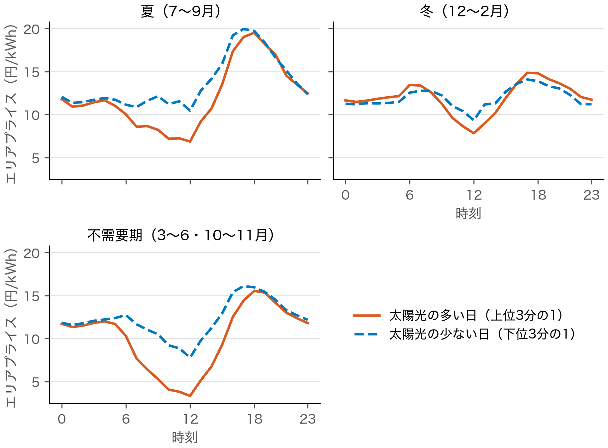{width=15cm}

注）各季節内で日次の太陽光発電量（制御前）が上位・下位3分の1の日の時刻別平均価格。

出所）日本卸電力取引所『スポット市場取引結果』、北海道電力ネットワーク『エリア需給実績』より筆者作成。

図5.2 は同じ比較を風力について行ったものである。風力の多い日は少ない日より、全時間の平均で価格が1.2〜1.6円/kWh 低く、曲線の形はほぼ変わらない。風力の出力そのものの日内振幅（時刻別平均の最大値と最小値の差を平均で割った値）は季節別に14〜20%にとどまり、太陽光（315〜422%）より1桁以上小さい。風力は一日全体をほぼ一様に押し下げる。ただし厳密な平行移動ではなく、5.7節で見るとおり、価格の高い時間ほど円建てでやや大きく下げる。

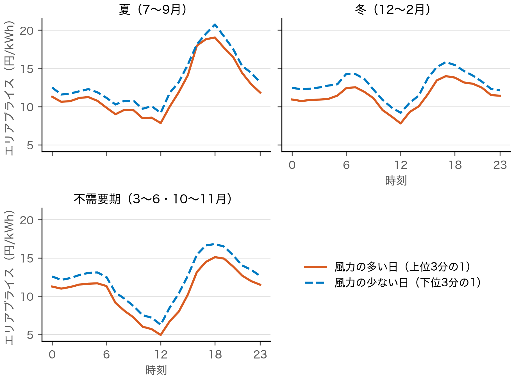{width=15cm}

注）各季節内で日次の風力発電量（制御前）が上位・下位3分の1の日の時刻別平均価格。

出所）図5.1 と同じ。

### 5.2.2　発電量の帯域分解

表5.1 は FY2023〜25 の設備利用率の帯域分解である。北海道の風力は分散の約7割が1日を超える帯域にあり、日内の2帯域の合計は約1割にとどまる。北海道の太陽光は6〜24時間の帯域が約3分の2を占める。九州の風力と太陽光も同じ構造を示し、帯域の構造は地域ではなく電源種の性質である。年度別の分解（図5.3）でも、風力の導入量が約4倍になった10年間に、北海道の風力の帯域シェアはほとんど変わらない。

: 表5.1　制御前出力の帯域分解（設備利用率、FY2023〜25）

| 帯域 | 北海道・風力 | 北海道・太陽光 | 九州・風力 | 九州・太陽光 |
|---|---:|---:|---:|---:|
| 6時間未満 | 1.9 | 6.0 | 1.9 | 6.2 |
| 6〜24時間 | 8.6 | 65.6 | 7.8 | 65.4 |
| 1〜7日 | 40.8 | 4.2 | 43.3 | 4.8 |
| 7日超 | 31.2 | 4.4 | 29.2 | 3.2 |

注）単位は%。式(5.1)の各成分の分散を元の系列の分散で割った値で、成分が直交しないため合計は100%にならない。

出所）北海道電力ネットワーク・九州電力送配電『エリア需給実績』、資源エネルギー庁『固定価格買取制度 情報公表用ウェブサイト』より筆者作成。

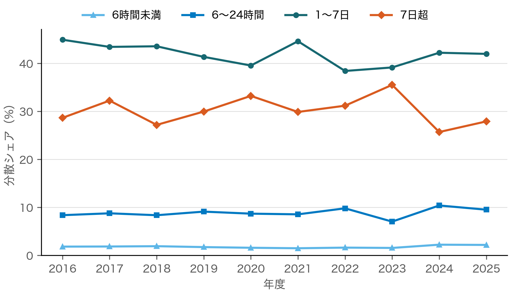{width=15cm}

注）式(5.1)の分散シェアを年度ごとの系列で計算した値。図の系列は出力制御後の発電量で、制御前の系列で計算した値との差は0.1ポイント以下である。

出所）北海道電力ネットワーク『エリア需給実績』より筆者作成。

風力の6時間未満の帯域が2%弱と小さいことは、地点間の相関が低い高周波の成分がフリートの集約で相殺されることと整合的である（St. Martin et al., 2015）。出力変動緩和の技術要件のない九州の風力も同じ1.9%である（3.6.4項）。太陽光の6時間未満の帯域は、日の出・日の入りという日周の決定的な形から生じるので、比較の基準にはならない。

### 5.2.3　発電量と価格の水準・日内形状

図5.4 は、FY2023〜25 の各季節で日を日次発電量の五分位に分け、日平均価格と TB4h を示したものである。他の要因を統制しない記述統計である。風力は発電量が増えるほど水準を下げ、冬と不需要期では第1五分位と第5五分位の差の区間が0を含まない。TB4h は冬と不需要期で縮み、夏は広がるが、区間はいずれも0を含み、記述上の差にとどまる。太陽光は水準を下げるとともに TB4h を広げ、夏と不需要期の拡大の区間は0を含まない。風力が TB4h を広げるかどうかの判断は、図ではなく次節の回帰に基づく。

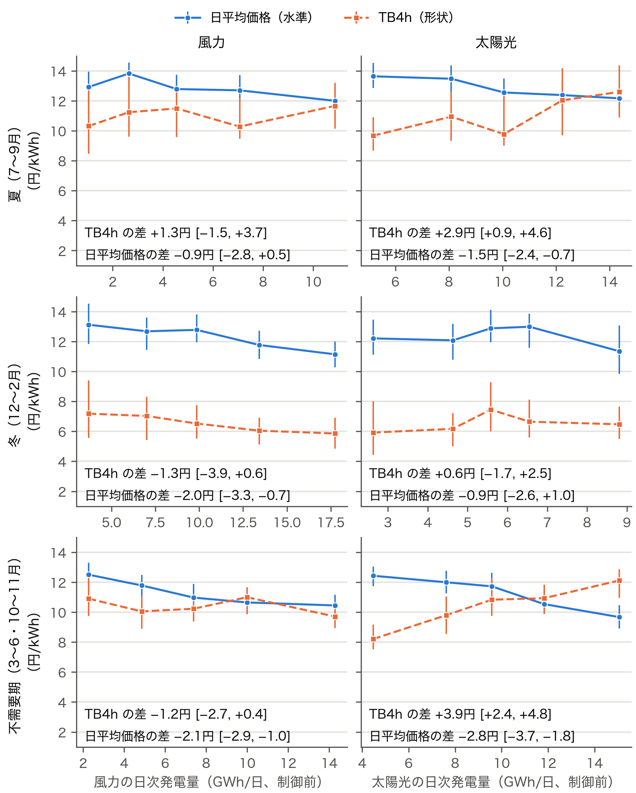{width=15cm}

注）各季節で日次発電量（制御前）の五分位に日を分けた群平均。誤差棒と、各パネルに記した第5五分位と第1五分位の差の [ ] 内は、日単位の14日移動ブロック・ブートストラップ（999回）による95%区間。

出所）図5.1 と同じ。

## 5.3　日次回帰による推定

### 5.3.1　北海道の水準と日内形状

表5.2 は式(5.2)の推定結果である。北海道では、太陽光と風力はいずれも全季節で水準を下げ、太陽光・冬（10%水準）を除いて1%水準で有意である。

日内形状への効き方は電源種で分かれる。太陽光は不需要期に TB4h を広げる。主仕様では系列相関を考慮すると精度が低い（EWC の p=0.14）が、同じ月の中の日々の変動で識別すると係数は大きくなって1%水準で有意となり（5.9節）、日内標準偏差への係数も主仕様の+0.09（EWC の p=0.12）から+0.15（1%水準で有意）になる。FY2023〜25 に限ると、不需要期（+0.35）と夏（+0.30）の係数はいずれも1%水準で有意である。主仕様で冬に見られる太陽光の負の係数は、日射の多い2月にスプレッドが小さく、日射の少ない12〜1月に大きいという月の違いと、2021年1月の価格高騰を拾ったもので、頑健でない（年月固定効果の下では正で有意でない）。

風力の TB4h への係数は、冬に負で5%水準で有意、夏と不需要期は有意でない。どの季節でも、風力が TB4h を広げる頑健な証拠はない。EWC の95%区間の上限を年度内の日次発電量1標準偏差あたりに直すと、3季節の区分では季節平均 TB4h の3.0〜5.3%（FY2023〜25 の夏だけ10.9%、+1.20円/kWh）であり（FY2016〜25 の冬は区間全体が負）、効果があっても小さい。この区分では、5.9節で比べるどの推論法・仕様・標本でも正に有意にならない。ただし不需要期を暦月の春と秋に分けると、FY2023〜25 の春に境界的な正の係数があり（主仕様で+0.084、EWC の p=0.13）、上限は春の平均 TB4h の7.4%と、3季節の区分の範囲を上回る。春の係数は、年月固定効果に価格のラグを加えた仕様では5%水準で（p=0.024）、Fuke and Ohashi（2025）の仕様の春では1%水準で有意となる（5.8節）。ただし、どちらも右辺のラグ価格が誤差と相関しうる仕様である。

: 表5.2　日次回帰の係数

|  | (1) | (2) | (3) | (4) |
|---|---:|---:|---:|---:|
| エリア | 北海道 | 北海道 | 九州 | 九州 |
| 被説明変数 | 水準 | TB4h | 水準 | TB4h |
| 太陽光・夏 | −0.406\*\*\* | 0.033 | −0.100\*\*\* | −0.014 |
|  | (0.098) | (0.158) | (0.030) | (0.035) |
| 太陽光・冬 | −0.761\*† | −0.807\*\*† | −0.071\*\*\*† | 0.112\*\*\* |
|  | (0.385) | (0.402) | (0.023) | (0.033) |
| 太陽光・不需要期 | −0.351\*\*\* | 0.233 | −0.058\*\*\* | 0.101\*\*\* |
|  | (0.091) | (0.156) | (0.010) | (0.020) |
| 風力・夏 | −0.245\*\*\* | −0.156 | −0.048 | 0.085 |
|  | (0.067) | (0.163) | (0.135) | (0.354) |
| 風力・冬 | −0.353\*\*\* | −0.363\*\*† | −0.369 | −0.463 |
|  | (0.102) | (0.174) | (0.287) | (0.488) |
| 風力・不需要期 | −0.355\*\*\* | −0.067 | −0.021 | 0.173 |
|  | (0.061) | (0.100) | (0.111) | (0.172) |
| 観測数（日） | 3,632 | 3,632 | 3,632 | 3,632 |

注）単位は円/kWh per GWh/日。水準は日平均価格。年度固定効果・季節固定効果と需要を統制。括弧内は EWC 標準誤差（$\nu=94$）。\*\*\*、\*\*、\* はそれぞれ1%、5%、10%水準で有意（自由度94の t 分布）。†は、ふるいブートストラップの補正 p 値で有意水準が1段以上下がる係数。

出所）日本卸電力取引所『スポット市場取引結果』、北海道電力ネットワーク・九州電力送配電『エリア需給実績』より筆者作成。

電源種の非対称は、効果の相対的な大きさでは、Wozabal et al.（2016）がドイツの日内の分散で示した結果（太陽光の効果が風力の約12倍）と同じである。同論文では太陽光が日内の分散を下げており符号は逆であるが、同論文が示す日内の分散と残余需要のU字の関係でいえば、この違いは市場がU字のどの位置にあるかの違いと解釈できる。北海道では夕方のピークが太陽光の多寡によらず残り（5.2.1項）、太陽光は昼の価格を下げて夕方との差を開く側に働く。Kyritsis et al.（2017）の「太陽光は変動性を下げ、風力は上げる」とも逆に見えるが、彼らの変動性は日次系列の条件付き分散、すなわち多日変動であり、対象が異なる（5.8節）。

### 5.3.2　冬の上位・下位4時間への分解

冬に風力が TB4h を縮めるかを、TB4h を上位4時間と下位4時間の平均価格に分けて調べる（表C.1）。冬の風力は、点推定では上位4時間の価格を下位4時間より多く下げ（主仕様で−0.59 と−0.23）、この引下げは上位・下位4時間の冬の平均価格に比例した引下げと矛盾しない（EWC の p=0.52〜0.99）が、平行移動とも頑健には区別できない。平行（比が1）の検定は TB4h の係数がゼロという検定と同じであり、FY2016〜25 の主仕様では EWC で5%水準で棄却されるが、補正 p 値（0.099）ではどの仕様でも5%水準で棄却されない。TB4h の係数は同じ月の中では半減し、FY2023〜25 では有意でない。したがって「冬に風力がスプレッドを縮める」は弱い結果であり、頑健にいえるのは風力がスプレッドを広げる証拠がないことまでである。太陽光は、同じ月の中では冬の下位4時間だけを下げる（−0.33、5%水準で有意）ので、「冬に太陽光がスプレッドを縮める」は支持されない。

### 5.3.3　九州との比較

九州では、太陽光が冬と不需要期に日内スプレッドを1%水準で有意に広げる（表5.2 の列(4)）。夏は有意でないが、FY2023〜25 に限ると5%水準で有意に正となる。水準への効果は北海道より小さい。市場とフリートの規模が大きいことに加え、昼の価格が下限価格に張り付く時間が長く、それ以上は下がらないためと考えられる。風力は導入量が小さく、水準への有意な効果は検出されない。日内形状への風力の係数はどの季節でも有意でなく、標本と仕様によって符号も有意性も変わるので（5.9節）、九州の風力が日内形状を広げるという解釈はとらない。

## 5.4　分位点回帰による高分位の効果

Sakaguchi and Fujii（2021）型の統制のない仕様を本研究で再推定すると、τ=0.9 の風力の係数の絶対値は FY2023〜25 のほうが FY2016〜19 より小さいが、差の95%区間は0を含む（表C.2 の最下行）。この仕様は年度間の価格水準の違いを拾い、年度別の係数も大きく振れるので、この比較から MOE の減衰は読めない。

固定効果で統制した主仕様では、FY2023〜25 と FY2016〜18 の τ=0.9 の差は負に有意だが、この差は FY2018（胆振東部地震の年度）を含むことに依存し、FY2016〜17 と比べた差は0を含む。FY2019〜22 の大きな値は燃料危機期によるもので、増強直後の FY2019〜20 だけでは FY2016〜17 とほぼ等しい（表C.3）。価格と相対価格のどちらでも、どの期間の組でも、τ=0.9 で MOE が弱まった証拠はない。ただし、北本連系線の増強そのものの効果はこの比較からは識別できない。

図5.5 は、統制付きの仕様の風力の係数を分位と期間ごとに示したものである。FY2023〜25 の係数は全分位で負に有意で、τ=0.1 の−3.84 から τ=0.9 の−5.28 へと高分位ほど負に大きい。FY2016〜18 の係数は−1.8〜−0.8 と小さく、τ=0.8 以上では95%区間が0を含む。FY2019〜22 は高分位で負に大きいが、区間は広い。相対価格でも期間の並びは変わらず、高分位の効果が直近の期間に弱まった形は見られない。期間差の点推定と区間は表C.2 に示す。

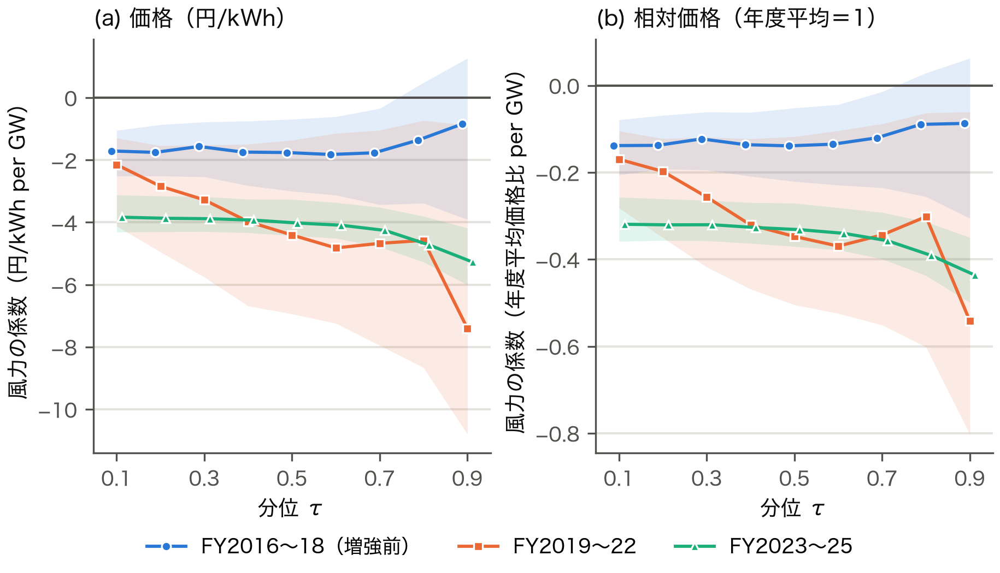{width=15cm}

注）時間値。(a) は価格（円/kWh per GW）、(b) は相対価格（価格を年度平均で割った値）を被説明変数とする。統制付きの仕様（制御前の風力・太陽光・需要に、季節×時刻・月・年度の固定効果と曜日・祝日を加えたもの）の係数で、帯は日単位の14日移動ブロック・ブートストラップ（499回）による95%区間。

出所）日本卸電力取引所『スポット市場取引結果』、北海道電力ネットワーク『エリア需給実績』より筆者作成。

## 5.5　市場分断の構成

北本連系線の増強による市場統合は、北海道と東北のエリアプライスの関係に表れている（表5.3 のパネルB）。北海道と東北が同価格のコマは FY2016〜19 の約3割から FY2023〜25 の約8割へ増え、北海道が東北より高いコマは、増強をはさんで FY2018 の91%から FY2020 の13%へ下がった。システムプライスとの比較（パネルA）でも高値が減り安値が増えたが、FY2023〜25 の高値のうち北本連系線で分断したのは16.6%にすぎず、高値全体の75.7%は北海道・東北・東京が同価格でシステムプライスを上回る東西の分断であり、安値も68.5%は北海道と東北が同価格のまま東日本側で生じている。

: 表5.3　北海道エリアプライスの分断の構成

| 区分 | FY2016〜19 | FY2020〜22 | FY2023〜25 |
|---|---:|---:|---:|
| **パネルA：システムプライスとの比較** |  |  |  |
| 高値（北海道＞システム） | 90.7（87.2〜97.7） | 54.8（37.1〜65.4） | 61.6（59.3〜64.6） |
| 同価格 | 6.8（1.0〜11.6） | 20.2（15.7〜27.6） | 11.3（9.2〜14.9） |
| 安値（北海道＜システム） | 2.5（1.1〜5.0） | 25.0（18.9〜35.3） | 27.1（20.5〜30.9） |
| **パネルB：北海道と東北（北本連系線）** |  |  |  |
| 北海道＞東北 | 70.1（40.8〜90.9） | 9.6（5.0〜13.0） | 9.6（5.3〜14.9） |
| 同価格 | 29.2（7.6〜58.3） | 86.0（84.1〜89.1） | 80.9（71.3〜91.6） |
| 北海道＜東北 | 0.6（0.1〜1.4） | 4.4（2.2〜6.0） | 9.4（3.1〜13.8） |

注）30分コマの構成比（%）。括弧内は年度別の値の範囲。価格差が±0.01円/kWh 以内を同価格とする。北海道の価格が欠測する960コマを除く。

出所）日本卸電力取引所『スポット市場取引結果』より筆者作成。

風力の多い日には安値のコマが増える。FY2023〜25 の季節内の風力三分位で比べると、安値の時間は夏7.2→10.7、冬3.1→8.3、不需要期4.8→9.2 時間/日に増え、増加の95%区間はいずれも0を含まない。この増加のうち北本連系線が拘束する時間（北海道が東北より安い時間）は、夏で約4分の3、不需要期で約半分、冬で2割弱である。残りは北海道と東北が同価格のままシステムプライスを下回る時間で、両エリアの風力は同じ気象で動くため、北海道の風力の効果とは識別できない。風力は現時点で、価格を下限価格に張り付かせる前に安値の分断を増やしているが、北本連系線での輸出の飽和による道内価格の切り離しといえるのはその一部である。

## 5.6　空間分散の反実仮想

5.1.4項の集中立地の反実仮想の結果を表5.4 と図5.6 に示す。校正の上限は北海道全域を約32km 間隔の独立な地点で埋め尽くした場合の理論値で、実際のフリートの配置から測った日内分散比は2.9〜3.9で、下限〜中央に近い（校正の詳細は表C.4）。

中央の校正では、TB4h の中央値は3%、完全予見粗利（4.2.1項）は4.5%増えるにとどまり、下限張り付き時間はほとんど変わらない。増幅された確率的な変動には系統的な日内の位相がなく、日ごとの上位4時間と下位4時間の差にあまり寄与しないためである。上限では完全予見粗利は19%増え、モデル価格の上で風力が TB4h に与える夏と冬の係数は正に転じる（EWC の p=0.04、0.005）。日周まで増幅した版や帯域別に増幅した版でも、実現した日内分散比が同じなら結果はほぼ同じであり（表C.5）、価格の応答を決めるのは、増幅の作り方ではなく実現した日内分散の大きさである。

日内分散の大きさが同じでも、系統的な日周の位相は効果を大きく変える。実フリートに振幅0.3の日周を付与すると、完全予見粗利はピークの時刻によって+3.6%から−6.1%まで動き（表5.4）、同じ日内分散比の一様な増幅（+0.8〜1.3%）と比べて絶対値で2〜7倍で、符号も変わる（ピーク時刻を動かした結果は表C.6）。モデルの上では、日内形状への効果を決めるのは分散の大きさより位相である。位相が既存の安値の時間（未明〜昼）に重なればスプレッドを広げ、夕方〜深夜に重なれば縮める。

: 表5.4　集中立地の反実仮想の主な結果（北海道の風力、FY2023〜25）

| 系列 | 日内分散比 | 下限張り付き（時間/年） | TB4h 中央値（円/kWh） | 完全予見粗利（円/kW-年） | 風力→TB4h（夏／冬／不需要期） |
|---|---:|---:|---:|---:|---:|
| 実フリート | 1.00 | 115 | 7.96 | 8,266 | −0.040／−0.019／+0.141 |
| 一様な増幅：下限 | 2.81 | 115 | 8.10 | 8,463（+2.4%） | −0.025／−0.005／+0.146 |
| 一様な増幅：中央 | 4.40 | 116 | 8.20 | 8,640（+4.5%） | −0.009／+0.007／+0.148 |
| 一様な増幅：上限 | 16.88 | 140 | 9.03 | 9,819（+18.8%） | +0.104／+0.087／+0.175 |
| 日周の付与：未明（3時） | 2.00 | 98 | 8.17 | 8,482（+2.6%） | — |
| 日周の付与：昼（13時） | 1.85 | 154 | 8.06 | 8,564（+3.6%） | — |
| 日周の付与：夕方（18時） | 1.96 | 106 | 7.48 | 7,760（−6.1%） | — |
| 参考：実績の価格 | — | 203 | 8.85 | 10,317 | +0.088／−0.112／−0.025 |

注）実績の価格の行を除き、価格は第7章の価格過程モデル（仕様A、$\theta=1$）による。日内分散比は、一様な増幅では確率成分、日周の付与（振幅0.3）では全成分で測った値。括弧内は実フリートに対する変化率。風力→TB4h は式(5.2)の TB4h の風力の係数（円/kWh per GWh/日）。

出所）表5.2 と同じ資料と St. Martin et al.（2015）の相関距離をもとに筆者推計。

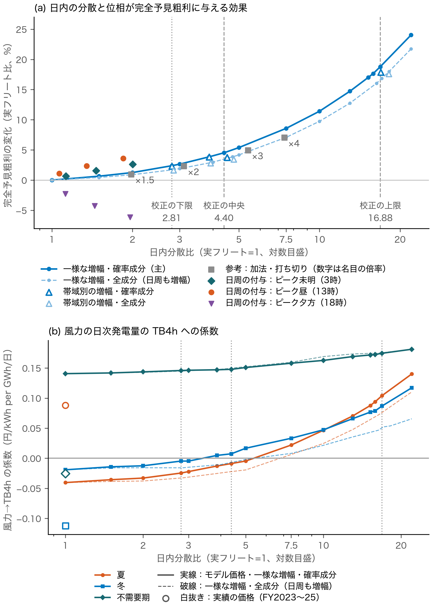{width=14cm}

注）(a) は日内分散比（対数目盛）と完全予見粗利の変化、(b) は日内分散比とモデル価格の上の風力の TB4h への係数。縦の線は校正の下限・中央・上限。日内分散比は、「確率成分」の系列では確率成分で、その他の系列では全成分で測った値である。主の「一様な増幅・確率成分」では日周を実フリートの水準のままとし、日周の付与の振幅は0.1〜0.3 である。灰色の四角は、日内帯域を加法で増やして0と設備容量で打ち切る作り方による参考値で、添えた数字はその名目の倍率である（表C.5）。

出所）表5.4 と同じ。

この反実仮想はモデル価格の上の比較なので、モデルの感応度を実績と比べた（表C.7）。モデルは実績に比べ、下限張り付き時間と完全予見粗利を小さく出す（表5.4 の第1行と最下行）。風力の日次発電量に対する TB4h の係数は、不需要期だけ実績とモデルの差が有意であり（−0.166、p=0.02）、表5.4 の不需要期の係数は水準ではなく行の間の差で読む。風力の日内変動に対する TB4h の感応度は、夏に実績がモデルの4.7倍で差は有意である（p=0.007）。この差は主に9月によって生じており、台風や前線の通過で風と価格が同時に動く交絡を含みうる。この比でモデルの夏の完全予見粗利の増分を補正すると、参考値として中央の校正で+6.7%、上限で+32%になるが、Fieller 型の区間は上側に長い（上限で22〜123%。表C.8）。

以上から、この比較の上では、北海道の風力が日内形状を広げる頑健な証拠がないことの主因は、風力に系統的な日内のサイクルがないことにあり、広域の単一価格ゾーンの下でのフリートの集約は補助的な機構と位置づけられる（10.3.1項）。ただし、これは仕様A の上の比較であり、仕様A′（7.2.2項）の上では確かめていない。また校正の上限では、補正後の完全予見粗利の増分は点推定で32%に達し、上限側の効果は無視できるとはいえない。ドイツで風力が日内の変動性を高める（Paraschiv et al., 2014; Rintamäki et al., 2017）のは夜間に偏った系統的な日内の位相があるためであり、豪州で風力が価格の条件付き分散を高めるという結果（Mwampashi et al., 2021）は多日変動の指標によるもので、日内形状とは対象が異なる。

## 5.7　価格カーブの主成分分解

### 5.7.1　因子の構造

FY2016〜25 の年度・季節内の日々の変動のうち、第1〜第3主成分が78.3%、7.2%、4.9%を説明する。寄与率は2021年1月の31日に強く引っ張られているが、負荷の形は安定している（付録C.1.5）。第1主成分は負荷が全時刻で正で、日平均価格との相関が0.995 の、期間構造の水準にあたる因子である。ただし負荷は夕方に偏っており、価格の高い日ほど夕方が大きく上がるという供給曲線の凸性と整合的である。第2主成分は9〜15時が負、17〜19時が正の、昼と夕方の差の因子で、ダックカーブの深さにあたる。債券の傾きの因子と違って負荷は単調でなく、昼だけが負の窪みの形をしている。第3主成分は夜と夕方の差の因子である（図5.7 の上段）。FY2023〜25 では、第1主成分の寄与率が57.0%に下がり、第2主成分が17.2%に上がる。

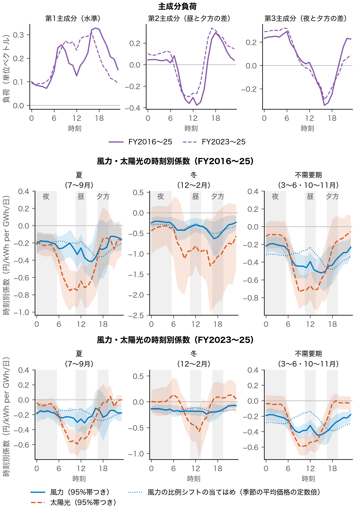{width=14cm}

注）上段は年度×季節×時刻の平均を除いた偏差の主成分負荷で、寄与率は第1〜第3主成分の順に FY2016〜25 で78%・7%・5%、FY2023〜25 で57%・17%・7%である。中段（FY2016〜25）と下段（FY2023〜25）は式(5.2)と同じ右辺で24時刻を別々に回帰した係数と EWC の95%帯。点線は風力の係数に季節の平均価格プロファイルの定数倍を当てはめたもの。灰色の帯は夜（0〜5時）・昼（11〜13時）・夕方（17〜19時）。夕方−昼・夕方−夜の差と形の検定の値は表C.9 に示す。

出所）表5.2 と同じ（北海道のみ）。

因子スコアを式(5.2)の右辺に回帰すると、風力と太陽光はいずれも第1主成分を全季節で下げる（5%水準で有意。ただし太陽光・冬は p=0.047 で境界的）。第2主成分は太陽光が全季節で押し上げる（5%水準で有意）。発電量の年度内の1標準偏差あたりで、太陽光は第2主成分を0.10〜0.31標準偏差動かすのに対し、風力は0.02〜0.11標準偏差にとどまる。風力の第2主成分の係数は不需要期に1%水準で有意（+0.46）だが、負荷の和が0でないために生じる一様な値下がりの寄与を除くと、15時前後の小さな効果（+0.21〜+0.31）にとどまる。太陽光は水準と形状の両方の因子に負荷し、風力は主に水準の因子に負荷する。

### 5.7.2　時刻別係数の形とコントラスト

図5.7 の中段と下段は、24時刻を別々に回帰した風力・太陽光の係数ベクトルである。風力の時刻別係数は全時刻で負で、変動係数は太陽光より小さく、風力は一日をほぼ一様に押し下げる。ただし厳密な平行移動ではない。FY2016〜25 では平行シフトが全季節で棄却され、価格の高い時間ほど円建てで大きく下がる。冬の係数ベクトルは冬の平均価格プロファイルの定数倍に近い（余弦の絶対値0.99）が、比例シフトも棄却されるので、24時刻の形としては比例に近いという記述にとどめる。FY2023〜25 の風力の係数はさらに平坦で、夏は平行シフトも棄却できない。係数の範囲・変動係数・コントラストと、平行・比例シフトの検定の値は表C.9 に、2021年1月を除いた標本の結果は表C.10 に示す。

蓄電池の裁定原資に直結するのは時刻の間の差である。風力が夕方−昼の差を広げる証拠はない。FY2016〜25 の冬は負だが10%水準にとどまり（補正 p 値は0.14）、FY2023〜25 は全季節で有意でない。一方、夜は風力による下がり方が他の時間より小さいので、風力は夕方−夜の差を縮める。安値の時間が主に夜にあった FY2016〜22 の冬（日ごとの最安4時間のうち平均2.3時間が0〜5時）には、この縮小は裁定原資を削る側に働いたが、安値が昼に移った FY2023〜25 の冬（平均3.1時間が9〜15時）には、夕方−夜の係数も有意でない。太陽光は夏と不需要期に夕方−昼の差を広げ、FY2023〜25 では冬にも広げる。

### 5.7.3　TB4h と水準の因子

FY2016〜25 の年度・季節内では、TB4h の変動の68.5%（2021年1月を除くと51.2%）が第1主成分だけで説明され、TB4h は供給曲線の凸性を通じて水準と連動する。風力が冬に TB4h を下げる係数（−0.363）を欠落変数の公式で分解すると、第1主成分を経由する部分が−0.451、第2〜第5主成分（形状）を経由する部分が+0.048、残差が+0.040 であり、冬の縮小の点推定はほぼ全量が水準の因子を経由している。これは上位4時間をより多く下げるという5.3.2項の点推定と整合的である。これに対し FY2023〜25 の主成分で測ると、TB4h の変動のうち第1主成分で説明される部分は1.0%にすぎず、現行の構造では TB4h はほぼ形状の指標として働く。

本節の結果は、日平均価格と TB4h で得た水準と形状の分離が、要約指標の選び方に依存しないことを裏付ける。ただし太陽光は水準の因子にも強く効き、風力の効果は厳密な平行シフトではなく、夕方と夜の差をやや縮める。

## 5.8　先行研究の指標との比較

5.3節と5.7節では、太陽光が日内のスプレッドを広げ、風力は主に水準を下げることを示した。このうち太陽光の結果は、日をまたぐ価格の散らばりで変動性を測った先行研究とは逆に見える。とくに Fuke and Ohashi（2025）は、九州で太陽光が価格の変動性を下げると報告している。本節は5.1.6項の方法により、二つの結果が同じデータの上で両立するかを確かめる。

九州の FY2016〜19 で同論文の仕様を再現すると、日間の IQR 係数の符号は全季節で原典と一致し、有意な係数（夏の需要と春の太陽光）も同じである（表C.11）。同じ標本と説明変数のまま被説明変数を TB4h に替えると、太陽光の効果の符号が分かれる（表5.5 のパネルA）。春の太陽光は日間の IQR を5%水準で有意に縮める一方、TB4h への係数は正であり、冬と秋には TB4h を5%水準で有意に広げる。FY2023〜25 では乖離がさらに明瞭であり、北海道でも同じ形が現れる。太陽光は昼間平均価格を日々安定させながら、昼と夕方の差を開いている。「太陽光は変動性を下げる」（Fuke & Ohashi, 2025）と「太陽光は日内スプレッドを広げる」は、同じデータの上で同時に成立する別の量の記述である。主仕様（式(5.2)）とこの仕様は季節の区分と単位が異なるので係数の大きさは直接比べられないが、太陽光が日内のスプレッドを広げるという符号は両仕様で共通である。欧州でも、変動型の再エネの増加が価格の分散を必ずしも高めないことが報告されている（Schöniger & Morawetz, 2022）。

: 表5.5　先行研究の仕様による日間 IQR 係数と TB4h への係数

| 標本・指標 | 冬 | 春 | 夏 | 秋 |
|---|---:|---:|---:|---:|
| **パネルA：太陽光** |  |  |  |  |
| 九州 FY2016〜19：日間 IQR | −0.100 | −0.259\*\* | −0.421 | −0.189 |
| 九州 FY2016〜19：日内 TB4h | +0.739\*\* | +0.284 | +0.016 | +0.913\*\* |
| 九州 FY2023〜25：日間 IQR | −0.542\*\*\* | −0.738\*\*\* | −0.478 | −0.423 |
| 九州 FY2023〜25：日内 TB4h | +2.111\*\*\* | +1.678\*\*\* | +0.770\* | +2.152\*\*\* |
| 北海道 FY2023〜25：日間 IQR | −1.964 | −2.909\* | +0.773 | −3.864\* |
| 北海道 FY2023〜25：日内 TB4h | +4.399\*\* | +7.716\*\*\* | +4.974\*\* | +4.747\*\* |
| **パネルB：風力（北海道）** |  |  |  |  |
| FY2023〜25：日間 IQR | −3.166\*\*\* | −0.994 | +2.822 | −3.870 |
| FY2023〜25：日内 TB4h | −1.477 | +5.025\*\*\* | +3.481 | −2.133 |

注）単位は円/kWh per GW。Fuke and Ohashi（2025）の仕様と季節の区分（5.1.6項）による。日間 IQR は昼間平均価格の分位点回帰の IQR 係数 $\beta_{0.9}-\beta_{0.1}$、日内 TB4h は同じ標本・同じ説明変数で被説明変数を TB4h に替えた最小二乗推定の係数。IQR 係数の星は日単位の14日移動ブロック・ブートストラップ（299回）の標準誤差による正規近似、TB4h の星は EWC（暦日の格子、FY2016〜19 は $\nu=51$、FY2023〜25 は $\nu=42$）により、\*\*\*、\*\*、\* はそれぞれ1%、5%、10%水準で有意。北海道の FY2016〜19 を含む全結果は表C.12・表C.13 に示す。

出所）表5.2 と同じ。

風力について北海道で同じ比較をすると（表5.5 のパネルB）、日間では FY2023〜25 の冬に IQR を縮め（1%水準で有意）、上側の裾を圧縮する高分位の MOE（5.4節）と整合的である。日内では、FY2016〜19 に春・夏とも負（表C.13）で、FY2023〜25 の春に正である（1%水準で有意。GWh/日あたりに直すと約+0.21）。ただし、この仕様は7日分のラグ価格を右辺に含むので係数に偏りがありうる。主仕様で不需要期を暦月の春に分けた係数は、5.3.1項と5.9節のとおり境界的な証拠にとどまり、純需要の低い日に集中する証拠もない（付録C.1.8）。供給曲線の下端の急勾配で安い時間ほど大きく下がるという機構は、第7章の価格モデルの上では働くが、標本内では確かめられず、風力への応答と実績との差が標本内で有意でなくなるよう修正した仕様A′（風力への応答はなお実績の約2倍）の上では、風力が3倍でも実行可能な戦略 c の粗利はむしろ下がる（7.3節）。

したがって、同じ標本でも、多日変動と日内形状のどちらを測るかで太陽光の効果の符号は逆になる。再エネが価格の変動性を高めるかは、時間スケールを指定しなければ判定できない。

## 5.9　頑健性の確認

表5.6 は主要な係数を、推論法・仕様・標本の間で比べたものであり、図5.8 は同じ係数の95%区間を推論法と仕様の間で比べたものである。ふるいブートストラップで求めた名目5%の検定の実効的な棄却率は、HC3 の37〜42%に対し EWC では8〜10%であり、主仕様では比較した推論法の中で EWC の歪みが最も小さい（付録C.1.10）。表5.2 の24係数のうち5%水準で有意なものは、HC3 では14、EWC では12、補正 p 値では10である。

本章の主な結論は、いずれの変種でも保たれる。第一に、北海道の風力が水準を下げる効果は、どの仕様・標本でも全季節で1%水準で有意である。第二に、北海道の風力の TB4h への係数は、3季節の区分ではどの仕様・標本でも正に有意にならない。暦月の春の正の係数（5.3.1項）は、補正 p 値で5%を下回る仕様がなく、有意となる仕様はいずれも誤差と相関しうる価格のラグを含むので、境界的な証拠として扱う。第三に、風力が冬に TB4h を縮める効果は、同月内の識別で半減し、FY2023〜25 では有意でない。第四に、太陽光が不需要期に TB4h を広げる効果は同月内の識別でむしろ強まり、冬の負の係数は同月内の識別や FY2023〜25 では消える。第五に、九州の風力の係数は仕様と標本で符号も有意性も変わる一方、九州の太陽光が冬と不需要期に TB4h を広げる効果は、どの変種でも有意である。燃料危機期を除くと北海道の水準への効果の絶対値は小さくなるが、相対価格で比べるとその差は小さい（表C.14）。

: 表5.6　主要な係数の頑健性

| 係数 | 主仕様 | p（HC3） | p（EWC） | p（補正） | 年月FE | FY2023〜25 | 燃料危機期を除く | 2021年1月を除く |
|---|---:|---:|---:|---:|---:|---:|---:|---:|
| **パネルA：北海道** |  |  |  |  |  |  |  |  |
| 水準・風力・冬 | −0.353 | <0.001 | 0.001 | 0.006 | −0.256\*\*\* | −0.161\*\*\* | −0.302\*\*\*† | −0.269\*\*\* |
| TB4h・風力・夏 | −0.156 | 0.119 | 0.339 | 0.414 | −0.075 | 0.088 | −0.053 | −0.163 |
| TB4h・風力・冬 | −0.363 | <0.001 | 0.040 | 0.099 | −0.181\*\* | −0.112 | −0.388\*\*† | −0.232\* |
| TB4h・風力・不需要期 | −0.067 | 0.243 | 0.504 | 0.567 | −0.030 | −0.025 | −0.015 | −0.054 |
| TB4h・太陽光・冬 | −0.807 | 0.005 | 0.048 | 0.123 | 0.371 | 0.044 | −0.565 | −0.592\*\* |
| TB4h・太陽光・不需要期 | 0.233 | <0.001 | 0.140 | 0.214 | 0.392\*\*\* | 0.350\*\*\* | 0.314\*\* | 0.230 |
| **パネルB：九州** |  |  |  |  |  |  |  |  |
| TB4h・風力・不需要期 | 0.173 | 0.124 | 0.317 | 0.384 | −0.020 | 0.113 | 0.049 | 0.256\* |
| TB4h・太陽光・冬 | 0.112 | <0.001 | 0.001 | 0.009 | 0.187\*\*\* | 0.183\*\*\* | 0.077\*\* | 0.105\*\*\* |
| TB4h・太陽光・不需要期 | 0.101 | <0.001 | <0.001 | <0.001 | 0.101\*\*\* | 0.123\*\*\* | 0.083\*\*\* | 0.108\*\*\* |

注）単位は円/kWh per GWh/日。主仕様は表5.2。p（補正）は、ふるいブートストラップ（1,999回）で求めた EWC の p 値。年月FE は需要・曜日・祝日と年月固定効果の仕様、燃料危機期を除くは FY2021〜22 を除いた標本（2,902日）、2021年1月を除くはその31日を除いた標本（3,601日）。星は EWC による（FY2023〜25 は $\nu=42$、他は $\nu=94$。記号と†は表5.2 と同じ）。他の変種は表C.15 と表C.16 に示す。

出所）表5.2 と同じ。

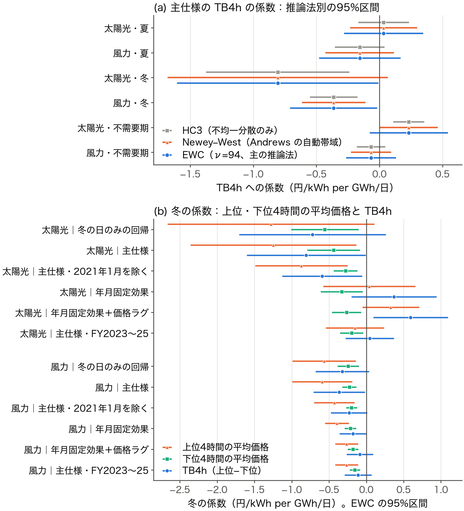{width=15cm}

注）FY2016〜25 の北海道の日次（3,632日）。(a) は主仕様（表5.2）の TB4h の係数の95%区間を、HC3、Newey–West（Andrews の自動帯域）、EWC（$\nu=94$）で比べたもの。(b) は冬の太陽光・風力の係数を、上位4時間の平均価格、下位4時間の平均価格、TB4h について、仕様・標本別に EWC の95%区間で示したもの。(b) の「主仕様」は表5.2 の主仕様、「年月固定効果」は年月固定効果の仕様、「冬の日のみの回帰」は冬の日だけで推定した仕様である。

出所）日本卸電力取引所『スポット市場取引結果』、北海道電力ネットワーク『エリア需給実績』より筆者作成。

これらの推論と識別の修正は、第7章以降の限界参入者の収益や自由参入の条件には直接は影響しない。第7章の価格過程は回帰係数ではなく、純需要から価格への写像と時刻別の項を使うためである。ただし価格過程が本章の風力への条件付き応答を再現するかは別の問題であり、第7章で同じ回帰をモデル価格に当てて検証する（7.2.2項）。

## 5.10　小括

本章の主要な結果は次の5点である。

1. 先行研究の日間の変動性の指標を再現したうえで、同じ標本で日内の指標に替えると、太陽光の効果の符号が変わる。再エネが価格の変動性を高めるかは、時間スケールを指定しなければ判定できない。
2. 太陽光は水準を下げ、不需要期を中心に日内のスプレッドを広げる。これはダックカーブの形成であり、通説は条件付きで成立する。この拡大は同じ月の中の識別でむしろ強まり、主仕様に現れる冬の負の係数は月の違いと2021年1月の価格高騰によるもので頑健でない。
3. 風力は水準を下げるが、日内形状を広げる頑健な証拠はない。風力の変動の約7割は1日を超える帯域にあり、価格カーブでは主に水準の因子に負荷して一日をほぼ一様に押し下げる。効果があっても、上限は3季節の区分で季節平均の TB4h の約3〜5%（FY2023〜25 の夏で約11%）、暦月の春に分けると約7%である。冬にスプレッドを縮める点推定も弱い結果である。
4. 高分位の MOE が、風力の倍増と北本連系線の増強の後に弱まった証拠はない。市場分断の構成は変わり、システムプライスに対する高値・安値の多くは、北海道と東北が同価格のまま東日本側で生じている。
5. 集中立地の反実仮想では、中央の校正の範囲で効果は小さく、日内形状への効果を決めるのは分散の大きさより系統的な日内の位相である。ただし集中度が校正の上限に近づけば、風力は日内形状を広げる側に働きうる。北海道の結果は、現在の市場・系統構造と導入水準の下での記述であり、普遍法則ではない。

仮説1は支持される。風力は水準を下げるが日内スプレッドを系統的に広げる頑健な証拠はなく（暦月の春の正の係数は境界的な証拠にとどまる）、日内の形状を変えるのは主に太陽光であり、同じ標本でも日間と日内の指標で太陽光の効果の符号が変わる。

RQ1 への答えは次のとおりである。風力の増加は卸電力価格の水準を一日にわたってほぼ一様に押し下げるが、その出力の変動は主に1日を超える帯域にあって日内形状を広げる頑健な証拠はなく、昼を押し下げて日内スプレッドを広げる太陽光とは効き方が異なる。蓄電池の裁定原資は日内形状で決まるので、第6章は TB4h と完全予見粗利を主な指標として蓄電池のスポット裁定価値を測り、本章の価格カーブの因子を完全予見粗利の因子エクスポージャーの分析に用いる。

[^c5-1]: 9月は冷房需要が小さく端境的な性格をもつが、夏に含める。北海道の風力の TB4h への係数は、7〜8月に限ると−0.35（10%水準で有意）で、9月を含めると縮小するが負のままである。


```{=openxml}
<w:p><w:r><w:br w:type="page"/></w:r></w:p>
```


# 第6章　蓄電池のスポット裁定価値

本章は RQ2 の前半、すなわち風力主導の北海道で、系統用蓄電池が前日スポット市場の裁定からどれだけの価値を得られるかを測る。第5章は、風力が一日の価格をほぼ一様に押し下げる一方、日内のスプレッドを広げるという頑健な証拠はないことを、価格の側から示した。本章はこれを蓄電池の価値の側から確かめる。方法の要点は、1日の裁定を充電時間の電力と放電時間の電力を交換するスプレッド・オプションとみなし、その事後のペイオフである完全予見粗利を上界、先読みのない戦略の実現粗利を実際に取れる額として測り、両者の差をオプションの層と予測評価の検定で読み解くことにある。6.1節で方法を述べ、6.2〜6.5節で完全予見粗利の水準、実行可能戦略の実現率、風力との関係、duration（充放電時間）の影響を示す。6.6節と6.7節で取り逃しの内訳と戦略の優位の頑健性を調べ、6.8節で第7章の均衡分析に渡す収益の基準を位置づけ、6.9節で小括する。

## 6.1　分析の方法

### 6.1.1　完全予見粗利と脚の分解

本章の対象は、第4章で定義した4時間蓄電池（出力1MW・容量4MWh、往復効率 $\eta=0.85$、1日1サイクル、価格テイカー）であり、北海道エリアプライスの60分値 $p_{t,h}$（円/kWh）の上で、日次の粗利 $X_t(D,C)$（式(4.1)）と完全予見粗利 $\pi_{\mathrm{PF}}$（式(4.2)）を測る。完全予見粗利は、日次のスプレッド（交換）オプション（Margrabe, 1978）約365本の束の事後のペイオフであり、前日スポット市場に限る本研究の設定の中で、先読みのないどの運用方策の粗利も上回る上界である（D. B. Brown et al., 2010）。時間前市場での組み替えや需給調整市場の収入は含まない。

北海道と九州の差がどこから来るかを見るため、上位4時間の平均価格 $T$、下位4時間の平均価格 $B$、日平均価格 $m$ を用いて、1日の完全予見粗利（休止を考えない値）を次の恒等式で分ける。

$$4(\eta T-B)=4\eta\,(T-m)+4\,(m-B)-4(1-\eta)\,m$$

（式番号 6.1）

右辺の第1項を放電脚（上位4時間のプレミアム）、第2項を充電脚（下位4時間のディスカウント）、第3項を往復損失の水準項と呼ぶ。$\eta=0.85$ では $3.4(T-m)+4(m-B)-0.6m$ となる。両エリアの比較には、放電脚の比率 $(T-m)/(T-B)$ も用いる。

### 6.1.2　実行可能戦略

実行可能戦略は、第4章の基本戦略 a（前日の実現価格のランク）、b（D−2 までの実績から予測した残余需要のランク）、c（過去28日・同じ曜日区分の平均価格のランク、気候値）に、変種2つを加えた5本である。残余需要は需要の予測から太陽光の予測を引いた値であり、いずれの戦略も充放電の窓を前日に決める。変種として、同じ曜日区分の直近日の実現価格のランクを使う a2 と、b の残余需要からさらに風力の直近7日平均を控除した信号を使う b′ を評価する[^c6-1]。窓はいずれも上位・下位4時間の順位で選び（ランク法）、充電してから放電する順序は課さない。順序の影響は、順序を課した厳密解（動的計画）と比べて確かめる。

近似動的計画（Jiang & Powell, 2015）のような高度な戦略もありうるが、本章の目的は実現率（4.2.2項）の水準を校正することにあるので、透明で再現できる単純な戦略を用いる。

### 6.1.3　層分解と戦略の検定

実現率が何を取り逃しているかを見るため、戦略 c の固定窓を $(D_c,C_c)$ として、完全予見粗利を次の3層に分ける。

$$\pi_{\mathrm{PF}}=\sum_t X_t(D_c,C_c)+\sum_t \max\{-X_t(D_c,C_c),\,0\}+\sum_t\Bigl[\Bigl(\max_{D,C}X_t(D,C)\Bigr)^{+}-\max\{X_t(D_c,C_c),\,0\}\Bigr]$$

（式番号 6.2）

右辺の第1項 (I) は前日に固定した窓の実現粗利（本源的方策の価値）、第2項 (II) は固定窓の粗利が負になる日に休む価値（休止の価値）、第3項 (III) は当日の実現価格で窓を選び直す価値である。戦略 c の実現率は (I)/$\pi_{\mathrm{PF}}$ にほかならず、(II)+(III) は固定窓に対する完全情報の価値で、先読みのない最適方策の価値がとりうる幅にあたる（4.2.2項）。前日市場では当日24時間の価格が一度に約定するので、(II)+(III) は、約定後に時間前市場でスポットと同じ価格で窓を組み替えられるとした場合に取れる額であり、実際に取れる額の上限である。ガス貯蔵の評価でいう extrinsic 価値（Lai et al., 2010）は流動的な先渡市場で実際に得る価値であり、(II)+(III) とは性質が違うので、本研究はこの語を用いない。層は年度別と、季節×風力の三分位別に集計する。

戦略の比較は、予測評価と取引ルールの検定として行う。予測の価値を利用者の損益で評価する考え方に従い（Leitch & Tanner, 1991）、日次粗利の差を損失差とみなして、その平均が0かを Diebold and Mariano（1995）の検定（DM 検定。長期分散は Newey & West, 1987 による）で調べる。戦略 c は複数の戦略を試した後に、標本の中で実現率が最も高いものとして選んだ戦略なので、二者比較には選択の偏り（データ・スヌーピング）が残る。そこで White（2000）の Reality Check と Hansen（2005）の SPA（superior predictive ability）検定で選択の偏りを考慮し（取引ルールへの応用は Sullivan et al., 1999）、最善の戦略の集合を Hansen et al.（2011）のモデル信頼集合で補足的に推定する。比較する戦略には、Diebold and Li（2006）の動的因子モデルを24時間の価格カーブに当てた予測（DL1・DL3・DL5）と時刻別の AR(1) による予測（AR）を加えて計9本とし、区間と検定には定常ブートストラップ（Politis & Romano, 1994）を用いる。主な標本は FY2023〜25 の1,096日である。

このほか、完全予見粗利を第5章の価格カーブの主成分に回帰して因子へのエクスポージャーを測り（6.4.2項）、duration を2〜8時間で変えて価値と参入閾値を求める（6.5節）。長期分散の推定、ブロック長の選択、動的因子予測の構成、因子エクスポージャーの回帰、duration 別の計算の詳細は付録B.3.5〜B.3.8 に示す。

## 6.2　完全予見粗利の水準と脚の分解

北海道で約定価格が下限価格（0.01円/kWh）に張り付いたコマは、FY2025 に473コマ（30分単位）で、九州（983コマ）の約半分である。FY2023〜24 は九州の3割弱にとどまる（表D.1）。下限張り付きは少ないが、4時間蓄電池の完全予見粗利は FY2023〜25 に0.96〜1.15万円/kW-年あり、3年平均で九州の88%（95%区間79〜96%）に達する。年度別には、FY2023 に79%、FY2024 に77%、FY2025 に111%である。

この差がどちらの脚から来るかを式(6.1)で調べると、両エリアの24時間の価格がそろう共通日で、どちらのエリアでも粗利の原資は放電脚と充電脚でほぼ半々である（表6.1）。FY2023〜25 の放電脚の比率の差は、等重み余弦（EWC）による推論（Lazarus et al., 2018）で有意でない（p=0.43）。季節別にも、夏は両エリアとも放電脚寄り、不需要期は両エリアともやや充電脚寄りである。冬は九州が充電脚寄りで北海道との差が有意だが（p<0.001）、これは北海道の夕方のプレミアムが大きいからではなく、冬の昼の窪みが九州で深いためである。

: 表6.1　完全予見粗利の脚の分解（北海道／九州）

| 期間・季節（日数） | 日平均 $m$（円/kWh） | $T/m$ | $B/m$ | 放電脚（円/kW-日） | 充電脚（円/kW-日） | 完全予見粗利（円/kW-日） | 放電脚の比率 | 完全予見粗利の比（95%区間） |
|---|--:|--:|--:|--:|--:|--:|--:|--:|
| FY2023〜25 通年（1,096） | 11.93／9.94 | 1.41／1.53 | 0.61／0.49 | 16.8／17.8 | 18.6／20.3 | 28.2／32.2 | 0.515／0.508 | 0.88（0.79〜0.96） |
| 同 夏（276） | 12.86／11.18 | 1.51／1.59 | 0.65／0.62 | 22.2／22.6 | 17.9／17.1 | 32.4／33.0 | 0.59／0.61 | 0.98（0.79〜1.17） |
| 同 冬（271） | 12.31／10.47 | 1.27／1.37 | 0.74／0.56 | 11.2／13.3 | 12.9／18.6 | 16.8／25.6 | 0.51／0.46 | 0.66（0.50〜0.81） |
| 同 不需要期（549） | 11.28／9.05 | 1.44／1.58 | 0.52／0.37 | 16.8／17.7 | 21.8／22.8 | 31.8／35.0 | 0.48／0.48 | 0.91（0.82〜0.99） |
| FY2025 通年（365） | 11.70／9.81 | 1.49／1.49 | 0.60／0.54 | 19.6／16.4 | 19.0／17.9 | 31.5／28.4 | 0.548／0.519 | 1.11（0.92〜1.29） |
| FY2026 4〜6月（91） | 14.04／10.03 | 1.64／1.64 | 0.34／0.37 | 30.8／21.9 | 37.3／25.1 | 59.6／41.0 | 0.49／0.51 | 1.45（1.16〜1.74） |

注）両エリアの24時間の価格（60分値）がそろう共通日について、式(6.1)で分けた値。各セルは「北海道／九州」で、最右列は北海道÷九州。放電脚は $3.4(T-m)$、充電脚は $4(m-B)$ で、水準項は示さない。完全予見粗利は休止を考えない値。放電脚の比率は $(T-m)/(T-B)$。比は期間平均の比で、95%区間は日次の差（比は線形化した影響関数）の平均に EWC を当てて求めた。夏は7〜9月、冬は12〜2月、不需要期はそれ以外の月。FY2016〜22 の値と差の検定の p は付録C.2.1 に示す。

出所）日本卸電力取引所『スポット市場取引結果』より筆者作成。

FY2023〜25 の北海道は、日平均で基準化した夕方のプレミアム（$T/m$）も昼の窪み（$B/m$）も九州より浅い一方、価格水準は高い。北海道の夕方の価格（上位4時間平均16.9円/kWh）が九州（15.2円/kWh）より高いのは、この水準の差による。水準の高さが粗利を押し上げる分（+6.5円/kW-日）を形状の浅さ（−10.4円/kW-日）が上回るので、TB4h は九州の93%、往復損失を差し引いた完全予見粗利は88%になる。ただし形状の差は年度で動き、差が縮まった FY2025 と FY2026 の4〜6月には、北海道の完全予見粗利が九州を上回った。完全予見の窓の時刻も両エリアでほぼ同じで、充電は9〜15時、放電は16〜21時に集まる。したがって「九州は充電脚、北海道は放電脚が価値の源泉」という対比は成り立たず、FY2023〜25 の北海道の特徴は、形状がやや浅く価格水準が高いことにある。北海道の脚は冬にとりわけ浅い（図6.1 の (a)）。

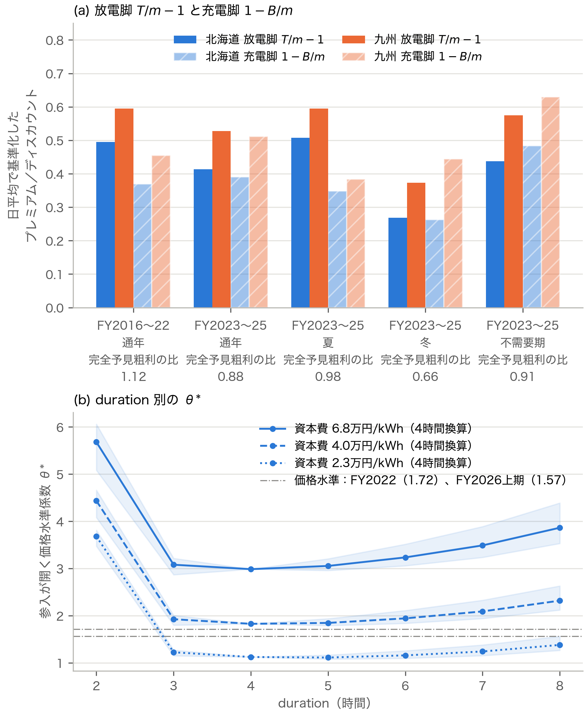{width=15cm}

注）(a) は放電脚 $T/m-1$ と充電脚 $1-B/m$（上位・下位4時間の平均価格を日平均で基準化した値）を、北海道と九州の24時間の価格がそろう共通日で比べたもの。横軸の各群の下の「完全予見粗利の比」は、北海道÷九州の比である。(b) は $K=0$ で参入が開く価格水準係数 $\theta^*$ を duration 別に示したもの（6.5節）で、静学、割引率6%。系列は4時間換算の資本費6.8・4.0・2.3万円/kWh、線は資本費のうち kW に比例する部分を24.3%とした値、帯はそれを0〜39.7%とした範囲。収益は実績整合ケース（モデル価格の上の戦略 c を4時間・$K=0$ で実績の戦略 c に校正）、容量収入は2029年度向けの北海道の約定価格と調整係数による（2時間は0）。水平の線は FY2022 と FY2026上期の価格水準である。

出所）日本卸電力取引所『スポット市場取引結果』、電力広域的運営推進機関『容量市場メインオークション約定結果』『容量市場メインオークション用調整係数』、経済産業省『定置用蓄電システム普及拡大検討会の結果とりまとめ』より筆者作成。

FY2016〜25 の推移（図6.2）では、完全予見粗利は FY2016〜19 に0.6〜1.1万円/kW-年、燃料危機の FY2022 に2.5万円へ急騰し、FY2023〜25 に0.96〜1.15万円へ戻った。風力が日内のスプレッドを広げるという頑健な証拠はないので（5.3節）、北海道の裁定原資が風力の増加によって大きく広がることは見込みにくい（6.4節）。

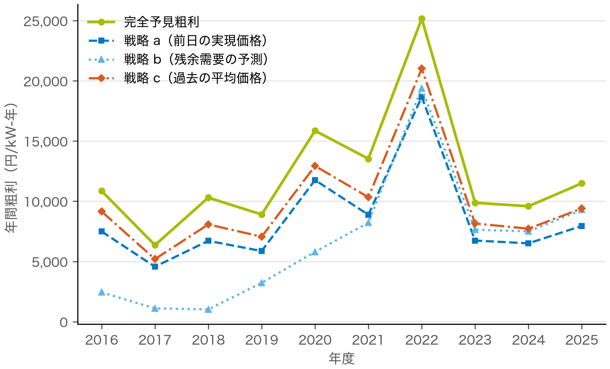{width=15cm}

注）4時間・往復効率0.85。a・b・c は6.1.2項の戦略である。FY2016 の戦略 b・c は、系列の冒頭で信号を作れない日を除く。FY2018 は北海道胆振東部地震による欠測を含む。

出所）日本卸電力取引所『スポット市場取引結果』、北海道電力ネットワーク『エリア需給実績』より筆者作成。

## 6.3　実行可能戦略と実現率

図6.3 は、FY2023〜25 の実行可能戦略の実現率と、戦略 c との差の検定である。気候値の戦略 c が81.7%（95%区間77.5〜84.9%）で最も高く、残余需要の予測ランクを使う戦略 b（78.9%）が続く。前日の実現価格のランクを使う戦略 a は68.5%で、九州の同じ戦略（年度別に76〜80%）より約10ポイント低い。c は b を年平均290円/kW-年、a を1,356円/kW-年上回り、c と他の戦略の差はいずれも1%水準で有意である。年度別には、c と b の差は FY2023・FY2024 に有意だが、FY2025 は1.1ポイントで有意でなく（p=0.25）、差は縮まっている。各戦略の年度別の値は表C.18 に示す。

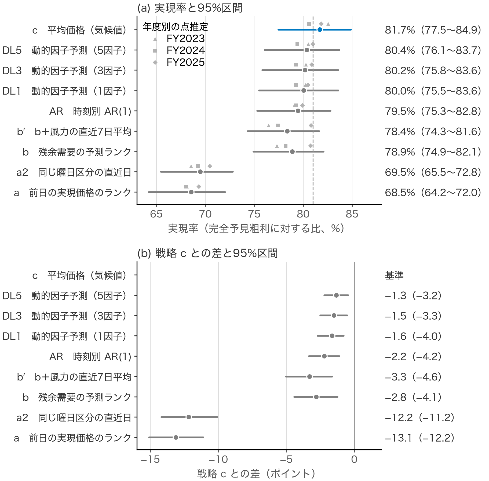{width=15cm}

注）実現率は完全予見粗利に対する比（%）。北海道 FY2023〜25 の1,096日、4時間・往復効率0.85・60分粒度。(a) の点は3年度の粗利の合計の比、横線は定常ブートストラップ（平均ブロック長20日、反復10,000回）の95%パーセンタイル区間、灰色の印は年度別の点推定で、右端の数値は点推定と95%区間である。(b) は戦略 c との差（ポイント）と95%区間で、右端の括弧内は日次粗利の差の Diebold–Mariano 統計量（長期分散は Newey–West、ラグ7日）。DL1・DL3・DL5 は動的因子予測、AR は時刻別 AR(1) による予測（6.1.3項）。縦の破線は戦略 c の実現率の水準（81%）。a・a2 は前日の実現価格に同値がある日（219日）に、同値の時間帯へ充放電量を均等に配分した値で、選び方を変えると a は年度別に66.5〜70.7%の範囲で動く。SPA 検定とモデル信頼集合（MCS）の結果は6.7節で扱う。

出所）日本卸電力取引所『スポット市場取引結果』、北海道電力ネットワーク『エリア需給実績』より筆者作成。

この順位は、北海道の日次の価格形状が二つの部分からなることを示す。一つは需要の朝夕のピーク・夜の谷・季節の日射からなる安定した骨格であり、もう一つは翌日に持ち越されにくい日々の変動である。戦略 a は前日の変動を追いかけて取り逃し、平均をとる戦略 c は変動を相殺して骨格だけを残す。形状の日々の持続性が低い過程では気候値が持続性予測に勝つという、予測の古典的な結果である（6.7節）。c が b を上回るのは、価格の平均が揚水の運用、連系線、風力の季節的な日内パターンまで織り込むためである。風力の直近7日平均を信号に加えた b′ は b を改善せず、プールではむしろ0.5ポイント下回る（p=0.03）。これは、風力の変動は数日にわたって持続するが（5.2.2項）、一日の価格をほぼ一様に動かし、充放電の順位を決める形状を広げるという頑健な証拠はない（5.3節・5.7節）ことと整合する。

FY2016〜25 の推移（図6.2）では、戦略 b は FY2016〜18 に実現率10〜22%とほぼ機能せず、FY2022〜23 に戦略 a を逆転した。価格形状を決める要因が再生可能エネルギーに移ったことを示すこの逆転は九州で先に観察されており、北海道でも遅れて現れ始めている。戦略 c の実現率は FY2016〜25 に76.4〜84.3%の範囲にあり、FY2018・FY2019・FY2021 を除けば8割を超える。充放電の順序を課した厳密解と比べても、戦略 c の粗利の差は±0.4%以内にとどまる（6.7節）。

戦略 c の実現率は、Butters et al.（2025）が CAISO で報告する完全予見の約7割と同じ水準帯にあり（10.2.3項）、本研究の気候値戦略は、PJM で直前2週間の価格に基づく運用が完全予見の85%以上を捕捉するという Sioshansi et al.（2009）のバックキャストの日本版にあたる。

## 6.4　風力の日次水準と裁定指標

### 6.4.1　風力の三分位別の裁定指標

表6.2 は、各季節で日次の風力発電量（出力制御前）の三分位に日を分け、裁定指標の平均を比べたものである。冬と不需要期では風力の多い日に TB4h がやや縮み、完全予見粗利は冬に−19%、不需要期に−2%となる。夏はむしろ風力の多い日にやや高いが、これは9月の日に由来し、7〜8月に限ると TB4h は10.72円から10.38円へ縮み、完全予見粗利は−2%と、他の季節と同じ向きになる。冬の−19%も、日次の完全予見粗利を風力に回帰すると係数は負だが有意でなく[^c6-2]、風力が冬の価値を下げるとまでは言えない。

: 表6.2　風力の三分位別の裁定指標（FY2023〜25）

| 季節 | 風力の三分位 | TB4h（円/kWh） | 完全予見粗利（円/kW-日） | 下限張り付き（時間/日） | 安値分断（時間/日） | うち北本の拘束（時間/日） | うち東日本側（時間/日） |
|---|---|--:|--:|--:|--:|--:|--:|
| 夏 | 小 | 10.89 | 31.6 | 0.14 | 7.2 | 1.3 | 5.4 |
|  | 中 | 10.81 | 31.7 | 0.08 | 7.7 | 2.2 | 4.7 |
|  | 大 | 11.30 | 33.8 | 0.35 | 10.7 | 4.0 | 6.1 |
| 冬 | 小 | 7.24 | 19.0 | 0.02 | 3.1 | 0.2 | 2.8 |
|  | 中 | 6.43 | 16.1 | 0.00 | 5.2 | 0.5 | 4.4 |
|  | 大 | 5.92 | 15.3 | 0.04 | 8.3 | 1.1 | 6.7 |
| 不需要期 | 小 | 10.61 | 32.1 | 0.62 | 4.8 | 1.6 | 3.0 |
|  | 中 | 10.35 | 31.7 | 1.19 | 6.5 | 2.7 | 3.5 |
|  | 大 | 10.19 | 31.6 | 1.19 | 9.2 | 3.6 | 5.2 |

注）日次平均。三分位は各季節内の3年プールで、日次の風力発電量（出力制御前）により分ける。下限張り付きは北海道エリアプライス（60分値）が0.01円/kWh の時間、安値分断は北海道エリアプライスがシステムプライスを0.01円超下回る時間。北本の拘束は北海道エリアプライスが東北エリアプライスを0.01円超下回る時間、東日本側は北海道と東北の差が0.01円以内の時間で、残りは北海道が東北を上回る時間である。

出所）日本卸電力取引所『スポット市場取引結果』、北海道電力ネットワーク『エリア需給実績』より筆者作成。

下限価格に張り付く時間は、風力の多い日でも需要期で1日0.4時間以下、不需要期で1.2時間にとどまる。一方、安値分断の時間は風力の多い日に1.5〜2.7倍（冬で最大）に増えるが、その増加の一部は北本連系線の拘束により、残りの大半は東日本側の分断である（5.5節）。表6.2 は、風力が一日の価格をほぼ一様に押し下げ、安値分断が増える局面の姿であり、現行の風力水準では、風力の多い日に蓄電池の価値が高まるという証拠はない。

### 6.4.2　価格カーブの因子へのエクスポージャー

風力がどの経路で蓄電池の価値に効くかを、24時間の価格カーブの主成分分解（5.7節）で測る。日次の完全予見粗利を、第5章の日次回帰と同じ右辺（式(5.2)）と第1〜第5主成分のスコアに回帰すると、各因子へのエクスポージャーが得られる。これは、債券の水準・傾き・曲率の因子（Litterman & Scheinkman, 1991）への感応度（ファクター・デュレーション）を、非線形なペイオフについて線形近似で測ったものにあたる。この回帰の標準誤差はラグ14日の Newey–West によるので、境界的な有意性は割り引いて読む。

FY2016〜25 の主成分では、エクスポージャー（因子1単位あたりの円/kW-日）は第1主成分（水準）が0.80、第2主成分（昼と夕方の差）が1.20であった。水準への感応が大きいのは、この期間の水準因子の負荷が夕方に偏り、水準の高い日ほど夕方が夜より大きく上がったためである。全時刻に一様な値上がりであれば、粗利は往復損失の分だけむしろ減る[^c6-3]。FY2023〜25 の主成分で測ると、水準因子へのエクスポージャーは0.01とほぼ消え、昼と夕方の差の因子へのエクスポージャーが1.71となる。その1標準偏差は平均粗利の45%に相当する。現行の構造の蓄電池は、平均で見れば価格カーブの形状に対するロング・ポジションである。ただし水準への感応がほぼ0なのは3年度・3季節の平均であり、年度別には符号が変わる（付録C.2.3）。

このエクスポージャーに第5章の因子回帰の係数を掛けると、風力と太陽光の効果を、水準因子経由、形状因子（第2〜第5主成分）経由、残差に分けられる。この分解は欠落変数の公式により標本内で厳密に成り立つ。FY2016〜25 の全期間では、風力は冬に主に水準因子を通じて完全予見粗利を下げるが（Newey–West で5%有意）、FY2023〜25 の構造ではこの経路は消え、風力の効果は有意でない。太陽光は夏と不需要期に粗利を上げ、その大半は形状因子経由である。現行の構造で蓄電池の価値を動かすのは、形状の因子を通じた効果である。

同じ結論は因子別の感応度でも確かめられる。実績価格の上で風力が作る価格変動だけを0〜3倍にしても、FY2023〜25 の完全予見粗利は−0.4〜−1.2%しか動かない[^c6-4]。これに対し、日内の形状成分を0にすると粗利は19.4%減る。風力の変動を3倍にした場合の変化を負にしているのは下限価格での打ち切りであり、打ち切らなければ+2.6%となる。打ち切りは充電側の値下がりを止めて価値を削る（7.7節、第9章）。

## 6.5　duration と参入閾値

duration を2〜8時間で変え、完全予見粗利と、窓を同じ時間にした戦略 c の実現額を実績価格で計算した。FY2023〜25 の完全予見粗利は、2時間6,026円、4時間10,317円、6時間13,062円、8時間14,354円/kW-年で、限界価値は逓減する。実現率も duration が長いほど下がるので、戦略 c の実現額の増分は4時間から6時間で+23%、6時間から8時間で+6%にとどまる（表C.17）。この逓減は PJM（Sioshansi et al., 2009）や欧州の全入札ゾーン（Mercier et al., 2023）の報告と同じ形である。

長い duration は容量収入も増やす。2029年度向けの北海道の調整係数 $\kappa(h)$ は4時間83.6%、6時間93.2%なので、4時間から6時間への限界収入は、容量収入の約1,430円とスポットの約1,900〜2,000円を合わせて計約3,400円/kW-年である。これに対し、追加の2時間分の資本費の年額と、充電側の託送従量負担・運転維持費の増分は計8,100〜12,900円/kW-年にのぼる（資本費6.8万円/kWh、WACC 6%。幅は資本費のうち kW に比例する部分を0〜40%とした範囲）。

蓄電池がない状態（$K=0$）で参入が開く価格水準係数 $\theta^*$（式(4.8)）は、同じ幅で見て3〜5時間でほぼ平らである（2.86〜3.21。図6.1 の (b)）。2時間は容量収入がないので明確に高く、6時間以上も長いほど高くなる（表C.17）。$\theta^*$ が最小になる duration は kW 比例部分の比率によって3〜5時間の間で入れ替わるので、「4時間が最小」とまでは言えない。ただし4時間の2.99との差は小さく、duration を選び直しても参入閾値の低下は約4%にとどまる[^c6-5]。4時間の仮定は、長い duration の価値を取り逃して参入を不利に見ているわけではなく、現行の資本費での $K^*=0$ の判定（7.5節）は duration の選び方に依存しない。なお、風力の1日を超える長周期の変動を取るには日をまたいで蓄える運用が要り、1日1サイクルのこの比較には現れない。

## 6.6　オプションとしての層分解

### 6.6.1　年度別・季節別の層

FY2023〜25 平均の完全予見粗利10,317円/kW-年は、(I) 8,427円（81.7%）、(II) 208円（2.0%）、(III) 1,682円（16.3%）からなる（図6.4、表D.3）。(I) の比率は戦略 c の実現率そのものであり、残りの18.3%（1,890円/kW-年）、すなわち (II)+(III) が固定窓に対する完全情報の価値である。(II) が小さいのは、固定窓の粗利が負になる日が FY2023〜25 に年18〜37日（5〜10%）にとどまるためである。(III) は完全予見粗利の大きい年ほど額が大きいが、比率は14〜23%の範囲にある。(I) の比率は FY2016〜25 に76.4〜85.6%であり、燃料危機の FY2022 でも大きくは変わらない。FY2016 は分母も戦略 c を評価できる355日にそろえた値なので、6.3節で全365日を分母とした84.3%と異なる。

なお、正規分布を仮定した閉形式（Bachelier 型）で日次スプレッド・オプションの時間価値を近似すると、日次粗利の分布の右への歪みを無視するので、(II) にあたる部分を実現値の約6倍に見積もる（付録B.3.4）。本研究が閉形式の価格公式を使わず、実現した価格の経路でペイオフを数えるのはこのためである。

季節で見ると、層の構成は大きく違う（表D.3 のパネルB）。冬は (I) の比率が0.61にとどまり、(III) が3割を超えるが、冬の (III) の額は夏・不需要期より2割ほど大きいだけであり、比率が高いのは冬の完全予見粗利そのものが小さいためである。冬に固定窓が外れやすい理由の一つは、放電に適した時間が朝と夕方の間で日々入れ替わることにある（付録C.2.5）。ただし冬の完全予見粗利は年間の15%にすぎず、冬の (I) の比率が夏並みであっても、年間の実現率は0.82から0.85に上がるだけである。

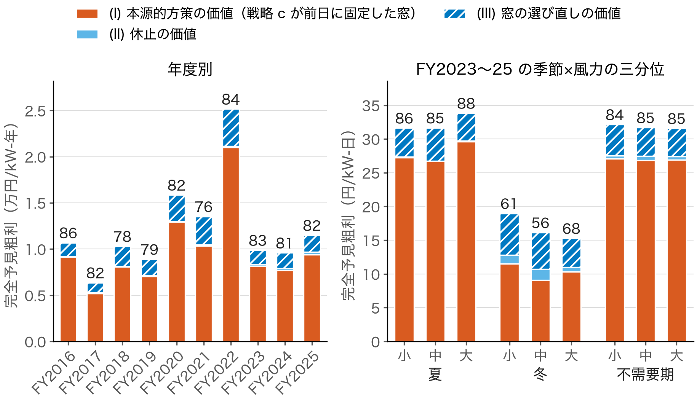{width=15cm}

注）左は年度合計（万円/kW-年）、右は日平均（円/kW-日）。棒の上の数字は (I) の比率（%）、すなわち戦略 c の実現率である。層の定義は式(6.2)、風力の三分位は表6.2 と同じ。

出所）日本卸電力取引所『スポット市場取引結果』、北海道電力ネットワーク『エリア需給実績』より筆者作成。

風力の三分位で分けても、(I) の比率は夏0.85〜0.88、不需要期0.84〜0.85で差が小さく、冬（0.56〜0.68）も風力の水準に単調には依存しない（図6.4 の右、表D.3）。日次の (III) を風力に回帰すると、係数は夏でほぼ0、冬と不需要期では負である[^c6-6]。風力の多い日に価格の形が読みにくくなり、窓の選び直しの価値が増えるという関係は見られない。

### 6.6.2　取り逃しの内訳と前日入札の限界

この分解は、戦略 c の実現率の解釈を限定する。前日スポットだけで戦略 c を上回る道は、休止と、入札時点の窓の選び方の改善（予測の改善や、価格に条件を付けた入札）である。休止は、事後の上限で測っても年2%にとどまる。窓の選び方の改善は (III) の一部を取りうるが、試した予測はいずれも c に及ばない（6.7節）。(II)+(III)（18%、冬は39%）を取りにいくのは、ドイツの日前市場と当日市場をまたぐ戦略（Oeltz & Pfingsten, 2025。査読前のプレプリント）である（10.4節）。時間前市場の価格はスポットと一致せず、流動性にも限りがあるので、取れるのはその一部である。本研究は前日スポットに範囲を限る（10.5節）。

## 6.7　実行可能戦略の検定と頑健性

表6.3 は、戦略 c の優位を選択の偏りを考慮して検定した結果と、主な頑健性の確認をまとめたものである。基準を b とすると、平均差を標準化した値が最大の候補は c であり、その優位は選択の偏りを考慮しても有意である。基準を c とすると、点推定で c を上回る候補はなく、c を有意に上回る戦略はない。ただし、この検定の帰無仮説は「どの候補も基準を上回らない」であり、それが棄却されないことは c が最善であることまでは示さない。最善の戦略の集合を推定するモデル信頼集合では、範囲統計量によれば99%の集合にも c だけが残るが、最大統計量によれば90%の集合に b と動的因子予測を含む6本が残り、最善の集合は統計量に依存する。また、c と b の差が縮んだ FY2025 には b に対する c の優位を単年では確認できず、この優位は主に3年プールの結果である。

: 表6.3　実行可能戦略の検定と頑健性の要約

| 確認の項目 | 方法 | 結果 | 結論 |
|---|---|---|---|
| c と b の差 | DM 検定 | +2.8ポイント（95%区間1.2〜4.4）、DM=4.10 | c が優位 |
| 選択の偏りを考慮した検定（基準 b） | SPA 検定・Reality Check（候補8本） | SPA の p=0.001、Reality Check の p=0.023 | c が優位 |
| 同（基準 c） | 同上 | c を上回る候補なし（p=1） | c を有意に上回る戦略なし |
| 最大値を選ぶことの偏り | 同じブートストラップ標本 | c が最大の割合99.8%、偏り−0.05ポイント | 上方の偏りなし |
| 年度別の検定（基準 b） | SPA 検定 | p=0.002（FY2023）、0.052（FY2024）、0.461（FY2025） | FY2025 は単年で確認できない |
| ブロック長 | 平均ブロック長7〜28日 | SPA の p≤0.0014 | 変わらない |
| 動的因子予測 | DL1・DL3・DL5・AR | c との差−1.3〜−2.2ポイント | c が上回る |
| 最善の戦略の集合 | モデル信頼集合 | 99%集合は c のみ（$T_R$）、90%集合は6本（$T_{\mathrm{max}}$） | 最善の集合は統計量に依存 |
| 充放電の順序 | 動的計画の厳密解 | 完全予見粗利−1.7〜−2.7%、c は±0.4%以内 | ランク法は頑健 |

注）北海道 FY2023〜25 の1,096日（年度別の行を除く）。SPA 検定は Hansen（2005）の一致版の p で、帰無仮説は「どの候補も基準を上回らない」。ブートストラップは定常ブートストラップ（平均ブロック長20日、反復10,000回）。モデル信頼集合は Hansen et al.（2011）により、$T_R$ は範囲統計量、$T_{\mathrm{max}}$ は最大統計量である。各検定の詳細は表C.19 と表C.20 に示す。

出所）日本卸電力取引所『スポット市場取引結果』、北海道電力ネットワーク『エリア需給実績』より筆者作成。

期間構造の標準的な予測モデルを当てても、前日の価格の情報で気候値を上回ることはできない。動的因子予測（DL1・DL3・DL5）と AR は、時間別価格の二乗誤差を c より14〜17%小さくするが（表C.20）、その改善はほぼすべて日平均（水準）の部分にあり、日平均を除いた形状の二乗誤差はほとんど変わらない。第1因子の1日の持続性は $\phi\approx0.54$ あるが、第2・第3因子は $\phi\approx0.35$ と小さく、充放電の時間を決めるカーブの順位は日平均を一律に動かしても変わらない。統計的な予測精度と経済的な価値が一致しないことは Leitch and Tanner（1991）以来の論点であり、ここではそれが、前日の情報は水準の予測には効くが、裁定の価値を決める形状の予測には効かないという形で現れ、6.3節の解釈を予測評価の手法で裏づける。

## 6.8　実現率の位置づけと均衡分析の収益の基準

第4章で定義したとおり、第7章の均衡分析は、限界参入者の収益をモデル価格の上で戦略 c を動かして求め、実績に校正する（実績整合ケース、式(4.4)）。本章の層分解は、この基準の根拠を与える。モデル価格は日々の予測できない形状の変動、すなわち層 (III) の多くを持たないので、モデル価格の上での完全予見粗利と戦略 c の差は663円/kW-年と、実績価格の上での差（1,890円）の約3分の1にとどまり、同じ戦略 c の実現率は0.92（仕様A、$K=0$、$\theta=1$）と高い。他方、モデル価格の上での戦略 c の粗利は、予測できる形状の価値が小さいために実績を下回る。実績整合ケースはこの差を校正係数 $\lambda$ で埋める（4.2.4項）。

この基準の向きを確かめておく。実績整合ケースは、$K=0$ では試した9本の中で点推定の実現率が最も高い c の実績に合わせた中心の推定であり、c を事後的に選んだことによる上方の偏りはほぼない（6.7節）。ただし検定が示すのは試した単純戦略の中での順位であり、実現率の水準そのものの妥当性ではない。戦略 c の実現額は先読みのない最適方策の価値の期待値の意味での下界であり、価格条件付きの入札（指値・ブロック入札）を使えば (II)+(III) の一部を上積みしうるので、実績整合ケースも実行可能な収益の上限ではない。この点で収益の基準は、参入に有利な側に置いた主たる前提（4.2.6項）とは向きが逆であり、$K^*=0$ という結論の側に偏りうる仮定である。$\lambda$ は FY2023〜25 の標本内の値で、年度別には0.94〜1.21で動くが、形状の期間外（FY2026 の4〜6月と FY2022）でも実績とモデルの比は小さくならない（付録C.2.7）。

収益の基準の置き方が $K^*=0$ の判定に与える影響は7.5節で扱うが、その偏りの大きさは次の極端な場合で上から抑えられる。前日スポットに限る本研究の設定で取りうる収益の上限、すなわち実績価格の上で実現率を1とした場合でも、損益分岐の価格水準係数 $\theta^*$ は第7章の標準・楽観・保守の3ケースで2.06〜2.95であり、燃料危機の FY2022 の水準（1.72）の1.2〜1.7倍である（付録C.2.7）。

## 6.9　小括

本章の主な結果は次の5点である。

1. 完全予見粗利は FY2023〜25 に0.96〜1.15万円/kW-年で、九州の約9割である。原資は両エリアとも放電脚と充電脚でほぼ半々であり、北海道の特徴は、価格形状がやや浅く価格水準が高いことにある。
2. 過去28日の平均価格カーブに対して前日に窓を固定する本源的方策（戦略 c）が完全予見粗利の81.7%を取り、試した9本の戦略の中で点推定が最も高い。b に対する優位は3年プールでは選択の偏りを考慮しても有意であり、c を有意に上回る戦略はない（最善の戦略の集合は統計量に依存する）。期間構造の動的因子予測も気候値を上回れない。
3. 取り逃している18%（冬は39%）の大半は、当日の実現価格で窓を選び直す価値である。前日スポットの入札だけで取れるのはその一部にとどまる。
4. 風力の多い日に蓄電池の価値が高まるという頑健な証拠はない。現行の構造の蓄電池は価格カーブの形状に対するロング・ポジションであり、風力は主に水準の因子に働くので、風力が蓄電池の価値を動かすという頑健な証拠はなく、効果があっても小さい。
5. duration を選び直しても参入閾値の低下は約4%にとどまり、4時間の仮定は参入を不利に見ていない。均衡分析は、モデル上の戦略 c を実績に校正した実績整合ケースを収益の基準とする。

仮説2の前半は支持される。本源的方策が完全予見粗利の81.7%を取り、予測を加えた戦略もこれを上回らない。後半（フリートの拡大に伴う減衰）は第7章で検証する。

RQ2 の前半への答えは次のとおりである。風力主導の北海道で蓄電池のスポット裁定価値を決めるのは風力の量ではなく価格カーブの日内の形状であり、前日スポットで実際に取れるのは、九州の約9割の上界のうち8割強である。第7章では、この収益の基準を構造型の価格過程モデルに載せ、蓄電池の参入が価格の形状を平らにする効果を内生化して、自由参入均衡 $K^*$ を求める。

[^c6-1]: 戦略 c の平均価格カーブは、当日より前で24時間の価格がそろう直近29日（D−29〜D−1）のうち、同じ曜日区分の日の時刻別平均であり、本文の「過去28日」はこの窓の概数である。戦略 b の需要の予測は D−29〜D−2 のうち同じ曜日区分の日の平均、太陽光の予測は D−8〜D−2 の平均による。曜日区分は平日と土日の2区分で、国民の祝日は平日として扱う。信号に同値がある日は、同値の時間帯に充放電量を均等に配分する。実装の詳細は付録B.3.1 に示す。

[^c6-2]: FY2023〜25 の日次の完全予見粗利を日次の風力発電量（出力制御前、GWh/日）に季節別に回帰すると、冬の係数は年度固定効果の仕様で−0.36（t=−1.5）、年月固定効果と需要・太陽光・土日を加えた仕様で−0.39（t=−1.5）であり、どの季節でも5%水準で有意でない。標準誤差は Newey–West（7ラグ）による。Newey–West は系列相関の強い日次回帰で過大に棄却しやすいので（5.9節）、有意でないという結論は推論法を変えても覆りにくい。

[^c6-3]: 日ごとに全時刻へ同じ額 $u_d$（円/kWh）を加えても上位・下位4時間の選択は変わらないので、完全予見の粗利は $-4(1-\eta)u_d=-0.6u_d$（円/kW-日）だけ動く（休止と稼働が入れ替わる日を除く。導出は付録B.1.1）。年度×季節内で平均0の水準成分は、平均の粗利をほとんど変えない。これは実証の結果ではなく、ペイオフの代数的な性質である。

[^c6-4]: 時刻別の価格の偏差を風力・太陽光・需要の発電量の偏差（年度×季節の平均からの偏差）に回帰した標本内の線形の応答を伸縮させる計算であり、平均の発電量は変えない。2倍・3倍は観測された変動の幅を超えるモデル依存の外挿である。値は下限価格で打ち切る場合である。導入容量を増やして純需要の水準そのものを下げる反実仮想（7.3節）とは別の計算であり、両者の符号の違いは矛盾ではない。太陽光の変動や水準成分を伸縮させた結果は付録C.2.3 に示す。

[^c6-5]: 主の前提の下での4時間からの低下は約4%（資本費6.8万円/kWh で最大4.3%、WACC 8% で4.5%）であり、容量収入を0とし資本費2.3万円/kWh・kW 比例部分40%とする極端な組合せでのみ最大6.6%になる。1日2サイクルを許しても、戦略 c の実現額は4時間で+0.7%しか増えない。需給調整市場の収入は入れていない（短い duration に有利に働く）。詳細は付録C.2.4 に示す。

[^c6-6]: FY2023〜25 の日次の (III) を日次の風力発電量（GWh/日）に季節別に回帰すると、年度固定効果の仕様で係数は夏+0.02（t=0.2）、冬−0.18（t=−2.3）、不需要期−0.09（t=−1.4）である。t 値は Newey–West（7ラグ）によるもので、系列相関の強い日次回帰では過大に棄却しやすいので、冬と不需要期の係数の有意性は割り引いて読む。年月固定効果などを加えた仕様は付録C.2.5 に示す。


```{=openxml}
<w:p><w:r><w:br w:type="page"/></w:r></w:p>
```


# 第7章　構造型価格モデルと自由参入均衡

本章は、蓄電池自身の参入によってスポット裁定価値がどれだけ速く減るか（RQ2 の後半）と、市場収入だけで運営するマーチャントの自由参入均衡でどれだけの容量が成り立つか（RQ3 の前半）を問う。第6章の価値は実績価格の上で単独の蓄電池を評価したもので、充放電が価格を動かす効果を含まない。そこで本章は、純需要を供給曲線に写す構造型価格モデルの上で蓄電池フリートを内生化し、限界参入者の収益曲線、ゼロレント条件による均衡容量 $K^*$、参入に必要な価格水準 $\theta^*$ を求め、実物オプションの参入閾値で静学の判定を補う。7.1節で方法を、7.2節で価格モデルの検証を、7.3〜7.5節で構造イベント・収益曲線・均衡容量を、7.6節で頑健性を、7.7節で下限価格の機構（RQ6 の一部）を、7.8節で参入閾値を示し、7.9節で小括する。

## 7.1　分析の方法

### 7.1.1　構造型価格モデル

本章の価格過程は、第4章の式(4.3)のとおり、純需要 $\mathrm{net}_t$（需要から出力制御前の太陽光・風力と原子力を引いたもの）の局所供給曲線 $g$ と時刻別のプレミアム $\mu$ を、年度別の価格水準係数 $\theta_{\mathrm{FY}}$ で伸縮させたものである。$g$ は季節ごとに純需要のビンの中央値を単調化した局所供給曲線、$\mu$ はその残差の季節×時刻別の中央値で、夕方のランプや希少性のプレミアムを表す[^c7-1]。$g$ と $\mu$ だけからなるこの単一曲線の仕様を仕様A と呼び、$\theta_{\mathrm{FY}}=1$ と置く版を水準固定、年度別の $\theta_{\mathrm{FY}}$ を当てる版を水準係数付きと呼ぶ。推定期間は FY2023〜25 で、最下位ビンの中心より低い純需要（推定範囲外）では価格を0.01円/kWh とする。出力制御前の発電量は設備利用率と導入量の積で表すので、気象のパスを保ったまま導入量を動かせる。市場分断を扱うため、システムプライスに対する安値・同価格・高値の3レジーム（5.1.3項）を純需要の多項ロジットで確率化し、同価格の時間にはシステムプライスを外生に当てる分断混合仕様も推定する。形状を固定したまま、FY2022 と FY2026上期（4〜6月）の $\theta$ を当該期間の価格で1パラメータ推定して、形状の期間外の検証とする。推定の手順は付録B.4.1 に示す。

この定式化は、需要を供給曲線に当てて価格を導く構造型電力価格モデルの系譜にある（Barlow, 2002; Carmona et al., 2013; Kanamura & Ohashi, 2007）。ホッケースティック型の供給曲線では需要が供給力に近づくと価格が急騰してスパイクが生じるが（Weron, 2014）、北海道の裁定価値には、純需要の低い時間にゼロ限界費用の電源へ切り替わる下端の急勾配も効き、その終点の下限価格は充電側の値下がりを止める（7.7節）。Weron（2014）の類型でいえば、$g$ は基礎（fundamental）モデル、$\mu$ と分断レジームの混合は統計・レジームスイッチの要素であり、後者は JEPX の買い主導・売り主導のレジーム転換（Kanamura & Bunn, 2022）を分断の3レジームに置き換えたものにあたる。負の価格を明示的に生成する欧州の簡約形モデル（Fanone et al., 2013）と違い、本研究は0.01円の下限を分布の左側の打ち切りとして扱う。

反実仮想で動かすのは風力の導入量なので、無条件の分布の再現に加えて、風力への条件付き応答を検証する。FY2023〜25 の1,096日について、実績価格とモデル価格の日次の指標に第5章の主仕様（表5.2）と年月固定効果の仕様を当て、差（モデル−実績）を同じ右辺に回帰して検定する（EWC、$\nu=42$。風力の3季節の族には Holm（1979）の補正を当てる）。両仕様の全季節・全指標で差の p が0.10を上回ることを基準とし、仕様A がこれを満たさないので（7.2.2項）、$\mu$ を日次の風力発電量の三分位にも依存させた仕様A′ を作る。現行の風力水準での収益曲線と $\theta^*$ は水準の再現がよい仕様A を主とし、風力の導入量を動かす反実仮想は仕様A′ を主とする。

### 7.1.2　完全予見粗利の分解

完全予見粗利は、充電脚と放電脚を持つ日次のスプレッド・オプションのペイオフであり、価格の比例的な変化には1次同次だが、加法的な変化には往復損失の分だけ反応する（第4章）。この性質を構造イベントの効果の読み解きに使う。粗利が正で稼働する日について、上位4時間・下位4時間の平均価格を第6章と同じく $T$・$B$ とすると、

$$4\,(0.85\,T-B)=3.4\,(T-B)-0.6\,B$$

（式番号 7.1）

が成り立つ（円/kW-日）。右辺の第1項はスプレッド $T-B$（TB4h）の価値、第2項は往復損失の費用である。失われる0.6kWh も下位4時間の価格で買うので、スプレッドが変わらなくても価格水準が下がれば粗利は増える。そこで構造イベントによる完全予見粗利の変化を、スプレッドの変化（3.4·ΔTB4h）、往復損失の水準効果（−0.6·Δ$B$）、休止の切替（どちらかの状態で粗利が負となり休止する日の差）に分ける。損失を上位4時間の価格で評価する別の分け方でも、以下の結論は変わらない。また、約定価格は潜在価格 $\tilde p_t$ を用いて $\max(\tilde p_t,0.01)=\tilde p_t+\max(0.01-\tilde p_t,0)$ と書けるので、充電する蓄電池は行使価格0.01円のプットを売った形になる（7.7節）。

### 7.1.3　フリートの内生化と実績整合ケース

フリート容量 $K$ の影響は、蓄電池を1万kW 刻みで逐次投入する増分貪欲ディスパッチで内生化する。各増分はその時点の価格で最安4時間に充電し、最高4時間に放電して（粗利が正の日のみ）、純需要と価格を更新する。これは各参入者が残されたスプレッドを順に取る競争均衡の近似であり、裁定ポジションの価格インパクト[^c7-2]を供給曲線から計算するものである。価格テイカーのモデルが貯蔵の価値を過大評価する問題に対して Emmanuel and Denholm（2022）が提案した市場フィードバックの枠組みを、供給曲線モデルの上で実装したものにあたる。Karaduman（2023）は、南豪州で価格インパクトを無視すると収益性を約2倍過大評価することを示している。

限界参入者の収益は、第4章の実績整合ケース（式(4.4)）で測る。すなわち、フリート投入後のモデル価格の上で戦略 c（4.2.2項）が実際に得る粗利 $c_{\mathrm{model}}(K)$ に、$K=0$・$\theta=1$ で実績に一致させる校正係数 $\lambda=1.108$（95%区間1.03〜1.19）を掛け、充電側の託送従量負担 $w_{\mathrm{chg}}$（1,752円/kW-年）を控除した $\pi(K)=\lambda\,c_{\mathrm{model}}(K)-w_{\mathrm{chg}}$ である。実績価格で測った実現率をモデルの完全予見粗利に掛けない理由は4.2.4項で述べた。$\lambda=1$ とした値（モデル直値）は下側の参考とする。$K>0$ ではフリートが価格の山谷を先に削るので、$\lambda$ を一定とする実績整合ケースは上側の値になりうる。主仕様のフリートは完全予見で配分し、フリート自身も戦略 c の窓で動く場合を感応度とする（7.4節）。

### 7.1.4　均衡条件

均衡容量 $K^*$ は第4章のゼロレント条件（式(4.5)）の解であり、$\pi(0)+\kappa P_{\mathrm{cap}}$ が参入必要収益 $c_{\mathrm{req}}$（式(4.6)）に届かなければ $K^*=0$ である。WACC 6%では $c_{\mathrm{req}}=3.59$万円/kW-年、実効容量収入 $\kappa P_{\mathrm{cap}}$ は1.25万円/kW-年である。粗収益が $\theta$ にほぼ比例するので、$K=0$ で参入が開く価格水準係数 $\theta^*$（式(4.8)）は、$a=\lambda\,c_{\mathrm{model}}(0)$（8,427円/kW-年）と $F=c_{\mathrm{fix}}+w_{\mathrm{chg}}-\kappa P_{\mathrm{cap}}$（1,452円/kW-年）を用いて $\theta^*=[I\cdot\mathrm{CRF}(r,20)+F]/a$ と書ける。比較のため、$c_{\mathrm{req}}$ を3.45万・3.2万・3.7万円とする標準・楽観・保守の3ケース（保守は実効容量収入も0.83万円とする。式(4.6)の割引率では約5.3%・3.9%・6.6%にあたる）を併記する。本章の $K^*$ は、スポット裁定と容量収入だけに依存するマーチャントの均衡容量であり、需給調整市場のレントは0と置く。ΔkW を供出する時間はスポット裁定に使えないので、そのレントは $\pi(K)$ に足すものではなく、置き換えて比べるものである。この置き方と、契約型の容量 $K_{\mathrm{exo}}$ を0とする置き方に対しては、7.6節で感応度を示す。

このゼロレント条件は、Butters et al.（2025）の動学的参入均衡を定常・確定的にした版にあたり、競争が進むほど個別の利潤が消えて総容量が決まるという Zhao et al.（2022）の極限に対応する。価格水準が不確実で投資が不可逆なら、競争が消すのは参入時点の超過 NPV であり、静学の損益分岐に対する閾値の上乗せは残る（Dixit & Pindyck, 1994; Leahy, 1993）。寡占の均衡で投資がゼロ NPV の近くで起きるという結果（Grenadier, 2002）も、先取りを含む均衡（Back & Paulsen, 2009; Fudenberg & Tirole, 1985; Weeds, 2002）も、将来の参入を織り込んだ NPV についての命題である。将来の参入は収入を下げる方向にしか働かないので、いずれの均衡でも、参入者が見込む価格経路で評価した静学のゼロレント条件は動学的な参入閾値の下限を与え、静学の $K^*$ は動学的な均衡容量の上限にあたる。価格水準の期待成長を0と置く主仕様では、この下限は価格水準一定の条件、すなわち $\theta^*$ そのものである。需給調整市場の収入や成長オプションに依存する参入は、この命題の対象外である。$K_{\mathrm{exo}}=0$ と静学の条件は、いずれも参入に有利な側の置き方なので、その下でも $K^*=0$ となれば、この結論は結論にとって不利な側の仮定の下で確かめられたことになる。これに対し、需給調整市場のレントを0と置くことは参入に不利な側の置き方なので、その影響は7.6節で別に評価する。

### 7.1.5　不確実性の下での参入閾値

不可逆な投資の機会は、価格水準を原資産とするアメリカン型のコール・オプションである（Dixit & Pindyck, 1994; McDonald & Siegel, 1986）。価格水準の代理として、月平均システムプライスを FY2023〜25 の同月平均で割った値（2016年4月〜2026年6月、123か月）を用いる。この代理は北海道エリアプライスで作る代理よりボラティリティを大きく出すので、参入が開く確率を高めに出す点では参入に有利な側に、参入閾値を高めに出す点では $K^*=0$ の結論を強める側に働く。その対数を、ランダムウォークに従う恒久成分 $\xi$ と1次の自己回帰過程（AR(1)）に従う一時成分 $\chi$ の和として、カルマンフィルタを用いた最尤法で推定する。Schwartz and Smith（2000）の2因子モデルを、先物を使わずに推定した形である。年間のキャッシュフローは

$$\mathrm{CF}_t=a\,\theta_t\,\frac{c_{\mathrm{model}}(K_t)}{c_{\mathrm{model}}(0)}-F$$

（式番号 7.2）

とする。資本費は年率 $g_I$（0〜8%）で下がって揚水並みの2.3万円/kWh で止まり、寿命は20年、判断は年1回、建設ラグは1年、恒久成分は期待成長 $\alpha=0$ の対数正規マルチンゲールとする。式(7.2)のキャッシュフローの下で比べる閾値は、式(4.8)の静学の損益分岐 $\theta^*$、排他的な参入権を持つ単独企業の最適行使閾値 $\bar\theta$（年次の動的計画法で求める）、競争均衡の参入閾値 $\theta_c$ の三つである。$\theta_c$ は、閾値で参入した者の NPV を、後続の参入で収入が閾値に押さえられることを織り込んで計算し、それが0になる水準であり、Dixit and Pindyck（1994, Chapter 8）の産業均衡を年次・有限寿命に置き換えたものにあたる。割引は実物確率の下で WACC によって行う。北海道の価格水準を複製できる取引商品がなく、リスクの市場価格を校正できないためであり（Dixit & Pindyck, 1994, Chapter 4）、基準の6%（契約型の資本コストの水準）に、マーチャントの資産の資本コストに近い8%（8.7.2項）を併記する。割引率を上げれば閾値は上がるので、6%は参入に有利な側の置き方である。数値解法と検算は付録B.4.5 に示す。

## 7.2　価格モデルの再現と検証

### 7.2.1　水準と分布の再現

標本内では、分断混合仕様は TB4h の中央値（実績8.3〜9.6円/kWh）を8.0〜8.3円とほぼ再現する。しかし分布の裾が圧縮されるため、完全予見粗利は実績より9〜24%過小で、0.01円/kWh に張り付く時間（以下、下限張り付き時間）も実績の5〜6割にとどまる（表C.21）。時刻別プレミアム $\mu$ を外すと、仕様A の完全予見粗利は25%下がる。夕方のランプや希少性のプレミアムは、純需要だけでは説明できない一次的な要素である。

FY2026 の4〜6月には、定常な仕様（$\theta=1$）の価格は実績の TB4h の中央値と95パーセンタイル（p95）を大きく下回る（表7.1）。同じ期間に北海道エリアプライスは同じ純需要水準で約1.6〜1.7倍、システムプライスも約1.5〜1.6倍に上がっており、上側の水準のシフトは全国的な燃料・供給構造の変化である。年度別の水準係数は、FY2023〜25 の0.94・1.07・1.00に対し、FY2026上期が1.57、FY2022 が1.72である。形状を固定して $\theta$ だけを推定すると、FY2026上期の完全予見粗利は実績の78%まで再現される（直前の水準を与えると50〜51%）。これは水準を合わせたうえでの形状の検証であり、予測力の検証ではない。また $\theta$ は基準価格3円/kWh 以上の価格の水準を表す指数であり、年度間の完全予見粗利の違いは説明しない。残る乖離は下限張り付き時間とスパイクの裾の圧縮による定常的な過小評価で、FY2022 は連系線増強前の厚い裾のため56%しか再現できない。

: 表7.1　年度別の水準係数と価格過程の再現

| | FY2022 | FY2023 | FY2024 | FY2025 | FY2026（4〜6月） |
|---|---:|---:|---:|---:|---:|
| 水準係数 $\theta_{\mathrm{FY}}$ | 1.72 | 0.94 | 1.07 | 1.00 | 1.57 |
| **パネルA：TB4h の中央値（円/kWh）** | | | | | |
| 実績 | 19.3 | 8.3 | 8.7 | 9.6 | 18.7 |
| 仕様A（$\theta=1$） | 7.8 | 7.8 | 7.8 | 8.3 | 9.2 |
| 仕様A（水準係数付き） | 13.4 | 7.3 | 8.3 | 8.3 | 14.3 |
| **パネルB：p95（円/kWh）** | | | | | |
| 実績 | 42.2 | 18.1 | 19.6 | 19.6 | 26.1 |
| 仕様A（$\theta=1$） | 18.7 | 18.2 | 17.9 | 18.2 | 14.5 |
| 仕様A（水準係数付き） | 32.1 | 17.1 | 19.0 | 18.1 | 22.7 |
| **パネルC：完全予見粗利（円/kW-年）** | | | | | |
| 実績 | 25,160 | 9,873 | 9,586 | 11,493 | 5,425 |
| 仕様A（$\theta=1$） | 8,262 | 7,989 | 8,319 | 8,489 | 2,707 |
| 仕様A（水準係数付き） | 14,173 | 7,495 | 8,860 | 8,463 | 4,241 |

注）p95 は95パーセンタイル。FY2026 は4〜6月の3か月分で、完全予見粗利も3か月分の値である。形状は FY2023〜25 で推定し、FY2022 と FY2026 は形状の期間外検証で、水準係数は当該期間の価格で推定した。仕様A（$\theta=1$）は水準を固定した値、仕様A（水準係数付き）は各年度の $\theta_{\mathrm{FY}}$ を当てた値である。

出所）日本卸電力取引所『スポット市場取引結果』、北海道電力ネットワーク『エリア需給実績』より筆者作成。

実績とモデルの比は、完全予見粗利ではどの期間でも1を上回り（標本内1.25、年度抜き取り1.28、FY2026 の4〜6月1.28、FY2022 1.78）、戦略 c でも FY2024（0.94）を除いて1を上回る（標本内1.11、FY2026 の4〜6月1.23、FY2022 1.60）。比が期間外で小さくならないので、$K=0$ の実績整合ケースは上限ではなく中心の推定とみなせる。

### 7.2.2　風力への条件付き応答と仕様A′

仕様A は不需要期で実績と有意に異なる。風力1GWh/日あたりの差は、TB4h で+0.180円/kWh（p=0.010）、完全予見粗利で+0.60円/kW-日（p=0.012）であり、Holm の補正後も p=0.024〜0.037で残る。高風日の夕方の高値の低下を、実績の半分以下しか再現しないためである。水準係数を入れても同じ向きにずれる（完全予見粗利で+0.57円/kW-日、p=0.018）ので、ずれは水準の扱いでは解消しない。原因は時刻別プレミアム $\mu$ が日々の風力で変わることにあり、不需要期の高風日には夕方（17〜20時）のプレミアムが1〜2円/kWh 小さい。仕様A′ では、両仕様の全季節・全指標で差の p が0.10を上回る（最小0.14）。ただし有意でないことは一致を意味しない。不需要期の完全予見粗利の差の点推定+0.35（95%区間−0.13〜+0.82）は残り、$\mu$ を年度抜き取りで推定すると p は0.09になる。仕様A′ は状態変数などの組合せを試して選んだので、この検証は標本内の確認にとどまる（表C.22）。風力1GWh/日あたりの年間の完全予見粗利の応答は、実績+37円、仕様A+139円、仕様A′+79円/kW-年である。仕様A′ もなお実績の約2倍の応答を示すので、仕様A′ で求めた風力の増加の効果も、参入に有利な側に偏った値である。なお、太陽光については両仕様とも不需要期の下位4時間を実績より深く下げており、ベースロード減の効果（7.7節）を読むときの留意点になる。

## 7.3　構造イベントの部分均衡効果

FY2023〜25 の気象・需要パスの上で、分断混合仕様の価格過程に構造イベントを加えた（共通乱数。年度別の結果は表C.23）。風力の現行値121万kW は、推定期間の認定容量の平均である。

泊原子力発電所3号機（以下、泊3号）の再稼働（91.2万kW×稼働率90%）は、下限張り付き時間を5〜7倍に増やし、完全予見粗利を3年度平均で+1,184円/kW-年増やす。ただしその約7割（+812円）は、価格水準が下がって往復損失が安くなる効果であり、夏にはスプレッドがむしろ縮む。収益曲線と同じ決定論の仕様A でも、増分+662円は往復損失の水準効果+847円とスプレッドの変化−197円などからなる。全時間一定のデータセンター等の需要+80万kW は完全予見粗利を797円減らし、泊3号と合わせるとほぼ相殺するが、その単独の効果の大きさは供給曲線の上端の置き方に依存し、分断混合仕様では符号も識別できない（表C.23）。

どの仕様・下端の扱いでも、$K^*=0$ は変わらない。下限を残す三つの扱い（仕様A、下端の線形外挿、分断混合仕様）の価格の上で戦略 c を計算して現状に校正すると、泊3号から泊1〜3号の全基まで（泊3号の2基分を以下、泊2基相当と呼ぶ）の再稼働で、$\pi(0)$ は4,625〜7,384円/kW-年、$\theta^*$（式(4.8)、WACC 6%）は2.75〜3.95であり、FY2026上期の1.57と FY2022 の1.72を大きく上回る。分断混合仕様では泊2基相当と全基で完全予見粗利が大きく増えるが、増分は時間ごとに独立に引くレジームの切り替わりから生じるので、戦略 c はほとんど取れない（実現率0.80→0.52・0.41）。実現可能収益はむしろ下がる。

風力導入量を現行の0.5〜3倍に振ると（表C.24、図7.1）、仕様A′ の完全予見粗利は現行の9,036円/kW-年から、2倍で+334円、3倍で+1,001円増える。現行水準の近くでは風力の効果はほぼ一様で、1.25倍の増分+35円は往復損失の水準効果+98円とスプレッドの変化−63円からなる。構造モデルの上では、導入量が増えると低純需要の時間が供給曲線の下端の急な部分に入り、安い時間ほど大きく下がる非平行の効果でスプレッドが開く（この機構は標本内の回帰では確認できない。7.7節）。しかし仕様A′ では、その効果は3倍でも+258円にとどまる。仕様A（3倍で+1,481円）と分断混合仕様（+1,961円）は増分をさらに大きく出すが、仕様A′ を含めいずれも風力への応答を実績より大きく出すので（7.2.2項）、これらの増分は上側の値である。

{width=15cm}

注）FY2023〜25 の気象・需要パス、$K=0$ の部分均衡。風力導入量は、出力制御前の設備利用率の過程を保って一律に伸縮させた。上は完全予見粗利（円/kW-年）、下は下限張り付き時間（時間/年）。系列は泊なし（現状）と泊3号の再稼働、縦の破線は風力導入量の現状（121万kW）。価格過程は水準係数を入れない分断混合仕様である。蓄電池フリートの応答、システムプライスの変化、供給側の内生的な反応は含まず、レジームの確率の推定範囲外への外挿を含む。分断混合仕様は風力の効果を実績より有利に出す仕様であり、主とする仕様A′ と仕様A の値は表C.24 に示す。

出所）日本卸電力取引所『スポット市場取引結果』、北海道電力ネットワーク『エリア需給実績』より筆者作成。

より重要なのは、完全予見粗利が増えても、実行可能な粗利はほとんど増えないことである。風力3倍でのモデル価格の上の戦略 c の粗利の変化は、仕様A′ で−241円、仕様A で+168円にとどまる。増える完全予見粗利の大半は、前日の気候値では予測できない日々の深い安値から来るからである。泊と組み合わせると、仕様A′ の完全予見粗利は風力2倍を頂点に下がる。いずれも $K=0$ の上の形であり、価値を大きく動かすのは蓄電池自身の競合である。

## 7.4　限界参入者の収益曲線

蓄電池フリートを内生化した限界参入者の実現可能収益 $\pi(K)$ を、表7.2 と図7.2(a) に示す。

: 表7.2　限界参入者の実現可能スポット収益 $\pi(K)$

| $K$（万kW、4時間） | 現状 | 泊3号の再稼働 | 泊＋風力2倍 |
|---|---:|---:|---:|
| 0 | 6,675（5,886） | 7,384（6,529） | 7,249（6,406） |
| 10 | 5,577（4,891） | 6,336（5,579） | 6,320（5,564） |
| 20 | 4,500（3,915） | 5,337（4,674） | 5,467（4,792） |
| 25 | 3,964（3,429） | 4,837（4,221） | 5,038（4,403） |
| 30 | 3,448（2,961） | 4,353（3,782） | 4,626（4,029） |
| 50 | 1,592（1,279） | 2,638（2,227） | 2,920（2,482） |
| 70 | 159（−20） | 1,189（913） | 1,486（1,183） |
| 100 | −1,190（−1,243） | −333（−465） | −81（−238） |
| 150 | −1,993（−1,970） | −1,571（−1,588） | −1,472（−1,498） |
| $\pi=0$ となる $K$（万kW） | 72.6（69.6） | 91.9（88.0） | 98.4（94.2） |

注）円/kW-年。各セルは実績整合ケース（括弧内はモデル直値）。仕様A（水準固定。校正係数は1.103で、$K=0$ で実績の戦略 c 8,427円に一致させる。7.1.3項の $\lambda=1.108$ は水準係数付きの仕様A の値）、増分貪欲（1万kW 刻み）、フリートは完全予見で配分、充電従量負担を控除、FY2023〜25 パスの平均。泊＋風力2倍の列は仕様A による（風力への条件付き応答を標本内で修正した仕様A′ では、泊＋風力2倍の $\pi(0)$ は6,629円、$\pi=0$ となる $K$ は98.2万kW）。

出所）表7.1 と同じ。

{width=15cm}

注）(a) は $\theta=1$ の現状の $\pi(K)$、(b) は $K=0$ の収益と価格水準係数 $\theta$ の関係および参入に必要な水準。水準係数付きの仕様A、FY2023〜25 パス、増分貪欲（1万kW 刻み）、充電従量負担を控除。実線は実績整合ケース、破線はモデル直値、一点鎖線はフリートも戦略 c の窓で動く感応度。

出所）表7.1 と同じ。

カニバリゼーションは速い。$\pi(K)$ は25万kW で $K=0$ の59%、約31万kW で半減し、50万kW で24%、約72万kW で負に転じる。泊の再稼働や風力の倍増は曲線を上方に移すが、負に転じる点は約92〜98万kW に動くにとどまる。この減衰は、1GW の貯蔵で裁定価値が2割超減るとした Sioshansi et al.（2009）以来の自己共食いの議論と整合する（Karaduman, 2023; Lamont, 2013; Lamp & Samano, 2022）。海外の市場の実績との比較は10.2.3項で行う。

限界参入者の戦略 c の実現率は、$K\le50$万kW で0.91〜0.94とほぼ一定で、100万kW で0.59〜0.67に下がる。フリート自身も戦略 c の窓で動くと仮定すると実現率はより速く下がり、$\pi=0$ となる容量は約53万kW に前倒しになる。フリートの情報の仮定によって負に転じる点は53〜72万kW の幅で動くが、$K^*=0$ は $\pi(0)$ だけで決まるので、この仮定にも、$K>0$ で $\lambda$ を一定とする仮定にも左右されない。

## 7.5　均衡容量と損益分岐の価格水準

参入に必要なスポット収益 $c_{\mathrm{req}}-\kappa P_{\mathrm{cap}}$ は、式(4.6)（WACC 6%）の $c_{\mathrm{req}}$ で23,414円、標準・楽観・保守ケースで22,000円・19,500円・28,700円/kW-年である。これに対し $\pi(0)$ は6,675〜7,384円（モデル直値5,886〜6,529円）にすぎず、いずれのシナリオ・ケースでも参入に必要な水準に達しない。したがって現行の資本費と価格構造の下では、スポット裁定と容量収入だけに依存するマーチャントの均衡容量は $K^*=0$ である（需給調整市場のレントは7.6節で扱う）。これは私的な参入誘因についての命題である。価格上限が停電価値を下回らなければ競争的な貯蔵のゼロ利潤均衡がシステム費用の最小化と一致するという Schmalensee（2022）の同値は、価格が歪められていない場合のものである。下限価格が拘束力を持ち、出力制御が無補償で、容量市場と LTDA がある本研究の設定では、$K^*=0$ からシステム費用についての含意は導けない（本研究は厚生分析を扱わない）。

価格水準を上げても判定は変わらない（図7.2(b)）。$\pi(0)$ は FY2026上期の水準（$\theta=1.57$）で11,452円、燃料危機の FY2022 の水準（$\theta=1.72$）で12,705円にとどまり、楽観ケースの19,500円に届かない（$K>0$ は表C.25）。式(4.8)の損益分岐は $\theta^*=2.99$（モデル直値3.31、$\lambda$ の95%区間で2.78〜3.21、3ケースで2.52〜3.61）であり、FY2026上期の水準の1.91倍、FY2022 の1.74倍にあたる。

ただしこの $\theta^*$ は、推定期間で校正した $\lambda$ を高い価格水準でも一定とし、収益を $\theta$ に比例させて求めた値である。期間外の実績とモデルの比は、戦略 c で FY2026上期1.23、FY2022 1.60と $\lambda$ を上回る（7.2.1項）。価格水準が高い局面では、モデルが実績の取り分を過小に見て、$\theta^*$ を高めに出している可能性がある。この比を $\lambda$ の代わりに当てると、$\theta^*$ は約2.7・約2.1に下がる。$\lambda$ の95%区間による幅は推定期間内の標本誤差だけを表し、この下側の不確実性を含まない。FY2023〜25 の実績価格の上で実現率を1とする極端な場合でも、式(4.8)の $\theta^*$ は2.44である（付録C.2.7）。いずれも FY2022 の水準1.72を上回るが、必要な価格水準は、収益の基準の置き方によって2倍強から約3倍の幅を持つ。

例外に近いのは FY2022 の実績価格そのものである。連系線増強前の分断構造の上で戦略 c が実際に得た粗利21,017円を用いれば、実現可能収益は19,265円で、参入に必要なスポット収益の82%（式(4.6)）、88%（標準ケース）、99%（楽観ケース）に達する。マーチャントの参入は、燃料危機の水準と当時の分断構造が同時に恒常化する場合にのみ開く。なお、以上は価格水準が一定のまま続くと置いた静学の判定であり、待機の価値を考慮すると参入閾値はさらに上がる（7.8節）。

資本費の側からみると、$K=0$ で参入が立つ年間固定費（資本費の年額と運転維持・廃止費の合計）は約1.23万円/kW-年で、資本費に換算すると約2.0万円/kWh、現行の6.8万円/kWh の3割弱である。資本費が蓄電池産業戦略の長期目標である揚水並みの2.3万円/kWh まで下がれば、$\theta^*$ は1.12となる。FY2023〜25 の水準では参入は開かないが余裕は小さく、恒久成分の推定値1.22（7.8節）や FY2026上期の水準1.57が続けば開く（$\theta=1.22$ での損益分岐の資本費は2.5万円/kWh）。Butters et al.（2025）は CAISO で資本費が30%下がれば導入が大きく進むと報告したが、北海道では資本費の約7割の低下か、価格水準の約3倍への上昇が必要である。系統利用料が裁定価値を20〜50%削るという Mercier et al.（2023）の指摘のとおり、託送等固定費と充電従量負担も損益分岐に一次的に効く。

## 7.6　頑健性の確認

主要な感応度を表7.3 にまとめる。需給調整市場のレント（後述）を除き、どの前提の変更でも $K^*=0$ の判定は変わらない。

: 表7.3　均衡の判定の感応度

| 変える前提 | 置き方 | 主な結果 | $K^*=0$ |
|---|---|---|---|
| 価格過程の仕様と下端の扱い | 仕様A、線形外挿、分断混合（泊3号〜全基） | $\pi(0)$ 4,625〜7,384円、$\theta^*$ 2.75〜3.95 | 不変 |
| 風力導入量と泊の組合せ | 風力0.5〜3倍、泊の有無 | $\pi(0)$ の最大7,177円 | 不変 |
| フリートの情報の仮定 | 完全予見、戦略 c の窓、半々 | $\pi=0$ の $K$ 53〜72万kW | 不変 |
| 校正係数 $\lambda$ | 95%区間1.03〜1.19、$\lambda=1$、期間外の比1.23・1.60 | $\theta^*$ 2.78〜3.21、3.31、約2.7・約2.1 | 不変 |
| 割引率 | 5%〜9% | $\theta^*$ 2.76〜3.71 | 不変 |
| 容量市場の参加区分 | 発動指令電源（実効0.83万円） | $\theta^*$ 3.48 | 不変 |
| 既設・契約型の容量 | $K_{\mathrm{exo}}=20$万kW、87.4万kW | $\theta^*$ 4.05、約26 | 不変 |
| 容量市場価格の $K$ 依存 | 北海道ブロック按分、全国連系 | 按分では約27万kW で約定価格0 | 不変 |
| 需給調整市場のレント | 上限 $\min(Q/K,1)\times 2p_{\Delta}\times8{,}760$ | 50万kW で17,520〜262,800円 | 覆りうる（支えうる容量は $Q$ 程度まで） |

注）$\theta^*$ は式(4.8)（WACC 6%、実績整合ケース）による。校正係数の期間外の比は、FY2026上期と FY2022 の戦略 c の実績とモデルの比（7.2.1項）を $\lambda$ の代わりに当てた場合である。容量市場の参加区分の比較の対象は安定電源（実効1.25万円）。容量市場価格の $K$ 依存は $K>0$ の収入だけを下げるので、$K=0$ で決まる判定には効かない。$Q$ は北海道の調達量（10〜50万kW の仮定）、$p_{\Delta}$ は ΔkW 価格（5〜15円/ΔkW・h）で、レントはスポット裁定と排他的なので、$\pi(K)$ と置き換えて比べる上限である。詳細は付録C.3.6 に示す。

出所）表7.1 の出所、電力広域的運営推進機関『容量市場メインオークション約定結果』『メインオークション需要曲線』より筆者作成。

風力導入量と蓄電池容量の2次元の感応度面では、仕様A′ で風力を3倍にしても $\pi(0)$ は6,434円にむしろ下がる。フリート50万kW 分のカニバリゼーション（6,675円から1,888円）のほうが、風力の効果よりはるかに大きい（表C.26、図7.3）。既設・契約型の容量を外生に置くと $\theta^*$ は大きく上がるが、推定期間の価格には当時稼働していた蓄電池の影響がすでに入っているので、その値は二重計上を含む上限側である。容量市場の約定価格は、需要曲線を北海道の需要シェアで按分した近似では、蓄電池の追加4.4万kW で指標価格まで下がる（表C.27）。容量市場側のカニバリゼーションはスポット側より速く、2030年度向けの指標価格の引上げによる容量収入の上振れを打ち消す側に働く。

{width=15cm}

注）(a) は供給曲線の下端を段差とする仕様A、(b) は下端を線形外挿し下限を残した仕様A。実線は泊なし、破線は泊3号の再稼働で、色は風力導入量（現状の0.5〜3倍）。水準係数付きの価格過程（$\theta=1$）、FY2023〜25 パス、増分貪欲（1万kW 刻み）。実績整合ケースは各下端の扱いの現状・$K=0$ で実績の戦略 c（8,427円/kW-年）に校正し、充電従量負担を控除した。参入に必要なスポット収益（容量収入1.25万円のとき、式(4.6)（WACC 6%）で約2.34万円、楽観ケースで1.95万円）には、どの組合せでも届かない。仕様A′ は含まない。

出所）図7.1 と同じ。

需給調整市場のレントの上限は、フリートが小さいうちは参入に必要なスポット収益（23,414円）を埋めうる大きさである（表C.28）。表7.3 の前提のうち、$K^*=0$ の判定を覆しうるのは、このレントを0と置く主の置き方だけである。ただしこの上限は、$K$ が調達量 $Q$ を超えても ΔkW 価格が $p_{\Delta}$ に保たれると置いた値である。$K$ が $Q$ を超えると、蓄電池どうしが $Q$ の枠を争うので、ΔkW 価格はスポット裁定の機会費用まで下がり、スポット裁定を上回るレントは残らない。蓄電池の落札単価が急速に下がった実績（3.4節）は、この競争が速く進むことを示している。既設や契約型の蓄電池も同じ枠を争うので、需給調整市場のレントで支えうるマーチャントの容量は、多くとも調達量 $Q$ の程度（仮定の幅で10〜50万kW）で頭打ちになり、契約申込の234万kW には遠く及ばない。北海道エリアの商品別の約定量と約定価格によるレントの実測は行っていないので、本章の $K^*=0$ は、スポット裁定と容量収入だけに依存するマーチャントについての判定として読む必要がある。

最後に、割引率の選び方について述べる。補助金のないマーチャントの事業 IRR は $\theta$ が1〜1.72の範囲で負なので、実効容量収入が1.25万円にとどまる限り、判定は割引率の選び方によらない（8.7.1項）。判定が割引率に依存するのは、FY2022 の実績価格そのもの（IRR は3.75%）、2030年度向け以降の容量収入の上振れ、補助金を受けるマーチャントの場合である（7.8節・8.7節）。

## 7.7　価格モデルの曲線と下限価格の機構

7.3〜7.6節の構造イベントと風力の効果は、供給曲線の低純需要の側の形と下限価格の扱いに依存する。本節はその機構を示す。ただし下端の機構は構造モデル上のもので、標本内の回帰では確認できない。春の風力の TB4h への係数（5.3.1項）を日の純需要の三分位で分けても、低純需要の日ほど大きく正になる形は現れない。

図7.4 は仕様A の供給曲線と純需要の分布である。$g$ は各季節の最下位ビンの中心より低い純需要では識別できず、仕様A はこの推定範囲外を0.01円とする。推定範囲外の時間は現状では全時間の0.2%にすぎないが、泊3号（−821MW）で5.2%、泊2基相当（−1,642MW）で29%に増える。推定範囲内の下端の傾きは、春と秋で急（1.14円・0.70円/kWh per 100MW）、冬と夏で緩やか（0.31円・0.35円）である。仕様A で冬・夏に現れる急な落ち込みは、推定範囲外を0.01円とする段差の仮定による。

{width=15cm}

注）上段は季節別の供給曲線 $g$、時刻別の $g+\mu$（3時・12時・18時）、下端の線形外挿と実績（FY2023〜25）で、網掛けは推定範囲外。下段は FY2023〜25 の気象・需要パスの純需要の分布（現状、泊3号、泊2基相当、風力2倍）。

出所）表7.1 と同じ。

ベースロードを一律に減らした応答を図7.5 に示す（分解は表C.29）。仕様A では、泊3号の再稼働で上位4時間の平均価格は15.9円から11.9円/kWh、下位4時間は7.9円から4.0円/kWh へほぼ同じ幅で下がり、TB4h は8.04円から7.89円へわずかに縮む。夏は上位4時間の帯の供給曲線が下位4時間の帯より急なので、完全予見粗利は179円減る。ベースロードをさらに減らすと、完全予見粗利は約1,100MW で頂点に達した後に下がり、泊1〜3号の全基（1,863MW）では7,782円と現状の8,266円を下回る。上位4時間が下がり続ける一方で、下位4時間は下限価格に張り付いてそれ以上下がらなくなるためである。山の高さは推定範囲外の置き方にも依存し、下端を線形外挿して下限を残すと、泊3号の増分は+662円から+163円に、泊2基相当は−1,342円になる。どちらの置き方が正しいかは、データからは判定できない。

{width=15cm}

注）FY2023〜25 パスの部分均衡。A は年間の完全予見粗利（仕様A、線形外挿の下限あり・下限なし）、B は仕様A の変化の式(7.1)による分解、C は季節別の変化、D〜F は仕様A の価格指標、季節別の TB4h、下限張り付き時間。縦の点線は泊3号と泊2基相当。季節は夏7〜9月、冬12〜2月、不需要期3〜6月と10〜11月。

出所）表7.1 と同じ。

下限価格そのものの役割は、まず実績価格で確かめられる（表7.4 のパネルA）。FY2023〜25 の実績価格を一様に $\Delta p$ 円/kWh 下げると、0.01円で打ち切らない限り、完全予見粗利は1円あたり219円/kW-年（0.6×365日）増えるだけである。加法的な水準の変化への反応は、往復損失を通じた弱いものにとどまる。0.01円で打ち切ると、完全予見粗利はほぼ横ばいの後に下がる。平行に下がる価格が下限で打ち切られると、安い側だけが下がらなくなり、スプレッドが縮むからである。充電脚でプットを売っているので、潜在価格が下限を下回るほど、得られたはずの値下がりを失う。

: 表7.4　下限価格の機構の検証

| | 仕様A | 下限あり | 下限なし | 段差の効果 | 下限価格の効果 | 0.01円以下の時間 |
|---|---:|---:|---:|---:|---:|---:|
| **パネルA：実績価格を一様に $\Delta p$ 円/kWh 下げた場合（水準）** | | | | | | |
| $\Delta p=0$ | — | 10,317 | 10,317 | — | 0 | 203 |
| $\Delta p=1$ | — | 10,339 | 10,535 | — | −196 | 309 |
| $\Delta p=2$ | — | 10,316 | 10,754 | — | −437 | 366 |
| $\Delta p=3$ | — | 10,263 | 10,972 | — | −709 | 430 |
| $\Delta p=5$ | — | 10,053 | 11,410 | — | −1,357 | 557 |
| $\Delta p=8$ | — | 9,259 | 12,067 | — | −2,808 | 1,152 |
| $\Delta p=10$ | — | 7,967 | 12,506 | — | −4,539 | 2,625 |
| **パネルB：価格過程のシナリオ（現状からの変化）** | | | | | | |
| 風力2倍 | +605（+236） | +412（+72） | +1,054（+618） | +193 | −642 | — |
| 風力3倍 | +1,481（+740） | +975（+312） | +2,808（+1,869） | +506 | −1,833 | — |
| 泊3号（−821MW） | +662（−197） | +163（−621） | +1,887（+844） | +499 | −1,723 | — |
| 泊2基相当（−1,642MW） | +293（−1,269） | −1,342（−2,653） | +4,245（+2,072） | +1,635 | −5,587 | — |
| 泊1〜3号全基（−1,863MW） | −484（−2,155） | −2,027（−3,435） | +4,709（+2,228） | +1,543 | −6,737 | — |

注）値は完全予見粗利（円/kW-年。FY2023〜25 の年度合計の3年平均）。下限ありは0.01円で打ち切った価格、下限なしは打ち切らない価格の上の値であり、下限価格の効果は下限ありと下限なしの差（負の値は下限価格が削る価値）である。パネルA は実績価格の上の水準で、下限なしの増分は往復損失の水準効果だけからなる。0.01円以下の時間は、引き下げた価格が0.01円以下となる年間の時間数（時間/年）である。パネルB は仕様A（水準固定）の上の現状からの変化で、括弧内はうちスプレッドの変化（3.4·ΔTB4h）。パネルB の下限あり・下限なしは下端を線形外挿した価格過程の値であり、段差の効果は仕様A と線形外挿・下限ありの差である。風力の行は、風力の効果を実績より有利に出す仕様A の値である。—は該当しないことを示す。

出所）表7.1 と同じ。

価格過程でも同じことが言える（パネルB）。下端を線形外挿したうえで下限も外すと、下限価格が削る価値は泊3号で1,723円、泊2基相当で5,587円、風力3倍で1,833円である。この反実仮想の負の価格は浅い（泊3号で平均−5.0円）。泊3号で削る1,723円は、第9章の段差モデルで負の価格の深さを約4.5円と置いた場合の値にあたるので、これは下限価格が削る価値の上限ではない。それでも符号は明確であり、下限価格は裁定価値を作るのではなく削る。下限を外すと山型は消え（図7.5 のA）、単一曲線の仕様で山型を作っているのは下限価格である。分断混合仕様ではベースロードの減少とともに完全予見粗利が単調に増えるが、これは連系時にシステムプライスを外生に置く外挿によるもので、戦略 c ではほとんど取れない（7.3節）。原子力の日次発電量が変動する九州の日次回帰も、原子力がスプレッドを広げる証拠を示さないが（表C.30）、年月固定効果の仕様の片側95%上限は泊の規模で1〜3円/kWh の拡大を排除しないので、「泊の再稼働はスプレッドをほとんど広げない」という記述の根拠は主に北海道の価格モデルである。量的な大きさは推定範囲外の扱いと仕様に依存するが、どの扱いでも $K^*=0$ は変わらない。下限価格が余剰の価値を市場から隠すという第9章の議論は、この機構の上に立つ。

## 7.8　不確実性の下での参入閾値

### 7.8.1　価格水準の2因子分解

全期間の推定では、恒久成分のボラティリティ $\sigma_\xi$ は年0.30、一時成分の半減期は1.2か月である（図7.6(a)、表C.31）。ただし $\sigma_\xi$ はほぼ FY2021〜22 の燃料危機で決まり、2016年4月〜2021年3月では0、2023年4月以降では0.11である。プロファイル尤度による95%区間は全期間で0〜0.64と広く、$\sigma_\xi=0$ も棄却できない。単位根の検定も決め手にならず、ADF 検定（Dickey & Fuller, 1979）は単位根を5%で棄却できず（p=0.055）、KPSS 検定（Kwiatkowski et al., 1992）は定常性を棄却する（p=0.022）。分散比も、Lo and MacKinlay（1988）の頑健な統計量ではランダムウォークを棄却できない。ショックが恒久的か一時的かは識別できないので、以下では $\sigma$ を0.10〜0.30の幅で示す。FY2026（4〜6月）の代理の水準1.55のうち、FY2023〜25 の水準からの上昇幅0.55に占める恒久成分の上昇は3〜4割にとどまる。20年の投資判断に効くのは恒久成分なので、2026年6月の推定値 $\xi=1.22$ を出発点とする。

{width=15cm}

注）(a) は価格水準の代理（月平均システムプライス÷FY2023〜25 の同月平均、対数目盛）と恒久成分の推定値、(b) は恒久成分のボラティリティ $\sigma$ と参入閾値（WACC 6%）で、$\theta_c$ は競争均衡の閾値、$\bar\theta$ は排他的な権利を持つ単独企業の閾値、$g_I$ は資本費の年低下率である。(c) は資本費低下5%/年の下でマーチャント参入が開く累積確率（$\sigma=0.15$、$0.30$、静学と競争均衡の規則）。粗収益は実績整合ケース。

出所）日本卸電力取引所『スポット市場取引結果』より筆者作成。

### 7.8.2　参入閾値

参入に必要な価格水準係数を図7.6(b) に示す（$\sigma$・資本費の低下率・WACC の組合せごとの値は表C.32）。資本費一定・WACC 6%では、$\sigma$ が0.10〜0.30の範囲で、競争均衡の閾値 $\theta_c$ は3.5〜4.8（静学の1.17〜1.59倍）、単独企業の閾値 $\bar\theta$ は3.8〜5.9（1.26〜1.97倍）である。資本費が年5%下がる見込みの下では、$\sigma\to0$ でも閾値は競争均衡で4.2、単独企業で5.3に上がる。後から安く参入する者が価格を押し下げるので、資本費の低下は競争の下でも待つ理由になる（$\sigma\to0$ の単独企業の値5.33は、Jorgenson（1963）型の使用者費用による閉形式と一致する）。$\sigma$ が0.10〜0.30で、WACC 6〜8%、$g_I$ が0〜5%のいずれの組合せでも、競争均衡の閾値は恒久成分の推定値1.22の2.9〜5.1倍である。

閾値の計算は、年1回判断の補正（Broadie et al., 1997; Howison, 2007）を掛けた連続時間の閉形式との比較、連続時間・無限寿命の競争均衡のモンテカルロによる再現、$\sigma\to0$ での閉形式との比較の三通りで検算した（付録B.4.5）。寿命を100年に延ばすと $\theta_c$ と $\bar\theta$ が一致し、近視眼的な閾値が競争均衡の閾値になるという Leahy（1993）の命題が再現される。$\theta_c$ で参入した者の NPV は、将来の参入を織り込めば0だが、静学で計算すれば投資額の18〜63%になる。

### 7.8.3　参入が開く確率

恒久成分の推定値1.22を出発点に $\theta$ を年次のマルチンゲールとして動かし、補助金のないマーチャントについて、実効容量収入1.25万円の下で、既設の容量のない市場に参入が開く確率と、2040年度のフリート容量の期待値を求めた（図7.6(c)。$\sigma$ と資本費の置き方ごとの値は表C.33）。

資本費一定では、2040年度までに参入が開く確率は、競争均衡の閾値で $\sigma=0.30$ でも7.3%であり、$\sigma$ が0.15〜0.30では静学の規則の3分の1から4割程度にあたる。資本費が年5%下がると、静学の規則では確率が23.2〜35.4%に上がる。しかし資本費が下がり続ける間は待つことが合理的になるので、競争均衡では3.6〜14.2%にとどまる。2030年度までの確率は、競争均衡ではどの場合も0.69%以下である。2040年度の期待容量は最大3.95万kW で、契約申込234万kW の約60分の1である。

前提を参入に有利な側へ動かすと、確率は上がる（表C.34・表C.35）。2040年度までの確率の最大は、FY2030 以降に実効容量収入1.75万円が続けば24%、価格水準の期待成長を年2%と置けば22%、2因子モデルどおり対数のドリフトを0とすれば34%である。期待成長は、参入の時期を左右する最大の不確定要因である。環境共創イニシアチブ（SII）の系統用蓄電池の導入支援事業による1/2補助（上限なし）を受ける参入者では、静学の損益分岐は1.58と FY2026上期の水準にほぼ等しく、確率は最大48%に上がる。ただし北海道の交付額で賄える容量で打ち切ると、2040年度の期待容量は5万kW 以下である。

### 7.8.4　参入閾値の解釈

以上の結果は三点に整理できる。第一に、7.1.4項で述べたとおり、静学のゼロレント条件は動学的な参入閾値の下限であり、競争が消すのは参入時点の超過 NPV であって閾値の上乗せではない。不確実性と資本費の低下を考慮すると、7.5節の $K^*=0$ はより強く成り立つ。第二に、$K^*=0$ は参入が永久に起きないという意味ではなく、資本費の低下と価格水準の恒久的な上昇が重なるまで普及が遅れると読むのが正確である。第三に、恒久成分の識別には1世紀規模の価格系列（Pindyck, 1999）か先物の期間構造（Schwartz & Smith, 2000）が要るが、北海道にはどちらもなく、ボラティリティと期待成長はデータから識別できない。それでも補助金がなければ、2030年度までの確率は容量収入を上限近傍の2.5万円と置く場合を除いて3%以下と小さく、2040年度の期待容量は12万kW 未満で、契約申込の234万kW とは桁が違う。この二点は、どの置き方でも頑健である。

ただし、待機の価値による閾値の上乗せの大きさは推定値ではない。$\sigma_\xi=0$ も棄却できないので（7.8.1項）、静学の損益分岐に対する1.17〜1.59倍という倍率は、$\sigma$ に置いた0.10〜0.30の幅で決まっている。また状態変数は価格水準 $\theta$ だけであるが、1年の収入の変動でみると、その主因は $\theta$ ではない。マーチャントの年間の市場収入の CFaR を要因に分けると、容量価格の約定水準が51%、他者の参入が35%を占め、$\theta$ は8%にとどまる（8.7.5項）。不可逆な投資では、収入の不確実性が増えるほど待機の価値は大きくなるのが通常なので、容量価格・他者の参入・価格の形状の不確実性を状態変数に加えれば、閾値はさらに上がる方向に動く。その意味で、1.17〜1.59倍は閾値の上乗せの下側の値とみなせる。

札幌市の Helios（5万kW/10.4万kWh、2025年12月運開）は、長期の買取契約を持たないマーチャントの蓄電池であり（ESS News, 2025; HD Renewable Energy, 2025）、$K^*=0$ と矛盾するように見える。しかし duration は約2時間で、容量市場の安定電源の要件（3時間以上）を満たさず、容量収入を見込まない静学の損益分岐 $\theta^*$ は5.0と、同じく容量収入を0とした4時間仕様の4.5より高い（表C.17）。短い duration はスポット裁定だけでは参入を有利にせず、差を埋めうるのは需給調整市場の収入である。推測を含むが、Helios は需給調整市場の移行期のレントや成長オプションに依存する案件と読むのが自然であり、スポット裁定と容量収入だけに依存するマーチャント容量についての $K^*=0$ とは両立する（8.4.3項）。

## 7.9　小括

本章の主要な結果は次の5点である。

1. 構造型価格モデルは、年度別の水準係数を入れると価格の水準と形状をおおむね再現するが、分布の裾を圧縮する。そこで限界参入者の収益は、モデル価格の上で戦略 c を直接計算し、$K=0$ で実績に校正した実績整合ケースで測った。風力を動かす反実仮想に用いた仕様A′ も、なお風力の効果を実績より大きく出す。
2. 限界参入者の実現可能収益は、フリートの拡大に対して速く減衰し、約31万kW で半減、約72万kW で負に転じる。泊の再稼働や風力の倍増は、負に転じる点を約92〜98万kW に動かすにとどまる。
3. 現行の資本費と価格構造の下で、スポット裁定と容量収入だけに依存するマーチャントの均衡容量は $K^*=0$ である。参入には FY2023〜25 の2倍強から約3倍の価格水準が必要であり、FY2026上期や燃料危機期の価格水準を与えても、価格過程の仕様、風力導入量、割引率、既設容量のいずれの感応度でも、判定は変わらない。例外に近いのは燃料危機期の実績価格そのものと、調達量の程度で頭打ちになる需給調整市場のレントである。
4. 泊の再稼働による完全予見粗利の増分の大半は往復損失の水準効果であり、風力の増加で増える完全予見粗利は前日には予測できない安値から来るので、実行可能な粗利はほとんど増えない。下限価格は、充電脚のプットの売りとして裁定価値を削る。
5. 価格水準の不確実性と資本費の低下を考慮すると、静学の損益分岐は動学的な参入閾値の下限にあたり、$K^*=0$ はより強く成り立つ。補助金のないマーチャントの参入が2030年度までに開く確率はどの置き方でも小さく、2040年度のフリート容量の期待値は契約申込と桁が違う。

仮説2の後半（裁定価値はフリートの拡大とともに減衰する）は支持される。仮説3のうち、マーチャントの均衡容量が接続済みと契約申込の容量を大きく下回ること、価格水準の不確実性と投資の不可逆性を考えてもこの判定が弱まらないことは支持される。仮説6の前半（下限価格が充電脚のプットの売りとして裁定価値を削る）も支持される。

RQ2 の後半と RQ3 の前半への答えは、北海道の蓄電池のスポット裁定価値はフリートの拡大とともに急速に減衰し、スポット裁定と容量収入だけに依存するマーチャントの自由参入均衡の容量はゼロである、というものである。ところが、実際の接続済み容量（約20万kW）と契約申込（約234万kW）は、いずれもこの均衡を超えている。次章では、この乖離を市場外の収入と契約の評価によって分解する。

[^c7-1]: ここでの季節は気象学的な4区分（12〜2月、3〜5月、6〜8月、9〜11月）であり、第5章の報告用の季節区分（夏7〜9月、冬12〜2月、不需要期）とは異なる。

[^c7-2]: 取引量あたりの価格の動きで測る市場の深さであり、Kyle（1985）のラムダ（価格インパクト係数）と同じ尺度である。ただし本研究は Kyle のラムダを取引データから推定してはおらず、本研究の価格インパクトは、情報の非対称ではなく供給曲線の傾きから生じる。


```{=openxml}
<w:p><w:r><w:br w:type="page"/></w:r></w:p>
```


# 第8章　均衡からの乖離と契約の評価

第7章は、市場収入（スポット裁定と容量収入）だけで運営する蓄電池、すなわちマーチャントの均衡容量が、現行の資本費と価格構造の下では $K^*=0$ であることを示した。それでも北海道では系統用蓄電池の参入が続いている。本章は、この乖離がいくらで何に帰属するか（RQ3 の後半）、併設蓄電池の抑制回避の価値はどれだけあり、どの条件で参入が立つか（RQ4）、どの条件で $K^*>0$ に転じるか（RQ5）を問う。方法は、乖離を市場外収入と期待に分解して容量（kW）と1kWあたりの現在価値で勘定し、契約型とマーチャントの収益性とリスクを企業金融の道具で比べることである。8.1節で方法を、8.2節で乖離の勘定を、8.3節と8.4節で乖離の成分を、8.5節で併設蓄電池を、8.6節で参入が開く条件を、8.7節でリスク・リターンを示し、8.8節で頑健性を確かめ、8.9節で小括する。

## 8.1　分析の方法

### 8.1.1　乖離の分解と容量の勘定

乖離は、参入者が直面する収益源に分解する。容量市場の収入は約定価格に調整係数を掛けた実効値で、長期脱炭素電源オークション（LTDA）の収入は約定結果と還付の構造から求めた実効値で、補助金は公募要領の補助率で評価する。これらで説明できない残りは、計測していない市場収入（需給調整市場の移行期レント）、参入者の期待（将来の価格水準、資本費の低下）、接続枠の保有に帰属させ、第7章の実物オプションの枠組み（7.1.5項）で解釈する。

容量の勘定では、接続済み約20万kW と契約申込約234万kW の合計254万kW を、LTDA、補助、マーチャント、併設、不明の五つの属性に割り当てる。補助は環境共創イニシアチブ（SII）の交付決定のうち北海道の12件、マーチャントは事業者の発表で確認できる案件である。LTDA は落札容量（契約容量）で数え、LTDA の北海道分と補助の kW は公表資料から推定する（付録B.5.1）。各属性には、8.1.3項の調整現在価値（APV）を、マーチャントの資産の資本コスト $r_A^M=9\%$ と実績整合ケースの収益で計算して対応させる。残差は、不明の kW と、それをマーチャントの4時間蓄電池とみなした1kWあたりの APV の不足（参入に最も有利な $K=0$ で評価）の積として、円で示す。

### 8.1.2　併設蓄電池の増分価値

併設蓄電池の価値は、エリア価格でのスポット裁定 $\pi_{\mathrm{spot}}'$（系統用蓄電池のスポット裁定 $\pi_{\mathrm{spot}}$ に対応する）と、再エネの出力制御（以下、抑制）の回避 $\pi_{\mathrm{local}}$ からなる。両者は同じ時間の充電を取り合うので足し合わせられず、日ごとの線形計画で同時に最適化して、$\pi_{\mathrm{local}}$ を系統から充電する場合に比べた増分と定義する。参入条件は $\pi_{\mathrm{spot}}'+\pi_{\mathrm{local}}+\kappa P_{\mathrm{cap}}\ge c_{\mathrm{req}}^{\mathrm{co}}$ である。$\kappa P_{\mathrm{cap}}$ は実効容量収入、$c_{\mathrm{req}}^{\mathrm{co}}$ は併設の参入必要収益（円/kW-年）で、系統用と同じ定義と、託送の固定費を発電所と共有し系統から充電しない定義の2通りとする。この条件を、資本費、割引率、duration、容量収入の有無、FIP のプレミアムの格子で評価し、参入が開く抑制率と資本費を求める（付録B.5.2）。

### 8.1.3　損益分岐と企業金融の評価

参入条件 $\theta\,a(0)-w_{\mathrm{chg}}+\kappa P_{\mathrm{cap}}\ge c_{\mathrm{req}}$（4.2.5項）は価格水準係数 $\theta$ について線形なので、$K=0$ で参入が開く損益分岐の水準係数 $\theta^*$ は式(4.8)で閉じた形で求まる。本章では式(4.8)の分母 $\lambda\,c_{\mathrm{model}}(0)$ を $a(0)$（実績整合ケースで8,427円/kW-年。4.2.4項）と書き、分子の $c_{\mathrm{req}}$（式(4.6)）では割引率 $r$ と資本費 $I$ を動かす[^c8-1]。

[^c8-1]: 収益は $\theta$ にほぼ比例し、比例の式と直接解の差は0.001以下である。第7章の標準ケースの $\theta^*$（2.82）との違いは、$c_{\mathrm{req}}$ の置き方（3.45万円/kW-年、割引率約5.3%に相当）だけによる。本章は割引率6%（$c_{\mathrm{req}}=3.59$ 万円/kW-年）に統一する。

契約型とマーチャントの比較は、無レバレッジ・税前・実質・20年の毎年同額のキャッシュフローで行う。金額・割引率・IRR はすべて実質であり、一般物価の上昇は織り込まない。ただし価格水準係数 $\theta$ は名目の価格の比なので、基準期間以後の物価の上昇分を含みうる（付録B.4.5）。スポット収入は実績整合ケース（$K=0$・$\theta=1$ で $\pi(0)=6{,}675$ 円/kW-年）、実効容量収入は2029年度向けの12,517円/kW-年を主とする（付録B.5.3）。まず、割引率に左右されない事業の内部収益率（事業 IRR）で比べる（IRR が負なら、どの非負の割引率でも正味現在価値（NPV）は負である）。次に、割引率を資産の資本コストとして契約型（$r_C$）とマーチャント（$r_A^M$）に分ける（Modigliani & Miller, 1958）。そのうえで乖離の各成分を、Myers（1974）の APV を制度収入の成分に拡張した形で、1kWあたりの現在価値にそろえる。基礎は借入のないマーチャント事業の NPV（$r_A^M$ で割引）で、容量市場の収入も同じ率で割り引き、補助金は建設時の受取として割り引かない。

LTDA は、他市場収益の約9割の還付と容量市場への参加を、20年間の固定収入と交換するレベニュースワップとして扱う。固定収入を $q$、手放す収入を $z$、割引率 $r$ での現在価値を $\mathrm{PV}(\cdot\,;r)$ と書くと、スワップの価値は二つに分かれる。

$$
V^{\mathrm{swap}}=\left[\mathrm{PV}(q;r_C)-\mathrm{PV}(z;r_C)\right]+\left[\mathrm{PV}(z;r_C)-\mathrm{PV}(z;r_A^M)\right]
$$

（式番号 8.1）

第1項を期待値の移転、第2項をリスク移転と呼ぶ。主の割引率は $r_C=5\%$・$r_A^M=9\%$ とする。リスク移転は、資本資産価格モデル（CAPM）の確実性等価（Fama, 1977）でも検算する。各年の価値の更新の標準偏差にリスクの価格 $\Lambda$（市場ポートフォリオのシャープ・レシオと市場収益率との相関の積）を掛けて期ごとにリスク調整し、不足額を測る割引率（6%）で割り引いて積み上げる（付録B.5.4）。

### 8.1.4　収入リスクとヘッジの計測

収入の振れとその源泉は、exposure-based Cash-Flow-at-Risk（CFaR; Andrén et al., 2005）で測る。対象はマーチャント4時間蓄電池の年間の市場収入である。

$$
R=\theta\,S\,\omega\,a(K)-w_{\mathrm{chg}}+\kappa P_{\mathrm{cap}}(K;L)
$$

（式番号 8.2）

式(8.2)の $a(K)$ はフリート容量 $K$ の下での実績整合ケースの粗利で、因子は価格水準 $\theta$、他者の参入 $K$、容量価格の約定水準 $L$、年度単位の形状 $S$、日々の天候 $\omega$ の五つとし、互いに独立とする。$R$ は投資時点から見た代表的な1年の収入である。20万回のモンテカルロで5% CFaR（期待値と5%分位点の差）と5%期待ショートフォール（ES; Acerbi & Tasche, 2002; Artzner et al., 1999）を求め、因子別の寄与を Shapley 配分（Shapley, 1953; Shorrocks, 2013）で測る（付録B.5.5）。上場先物でこのリスクをどこまで消せるかは、Ederington（1979）のヘッジ有効性（HE）で測る。

$$
\mathrm{HE}=1-\frac{\mathrm{Var}\left(G-h^{*}P^{\mathrm{fut}}\right)}{\mathrm{Var}(G)},\qquad h^{*}=\frac{\mathrm{Cov}\left(G,P^{\mathrm{fut}}\right)}{\mathrm{Var}\left(P^{\mathrm{fut}}\right)}
$$

（式番号 8.3）

$G$ は北海道の月間の完全予見粗利、$P^{\mathrm{fut}}$ は先物の最終決済価格の代理としての東京エリアの月平均価格である（付録B.5.6）。

## 8.2　参入の事実と乖離の勘定

北海道エリアの系統接続済み蓄電池は約20万kW、契約申込は約234万kW、接続検討は約823万kW である（2026年5月末。北海道電力ネットワーク，2026。3.5.2項）。契約申込は、限界参入者のスポット収益がゼロになる容量（実績整合ケースで約72万kW。7.4節）すら大きく超えており、スポット裁定と容量収入だけでは説明できない。表8.1 と図8.1 は、接続済みと契約申込の合計254万kW についての乖離の勘定である。

: 表8.1　乖離の勘定（北海道の系統用蓄電池、2026年5月末）

| 属性 | 段階 | 容量（万kW） | 割合 | APV（万円/kW）：$\theta$=1／FY2026上期 | 分類 |
|---|---|---:|---:|---|---|
| LTDA（北海道の落札蓄電池） | 契約申込 | 56.8〜67.4 | 22〜27% | +4.8〜+44.6（6時間） | 市場外収入で APV が正 |
| 補助（SII、北海道12件） | 不明 | 14.7〜26.9 | 6〜11% | −7.2／−2.9（4時間） | APV が負のまま参入 |
| マーチャント（Helios） | 接続済み | 5.0 | 2% | −20.9／−18.3（2時間） | APV が負のまま参入 |
| 併設 | 系統用の統計の外 | 0 | 0% | — | 対象外 |
| 不明 | 接続済み約15＋契約申込の残り | 154.6〜177.5 | 61〜70% | −20.8／−16.5（4時間とみなす） | 属性不明 |
| 合計 | 接続済み20＋契約申込234 | 254 | 100% | | |

注）APV は $r_A^M=9\%$・実績整合ケースで、LTDA の固定収入は $r_C=5\%$ で割り引く（幅は上限価格・積み上げ価格と契約容量の定義による。上限7.2万円・期待容量で+32.0万円）。補助は1/2補助（上限なし）と容量収入1.25万円、Helios は容量収入・補助なし。LTDA は落札容量で数え、契約申込に含まれると仮定した（設備容量換算では66.4〜77.8万kW、26〜31%）。SII の kW は補助額からの推定。LTDA・SII の案件が接続済みに含まれるか、両者の事業者が重なるかは公表資料から特定できない。併設の北豊富（24万kW）は系統用の統計に含まれない。

出所）電力広域的運営推進機関『長期脱炭素電源オークション約定結果』、環境共創イニシアチブ『交付決定について』、事業者の公表資料より筆者作成。接続済み・契約申込の容量は北海道電力ネットワーク『発電等設備の受付状況に関する情報・出力制御区分の内訳』による。

属性を帰属できる kW は落札容量で30〜39%（設備容量換算で34〜43%）にとどまり、そのうち市場外収入で APV が正になるのは LTDA の分だけである。補助と Helios は、本研究の資本コスト（$r_A^M=9\%$）で評価した APV が負のまま参入を決めた（交付決定・運開）ことが確認できる。

不明の kW がすべてマーチャントの4時間蓄電池として建設されるなら、計測していない成分（需給調整市場の移行期レント、見通しの違い、接続枠の待機価値）が1kWあたり約21万円（年額約2.3万円）、総額で約3,200〜3,700億円（年約350〜410億円）を埋めなければならない（割引率と価格水準を変えた値は8.8節）。kW は全量が建設される場合の上限であるが、全量が建設されれば $\pi(K)$ と容量価格が下がって1kWあたりの不足はさらに大きくなるので（$\pi$ は $K=100$ 万kW で−1,202円/kW-年）、この総額は上限でも下限でもなく、規模の目安である。

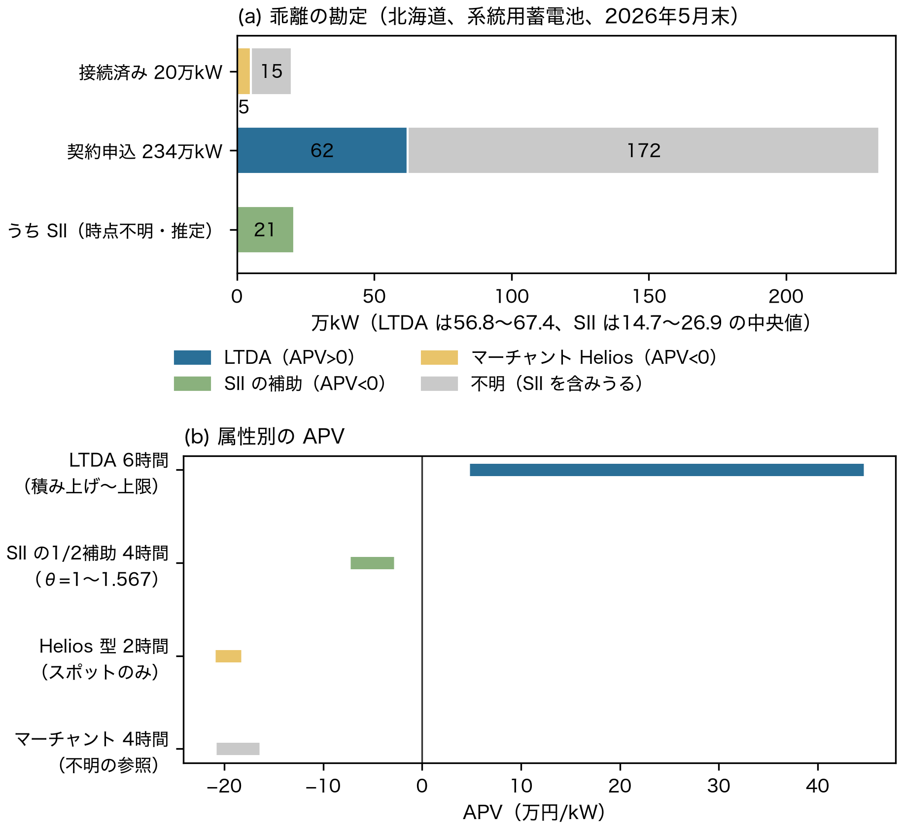{width=15cm}

注）(a) は段階別・属性別の容量（LTDA と SII は推定の幅の中央値）、(b) は属性別の APV（$r_A^M=9\%$、実績整合ケース）。

出所）表8.1 と同じ資料より筆者作成。

## 8.3　市場外収入

### 8.3.1　容量市場

北海道の容量市場の約定価格は上限近傍にあり、4時間蓄電池の実効収入約1.25万円/kW-年は2026〜29年度向けの4回の実効値（7,314〜12,517円/kW-年）の上端で、第7章の判定に織り込み済みである。容量市場だけでは乖離は埋まらない。2030年度向けには指標価格（Net CONE）が約2倍になり（OCCTO, 2026c）、実効収入は約1.75万円（上限価格なら約2.6万円）まで上がりうるが、蓄電池の応札の急増（3.3.1項）は容量市場の側の共食いの始まりを示唆しており、この上振れは持続的とは限らない（7.6節）。

### 8.3.2　長期脱炭素電源オークション

LTDA の北海道の落札蓄電池は約67.4万kW（別解では56.8万kW）と推定され（3.3.2項）、供給力の提供は2027年度以降なので、2026年5月末の接続済みとは時期が重ならない[^c8-2]。他市場収益は平均して約9割が還付されるので（容量確保契約約款第28条）、LTDA 電源は市場収益に依存せずに建設される。蓄電池の上限価格は北海道で7.7万円/kW-年（第3回）、7.2万円（応札年度2026）であり（OCCTO, 2025a, 2026a）、期待容量で契約する6時間蓄電池（調整係数0.932）の設備1kWあたりの固定収入は上限価格の93.2%以下になるが、それでも参入必要収益（6時間に換算して、割引率4〜6%で約4.2〜4.8万円/kW-年）を大きく上回る。契約申込のうち LTDA の落札分は、この市場外収入で説明される（付録C.4.1）。

[^c8-2]: 物理的な連系が供給力の提供に先行する案件の有無は、公表資料では確認できない。接続済みと LTDA を合わせた既設・契約型の容量は約87.4万kW（6時間級の kWh を4時間に換算すると99.1万kW）である。

工藤（2025）は、蓄電池・揚水の応札が募集上限の3.4〜7倍に達していることを指摘している。これは、市場外収入が市場収益と独立に参入を作り出していることの傍証である。落札電源は、供給力提供開始年度を除き、制度適用期間中は同じ設備容量で容量市場のメインオークションに参加できない（OCCTO, 2026a）。LTDA のレベニュースワップとしての価値は8.7.3項で評価する。

### 8.3.3　補助金

SII の系統用蓄電池の導入支援事業の補助率は、1,000kW 以上10,000kW 未満で1/3以内（上限10億円）、10,000kW 以上で1/2以内（上限40億円）である[^c8-3]。北海道の交付決定は、2024年度が27件中9件（131.6億円）、2025年度が37件中3件（49.0億円）であった（環境共創イニシアチブ，2024，2025）。上限のない1/2補助は実効の資本費を6.8万円から3.4万円/kWh に下げるが、4時間・6.8万円/kWh では、上限40億円が約2.9万kW を超える案件から効く。上限のない1/2補助と容量収入1.25万円を合わせた損益分岐の水準係数は1.58（割引率6%。8%では1.81）で、FY2026上期の水準（1.57）とほぼ等しく、そのときの事業 IRR は5.9%である（8.7.1項）。補助を受けたマーチャントの判定は、割引率の選び方に依存する。

[^c8-3]: 長期間エネルギー貯蔵（LDES）は2/3以内（上限20億円）である。

## 8.4　残差と接続枠

### 8.4.1　期待による説明の条件

8.3節の市場外収入で説明できない残りは、計測していない市場収入と参入者の期待に帰属する。前者は需給調整市場の移行期レントであり（8.4.3項）、後者の候補は、FY2026上期に観察された高い価格水準と日内スプレッド（TB4h の中央値18.7円/kWh）の定常化、資本費の低下、データセンター需要と泊発電所の再稼働である。ただし7.1.4項で述べたとおり、スポット裁定と容量収入だけに依存する参入者は、自らが見込む価格経路で評価した静学の NPV が負なら、どの均衡でも参入しない[^c8-4]。

[^c8-4]: 成長オプションなど、これらの均衡が扱わない価値は別である（8.4.3項）。

したがって参入の急増を期待で説明するには、補助金のない参入者は FY2023〜25 の3.0倍（$\theta^*=2.99$）以上の価格水準を20年の平均で見込んでいなければならない。これは本研究の推定（恒久成分は1.2前後）とかけ離れている。上限のない1/2補助を受ける参入者なら、FY2026上期の水準が続くと見込めば静学の NPV はほぼ0になる。しかし、2024〜25年度の北海道の交付額（計約181億円）で賄えるのは4時間換算で13万〜23万kW にすぎず、契約申込の大半は補助と期待を組み合わせても説明しにくい。残差の説明には、次の三つが残る。

### 8.4.2　接続枠の待機オプション

第一は、契約申込が投資ではなく、接続枠という待機オプションの取得だという説明である。申込の際に預ける概算工事費負担金の5%の保証金は、事業者の都合で辞退すれば没収される（資源エネルギー庁，2025b）。これが排他的な権利の価格にあたる。マーチャント収入だけで評価した接続枠の待機価値 $W_0$ は、恒久成分の推定値1.22から出発して、期限5年・$\sigma$=0.15〜0.30 で53〜3,832円/kW（資本費が年5%低下するなら385〜6,899円/kW）である[^c8-5]。保証金以外の費用を無視すれば、保証金が $W_0$ を下回る地点、すなわち工事費負担金が $W_0$ の20倍以下の地点では、建設する確率が低くても枠を押さえることが合理的になる。この工事費負担金の上限は期限5年・$\sigma=0.30$ で7.7万円/kW（資本費が低下するなら13.8万円/kW）であり、待機価値で申込を説明できるのは、価格の変動を大きく見込み、工事費負担金が小さい地点に限られる。期限5年の枠を行使する確率は最大4.8%（資本費が年5%低下する場合でも最大9.4%）で、契約申込の大半が建設されないことと整合する。

[^c8-5]: いずれも他社の参入を無視した上限である。一方、LTDA への応札に使う枠の価値は含まないので、LTDA を狙う申込者にとっては過小評価である。期限なしの値などは付録C.4.4 に示す。

資源エネルギー庁は「空押さえ」の対策として保証金を10%に引き上げる案を示し（資源エネルギー庁，2025b）、東京電力パワーグリッドの2026年度版の手続きの資料はこの改定を記載している（東京電力パワーグリッド，2026）[^c8-6]。保証金が倍になれば上の上限は半分になり、待機価値の小さい枠から申込が減ると予想されるので、引き上げの前後の契約申込の変化はこの解釈の検証になる。

[^c8-6]: 同案は、工事費負担金を分割払いする場合に初回50%以上の支払いも求める。適用開始の時期は一次資料の本文では特定できない。

### 8.4.3　移行期レントと価格の見通し

第二は需給調整市場の移行期レントと短い duration の組合せ（補助金と組み合わさる場合を含む）、第三は参入者の価格の見通しが本研究の推定と異なる場合である。第三から検討する。恒久成分の $\sigma$ も期待成長もデータから識別できないので（7.8節）、高い $\sigma$ や上振れの見通しを持つ参入者がいることは否定できない。FY2026上期の水準1.57 をすべて恒久と置き、年2%の期待成長を見込めば、2040年度までに参入が開く確率は競争均衡で最大39%（期待成長0では21%）になる。それでも2040年度のフリート容量の期待値は最大17万kW で、契約申込の1割に満たない[^c8-7]。

[^c8-7]: 2因子モデルどおり対数のドリフトを0とすれば最大45%、出発点を1.22 のままでも、容量収入が FY2030 以降1.75万円に上がれば最大24%である。FY2026（4〜6月）の価格水準の代理1.55 のうち、恒久成分は1.2前後である。

第二の説明の例が、札幌市の Helios（5万kW／10.4万kWh、2025年12月運開）である。長期の買取契約を持たない「100%マーチャント」の案件で（ESS News, 2025; HD Renewable Energy, 2025）、$K^*=0$ と矛盾するように見える。しかし duration は約2時間で容量市場の要件（3時間以上）を満たさず、スポット裁定だけで評価した APV は−20.9万円/kW、IRR は負である（7.8.4項）。事業者は2026年の電力取引の収入を最大20億円（約4万円/kW-年）と見込み、需給調整市場への参加を計画している（HD Renewable Energy, 2025）。この見込みが粗利であれば、モデルによる2時間仕様のスポット実現収益（約5,200円/kW-年）はその約13%にとどまり、APV は+11.9万円/kW に転じるので、Helios の参入の説明は、計測していない需給調整市場の収入の大きさに依存する。そのレントはフリートが小さいうちは参入必要水準を埋めうるが（7.6節）、参入とともに消える（3.4節）[^c8-8]。推測を含むが、Helios は移行期のレントに依存する案件と読むのが自然であり、$K^*=0$ と両立する。

[^c8-8]: 見込みが粗利なら IRR は20%である。見込みが売上か粗利か、補助金の有無は公表資料では確認できない。国内で100万kW 規模の案件群の開発を掲げる事業者（ESS News, 2025）が、最初の案件を、運用の知見や系統接続の実績を得る成長オプションとみている可能性もある。

三つの説明は、それぞれ別の kW を説明しうる。契約申込の段階にある不明の kW は待機オプション（第一）で説明しうるが、それは工事費負担金が小さい地点に限られる。接続済みの不明の約15万kW（SII の交付案件の一部を含みうる）と Helios は、補助を除けば移行期レント（第二）か見通しの違い（第三）で説明するほかない。補助を受けた案件は、契約型並みの割引率と FY2026上期並みの価格水準を同時に置けば説明しうる（8.7.3項）。残差の解釈は第10章で行う。

## 8.5　併設蓄電池と出力制御

併設蓄電池は系統用の統計の外にあり、そのローカル価値は系統用の乖離を説明しない（表8.1）。本節は RQ4、すなわちエリア価格に映らない抑制回避の価値によって、併設蓄電池の内生的な参入がどの条件で立つかに答える。

### 8.5.1　価格に映らない抑制

北海道の風力の抑制は2025年度から立ち上がった（3.2節）。2025年4月〜2026年6月の抑制電力量の71.8%は、下限価格（0.01円/kWh）に張り付いた時間に生じている。5円/kWh を超える時間の抑制（10.9%）も、ローカル混雑を示すものではない。その88.6%（電力量）は太陽光の抑制と同じ時間に起き、64%（時間）は抑制が続いた時間帯の最初か最後の時間にあるので、前日に時間帯単位で計画されるエリア全体の制御と、時間ごとの価格とのずれと読むのが自然である。ローカル混雑による出力制御の対象は太陽光のノンファーム電源だけである（OCCTO, 2026b）。分類と一覧は付録C.4.2 と表D.4・表D.5 に示す。

したがって、北海道の現状で価格に映らない抑制の中心は、ローカル性ではなく下限での打ち切りである。下限に張り付いた時間の余剰は、価格が0.01円より下がらないために出力制御という数量で処理され（第9章）、エリア価格に基づく $\pi_{\mathrm{spot}}$ は、併設蓄電池がこの余剰を吸収する価値をゼロと計上している。ローカル混雑による損失も、ノーダル価格なら併設蓄電池の価値として取引できるが（Maji et al., 2025）、ゾーン価格の日本では市場の外に置かれる。ただし北海道では、ローカル制御はまだごく一部である。

### 8.5.2　抑制回避の増分と参入条件

抑制回避の増分は、吸収1kWh あたり4.3〜4.6円（プレミアム3円）である[^c8-9]。抑制量はフリート設備容量比で中央値1.4%と小さいので、次世代電力系統ワーキンググループの出力制御の見通しが置く併設の前提（風力1kWあたり0.64kWh。資源エネルギー庁，2026a）の蓄電池は、抑制が一様に分布すれば96.8%、一部のサイトに集中すれば（ERCOT の分布）65.3%を回避できる。制約は出力ではなく容量（kWh）である（表C.36）。北海道で抑制がどこに偏るかは制御の配分規則（9.5節）で決まり、サイト別の内訳は公表されないので、両者を範囲の境界とする。この回避率で、増分はスポット裁定（実績整合ケースの $\pi_{\mathrm{spot}}=6{,}675$ 円/kW-年）に対して、FY2025 の実績で約1%、FY2026 の4〜6月を年率とみなした上限でも7〜11%にとどまる。抑制の時間構造を比例的に拡大しても、回避率が下がるので25〜31%で頭打ちになり、回避率を一定とし毎日満充電できる上限でようやくスポット裁定と同程度になる（表C.36・表C.37）。英国の併設蓄電池でも、回収の主因は価格裁定である（Atherton et al., 2023）。

[^c8-9]: 近似（0.85×プレミアム＋吸収時のエリア価格＋充電従量負担）より1〜2割小さい。FIP 基準価格（14円）×抑制電力量は、放電した電力のエネルギー価値を含みスポット裁定と重複する上限で、抑制率1.35%では増分の約3.2倍である。

参入条件（図8.2）の評価結果は三点にまとめられる（表C.38）。第一に、現行の資本費6.8万円/kWh では、抑制率を2035年度の北海道の見通し（資源エネルギー庁，2026a）の37%まで上げても、どの組合せも成り立たない（2時間仕様はどの資本費でも成り立たない）。第二に、参入が開くのは、抑制がなくても損益分岐の近くにある組合せに限られる。資本費約2.3万円/kWh・系統用と同じ定義・容量収入ありでは抑制がなくても不足は年800〜2,200円程度で、抑制率1.35%以下〜4.8%（割引率8%では2.9〜7.5%）で参入が開く。託送の固定費を共有する定義なら、資本費4.0万円/kWh・割引率6%で抑制がなくても成り立つ。第三に、損益分岐の資本費（系統用と同じ定義・容量収入あり・割引率6%）は、抑制がなければ2.06万円/kWh、回避率一定の上限側でも4.04万円/kWh にとどまる[^c8-10]。

[^c8-10]: 廃止費を資本費に比例させた定義による値で、第7章の2.0万円とは廃止費の置き方が違う（7.5節）。容量収入がない場合は、資本費2.3万円・回避率一定に限り抑制率8〜15%で参入が開く。

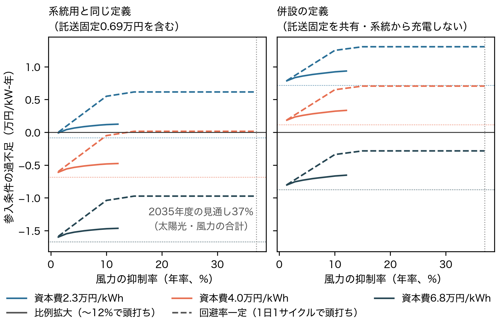{width=15cm}

注）縦軸は参入条件の過不足（左辺と $c_{\mathrm{req}}^{\mathrm{co}}$ の差、万円/kW-年）。左は系統用と同じ定義、右は併設の定義。0.64kWh/kW、一様分布、プレミアム3円、割引率6%、容量収入1.25万円。色は資本費（2.3・4.0・6.8万円/kWh）、実線は比例拡大、破線は回避率一定、水平の点線は抑制なしの水準、縦の点線は2035年度の見通し（37%）。

出所）日本卸電力取引所『スポット市場取引結果』、北海道電力ネットワーク『エリア需給実績』、電力広域的運営推進機関『容量市場メインオークション約定結果』、経済産業省『定置用蓄電システム普及拡大検討会の結果とりまとめ』より筆者作成。

参入の可否は主に資本費、$c_{\mathrm{req}}^{\mathrm{co}}$ の定義、容量収入で決まり、抑制率が効くのは損益分岐の近くの組合せに限られる。本研究は併設を、制度（併設の要件、FIP 併設、9.5節で述べる制御順の見直し）に依存する容量として外生に置く。なお増分は完全予見の線形計画による上界であり、比例拡大は4〜6月の時間構造を通年に延ばし、価格は実績のままと置いたものである。

## 8.6　損益分岐面

本節は、$K^*>0$ に転じる条件（RQ5）を、資本費・実効容量収入・価格水準係数 $\theta$ の3次元で示す。図8.3 は、式(4.8)で計算した $\theta^*$ を資本費と実効容量収入の平面に示したものであり、格子の数値は表C.39 に示す。割引率6%は固定収入を前提にした契約型の資本コストの水準であり（8.7.2項）、図8.3 の値はマーチャントにとって参入に有利な側の値である。既設・契約型の容量を無視した $K=0$ での評価も、有利な側の値である[^c8-11]。

[^c8-11]: 接続済み20万kW の上では $\theta^*=4.05$、LTDA の北海道分を加えた87.4万kW の上では25.9 である（7.6節）。推定期間の価格に入っている既設分を差し引いていないので、高めの値である。

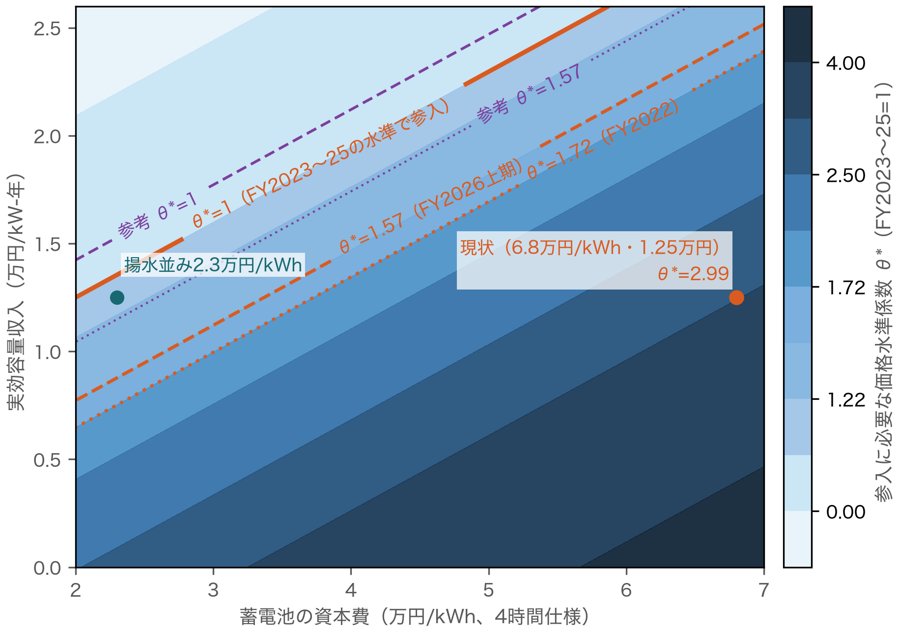{width=15cm}

注）$K=0$ で参入が開く価格水準係数 $\theta^*$（FY2023〜25=1）を、蓄電池の資本費（4時間）と実効容量収入 $\kappa P_{\mathrm{cap}}$ の組合せについて示す。分母は実績整合ケースの $a(0)=8{,}427$ 円/kW-年、割引率6%、寿命20年。橙の線は $\theta^*=1$（FY2023〜25 の水準）、1.57（FY2026上期）、1.72（FY2022）の等高線で、線より左上の組合せではその水準で参入が開く。紫の線は、実績価格の上の実現率（0.81）をモデルの完全予見粗利に掛けた参考の置き方（4.2.4項）による $\theta^*$=1・1.57 の等高線。点は現状（資本費6.8万円/kWh、実効容量収入1.25万円）と揚水並みの資本費（2.3万円/kWh）の位置である。

出所）日本卸電力取引所『スポット市場取引結果』、北海道電力ネットワーク『エリア需給実績』、電力広域的運営推進機関『容量市場メインオークション約定結果』『メインオークション需要曲線』『容量市場メインオークション用調整係数』、経済産業省『定置用蓄電システム普及拡大検討会の結果とりまとめ』より筆者推計。

現状（資本費6.8万円/kWh、実効容量収入1.25万円）では $\theta^*=2.99$（モデル直値3.31）であり、FY2023〜25 の約3倍の価格水準が要る。揚水並みの資本費2.3万円/kWh でも、現行の容量収入では1.12で、恒久成分の水準1.22 なら開くが、FY2023〜25 の水準では開かない。FY2023〜25 の水準で参入が開くのは、資本費が2.3〜3.0万円/kWh に下がって容量収入が1.75万円以上になるか、資本費4.0〜5.0万円/kWh で容量収入が2.5万円になる場合だけである。見込む水準が FY2026上期（1.57）や FY2022（1.72）まで上がれば開く組合せは増えるが、いずれも資本費の大幅な低下か、容量収入の上振れか、観察された最も高い価格水準の持続を組み合わせた連言条件である（付録C.4.3）。

参入が開いた後の均衡容量は、$\pi(K)$ の減衰と容量価格の $K$ への依存で決まる。$\theta=1$・資本費2.3万円・容量収入2.5万円の組合せでは、容量価格を定数とすればフリートは300万kW を超えても閉じないが、容量価格の $K$ への依存を入れると、$K^*$ は全国連系で約77万kW、北海道が単独ブロックとして分断される按分曲線で約8万kW にとどまり（FY2026上期の水準でも83万kW と12.5万kW）、接続済み約20万kW を外生に置けば、マーチャント分は57万kW と0になる（表C.40）。契約申込の約234万kW をマーチャントの均衡として説明できるパラメータの組合せは、観察可能な範囲にない。乖離は、パラメータの不確実性ではなく、市場外収入、計測していない需給調整市場の収入、接続枠の保有を含む期待によって説明されなければならない。

## 8.7　契約型とマーチャントのリスク・リターン

本節は、8.6節までの判定を企業金融の道具で検算し、乖離の成分を現在価値（8.7.1〜8.7.4項）と収入リスク（8.7.5項・8.7.6項）の二つの物差しにそろえる。

### 8.7.1　事業 IRR

マーチャントの4時間蓄電池（27.2万円/kW）は、FY2023〜25 の価格水準と容量収入1.25万円で、年間キャッシュフローが6,992円/kW にとどまる。20年でも投資額の51%しか回収できず、事業 IRR は−5.6%である（表8.2）。IRR が0になる $\theta$ は1.78 で、観察された最も高い FY2022 の水準（1.72）も上回るので、モデルで与えた価格水準（$\theta$=1〜1.72）では IRR は負である。したがって容量収入が1.25万円にとどまる限り、補助金のないマーチャントの $K^*=0$ は割引率の選択に依存しない。

: 表8.2　マーチャント4時間蓄電池の事業 IRR

| 価格水準 | 1.25万円 | 1.75万円一定 | 既約定→1.75万円 | 既約定→2.62万円 | 2.5万円一定 | 1/2補助・1.25万円 |
|---|---:|---:|---:|---:|---:|---:|
| $\theta=1$（FY2023〜25） | −5.6% | −1.2% | −1.7% | +2.9% | +3.7% | +0.3% |
| $\theta=1.22$（恒久成分） | −3.8% | +0.2% | −0.4% | +3.8% | +4.7% | +2.7% |
| $\theta=1.567$（FY2026上期） | −1.3% | +2.1% | +1.5% | +5.3% | +6.3% | +5.9% |
| $\theta=1.715$（FY2022） | −0.4% | +2.8% | +2.2% | +5.9% | +6.9% | +7.2% |
| FY2022 の実績価格 | +3.75% | +6.4% | +5.8% | +8.8% | +10.0% | — |

注）無レバレッジ・税前・実質・20年、資本費6.8万円/kWh、$K=0$、実績整合ケース（$\theta=1.22$ 以上の行は $\theta$ に比例させた値、FY2022 の実績価格の行は実績の戦略 c）。第2列以降は実効容量収入で、「既約定→」は FY2027〜29 を既約定の値とし FY2030 以降を各値とした経路、2.62万円は上限価格の実効値。最終列は上限のない1/2補助を受けた場合で、補助後の投資額13.6万円/kW に対する IRR。$\pi(0)$、容量収入0.73万円（2026年度向け）の場合を含む全ケースは表C.41 に示す。

出所）日本卸電力取引所『スポット市場取引結果』、北海道電力ネットワーク『エリア需給実績』、電力広域的運営推進機関『容量市場メインオークション約定結果』『メインオークション需要曲線』『容量市場メインオークション用調整係数』、経済産業省『定置用蓄電システム普及拡大検討会の結果とりまとめ』、環境共創イニシアチブ『系統用蓄電池等電力貯蔵システム導入支援事業費補助金 公募要領』より筆者推計。

IRR が正になる例外は、FY2022 の実績価格そのもの（連系線増強前の分断構造）と、2030年度向け以降の容量収入の上振れである。それでも IRR が8%を超えるのは FY2022 の実績価格に2.5万円か上限価格を重ねた場合だけであり、$K^*=0$ は、マーチャントの資本コストを8%以上とすれば、ほぼすべての組合せで保たれる。

対照的に、LTDA の6時間蓄電池（40.8万円/kW）は、北海道の上限価格で落札すると、事業 IRR が12.2〜13.6%（契約容量＝期待容量。設備容量とみなせば最大15.1%）になる。事業報酬率4〜6%で積み上げた応札価格で落札すれば4.3〜6.3%である。LTDA は応札価格で支払われる（pay-as-bid）ので、落札者の実際の IRR はおおむねこの間にあると考えられる（蓄電池の約定価格は公表されていない。表C.42）。同じ6.8万円/kWh の6時間蓄電池をマーチャントで持つと、容量収入1.40万円を得ても IRR は−6.5%である。IRR の符号を分けているのは、資産ではなく収入の契約形態である。ただし8.7.3項で示すとおり、その差は主にリスクの移転ではなく期待値の移転から生じる。

### 8.7.2　資産の資本コスト

割引率6%は契約型の水準であり（LTDA の事業報酬率と調達価格等算定委員会（2026）の税引前の想定 IRR はいずれも4〜6%）、価格リスクをそのまま負うマーチャントには、より高い資本コストが対応する。Gohdes et al.（2022）による豪州の全国電力市場（NEM）の調査値から、同じ借入金利の仮定の下でのマーチャントの上乗せ（4.0〜5.1%ポイント）を求めて契約型の4〜6%に足すと8〜11%になるので、その下限側の8〜9%を $r_A^M$、4〜6%を $r_C$ とする（付録B.5.3）。これは文献に基づく位置づけであり、本研究の推定値ではない。Modigliani and Miller（1958）の命題により、摩擦がなければ $\theta^*$ は資産の資本コストだけで決まり、8%で3.46、9%で3.71 になる（表C.43）。法人税の節税効果を Miles and Ezzell（1980）の式で入れても $\theta^*$ は0.05〜0.12 下がるにとどまり、補助金のないマーチャントは FY2026上期の水準でも課税所得が毎年負なので、事業会社単体では節税効果を使えない。LTDA への応札の集中を説明するのは、レバレッジではなく、上限価格での事業 IRR の高さと、固定収入によって資産の資本コストが契約型の水準に下がることである。

### 8.7.3　調整現在価値とレベニュースワップ

マーチャントの4時間蓄電池の APV は、容量市場と上限のない1/2補助を加えても−7.2万円/kW である（図8.4 の (a)。$r_A^M=8\%$ では−6.7万円）。APV が0になる水準係数は1.94 で、観察された最も高い FY2022 の水準（1.72）でも届かない。

LTDA の6時間蓄電池は、マーチャントとしての NPV（−32.3万円/kW）に、式(8.1)のスワップを重ねたものとみなせる。手放す収入は年2.09万円/kW で、その3分の2は容量収入である[^c8-12]。上限価格7.2万円・期待容量では、スワップの価値+64.3万円のうち、期待値の移転が+57.3万円、リスク移転は+7.0万円（10.9%）にすぎず、APV は+32.0万円/kW になる。リスク移転の比率は、固定側を20年国債程度の2.5%で割り引く場合を含め、割引率を動かしても5〜18%であり、LTDA が参入を作る価値の大部分は期待値そのものの移転である。手放す収入と等価な公正な固定価格は、$r_C=5\%$ で契約容量1kWあたり年1.5万〜1.6万円にすぎず、上限価格はその4.4〜5.0倍である。固定収入の価値の77〜80%は、手放す収入との交換ではなく、容量拠出金を通じた需要家からの移転にあたる[^c8-13]。その受け手は、容量拠出金を負担する小売電気事業者と、その先の需要家である（豪州の CfD で残余のリスクが納税者に移るという Gohdes et al., 2022 の指摘に対応する）。なお、4時間のマーチャントと6時間の LTDA は資産が違うので、この分解は成分の相対的な大きさを見るためのものであり、水準の比較には事業 IRR を用いる。

[^c8-12]: 容量収入1.40万円と、スポット純収入0.77万円（実績価格の上の戦略 c、6時間、充電従量負担控除後）の9割である。

[^c8-13]: 手放す収入の現在価値は $r_A^M=9\%$ で19.1万円/kW である。事業報酬率5%の積み上げ価格で落札した場合でも、公正な水準の2.7〜2.9倍で、約3分の2が移転である。割引率の組合せによる幅は付録C.4.4 に示す。

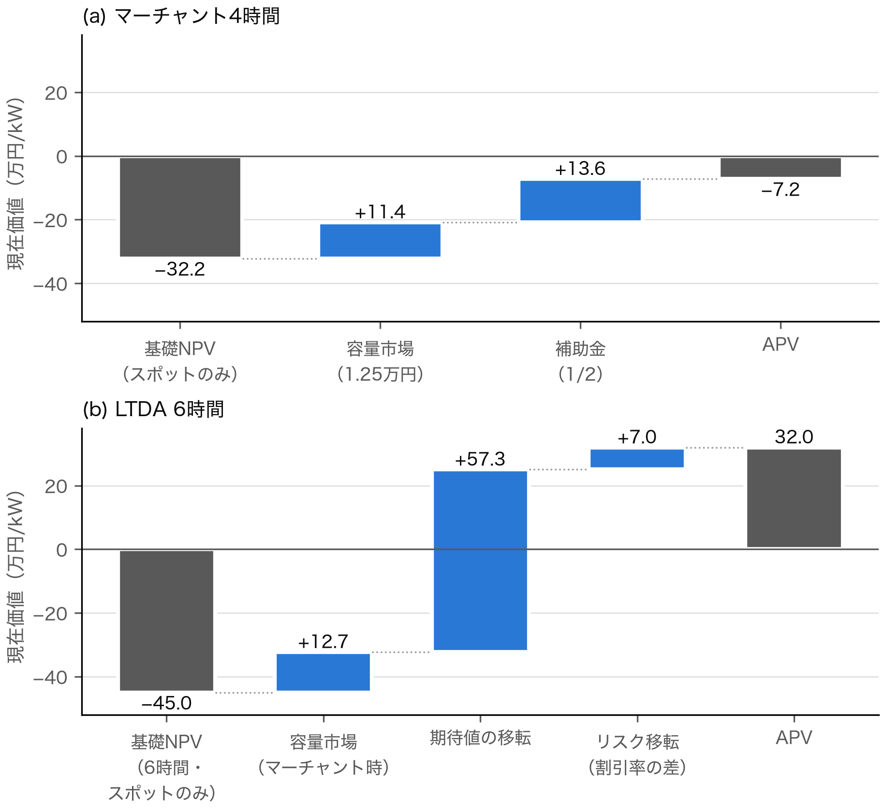{width=15cm}

注）万円/kW。無レバレッジ・税前・20年、資本費6.8万円/kWh、借入なし。(a) はマーチャント4時間蓄電池（$\theta=1$、$r_A^M=9\%$）で、スポットは実績整合ケースの $\pi(0)=6{,}675$ 円/kW-年、容量市場は実効1.25万円/kW-年、補助金は上限のない1/2で割り引かない。(b) は LTDA 6時間蓄電池（上限価格7.2万円・期待容量、$r_C=5\%$・$r_A^M=9\%$）で、スポットは実績価格の上の戦略 c（6時間）、期待値の移転とリスク移転は式(8.1)の2項である。基礎 NPV はスポット収入だけで評価した NPV。節税効果は含めない。価格水準と落札価格を変えた値は表C.44 に示す。

出所）表8.2 と同じ資料、および電力広域的運営推進機関『長期脱炭素電源オークション募集要綱』より筆者推計。

表8.1 の勘定に戻ると、補助を受けた案件の APV が0になる割引率は、上限のない1/2補助・FY2026上期の水準で5.9%、FY2023〜25 の水準で0.3%であり、補助のないマーチャントは FY2026上期の水準でも事業 IRR が負で、どの割引率でも説明できない（付録C.4.4）。したがって接続済みの容量の説明は、契約型並みの割引率と FY2026上期並みの価格水準を同時に置く場合に限られ、マーチャントの資本コストの下では、計測していない需給調整市場のレントと見通しの違いに依存する。

### 8.7.4　確実性等価による検算

確実性等価で測っても、期待値の移転が大半であるという結論は変わらない。4時間のスポット収入のリスクを全部移したときにマーチャントの不足額が埋まる比率は、価格水準を定常 AR(1) とすると0.7〜11.0%、恒久成分をランダムウォークとすると2.2〜34.2%にとどまり（表C.45）、LTDA が移すのは他市場収益の9割なので、保険価値はこれよりさらに小さい。この比率は、6%で割り引くことで小さめに、市場収益率との相関を正と置くことで大きめに出る、逆向きの二つの偏りを含む値である（付録B.5.4・C.4.5）。

### 8.7.5　多因子 CFaR と LTDA が移転するリスク

主ケースでは、他者の参入 $K$ を接続済み約20万kW から LTDA の北海道分が加わる87.4万kW までの一様分布とし、容量価格を全国連系の $K$ 依存とする。このとき年間の市場収入の5% CFaR は5,869円/kW-年である。期待値の86%は容量収入で、市場収入が固定費（1.22万円/kW-年）を賄えない確率は69%に達する（表8.3）。Shapley 配分では、容量価格の約定水準（51%）と他者の参入（35%）が二大因子で、価格水準 $\theta$ は8%にすぎない。2026年度向けのマルチプライス約定を除くと最大の因子は他者の参入に替わるが（8.8節）、日々の天候の寄与はどの仮定でも3.4%以下である（図8.5）[^c8-14]。

[^c8-14]: 基準 $R_{\mathrm{ref}}=19{,}192$ 円/kW-年（$\pi(0)$ と2029年度向けの容量収入の和）から5%点までの下振れは14,323円で、その6割は共食いと低い約定水準による期待値の低下である。その他の感応度は表C.46 と表C.47 に示す。

: 表8.3　マーチャント4時間蓄電池の年間市場収入の5% CFaR と因子別の寄与

| 項目 | マーチャント | LTDA |
|---|---:|---:|
| **パネルA：分布の要約（円/kW-年）** | | |
| 期待値 | 10,738 | — |
| 5% CFaR | 5,869 | 238 |
| 5% ES | 6,463 | 255 |
| 固定費を賄えない確率 | 69% | — |
| **パネルB：5% CFaR の Shapley 配分（円/kW-年）** | | |
| 価格水準 $\theta$ | 470（8%） | 55 |
| 他者の参入 $K$ | 2,025（35%） | 136 |
| 容量価格の約定水準 $L$ | 2,972（51%） | 0 |
| 年度単位の形状 $S$ | 351（6%） | 41 |
| 日々の天候 $\omega$ | 50（1%） | 6 |

注）主ケース（容量価格の $K$ 依存を全国連系、約定水準を2026〜29年度向けの4値）、実績整合ケース、20万回のモンテカルロ。CFaR・ES は期待値からの差。LTDA は固定収入とスポット収益の1割からなる落札者の収入。パネルBの括弧内は構成比。約定水準と按分曲線を変えた感応度は表C.46・表C.47 に示す。

出所）日本卸電力取引所『スポット市場取引結果』、北海道電力ネットワーク『エリア需給実績』、電力広域的運営推進機関『容量市場メインオークション約定結果』より筆者推計。

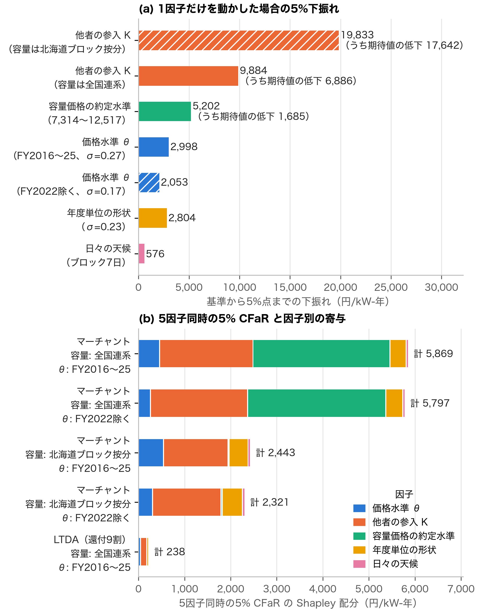{width=15cm}

注）(a) 基準 $R_{\mathrm{ref}}$（他者の参入なし・$\theta=1$・容量収入12,517円で19,192円/kW-年）から1因子だけを確率変数にしたときの5%点までの下振れ（括弧内は期待値の低下分、斜線は感応度のケース）。(b) 5因子同時の5% CFaR の Shapley 配分。実績整合ケース。

出所）表8.3 と同じ。

この結果は、第7章と8.6節が $\theta$ を参入判断の軸に置いたことと矛盾しない。$\theta^*$ が問うのは期待値で参入が開く水準、CFaR が問うのは参入後の収入の振れだからである。ただし $\theta$ は年次リスクの主因ではなく、FY2022 の1年を除けば、年次の完全予見粗利の変動のうち $\theta$ で説明できる部分は小さい（付録C.4.6）。

LTDA の落札者の収入の5% CFaR は238円/kW-年で、LTDA はマーチャントの CFaR の95.9%を移す。移転される CFaR の86%は容量価格の約定水準と他者の参入に由来し、$\theta$ に由来するのは7.4%にとどまるので[^c8-15]、LTDA の保険としての機能を $\theta$ の変動だけで評価すると過小評価になる。契約型の容量が市場収益と独立に建設されるのは、期待値の移転に加えて、上場商品では移転できない容量価格と共食いのリスクを容量拠出金の負担者に移すことにもよる（落札者は供給力の提供義務などの別のリスクを負う）。ただし CFaR は期待値で定義したゼロレント条件に入らないので、$K^*=0$ の判定を直接は強めず、リスクが参入判断に効くのはリスク調整後の割引率や資金調達の条件を通じてである。

[^c8-15]: 還付率85〜95%の範囲で、移転される比率は93.9〜98.0%である。$\theta$ と約定水準は負に相関しうるので、因子の独立の仮定は CFaR を大きめに出しうる。

### 8.7.6　ヘッジ有効性と市場の非完備

国内の電力先物は欧州エネルギー取引所（EEX）と日本取引所グループ（JPX）に上場しているが、北海道の商品はない。式(8.3)で北海道の月間の完全予見粗利を東京の月平均価格で最小分散ヘッジすると、2016年4月〜2026年6月の全期間では分散の79%（ベース）〜85%（ピーク）を消せるが、これは主に FY2020〜22 の需給逼迫と燃料危機の時期に全エリアの価格が同時に動いたことによる。その期間を除くと21〜30%、2023年4月以降では48〜53%で、後者も標本外では33〜42%に下がる（表C.48）。さらに、上場先物で固定できるのは JPX で2年度先まで（2027年4月の業務規程の改正後は5年度先まで）、EEX で6年度先までであり（東京商品取引所，2026；日本取引所グループ，n.d.）、最長6年度分を完全に固定できても、20年の収入の現在価値の分散のうち消せるのは38〜56%（2年度分なら8〜23%）にすぎない。満期の乗り換えはベーシスと資金繰りのリスクを伴い（Mello & Parsons, 1995）、CFaR で寄与の大きい他者の参入と容量価格には上場商品がない。マーチャントは、長期のリスクについて非完備な市場に直面している。

リスクを取引する市場が非完備だと投資が抑えられ、長期契約がそれを補うという議論（de Maere d'Aertrycke et al., 2017; Willems & Morbee, 2010）に照らすと、LTDA は欠けている長期のヘッジ市場を制度で補っていると読める。H.-Z. Li et al.（2025）が2021年の価格高騰の要因に挙げたヘッジ市場の未成熟は、蓄電池の側にもある。ただし $K^*=0$ は期待値で決まっており、ヘッジ市場が完備になっても覆らない。ヘッジ手段の欠如が効くのは、参入が開く水準に近づいたときの資金調達の条件と、契約型が選ばれやすいことの説明においてである。

## 8.8　頑健性の確認

本章の主な結論が、基準の置き方と仮定の変種によって変わるかどうかを、表8.4 にまとめる。

: 表8.4　主な結論の頑健性

| 結論 | 主の基準での値 | 変種での値 |
|---|---|---|
| 現状の損益分岐の水準係数 $\theta^*$ は観察された水準（1〜1.72）を上回る | 2.99（割引率6%、実績整合ケース、$K=0$） | $\lambda$ の95%区間で2.78〜3.21、モデル直値3.31、資産の資本コスト8〜9%で3.46〜3.71、節税効果を入れると0.05〜0.12低下、接続済み20万kW の上で4.05 |
| 補助金のないマーチャントの事業 IRR は負 | −5.6%（$\theta=1$、容量収入1.25万円） | $\theta=1.72$ で−0.4%、モデル直値で−6.6%、容量収入0.73万円で−14.5%。FY2022 の実績価格（+3.75%）と容量収入の上振れの一部では正 |
| 属性不明の kW が埋めるべき不足 | 1kWあたり約21万円、総額約3,200〜3,700億円（$r_A^M=9\%$） | $r_A^M=8\%$ で約20万円・3,100〜3,600億円、FY2026上期の水準が続くと置くと2,500〜2,900億円。補助と Helios の APV は8%でも負（−6.7万円、−21.4万円/kW） |
| 現行の資本費（6.8万円/kWh）では併設の参入が開かない | 抑制率37%でも開かない（割引率6%） | 割引率8%、集中分布、プレミアム2〜4円、併設の定義のいずれでも開かず、384通りの最良でも年1,391円/kW 不足。2時間仕様はどの資本費でも開かない |
| LTDA の価値の大半は期待値の移転 | リスク移転はスワップの価値の10.9%（$r_C=5\%$、$r_A^M=9\%$） | 割引率の組合せで5〜18%、積み上げ価格で落札した場合は11〜30%。確実性等価でリスクを全部移して埋まる比率は0.7〜34.2% |
| 容量価格の約定水準と他者の参入が CFaR の主因 | 51%と35%（全国連系、約定水準は4値） | 約定水準を3値とすると他者の参入60%・容量15%、北海道ブロック按分では他者の参入57%・$\theta$ 23%・容量1%、$\theta$ を FY2022 を除いて校正すると $\theta$ は5%。日々の天候はどの仮定でも3.4%以下 |

注）値の定義と全ケースは付録C.4.2〜C.4.6 に示す。

出所）表8.1〜表8.3・図8.4 と同じ資料、および Gohdes et al.（2022）より筆者推計。

表8.4 の変種の下でも、現状の $\theta^*$ が観察された価格水準を上回ること、現行の資本費では併設の参入が開かないこと、LTDA の価値の大半が期待値の移転であることは変わらない。基準に依存するのは、FY2022 の実績価格や容量収入の上振れの下での事業 IRR の符号（このとき $K^*=0$ の判定は割引率に依存する。8.7.1項）と、容量価格の仮定に左右される CFaR の因子の順位の二点である。

## 8.9　小括

本章は、マーチャントの均衡容量 $K^*=0$ と現実の参入との乖離を、市場外収入と期待に分解し、kW と1kWあたりの現在価値で勘定した。主要な結果は次の5点である。

1. 接続済みと契約申込の合計254万kW のうち、市場外収入で APV が正になるのは LTDA の北海道の落札蓄電池（22〜27%）である。補助と Helios の8〜13%は、本研究の資本コスト（9%）で評価した APV が負のまま参入を決めており、61〜70%は属性が特定できない。
2. 北海道の価格に映らない抑制の中心は下限価格での打ち切りであり、併設蓄電池の抑制回避の価値は、スポット裁定に対して比例拡大でも25〜31%で頭打ちになる。
3. 補助金のないマーチャントの事業 IRR は、実効容量収入1.25万円の下ではモデルで与えたどの価格水準（$\theta$=1〜1.72）でも負であり、$K^*=0$ の判定は割引率の選び方に依存しない。例外は FY2022 の実績価格そのものと、2030年度向け以降の容量収入の上振れである。
4. 同じ6時間蓄電池の事業 IRR は、マーチャントでは負、LTDA の上限価格では12.2〜13.6%であり、IRR の符号を分けているのは収入の契約形態である。ただしその差は主に期待値の移転から生じる。LTDA の上限価格は公正な固定価格の4.4〜5.0倍で、スワップの価値のうちリスク移転は約1割にすぎない。
5. LTDA はマーチャントの年間市場収入の5% CFaR の大半を移すが、その多くは上場のヘッジ手段がない容量価格の約定水準と他者の参入に由来する。マーチャントは、長期のリスクについて非完備な市場に直面している。

仮説3は支持される。ただし市場外収入で APV が正になるのは LTDA の落札分であり、補助を受けた案件は、本研究の資本コスト（9%）の下では補助を含めても APV が負である。仮説4は一部だけ支持される。抑制回避の価値は併設案件に帰属し、比例拡大でも裁定価値の25〜31%で頭打ちになって乖離を説明しないが、北海道で価格に映らない抑制の中心は下限価格での打ち切りであり、ローカル系統の制約による経路は風力については確認されない。仮説5は、FY2023〜25 の価格水準（$\theta=1$）を基準とする限り支持される。恒久成分の推定値1.22 を基準にすると、資本費が2.3万円/kWh に下がるだけで参入が開く（$\theta^*=1.12$）。

RQ3 の後半への答えは、乖離のうち LTDA の市場外収入で説明できるのは kW で2〜3割にとどまり、属性が特定できない6〜7割の kW は、マーチャントとして建設されるなら計測していない成分が埋めなければならない残差として残る、というものである。RQ4 への答えは、現行の資本費では抑制率が2035年度の見通しまで上がっても併設の内生的な参入は立たない、というものである。RQ5 への答えは、$K^*>0$ に転じるのは資本費の大幅な低下、容量収入の上振れ、高い価格水準の持続を組み合わせた場合に限られ、そのときも均衡容量は契約申込に届かない、というものである。次章は RQ6 として、価格に映らない抑制の中心にある下限価格が、蓄電池の価値と均衡容量をどう歪めるかを扱う。


```{=openxml}
<w:p><w:r><w:br w:type="page"/></w:r></w:p>
```


# 第9章　下限価格と負の価格

本章は、JEPX スポット市場の下限価格0.01円/kWh が蓄電池の価値と参入条件をどう歪めるか、また下限を負の価格に置き換えると裁定価値、参入に必要な価格水準、再エネ側の収入がどれだけ変わるかを問う（RQ6）。第7章は下限価格が充電側の値下がりを止めて裁定価値を削ることを、第8章は下限に張り付いた後の余剰が無補償の出力制御に現れることを示した。本章はこれらを一つの機構として読み直す。そのうえで、第7章の価格過程の上で下限の時間の価格を負の一定値に置く段差モデルを用い、限界参入者の収益曲線と損益分岐の価格水準係数 $\theta^*$ を求め直す。9.1節で方法、9.2節で下限価格の役割、9.3節で段差モデルの結果、9.4節で再エネ側からの移転、9.5節で価格による調整と数量による調整の比較を述べる。9.6節で結果の頑健性を確かめ、9.7節で小括する。

## 9.1　分析の方法

### 9.1.1　負の価格の段差モデル

第7章の価格過程（7.1.1項）は0.01円で打ち切られた価格から推定しているので、負の領域の供給曲線は識別できない。そこで、モデル価格が下限価格に張り付く時間（純需要が下限張り付きの閾値を下回る時間）の集合を $\mathcal{F}$ とし、その時間の価格だけを $-\delta$ 円/kWh に置く段差モデル（式(9.1)）を用いる。

$$p_t^{(\delta)}=p_t-(0.01+\delta)\,\mathbf{1}\{t\in\mathcal{F}\}$$

（式番号 9.1）

$p_t$ は第7章の感応度（7.5節・7.6節）と同じ水準係数付きの価格過程（式(4.3)）によるモデル価格で（仕様の使い分けは9.1.2項）、$t\in\mathcal{F}$ では0.01円である。負の価格の深さ $\delta$ は外生とし、0（下限の撤廃のみ）、5、10円に振る。蓄電池のフリートが $\mathcal{F}$ の時間に充電すると純需要が上がって価格は下限を離れるので、$\mathcal{F}$ はフリートの規模とともに縮む。第7章の下端の線形外挿（7.7節）で生じる負の価格は下端の傾きで決まる浅いもので、下限が削る価値の上限を与えないので、段差モデルは深さを外生に置く別の反実仮想として用いる（付録B.6.2）。

$\delta$ の目安は、余剰時に運転を続ける電源の支払意思である。抑制が無補償の FIT 電源は0円までしか耐えず、FIP 電源はプレミアム（基準価格と参照価格の差）まで、起動費のある火力・原子力はそれ以上の負値を提示しうる。ドイツの日前市場の負のスパイクは約−38ユーロ/MWh を閾値とする厚い裾をもつと推定されており（Fanone et al., 2013）、$\delta$=5〜10円（1ユーロ＝160円で約−30〜−60ユーロ/MWh）はこの閾値の近傍にあって、極端な負のスパイクは含めていない。

### 9.1.2　シナリオと損益分岐の直接解

シナリオは、現状（FY2023〜25 の気象・需要パス、$\theta=1$）、FY2026上期の価格水準（$\theta=1.57$）、泊3号機の再稼働、泊と風力2倍の4通りである（7.3節）。泊と風力2倍は、風力への条件付き応答と実績との差が標本内で有意でなくなるよう修正した仕様A′（7.2.2項。風力への応答はなお実績の約2倍）を主とし、単一曲線の仕様A を感応度とする。その他のシナリオは仕様A による。限界参入者の収益 $\pi(K)$（式(4.4)）は、第7章と同じ増分貪欲ディスパッチ（刻み1万kW。7.4節）の下で、各シナリオのモデル価格の上で戦略 c を直接計算し、現状・$K=0$ で実績の戦略 c に校正した実績整合ケースで測る（校正係数 $\lambda$ は仕様A で1.108、仕様A′ で1.0015）。

$-\delta$ は $\theta$ で伸縮させない。余剰時の支払意思は燃料価格の水準に依存しないと置くからである。このため粗収益は $\theta$ に比例せず、$\theta$ によらない正の部分をもつので、比例を前提とする第4章の閉じた式（式(4.8)）は、$\theta^*$ が1を超える局面で $\theta^*$ を過小に出す。そこで各 $\theta$ で戦略 c を計算し直し、$K=0$ のゼロレント条件

$$\lambda\,c_{\mathrm{model}}(0;\theta,\delta)-w_{\mathrm{chg}}+\kappa P_{\mathrm{cap}}=c_{\mathrm{req}}$$

（式番号 9.2）

を $\theta$ について直接解く（付録B.6.1）。$c_{\mathrm{model}}(0;\theta,\delta)$ は水準係数 $\theta$・深さ $\delta$ のモデル価格の上での戦略 c の粗利（$K=0$）、$c_{\mathrm{req}}$ は第4章の参入必要収益（式(4.6)）で、本章では WACC 6%・寿命20年で評価する（8.6節）。

モデルの下限張り付き時間は、現状で年115時間と、実績（FY2023〜25 の平均約203時間）の57%にとどまる。負の価格の効果は下限張り付き時間にほぼ比例するので、実績価格の下限の時間を使う場合、供給曲線の下端を線形外挿する場合、下限張り付き時間を実績に合わせて較正する場合の三つの感応度と仕様A による結果を、9.6節で示す。

### 9.1.3　再エネ側からの移転の計測

負の価格は、蓄電池への支払いであると同時に、余剰の時間に発電する再エネ事業者からの移転でもある。そこで実績から、下限張り付きの時間に発電し販売された太陽光・風力の電力量に $0.01+\delta$ 円を掛けた再エネ側の収入減と、出力制御量に $\delta$ 円を掛けた抑制の影の価格の価値を年度別に求めて比べる。抑制された電力量は販売されないので、収入減には含めない。いずれも実績の発電量と出力制御量を固定した静学の計算である。

## 9.2　下限価格の役割

蓄電池の側からみると、下限価格は充電価格を、潜在価格 $\tilde p_t$（下限がなければ成立する価格）と0.01円の大きいほうにする。

$$\max\{\tilde p_t,\,0.01\}=\tilde p_t+\max\{0.01-\tilde p_t,\,0\}$$

（式番号 9.3）

式(9.3)の右辺の第2項は行使価格0.01円のプットのペイオフであり、充電する蓄電池はこれを支払う側、すなわちプットの売り手にあたる（7.7節）。潜在価格が下限を下回る時間ほど、蓄電池は得られたはずの値下がりを失う。このため価格が一様に下がる局面では、下限での打ち切りは価値を削る。実績価格（FY2023〜25）を一様に8円/kWh 下げると、完全予見粗利は、0.01円で打ち切らなければ10,317円から12,067円/kW-年に上がるが、打ち切ると9,259円に下がる（表7.4）。

前章までの結果も、この機構でつながる。太陽光は昼の純需要を彫って裁定価値を作るが、その底は下限価格で止まる（5.7節）。風力とベースロードの追加は供給曲線の下端の急勾配と往復損失の水準効果を通じて裁定価値を増やしうるが（7.7節）、標本内で差が有意でなくなるよう修正した仕様A′ でも、風力を3倍にしても戦略 c の粗利はほとんど増えない（7.3節）。下限に張り付いた後の余剰は、価格ではなく無補償の出力制御という数量に現れ、北海道の風力の抑制電力量の7割強は下限張り付きの時間に生じている（8.5節）。

すなわち下限価格は、余剰時の価格発見を止め、余剰の配分を優先給電ルールという数量割当に置き換える制度である。下限より下にあるはずの吸収の価値はスポット価格に現れず、マーチャントの参入条件からも抜け落ちる。ただし、現状の余剰の量の下では、下限での打ち切りは第7章の $K^*=0$ の主因ではなく（9.3.1項）、この機構は余剰が増えるほど重みを増す。

## 9.3　段差モデルによる収益と損益分岐

### 9.3.1　余剰の量と収益曲線

下限価格のシナリオ別に、$K=0$ の収益 $\pi(0)$ と参入が開く $\theta^*$ を表9.1 に、限界参入者の収益曲線 $\pi(K)$ を図9.1 に示す。フリート容量50万・100万kW の収益と、下限0円と FY2026上期の水準の結果は表C.49 に示す。

: 表9.1　下限価格のシナリオ別の $\pi(0)$ と $\theta^*$

| シナリオ | 下限 | 負の価格の時間（時間/年） | $\pi(0)$ | $\theta^*$ |
|---|---|---:|---:|---:|
| 現状 | 0.01円（現行） | 0 | 6,675 | 2.99 |
|  | −5円 | 115 | 7,131 | 2.93 |
|  | −10円 | 115 | 7,596 | 2.88 |
| 泊3号再稼働 | 0.01円（現行） | 0 | 7,156 | 2.82 |
|  | −5円 | 762 | 9,587 | 2.55 |
|  | −10円 | 762 | 12,006 | 2.28 |
| 泊＋風力2倍（仕様A′） | 0.01円（現行） | 0 | 6,629 | 3.00 |
|  | −5円 | 1,537 | 10,006 | 2.60 |
|  | −10円 | 1,537 | 13,453 | 2.20 |

注）$\pi(0)$ はフリート容量が0のときの実績整合ケースの収益（円/kW-年）で、充電従量負担を控除した。負の価格の時間は、$K=0$ で価格を $-\delta$ に置く時間（モデルの下限張り付き時間）。$\theta=1$、FY2023〜25 パス、増分貪欲（刻み1万kW）。泊＋風力2倍は仕様A′（$\lambda=1.0015$）、現状と泊3号再稼働は水準係数付きの仕様A（$\lambda=1.108$）による。$\theta^*$ は、資本費6.8万円/kWh・実効容量収入1.25万円/kW-年・WACC 6% で式(9.2)を直接解いた値。仕様と下限張り付き時間の置き方を変えた結果は表9.3 に示す。

出所）日本卸電力取引所『スポット市場取引結果』、北海道電力ネットワーク『エリア需給実績』、電力広域的運営推進機関『容量市場メインオークション約定結果』より筆者作成。

{width=15cm}

注）段差モデル・仕様A・実績整合ケース（$\lambda=1.108$）。(a) は現状（実線）と泊3号再稼働（破線）、(b) は泊＋風力2倍である。(b) は表9.3 の仕様A の行にあたり、表9.1 の泊＋風力2倍（仕様A′）とは異なる。その他の条件は表9.1 と同じ。

出所）表9.1 と同じ。

結果は三つある。第一に、現状の余剰の量では効果は小さい。モデルの下限張り付き時間は年115時間であり、−10円でも $\pi(0)$ の増加は14%にとどまり、$\theta^*$ は2.99から2.88に下がるにすぎない。下限を0円にするだけでは何も変わらない（表C.49）。第二に、効果は余剰の量とともに拡大する。泊3号の再稼働で下限張り付き時間が年762時間になると、−10円で $\pi(0)$ は1.7倍になり、$\theta^*$ は2.82から2.28へ19%下がる。泊と風力2倍（仕様A′）では下限張り付き時間が1,537時間となり、−10円で $\theta^*$ は3.00から2.20へ27%下がる。第三に、カニバリゼーションによる収益の低下が比率でみて緩む。充電が支払いを受けるので、泊と風力2倍（仕様A′）・−10円では、現行の下限で負になる $K=100$ 万kW でも正の収益が残る（現行の下限の−86円に対し2,502円/kW-年。表C.49）。

これらは、下限が充電脚のプットの売りにあたること（式(9.3)）の裏返しである。下限を $-\delta$ に置き換えることはプットの行使価格を下げることにあたり、その効果は深さ $\delta$ にほぼ比例し、プットが行使される時間、すなわち下限張り付き時間が長いほど大きい。

### 9.3.2　参入条件との関係

現行の資本費と容量収入の下では、どのシナリオでも $\theta^*$ は1を超え、負の価格だけではマーチャントの参入は開かない。この結論は、仕様と下限張り付き時間の置き方を変えても変わらない（9.6節）。容量収入が上限近傍の2.5万円で続けば、泊＋風力2倍・−10円では、現行の資本費でも $\theta^*=0.69$（仕様A′。仕様A では0.57）となり、FY2023〜25 の価格水準（$\theta=1$）で参入が開く。資本費が揚水並みの2.3万円/kWh なら、容量収入1.25万円・−10円でも、$\theta^*$ は泊3号で0.52、泊＋風力2倍で0.31（仕様A′。仕様A では0.22）、現状で1.01 である。負の価格が参入を開くのは、資本費の低下か容量収入の上振れと組み合わさる場合であり、しかも動学的な参入閾値はこの静学の $\theta^*$ より高い（7.1.4項）。

負の価格は、損益分岐面（8.6節）を資本費・容量収入と同じ方向に動かす第三の政策レバーであり、その効きは将来の余剰の大きさで決まる。資源エネルギー庁（2026a）は、太陽光・風力が2026年度供給計画の見通しの約1.3倍まで導入される前提で、2035年度の北海道の出力制御率（無制限・無補償ルールの太陽光・風力の合計）を37%と見通す。これが実現すれば、効果は泊と風力2倍のシナリオに近いか、それを超えうるが、その余剰の量は価格過程の推定範囲の外にある。

## 9.4　出力制御の影の価格と再エネ側からの移転

表9.2 に、再エネ側の収入減と抑制の影の価格の価値を示す。

: 表9.2　下限張り付き時間の再エネ発電と出力制御の影の価格

| 年度 | 下限張り付き（時間） | 再エネ発電（GWh） | 収入減 $\delta$=5／10（億円） | 出力制御（GWh） | 影の価格の価値 $\delta$=5／10（億円） | 比 |
|---|---:|---:|---:|---:|---:|---:|
| FY2023 | 265 | 442.1 | 22.1／44.3 | 0.8 | 0.04／0.08 | 546倍 |
| FY2024 | 138 | 272.0 | 13.6／27.2 | 2.7 | 0.13／0.27 | 101倍 |
| FY2025 | 205 | 374.7 | 18.8／37.5 | 16.2 | 0.81／1.62 | 23倍 |
| FY2026（4〜6月） | 216 | 380.4 | 19.1／38.1 | 65.3 | 3.26／6.53 | 5.8倍 |

注）北海道の実績。再エネは太陽光と風力の合計。再エネ発電は下限張り付きの時間に販売された電力量で、抑制された電力量を含まない。比は収入減÷影の価格の価値で、$\delta$ にほぼ依存しない（抑制前の出力で測った比は9.6節、抑制時間は付録C.5.3）。FY2026 は4〜6月の3か月分。

出所）日本卸電力取引所『スポット市場取引結果』、北海道電力ネットワーク『エリア需給実績』より筆者作成。

FY2025 には、負の価格が−5円なら年19億円、−10円なら38億円が再エネ事業者から蓄電池と需要側に移るが、影の価格で測った抑制の価値は0.8〜1.6億円にすぎない。負の価格は、捨てられた電気に値段を付けるだけでなく、下限の時間に発電していたすべての再エネに支払いを求めるからである。移転額と抑制の価値の比は、抑制の増加とともに FY2023 の約550倍から FY2026 の4〜6月の約6倍に下がったが、それでも移転額は抑制の価値を大きく上回る（表9.2）。

FIT 電源の電気の多くは送配電事業者が買い取って市場に出すので、その分の負担は発電事業者ではなく賦課金を通じて需要家に帰着する。したがって負の価格の導入は、FIP 電源のプレミアムを負の価格の時間に停止する規則（ドイツの再生可能エネルギー法にある）や FIT 電源の扱いと一体で設計しなければ、再エネ側の収入と賦課金の負担を大きく動かす。

## 9.5　価格による調整と数量による調整

現行制度は余剰時の調整を優先給電ルールという数量割当で行っており、その見直し（FIT 電源を先に制御し、FIP に移行して蓄電池を併設した電源の抑制率を下げる）が進んでいる。資源エネルギー庁（2026a）の試算では、北海道の太陽光の2035年度の出力制御率は、従来の制御順の43%に対し、見直し後（FIP 比率25%）は FIP に移行しない FIT 太陽光で53%、FIP に移行し1kW あたり3kWh の蓄電池を併設した太陽光で3%となる。これは数量規制の側で併設蓄電池を誘導する設計であり、負の価格は同じ目的を価格で達成する設計である。

価格と数量のどちらで調整するかという問いには、Weitzman（1974）の価格と数量の比較という観点がある。Weitzman（1974）は、規制者が限界費用を確実には知らないとき、規制する量に対する限界便益の曲線の傾きが限界費用の曲線の傾きより緩やかなら価格による規制が、急なら数量による規制が期待厚生で勝ることを示した。ただし本研究は、この基準でどちらの調整が勝るかを判定しない。第一に、ここで規制される量は抑制量、裏返せば余剰の吸収量であり、その社会的な限界便益と限界費用の傾きを測るには厚生分析が要るが、本研究は厚生分析を扱わない（1.6節・7.5節）。本研究が測る $\pi(K)$ は、下限価格・無補償の出力制御・容量市場の下での私的な限界参入者の収益にとどまる[^c9-1]。第二に、負の価格の許容は、規制者が価格を固定することではなく市場に価格の発見を任せることであり、Weitzman（1974）のいう価格による規制とは異なる。本章は Weitzman（1974）を、二つの調整を対比する観点として参照するにとどめる。

[^c9-1]: 実績整合の現状で、$\pi(K)$ の $K=0$ から50万kW までの傾きは1万kW あたり約−100円/kW-年（$\pi(0)$ の約1.5%）で、$\pi(K)$ は約31万kW で半減する。泊＋風力2倍でも−78〜−86円（仕様A′・仕様A）である。蓄電池の資本費は世界市場で決まるので、北海道の導入規模では $K$ に対してほぼ水平と置ける。これらは蓄電池の容量 $K$ に対する私的な収益と費用の傾きであり、抑制量を規制する量とみた場合の社会的な限界便益・限界費用の傾きではない。

この観点に照らしたとき、負の価格の利点は、価格の発見と透明性にある。負の価格の下では、どの電源をどれだけ止めるかを行政が決める代わりに、支払意思の低い電源から順に止まり、蓄電池には吸収の価値が直接支払われる。透明性の面でも、出力制御の実績は事後に需給実績や月次の検証資料で把握するしかないのに対し、負の価格は30分ごとに公表される。

ただし負の価格には限界が二つある。第一に、負の価格が拾うのはエリア全体の余剰だけである。ローカル系統の混雑による制御は、現状では太陽光のノンファーム電源に限られて小さいが（各系統で最大0.25万kW、太陽光の抑制の1.5%以下。8.5.1項・付録C.4.2）、ゾーン価格には映らず、ノーダル価格か混雑管理の制度なしには解消しない。第二に、負の価格の深さは希少性ではなく補助制度で決まる。FIT の無補償ルールと FIP のプレミアムが残れば、負の価格はプレミアムの大きさを映すだけで、余剰の限界価値を示す指標にはならない。透明性の高い指標として働くのは、補助の設計と組み合わせた場合に限られる。

## 9.6　頑健性の確認

本節では、9.3節と9.4節の結果が、段差モデルの仕様、余剰の量の置き方、損益分岐の解き方、移転の計測の定義に依存しないかを確かめる。表9.3 に、泊と風力2倍のシナリオで仕様と下限張り付き時間の置き方を変えた結果と、現状で実績価格の下限の時間を負の価格に置いた結果を示す（その他の組合せは表C.49）。

: 表9.3　段差モデルの仕様と余剰の量の置き方への感応度

| シナリオ・扱い | 下限 | 負の価格の時間（時間/年） | $\pi(0)$ | $\theta^*$ |
|---|---|---:|---:|---:|
| 泊＋風力2倍・仕様A | 0.01円（現行） | 0 | 7,026 | 2.87 |
|  | −5円 | 1,478 | 10,851 | 2.43 |
|  | −10円 | 1,478 | 14,639 | 2.00 |
| 泊＋風力2倍・下端の線形外挿 | 0.01円（現行） | 0 | 6,027 | 3.23 |
|  | −10円 | 1,092 | 10,693 | 2.63 |
| 泊＋風力2倍・下限時間の較正 | 0.01円（現行） | 0 | 7,296 | 2.78 |
|  | −10円 | 2,103 | 16,251 | 1.79 |
| 現状・実績価格 | −5円 | 203 | 7,421 | 2.90 |
|  | −10円 | 203 | 8,166 | 2.81 |

注）$\pi(0)$ は円/kW-年。表9.1 と同じ条件で、仕様と下限張り付き時間の置き方だけを変えた。実績価格の行を除き、水準係数付きの仕様A（$\lambda=1.108$）による。仕様A の行は表9.1 と同じ段差モデル、下端の線形外挿の行は、供給曲線の下端を線形に延ばし、下限のない潜在価格が0.01円以下になる時間だけを $-\delta$ に置いたもの。下限時間の較正の行は、季節別の閾値で現状の下限張り付き時間を実績（約203時間/年）に合わせたもの。実績価格の行は、FY2023〜25 の実績価格の下限の時間（年平均203時間）をそのまま $-\delta$ に置いて戦略 c を直接計算した値で、$K=0$ だけを示す。

出所）表9.1 と同じ。

主な結論は変わらない。第一に、現状の効果が小さいという結論は、モデルの下限張り付き時間が実績を下回ることによるものではない。実績価格の下限の時間を−10円に置くと、$\pi(0)$ の増分はモデルの約1.6倍の+1,491円で、完全予見粗利の増分の96%を捕捉するが、$\theta^*$ は2.81 にとどまる。第二に、余剰の大きい局面で $\theta^*$ が下がる向きは、仕様と下端の置き方によらない。泊と風力2倍・−10円の $\theta^*$ の低下は、仕様A で30%、下端の線形外挿で19%、下限時間の較正で36%であり、主の仕様A′ の27%はこの19〜36%の幅の中にある。第三に、どの扱いでも $\theta^*$ は1を超え、最小でも下限時間を較正した泊＋風力2倍・−10円の1.79 であるので、負の価格だけではマーチャントの参入は開かない。導入容量の計上時期を補正しても $\theta^*$ はほとんど変わらない（付録C.5.2）。

損益分岐の解き方は低下の幅を左右する。比例の式（式(4.8)）で解くと $-\delta$ も $\theta$ とともに伸縮すると置くことになり、−10円では、仕様A の泊＋風力2倍で直接解の2.00 に対し1.54、泊3号で2.28 に対し1.83 と、低下を大きく見せる。本章が直接解を用いるのはこのためであるが（9.1.2項）、比例の式で解いても $\theta^*$ は1を超える。

再エネ側からの移転と抑制の価値の比較も、計測の定義に左右されない。収入減を抑制前の出力で測ると、抑制された電力量を収入減と影の価格の価値の両方に数えることになるが、その場合でも比は FY2025 で23.8倍、FY2026 の4〜6月で6.7倍であり、移転額が抑制の価値を大きく上回るという結論は変わらない（付録C.5.3）。

留保が二つある。第一に、余剰の量そのものが段差の仮定に依存する。泊のシナリオの下限張り付き時間の6〜7割は、推定範囲外の純需要で価格を0.01円とする仮定から生じる。第二に、現状・$K=0$ で推定した $\lambda$ を負の価格のシナリオに当てるのは仮定である。仕様A の泊＋風力2倍・−10円では校正後の粗利が完全予見粗利の0.97倍に達しており、余剰の大きいシナリオの $\theta^*$ は、参入に有利な側に偏っている可能性がある。この偏りがあれば、$\theta^*$ の低下の幅は過大に出ているが、負の価格だけでは参入が開かないという結論はむしろ強まる。

## 9.7　小括

本章の主要な結果は次の5点である。

1. 下限価格0.01円/kWh の下で、充電する蓄電池は行使価格0.01円のプットを売っている形になる。下限価格は裁定価値を削り、下限より下にあるはずの余剰の価値を無補償の出力制御という数量に置き換えて、スポット価格から隠す。
2. 負の価格の導入はこのプットの行使価格を下げることにあたり、効果は深さと下限張り付き時間とともに大きくなる。現在の余剰の量では効果は小さいが、泊と風力2倍・−10円の局面では、参入に必要な価格水準を27%（下端の置き方・仕様により19〜36%）下げる。
3. 現行の資本費と容量収入の下では、どのシナリオでも、また仕様と余剰の量の置き方を変えても $\theta^*$ は1を超え、負の価格だけではマーチャントの参入は開かない。負の価格は、資本費・容量収入と並ぶ第三の政策レバーである。
4. 再エネ側からの移転額は、抑制の増加とともに比が下がっているものの、抑制の影の価格の価値を大きく上回る。負の価格には、FIP のプレミアムの停止規則や FIT 電源の扱いと一体の設計が要る。
5. 負の価格の利点は、余剰の配分を行政による数量割当から価格の発見に移し、吸収の価値を公表される価格として示す透明性にある。ただし負の価格はエリア全体の余剰しか映さず、ローカル系統の混雑による抑制はゾーン価格に現れない。

仮説6は支持される。下限価格は充電脚のプットの売りとして裁定価値を削り、負の価格の効果は余剰の量に依存して、現在の余剰ではマーチャントの参入を単独で開かない。

RQ6 への答えは次のとおりである。下限価格は充電脚のプットの売りとして蓄電池の裁定価値を削り、余剰の価値を市場から隠しているが、負の価格が裁定価値と参入条件を動かす幅は将来の余剰の大きさで決まり、現在の余剰の量と現行の費用の下ではマーチャントの参入を単独で開くには足りない。次章では、第5章から本章までの結果を統合し、先行研究との関係、機構、外的妥当性と限界を考察する。


```{=openxml}
<w:p><w:r><w:br w:type="page"/></w:r></w:p>
```


# 第10章　考察

本章は、第5章から第9章の結果を統合し、主RQ に対する本研究の答えをファイナンスの概念で解釈する。分析の各章は RQ1〜RQ6 に個別に答えたが、その結果は、価格形成から蓄電池の価値、自由参入均衡、均衡からの乖離、制度の反実仮想へと積み重なる一つの議論をなす。10.1節でこの議論を五つの論点に整理し、10.2節で主要な先行研究と対比し、10.3節で結果を生む機構を検討する。10.4節で外的妥当性を、10.5節で分析の限界と主要な前提の影響を論じ、10.6節で本研究の結論を覆しうる反証条件を示す。

## 10.1　結果の統合的解釈

第一に、「再エネの増加は価格のボラティリティを高める」という通説は、電源の種類と時間スケールによって分岐する。24時間の価格カーブを受渡時刻の並ぶ短い期間構造とみなし、金利の期間構造（Litterman & Scheinkman, 1991）と同じく主成分に分けると、太陽光は水準と形状の両方の因子に負荷し、不需要期を中心に昼と夕方の価格差を広げる。風力は主に水準の因子に負荷し、一日の価格をほぼ一様に押し下げ（5.7節）、日内スプレッド（TB4h）を広げるという頑健な証拠はない（5.3節）。ただし不需要期を暦月の春と秋に分けると、FY2023〜25 の春には境界的な正の係数がある。日々の価格の散らばりに限れば、風力も太陽光も季節によっては価格を安定させる（5.8節）。なお、Navia Simon and Diaz Anadon（2025）は、再エネが電力価格の燃料価格への感応度を下げることを「保険価値」と呼んだ。これは数年規模の構造を対象とする別の量であり、本研究の日々の散らばりの結果を直接に裏づけるものではないが、再エネが価格を安定させる側に働く経路があることを示す参考になる。

第二に、蓄電池のスポット価値を決めるのは、ボラティリティ一般ではなく価格カーブの日内の形状である。4時間蓄電池は日次の交換オプションの束とみなせ（Deng et al., 2001; Margrabe, 1978）、その事後のペイオフである完全予見粗利の8割強は、前日に気候値で窓を固定する本源的方策の価値である（6.6節）。このペイオフを価格カーブの因子に回帰すると、FY2023〜25 の構造では水準へのエクスポージャーはほぼゼロで、昼と夕方の差へのエクスポージャーが大きい（6.4.2項）。債券のファクター・デュレーションに倣っていえば、現行の構造の蓄電池は、平均でみて価格カーブの形状に対するロング・ポジションである。風力は主に水準の因子に負荷するので、実績価格の上で風力が作る価格変動を大きくしても、日内の形状成分を動かす場合と違って、年間の完全予見粗利はほとんど動かない。再エネの増加がボラティリティを通じて蓄電池の価値を高めるという連鎖は、風力については現行の構造では弱い。

第三に、価値の転換点を作るのは風力ではなく、蓄電池自身の競合である。限界参入者の実現可能収益 $\pi(K)$ は、フリートの拡大に対して速く減衰する（7.4節）。裁定のポジションが自らの価格インパクトで裁定の機会を消していく、蓄電池のカニバリゼーション（共食い）である。限界参入者のゼロレント条件で判定すると、現行の資本費と価格構造の下で、スポット裁定と容量収入だけに依存するマーチャントの均衡容量は $K^*=0$ である（7.5節）。需給調整市場のレントは0と置いたが、蓄電池どうしの競争の下では、このレントが支えうる容量は調達量の程度にとどまる（7.6節）。$K=0$ で参入が開く価格水準係数 $\theta^*$ は、参入に必要な収入から逆算した含意の価格水準であり、reverse DCF と同じ考え方に立つ。その値は、収益の基準の置き方によって FY2023〜25 の2倍強から約3倍にあたり、FY2022 の水準も FY2026上期の水準も上回る。FY2022 の実績価格そのものでも、得られる収益は参入に必要なスポット収益の82〜99%にとどまる（7.5節・8.6節）。この判定は、実効容量収入が1.25万円/kW-年にとどまる限り割引率の選び方によらず（8.7.1項）、待機の価値を考慮するとより強く成り立つ（7.8節）。

第四に、それでも参入が続く理由の一つは、収入の契約形態を変える制度にある。LTDA は、他市場収益の約9割と容量市場への参加を原則20年の固定収入と交換するレベニュースワップであり（8.3.2項）、同じ6時間蓄電池の事業 IRR は、LTDA の上限価格では正、マーチャントでは負になる（8.7.1項）。IRR の符号を分けているのは収入の契約形態であるが、その差は主にリスクの移転ではなく期待値の移転から生じる。LTDA はマーチャントの年間市場収入の多因子 Cash-Flow-at-Risk（CFaR; Andrén et al., 2005）の大半を移転するが、スワップの価値のうちリスク移転にあたるのは約1割にすぎない（8.7節）。CFaR への寄与が大きい容量価格と他者の参入には上場商品がなく、マーチャントの蓄電池は長期のリスクについて非完備な市場に直面している。LTDA はそれを制度で補っていると読めるが、$K^*=0$ は期待値で決まっているので、ヘッジの市場が完備になっても覆らない（8.7.6項）。

第五に、下限価格は余剰の価値を市場から隠す制度であり（第9章）、充電する蓄電池からみると行使価格0.01円/kWh のプットの売りにあたって裁定価値を削る（10.3.2項）。負の価格の導入は余剰の量に比例して裁定価値を高めるが、現状の余剰では効果は小さく、泊3号機の再稼働と風力の倍増が重なる局面でも、それだけではマーチャントの参入は開かない。一方で、再エネ側からの移転額は出力制御の価値を大きく上回る（9.3節・9.4節）。

五つの論点をつなぐと、主RQ への答えは次のようになる。北海道の市場構造と制度を所与とすれば、スポット裁定と容量収入だけに依存するマーチャントの均衡容量 $K^*$ はゼロである。価格カーブの形状が決める $K=0$ の収益が資本費を賄えず、風力の増加も下限価格の見直しもそれを覆すほどには収益を動かさないからであり、参入が開く局面でも、共食いによって限界参入者の収益は速く減衰する。現実の参入はこの均衡を大きく超えているが、市場外収入で説明できると確かめられるのは LTDA の落札分（容量の2〜3割）にとどまり、属性の特定できない6〜7割は、マーチャントとして建設されるなら計測していない成分に依存する（8.2節、10.3.3項）。

## 10.2　先行研究との対話

### 10.2.1　日内の価格変動の指標と時間スケール

Fuke and Ohashi（2025）は、九州の太陽光について、昼間の平均価格の条件付き分位点幅（IQR）で測った変動性が春と夏に低下することを示した。本研究は同じ九州で、太陽光が日内スプレッド（TB4h）を冬と不需要期に広げることを示しており、両者は一見矛盾する。しかし彼らの IQR は昼間の平均価格の日々の散らばり（多日変動）を測り、TB4h は日内の形状を測るので、太陽光が昼間の平均価格を日々安定させながら、同時に昼と夕方の差を開くことに矛盾はない。実際に、彼らの仕様を再現したうえで被説明変数を TB4h に替えると、同じ標本で係数の符号が変わる（5.8節）。蓄電池の裁定の原資は日内の形状で決まるので、蓄電池の分析には本研究の指標が適する。彼らが今後の課題に挙げた時間値データによる日内変動の分析は、本研究が取り組んだ部分にあたる。

### 10.2.2　構造型価格モデルと供給曲線の両端

Kanamura and Ohashi（2007）は、構造型の電力価格モデルを揚水発電の最適な運用方策の導出に用いており、貯蔵の運用を構造型の価格モデルの上で評価した点で、第7章の先行例である。同論文のホッケースティック型の供給曲線は、需要が供給力に近づくと価格が急騰する上端の急勾配でスパイクを表す（Weron, 2014）。これに対し本研究の結果は、蓄電池の裁定価値には供給曲線の両端が効くことを示す。放電脚は上端の側に、充電脚は下端の側にある。北海道の不需要期の下端は中位の約2倍の傾きをもち、価格過程の上では、純需要がこの範囲に入ると安い時間ほど大きく下がって充電脚の価値が上がる。この下端の急勾配はホッケースティックの鏡像にあたり、その終点に0.01円/kWh の下限価格がある。ただしこれはモデル上の機構であり、標本内の回帰では確かめられない（7.7節）。

### 10.2.3　蓄電池の価値の減衰と参入

Butters et al.（2025）と比べると、本研究の戦略 c の実現率（FY2023〜25 の年度別で80.6〜82.6%）は、彼らの実行可能戦略が達成する完全予見の約7割より1割ほど高いが、同じ水準帯にある。彼らはカリフォルニア州の電力市場（CAISO）の5分値を扱い、本研究は前日スポットの60分値で1日1サイクルに限るので、上界とする完全予見そのものが異なる。蓄電池の単位価値が導入量とともに下がるという彼らの結果は、本研究の $\pi(K)$ の減衰と方向として矛盾しない。ただし指標も市場の規模も異なるので、減衰の速度は直接には比べられない。

彼らの設定で仮定によって捨象されていた条件のうち、本研究で一次的に重要であったのは、下限価格、連系線の制約、複数の市場である。下限価格は裁定価値を削る制約として、また余剰の価値を市場から隠す制度として効いた（7.7節、第9章）。連系線の制約は市場分断の構成の変化として（5.5節）、複数の市場は容量市場と LTDA による乖離として現れた。これに対し、彼らが脚注で示唆した併設蓄電池の抑制回避の価値は小さく、系統用の乖離も説明しない（8.5節）。ただし、彼らが明示した限界のうち、火力の退出と資本費の内生的な低下は本研究でも扱っていない。標本内の変動から高い導入量を外挿するという限界も、気象のパスを保存したまま風力の導入量を動かす価格過程によって、部分的に緩和したにとどまる。

テキサス州の電力市場（ERCOT）で蓄電池の年間収益が2年で約6分の1に下がったこと（2.2.1項）も、方向としては $\pi(K)$ の急な減衰と矛盾しないが、アンシラリーサービスの収益の減少を含む総収益の動きであり、減衰の傾きの裏づけにはならない。北海道の契約申込は、限界参入者の収益が負に転じる容量を大きく超えている。これは ERCOT の後追いではなく、LTDA と容量市場という日本固有の市場外収入が、共食いの先へ参入の一部を押し出している結果と読める。ただし量で確かめられるのは LTDA の分である（10.1節）。

参入については、彼らが動学的な競争均衡を推定したのに対し、本研究は競争均衡の参入閾値を実物オプションとして解いた（7.8節）。競争の下では待機の価値が消えて静学の NPV 判断に近づく、という読み方は正確でなく、静学のゼロレント条件は動学的な参入閾値の下限にとどまる（7.1.4項）。

## 10.3　結果を生む機構

### 10.3.1　風力の時間構造とフリートの集約

風力が日内の形状を広げる頑健な証拠がない理由として、二つの機構が考えられる。第一に、風力には系統的な日内のサイクルがなく、何時に吹くかは決まっていない。第二に、北海道は広域の単一価格ゾーンであるため、地理的に分散した風力がフリートとして集約され、日内の高周波の変動が相殺された後に価格に効く。価格過程（仕様A）の上の反実仮想（5.6節）では、日内の確率的な変動を文献の相関距離（St. Martin et al., 2015）で校正した中央の値まで増やしても完全予見粗利はわずかしか動かないが、系統的な日周は位相次第で粗利を増やしも減らしもし、分散1単位あたりで一様な増幅よりはるかに大きく効く。中央の校正の範囲では、系統的な日内の位相がないことが本質であり、フリートの集約は補助的な機構である。ただしこの順位は仕様A の上で比べたもので、仕様A′ の上では確かめていない。また校正の上限まで集中度を上げると風力は日内形状を広げる側に働きうるが、実際のフリート配置から測った集中度は校正の下限から中央に近い。

Rintamäki et al.（2017）がデンマークについて示した、風が終日ほぼ一様に吹くのでピークとオフピークの価格がほぼ等しく下がるという機構は、北海道の第一の機構と一致する。彼らがドイツで観察した、夜間に偏った風力が変動性を上げる機構が北海道で働かないのは、道内の風力に系統的な日内の偏りがないためと解釈できる。この性質は市場と系統の構造の産物であり、洋上風力が道北に集中してサイト間の相関が高まれば弱まりうる。なお、反実仮想は価格ゾーンの構成を動かしていないので、単一価格ゾーンの寄与そのものは識別していない。

### 10.3.2　水準の低下と下限価格

風力による価格の引下げは、24時間の形でみると厳密な平行移動ではないが、上位・下位4時間の2点でみると、平均価格に比例した低下とも平行移動とも頑健には区別できない（5.3.2項・5.7.2項）。日次のペイオフは価格について1次同次なので、比例的な低下であればペイオフは同じ割合だけ縮み、平行移動であれば、下限で打ち切らない限り、往復損失を安く買える分だけ粗利がわずかに増える（7.7節）。下限価格の役割は、平行な水準の低下に下限での打ち切りが加わってスプレッドが開く、というものではない。平行に下がる価格が下限で打ち切られると、安い側だけが下がらなくなるので、スプレッドは縮む（表7.4、式(9.3)）。

太陽光が昼の純需要を彫って形状の因子からスプレッドを作るのに対し、風力が作るのは主に水準の低下であり、価値への効きは供給曲線の下端の形と往復損失を通じたものにとどまる。風力が蓄電池の価値を動かす経路は、この見方で三段階に整理できる。第一に、現行の水準では風力の効果はほぼ一様であり、価値をほとんど動かさない。第二に、導入量が増えると、純需要の低い時間が供給曲線の下端の急な部分に入り、価格過程の上では安い時間ほど大きく下がる非平行の効果がスプレッドを開く。ただしその大きさは仕様に強く依存し、しかも増える完全予見粗利の大半は気候値では予測できない日々の深い安値から来るので、戦略 c の粗利はほとんど増えない（7.3節）。第三に、下限価格はその落ち込みの終点であり、それ自体は価値を削る（7.7節）。第9章で下限を負の価格に置き換えると $\pi(0)$ が上がるという結果は、同じことの裏返しである。

原子力（ベースロード）の増加も同じ見方で読める。泊3号機の再稼働による完全予見粗利の増分は往復損失の水準効果によるもので、スプレッドは広がらない（式(7.1)、7.3節）。泊3号機から全基までの再稼働のどの想定でも、$\theta^*$ は FY2022 の水準を大きく上回る（7.3節）。この結論は主に北海道の価格モデルに依るが（7.7節）、原子力の再稼働がスプレッドを広げて蓄電池の価値を大きく上げるという見方は、本研究の結果からは支持されない。

### 10.3.3　契約と期待による参入

参入が均衡を超える理由は、契約型とマーチャントの二つの層に分けると理解しやすい。LTDA と補助金の市場外収入に依存する容量は市場収益と無関係に建設され、マーチャントの容量はその後に残ったスプレッドに直面する。ただし補助による参入は、契約型並みの割引率と高い価格水準を同時に置かなければ説明できない（8.7.3項）。期待による説明にも限りがある。補助金のない参入者は FY2023〜25 の約3倍以上の価格水準を20年の平均で見込む必要があり、補助を組み合わせても、北海道の交付額で賄える容量は小さい（8.4.1項）。

属性の特定できない6〜7割がすべてマーチャントの4時間蓄電池として建設されるなら、需給調整市場の移行期のレント、見通しの違い、接続枠の待機価値という計測していない成分が、8.2節で求めた不足を埋めなければならない。契約申込の多くは、建設の約束ではなく、保証金を価格とする接続枠という待機オプションの取得として理解するのが整合的であるが、それが成り立つのは工事費負担金の小さい地点に限られる（8.4.2項）。「100%マーチャント」とされる Helios も、需給調整市場の移行期のレントに依存する案件と読むのが自然である（8.4.3項）。

## 10.4　外的妥当性

本研究の枠組みの自然な比較対象は、風力と太陽光が混在し東京への連系が太い東北エリアと、太陽光が主導し昼の下限張り付きが多い九州エリアである。九州では、太陽光が増え続けるなかで、下限張り付きのコマ数と完全予見粗利が FY2023 から FY2025 にかけて減った（3.6.1項）。この圧縮は揚水の運用の拡大などによる可能性があるが、本研究はその要因を識別していない。仮にそうであれば、余剰を吸収する揚水や連系線の運用が広がるにつれて北海道でも同じ圧縮が起こりうるが、これは推測にとどまる。同時市場の導入の検討とノーダル化の議論は、需給調整市場のゼロレントの仮定と、併設蓄電池のローカル価値の扱いを変えうる。ドイツでは、当日市場の逐次の再最適化を含む複数市場の戦略が、日前市場だけの粗利を4〜5割上回るという報告がある（Oeltz & Pfingsten, 2025。査読前のプレプリント）。国内でも、同時市場で蓄電池がプライスメーカーとして参加する際の損益の評価手法が提案されている（清水ほか，2026）。スポット単独のゼロレントの仮定は、これらの市場設計の下では再検討を要する。ただし本研究の層分解では、前日の価格のまま時間前に窓を組み替えられるとしても、上乗せの上限は完全予見粗利の18.3%である（6.6節）。ドイツとの差は、当日の価格が前日と別に動くことと、細かい取引単位で何度も組み替えられることの価値によるとみられ、国内の時間前市場の厚みに依存する。

ファイナンスの結果の外的妥当性には、二つの注意がいる。第一に、蓄電池の因子エクスポージャーは市場の構造で変わる。FY2016〜19 の北海道では、水準の高い日ほど夕方の価格が大きく上がり、蓄電池は水準の因子にも強いロング・ポジションをもっていた（付録C.2.3）。需給の逼迫でスパイクが立ちやすい市場や燃料価格の高騰期には、蓄電池の価値は価格水準と連動しやすい。北海道の中でも形状は年度で動き、FY2026 の4〜6月には昼の窪みが九州並みに深まって、完全予見粗利は九州の1.45倍になった（表6.1）。第二に、東京や関西には上場先物があるので、ヘッジ有効性の条件と、先物の期間構造による価格水準の恒久成分の識別（Schwartz & Smith, 2000）の条件が北海道と異なる。これらのエリアでは、参入閾値を、市場で観察されるリスクの価格を用いて求め直せる可能性がある。

## 10.5　分析の限界

本研究の限界は、部分均衡、推論と識別、価格過程と収益の基準、不確実性とリスクの評価、乖離の勘定と観測データの五つに整理できる。主要な前提と捨象を外したときに主な結論が動く方向を表10.1 にまとめ、各前提の内容と感応度の詳細は表C.51 に示す。

: 表10.1　主要な前提・捨象と結論への影響

| 前提・捨象 | 外したときの影響の方向 |
|---|---|
| 部分均衡と時間不変の供給曲線 | 一律でない（火力の退出は価値を上げ、揚水・連系線の運用拡大は下げる）。覆すには $\theta^*=2.99$ に相当する変化が要る |
| 決定論的な価格過程と静学のゼロレント条件 | 強める（不確実性を入れると閾値は静学の1.17〜1.59倍）。期待成長を見込むと弱める（年2%で下限2.50） |
| 実効容量収入を1.25万円/kW-年で20年一定 | 弱める（2030年度向けの1.75万円が続けば、FY2026上期以上の水準で IRR 1.5〜2.2%）。容量価格の $K$ 依存はそれを打ち消す |
| 既設・契約型の蓄電池がない $K=0$ で評価 | 強める（接続済み20万kW の上で $\theta^*=4.05$） |
| 前日スポット・1日1サイクル・4時間 | 弱めるが $K^*=0$ は変わらない（2サイクルで戦略 c は+1.0%以下、時間前の上乗せは最大18.3%、duration の選び直しで $\theta^*$ は約4%、極端な組合せでも最大6.6%低下） |
| 実績整合ケース（校正係数 $\lambda$ を一定） | 一律でない（$K>0$ では収益を上側に、$K=0$ では過小に置く可能性）。$\theta^*$ は $\lambda$ の95%区間で2.78〜3.21 |
| フリートの情報と配分 | $\pi=0$ の容量は53〜72万kW で動くが、$K^*=0$ は $\pi(0)$ で決まるので影響しない |
| 需給調整市場のゼロレント | 弱める（初期の参入者の収入を過小に見る）。レントは参入とともに消える |
| 価格過程の仕様と推定範囲より下の価格 | 弱めない（仕様A′ でも風力の効果はなお上限側の可能性）。下端の置き方は泊の効果の符号まで動かすが、どの扱いでも $K^*=0$ |
| 負の価格の深さを外生に置く | 弱める側だが小さい。効果は下限張り付き時間の置き方に依存し、実績の下限張り付き時間を使っても $\theta^*=2.81$ |
| 60分値と平滑化された風力出力 | 弱める側（高周波の成分と裁定価値を過小に見る）だが、4時間尺度の評価への影響は小さい |
| 風力の空間分散を現状に固定 | 弱める（集中立地の上限側では完全予見粗利が+19%） |
| 実物確率の下の WACC による割引 | 割引率を上げると閾値が上がり、強める（8%で静学の損益分岐3.46） |

注）影響の方向は、前提を外したときに、主な結論（「風力が日内の形状を広げる頑健な証拠はない」と「マーチャントの $K^*=0$」）が強まるか弱まるかを示す。$\theta^*$ は $K=0$ で参入が開く価格水準係数で、FY2023〜25 の水準を1とする。

出所）筆者作成。

第一に、分析は部分均衡である。システムプライスは外生であり、火力の退出、連系線の増強、揚水の運用といった供給側の反応は、価格過程に埋め込まれた歴史的な応答として固定されている。供給曲線 $g$ と時刻別の項 $\mu$ は FY2023〜25 の推定のまま不変とし、動かすのは水準係数 $\theta$ だけである。価格過程は完全予見粗利の実績の7〜9割しか再現せず、期間の外で検証したのは形状だけであり、$\theta$ は予測ではなくシナリオの変数である。もっとも、$K^*=0$ は $\theta$ を2倍強から約3倍に引き上げない限り覆らないので、この限界が結論を変える可能性は小さい。第9章の負の価格も外生の深さを置いた反実仮想であり、負の領域の供給曲線と補助制度の反応は扱っていない。参入者は競争的な価格テイカーとし、貯蔵の所有構造や市場支配力による歪み（Andrés-Cerezo & Fabra, 2023; Sioshansi, 2010）と厚生は扱っていない。

第二に、推論と識別の限界がある。日次回帰の残差は強く系列相関している（1次の自己相関0.76〜0.91）。本研究は Lazarus et al.（2018）の等重み余弦（EWC）検定を主の推論法とし、残る歪みをブートストラップで確かめたが、この補正もなお歪みをやや小さめに見積もる。また、有意でない係数は「効果がない」とは読まず、95%区間の上限で効果の大きさを限った。気温は統制しておらず、需要の統制を通じて一部吸収されるにすぎない。九州の風力は標本と仕様で係数の符号も有意性も変わるので、積極的な主張をしない。

第三に、価格過程と収益の基準に関する限界がある。風力のシナリオに用いた仕様A′ も標本内で選んだ仕様であり、風力の効果はなお上限側である可能性がある（7.2.2項）。供給曲線の推定範囲より低い純需要の価格は識別できず、泊の効果は大きさだけでなく、場合によっては符号も、その置き方に依存する（7.7節）。校正係数 $\lambda$ は推定期間内の校正であり、$K$ と $\theta$ によらず一定と置いたことの影響の向きは一律でない（表10.1）。

第四に、不確実性とリスクの評価に関する限界がある。価格水準の恒久成分のボラティリティ $\sigma$ と期待成長は、10年余りのスポット価格からは識別できず、識別に要る1世紀規模の価格系列（Pindyck, 1999）も先物の期間構造（Schwartz & Smith, 2000）も北海道エリアにはない。そこで $\sigma$ は0.10〜0.30 の幅で示し、期待成長は0と置いた。静学の損益分岐に対する参入閾値の倍率（1.17〜1.59倍）はこの $\sigma$ の幅で決まる値であり、状態変数を価格水準だけに限っているので、上乗せの下側の値である（7.8.4項）。年2%の期待成長を見込むと参入が開く確率は上がるが、2030年度までの確率が3%以下、2040年度のフリート容量の期待値が12万kW 未満という結論は変わらない（7.8.3項）。割引は実物確率の下で WACC によって行い、リスク中立化はしていない。価格水準を複製できる取引商品がなく、市場のリスクの価格を校正できないためであり、リスクの調整は割引率に含めた（Dixit & Pindyck, 1994, Chapter 4）。確実性等価のリスクの価格も仮定であり、多因子 CFaR は因子を独立とした静学的な年次分布、ヘッジ有効性は標本内の上限側の値である（8.7節）。

第五に、乖離の勘定と観測データに関する限界がある。乖離の勘定で属性を特定できたのは kW の3〜4割にとどまり、補助と LTDA の北海道分の kW は公表資料からの推定である（8.2節）。また、風力出力は出力変動緩和の技術要件（北海道電力ネットワーク，2023）の下で平滑化された後の値を含み、帯域分解の6時間未満の成分は過小でありうる。ただし九州との比較と反実仮想から、4時間尺度の評価への影響は小さい（3.6.4項・5.6節・表C.5）。

以上のように、多くの前提は、外すと $K^*=0$ を強める側に働くか、方向が一律でない。弱める側に働くのは、価格水準の期待成長、容量収入の上振れ、補助、資本費の低下、需給調整市場の移行期のレント、時間前市場での組み替え、風力の集中立地の上限側、FY2022 の実績価格という例外である。このうちレントは参入とともに消え、補助と容量収入の上振れは交付額と容量価格の $K$ 依存で上限が決まる。資本費が揚水並みの2.3万円/kWh まで下がれば、$\theta^*$ は1.12 となり、価格水準の恒久成分の推定値（1.22）と同程度になる（7.5節）。

## 10.6　反証条件

本研究の主張は、現行の市場制度と公表済みの構造イベントを所与とする条件つきの命題であるが、観察によって反証されうる。反証の条件は次の三つである。

第一に、LTDA と補助を受けない4時間のマーチャント蓄電池が、需給調整市場の収入を除いても採算を見込む形で一定の規模（たとえば数十万kW）着工すれば、本研究の収益の基準（実績整合ケースの $\pi(0)$）か均衡の判定のいずれかが棄却される。これは $K^*=0$ に対する最も直接の反証である。契約申込ではなく着工で判定し、需給調整市場の収入を除くのは、属性を特定できない申込が接続枠の待機価値や需給調整市場の移行期のレントでも説明でき（10.3.3項）、これらの計測していない成分がどの反例も吸収してしまうのを避けるためである。このとき残る見通しの違いで参入を説明するには、参入者が FY2023〜25 の約3倍以上の価格水準を20年の平均で見込んでいなければならない（8.4.1項）。

第二に、スプレッドが損益分岐の水準を上回ったまま、契約申込と着工が2年以上止まれば、本研究の枠組みは棄却される。ここでの損益分岐の水準は、不確実性の下では、待機の価値を含む動学的な参入閾値である（7.8節）。

第三に、資本費や容量収入が損益分岐を超えて参入が開いた局面で、本研究の $K^*$（表C.40）を大きく下回る容量でスプレッドが恒常的に損益分岐を割れば、本研究は $\pi(K)$ の減衰を緩やかに見て、$K^*$ を過大に推計していることになる。

これに加えて、風力についての結論は、系統的な日内の位相をもたない風力が広域の単一価格ゾーンで集約されるという現在の構造の下でのものであり、洋上風力が道北に集中してサイト間の相関が高まれば弱まりうる（10.3.1項）。泊3号機の再稼働、混雑管理システムの運開、第4回 LTDA の結果などの今後の事実は、これらの条件に照らして本研究の結論を検証する材料になる。第11章では、本章の考察を踏まえて RQ ごとの答えをまとめ、実務と政策への含意と今後の課題を述べる。


```{=openxml}
<w:p><w:r><w:br w:type="page"/></w:r></w:p>
```


# 第11章　結論

本研究は、風力主導の北海道エリアにおいて、スポット裁定と容量収入だけで運営する系統用蓄電池（マーチャント）の自由参入均衡容量が、需給調整市場のレントを0と置く限り、現行の資本費と価格構造の下でゼロであり、接続済みと契約申込を合わせた254万kW のうち市場外収入で説明できるのは2〜3割にとどまることを、価格形成から蓄電池の価値、均衡、乖離へと積み上げた分析で示した。本章では、まず第1章で設定した六つの研究課題と主たる研究課題に順に答える（11.1節）。次に、分析に用いたファイナンスの手法ごとに得られた成果を整理し（11.2節）、投資実務と政策への含意を述べ（11.3節）、最後に今後の課題を示す（11.4節）。分析の限界は第10章で論じたので、本章では繰り返さない。

## 11.1　研究課題への答え

六つの研究課題への答えは、次のとおりである。

1. **RQ1（価格形成）**　太陽光は、不需要期を中心に昼の価格を押し下げ、日内の価格差を広げる（第5章）。これに対し風力は一日の価格をほぼ一様に押し下げ、日内の価格差を広げるという頑健な証拠はない。効果があったとしても、その95%信頼区間の上限は、夏・冬・不需要期の3季節の区分では年度内1標準偏差あたり季節平均の TB4h の約3〜5%（FY2023〜25 の夏で約11%）にとどまる。不需要期を暦月の春に限ると上限は約7%で、春の正の点推定も境界的な証拠にとどまる。風力の変動の約7割は1日を超える帯域にあり、風力の倍増と北本連系線の増強を経ても、高分位のメリットオーダー効果が弱まった証拠はない。この性質は北海道の市場・系統構造に依存しており、洋上風力が道北に集中すれば弱まりうる（10.3.1項）。

2. **RQ2（系統用蓄電池の価値）**　北海道の4時間蓄電池の完全予見粗利は、FY2023〜25 に0.96〜1.15万円/kW-年で、九州の約9割である（第6章）。過去28日の平均価格カーブ（気候値）に基づいて前日に充放電の窓を固定する本源的方策（戦略 c）がその81.7%を取り、試した戦略の中にこれを上回るものはなく、風力の導入が蓄電池のスポット価値を高めるという頑健な証拠もない。この価値はフリートの拡大に対して速く減衰し、限界参入者の実現可能収益（実績整合ケース）は、$K=0$ の6,675円/kW-年から約31万kW で半減し、約72万kW で負に転じる（第7章）。

3. **RQ3（均衡と均衡からの乖離）**　現行の資本費と価格構造の下で、スポット裁定と容量収入だけに依存するマーチャントの均衡容量はゼロである（第7章）。需給調整市場のレントは0と置いたが、蓄電池どうしの競争の下でこのレントが支えうる容量は、調達量の程度にとどまる。$K=0$ で参入が開くには、モデルの水準係数で FY2023〜25 の約3.0倍（割引率6%で $\theta^*=2.99$）の価格水準が要る。実績価格の上で実現率を1とする極端な場合でも2.44倍、期間外の実績とモデルの比で校正し直しても2倍強であり、FY2026上期（1.57倍）や燃料危機の FY2022（1.72倍）の水準を与えても判定は変わらない。FY2022 の実績価格そのものでも、得られる収益は参入に必要なスポット収益の82〜99%にとどまる。一方、接続済み（約20万kW）と契約申込（約234万kW）は、いずれもこの均衡を超えている。この254万kW のうち、市場外収入で調整現在価値（APV）が正になるのは長期脱炭素電源オークション（LTDA）の落札分であり、落札容量で22〜27%にあたる（第8章）。補助を受けた案件とマーチャントと確認できた案件の計8〜13%は、本研究の資本コスト（9%）で評価した APV が負のまま参入を決めており、61〜70%は属性が特定できない。補助金のない参入を期待だけで説明するには約3.0倍以上の価格水準を20年の平均で見込む必要があるが、これは価格水準の恒久成分の推定値（1.2前後）とかけ離れている。契約申込の多くは、保証金を価格とする接続枠の待機オプションとして読むのが整合的であるが、それが成り立つのは工事費負担金の小さい地点に限られる。

4. **RQ4（併設蓄電池の価値）**　北海道の現状で価格に映らない出力制御の中心は、ローカル系統の混雑ではなく下限価格での打ち切りであり、風力の抑制電力量の7割強は下限張り付きの時間に生じている（第8章）。併設蓄電池の抑制回避の価値は、系統用のスポット収益に対して FY2025 の実績で約1%であり、観察された抑制の時間構造を比例的に拡大しても25〜31%で頭打ちになる。現行の資本費（6.8万円/kWh）では、抑制率が2035年度の見通し（37%）まで上がっても、併設の内生的な参入は立たない。併設蓄電池は系統用の統計の外にあり、乖離も説明しない。

5. **RQ5（反転条件）**　FY2023〜25 の価格水準で $K^*>0$ に転じるのは、資本費3.0万円/kWh 以下かつ実効容量収入1.75万円/kW-年以上、または資本費4.0〜5.0万円/kWh かつ実効容量収入2.5万円の組合せに限られる（第8章）。FY2026上期並みの水準が続けば、現行の資本費でも容量収入2.5万円で参入が開く。いずれも複数の条件を同時に要する連言条件である。参入が開いても、容量価格がフリートの容量に依存することを入れると、資本費2.3万円/kWh・容量収入2.5万円の組合せでも均衡容量は全国連系で約77万kW、北海道が単独のブロックで約定すれば約8万kW にとどまり、契約申込の約234万kW には届かない。負の価格も損益分岐を資本費・容量収入と同じ方向に動かす第三の政策の手段である（第9章）。

6. **RQ6（下限価格）**　0.01円/kWh の下限価格は、余剰の時間に充電側の価格の下落を止めて裁定価値を削り、余剰の価値を市場から隠している（第7章、第9章）。充電する蓄電池からみれば、下限価格は行使価格0.01円のプットの売りにあたり、負の価格の導入はその行使価格を下げて、余剰の量とともに裁定価値を高める。しかし現状の余剰では効果は小さく、−10円/kWh の下限でも損益分岐の水準係数は2.99から2.88に下がるだけであり、泊3号機の再稼働と風力の倍増が重なる局面でも、参入に必要な価格水準の低下は27%にとどまる。現行の資本費と容量収入の下では、どのシナリオでも $\theta^*$ は1を超え、負の価格だけでマーチャントの参入が開くわけではない。他方、再エネ側からの移転額（FY2023〜25 に−10円/kWh で年27〜44億円）は、出力制御の価値を大きく上回る。

第2章で示した六つの仮説（2.6.3項）の判定は次のとおりである。仮説1（風力は主に水準を下げ、日内の形状を変えるのは主に太陽光である）は支持される。仮説2（本源的方策が裁定価値の大半を取り、その価値はフリートの拡大とともに減衰する）も支持される。仮説3（マーチャントの均衡容量は現実の参入を大きく下回り、市場外収入はその一部しか説明しない）は支持され、市場外収入で説明できるのは LTDA の落札分である。仮説4（併設の抑制回避の価値は小さく、乖離を説明しない）は一部だけ支持される。価値が小さく乖離を説明しないことは確かめられたが、価格に映らない抑制の中心は下限価格での打ち切りであり、ローカル系統の制約による経路は風力については確認されなかった。仮説5（単一の条件の変化では均衡容量は正に転じない）は、FY2023〜25 の価格水準を基準とする限り支持される。恒久成分の推定値1.22 を基準にすると、資本費の低下だけで参入が開く。仮説6（下限価格は裁定価値を削るが、負の価格だけでは現状の余剰の下で参入は開かない）は支持される。

以上から、主たる研究課題には次のように答えられる。北海道の市場構造と制度を所与とすれば、スポット裁定と容量収入だけに依存するマーチャントの系統用蓄電池の均衡容量はゼロである。この判定は、duration を選び直しても、価格水準の不確実性を考慮しても変わらず、実効容量収入1.25万円の下でモデルの価格水準を与える限り、割引率の選び方にもよらない。接続済みと契約申込の254万kW とこの均衡との乖離のうち、市場外収入で説明できるのは2〜3割にとどまり、属性の特定できない6〜7割がすべてマーチャントの4時間蓄電池として建設されるなら、計測していない成分（需給調整市場の移行期のレント、見通しの違い、接続枠のオプション価値）が、1kWあたり約21万円、総額で約3,200〜3,700億円を埋めなければならない（資産の資本コスト9%、$K=0$ で評価した規模の目安）。説明できない残差は「測れない」ものではなく、乖離の勘定表（表8.1）の属性不明の kW と円で定義される量である。

## 11.2　ファイナンスの手法による成果

本研究は、ファイナンスと金融工学の手法を四つの場面で用いた（対応は表4.2）。各場面で手法が明らかにしたことは、次のとおりである。

**資産の評価**　蓄電池を日次のスプレッド（交換）オプションの束とみなし、完全予見粗利をペナルティのない情報緩和による上界（D. B. Brown et al., 2010）として、本源的方策の価値、休止の価値（2.0%）、窓の選び直しの価値（16.3%）の3層に分けた（第6章）。本源的方策の点推定での優位は、予測を加えた戦略 b に対しては選択の偏りを考慮しても有意であり、本源的方策を有意に上回る戦略はない（データ・スヌーピングを補正する SPA 検定による。Hansen, 2005）。Diebold and Li（2006）型の動的因子予測は、時間別価格の予測誤差を減らしても実現率では本源的方策に劣る。前日の情報で予測できるのは主に日平均の水準であり、充放電の順位を決める形状はほとんど持ち越されない。この層分解が、均衡分析で限界参入者の収益を実績に校正する基準（実績整合ケース）を与えた。

**価格の因子と構造**　24時間の価格カーブを期間構造とみなして主成分に分け、蓄電池のペイオフを因子に回帰すると、現行の市場構造の蓄電池は、水準の因子へのエクスポージャーがほぼゼロで、昼と夕方の差の因子に対するロング・ポジションである（第5章、第6章）。ただし FY2016〜19 には水準へのエクスポージャーも大きく、この性質は市場の構造で変わる。構造型の価格モデルの上では、完全予見粗利は価格の比例的な変化に1次同次であり、加法的な平行移動には往復損失を通じてしか反応しない（第7章）。風力を動かす反実仮想は、風力への条件付き応答について、モデルと実績の差が標本内で有意でなくなるよう修正した仕様A′ で行ったが、差が有意でないことは一致を意味せず、仕様A′ の風力への応答もなお実績の約2倍である。

**参入の判断**　価格水準を恒久成分と一時成分に分ける Schwartz and Smith（2000）型の2因子モデルを推定し、競争均衡の参入閾値（Leahy, 1993）を実物オプションとして解いた（第7章）。競争が消すのは参入時点の超過 NPV であって閾値の上乗せではなく、閾値は静学の損益分岐の1.17〜1.59倍である。補助金がなく価格水準の期待成長を0と置くと、2040年度までにマーチャントの参入が開く確率は、資本費一定で最大7.3%、資本費が年5%下がる場合で最大14%である。前提を参入に有利な側へ動かしても、2040年度のフリート容量の期待値は12万kW 未満である。恒久成分のボラティリティと期待成長はデータから識別できないので、これらの確率は幅をもって読む必要がある。

**契約の評価**　事業 IRR、資産の資本コスト、APV（Myers, 1974）、確実性等価、多因子の Cash-Flow-at-Risk（CFaR）、ヘッジ有効性を組み合わせ、契約型とマーチャントを同じ物差しで比べた（第8章）。マーチャントの4時間蓄電池の事業 IRR は実績整合ケースで−5.6%、LTDA の6時間蓄電池の上限価格での事業 IRR は12.2〜13.6%であり、上限価格は公正な固定価格の4.4〜5.0倍にあたる。LTDA はマーチャントの5% CFaR の95.9%を移すが、レベニュースワップとしての価値のうちリスクの移転は約11%にすぎない。移すリスクの量は大きいが、そのリスクに付く価格は小さい。CFaR の二大因子である容量価格の約定水準と他者の参入には上場商品がなく、東京の先物を最長6年度分固定しても、20年の収入の現在価値の分散は38〜56%しか消せない。マーチャントは長期のリスクについて非完備な市場に直面し、LTDA はそれを制度で補っているが、$K^*=0$ は期待値の不足で決まっており、リスクの移転やヘッジ市場の完備化では覆らない。

## 11.3　実務・政策への含意

投資実務にとってまず重要なのは、スポット裁定が蓄電池の収益源の一部にすぎず、しかも参入の進展に対して最も脆弱な源泉だということである。収益スタックの評価では、参入に伴う減衰を織り込む必要がある。風力の増加も原子力の再稼働もスプレッドをほとんど広げず、データセンター等のフラット需要の増加は価値を下げうる（第7章）。価値の転換点を作る主因は、蓄電池自身の競合である。

ファイナンスの面では、投資家にとって三つの含意がある。第一に、割引率の選び方である。FY2022 の実績価格、2030年度向け以降の容量価格の上振れ、補助金を受ける案件では割引率が判定を左右し、そのとき固定収入を前提とした契約型の水準（6%前後）をマーチャントに当てると、参入を有利に見る。価格リスクをそのまま負うマーチャントには資産の資本コスト8〜9%が対応し、損益分岐の水準係数は3.46〜3.71に上がる。節税効果は小さく、レバレッジでエクイティの IRR が上がっても事業の価値は生まれない。第二に、LTDA の評価の中心は、リスクの移転ではなく、公正な固定価格を上回る期待収入の差に置くべきである。第三に、北海道エリアには上場先物がなく、収入の最大のリスク因子にも対応する商品がない。マーチャントの投資家は、ヘッジできない長期のリスクを負うことを前提に資本コストと資本構成を決める必要がある。加えて、資本費の低下が見込まれる限り待機の価値は競争の下でも消えず、その見込みは参入を遅らせる方向に働く。

政策にとって、導入見通しと市場均衡の乖離は市場外収入に依存する容量の規模を示す。ただし LTDA で説明できるのはその一部にとどまるので、乖離を制度の効果として評価するには、案件の属性と段階を一次資料で照合した統計が要る。LTDA と補助金が参入を駆動している以上、duration の要件、還付の構造、上限価格といった制度設計が導入の量と質を決める。LTDA の固定収入の価値の77〜80%は容量拠出金を通じた需要家からの移転であり（第8章）、上限価格の水準は参入の量だけでなく需要家の負担を直接に決める。LTDA が実際に担っているのは、長期の価格リスクについて市場の非完備を制度で補う役割よりも、期待値の不足を需要家からの移転で埋める役割である。接続枠の保証金を工事費負担金の5%から10%に引き上げる措置は、契約申込を待機オプションとみる本研究の解釈を検証し、空押さえ対策の効果を測る機会になる。

出力制御については、併設蓄電池の導入は、抑制回避の価値よりも、併設の要件、FIP 電源への併設、制御順の見直しといった制度に依存する（第8章、第9章）。下限価格を負の価格に置き換えることは、余剰の配分を数量の割当から価格発見に移し、蓄電池による吸収の価値を市場の内側に入れる。ただしその効果は余剰の量に依存して現状の余剰では小さく、FIP のプレミアムの停止規則と一体で設計しなければ、再エネ側の収入を大きく損なう。ローカル系統の混雑による抑制は、現状では小さいが、ゾーン価格の負の価格では解消しないので、ノーダル価格か混雑管理の制度が別に要る。

## 11.4　今後の課題

主要な前提と捨象が結論に与える影響は10.5節で検討した。以下では、残る研究課題を、ファイナンスの分析と、データ・価格モデル・制度に分けて述べる。

ファイナンスの分析には、五つの課題がある。第一に、先物の期間構造による価格水準の恒久成分の識別である。東京・関西エリアの上場先物を用いて Schwartz and Smith（2000）の本来の方法で2因子を推定できれば、参入閾値と参入が開く確率の幅を狭め、市場で観察されるリスクの価格による評価に近づける。第二に、上場インフラファンドやマーチャント型の事業者の株価からアセットベータを推定し、本研究が仮定で置いた資産の資本コストと確実性等価のリスクの価格を検証することである。第三に、外生変数つきの GARCH（GARCH-X）による日間の条件付き分散への再エネの効果の推定と、Kyritsis et al.（2017）との直接の比較である。第四に、保証金の引き上げの前後での北海道の契約申込の変化による、接続枠のオプション価値の検証である。第五に、価格条件付きの入札を含む実行可能戦略の検定と、ペナルティ付きの情報緩和による上界の締め付けである。これにより、完全予見粗利と本源的方策の間に残る18.3%のうち、前日の入札で取れる部分を測れる。

データ・価格モデル・制度については、次の課題がある。第六に、気温のデータを日次回帰の統制に加える。第七に、価格過程の裾の再現、外部の燃料価格指数による水準係数の校正、供給曲線の時間依存と推定範囲より下の価格の識別を改善する。第八に、仕様A′ の風力への応答、実績整合ケースの校正係数、フリートの情報の仮定を、FY2026 以降のデータと実際の運用で期間外に検証する。第九に、火力の退出、連系線と揚水の運用、資本費の低下など、部分均衡の外の反応を取り込む。第十に、容量市場の按分規則と需給調整市場のレントを実測し、補助金の交付案件や LTDA の落札案件の kW・段階・連系時期を一次資料で照合して、属性不明の61〜70%を狭める。第十一に、抑制のサイト別の分布と平滑化の範囲をとらえ、サイト別の出力データで洋上風力の集中の影響を検証する。第十二に、同時市場への移行後の需給調整市場と、洋上風力の大量導入後の帯域構造を再検証する。第十三に、負の価格の深さを補助制度から内生的に導く市場設計のモデルで、2035年度の出力制御の見通しを前提に均衡容量を計算し直す。


```{=openxml}
<w:p><w:r><w:br w:type="page"/></w:r></w:p>
```


# 研究における生成AIの利用について

【要確認】

> 一橋大学と経営管理研究科の生成AIの利用に関する方針、および指導教員の指示を確認したうえで、この項を記載する。方針が開示を求める場合、または本研究で生成AIを用いた場合は、次の三点を具体的に書く。第一に、用いたツールの名称と版（例えば Claude（Anthropic）と、そのモデルの名称）である。第二に、用途である。原稿の構成の再編、文章の推敲、英文の要旨の作成、解析コードの作成と点検、文献の整理など、用いた作業ごとに範囲を示す。第三に、結果の扱いである。生成された文章とコードを筆者がどのように確認したか（本文の数値を解析の出力と照合した方法など）を書く。生成AIを出典として引用しないこと、生成AIが書いた文章をそのまま筆者の文章として出さないことは、方針の有無にかかわらず守る。

```{=openxml}
<w:p><w:r><w:br w:type="page"/></w:r></w:p>
```

# 謝辞

【要記入】

> 謝辞は1頁以内とし、本論文の中で個人的な内容を書くのはこの項だけとする。書く内容は次のとおりである。指導教員と審査員への謝意、ゼミと研究科の教員・学生から受けた助言への謝意（個人名を挙げる場合は本人の了解を得る）、データや資料の提供を受けた機関・個人があればその旨（公表データだけを用いた場合は不要）を書く。研究のきっかけになった実務の経験や、九州の予備的な分析から北海道に対象を移した経緯を書く場合も、この項に置く。勤務先が電力・蓄電池の事業にかかわる場合は、本論文の見解が筆者個人のものであって所属する組織の見解ではないことと、利益相反の有無を明記する。勤務先の守秘にかかわる案件の情報は書かない。


```{=openxml}
<w:p><w:r><w:br w:type="page"/></w:r></w:p>
```


# 参考文献

本文と付録で引用した文献を、和文献（著者名の五十音順）、欧文献（著者名のアルファベット順）の順に掲げる。

::: {custom-style="Bibliography"}
清水龍一・亀井友暉・益田泰輔（2026）「蓄電池事業者が参加する同時市場における市場参加者の損益評価手法」『電気学会論文誌B（電力・エネルギー部門誌）』146(2), 125–138. https://doi.org/10.1541/ieejpes.146.125

丹羽弘善（2006）『電力市場における電力貯蔵システムの運用戦略』修士論文, 東京大学大学院新領域創成科学研究科先端エネルギー工学専攻. https://repository.dl.itc.u-tokyo.ac.jp/records/8837

Acerbi, C., & Tasche, D. (2002). On the coherence of expected shortfall. *Journal of Banking & Finance*, *26*(7), 1487–1503. https://doi.org/10.1016/S0378-4266(02)00283-2

Andrén, N., Jankensgård, H., & Oxelheim, L. (2005). Exposure-based cash-flow-at-risk: An alternative to VaR for industrial companies. *Journal of Applied Corporate Finance*, *17*(3), 76–86. https://doi.org/10.1111/j.1745-6622.2005.00046.x

Andrés-Cerezo, D., & Fabra, N. (2023). Storing power: Market structure matters. *The RAND Journal of Economics*, *54*(1), 3–53. https://doi.org/10.1111/1756-2171.12429

Andrews, D. W. K. (1991). Heteroskedasticity and autocorrelation consistent covariance matrix estimation. *Econometrica*, *59*(3), 817–858. https://doi.org/10.2307/2938229

Artzner, P., Delbaen, F., Eber, J.-M., & Heath, D. (1999). Coherent measures of risk. *Mathematical Finance*, *9*(3), 203–228. https://doi.org/10.1111/1467-9965.00068

Atherton, J., Akroyd, J., Farazi, F., Mosbach, S., Lim, M. Q., & Kraft, M. (2023). British wind farm ESS attachments: Curtailment reduction vs. price arbitrage. *Energy & Environmental Science*, *16*(9), 4020–4040. https://doi.org/10.1039/d3ee01355c

Back, K., & Paulsen, D. (2009). Open-loop equilibria and perfect competition in option exercise games. *The Review of Financial Studies*, *22*(11), 4531–4552. https://doi.org/10.1093/rfs/hhp046

Bakke, I., Fleten, S.-E., Hagfors, L. I., Hagspiel, V., Norheim, B., & Wogrin, S. (2016). Investment in electric energy storage under uncertainty: A real options approach. *Computational Management Science*, *13*(3), 483–500. https://doi.org/10.1007/s10287-016-0256-3

Baldursson, F. M., & Karatzas, I. (1996). Irreversible investment and industry equilibrium. *Finance and Stochastics*, *1*(1), 69–89. https://doi.org/10.1007/s007800050017

Barlow, M. T. (2002). A diffusion model for electricity prices. *Mathematical Finance*, *12*(4), 287–298. https://doi.org/10.1111/j.1467-9965.2002.tb00125.x

Broadie, M., Glasserman, P., & Kou, S. (1997). A continuity correction for discrete barrier options. *Mathematical Finance*, *7*(4), 325–349. https://doi.org/10.1111/1467-9965.00035

Brown, D. B., Smith, J. E., & Sun, P. (2010). Information relaxations and duality in stochastic dynamic programs. *Operations Research*, *58*(4, Part 1), 785–801. https://doi.org/10.1287/opre.1090.0796

Brown, T., & Reichenberg, L. (2021). Decreasing market value of variable renewables can be avoided by policy action. *Energy Economics*, *100*, Article 105354. https://doi.org/10.1016/j.eneco.2021.105354

Bühlmann, P. (1997). Sieve bootstrap for time series. *Bernoulli*, *3*(2), 123–148. https://doi.org/10.2307/3318584

Butters, R. A., Dorsey, J., & Gowrisankaran, G. (2025). Soaking up the sun: Battery investment, renewable energy, and market equilibrium. *Econometrica*, *93*(3), 891–927. https://doi.org/10.3982/ECTA20411（参照したのは NBER Working Paper No. 29133 の2024年9月改訂版）

Cameron, A. C., & Miller, D. L. (2015). A practitioner's guide to cluster-robust inference. *Journal of Human Resources*, *50*(2), 317–372. https://doi.org/10.3368/jhr.50.2.317

Carmona, R., Coulon, M., & Schwarz, D. (2013). Electricity price modeling and asset valuation: A multi-fuel structural approach. *Mathematics and Financial Economics*, *7*(2), 167–202. https://doi.org/10.1007/s11579-012-0091-4

Cochrane, D., & Orcutt, G. H. (1949). Application of least squares regression to relationships containing auto-correlated error terms. *Journal of the American Statistical Association*, *44*(245), 32–61. https://doi.org/10.1080/01621459.1949.10483290

Corsi, F. (2009). A simple approximate long-memory model of realized volatility. *Journal of Financial Econometrics*, *7*(2), 174–196. https://doi.org/10.1093/jjfinec/nbp001

de Maere d'Aertrycke, G., Ehrenmann, A., & Smeers, Y. (2017). Investment with incomplete markets for risk: The need for long-term contracts. *Energy Policy*, *105*, 571–583. https://doi.org/10.1016/j.enpol.2017.01.029

Deng, S.-J., Johnson, B., & Sogomonian, A. (2001). Exotic electricity options and the valuation of electricity generation and transmission assets. *Decision Support Systems*, *30*(3), 383–392. https://doi.org/10.1016/S0167-9236(00)00112-3

De Vos, K. (2015). Negative wholesale electricity prices in the German, French and Belgian day-ahead, intra-day and real-time markets. *The Electricity Journal*, *28*(4), 36–50. https://doi.org/10.1016/j.tej.2015.04.001

Dickey, D. A., & Fuller, W. A. (1979). Distribution of the estimators for autoregressive time series with a unit root. *Journal of the American Statistical Association*, *74*(366), 427–431. https://doi.org/10.1080/01621459.1979.10482531

Diebold, F. X., & Li, C. (2006). Forecasting the term structure of government bond yields. *Journal of Econometrics*, *130*(2), 337–364. https://doi.org/10.1016/j.jeconom.2005.03.005

Diebold, F. X., & Mariano, R. S. (1995). Comparing predictive accuracy. *Journal of Business & Economic Statistics*, *13*(3), 253–263. https://doi.org/10.1080/07350015.1995.10524599

Dixit, A. K., & Pindyck, R. S. (1994). *Investment under uncertainty*. Princeton University Press.

Dunbar, A. (2016). *Value of electrical energy storage: A comparison between commercial and system level benefits* [Doctoral dissertation, The University of Edinburgh]. Edinburgh Research Archive. https://hdl.handle.net/1842/25438

Ederington, L. H. (1979). The hedging performance of the new futures markets. *The Journal of Finance*, *34*(1), 157–170. https://doi.org/10.1111/j.1540-6261.1979.tb02077.x

Emmanuel, M., & Denholm, P. (2022). A market feedback framework for improved estimates of the arbitrage value of energy storage using price-taker models. *Applied Energy*, *310*, Article 118250. https://doi.org/10.1016/j.apenergy.2021.118250

Fama, E. F. (1977). Risk-adjusted discount rates and capital budgeting under uncertainty. *Journal of Financial Economics*, *5*(1), 3–24. https://doi.org/10.1016/0304-405X(77)90027-7

Fanone, E., Gamba, A., & Prokopczuk, M. (2013). The case of negative day-ahead electricity prices. *Energy Economics*, *35*, 22–34. https://doi.org/10.1016/j.eneco.2011.12.006

Fieller, E. C. (1954). Some problems in interval estimation. *Journal of the Royal Statistical Society: Series B (Methodological)*, *16*(2), 175–185. https://doi.org/10.1111/j.2517-6161.1954.tb00159.x

Fleten, S.-E., Linnerud, K., Molnár, P., & Tandberg Nygaard, M. (2016). Green electricity investment timing in practice: Real options or net present value? *Energy*, *116*(Part 1), 498–506. https://doi.org/10.1016/j.energy.2016.09.114

Fudenberg, D., & Tirole, J. (1985). Preemption and rent equalization in the adoption of new technology. *The Review of Economic Studies*, *52*(3), 383–401. https://doi.org/10.2307/2297660

Fuke, N., & Ohashi, K. (2025). Seasonal variation in the impact of solar power generation on electricity price level and variability. *Journal of Commodity Markets*, *40*, Article 100521. https://doi.org/10.1016/j.jcomm.2025.100521

Giacomini, R., & White, H. (2006). Tests of conditional predictive ability. *Econometrica*, *74*(6), 1545–1578. https://doi.org/10.1111/j.1468-0262.2006.00718.x

Gohdes, N., Simshauser, P., & Wilson, C. (2022). Renewable entry costs, project finance and the role of revenue quality in Australia's National Electricity Market. *Energy Economics*, *114*, Article 106312. https://doi.org/10.1016/j.eneco.2022.106312（資本構成の調査値は、Working Paper 版〔Gohdes & Simshauser, EPRG Working Paper 2204〕の Table 3 による）

Grenadier, S. R. (2002). Option exercise games: An application to the equilibrium investment strategies of firms. *The Review of Financial Studies*, *15*(3), 691–721. https://doi.org/10.1093/rfs/15.3.691

Grimaldi, A., Minuto, F. D., Perol, A., Casagrande, S., & Lanzini, A. (2025). Techno-economic optimization of utility-scale battery storage integration with a wind farm for wholesale energy arbitrage considering wind curtailment and battery degradation. *Journal of Energy Storage*, *112*, Article 115500. https://doi.org/10.1016/j.est.2025.115500

Hagfors, L. I., Kamperud, H. H., Paraschiv, F., Prokopczuk, M., Sator, A., & Westgaard, S. (2016). Prediction of extreme price occurrences in the German day-ahead electricity market. *Quantitative Finance*, *16*(12), 1929–1948. https://doi.org/10.1080/14697688.2016.1211794

Handschy, M. A., Rose, S., & Apt, J. (2017). Is it always windy somewhere? Occurrence of low-wind-power events over large areas. *Renewable Energy*, *101*, 1124–1130. https://doi.org/10.1016/j.renene.2016.10.004

Hansen, P. R. (2005). A test for superior predictive ability. *Journal of Business & Economic Statistics*, *23*(4), 365–380. https://doi.org/10.1198/073500105000000063

Hansen, P. R., Lunde, A., & Nason, J. M. (2011). The model confidence set. *Econometrica*, *79*(2), 453–497. https://doi.org/10.3982/ECTA5771

Harvey, D., Leybourne, S., & Newbold, P. (1997). Testing the equality of prediction mean squared errors. *International Journal of Forecasting*, *13*(2), 281–291. https://doi.org/10.1016/S0169-2070(96)00719-4

Hirth, L. (2013). The market value of variable renewables: The effect of solar wind power variability on their relative price. *Energy Economics*, *38*, 218–236. https://doi.org/10.1016/j.eneco.2013.02.004

Holm, S. (1979). A simple sequentially rejective multiple test procedure. *Scandinavian Journal of Statistics*, *6*(2), 65–70. https://www.jstor.org/stable/4615733

Hou, S., & Bunn, D. (2024). Daily episodic and continuous arbitrage trading with electric batteries. *The Energy Journal*, *45*(4), 179–194. https://doi.org/10.1177/01956574241281143

Howison, S. (2007). A matched asymptotic expansions approach to continuity corrections for discretely sampled options. Part 2: Bermudan options. *Applied Mathematical Finance*, *14*(1), 91–104. https://doi.org/10.1080/13504860600858410

Ikeda, S. S. (2019). Illiquidity in the Japan Electric Power Exchange. *Journal of Commodity Markets*, *14*, 16–39. https://doi.org/10.1016/j.jcomm.2018.08.001

Jiang, D. R., & Powell, W. B. (2015). Optimal hour-ahead bidding in the real-time electricity market with battery storage using approximate dynamic programming. *INFORMS Journal on Computing*, *27*(3), 525–543. https://doi.org/10.1287/ijoc.2015.0640

Jorgenson, D. W. (1963). Capital theory and investment behavior. *The American Economic Review*, *53*(2), 247–259.

Kanamura, T., & Bunn, D. W. (2022). Market making and electricity price formation in Japan. *Energy Economics*, *107*, Article 105765. https://doi.org/10.1016/j.eneco.2021.105765

Kanamura, T., & Ohashi, K. (2007). A structural model for electricity prices with spikes: Measurement of spike risk and optimal policies for hydropower plant operation. *Energy Economics*, *29*(5), 1010–1032. https://doi.org/10.1016/j.eneco.2006.05.012

Karaduman, Ö. (2023). *Economics of grid-scale energy storage in wholesale electricity markets* (Working paper). Stanford Graduate School of Business. https://gsb-faculty.stanford.edu/omer-karaduman/files/2022/09/Economics-of-Grid-Scale-Energy-Storage.pdf

Ketterer, J. C. (2014). The impact of wind power generation on the electricity price in Germany. *Energy Economics*, *44*, 270–280. https://doi.org/10.1016/j.eneco.2014.04.003

Kiefer, N. M., & Vogelsang, T. J. (2005). A new asymptotic theory for heteroskedasticity-autocorrelation robust tests. *Econometric Theory*, *21*(6), 1130–1164. https://doi.org/10.1017/S0266466605050565

Koekebakker, S., & Ollmar, F. (2005). Forward curve dynamics in the Nordic electricity market. *Managerial Finance*, *31*(6), 73–94. https://doi.org/10.1108/03074350510769703

Koenker, R., & Bassett, G. (1978). Regression quantiles. *Econometrica*, *46*(1), 33–50. https://doi.org/10.2307/1913643

Künsch, H. R. (1989). The jackknife and the bootstrap for general stationary observations. *The Annals of Statistics*, *17*(3), 1217–1241. https://doi.org/10.1214/aos/1176347265

Kwiatkowski, D., Phillips, P. C. B., Schmidt, P., & Shin, Y. (1992). Testing the null hypothesis of stationarity against the alternative of a unit root. *Journal of Econometrics*, *54*(1–3), 159–178. https://doi.org/10.1016/0304-4076(92)90104-Y

Kyle, A. S. (1985). Continuous auctions and insider trading. *Econometrica*, *53*(6), 1315–1335. https://doi.org/10.2307/1913210

Kyritsis, E., Andersson, J., & Serletis, A. (2017). Electricity prices, large-scale renewable integration, and policy implications. *Energy Policy*, *101*, 550–560. https://doi.org/10.1016/j.enpol.2016.11.014

Lago, J., Marcjasz, G., De Schutter, B., & Weron, R. (2021). Forecasting day-ahead electricity prices: A review of state-of-the-art algorithms, best practices and an open-access benchmark. *Applied Energy*, *293*, Article 116983. https://doi.org/10.1016/j.apenergy.2021.116983

Lai, G., Margot, F., & Secomandi, N. (2010). An approximate dynamic programming approach to benchmark practice-based heuristics for natural gas storage valuation. *Operations Research*, *58*(3), 564–582. https://doi.org/10.1287/opre.1090.0768

Lamont, A. D. (2013). Assessing the economic value and optimal structure of large-scale electricity storage. *IEEE Transactions on Power Systems*, *28*(2), 911–921. https://doi.org/10.1109/TPWRS.2012.2218135

Lamp, S., & Samano, M. (2022). Large-scale battery storage, short-term market outcomes, and arbitrage. *Energy Economics*, *107*, Article 105786. https://doi.org/10.1016/j.eneco.2021.105786

Landy, M., Schmidt, O., Johnson, N., & Staffell, I. (2026). Maximising the economic value of renewable and battery storage hybrids with revenue stacking. *Energy & Environmental Science*, *19*(13), 4469–4494. https://doi.org/10.1039/d6ee00776g

Lazarus, E., Lewis, D. J., Stock, J. H., & Watson, M. W. (2018). HAR inference: Recommendations for practice. *Journal of Business & Economic Statistics*, *36*(4), 541–559. https://doi.org/10.1080/07350015.2018.1506926

Leahy, J. V. (1993). Investment in competitive equilibrium: The optimality of myopic behavior. *The Quarterly Journal of Economics*, *108*(4), 1105–1133. https://doi.org/10.2307/2118461

Leitch, G., & Tanner, J. E. (1991). Economic forecast evaluation: Profits versus the conventional error measures. *The American Economic Review*, *81*(3), 580–590.

Li, H.-Z., Bu, L.-L., Kopsakangas-Savolainen, M., & Goto, M. (2025). A revisiting of 2021 Japanese electricity spot market dysfunction event: How it happened and what can we learn from it? *Energy Policy*, *206*, Article 114802. https://doi.org/10.1016/j.enpol.2025.114802

Li, Y., Xie, Y., Zhang, X., Xiao, F., & Gao, W. (2024). Grid variability and value assessment of long-duration energy storage under rising photovoltaic penetration: Evidence from Japan. *Energy*, *307*, Article 132607. https://doi.org/10.1016/j.energy.2024.132607

Litterman, R., & Scheinkman, J. (1991). Common factors affecting bond returns. *The Journal of Fixed Income*, *1*(1), 54–61. https://doi.org/10.3905/jfi.1991.692347

Lo, A. W., & MacKinlay, A. C. (1988). Stock market prices do not follow random walks: Evidence from a simple specification test. *The Review of Financial Studies*, *1*(1), 41–66. https://doi.org/10.1093/rfs/1.1.41

López Prol, J., & Schill, W.-P. (2021). The economics of variable renewable energy and electricity storage. *Annual Review of Resource Economics*, *13*, 443–467. https://doi.org/10.1146/annurev-resource-101620-081246

Loukatou, A., Johnson, P., Howell, S., & Duck, P. (2021). Optimal valuation of wind energy projects co-located with battery storage. *Applied Energy*, *283*, Article 116247. https://doi.org/10.1016/j.apenergy.2020.116247

Ma, T., Du, Y., Xu, T., & Chen, W. (2023). Cross-regional effects of renewable power generation on the electricity market: An empirical study on Japan's electricity spot market. *Applied Economics*, *55*(18), 2070–2097. https://doi.org/10.1080/00036846.2022.2101609

Maciejowska, K. (2020). Assessing the impact of renewable energy sources on the electricity price level and variability – A quantile regression approach. *Energy Economics*, *85*, Article 104532. https://doi.org/10.1016/j.eneco.2019.104532

Maekawa, J., Hai, B. H., Shinkuma, S., & Shimada, K. (2018). The effect of renewable energy generation on the electric power spot price of the Japan Electric Power Exchange. *Energies*, *11*(9), Article 2215. https://doi.org/10.3390/en11092215

Maji, D., Irwin, D., Shenoy, P., & Sitaraman, R. K. (2025). A first look at node-level curtailment of renewable energy and its implications. In *Proceedings of the 16th ACM International Conference on Future and Sustainable Energy Systems* (pp. 293–304). Association for Computing Machinery. https://doi.org/10.1145/3679240.3734627

Malvaldi, A., Weiss, S., Infield, D., Browell, J., Leahy, P., & Foley, A. M. (2017). A spatial and temporal correlation analysis of aggregate wind power in an ideally interconnected Europe. *Wind Energy*, *20*(8), 1315–1329. https://doi.org/10.1002/we.2095

Margrabe, W. (1978). The value of an option to exchange one asset for another. *The Journal of Finance*, *33*(1), 177–186. https://doi.org/10.1111/j.1540-6261.1978.tb03397.x

Markowitz, H. (1952). Portfolio selection. *The Journal of Finance*, *7*(1), 77–91. https://doi.org/10.1111/j.1540-6261.1952.tb01525.x

McDonald, R., & Siegel, D. (1986). The value of waiting to invest. *The Quarterly Journal of Economics*, *101*(4), 707–727. https://doi.org/10.2307/1884175

Mello, A. S., & Parsons, J. E. (1995). Maturity structure of a hedge matters: Lessons from the Metallgesellschaft debacle. *Journal of Applied Corporate Finance*, *8*(1), 106–121. https://doi.org/10.1111/j.1745-6622.1995.tb00279.x

Mercier, T., Olivier, M., & De Jaeger, E. (2023). The value of electricity storage arbitrage on day-ahead markets across Europe. *Energy Economics*, *123*, Article 106721. https://doi.org/10.1016/j.eneco.2023.106721

Miles, J. A., & Ezzell, J. R. (1980). The weighted average cost of capital, perfect capital markets, and project life: A clarification. *Journal of Financial and Quantitative Analysis*, *15*(3), 719–730. https://doi.org/10.2307/2330405

Modigliani, F., & Miller, M. H. (1958). The cost of capital, corporation finance and the theory of investment. *The American Economic Review*, *48*(3), 261–297. https://www.jstor.org/stable/1809766

Mwampashi, M. M., Nikitopoulos, C. S., Konstandatos, O., & Rai, A. (2021). Wind generation and the dynamics of electricity prices in Australia. *Energy Economics*, *103*, Article 105547. https://doi.org/10.1016/j.eneco.2021.105547

Myers, S. C. (1974). Interactions of corporate financing and investment decisions—Implications for capital budgeting. *The Journal of Finance*, *29*(1), 1–25. https://doi.org/10.2307/2978211

Navia Simon, D., & Diaz Anadon, L. (2025). Power price stability and the insurance value of renewable technologies. *Nature Energy*, *10*(3), 329–341. https://doi.org/10.1038/s41560-025-01704-0

Newey, W. K., & West, K. D. (1987). A simple, positive semi-definite, heteroskedasticity and autocorrelation consistent covariance matrix. *Econometrica*, *55*(3), 703–708. https://doi.org/10.2307/1913610

Oeltz, D., & Pfingsten, T. (2025). *Rolling intrinsic for battery valuation in day-ahead and intraday markets* (arXiv:2510.01956). arXiv. https://doi.org/10.48550/arXiv.2510.01956

Ohashi, K., Wu, H., & Yamamoto, Y. (2026). *Dynamic effects of supply and demand on electricity prices during the global energy crisis: Evidence from Japan* (HIAS Discussion Paper No. HIAS-E-161). Hitotsubashi Institute for Advanced Study, Hitotsubashi University. https://hdl.handle.net/10086/0002062012

Ohlendorf, N., & Schill, W.-P. (2020). Frequency and duration of low-wind-power events in Germany. *Environmental Research Letters*, *15*(8), Article 084045. https://doi.org/10.1088/1748-9326/ab91e9

Paraschiv, F., Erni, D., & Pietsch, R. (2014). The impact of renewable energies on EEX day-ahead electricity prices. *Energy Policy*, *73*, 196–210. https://doi.org/10.1016/j.enpol.2014.05.004

Patton, A., Politis, D. N., & White, H. (2009). Correction to “Automatic block-length selection for the dependent bootstrap” by D. Politis and H. White. *Econometric Reviews*, *28*(4), 372–375. https://doi.org/10.1080/07474930802459016

Pindyck, R. S. (1999). The long-run evolution of energy prices. *The Energy Journal*, *20*(2), 1–27. https://doi.org/10.5547/ISSN0195-6574-EJ-Vol20-No2-1

Politis, D. N., & Romano, J. P. (1992). A circular block-resampling procedure for stationary data. In R. LePage & L. Billard (Eds.), *Exploring the limits of bootstrap* (pp. 263–270). Wiley.

Politis, D. N., & Romano, J. P. (1994). The stationary bootstrap. *Journal of the American Statistical Association*, *89*(428), 1303–1313. https://doi.org/10.1080/01621459.1994.10476870

Politis, D. N., & White, H. (2004). Automatic block-length selection for the dependent bootstrap. *Econometric Reviews*, *23*(1), 53–70. https://doi.org/10.1081/ETC-120028836

Portnoy, S., & Koenker, R. (1997). The Gaussian hare and the Laplacian tortoise: Computability of squared-error versus absolute-error estimators. *Statistical Science*, *12*(4), 279–300. https://doi.org/10.1214/ss/1030037960

Powell, J. L. (1986). Censored regression quantiles. *Journal of Econometrics*, *32*(1), 143–155. https://doi.org/10.1016/0304-4076(86)90016-3

Rassi, S., & Kanamura, T. (2023). Electricity price spike formation and LNG prices effect under gross bidding scheme in JEPX. *Energy Policy*, *177*, Article 113552. https://doi.org/10.1016/j.enpol.2023.113552

Raviv, E., Bouwman, K. E., & van Dijk, D. (2015). Forecasting day-ahead electricity prices: Utilizing hourly prices. *Energy Economics*, *50*, 227–239. https://doi.org/10.1016/j.eneco.2015.05.014

Rho, S.-H., & Vogelsang, T. J. (2019). Heteroskedasticity autocorrelation robust inference in time series regressions with missing data. *Econometric Theory*, *35*(3), 601–629. https://doi.org/10.1017/S0266466618000117

Rintamäki, T., Siddiqui, A. S., & Salo, A. (2017). Does renewable energy generation decrease the volatility of electricity prices? An analysis of Denmark and Germany. *Energy Economics*, *62*, 270–282. https://doi.org/10.1016/j.eneco.2016.12.019

Sakaguchi, M., & Fujii, H. (2021). The impact of variable renewable energy penetration on wholesale electricity prices in Japan between FY 2016 and 2019. *Frontiers in Sustainability*, *2*, Article 770045. https://doi.org/10.3389/frsus.2021.770045

Schmalensee, R. (2022). Competitive energy storage and the duck curve. *The Energy Journal*, *43*(2), 1–16. https://doi.org/10.5547/01956574.43.2.rsch（参照したのは MIT CEEPR Working Paper 2020-012）

Schöniger, F., & Morawetz, U. B. (2022). What comes down must go up: Why fluctuating renewable energy does not necessarily increase electricity spot price variance in Europe. *Energy Economics*, *111*, Article 106069. https://doi.org/10.1016/j.eneco.2022.106069

Schwartz, E., & Smith, J. E. (2000). Short-term variations and long-term dynamics in commodity prices. *Management Science*, *46*(7), 893–911. https://doi.org/10.1287/mnsc.46.7.893.12034

Sensfuß, F., Ragwitz, M., & Genoese, M. (2008). The merit-order effect: A detailed analysis of the price effect of renewable electricity generation on spot market prices in Germany. *Energy Policy*, *36*(8), 3086–3094. https://doi.org/10.1016/j.enpol.2008.03.035

Shapley, L. S. (1953). A value for n-person games. In H. W. Kuhn & A. W. Tucker (Eds.), *Contributions to the theory of games* (Vol. 2, pp. 307–317). Princeton University Press. https://doi.org/10.1515/9781400881970-018

Shen, D., Ilic, M., & Parsons, J. (2026). *Peak-load pricing and investment cost recovery with duration-limited storage* (arXiv:2603.13678). arXiv. https://doi.org/10.48550/arXiv.2603.13678

Shin, K., & Lee, J. (2024). Investment decision for long-term battery energy storage system using least squares Monte Carlo. *Energies*, *17*(9), Article 2019. https://doi.org/10.3390/en17092019

Shorrocks, A. F. (2013). Decomposition procedures for distributional analysis: A unified framework based on the Shapley value. *The Journal of Economic Inequality*, *11*(1), 99–126. https://doi.org/10.1007/s10888-011-9214-z

Sioshansi, R. (2010). Welfare impacts of electricity storage and the implications of ownership structure. *The Energy Journal*, *31*(2), 173–198. https://doi.org/10.5547/ISSN0195-6574-EJ-Vol31-No2-7

Sioshansi, R., Denholm, P., Jenkin, T., & Weiss, J. (2009). Estimating the value of electricity storage in PJM: Arbitrage and some welfare effects. *Energy Economics*, *31*(2), 269–277. https://doi.org/10.1016/j.eneco.2008.10.005

St. Martin, C. M., Lundquist, J. K., & Handschy, M. A. (2015). Variability of interconnected wind plants: Correlation length and its dependence on variability time scale. *Environmental Research Letters*, *10*(4), Article 044004. https://doi.org/10.1088/1748-9326/10/4/044004

Stoll, H. R. (1969). The relationship between put and call option prices. *The Journal of Finance*, *24*(5), 801–824. https://doi.org/10.1111/j.1540-6261.1969.tb01694.x

Sullivan, R., Timmermann, A., & White, H. (1999). Data-snooping, technical trading rule performance, and the bootstrap. *The Journal of Finance*, *54*(5), 1647–1691. https://doi.org/10.1111/0022-1082.00163

Tselika, K. (2022). The impact of variable renewables on the distribution of hourly electricity prices and their variability: A panel approach. *Energy Economics*, *113*, Article 106194. https://doi.org/10.1016/j.eneco.2022.106194

Weeds, H. (2002). Strategic delay in a real options model of R&D competition. *The Review of Economic Studies*, *69*(3), 729–747. https://doi.org/10.1111/1467-937X.t01-1-00029

Weitzman, M. L. (1974). Prices vs. quantities. *The Review of Economic Studies*, *41*(4), 477–491. https://doi.org/10.2307/2296698

Weron, R. (2014). Electricity price forecasting: A review of the state-of-the-art with a look into the future. *International Journal of Forecasting*, *30*(4), 1030–1081. https://doi.org/10.1016/j.ijforecast.2014.08.008

White, H. (2000). A reality check for data snooping. *Econometrica*, *68*(5), 1097–1126. https://doi.org/10.1111/1468-0262.00152

Willems, B., & Morbee, J. (2010). Market completeness: How options affect hedging and investments in the electricity sector. *Energy Economics*, *32*(4), 786–795. https://doi.org/10.1016/j.eneco.2009.10.019

Woo, C. K., Horowitz, I., Moore, J., & Pacheco, A. (2011). The impact of wind generation on the electricity spot-market price level and variance: The Texas experience. *Energy Policy*, *39*(7), 3939–3944. https://doi.org/10.1016/j.enpol.2011.03.084

Wozabal, D., Graf, C., & Hirschmann, D. (2016). The effect of intermittent renewables on the electricity price variance. *OR Spectrum*, *38*(3), 687–709. https://doi.org/10.1007/s00291-015-0395-x

Würzburg, K., Labandeira, X., & Linares, P. (2013). Renewable generation and electricity prices: Taking stock and new evidence for Germany and Austria. *Energy Economics*, *40*, S159–S171. https://doi.org/10.1016/j.eneco.2013.09.011

Zhao, D., Jafari, M., Botterud, A., & Sakti, A. (2022). Strategic energy storage investments: A case study of the CAISO electricity market. *Applied Energy*, *325*, Article 119909. https://doi.org/10.1016/j.apenergy.2022.119909
:::

## 参考資料・データ

政府・審議会・取引所・事業者の公表資料、報道とプレスリリース、および分析に用いたデータを、発行機関の五十音順に掲げ、海外の機関と報道はその後にアルファベット順で掲げる。同じ機関の資料は年の順に並べる。随時更新される公表データは年を（n.d.）とし、データの取得日を示す。

::: {custom-style="Bibliography"}
環境共創イニシアチブ［SII］（2024）「令和6年度 再生可能エネルギー導入拡大・系統用蓄電池等電力貯蔵システム導入支援事業費補助金」の公募要領（公募期間2024年8月30日〜10月31日）と「交付決定について」（2024年12月23日更新）. https://sii.or.jp/chikudenchi06/uploads/R6k_ess_d_kouboyouryou.pdf、https://sii.or.jp/chikudenchi06/uploads/R6kess_d_koufukettei.pdf（2026年10月21日閲覧）

環境共創イニシアチブ［SII］（2025）「令和7年度 再生可能エネルギー導入拡大・系統用蓄電池等電力貯蔵システム導入支援事業費補助金」の公募要領（公募期間2025年8月29日〜10月24日）と「交付決定について」（2025年12月25日公表）. https://sii.or.jp/chikudenchi07/uploads/R7kess_kouboyouryou.pdf、https://sii.or.jp/chikudenchi07/uploads/R7kess_koufukettei.pdf（2026年10月21日閲覧）

九州電力送配電（n.d.）「エリア需給実績」（九州エリア、2016年4月〜2026年7月。2024年2月までは60分値、2024年3月からは30分値）. https://www.kyuden.co.jp/td_area_jukyu/jukyu.html（2026年7月26日取得）

工藤美香（2025）「総論：長期脱炭素電源オークションの有効性を問う（長期脱炭素電源オークションの課題 1）」自然エネルギー財団 連載コラム, 2025年7月16日. https://www.renewable-ei.org/activities/column/20250716.php（2026年10月21日閲覧）

経済産業省（2024a）「系統用・再エネ併設蓄電システムのコスト面・収益面での課題整理について」（三菱総合研究所作成）定置用蓄電システム普及拡大検討会 2024年度第3回 資料3, 2024年8月29日. https://www.meti.go.jp/shingikai/energy_environment/storage_system/pdf/2024_003_03.pdf（2026年10月21日閲覧）

経済産業省（2024b）「系統用蓄電システムの需給調整市場における収益性分析」（三菱総合研究所作成）定置用蓄電システム普及拡大検討会 2024年度第4回 資料3-1, 2024年11月11日. https://www.meti.go.jp/shingikai/energy_environment/storage_system/pdf/2024_004_03_01.pdf（2026年10月21日閲覧）

経済産業省（2025）「2024年度 定置用蓄電システム普及拡大検討会の結果とりまとめ」2025年3月7日. https://www.meti.go.jp/shingikai/energy_environment/storage_system/pdf/20250307_1.pdf（2026年7月28日取得）

経済産業省（2026）「需給調整市場ガイドライン」（2026年3月13日改定、3月14日受渡分から適用）. https://www.egc.meti.go.jp/info/guideline/pdf/20260313001a.pdf（2026年10月22日閲覧）

財務省（n.d.）「法人課税に関する基本的な資料」（諸外国における法人実効税率の比較）. https://www.mof.go.jp/tax_policy/summary/corporation/c01.htm（2026年10月21日閲覧）

資源エネルギー庁（n.d.）「固定価格買取制度 情報公表用ウェブサイト」（表B 市町村別導入容量、2014年6月〜2025年12月の四半期）. https://www.fit-portal.go.jp/PublicInfoSummary（2026年7月28日取得）

資源エネルギー庁（2025a）「系統用蓄電池に関する諸課題について」総合資源エネルギー調査会 次世代電力系統ワーキンググループ 第1回 資料3, 2025年1月23日. https://www.meti.go.jp/shingikai/enecho/denryoku_gas/saisei_kano/smart_power_grid_wg/pdf/001_03_00.pdf（2026年10月21日閲覧）

資源エネルギー庁（2025b）「発電等設備における系統アクセス手続きの規律強化について」総合資源エネルギー調査会 次世代電力系統ワーキンググループ 第6回 資料3, 2025年12月24日. https://www.meti.go.jp/shingikai/enecho/denryoku_gas/saisei_kano/smart_power_grid_wg/pdf/006_03_00.pdf（2026年10月21日閲覧）

資源エネルギー庁（2025c）「系統用蓄電池の迅速な系統連系に向けて」総合資源エネルギー調査会 次世代電力系統ワーキンググループ 第2回 資料2, 2025年3月17日. https://www.meti.go.jp/shingikai/enecho/denryoku_gas/saisei_kano/smart_power_grid_wg/pdf/002_02_00.pdf（2026年10月22日閲覧）

資源エネルギー庁（2026a）「再生可能エネルギー出力制御の長期見通し等について」総合資源エネルギー調査会 次世代電力系統ワーキンググループ 第12回 資料1-1, 2026年8月6日. https://www.meti.go.jp/shingikai/enecho/denryoku_gas/saisei_kano/smart_power_grid_wg/pdf/012_01_01.pdf（2026年10月21日閲覧）

資源エネルギー庁（2026b）「系統用蓄電池をはじめとする発電等設備の迅速な系統連系に向けた対応について」総合資源エネルギー調査会 次世代電力系統ワーキンググループ 第7回 資料1-1, 2026年2月9日. https://www.meti.go.jp/shingikai/enecho/denryoku_gas/saisei_kano/smart_power_grid_wg/pdf/007_01_01.pdf（2026年10月22日閲覧）

資源エネルギー庁（2026c）「系統用蓄電池をはじめとする発電等設備の迅速な系統連系に向けた対応について」総合資源エネルギー調査会 次世代電力系統ワーキンググループ 第9回 資料1, 2026年3月27日. https://www.meti.go.jp/shingikai/enecho/denryoku_gas/saisei_kano/smart_power_grid_wg/pdf/009_01_00.pdf（2026年10月22日閲覧）

調達価格等算定委員会（2021）「令和3年度以降の調達価格等に関する意見（案）」（別紙を含む）第67回 配布資料, 2021年1月22日. https://www.meti.go.jp/shingikai/santeii/（2026年7月28日取得）

調達価格等算定委員会（2022）「令和4年度以降の調達価格等に関する意見（案）」（別紙を含む）第75回 配布資料, 2022年1月28日. https://www.meti.go.jp/shingikai/santeii/（2026年7月28日取得）

調達価格等算定委員会（2023）「令和5年度以降の調達価格等に関する意見（案）」（別紙を含む）第84回 配布資料, 2023年1月31日. https://www.meti.go.jp/shingikai/santeii/（2026年7月28日取得）

調達価格等算定委員会（2024）「令和6年度以降の調達価格等に関する意見（案）」（別紙を含む）第93回 配布資料, 2024年1月29日. https://www.meti.go.jp/shingikai/santeii/（2026年7月28日取得）

調達価格等算定委員会（2025）「令和7年度以降の調達価格等に関する意見（案）」（別紙を含む）第102回 配布資料, 2025年1月30日. https://www.meti.go.jp/shingikai/santeii/（2026年7月28日取得）

調達価格等算定委員会（2026）「令和8年度以降の調達価格等に関する意見（案）」（別紙を含む）第114回 配布資料, 2026年2月2日. https://www.meti.go.jp/shingikai/santeii/（2026年7月28日取得）

電力広域的運営推進機関［OCCTO］（n.d.）「容量市場メインオークション用調整係数」（対象実需給年度2024〜2029年度の各版）. https://www.occto.or.jp/market-board/market/jitsujukyukanren/index.html（2026年7月28日取得）

電力広域的運営推進機関［OCCTO］（2023〜2025）「メインオークション需要曲線」（対象実需給年度2027〜2029年度の各版）. https://www.occto.or.jp/market-board/market/jitsujukyukanren/index.html（2026年7月28日取得）

電力広域的運営推進機関［OCCTO］（2023〜2026）「容量市場メインオークション約定結果」（対象実需給年度2026〜2029年度。2023年2月22日、2024年1月24日、2025年1月29日、2026年1月23日公表）. https://www.occto.or.jp/capacity-market/yoryoshijyo/main/data/（2026年10月21日閲覧）

電力広域的運営推進機関［OCCTO］（2024）「北海道本州間連系設備に係る広域系統整備計画」2021年5月19日策定・2024年2月21日変更. https://www.occto.or.jp/assets/kouikikeitou/seibikeikaku/kitahon/files/hokkaidohonsyu_20240221.pdf（2026年10月22日閲覧）

電力広域的運営推進機関［OCCTO］（2024〜2026）「長期脱炭素電源オークション約定結果」本文・別紙（落札電源一覧）（応札年度2023〜2025年度。2024年4月26日、2025年4月28日、2026年5月13日公表）. https://www.occto.or.jp/assets/market-board/market/oshirase/2024/files/240426_longauction_youryouyakujokekka_kouhyou_ousatsu2023.pdf、https://www.occto.or.jp/assets/market-board/market/oshirase/2025/files/250428_longauction_youryouyakujokekka_kouhyou_ousatsu2024.pdf、https://www.occto.or.jp/assets/various/capacity-market/jitsujukyukanren/2025_boshuyoukou_long/260513_longauction_youryouyakujokekka_kouhyou_ousatsu2025.pdf（2026年7月28日取得）

電力広域的運営推進機関［OCCTO］（2025a）「長期脱炭素電源オークション募集要綱・容量確保契約約款（応札年度：2025年度）」理事会資料, 2025年9月3日. https://www.occto.or.jp/soukaihoka/rijikai/2025/files/rijikai_528_gian2.pdf（2026年10月21日閲覧）

電力広域的運営推進機関［OCCTO］（2025b）「『容量市場メインオークション募集要綱（対象実需給年度：2029年度）』及び『容量確保契約約款』の公表について」第523回理事会 第4号議案, 2025年7月30日. https://www.occto.or.jp/soukaihoka/rijikai/2025/files/rijikai_523_gian4.pdf（2026年10月22日閲覧）

電力広域的運営推進機関［OCCTO］（2026a）「容量市場 長期脱炭素電源オークション募集要綱（応札年度：2026年度）」2026年9月2日. https://www.occto.or.jp/assets/260902_boshuyoukou_long_2026.pdf（2026年10月21日閲覧）

電力広域的運営推進機関［OCCTO］（2026b）「北海道エリアにおける流通設備混雑による再生可能エネルギー発電設備（自然変動電源）の出力抑制に関する検証結果」（北海道電力ネットワーク。2025年11月分〔2026年1月7日公表〕、2026年5月分〔2026年7月29日公表〕、2026年6月分〔2026年8月26日公表〕の本体と別紙1〜3）. https://www.occto.or.jp/news/oshirase_shutsuryokuyokusei_2025_260107_shutsuryokuyokusei2_hokkaido.html、https://www.occto.or.jp/news/oshirase_shutsuryokuyokusei_2026_260729_shutsuryokuyokusei2_hokkaido_1.html、https://www.occto.or.jp/news/oshirase_shutsuryokuyokusei_2026_260826_shutsuryokuyokusei2_hokkaido_1_1.html（2026年10月21日閲覧）

電力広域的運営推進機関［OCCTO］（2026c）「2026年度メインオークション需要曲線（対象実需給年度：2030年度）」2026年7月30日. https://www.occto.or.jp/assets/market-board/market/jitsujukyukanren/260730_mainauction_jyuyoukyokusen_jitsujukyu2030.pdf（2026年10月21日閲覧）

電力広域的運営推進機関［OCCTO］（2026d）「需給調整市場に係る実態調査結果等について」第62回需給調整市場検討小委員会 資料2, 2026年7月31日. https://www.occto.or.jp/assets/iinkai/jukyuchousei/62/jukyu_shijyo_62_02.pdf（2026年10月22日閲覧）

電力需給調整力取引所［EPRX］（2025）「2024年度の取引実績について」2025年6月19日. https://www.eprx.or.jp/information/docs/summary_2024.pdf（2026年10月22日閲覧）

電力需給調整力取引所［EPRX］（2026a）「需給調整市場かいせつ資料」第2版, 2026年3月13日. https://www.eprx.or.jp/outline/docs/kaisetsu.pdf（2026年10月22日閲覧）

電力需給調整力取引所［EPRX］（2026b）「2025年度の取引実績について」2026年6月18日. https://www.eprx.or.jp/information/summary_2025.pdf（2026年10月22日閲覧）

東京商品取引所（2026）「電力先物に係る年度物取引の限月延長に伴う業務規程の一部改正について」2026年8月17日. https://www.jpx.co.jp/rules-participants/rules/revise/t13vrt000001u7bi-att/gaiyo.pdf（2026年10月21日閲覧）

東京電力パワーグリッド（2026）「特別高圧・高圧 発電量調整供給契約申込に関する手続きについて」（2026年度版 説明会資料 資料5）2026年9月. https://www.tepco.co.jp/pg/consignment/retailservice/pdf/20260817H_hatsudenmoushikomi.pdf（2026年10月21日閲覧）

同時市場の在り方等に関する検討会（2025）「第二次中間取りまとめ」2025年10月15日. https://www.meti.go.jp/shingikai/energy_environment/doji_shijo_kento/pdf/20251015_1.pdf（2026年10月22日閲覧）

東北電力ネットワーク（n.d.）「エリア需給実績」（東北エリア、2016年4月〜2026年6月。2024年1月までは60分値、2024年2月からは30分値）. https://setsuden.nw.tohoku-epco.co.jp/download.html（2026年7月27日取得）

豊田通商（2023）「北海道 道北地域における送電・蓄電事業の設備が竣工」2023年5月16日. https://www.toyota-tsusho.com/press/detail/230516_006236.html（2026年10月22日閲覧）

日本卸電力取引所［JEPX］（n.d.）「スポット市場取引結果」（2016年4月1日〜2026年7月27日受渡分。30分48コマのシステムプライスとエリアプライス）. https://www.jepx.jp/electricpower/market-data/spot/（2026年7月26日取得）

日本取引所グループ［JPX］（n.d.）「電力先物 制度概要（年度物取引）」. https://www.jpx.co.jp/derivatives/products/energy/electricity-futures/04.html（2026年10月21日閲覧）

日本風力発電協会［JWPA］（2020〜2026）「風力発電の導入実績」（2019〜2025年末時点の各版。都道府県別の累積導入量のグラフ）. https://jwpa.jp/information/（2026年7月28日取得）

北海道電力（n.d.）「泊発電所の概要」. https://www.hepco.co.jp/energy/atomic/about/index.html（2026年10月22日閲覧）

北海道電力（2022）「奈井江発電所および砂川発電所の廃止について」2022年6月24日. https://www.hepco.co.jp/info/2022/1251807_1920.html（2026年10月22日閲覧）

北海道電力（2026）「2026年9月18日 社長会見（東京）要旨について」（添付資料「安定供給と脱炭素の両立に向けた供給力確保の取り組み」を含む）. https://www.hepco.co.jp/info/info2026/1253192_2074.html（2026年10月22日閲覧）

北海道電力ネットワーク（n.d.）「エリア需給実績」（北海道エリア、2016年4月〜2026年6月。2024年3月までは60分値、2024年4月からは30分値。出力制御量を含む）. https://www.hepco.co.jp/network/con_service/public_document/supply_demand_results/index.html（2026年7月27日取得）

北海道電力ネットワーク（2023）「太陽光発電設備および風力発電設備を当社系統へ接続する際の出力変動緩和対策に関する技術要件の撤廃について」2023年4月17日. https://www.hepco.co.jp/network/info/info2023/1252089_1969.html（2026年10月21日閲覧）

北海道電力ネットワーク（2026）「発電等設備の受付状況に関する情報・出力制御区分の内訳」（2024年12月末〜2026年8月末の月末累計。2026年8月末時点の版）. https://www.hepco.co.jp/network/con_service/public_document/eq_status_oc_category/index.html（2026年10月22日取得）

ESS News. (2025, December 1). *Helios 104 MWh Tesla battery project achieves commercial operations in Japan* [News article by T. Rayner]. https://www.ess-news.com/2025/12/01/helios-104-mwh-tesla-battery-project-achieves-commercial-operations-in-japan/

European Energy Exchange [EEX]. (2026). *EEX Japan power overview* (May 2026) [Presentation slides]. https://www.eex.com/fileadmin/EEX/Downloads/Products/EEX_Japanese_Power/20260529_EEX_Japan_Power_Overview_EN.pdf

HD Renewable Energy. (2025, November 25). *HDRE Group launches first overseas 50MW Helios BESS in Japan, projected to generate JPY 2 billion in first-year trading revenue* [Press release]. 共同通信PRワイヤー. https://kyodonewsprwire.jp/release/202511259781

Modo Energy. (2026, February 3). *Why were ERCOT battery revenues so low in 2025?* [Research article by L. Hotz]. https://modoenergy.com/research/why-were-ercot-battery-revenues-so-low-in-2025-weather-energy-arbitrage-builodout

Rapidus. (n.d.). *Rapidus Corporation* [Corporate website]. https://www.rapidus.inc/（2026年10月22日閲覧）
:::


```{=openxml}
<w:p><w:r><w:br w:type="page"/></w:r></w:p>
```


# 付録

付録は、本文の結論を支える資料を五つに分けて示す。付録A はデータの出所と構築の手順、変数と区分の定義をまとめる。付録B は、本文で結果だけを用いた導出と、推定・数値計算の手順を示す。付録C は、本文の各章の頑健性の確認で要約した結果の詳細と、主要な前提・捨象の影響の詳細である。付録D は、本文の表を補う追加の表である。付録E は、データ・解析スクリプト・出力ファイルの対応とデータの処理上の注意をまとめた再現のための資料であり、ファイル名はこの付録にだけ記す。

付録B〜D の節は本文の章の順に並べ、節の見出しに対応する章を示した。付録の図・表・式の番号は付録ごとの通し番号（表A.1、表D.1、式(B.1)など）とする。記号・単位・区分は本文と同じ意味で用いる。

# 付録A　データの構築と変数の定義

本付録は、第3章で概要を述べたデータについて、出所と期間（付録A.1）、時間パネルの構築（付録A.2）、欠測と地震の当日の扱い（付録A.3）、導入量の系列と設備利用率の計上時期（付録A.4）、外部情報との突合（付録A.5）、長期脱炭素電源オークションの落札蓄電池の所在エリアの推定（付録A.6）を示し、最後に本論文で用いる変数と区分の定義をまとめる（付録A.7）。処理後のファイルと作成するスクリプトは付録E に示す。

## A.1　データの出所

表A.1 は、本研究で用いたデータと資料について、提供機関、期間と粒度、取得日または閲覧日を示したものである。各資料の書誌は参考資料・データに示す。原データと処理後のファイルとの対応は付録E.1 に示す。

: 表A.1　データの出所と期間

| 区分 | 提供機関・資料 | 期間・粒度 | 取得日・閲覧日 |
|---|---|---|---|
| スポット市場の約定結果 | 日本卸電力取引所『スポット市場取引結果』 | 2016年4月1日〜2026年7月27日受渡分。30分48コマ、システムプライスと9エリアのエリアプライス | 2026年7月26日 |
| 北海道エリアの需給実績 | 北海道電力ネットワーク『エリア需給実績』 | 2016年4月〜2026年6月。旧様式は60分値（MWh、2024年3月まで）、新様式は30分値（MW 平均、2024年4月から）。出力制御量を含む | 2026年7月27日 |
| 東北エリアの需給実績 | 東北電力ネットワーク『エリア需給実績』 | 2016年4月〜2026年6月。旧様式は60分値（2024年1月まで）、新様式は30分値（2024年2月から） | 2026年7月27日 |
| 九州エリアの需給実績 | 九州電力送配電『エリア需給実績』 | 2016年4月〜2026年7月。旧様式は60分値（2024年2月まで）、新様式は30分値（2024年3月から） | 2026年7月26日 |
| 太陽光・風力の導入容量 | 資源エネルギー庁『固定価格買取制度 情報公表用ウェブサイト』の表B（市町村別導入容量） | 2014年6月〜2025年12月の四半期、市町村別。FIT/FIP の認定設備のみ | 2026年7月28日 |
| 容量市場 | 電力広域的運営推進機関『メインオークション約定結果』（2026〜2029年度向け）、『需要曲線』（2027〜2029年度向け、2030年度向け）、『調整係数』（2024〜2029年度向け、11,826行） | エリア別・放電時間別の調整係数 $\kappa$ を含む | 需要曲線（2027〜2029年度向け）と調整係数は2026年7月28日。約定結果と2030年度向けの需要曲線は2026年10月21日閲覧 |
| 長期脱炭素電源オークション | 電力広域的運営推進機関『約定結果』本文・別紙（落札電源一覧。第1〜3回＝応札年度2023〜2025）、『募集要綱』（応札年度2026） | 蓄電池76案件の容量。所在エリアは付録A.6 の方法で推定 | 約定結果は2026年7月28日。募集要綱は2026年10月21日閲覧 |
| 蓄電池の資本費 | 経済産業省 定置用蓄電システム普及拡大検討会の資料 | 2022〜2024年度の系統用蓄電システムの実勢価格（規模別）、2024年度の費用の内訳、収益性評価の算定諸元（運転維持費、廃止措置費用、稼働年数） | 2024年度の結果とりまとめは2026年7月28日。2024年度第3回・第4回の資料は2026年10月21日閲覧 |
| 再エネの費用の想定 | 調達価格等算定委員会『意見案』（令和3〜8年度向け。調達価格等算定委員会，2021，2022，2023，2024，2025，2026） | 風力・太陽光の資本費などの想定 | 2026年7月28日 |
| 系統用蓄電池の接続状況 | 北海道電力ネットワーク『発電等設備の受付状況に関する情報・出力制御区分の内訳』（2026年8月末時点の版）、次世代電力系統ワーキンググループの資料（全国） | 北海道は電源種別・手続きの段階別の月末の累計（2024年12月末〜2026年8月末、万kW）。本論文は2026年5月末の値（接続済み約20万kW、契約申込約234万kW、接続検討約823万kW）を用いる | 北海道電力ネットワークの公表は2026年10月22日。ワーキンググループの資料は2026年10月21日閲覧 |
| 系統用蓄電池の補助 | 環境共創イニシアチブ『再生可能エネルギー導入拡大・系統用蓄電池等電力貯蔵システム導入支援事業』の公募要領と交付決定一覧（2024・2025年度） | 補助率と上限額、北海道の12件の補助額 | 2026年10月21日閲覧 |
| 個別の蓄電池案件 | 事業者の発表と報道（札幌市の Helios） | 2025年12月の運転開始、容量、収入の見込み | — |
| 税・先物・保証金の諸元 | 財務省（法人実効税率）、日本取引所グループ・東京商品取引所・EEX の電力先物の商品概要（年度物の上場期間）、資源エネルギー庁・東京電力パワーグリッドの系統連系保証金の資料 | 2025〜2026年の公表 | 2026年10月21日閲覧（EEX を除く） |
| 突合に用いた外部の値 | 日本風力発電協会『風力発電の導入実績』（2019〜2025年末版。年末累計のグラフからの読み取り）、北海道電力ネットワーク『発電等設備の受付状況に関する情報・出力制御区分の内訳』の太陽光の接続済み容量 | 年末・年度末の値 | 日本風力発電協会は2026年7月28日、北海道電力ネットワークは2026年10月22日 |
| ローカル系統の出力制御 | 電力広域的運営推進機関『流通設備混雑による再生可能エネルギー発電設備（自然変動電源）の出力抑制の検証結果』（北海道電力ネットワーク。2025年11月分・2026年5月分・2026年6月分の本体と別紙1〜3） | 66kV 岩松線・富川線の日区分別の時間帯と最大抑制量 | 2026年10月21日閲覧 |

注）日付に「閲覧」と付したものは資料の閲覧日、それ以外はデータの取得日である。報道・プレスリリースと海外の機関の資料（表中の「—」と EEX）は、発行日で版が定まるので取得日を記さず、発行日を参考資料・データに示した。北海道の系統用蓄電池の接続状況は、北海道電力ネットワークが毎月更新して公表する表のうち、系統用蓄電池の接続検討の受付、契約申込の受付（連系承諾済みを含む）、接続済みの各容量である。取得した版は2026年8月末時点のものであるが、2024年12月末以降の各月末の値を収めており、2026年5月末の値はこの版から読んだ。第3章で用いる2025年12月末の契約申込（176万kW）も、この版の値と一致する。同じ表では、併設の蓄電池は容量の大きい電源の種別に合算して計上されるので、系統用蓄電池の値には含まれない。

出所）筆者作成。

## A.2　時間パネルの構築

需給実績の新様式への切り替えは、北海道が2024年4月、東北が2024年2月、九州が2024年3月である。時刻ラベルは、北海道と東北の新様式ではコマの開始時刻を、九州の新様式では終了時刻を指すので、すべて開始時刻に統一した。連系線の潮流は受電を正とする符号に統一し、九州の新様式は符号を反転した。旧様式のファイルには4行の前書きがあり、日付の列は前方に補完して読む。列の構成が変わったファイルにも対応できるよう、列は見出しの名前で対応づけた。30分値は2コマの平均をとって60分値に変換した（MW 平均の2コマの平均が、その時間の MWh にあたる）。

構築の後、需給の恒等式（電源の合計＋揚水＋連系線（受電を正）＋蓄電池＝需要）の残差を確かめた。残差の絶対値の最大は、北海道で12MW、東北で58MW、九州の旧様式で0である。九州の新様式（2024年3月以降）には平均約0.2GW（最大0.37GW）の系統的な残差が残る。新様式の「その他」の電源の列をパネルに取り込んでいないためであり、分析に使う需要・太陽光・風力・原子力の列には影響しない。北海道と東北のパネルは2016年4月1日から2026年6月30日までの各89,832時間、九州のパネルは2026年7月26日までの90,452時間で、いずれも欠落した時刻はない。

## A.3　欠測と地震の当日の扱い

北海道のエリアプライスは、2018年9月7日から26日までの480時間が欠測している。北海道胆振東部地震（9月6日未明）によるブラックアウトの後の取引停止に対応する。9月6日受渡分の価格は地震の前日に約定しており、パネルに含まれる。九州のパネルでは、2019年3月12日から31日までの20日間（480時間）、需要と原子力・火力の発電量が欠測し、揚水と連系線の潮流も一部の時間で欠測している。太陽光・風力の発電量と価格は観測されている。日次の指標は24時間がそろう日だけで作り、欠けた時間を0として足さない。このため両エリアの日次標本は、FY2016〜25 の3,652日から20日ずつを除いた3,632日になる。

地震の当日の2018年9月6日は標本に残している。この日の需要（15.2GWh/日）と太陽光（0）はブラックアウトの影響を受けた外れ値である。この日を除くと、北海道 FY2016〜25 の需要の最小は58.66GWh/日、太陽光の最小は0.06GWh/日になるが、平均と標準偏差はほとんど変わらない（需要の平均は83.36GWh/日から83.38GWh/日）。この日を除いて日次回帰を推定し直すと、表5.2 の係数（主仕様と年月固定効果の仕様の、日平均価格・TB4h・日内標準偏差）の変化は最大0.019である。10%・5%・1%の判定が変わるのは1本（年月固定効果の仕様の、風力・冬の日内標準偏差。等重み余弦（EWC）による p 値は0.052から0.049）だけである。

## A.4　導入量の系列と設備利用率の計上時期

導入量は、表B のうち新規認定分と移行認定分の表の合計を、都道府県別に集計したものである。太陽光は10kW 未満と10kW 以上、風力は20kW 未満と20kW 以上の合計である。2014年6月〜2025年12月の47四半期のうち44四半期分を用い、市町村別の表を欠く2016年9月・2019年6月・2021年3月の3四半期は線形補間した。2021年3月末については、都道府県別の表の北海道の値が、補間値と比べて風力で−0.1%、太陽光で+0.4%しか違わないことを確かめた。2025年12月より後は直近の値で延長した。

北海道の風力の年度平均の cf（制御前、時間平均）は、FY2016〜25 の順に26.2・29.0・27.0・27.9・27.0・26.7・26.5・30.4・25.9・25.0%であり、FY2023 だけが高い。表B は認定設備を運転開始の時点で計上し、非 FIT の設備を含まないので、試運転中の発電などで出力が容量に先行する月がある。2023年12月には制御前の風力出力の最大（887MW、抑制0）が表B の容量（86.4万kW）を上回り、時間単位の cf が1を超える時間が4時間ある。2023年4月・11月・12月と2024年1月の月平均の cf は、同じ月の他の年の中央値の1.2〜1.5倍である（図A.1）。

この計上時期のずれに対して、3通りの補正を作った。主の補正は、容量の計上を次の四半期末の値に前倒しするもので（2023年4〜5月は82.9万kW、2023年11月〜2024年2月は126.5万kW）、FY2023 の cf は26.2%になる。代替の補正のうち、同じ月の他の年の cf の中央値から容量を逆算する方法では27.0%、月内の最大出力から容量に下限を置く最小の補正では28.4%になる。真の運転中の容量は観測できないので、3通りの補正は幅を示すにとどまる。本研究は補正前の系列を用い、補正した系列による結果を感応度として示す（付録C.1.4・C.3.3・C.3.4・C.3.6・C.3.7・C.5.2、表10.1、表C.51）。補正すると、現行の風力導入量（FY2023〜25 の平均）は121万kW から125万kW になる。同じ倍率で比べた風力シナリオの完全予見粗利と限界参入者の収益 $\pi(0)$ の変化は1%未満であり、下限張り付き時間は風力3倍で数%減る。

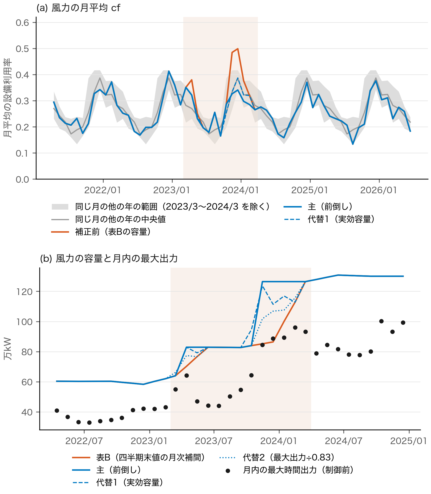{width=15cm}

注）(a) は風力の月平均の cf（制御前出力÷容量）。「主（前倒し）」は容量の計上を次の四半期末の値に前倒しした補正、「代替1（実効容量）」は同じ月の他の年の中央値から容量を逆算した補正である。(b) は表B の容量（四半期末の値の月次補間）、各補正の容量、月内の最大時間出力（制御前）。「代替2（最大出力÷0.83）」は月内の最大出力から容量に下限を置く最小の補正で、0.83 は2023年3月〜2024年3月以外の全月のピークの cf の最大値。網掛けは、同じ月の他の年の分布から除いた2023年3月〜2024年3月。

出所）資源エネルギー庁『固定価格買取制度 情報公表用ウェブサイト』の表B、北海道電力ネットワーク『エリア需給実績』より筆者作成。

## A.5　外部情報との突合

表B の北海道の風力の導入量は、2016年末32.0万kW、2023年末86.4万kW、2024年末130.0万kW、2025年末141.3万kW である。日本風力発電協会の年末導入量（36万kW、83万kW、128万kW、約128万kW。公表グラフからの読み取り）に対して、差は−11%、+4%、+2%、+10%である。日本風力発電協会は商用運転の設備を数え、表B は認定設備を運転開始の時点で計上するので、差は計上の基準と時期の違いを反映していると考えられる（個別の案件では照合していない）。太陽光は2025年3月末に234.3万kW で、北海道電力ネットワーク（2026）が公表する接続済みの容量（236万kW）との差は−0.7%である。

## A.6　長期脱炭素電源オークションの落札蓄電池の所在エリア

約定結果の別紙（落札電源一覧）は電源の名称と所在地を示すが、エリアの列をもたない。そこで、所在地の地名でエリアが決まる電源を固定し、地名のない電源（第1回1件、第2回15件、第3回13件）を9エリアに総当たりで割り当て、約定結果の本文にあるエリア別の落札容量（0.1万kW 単位、±0.05万kW）に一致する割当をすべて列挙した。同じ地名が複数の道県にある電源は所在地の表記で判定した。例えば第1回の森町睦実２蓄電所（56,351kW）は静岡県周智郡森町にあるので、中部エリアとした。一致する割当は、第1回が1通り、第2回が12通り、第3回が2通りである。別紙の合計は本文の全国の落札容量（976.6万kW、634.5万kW、729.9万kW）と、蓄電池の合計は本文の値（109.2万kW、137.0万kW、125.1万kW）と一致する。各電源のエリアの根拠は、別紙の地名で確定するもの、案件名に含まれるエリア名・県名によるもの、本文との照合のすべての解で一意に決まるもの、複数の候補が残るものの4段階に分けて記録した（付録E.4）。

推定した北海道の落札蓄電池は674,249kW（約67.4万kW）である。内訳は第1回32.5万kW（唯一の解）、第2回20.9万kW（12通りの解のいずれでも同じ）、第3回14.0万kW（2通りの解で同じ）であり、このうち6時間級は23.3万kW である。県名・市町村名で所在が決まる蓄電池を2件以上ほかのエリアへ動かす別解を許すと、第3回の北海道分は3.4万kW、合計は56.8万kW になる（以下、第3回の別解）。

これらの値は、外生の契約型容量 $K_{\mathrm{exo}}$ の感応度（7.6節・8.3.2項）に用いる。接続済みの約20万kW に北海道の落札分を加えると87.4万kW になり、第3回の別解では76.8万kW、6時間級の kWh を4時間で割ると99.1万kW になる。第8章の乖離の勘定では、LTDA を落札容量（契約容量。期待容量以下）で数え、設備容量に換算した値を上限側として併記する（付録B.5.1）。

## A.7　変数と区分の定義

表A.2〜表A.9 は、本論文で用いる変数・区分・指標の定義を、本文で初めて用いる章の順にまとめたものである。定義の式がある項目にはその式番号を、手順の詳細がある項目には付録の節を示す。数値は本文の主の基準（実績整合ケース、割引率6% など）による値である。

: 表A.2　データ・区分・価格指標の定義（第3〜5章）

| 項目 | 定義 |
|---|---|
| 年度（FY） | 4月から翌年3月まで |
| 季節（報告用） | 夏は7〜9月、冬は12〜2月、不需要期は3〜6月と10〜11月 |
| 暦月の4季節 | 報告用の不需要期を、春（3〜6月）と秋（10〜11月）に分けた区分。夏と冬は報告用と同じ |
| 季節（価格過程） | 気象学的な4区分（12〜2月、3〜5月、6〜8月、9〜11月）。報告用の区分とは別に、第7章の価格過程の推定にだけ用いる |
| 制御前出力 | 発電実績に出力制御量を足した出力 |
| 設備利用率（cf） | 制御前出力を導入量で割った値。導入量は固定価格買取制度 情報公表用ウェブサイトの表B の認定容量を月次に補間したもので、非 FIT の設備を含まない。計上時期を補正した系列は感応度にだけ用いる（付録A.4） |
| 現行の風力導入量と風力の倍率 | 現行の風力導入量は、価格過程の推定期間（FY2023〜25）の北海道の風力の認定容量の平均121万kW（計上時期を補正すると125万kW）。風力のシナリオはこれに倍率（0.5〜3倍）を掛け、設備利用率の時間の動きを保ったまま出力を伸縮させる |
| 純需要 | 需要から、制御前の太陽光、制御前の風力、原子力を引いた値 |
| TB4h スプレッド | 日内で価格の高い4時間の平均価格から、低い4時間の平均価格を引いた値（円/kWh） |
| 上位4時間・下位4時間の平均価格 | 日内の最高・最安の4時間の平均価格（円/kWh）。効率調整後スプレッドは、0.85×上位4時間の平均価格−下位4時間の平均価格 |
| 下限価格 | JEPX スポットの約定価格の下限0.01円/kWh。約定価格を $\max\{\tilde p_t,\,0.01\}$（$\tilde p_t$ は潜在価格）と書けることを、下限での打ち切りという |
| 下限張り付き | 約定価格が下限価格に張り付いた（0.011円/kWh 以下の）30分コマまたは60分の時間。下限張り付き時間はその時間数 |
| システムプライス比の高値・同価格・安値 | 北海道エリアプライスとシステムプライスの差が+0.01円/kWh を超えるコマを高値、−0.01円/kWh 未満のコマを安値、±0.01円/kWh 以内のコマを同価格とする。システムプライスは全国の連系線の制約のない価格であり、本州の価格ではない。価格過程の分断混合仕様のレジームもこの定義による |
| 北本連系線の分断 | 北海道と東北のエリアプライスの差が±0.01円/kWh を超えるコマ。北海道＞東北と北海道＜東北に分ける。システムプライス比の高値・安値のうち北海道と東北が同じ価格のまま生じるものは、東北東京間の連系線や東西の周波数変換設備での分断（東日本側）による |
| 帯域分解 | 移動平均のカスケード（式(5.1)）。6時間未満、6〜24時間、1〜7日、7日超の4成分で、成分は直交しない。主に設備利用率の系列に当てる（発電量の系列では導入量の趨勢が7日超の帯域に入る） |

出所）筆者作成。

: 表A.3　推論と価格カーブの分解の定義（第5章）

| 項目 | 定義 |
|---|---|
| EWC 検定 | Lazarus et al.（2018）の等重み余弦推定量による検定。係数の影響関数を暦日の第II種離散余弦 $\nu=\lfloor0.4T^{2/3}\rfloor$ 本（FY2016〜25 で94、FY2023〜25 で42）に射影して分散を求め、自由度 $\nu$ の t 分布で検定する。欠測日は影響関数を0とおく。時刻をまたぐ同時検定は、多式の EWC 共分散による Wald 統計量に F 補正を当てる（付録B.2.1） |
| 補正 p 値と † | 補正 p 値は、設計に合わせたふるいブートストラップ（1,999回）で求めた EWC の p 値。† は、補正 p 値で有意性の星が1段以上少なくなる係数。価格のラグを含む仕様では補正 p 値を求めない（付録B.2.2） |
| 年月固定効果の仕様 | 年度・季節の固定効果を年月固定効果（120セル）に置き換え、曜日と祝日を加えた仕様。同じ月の中の日々の気象の違いだけで係数を識別する |
| 効果の上限 | 有意でない係数について、EWC の95%区間の上限を年度内の日次発電量1標準偏差あたりの円/kWh に直し、季節平均の TB4h に対する比で示したもの。ブートストラップ‐t 区間による上限を併記する（付録B.2.3） |
| 係数の比 $\rho$ の95%集合 | 冬の上位4時間と下位4時間の係数の比 $\rho$ について、$y_d=\mathrm{Top}_d-\rho\,\mathrm{Bot}_d$ の EWC 検定を $\rho$ の格子の上で反転して求めた集合（Fieller 型）。平行移動は $\rho=1$、比例的な引下げは $\rho=\rho_0$（上位・下位4時間の平均価格の比）にあたる（付録B.2.3） |
| 分位点回帰の仕様 | 統制付きの仕様（主）は、制御前の風力・太陽光・需要に、季節×時刻・月・年度の固定効果と曜日・祝日を加えたもの。統制なしの仕様は、Sakaguchi and Fujii（2021）型の発電実績と定数だけのもの。相対価格は価格を年度平均価格で割った値。区間は日単位の14日移動ブロック・ブートストラップ（499回）のパーセンタイル区間。メリットオーダー効果が減衰したと判定するのは、価格と相対価格の両方で τ=0.9 の期間差の区間が0を含まず、効果が弱まる向きにある場合に限る（付録B.2.4） |
| 主成分の負荷 $v_k$ と因子スコア $f_{k,d}$ | 日 $d$ の24時間の価格ベクトルから年度×季節×時刻の平均を除いた偏差について、共分散行列の固有ベクトルを負荷とし、因子スコアを式(5.3)で定める。符号の向きは付録B.2.6 による。第1主成分は加法的な因子であり、乗法的な価格水準係数 $\theta$ とは別物である |
| 時刻別係数ベクトル $b$ | 式(5.2)と同じ右辺で24時刻の価格を別々に回帰した発電量の係数。平行シフトは $b_0=\cdots=b_{23}$、比例シフトは $b=\varsigma\,\bar{p}^{(s)}$（$\bar{p}^{(s)}$ は季節 $s$ の平均価格プロファイル、$\varsigma$ は比例の係数） |
| コントラスト | 時刻別係数の、夕方（17〜19時）と昼（11〜13時）の差、および夕方と夜（0〜5時）の差 |
| 因子エクスポージャー | 日次の完全予見粗利を、式(5.2)の右辺と第1〜第5主成分のスコアに回帰した係数（式(B.15)）。債券のファクター・デュレーションの類比にあたる |

出所）筆者作成。

: 表A.4　集中立地の反実仮想の定義（第5章）

| 項目 | 定義 |
|---|---|
| 日内分散比 | 合成系列で実現した日内の2帯域（6時間未満、6〜24時間）の分散の和の、実フリートに対する比。校正値は式(B.11)による |
| 相関距離 $\ell_{6}$・$\ell_{24}$ | St. Martin et al.（2015）の相関距離を、窓幅6時間・24時間に対数内挿した値（付録B.2.5） |
| ロジット空間での増幅 | 日内の2帯域の確率的な変動（季節×時刻の平均で表す系統的な日周を除いた部分）を設備利用率のロジット空間で増幅し、各日のロジットの平行移動で日次エネルギーを保存する作り方。増幅率は、実現した日内分散比が校正値に一致するよう求める。加法で振幅を伸ばして0と設備容量で打ち切る作り方は、比較にだけ用いる |
| 日周の付与 | 実フリートの出力 $x_h$ に $x_h\{1+\zeta\cos(2\pi(h-h_0)/24)\}$ の日周（振幅 $\zeta$、ピーク時刻 $h_0$）を付与した系列。日周振幅は、時刻別の平均出力の（最大−最小）÷平均で、実フリートは0.17 |
| 感応度比による補正 | 風力の日内変動（日内帯域の日次標準偏差）に対する TB4h の感応度の、実績とモデルの比。モデルの夏の完全予見粗利の増分にこの比を掛けた値を参考値とする |

出所）筆者作成。

: 表A.5　蓄電池の価値とオプションとしての分解の定義（第4・6章）

| 項目 | 定義 |
|---|---|
| 完全予見粗利 $\pi_{\mathrm{PF}}$ | 式(4.2)。4時間（出力1MW・容量4MWh）・往復効率0.85（放電側にまとめて適用）・1日1サイクル・日をまたぐ持ち越しなし・価格テイカーの蓄電池が、当日の実現価格を知って最安4時間に充電、最高4時間に放電し、粗利が負の日は休止したときの年間の粗利（円/kW-年）。前日スポット市場・1日1サイクルの下での上界にあたる |
| 日次の粗利 $X_t(D,C)$ | 式(4.1)。稼働する日には、4（0.85×上位4時間の平均価格−下位4時間の平均価格）＝3.4·TB4h−0.6·下位4時間の平均価格が成り立つ（式(B.4)） |
| 放電脚・充電脚 | 式(6.1)の恒等式 $4(0.85T-B)=3.4(T-m)+4(m-B)-0.6m$（$T$・$B$ は上位・下位4時間の平均価格、$m$ は日平均価格）の第1項（上位4時間のプレミアム）と第2項（下位4時間のディスカウント）。第3項は往復損失の水準項。放電脚の比率は $(T-m)/(T-B)$ |
| 実行可能戦略 | 先読みのない取引戦略。戦略 a は前日の実現価格の順位、a2 は同じ曜日区分の直近日の実現価格の順位、b は D−2 までの実績による需要（曜日区分別の28日平均）と太陽光（7日平均）の予測から作る残余需要の順位、b′ は b の残余需要から風力の直近7日（D−8〜D−2）の平均を控除した信号の順位、c は過去28日・同じ曜日区分の平均価格カーブの順位（気候値。窓を前日に固定する本源的方策）を使う。DL1・DL3・DL5 は、気候値からの偏差を1・3・5個の主成分に縮約し、因子ごとの AR(1) で当日に持ち越す動的因子予測（式(B.13)）、AR は時刻別の AR(1) による予測である（付録B.3.1、B.3.6） |
| 実現率（capture rate） | 実行可能戦略の実現粗利を完全予見粗利で割った比率。戦略 c は FY2023〜25 の実績価格で81.7%（8,427円/kW-年）、第7章のモデル価格の上では0.92。均衡分析では、実績で測った実現率をモデルの完全予見粗利に掛けない（取り逃しを二重に差し引くことになるため） |
| 層 (I)・(II)・(III) | 式(6.2)。戦略 c の窓 $(D_c,C_c)$ を基準とする完全予見粗利の分解。(I) は本源的方策の価値 $\sum_t X_t(D_c,C_c)$、(II) は休止の価値 $\sum_t\max\{X_t(D_c,C_c),0\}-$(I)、(III) は窓の選び直しの価値（完全予見粗利 $-\sum_t\max\{X_t(D_c,C_c),0\}$）。(I)＋(II)＋(III) は完全予見粗利に等しく、(I) を完全予見粗利で割ると戦略 c の実現率になる。(II)＋(III) は固定窓に対する完全情報の価値で、時間前市場でスポットと同じ価格で組み替えられるとした場合の上限 |
| DM 統計量 | 2戦略の日次粗利の差を損失差とする Diebold–Mariano 統計量。長期分散は Newey–West（ラグ7日）で推定し、Harvey et al.（1997）の小標本補正を付す（付録B.3.5） |
| SPA 検定・Reality Check | 基準以外の候補のうち最善のものも基準を上回らない、という帰無仮説の検定（Hansen, 2005; White, 2000）。定常ブートストラップ（平均ブロック長20日、10,000回）による（付録B.3.5） |
| duration 別の価値と $\theta^*(h)$ | 充放電時間 $h$=2〜8 の完全予見粗利と、窓を $h$ 時間にした戦略 c の実現粗利。資本費を kWh に比例する部分と kW に比例する部分（主は24.3%、0〜40% を感応度）に分け、容量収入を2029年度向けの北海道の調整係数 $\kappa(h)$（3時間未満は0）で按分して、$h$ 別の参入閾値を求める（付録B.3.8） |

出所）筆者作成。

: 表A.6　価格過程と均衡分析の定義（第7・9章）

| 項目 | 定義 |
|---|---|
| 価格水準係数 $\theta_{\mathrm{FY}}$・$\theta_m$ | 式(4.3)の年度別のスケール（FY2023〜25 の時間加重平均を1とする）。下限価格より上の部分を同じ比率で伸縮させる乗法的な水準の因子で、月次の $\theta_m$ も求める（付録B.4.1） |
| 仕様A・仕様A′・分断混合仕様 | 仕様A は、純需要の供給曲線 $g$ と時刻別プレミアム $\mu$（季節×時刻）からなる単一曲線の仕様。仕様A′ は $\mu$ を（季節、時刻、日次の制御前の風力発電量の三分位）に依存させた修正版であり、風力への条件付き応答と実績との差が標本内で有意でなくなる組合せとして選んだ（風力への応答はなお実績の約2倍）。三分位の境界は季節ごとに FY2023〜25 で定め、風力の反実仮想では最上位の三分位より先へ外挿しない。分断混合仕様は、システムプライス比の安値・同価格・高値の3レジームを純需要の多項ロジットで混合する仕様（付録B.4.1） |
| 推定範囲外と両端の扱い | 推定範囲外は、各季節の $g$ の最下位ビンの中心より低い純需要。仕様A はこの範囲の価格を0.01円とする（段差。主）。感応度として、最下位の打ち切られていない8ビンの傾きで線形外挿し、下限0.01円を残す場合（線形外挿・下限あり）と外す場合（下限なし）を計算する。上端（最上位ビンの中心より高い純需要）は価格を一定とし、線形外挿を感応度とする |
| ベースロードの一律減 | 原子力の再稼働を、純需要からの一律の差し引きで表す。泊3号は91.2万kW×稼働率90%＝821MW、泊2基相当は泊3号の2基分の1,642MW、泊1〜3号の全基は207万kW×90%＝1,863MW。泊＋風力2倍は泊3号と風力2倍の組合せ |
| 条件付き応答の検証 | FY2023〜25 の1,096日について、実績価格とモデル価格の日次の指標（日平均価格、上位4時間・下位4時間の平均価格、TB4h、完全予見粗利）に式(5.2)の主仕様と年月固定効果の仕様を当て、差（モデル−実績）を同じ右辺に回帰して差そのものを検定する。推論は EWC（$\nu=42$）で、風力の3季節の族に Holm（1979）の補正を当てる。両仕様で全季節・全指標の差の p が0.10を上回ることを基準とする（付録B.4.1） |
| 実績整合ケース | 式(4.4)。モデル価格の上で戦略 c を実際に動かして得る粗利 $c_{\mathrm{model}}(K)$ に校正係数 $\lambda$ を掛け、充電従量負担を控除した $\pi(K)=\lambda\,c_{\mathrm{model}}(K)-w_{\mathrm{chg}}$。$K=0$・$\theta=1$ で実績の戦略 c（8,427円/kW-年）に一致し、$\pi(0)=6{,}675$ 円/kW-年。均衡分析（第7〜9章）の主の基準 |
| 校正係数 $\lambda$ | 実績の戦略 c の粗利を、モデル価格の上の戦略 c の粗利で割った比（$K=0$・$\theta=1$、FY2023〜25 の標本内）。水準係数付きの仕様A で1.108（8,427÷7,602。95%区間1.03〜1.19）、水準固定の仕様A で1.103、仕様A′ で1.0015、下端を線形外挿した仕様A で1.114、分断混合仕様で1.233。各仕様の現状・$K=0$ で求め、$K>0$ と他のシナリオでも一定とする（付録B.4.3） |
| モデル直値 | $\lambda=1$ とした $c_{\mathrm{model}}(K)-w_{\mathrm{chg}}$（水準係数付きの仕様A で、$K=0$ に5,850円/kW-年）。参考として併記する |
| 実現率×モデルの完全予見粗利 | 実績で測った実現率（0.81）をモデルの完全予見粗利に掛けた粗収益（$K=0$ に6,695円/kW-年、充電従量負担を控除して4,943円/kW-年）。取り逃しを二重に差し引くので、収益の基準の比較にだけ用いる（付録C.2.7） |
| 増分貪欲ディスパッチとフリートの配分 | 規模 $K$ のフリートを1万kW 刻みで逐次投入し、各増分がその時点の価格で最安4時間に充電、最高4時間に放電して（粗利が正の日だけ）純需要と価格を更新する。主はフリートを完全予見で配分し、感応度としてフリートも戦略 c の窓で動く場合と、両者が半々の場合を示す（付録B.4.3） |
| 外生の契約型容量 $K_{\mathrm{exo}}$ | LTDA・補助金による契約型の容量を、価格テイカーとして同じ増分貪欲で動く外生の容量として置いたもの。主は0。感応度は接続済みの約20万kW、第3回の別解による76.8万kW、接続済みに LTDA の北海道分約67.4万kW を加えた87.4万kW（6時間級を4時間に換算すると99.1万kW）。推定期間の価格に既設の蓄電池の影響が入っているので、二重計上を含む（付録A.6、B.4.4） |
| 実効容量収入 $\kappa P_{\mathrm{cap}}$ | 容量市場の約定価格に調整係数 $\kappa$ を掛けた値。主は2029年度向けの北海道の14,972円/kW×0.836＝12,517円/kW-年（損益分岐の式では1.25万円に丸める）。感応度として、FY2030 以降を2030年度向けの指標価格（Net CONE 20,911円/kW）による1.75万円、上限近傍の2.5万円、上限価格（1.5×Net CONE）による2.62万円とする年度ごとの列を置く |
| 容量市場価格の $K$ 依存 | 2029年度向けの数量に2030年度向けの価格を当てた4点の折れ線の需要曲線の上の移動として、北海道ブロック按分と全国連系の二つの境界で与える。現在点を起点の実効容量収入に置き、接続済み容量とマーチャントだけを入れる（LTDA の電源は容量市場に参加しない）（付録B.4.4） |
| 負の価格の段差モデル | モデル価格が下限価格に張り付く時間だけ、価格を $-\delta$ 円/kWh（$\delta$=0・5・10）に置く反実仮想（式(9.1)）。$-\delta$ は $\theta$ で伸縮させない（付録B.6） |

出所）筆者作成。

: 表A.7　価格水準の不確実性と参入閾値の定義（第7章）

| 項目 | 定義 |
|---|---|
| 恒久成分 $\xi$・一時成分 $\chi$ | 価格水準の代理（月平均システムプライスを FY2023〜25 の同月平均で割った値、2016年4月〜2026年6月）の対数を、ランダムウォークの $\xi$ と AR(1) の $\chi$ の和で表す2因子分解（カルマンフィルタによる最尤推定）。$\sigma_\xi$ は恒久成分の年率のボラティリティ。2026年6月の恒久成分の推定値は1.22（付録B.4.5） |
| $a$・$F$ | 年間キャッシュフローを式(7.2)の形に書いたときの係数。$a$ は $K=0$・$\theta=1$ の限界参入者の粗収益で、実績整合ケースの $\lambda\,c_{\mathrm{model}}(0)$＝1.1085×7,602＝8,427円/kW-年（モデル直値は7,602円）。$F$ は運転維持・廃止0.53万円＋託送等の固定費0.69万円＋充電従量負担1,752円−実効容量収入1.25万円＝1,452円/kW-年 |
| 静学の損益分岐 $\theta^*$ | 式(4.8)、すなわち $(I\cdot\mathrm{CRF}+F)/a$（式(B.7)）。価格水準が一定のまま20年続くと置いて、$K=0$ で NPV を0にする価格水準係数。WACC 6% で2.99（$\lambda$ の95%区間で2.78〜3.21、モデル直値3.31）、第7章の標準ケース（$c_{\mathrm{req}}=3.45$ 万円）で2.82 |
| 損益分岐の直接解 | 収益が $\theta$ に比例しない場合（負の価格の段差モデル）に、各 $\theta$ で戦略 c を計算し直した粗収益について、式(9.2)を $\theta$ について解いた値（付録B.6.1） |
| 単独企業の閾値 $\bar\theta$ | 排他的な参入権を持つ単独企業の最適行使閾値。他社の参入を無視し、自分の待機の価値は考慮する |
| 競争均衡の閾値 $\theta_c$ | 閾値で参入した者の NPV を、その後に他社が同じ規則で参入して収入が閾値に押さえられる（上側の反射壁）ことを織り込んで計算し、それが0になる閾値 |
| 資本費の低下率 $g_I$ | 蓄電池の資本費の年率の低下（0〜8%）。揚水並みの2.3万円/kWh で止まるとする |
| 期待成長 $\alpha$ | 価格水準の恒久成分の期待成長率。主は0（マルチンゲール）、感応度は年2%と、2因子モデルどおり対数のドリフトを0とする $\exp(\sigma^2/2)-1$ |
| 参入が開く確率 | 恒久成分の推定値1.22を出発点に $\theta$ を年次のマルチンゲールとして動かしたとき、各年度までに $\theta$ が閾値を上回る確率 |
| 補助の扱い | SII の補助率（上限なしの1/2、1/3、上限の効く実効29.4%）に応じて、投資額と資本費の下限を（1−補助率）倍にする。競争均衡は、後続の参入者も補助を受けると置いた近似 |
| 接続枠の待機価値 $W_0$ | マーチャント収入（スポット裁定と容量収入）だけで評価した、排他的な接続枠（契約申込）の待機価値。単独企業の動的計画法で、期限つき（3・5・10年。本文は5年）と期限なし（80年で打ち切り）について求める。他社の参入を無視した上限 |

出所）筆者作成。

: 表A.8　費用・資本コスト・収益リスクの定義（第4・8章）

| 項目 | 定義 |
|---|---|
| $c_{\mathrm{req}}$・$\mathrm{CRF}$・$c_{\mathrm{fix}}$ | 式(4.6)。$I$＝6.8万円/kWh×4＝27.2万円/kW、$c_{\mathrm{fix}}$＝運転維持・廃止0.53万円＋託送等の固定費0.69万円＝1.22万円/kW-年。WACC 6% で $c_{\mathrm{req}}$＝3.59万円/kW-年 |
| 充電従量負担 $w_{\mathrm{chg}}$ | 1.2円/kWh×4時間×365日＝1,752円/kW-年 |
| 事業 IRR | 無レバレッジ・税前・20年で、毎年の期末に同額のキャッシュフローが生じるとしたときの内部収益率。物価上昇を織り込まないので実質と読む。容量収入の経路を置く場合は、年度別のキャッシュフローの IRR |
| 資産の資本コスト $r_A$ | 事業資産のリスクに見合う割引率。摩擦と税がなければ加重平均資本コストに等しい。契約型の $r_C$ は4〜6%（APV では5%）、マーチャントの $r_A^M$ は8〜9%（APV では9%、8% の値を併記）（付録B.5.3） |
| 調整現在価値（APV） | 借入のないマーチャント事業の NPV（$r_A^M$ で割引）を基礎とし、容量市場・補助金・LTDA の各成分の現在価値を足したもの。負債の節税効果は別に示す |
| APV が0となる割引率 | 補助後の投資額と、スポット・容量の収入から固定費を引いたキャッシュフローの IRR。これより低い割引率で評価すれば APV は正になる |
| 期待値の移転・リスク移転 | LTDA をレベニュースワップとみたときの価値の2成分（式(8.1)）。期待値の移転は固定収入が手放す収入の期待値を上回る分（$r_C$ で評価）、リスク移転は手放す収入を $r_C$ と $r_A^M$ で割り引いた現在価値の差 |
| 確実性等価のリスク調整 | $\log\theta$ を持続性 $\phi$ の定常 AR(1)（$\phi$=0〜0.9）または恒久成分のランダムウォーク（$\phi=1$、$\sigma_\xi$=0.10〜0.30）とし、各年の価値の更新の標準偏差にリスクの価格 $\Lambda$（シャープ・レシオ0.2〜0.4×市場収益率との相関0.3〜1）を掛けた額を、期ごとに6% で割り引いて積み上げたもの（付録B.5.4） |
| 年間市場収入 $R$ | 式(8.2)。$a(K)=\lambda\,c_{\mathrm{model}}(K)$ は実績整合ケースの限界参入者の粗収益（$\theta=1$）。因子は価格水準 $\theta$、他者の参入 $K$（主は20〜87.4万kW の一様分布）、容量価格の約定水準 $L$、年度単位の形状 $S$、日々の天候 $\omega$（付録B.5.5） |
| 5% CFaR・5% ES | CFaR は $R$ の期待値と5%分位点の差、ES は期待値と、5%分位点以下の条件付き期待値の差 |
| Shapley 配分 | 5因子を同時に動かしたときの5% CFaR を、全32通りの因子の部分集合の CFaR（含めない因子は基準値に固定）から、各因子に配分したもの |
| ヘッジ有効性（HE） | 式(8.3)。$G$ は北海道の月間の完全予見粗利、$P^{\mathrm{fut}}$ は東京エリアの月平均価格（ベースと、平日8〜20時・祝日を除くピーク）。季節（暦月の平均）は標本の中で除く（付録B.5.6） |

出所）筆者作成。

: 表A.9　乖離の勘定と併設蓄電池の定義（第8章）

| 項目 | 定義 |
|---|---|
| 乖離の kW 勘定 | 接続済みの約20万kW と契約申込の約234万kW の合計254万kW を、属性（LTDA、補助（SII の交付決定のうち北海道の12件）、確認できたマーチャント（Helios）、併設、不明）別の kW に割り当て、各属性に1kWあたりの APV（$r_A^M=9\%$、実績整合ケース）を対応させたもの。「市場外収入で APV が正」「APV が負のまま参入」「属性が不明」の三つに分ける（付録B.5.1） |
| 計測外の成分 | 属性が不明の kW をマーチャントの4時間蓄電池とみなしたときの1kWあたりの APV の不足（$K=0$ の値）と、その kW の積。$K=0$ は参入に最も有利な評価なので、上限ではなく規模の目安である |
| 併設蓄電池の価値の2成分 | エリア価格でのスポット裁定 $\pi_{\mathrm{spot}}'$ と、再エネの抑制の回避 $\pi_{\mathrm{local}}$。両者は同じ時間の充電を取り合うので、日ごとの線形計画で同時に最適化し、$\pi_{\mathrm{local}}$ は系統から充電する場合に比べた増分（両方を許した価値−スポット裁定だけの価値）とする（付録B.5.2） |
| 併設の参入条件 | $\pi_{\mathrm{spot}}'+\pi_{\mathrm{local}}+\kappa P_{\mathrm{cap}}\ge c_{\mathrm{req}}^{\mathrm{co}}$。$c_{\mathrm{req}}^{\mathrm{co}}$ は、系統用と同じ定義と、託送の固定費を発電所と共有し系統から充電しない併設の定義の2通り |
| 比例拡大・回避率一定 | 抑制率を上げる2通りの方法。比例拡大は FY2026 の4〜6月の時間別の抑制を比例的に拡大するもので、容量の制約で回避率が下がる（下限側）。回避率一定は表C.36 の回避率を保つ（上限側） |
| 5円超の抑制の分類 | 風力の抑制のうちエリアプライスが5円/kWh を超える時間を、(i) 太陽光の抑制が同じ時間にある、(ii) 同じ日に下限張り付きの時間がある、(iii) 再エネの抑制が続いた時間帯の最初か最後の時間である、(iv) ローカル制御が公表された系統・日・時間帯にあたる、に分けたもの（表D.4） |

出所）筆者作成。


```{=openxml}
<w:p><w:r><w:br w:type="page"/></w:r></w:p>
```


# 付録B　推定と導出の詳細

本付録は、本文で結果だけを用いた導出と、推定・数値計算の手順を、本文の章の順に示す。付録B.1 は第4章の共通の定義にかかわる導出、付録B.2〜B.6 は第5〜9章の方法の詳細である。記号は本文と同じ意味で用い、この付録だけで用いる記号はその場で定義する。

## B.1　分析の枠組みに関する導出（第4章）

本節は、第4章で定義した完全予見粗利、ゼロレント条件、損益分岐の価格水準係数について、本文で結果だけを用いた性質を導く。記号は第4章と同じである。

### B.1.1　交換オプションのペイオフの性質

日 $t$ の粗利（式(4.1)）は $X_t(D,C)=\eta\sum_{h\in D}p_{t,h}-\sum_{h\in C}p_{t,h}$ であり、$D$ と $C$ はそれぞれ4時間からなる。

**比例的な変化**　$X_t(D,C)$ は価格の線形関数なので、全時刻の価格を同じ正の倍率で動かすと、すべての $(D,C)$ について粗利も同じ倍率で動く。正の定数倍は大小関係を変えないので、最適な窓 $(D,C)$ は変わらず、窓についての最大値 $\max_{D,C}X_t(D,C)$ も同じ倍率で動く。さらに $(\cdot)^{+}$ は正の定数倍と交換できるので、日次の完全予見のペイオフとその年間合計（式(4.2)）は価格について1次同次である。

価格水準係数を入れた価格過程（式(4.3)）では、$\tilde{g}_t=g(\mathrm{net}_t;\mathrm{season})+\mu(\mathrm{season},\mathrm{hour})-0.01$ とおくと、$\theta>0$ に対して

$$p_t=\max\{0.01,\;0.01+\theta \tilde{g}_t\}=0.01+\theta\,\tilde{g}_t^{+}$$

（式番号 B.1）

と書ける。$\tilde{g}_t\ge0$ なら右辺は $0.01+\theta \tilde{g}_t$、$\tilde{g}_t<0$ なら0.01 であり、左辺と一致する。日 $t$・時刻 $h$ の値を $\tilde{g}_{t,h}$ と書いてこれを式(4.1)に代入すると

$$X_t(D,C)=\theta\Bigl(\eta\sum_{h\in D}\tilde{g}_{t,h}^{+}-\sum_{h\in C}\tilde{g}_{t,h}^{+}\Bigr)-4(1-\eta)\times0.01$$

（式番号 B.2）

となる。第2項は窓の選び方によらない定数（$-0.006$ 円/kW-日）なので、どの窓が最適か、また過去の平均価格カーブの順位で窓を決める戦略 c がどの窓を選ぶかは、$\theta$ によらない。したがって粗利は、下限価格に由来するこの小さな定数と、休止や正のマージンの判定が切り替わる日を除いて、$\theta$ に比例する。限界参入者の粗収益が $\theta$ にほぼ比例するという本文の性質（4.2.3項）は、これによる。

**加法的な変化**　全時刻の価格に同じ額 $u$（円/kWh）を足すと、

$$X_t(D,C;p+u)=X_t(D,C;p)+4\eta u-4u=X_t(D,C;p)-4(1-\eta)\,u=X_t(D,C;p)-0.6\,u$$

（式番号 B.3）

となる。変化は窓によらない定数なので最適な窓は変わらず、粗利は休止の切替を除いて $-0.6u$（円/kW-日）だけ動く。値下がり（$u<0$）は、往復損失として失う0.6kWh 分の充電費用を下げるので、粗利を上げる。

**稼働日の恒等式**　最適な窓の上位4時間・下位4時間の平均価格を $T_t$・$B_t$ とし、$\mathrm{TB4h}_t=T_t-B_t$ とすると、稼働する日の粗利は

$$4(\eta T_t-B_t)=4\eta\,\mathrm{TB4h}_t-4(1-\eta)\,B_t=3.4\,\mathrm{TB4h}_t-0.6\,B_t$$

（式番号 B.4）

と分けられる。構造イベントによる完全予見粗利の変化は、スプレッドの変化 $3.4\,\Delta\mathrm{TB4h}$、往復損失の水準効果 $-0.6\,\Delta B$、休止の切替（比べる二つの状態のどちらかで粗利が負となり休止する日の差）の3つに分かれる。失われる0.6kWh は充電時に下位4時間の価格で買うので、下位4時間で評価する。上位4時間で評価する別の分け方 $4(\eta T_t-B_t)=4\,\mathrm{TB4h}_t-0.6\,T_t$ も成り立つ。

### B.1.2　ゼロレント条件と NPV＝0 の同値性

20年の年金現価係数は $\sum_{t=1}^{20}(1+r)^{-t}=[1-(1+r)^{-20}]/r=1/\mathrm{CRF}(r,20)$ である。年々の収入と費用が一定なら、式(4.7)は

$$\mathrm{NPV}=-I+\frac{\pi(K)+\kappa P_{\mathrm{cap}}-c_{\mathrm{fix}}}{\mathrm{CRF}(r,20)}$$

（式番号 B.5）

と書ける。$\mathrm{NPV}=0$ は $\pi(K)+\kappa P_{\mathrm{cap}}-c_{\mathrm{fix}}=I\cdot\mathrm{CRF}(r,20)$、すなわち $\pi(K)+\kappa P_{\mathrm{cap}}-c_{\mathrm{req}}=0$（式(4.5)）と同値である。

等価年額 $I\cdot\mathrm{CRF}(r,20)$ は、資本の機会費用 $rI$ と、20年で元本を回収するための積立額 $[\mathrm{CRF}(r,20)-r]\,I=rI/[(1+r)^{20}-1]$ の和に分かれる。後者は経済的な減価償却にあたるので、等価年額は Jorgenson（1963）の資本の使用者費用に対応する。

数値は次のとおりである。$r=6\%$ では $\mathrm{CRF}(0.06,20)\approx0.0872$ で、$I=27.2$ 万円/kW に対する等価年額は約2.37万円/kW-年、$c_{\mathrm{fix}}=1.22$ 万円を加えた $c_{\mathrm{req}}$ は3.59万円/kW-年である。逆に $c_{\mathrm{req}}$ を与えて $\mathrm{CRF}(r,20)=(c_{\mathrm{req}}-c_{\mathrm{fix}})/I$ を $r$ について解くと、第7章の標準・楽観・保守ケースの $c_{\mathrm{req}}$（3.45万・3.2万・3.7万円/kW-年）は、それぞれ割引率約5.3%・3.9%・6.6% にあたる。

### B.1.3　損益分岐の価格水準係数

$\theta$ を明示して、限界参入者の粗利を $c_{\mathrm{model}}(K;\theta)$ と書く。付録B.1.1 により、$K=0$ の限界参入者の粗収益は $\lambda\,c_{\mathrm{model}}(0;\theta)\approx\theta\,\lambda\,c_{\mathrm{model}}(0;1)$ と書ける（$\theta=1$ で8,427円/kW-年）。これを $K=0$ の式(4.5)に代入すると

$$\theta\,\lambda\,c_{\mathrm{model}}(0;1)-w_{\mathrm{chg}}+\kappa P_{\mathrm{cap}}-c_{\mathrm{req}}=0$$

（式番号 B.6）

であり、$\theta$ について解いたものが式(4.8)である。$a=\lambda\,c_{\mathrm{model}}(0;1)$、$F=c_{\mathrm{fix}}+w_{\mathrm{chg}}-\kappa P_{\mathrm{cap}}$ とおけば、同じ式は

$$\theta^*=\frac{I\cdot\mathrm{CRF}(r,20)+F}{a}$$

（式番号 B.7）

と書ける。第7章の実物オプションの分析はこの形を用いる。実効容量収入を1.25万円とすると $F$＝1.22万＋1,752−1.25万＝1,452円/kW-年であり、$r=6\%$ では $\theta^*$＝（約2.37万＋1,452）÷8,427≈2.99 となる。

収益が $\theta$ に比例しない場合には、式(B.7)は $\theta^*$ を過小に出しうる。第9章の負の価格の段差モデルでは、下限価格に張り付く時間の価格を $\theta$ で伸縮させない負の値に置くので、粗収益は $\theta$ によらない正の部分をもつ。この場合の直接解と比例の式の差は付録B.6.1 に示す。第9章は、各 $\theta$ で戦略 c を計算し直した粗収益について、式(4.5)を $\theta$ について直接解く。

## B.2　価格形成の推定の詳細（第5章）

本節は、第5章の方法（5.1節）のうち、本文で要点だけを述べた計算の手順を示す。この節だけで用いる記号は、その場で定義する。

### B.2.1　EWC 検定の計算と欠測の扱い

式(5.2)の係数ベクトルの最小二乗推定量について、日 $t$ の影響関数を $\psi_t=(\mathbf{Z}'\mathbf{Z})^{-1}Z_t\hat{\varepsilon}_t$ とする。$\mathbf{Z}$ は説明変数の行列、$Z_t$ は日 $t$ の説明変数のベクトル、$\hat{\varepsilon}_t$ は残差である。暦日の時点 $t=1,\dots,n$（$n$ は標本の暦日数）の上で、第II種の離散余弦

$$\mathcal{C}_j(t)=\sqrt{2}\cos\left(\frac{\pi j\,(t-1/2)}{n}\right),\qquad j=1,\dots,\nu$$

（式番号 B.8）

に影響関数の和を射影し、射影の2乗を等重みで平均して係数の分散とする。これは Lazarus et al.（2018）の長期分散の推定量を、影響関数の和の形に書いたものである。

$$\hat{\boldsymbol{\Sigma}}=\frac{1}{\nu}\sum_{j=1}^{\nu}\Psi_j\Psi_j',\qquad \Psi_j=\sum_{t=1}^{n}\mathcal{C}_j(t)\,\psi_t$$

（式番号 B.9）

余弦の本数は Lazarus et al.（2018）の規則 $\nu=\lfloor 0.4n^{2/3}\rfloor$ に従う（FY2016〜25 の $n=3{,}652$ 日で $\nu=94$、FY2023〜25 の $n=1{,}096$ 日で $\nu=42$、Fuke and Ohashi（2025）型の仕様の FY2016〜19 で $\nu=51$）。$\nu$ を固定したまま標本長を大きくする漸近理論の下では、この t 統計量は自由度 $\nu$ の t 分布に従うので、t 分布の臨界値を用いる。Lazarus et al.（2018）はこの種の推論を HAR 推論（heteroskedasticity and autocorrelation robust inference）と呼ぶが、本文5.1.1項で触れた Corsi（2009）の HAR モデルとは別物である。

欠測日は、Rho and Vogelsang（2019）の振幅変調法により、暦日の格子の上で影響関数を0とおく。余弦とラグの時点は暦日で数え、欠測期間の前後の日を隣接させない。標本の行を連続とみなした場合との p 値の差は、EWC で0.003以下、Newey–West で0.001以下である。祝日は国民の祝日に関する法律の規則（振替休日、国民の休日、2019年の即位関連の祝日、2020〜21年の祝日の移動を含む）から作成した。FY2016〜25 の祝日は184日、うち平日は147日である。

比較に用いた推論法は四つである。第一は HC3 標準誤差、第二は Newey and West（1987）の HAC 標準誤差（ラグ7日・14日、および Andrews（1991）の AR(1) プラグインで係数ごとに選んだ帯域）、第三は年月クラスタ（120クラスタ、自由度119の t 分布。Cameron & Miller, 2015）である。第四は、Lazarus et al.（2018）の規則によるラグ $\lceil 1.3n^{1/2}\rceil$（79日）の Newey–West に、Kiefer and Vogelsang（2005）の固定 b の臨界値（5%で2.03）を当てた検定である。

### B.2.2　設計に合わせたふるいブートストラップ

式(5.2)の右辺は季節交互作用なので、各係数の影響関数は主にその季節の日に集中し（北海道の TB4h では、他の季節の日の寄与は影響関数の2乗和の2〜26%）、年の中で強弱をくり返す。EWC と固定 b の臨界値は影響関数の分散が時間を通じて一様であることを前提にしているので、この設計では名目の水準より棄却しやすくなる。

そこで説明変数の行列 $\mathbf{Z}$ を固定し、再エネの係数がゼロという帰無仮説の下の被説明変数を1,999回生成する。誤差は、主仕様の残差に当てはめた自己回帰（次数は BIC で選び、北海道6〜10次、九州9〜14次。係数の和は0.87〜0.91）と、季節別に復元抽出したイノベーションから作る。Bühlmann（1997）のふるいブートストラップを、回帰の残差に当てはめ、イノベーションを季節別に抽出する点で変えたものである。この帰無分布から EWC の t 統計量の補正 p 値と、各推論法の実効的な棄却率を求める。自己回帰は最小二乗残差に当てはめるので、生成した誤差の持続性は実際よりわずかに低い（北海道の TB4h で、残差の1次自己相関は0.74対0.76）。このため、この補正は歪みをやや小さめに見積もる。価格のラグを含む仕様は、残差の自己相関の下でラグ価格が誤差と相関しうるので、補正 p 値を求めず、境界的な証拠として扱う。

### B.2.3　効果の上限と、上位・下位4時間の係数の比

**効果の上限**　有意でない係数について、EWC の95%区間の上限に、年度内の日次発電量の標準偏差を掛けて円/kWh に直し、季節平均の TB4h で割った比を効果の上限とする。ブートストラップ‐t 区間による上限も併記する。

**係数の比の集合**　冬に風力が上位4時間の価格を下位4時間より多く下げるかを調べるため、上位4時間の係数 $\beta^{\mathrm{top}}$ と下位4時間の係数 $\beta^{\mathrm{bot}}$ の比 $\rho$ を考える。$\rho$ の格子の上で、被説明変数を $y_d=T_d-\rho\,B_d$（$T_d$・$B_d$ は日 $d$ の上位・下位4時間の平均価格で、式(6.1)の $T$・$B$ と同じ）とした回帰の EWC 検定で $H_0:\beta^{\mathrm{top}}-\rho\,\beta^{\mathrm{bot}}=0$ を検定し、棄却されない $\rho$ の集合を95%集合とする（Fieller, 1954 と同じ考え方）。平行移動は $\rho=1$ で、TB4h の係数がゼロという検定と同じである。比例的な引下げは $\rho=\rho_0$ で、$\rho_0$ は冬の上位・下位4時間の平均価格の比（FY2016〜25 で2.20、2021年1月を除くと2.01、FY2023〜25 で1.72）である。この検定は $\rho_0$ を固定値として扱うので、日単位の14日移動ブロック・ブートストラップで $\rho_0$ と係数を同時に再標本化した区間でも確かめる。真が比例のときにこの2点検定が平行を棄却する検出力も、同じ設計のシミュレーションで求める。

### B.2.4　分位点回帰の推定

分位点回帰は Frisch–Newton 内点法（Portnoy & Koenker, 1997）で推定し、汎用の統計ソフトウェアの推定値と目的関数値が一致することを確かめた。τ は0.1〜0.9とする。下限価格0.01円/kWh はデータの左側打ち切りである。ただし下限に張り付いたコマは FY2023〜25 でも全コマの2〜4%にとどまり、主に報告する τ=0.9 の条件付き分位は下限を上回る。条件付き分位が打ち切り点を上回る範囲では、打ち切られた価格の分位は潜在価格の分位に一致するので、高分位の係数は打ち切りの影響をほとんど受けない。下限が効く低分位を厳密に扱う打ち切り分位点回帰（Powell, 1986）は用いず、下限張り付きの時間を除いた推定を感応度として示す。係数と期間差の95%区間は、日単位の14日移動ブロック・ブートストラップ（Künsch, 1989。499回）のパーセンタイル区間で、期間ごとに独立に抽出する。感応度として、FY2018（胆振東部地震の年度）を除く FY2016〜17 と、燃料危機期を除く FY2019〜20 も推定し、先行研究の期間の FY2016〜19 も参考に示す。

**市場分断の内訳**　北海道の価格が欠測する960コマを除き、年度別の構成比と期間をプールした値を求める。風力の日次発電量の季節内三分位ごとに、安値のコマの時間を北本連系線の拘束（北海道＜東北）と東日本側（北海道＝東北）に分け、三分位の大−小の差の95%区間を日単位の14日移動ブロック・ブートストラップで求める。北本連系線の拘束の時間については連系線の潮流の分布も示す。空き容量のデータがないので、運用容量に対する比は求めない。価格過程の分断混合仕様（7.1.1項）のレジームは、システムプライスとの比較による定義に従う。

### B.2.5　空間分散の反実仮想の校正と系列の作り方

**相関距離**　St. Martin et al.（2015）の相関距離 $\ell_w$ は、日周の高調波（4次まで）と季節成分を除いた確率的な変動のうち、窓幅 $w$（時間）より速い成分すべての地点間相関を距離で積分した累積値であり、帯域通過の値ではない。同論文は $w=6$・24時間の値を数値で報告していないので、同論文の Fig.6 の地域別の点を読み取り、$w=6$・24時間に対数内挿した。豪州の発電量で $\ell_{6}=32$km・$\ell_{24}=130$km、カナダの風速で16km・67km である（最も遅い変動の相関距離はそれぞれ368km・273km）。同論文の式(2)の経験的包絡（$w_0=38$ 時間）からは、最も遅い変動の相関距離に対する比が6時間で0.019〜0.156、24時間で0.150〜0.534 と幅の広い値が出る。Fig.6 の値はその中ほどにある。

**分散の減衰**　6時間未満の帯域（帯域1）と6〜24時間の帯域（帯域2）の分散の減衰 $N_1$・$N_2$ を2通りで求める。帯域1には $\ell_{6}$、帯域2には $\ell_{24}$ を当てる。一つは、面積 $\mathcal{A}$ の領域に含まれる無相関な地点の数を最大で $\mathcal{A}/(2\ell)^2$ とする同論文の議論に基づく上限式

$$N_1=\frac{\mathcal{A}}{(2\ell_{6})^2},\qquad N_2=\frac{\mathcal{A}}{(2\ell_{24})^2}$$

（式番号 B.10）

である（領域を発電所で埋め尽くした場合の値で、発電所の数が少なければその数で決まる）。もう一つは容量加重の有効地点数で、帯域1では $N_1=1/(\boldsymbol{u}'\boldsymbol{\Omega}_{1}\boldsymbol{u})$ とする。$\boldsymbol{u}$ は市町村別の容量の重みベクトル、$\boldsymbol{\Omega}_{1}$ は地点 $i$・$j$ の間の距離 $\mathrm{dist}_{ij}$ に指数相関 $\exp(-\mathrm{dist}_{ij}/\ell_{6})$ を当てた相関行列であり、帯域2の $N_2$ は $\ell_{24}$ を用いて同じように求める。二つの帯域を合わせて、日内分散比を

$$\mathcal{V}=\frac{\varpi_{6}N_1+\varpi_{24}N_2}{\varpi_{6}+\varpi_{24}}$$

（式番号 B.11）

とする。$\varpi_{6}$・$\varpi_{24}$ は実フリートの6時間未満と6〜24時間の帯域の分散シェアである。下限は豪州型と容量加重、中央は豪州型と北海道全域（8.3万km²）、上限はカナダ型と北海道全域の組である（表C.4）。Malvaldi et al.（2017）の国別出力と欧州10か国の集約の分散比（2.1〜6.5倍）は全帯域の値なので、日内帯域の校正には用いない。

**合成系列**　設備利用率をロジット変換した系列を式(5.1)と同じカスケードで分解し、日内の2帯域の確率成分（季節×時刻の平均、すなわち系統的な日周を除いた部分）を同じ倍率で増幅する。そのうえで、各日のロジットの平行移動により日次エネルギーを実績に厳密に一致させる。出力は自然に0と設備容量の間に収まる。倍率は、合成系列で実現した日内分散比が校正値に一致するよう数値的に求める。$\ell$ は日周を除いた確率成分の値なので、主の反実仮想は日周の成分を増幅せず、日内分散比も確率成分で測った比 $\mathcal{V}^{\mathrm{ns}}$ に合わせる。日周の成分まで増幅した版（全成分）と、6時間未満と6〜24時間の帯域を校正の $(N_1, N_2)$ どおり別々に増幅した版を感応度とする。比較のため、日内帯域を加法で増やし、0と設備容量で打ち切ってから日次エネルギーに再スケールする作り方も示す。この作り方では、名目の倍率と実現する増幅が一致しない（表C.5）。

**日周の付与**　実フリートの出力 $x_h$（$h$ は時刻）に $x_h\{1+\zeta\cos(2\pi(h-h_0)/24)\}$ の日周を付与する。$\zeta$ は振幅、$h_0$ はピーク時刻である。0と設備容量での打ち切りと日次エネルギーへの再スケールを3回くり返し、日次エネルギーの誤差は最大1%に収まる。結果は、実現した日内分散比をそろえた一様な増幅と比べる。

**感応度の検証と補正**　反実仮想はモデル価格の上の比較なので、風力の日次発電量に対する TB4h の係数と、風力の日内変動（日内帯域の日次標準偏差、GW）に対する TB4h の感応度を、実績とモデルで比べる（差の EWC 検定）。夏の感応度の比（実績÷モデル）でモデルの夏の完全予見粗利の増分を補正した値を参考値とする。比の95%区間は、実績の係数の誤差だけを考える区間と、実績とモデルの係数の同時の EWC 共分散による Fieller 型の区間の2通りで示す。この補正は、感応度の比が一定で、完全予見粗利の増分が比に比例するという仮定に立つ概算である。

### B.2.6　主成分分解の符号と検定

**符号と推定の単位**　負荷 $v_k$ は24次元の単位ベクトルで、第1主成分は平均負荷が正、第2主成分は夕方（17〜19時）の負荷が昼（11〜13時）より大きい向き、第3主成分は夜（0〜5時）の負荷が正の向きに符号をそろえる。推定は全期間（FY2016〜25、北海道3,632日）、季節別、FY2023〜25、年度別に行い、日次変化（前日との差）の分解を頑健性として併記する。発電量の効果は、発電量の年度内の偏差の1標準偏差あたりでも示す。第2主成分の負荷の和は0でないので、全時刻一様の値下がりでもスコアが動く。そこで一様な値下がりの寄与を除くため、平均を0にした負荷 $(v_2-\bar{v}_2)'p_d$ による非一様な部分でも効果を示す。

**形の検定**　時刻別係数ベクトル $b$ について、平行シフト $H_0: b_0=\cdots=b_{23}$ と比例シフト $H_0: b=\varsigma\,\bar{p}^{(s)}$（$\bar{p}^{(s)}$ は季節 $s$ の平均価格プロファイル、$\varsigma$ は比例の係数）を検定する。時刻間の残差相関と日次の系列相関を両方考慮した多式の EWC 共分散で Wald 統計量を作り、Lazarus et al.（2018）の F 補正で p 値を求める（5制約の検定では $F(5,\nu-4)$）。24次元の共分散は日数に比べて推定誤差が大きいので、4時間ブロックの平均6本に縮約した検定（5制約）と、14日の移動ブロック・ブートストラップ（Künsch, 1989。299回）による p 値を主に報告し、23制約の検定は参考にとどめる（FY2023〜25 の $\nu=42$ では用いない）。形状の大きさは、時刻別係数の変動係数と、夕方−昼・夕方−夜のコントラストで測る。因子回帰・コントラスト・時刻別回帰の標準誤差は付録B.2.1 と同じ EWC により、境界の係数は付録B.2.2 のふるいブートストラップの p 値で確かめる。

**TB4h の経路分解**　TB4h の係数を、第1主成分を経由する部分、第2〜第5主成分を経由する部分、残差（第6主成分以下を通る線形の経路と、上位・下位4時間の並べ替え・休止による非線形性の合計）に分ける。各経路は、TB4h を因子スコアに回帰した係数と、因子スコアを式(5.2)の右辺に回帰した係数の積であり、欠落変数の公式によりこの分解は標本内で厳密に成り立つ。

## B.3　スポット裁定価値の推定と導出（第6章）

本節は、第6章の方法（6.1節）のうち、本文で要点だけを述べた実装と導出をまとめる。記号は式(4.1)・式(4.2)と式(6.1)・式(6.2)と同じである。価格の加法的な変化への応答は付録B.1.1 に示した。

### B.3.1　実行可能戦略の実装

戦略 c の平均価格カーブは、当日より前で24時間の価格がそろう直近29日（D−29〜D−1）のうち、同じ曜日区分の日の時刻別平均である。本文の「過去28日」はこの窓の概数である。同じ区分の日が5日未満になる日（系列の冒頭）は評価しない。このため FY2016 の戦略 c は、冒頭の10日を除く355日で評価する。戦略 b の需要の予測は D−29〜D−2 の28日のうち同じ曜日区分の日の平均、太陽光の予測は D−8〜D−2 の7日の平均であり、残余需要は需要の予測から太陽光の予測を引いた値である。b′ は、b の残余需要からさらに風力の直近7日（D−8〜D−2）の平均を控除した信号を使う。a2 は、同じ曜日区分の直近日の実現価格のランクを使う。曜日区分は、いずれも平日と土日の2区分で、国民の祝日は平日として扱う。

ランクに使う信号の4位と5位（または20位と21位）が同値の日は、同値の時間帯に充放電量を均等に配分する。これは同値から無作為に選ぶ場合の期待値に等しく、出力と容量の制約も満たす。同値は前日の実現価格を使う a・a2 で、FY2023〜25 の1,096日中219日に生じる（充電側136日）。このうち61日は、信号の日に下限価格0.01円/kWh の時間が5時間以上並ぶ日である。b′ の信号は1日だけ同値をもち、b・c・動的因子予測・AR の信号には同値がない。

### B.3.2　充放電の順序を課した厳密解

ランク法は、充電してから放電する順序を課さない。順序の影響を確かめるため、0時に空の状態から始め、4時間充電してから4時間放電する（または休止する）順序を課した厳密解を、動的計画で求めた。充放電は4時間ずつか休止に限り、部分サイクルと日をまたぐ持ち越しは扱わない。順序を課すと、完全予見のランク法の窓は FY2023〜25 の28%の日（FY2016〜25 の平均で22.5%）に、戦略 c の窓は12%の日に実行できなくなる。それでも完全予見粗利の差は FY2023〜25 で−1.7〜−2.7%（FY2016〜25 では−0.3〜−2.7%）、戦略 c の粗利の差は±0.4%以内にとどまる。

### B.3.3　層分解の上界と下界

先読みのない運用方策を、日 $t$ の窓 $(D_t,C_t)$ と休止の判断が前日までの情報だけに依存する方策と定義する。どの方策の粗利も、日ごとに $\bigl(\max_{D,C}X_t(D,C)\bigr)^{+}$ を超えない。したがって式(4.2)の完全予見粗利は、先読みのない最適方策の価値の上界である。これは、情報の制約を外し、外したことにペナルティを課さない情報緩和（D. B. Brown et al., 2010）の価値にあたる。他方、戦略 c は先読みのない方策の一つなので、その価値である層 (I) は、最適方策の価値を期待値の意味で下回る。層 (II) は固定窓の粗利の事後の符号で判定するので、前日の入札だけで確実に取れる額ではない。ペナルティ付きの情報緩和で上界を締めることは行っていない。

### B.3.4　閉形式（Bachelier 型）による休止の価値の診断

固定窓の日次粗利 $X_t(D_c,C_c)$ が年度×季節のセルの中で平均 $\bar X$、標準偏差 $\sigma_X$ の正規分布に従うとすると、休止の価値にあたる時間価値は次のように書ける。

$$E[\max\{X,0\}]-E[X]=\bar X\,\Phi(\bar X/\sigma_X)+\sigma_X\,\Phi'(\bar X/\sigma_X)-\bar X$$

（式番号 B.12）

$\Phi$ と $\Phi'$ は標準正規分布の分布関数と密度関数である。この値は、実現した休止の価値を大きく上回る。実現の休止価値が正の年度×季節26セルで、比は中央値5.8倍、四分位2.1〜22倍である。日次粗利の分布は右に歪んでおり（30セル中25セルで歪度が正）、同じ平均と標準偏差の正規分布は、粗利が負になる日の比率を実際より多く見積もる（中央値で11.6%対4.4%）。本研究が閉形式の価格公式を使わず、実現した価格の経路でペイオフを数えるのはこのためである。

### B.3.5　予測評価と取引ルールの検定

戦略 $i$ と $j$ の日次の実現粗利の差 $\Delta X^{ij}_t=X^{i}_t-X^{j}_t$（円/kW-日）を損失差とみなし、その平均が0かを Diebold and Mariano（1995）の検定で調べる。日次の差は系列相関をもつので、長期分散は Newey and West（1987）の Bartlett カーネル（ラグ7日。0日・14日を感応度）で推定し、Harvey et al.（1997）の小標本補正を付す。比較は FY2023〜25 のプール（1,096日）と年度別に行う。

選択の偏りを考慮した検定には、White（2000）の Reality Check と Hansen（2005）の SPA 検定（一致版の p）を用いる。基準は a・b・c とし、9本のうち基準以外の8本を候補とする。帰無仮説は「どの候補も基準を上回らない」である。補足として、最善の戦略の集合を推定する Hansen et al.（2011）のモデル信頼集合を、範囲統計量 $T_R$ と最大統計量 $T_{\mathrm{max}}$ の両方で求める。

ブートストラップには Politis and Romano（1994）の定常ブートストラップを用い、日の添字を全戦略で共通に再標本化する。反復は10,000回とする。平均ブロック長は、Politis and White（2004）の自動選択（Patton et al., 2009 による修正版）を損失差と実現率の線形化系列に当てた値の最大値で、20日である（7〜28日を感応度とする）。実現率とその差の95%区間は、同じブートストラップ標本のパーセンタイルで求める。同じ標本で、c が9本の中で最大の実現率をとる割合と、最大値を選ぶことによる偏り（ブートストラップ平均と点推定の差）も求める。

### B.3.6　動的因子予測の構成

戦略 c の平均価格カーブ（気候値）を $p^{\mathrm{c}}_t$（24次元）とし、前日の価格の気候値からの偏差を $e_{t-1}=p_{t-1}-p^{\mathrm{c}}_{t-1}$ とする。過去365日の偏差の共分散行列の固有ベクトル $v_1,\dots,v_J$ で偏差を $J=1,3,5$ 因子に縮約し、因子ごとの AR(1) で当日に持ち越す。予測カーブは、気候値に、偏差の過去365日平均と持ち越した因子の寄与を足したものである。

$$\hat p_t=p^{\mathrm{c}}_t+\bar e+\sum_{j=1}^{J}v_j\,\hat\phi_j\,\bigl(v_j'(e_{t-1}-\bar e)\bigr)$$

（式番号 B.13）

$\bar e$ は偏差の過去365日平均、$\hat\phi_j$ は第 $j$ 因子の AR(1) 係数である。この予測カーブのランクで充放電の窓を選ぶ（DL1・DL3・DL5）。これは Diebold and Li（2006）の2段階法で、Nelson–Siegel 型の負荷の代わりに主成分の負荷を用いたものである。時刻ごとの AR(1) で偏差を持ち越す戦略（AR）も評価する。負荷と係数は日ごとに過去365日で再推定し、先読みはない（前日の価格は当日分の入札締切の時点で既知である）。固定長のローリング窓で推定するので、比較は推定誤差を含めた予測力の比較になる（Giacomini & White, 2006）。

価格の予測としての精度は、時間別価格の二乗誤差を、日平均（水準）の二乗誤差と日平均を除いた形状の二乗誤差に、次の恒等式で分けて比べる。

$$\frac{1}{24}\sum_{h}(\hat p_{t,h}-p_{t,h})^2=(\hat m_t-m_t)^2+\frac{1}{24}\sum_{h}\bigl[(\hat p_{t,h}-\hat m_t)-(p_{t,h}-m_t)\bigr]^2$$

（式番号 B.14）

$\hat m_t$ と $m_t$ は、予測カーブと実現した価格の日平均である（$m_t$ は式(6.1)の日平均価格）。

### B.3.7　完全予見粗利の因子エクスポージャーと経路分解

日次の完全予見粗利 $y_d$（円/kW-日）を、第5章の日次回帰の右辺 $Z_d$ と第1〜第5主成分のスコア $f_{k,d}$ に回帰する。

$$y_d=Z_d'\beta+\sum_{k=1}^{5}\beta^{\mathrm{f}}_k f_{k,d}+\varepsilon_d$$

（式番号 B.15）

$\beta^{\mathrm{f}}_k$ が第 $k$ 因子へのエクスポージャーであり、債券の水準・傾き・曲率の各因子への感応度（ファクター・デュレーション）を、非線形なペイオフについて線形近似で測ったものにあたる。各スコアを同じ右辺に回帰した係数を $\gamma_k$（$f_{k,d}=Z_d'\gamma_k+\varepsilon^{\mathrm{f}}_{k,d}$。$\varepsilon^{\mathrm{f}}_{k,d}$ はこの回帰の誤差項）とすると、$y_d$ を右辺 $Z_d$ だけに回帰した係数 $\tilde\beta$ は、最小二乗法の代数により標本内で厳密に次のように分かれる（欠落変数の公式）。

$$\tilde\beta=\beta+\sum_{k=1}^{5}\beta^{\mathrm{f}}_k\gamma_k$$

（式番号 B.16）

風力・太陽光の係数について、$\beta^{\mathrm{f}}_1\gamma_1$ を水準因子経由、$\sum_{k=2}^{5}\beta^{\mathrm{f}}_k\gamma_k$ を形状因子経由、$\beta$ を残差（第6主成分以下を通る線形の経路と、上位・下位4時間の並べ替え・休止による非線形性の合計）と呼ぶ。標準誤差はラグ14日の Newey–West によるもので、EWC と2021年1月を除く感応度は求めていない。頑健性として、期間別（FY2016〜19、FY2020〜22、年度別）に主成分を求め直したエクスポージャーも示す。

因子別の感応度は、FY2023〜25 の季節別の主成分について次の価格を作り、完全予見粗利を再計算したものである。第一に、ある成分（年度×季節の平均カーブからの日内の偏差である形状成分、全時刻に同額で効く日平均の偏差である水準成分）だけを0〜2倍した価格。第二に、時刻別の価格の偏差を風力・太陽光・需要の発電量の年度内偏差（年度×季節の平均からの偏差）に回帰した標本内の線形の応答を用い、風力または太陽光が作る価格変動だけを0〜3倍した価格。いずれも年度×季節の平均の発電量は変えない。2倍・3倍は観測された変動の幅を超えるモデル依存の外挿である。それぞれ、下限価格0.01円/kWh で打ち切る場合と打ち切らない場合を計算する。

### B.3.8　duration 別の参入閾値

充放電時間 $h\in\{2,\dots,8\}$ について、完全予見粗利と、窓を $h$ 時間にした戦略 c の実現粗利を実績価格（FY2023〜25）で計算し、スポット側の $h$ 別の収入とする。第7章の価格過程モデルの上でも同じ計算をし、4時間・$K=0$ で実績の戦略 c に校正した値と比べる。資本費は、kWh に比例する部分と PCS 等の kW に比例する部分に分ける。kW に比例する部分の比率は、経済産業省の FY2024 の系統用蓄電池の費用内訳から0〜40%とし、主の値を24.3%とする（40% は電池以外をすべて kW 比例とした39.7%の概数）。容量収入は、2029年度向けの北海道の容量市場の約定価格に調整係数 $\kappa(h)$ を掛けた値とする（3時間未満は0）。これらを第4章の損益分岐の式(4.8)に入れ、$K=0$ で参入が開く価格水準係数 $\theta^*(h)$ を求める。充放電の順序の制約と1日2サイクルを頑健性として確かめる。

## B.4　構造型価格モデルと均衡の推定と導出（第7章）

本節は、第7章の構造型価格モデル、フリートの内生化、均衡条件、実物オプションの参入閾値について、本文で要点だけを述べた推定の手順、導出、数値解法と検算を示す。

### B.4.1　価格過程の推定

**供給曲線と時刻別プレミアム**　供給曲線 $g(\mathrm{net};\mathrm{season})$ は、気象学的な4季節（12〜2月、3〜5月、6〜8月、9〜11月）ごとに、FY2023〜25 の純需要を80分位のビンに分け、各ビンの価格の中央値を純需要について単調化して求める。時刻別プレミアム $\mu(\mathrm{season},\mathrm{hour})$ は、$g$ の残差の季節×時刻別の中央値である。水準係数付きの版では、形状 $g$・$\mu$ を $\theta$ で割り戻した価格に対して推定し、$\theta$ と形状を交互に更新して、FY2023〜25 の時間加重平均の $\theta$ が1になるよう正規化する。年度別・月次の水準係数 $\theta$ は、基準価格が3円/kWh 以上で下限価格に張り付いていない時間について、実績価格をモデル価格に原点回帰して推定する。外部の物価指数によらない価格水準指数である。限界参入者の粗収益は $\theta$ にほぼ比例し、$\theta$=1.57・1.72・3.0 で直接計算した値と比例と置いた値の比は0.998〜1.002 である。比例と置いて求めた $\theta^*$ と、$\theta$ ごとに戦略 c を計算し直して求めた直接解の差は、$K=0$ では、式(4.8)の WACC 6% の $\theta^*$（2.99）でも第7章の標準・楽観・保守ケースの $\theta^*$（2.82・2.52・3.61）でも0.001以下である。外生の契約型容量 $K_{\mathrm{exo}}$ の上で求めた $\theta^*$（付録B.4.4）では、差は大きくなるが0.03以下にとどまる。

**上端と下端の置き方**　各季節の最上位ビンの中心より高い純需要では価格を一定とする。Kanamura and Ohashi（2007）のホッケースティック型とは逆の、上端を平らにする仮定である。感応度として、上端を最上位8ビンの傾き、その2倍の傾き、実績の季節別の上位十分位の傾き、上端の傾きの上限（冬0.81・夏1.15円/kWh per 100MW）で線形外挿する場合を計算した（付録C.3.3）。各季節の最下位ビンの中心（冬1,460MW、春462MW、夏740MW、秋526MW）より低い純需要では $g$ を識別できないので、基本の仕様はこの範囲を0.01円とする。感応度として、下端を最下位の打ち切られていない8ビン（各季節の時間の約1割）の傾きで線形外挿した仕様を、下限0.01円を残す場合と外す場合の二通りで計算した。後者と前者の差が、下限価格が削る価値である。下限を外した仕様の負の価格の深さは下端の傾きで決まる。

**市場分断のレジーム**　システムプライスに対する安値・同価格・高値の3レジームの確率を、純需要の2次の多項ロジットで推定する。分断混合仕様では、レジームをこの確率で時間ごとに独立に引き（乱数種は固定し、シナリオ間は共通乱数とする）、同価格の時間にはシステムプライスを外生に当てる。乱数種による完全予見粗利の変化の標準偏差は約30〜50円/kW-年である。実績のレジームは持続する（次の時間も同じレジームである確率は、実績0.82に対し独立な抽出では0.52）ので、前の時間のレジームに条件づけたマルコフ型の抽出を感応度とする。レジームの構成を60分値（2コマの平均）で北海道エリアプライスとシステムプライスの差が±0.01円以内かどうかで分けると、安値分断29%・連系7%・高値分断64%であり、30分コマの構成（高値62%・同価格11%・安値27%）より連系が少ない。1時間のうち一方のコマだけが分断した時間が分断に数えられるためで、分断の方向の構成は第5章の結果と整合する。

**出力制御前の発電量**　出力制御前の太陽光・風力は、設備利用率 $\mathrm{cf}$ に導入量を掛けた形で表す。$\mathrm{cf}$ の分母の導入量（固定価格買取制度・市場連動型の認定容量）は、計上の時期が出力に遅れる月がある。主の分析は補正前の系列を用い、計上時期を補正した系列による結果を感応度とする（現行の風力導入量は121万kW から125万kW になる）。

**期間外の検証**　推定期間外の検証は、Lago et al.（2021）の作法（最終区間・1年以上）に従うべきところ、FY2026上期は3か月分にとどまり、検証の対象も形状に限られる。したがってこの検証は暫定的なものである。

**条件付き応答の検証と仕様A′**　FY2023〜25 の1,096日について、実績価格とモデル価格の日次の指標（日平均、上位4時間・下位4時間の平均価格、TB4h、完全予見粗利）に第5章の主仕様（季節×出力制御前の太陽光・風力発電量、需要、年度・季節の固定効果）と年月固定効果の仕様を当てる。差（モデル−実績）の系列を同じ右辺に回帰して差そのものを検定し、推論は EWC（$\nu=42$、t 分布）、風力の3季節の族には Holm（1979）の補正を当てる。判定の基準は、両仕様のどちらでも全季節・全指標で差の p が0.10を上回ることである。有意でないことは一致を意味しないので、差の点推定と区間も報告する。仕様A′ は、$\mu$ を（季節、時刻、日次の出力制御前の風力発電量の三分位）に依存させる。三分位の境界は季節ごとに FY2023〜25 で定め、$\mu$ は $\theta$ で割り戻した価格の $g$ の残差の平均とする。風力の反実仮想では、日次の風力が境界を越えると上の三分位の $\mu$ を使い、最上位の三分位より先へは外挿しない。仕様A′ は状態変数・分位数・統計量の組合せを試して選んだので、$\mu$ を年度抜き取りで推定した版も示す。

### B.4.2　完全予見粗利の恒等式と下限価格

稼働日の恒等式（本文の式(7.1)）の導出と、損失を上位4時間の価格で評価する別の分け方（4·ΔTB4h と −0.6·Δ$T$）は、付録B.1.1 に示した。全時刻に同じ額を足すと、上位・下位の時間の選択は変わらず、稼働日の粗利は1円/kWh あたり0.6円/kW-日だけ変わるので、実績価格を一様に $\Delta p$ 円/kWh 下げて打ち切らない場合の完全予見粗利の増分は、1円あたり $0.6\times365=219$ 円/kW-年になる。約定価格は潜在価格 $\tilde p_t$ と0.01円の大きいほうであり、式(9.3)のように、潜在価格と行使価格0.01円のプットのペイオフの和に分けられる。したがって充電する蓄電池は、充電脚でこのプットを売った形になる。

### B.4.3　フリートの内生化と実績整合ケース

**増分貪欲ディスパッチ**　フリート容量 $K$ は0〜150万kW の各整数（万kW）で評価し、それより大きい $K$ は10万kW ごとに評価する。各増分は、その時点の価格で最安4時間に充電し、最高4時間に放電して（粗利が正の日のみ）、純需要と価格を更新する。1パスで充放電の窓を固定する近似では、大容量でフリートが安値の時間を高値に反転させ、$\pi(K)$ が偽の上昇を示したので、増分化によって単調な減衰を確保した。刻み幅の感応度（10・5・2.5・0.5万kW）は付録C.3.5 に示す。

**限界参入者の戦略 c**　限界参入者の粗利 $c_{\mathrm{model}}(K)$ は、フリート投入後のモデル価格の上で戦略 c（過去28日・同じ曜日区分の平均価格のランクで前日に窓を固定する）を実行して求める。最初の履歴には、FY2022 末のモデル価格を使う。実績の戦略 c の実現額8,427円/kW-年は、モデルの完全予見粗利8,265円の1.02倍にあたる（6.8節）。

**校正係数**　$\lambda$ は、$K=0$・$\theta=1$ での実績の戦略 c とモデル価格の上の戦略 c の比である。水準係数付きの仕様A で1.108（8,427÷7,602。正確には1.1085）、水準固定の仕様A で1.103、仕様A′ で1.0015、下端を線形外挿した仕様A で1.114であり、どの版でも $K=0$ の実現可能収益は6,675円/kW-年になる。95%区間（1.03〜1.19）は、日次の組の定常ブートストラップによる。年度別の比は1.19・0.94・1.21である。

**フリートの情報の仮定**　主仕様のフリートは完全予見の増分貪欲で配分し、限界参入者だけを戦略 c で評価する。この組合せは情報の仮定が一貫しないので、フリートも戦略 c の窓（気候値で期待粗利が正の日だけ稼働）で動く場合と、両者が半々の場合を感応度とする。$K$ が大きい領域（150万kW 以上）では休止しない戦略 c の年間粗利が負になるので、事前の期待粗利が負の日を休止する版も示す。

### B.4.4　均衡条件の導出と静学・動学の関係

**損益分岐の水準係数**　粗収益が $\theta$ に比例することから式(4.8)を導く手順と、$\theta^*=[I\cdot\mathrm{CRF}(r,20)+F]/a$ への書き直しは付録B.1.3 に、標準・楽観・保守ケースの $c_{\mathrm{req}}$ と割引率の対応は付録B.1.2 に示した。WACC 6%（$c_{\mathrm{req}}=3.59$ 万円/kW-年）の $\theta^*=2.99$ と、標準ケース（$c_{\mathrm{req}}=3.45$ 万円）の2.82 の違いは、$c_{\mathrm{req}}$ の置き方だけによる。保守ケースは、$c_{\mathrm{req}}$ を高く、容量収入を低く置く、参入に不利な側のケースである。

**外生の契約型容量**　接続済みの約20万kW と、これに LTDA の北海道分約67.4万kW を加えた87.4万kW（第3回の別解では76.8万kW）を、価格テイカーとして同じ増分貪欲で動く外生の容量 $K_{\mathrm{exo}}$ として置き、$K_{\mathrm{exo}}$ の上の限界参入者の $\theta^*$ と $K^*$ を求める。$K^*$ は $K_{\mathrm{exo}}$ を含む総容量で、マーチャント分は $K^*-K_{\mathrm{exo}}$ である。FY2023〜25 の価格には当時稼働していた蓄電池の影響がすでに入っているので、$K_{\mathrm{exo}}$ を置いた値は二重計上を含み、参入に不利な側に偏る。LTDA の電源は他市場収益の約9割を還付するが、スポットで裁定する限り価格を平らにする。

**容量市場価格の $K$ 依存**　容量市場の需要曲線（2029年度向け：上限価格15,112.5円/kW、目標調達量における指標価格10,075円、調達価格ゼロとなる調達量）は公表されている。蓄電池フリート $K$ が供給側に $\kappa K$ を加えると、約定価格 $P_{\mathrm{cap}}(K)$ はこの折れ線に沿って下がる。北海道が単独のブロックとして分断される場合は、全国の曲線を北海道の需要シェア（529万kW／16,208万kW）で按分して近似し、全国と連系して約定する場合と比べる。2030年度向けからは指標価格（Net CONE）が20,911円、上限価格がその1.5倍の31,366.5円になる（OCCTO, 2026c）。2030年度向けの数量の公表値は用いず、2029年度向けの数量の3点に2030年度向けの価格（上限約30,700円・指標価格20,911円）を当てた4点の折れ線の上で、現在点を実効容量収入の起点に置き、蓄電池の追加で右に動かす。LTDA の電源は容量市場に参加しないので、接続済み容量とマーチャントだけを入れる。上限の約30,700円は公表値より約2%低いが、起点1.25万円の計算には効かず、起点2.5万円の計算でも実効容量収入が0になる $K$ をわずかに大きく出すにとどまる。

**需給調整市場のレントの上限**　移行期のレントの上限は、1kW が年間に供出できる ΔkW の物理的な上限で抑えた $\min(Q/K,1)\times 2p_{\Delta}\times8{,}760$ とする（$p_{\Delta}$ は 円/ΔkW・30分で公表されるので、1時間あたりは2倍になる）。$Q$ は北海道の調達量で、データを取得していないため10〜50万kW の仮定の幅とする。ΔkW 価格 $p_{\Delta}$ には、前日調達への移行後の一次調整力の上限価格15円/ΔkW・30分と火力並みの5円/ΔkW・30分を置く（二次以下の上限7.21円/ΔkW・30分はこの間にある）。ΔkW を供出する時間はスポット裁定に使えないので、この上限は $\pi(K)$ に足すものではなく、置き換えて比べるものである。

**静学の条件と動学的な参入閾値**　価格水準が不確実で投資が不可逆な場合、自由参入の競争均衡でも、参入は静学の損益分岐を上回る価格水準になるまで起きない。競争が消すのは参入時点の超過 NPV（将来の参入で価格の上側が押さえられることを織り込んで計算した NPV）であり、静学の損益分岐に対する閾値の上乗せは残る（Dixit & Pindyck, 1994, Chapter 8; Leahy, 1993）。Leahy（1993）が「近視眼的」と呼んだのは、他社の参入が価格に与える効果を無視しつつ、自分の待機の価値は考慮する参入トリガーであり、それが無限寿命の競争均衡のトリガーと一致する。Grenadier（2002）の寡占の均衡で投資がゼロ NPV の近くで起きるという結果も、競争者の将来の投資で価格の上側が押さえられることを織り込んだ NPV についての命題である。先取りを含む均衡（Back & Paulsen, 2009; Fudenberg & Tirole, 1985; Weeds, 2002）でも、先行者の将来の参入を織り込んだ NPV は追随者の価値（非負）に等しく、将来の参入を無視した NPV はそれ以上になる。資本費の低下が見込まれる場合も、後から安く参入する者との競争が待つ理由になる。均衡で参入する者の将来の参入を織り込んだ NPV は非負であり、将来の参入は収入を下げる方向にしか働かない。したがって、参入者が見込む価格経路で評価した静学のゼロレント条件は動学的な参入閾値の下限を与え、静学で求めた $K^*$ は動学的な競争均衡の容量の上限にあたる。価格水準の期待成長を0と置く主仕様では、この下限は価格水準一定の条件そのものであり、静学の条件で参入が開かなければ、待機を考慮しても開かない。

### B.4.5　実物オプションの数値解法と検算

**2因子モデルの推定**　価格水準の代理 $\theta_m$（月平均システムプライス÷FY2023〜25 の同月平均）の対数を $\ln\theta_m=\xi_m+\chi_m$ と分け、恒久成分 $\xi_m$ をランダムウォーク、一時成分 $\chi_m$ を AR(1)（係数 $\phi_\chi$）とする状態空間モデルを、カルマンフィルタによる最尤法で推定する。恒久成分のボラティリティ $\sigma_\xi$ の95%区間は、プロファイル尤度で尤度比統計量が3.84以下の範囲とする。この代理は、水準係数付き価格過程の月次の水準係数と、重複する51か月（2022年4月〜2026年6月）で対数0.93の相関を持つ。北海道エリアプライスで作った代理は相関が0.95とやや高いが、全期間の $\sigma_\xi$ は0と推定されるので、$\sigma_\xi$ を大きく出し参入に有利な側にあたるシステムプライスの代理を主とする。ショックが恒久的か一時的かは、ADF 検定（Dickey & Fuller, 1979）、KPSS 検定（Kwiatkowski et al., 1992）、不均一分散に頑健な分散比検定（Lo & MacKinlay, 1988）で確かめる。

**キャッシュフローと割引**　年間のキャッシュフローは本文の式(7.2)とし、$F$ は運転維持・廃止0.53万円、託送等固定0.69万円、充電従量負担1,752円の合計から実効容量収入1.25万円を引いた1,452円/kW-年である。$c_{\mathrm{model}}(K)$ は水準係数付きの仕様A・完全予見の増分貪欲フリート・1万kW 刻みの値で、粗収益は $\theta$ にほぼ比例する（$c_{\mathrm{model}}(K;1.567)/[1.567\,c_{\mathrm{model}}(K;1)]$ は $K$≤100万kW で0.999〜1.001）。$a$ は $\theta$ との積でしか入らないので、閾値はすべて $a$ に反比例し、閾値の倍率と検算の NPV は $a$ の基準によらない。割引は実物確率の下で WACC $r$ によって行い、連続複利の割引率を $\ln(1+r)$ とする。金額、$r$、次に述べる期待成長率 $\alpha$ は、付録B.5.3 と同じくいずれも実質である。ただし $\theta$ の過程は名目の価格から推定しており、出発点に置く恒久成分の推定値1.22 は、基準期間（FY2023〜25）以後の一般物価の上昇分を含みうる。実質の水準としては高めであり、参入に有利な側にあたる。Dixit and Pindyck（1994）の記法で原資産の期待成長率を $\alpha$ とすると、価格水準に比例する収入の期待成長と割引率の差（配当利回りにあたる量）は $\ln(1+r)-\alpha$ であり、主仕様の $\alpha=0$ ではこれが割引率に等しい。基本二次方程式

$$\tfrac12\sigma^2\beta(\beta-1)+\alpha\beta-\ln(1+r)=0$$

（式番号 B.17）

の正の根 $\beta$ は、$\alpha=0$ では $\beta=1/2+\sqrt{1/4+2\ln(1+r)/\sigma^2}$ である。ここでの $\beta$ はこの節だけで用いる記号である。

**単独企業の閾値**　対数 $\theta$ の格子（2,001点）上で、年次の動的計画法を後ろ向きに解き、排他的な参入権の最適行使閾値 $\bar\theta_t$ を求める。投資額は4時間×資本費で、資本費は年率 $g_I$ で下がって2.3万円/kWh で止まる。資本費が下限に達した後は定常の問題になる。

**競争均衡の閾値**　閾値 $\theta_c$ で参入した者の NPV を、その後に他社が同じ規則で参入し、収入の水準 $\Theta=\theta\cdot c_{\mathrm{model}}(K)/c_{\mathrm{model}}(0)$ が閾値に押さえられる（上側の反射壁）ことを織り込んで、モンテカルロ（5万本、共通乱数、建設ラグ1年）で計算する。この NPV が0になる閾値を、資本費が下限に達する年から後ろ向きに求める。

**検算**　第一に、資本費一定の単独企業の閾値の倍率 $\bar\theta/\theta^*$ を、連続時間の閉形式 $\beta/(\beta-1)$ に年1回判断の補正 $\exp(-0.5826\,\sigma\sqrt{\Delta t})$ を掛けた値と比べた。両者は0.05〜0.20%の差で一致した（$\sigma$=0.30・6%で1.973対1.970。補正前の閉形式は2.346）。補正の定数は、離散監視のバリア・オプションに対する Broadie et al.（1997）のものである。Howison（2007）は、行使日が離散的なオプション（バミューダ型）の最適行使境界も、1次のオーダーで同じ定数だけ継続領域の側へずれることを示している。年1回しか判断できない投資家は、連続時間の閾値より低い水準で参入する。ただし $\Delta t=1$ 年・$\sigma=0.30$ では $\sigma\sqrt{\Delta t}$ が小さいとは言えないので、この補正は数値解の確認にのみ用いた。第二に、Dixit and Pindyck（1994, Chapter 8）の連続時間・無限寿命の競争均衡を、上側に反射壁を持つ価格の収入現在価値のモンテカルロ（2万本、区間内の最大値をブラウン橋で生成）で再現した。NPV が0になる参入価格は、静学の損益分岐の1.551倍（$\sigma=0.15$、理論値1.546）、2.358倍（$\sigma=0.30$、理論値2.346）であった。第三に、$\sigma\to0$ の閾値を、資本費の年額に使用者費用の係数 $(r+g_I)/r$ を掛けた Jorgenson（1963）型の閉形式と比べ、$g_I=5\%$ の単独企業で一致した（5.33）。

**寿命と競争の効果**　全社が単独企業の閾値 $\bar\theta$ で参入する場合、参入者の NPV は $\sigma$=0.10〜0.30で+2.4万〜+6.9万円/kW（投資額の9〜25%）残る。このため競争の下では閾値は $\theta_c$ まで下がる。$\theta_c$ で参入した者の NPV は、将来の参入を織り込めば0だが、静学で計算すれば+4.8万〜+17.1万円/kW（投資額の18〜63%）になる。寿命を100年に延ばすと、$\theta_c$ と $\bar\theta$ は一致する（$\sigma=0.15$ で2.998対2.999、$\sigma=0.30$ で4.170対4.172）。20年寿命で $\theta_c$ が $\bar\theta$ を下回るのは、将来の参入による収入の押し下げが寿命の内側でしか効かないためである。上側の押さえによる収入の目減りは参入後の時間とともに大きくなるので、寿命が短いほど目減りの割合は小さく、競争均衡の倍率は下がる（$\sigma=0.15$ で寿命20・40・100年に1.261・1.356・1.418倍）。単独企業の閾値の倍率は寿命によらない（$\sigma=0.15$ で1.418倍）。

**参入が開く確率と期待容量**　恒久成分の推定値1.22を出発点に、$\theta$ を年次のマルチンゲールとして動かし、各年度までに $\theta$ が閾値を上回る確率を格子上の前進計算で求める。2040年度のフリート容量 $K$ の期待値はモンテカルロ20万本で求める。$K$ は $\Theta$ を通じて $c_{\mathrm{model}}(K)$ から逆算し、減らないとする。

**感応度の設定**　第一に、実効容量収入を年度ごとの列とし、FY2027〜29 を1.25万円、FY2030 以降を2030年度向けの指標価格による1.75万円、または上限近傍の2.5万円とする。競争均衡の境界は、資本費が下限に達する年と FY2030 の遅い方から後ろ向きに解く。2.5万円に資本費の低下を重ねると静学の損益分岐が負になり、容量価格を一定とするこのモデルでは参入が際限なく続くので、資本費一定の場合だけを計算する。第二に、環境共創イニシアチブ（SII）の補助（上限なしの1/2、1/3、上限の効く実効29.4%）を受ける参入者について、資本費とその下限を（1−補助率）倍にする。競争均衡は後続の参入者も補助を受けると置いた近似なので、静学の規則の確率も併記し、期待容量は北海道の交付額で賄える容量で打ち切った版も示す。第三に、外生の契約型容量 $K_{\mathrm{exo}}$（20・76.8・87.4万kW）を出発点に置き、$a=\lambda\,c_{\mathrm{model}}(K_{\mathrm{exo}})$、$\Theta=\theta\cdot c_{\mathrm{model}}(K_{\mathrm{exo}}+K)/c_{\mathrm{model}}(K_{\mathrm{exo}})$ として閾値と確率を計算する。第四に、実質の期待成長として、$\alpha=2$%/年と $\alpha=\exp(\sigma^2/2)-1$（2因子モデルどおり対数のドリフトを0とする場合）を置く。$\alpha$ は一般物価を上回る価格水準の上昇率であり、物価上昇そのものは期待成長に含めない。恒久成分にドリフトを加えた状態空間モデルでは、対数のドリフトは年+5.7%（標準誤差11.8%）と推定される。この推定は名目の $\theta$ によるが、物価上昇分を差し引いても0と区別できない。2%は、0と区別できないこの推定の範囲にあり、2因子モデルが含意する成長（$\sigma=0.30$ で4.6%）より小さい、控えめな正の値として置いた。費用 $F$ は実質で一定とする。このほか、FY2026（4〜6月）の水準1.57をすべて恒久と置く場合、WACC 8%の場合、$\lambda$ を95%区間の両端に置く場合、フリートを戦略 c の窓に従って配分した $c_{\mathrm{model}}(K)$ を使う場合（期待容量だけが変わる）を計算する。

**接続枠の待機価値**　接続枠（契約申込）の価値も同じ枠組みで評価する。マーチャント収入（スポット裁定と容量収入）だけで評価した排他的な接続枠の待機価値を、単独企業の動的計画法で、期限5年と期限なし（80年で打ち切り）について求め、契約申込時の保証金（概算工事費負担金の5%）と比べる（8.4.2項）。この待機価値は他社の参入を無視した上限である。

## B.5　乖離の勘定と契約の評価の方法（第8章）

本節は、第8章の方法（8.1節）の詳細であり、乖離の勘定（付録B.5.1）、併設蓄電池の増分価値（付録B.5.2）、事業 IRR・資本コスト・APV の計算の前提（付録B.5.3）、確実性等価（付録B.5.4）、多因子 CFaR（付録B.5.5）、ヘッジ有効性（付録B.5.6）の順に示す。

### B.5.1　乖離の勘定の推定方法

**目的**　乖離が「いくらで、何に帰属するか」を、1kWあたりの価値だけでなく容量でも示すため、北海道エリアの系統用蓄電池の接続済み約20万kW と契約申込約234万kW の合計254万kW（2026年5月末）を、案件の属性別の kW に割り当てる。属性は、LTDA、補助（SII の交付決定のうち北海道の12件）、マーチャント（事業者の発表で確認できる案件）、併設、不明の五つである。

**LTDA の北海道分**　所在エリアは付録A.6 の方法で推定する（北海道は約67.4万kW、第3回の別解では56.8万kW）。LTDA は落札容量（契約容量。期待容量以下）で数え、設備容量に換算した値を上限側として併記する。設備容量換算では66.4〜77.8万kW（254万kW の26〜31%）で、このとき不明は144.3〜167.9万kW（57〜66%）になる。LTDA の落札分は契約申込に含まれると仮定する。LTDA 案件の物理的な連系が接続済み約20万kW に先行して含まれているかは、公表資料では確認できない。

**補助の kW**　SII の交付決定の一覧には容量の記載がないので、北海道の交付額（2024・2025年度の計約181億円）を（補助率×資本費6.8万円/kWh）で割り、2〜4時間の duration で kW に換算して、14.7〜26.9万kW の幅で推定する。交付額で賄える容量は、4時間換算で13万〜23万kW（上限のない1/2補助から、上限の効く実効29%まで）である。補助案件の段階（接続済みか契約申込か）と、LTDA の落札事業者と特別目的会社を通じて重なるかは、公表資料から特定できない（交付先と落札事業者の名称は重ならない）。

**属性別の APV と残差**　各属性に、8.7.3項と同じ方法による1kWあたりの APV（マーチャントの資産の資本コスト $r_A^M=9\%$、実績整合ケース。8%の値を併記）を対応させ、「市場外収入で APV が正になる kW」「APV が負のまま参入を決めた kW」「属性が不明な kW」に分ける。マーチャントは確認できた Helios（5.0万kW、接続済み）だけで、併設（北豊富の24万kW）は系統用の統計の外にあるので0とする。残差は、不明の kW と、その kW をマーチャントの4時間蓄電池とみなしたときの1kWあたりの APV の不足（$K=0$ での値。$r_A^M=9\%$ で−20.8万円/kW、FY2026上期の水準で−16.5万円/kW）の積として円で示す。$K=0$ は参入に最も有利な評価なので、全量が建設されれば1kWあたりの不足は $\pi(K)$ と容量価格の低下でさらに大きくなる（実績整合ケースの $\pi$ は $K=100$ 万kW で−1,202円/kW-年）。一方、kW は全量が建設される場合の上限である。したがって総額は上限でも下限でもなく、規模の目安である。接続済み・契約申込の総量は第3章の集計により、送配電事業者の公表値との個別の照合は行っていない。

### B.5.2　併設蓄電池の増分価値と参入条件の計算

**価値の分解**　蓄電池の私的価値を、エリア価格での裁定 $\pi_{\mathrm{spot}}$（系統用と併設に共通）、抑制回避 $\pi_{\mathrm{local}}$（併設に固有で、エリア価格に映らない）、容量市場等の収入 $\kappa P_{\mathrm{cap}}$（系統用が中心）の3成分に分ける。均衡容量 $K^*$ の主結果は、第1と第3の成分の系統用マーチャント容量で立てる。

**増分の定義**　抑制回避の価値は、系統から充電する場合に比べた増分として定義する。FIP 基準価格（14円/kWh）×抑制電力量で評価すると、放電した電力量の市場価値まで含むことになり、スポット裁定と加算できない。抑制電力量の71.8%は下限張り付きの時間に生じ、系統用として裁定する蓄電池も同じ時間に充電するからである。そこで、日ごとの線形計画でスポット裁定と抑制回避を同時に最適化した価値（両方を許した価値）と、系統からだけ充電する価値の差を増分とする。0.01円のコマではプレミアムが交付されないとされるので、貯めた電力のプレミアムは放電時に付くとした。吸収1kWh あたりの増分は4.3〜4.6円（プレミアム3円）で、0.85×プレミアム＋吸収時のエリア価格＋充電従量負担による近似（4.8〜5.6円）より1〜2割小さい。FIP 電源の併設ではスポット裁定に増分が加わり、FIT 電源の併設は系統から充電できないのでスポット裁定がなく、抑制回避の価値は0.85×FIT 価格×吸収量になる。

**粗い上限**　参考として、14円×抑制電力量は、設備利用率26%・抑制率1.35〜8%で430〜2,551円/kW風力-年である。次世代電力系統ワーキンググループの出力制御の見通しが置く併設の前提（風力1kWあたり0.64kWh。資源エネルギー庁，2026a）で蓄電池容量あたりに換算すると673〜3,986円/kWh-年で、資本費6.8万円/kWh に対して年1.0〜5.9%にあたる。抑制率1.35%では2,393円/kW蓄電池-年で、増分の約3.2倍である。

**回避可能率**　併設容量の制約の下での回避可能率を、2025年4月〜2026年6月の時間値（抑制電力量13,184MWh、344時間、53イベント）を用いたフリート集約の充電状態のシミュレーションで評価した。抑制はすべて6〜17時に発生し（8〜15時に電力量の約8割）、イベントの持続時間は中央値8時間・最大10時間、電力量加重平均で7.5時間である。抑制量はフリート設備容量比で中央値1.4%、平均2.7%、90パーセンタイルでも6.0%にとどまる。併設の前提（4時間なら0.16kW/kW 風力）の蓄電池は、フリート全体に一様に分布する限り抑制の96.8%を吸収できる。集中のケースは、Maji et al.（2025）の ERCOT の分布（20%のノードが抑制電力量の77%）を当てはめ、容量シェア20%のサイト群に抑制の77%が集中すると仮定した。北海道の出力制御の大半はエリア全体の需給バランス制約（下げ代の不足）によるもので、エリア全体の制御は、供給力の余剰分と平均的な予測誤差をオフライン事業者に先に配分し、残りをオンライン事業者に配分する。したがって抑制がどこに偏るかは地点ではなく制御の配分規則（オフライン優先、見直し後は FIT 優先）で決まり、検証資料はサイト別の内訳を示さないので、偏りの大きさは定量化できない。一様と集中は、この範囲を示す境界である。

**抑制率の上げ方**　2通りとする。比例拡大は、FY2026 の4〜6月の時間別の抑制を比例的に拡大する方法で、容量（kWh）の制約で回避率が下がる下限側である。観察された抑制の時間帯では、出力をすべて抑制しても年率約12%で頭打ちになる。回避率一定は、表C.36 の回避率を保つ上限側で、1日1サイクルの上限（約7,000円/kW-年）で頭打ちになる。比例拡大は4〜6月の時間構造を通年に延ばしたもので、価格は実績のまま（併設蓄電池は価格を動かさない）と置いた。抑制回避の増分は完全予見の線形計画による上界で、戦略 c によるスポット裁定とは予見の前提が違う。

**参入条件の格子**　参入条件 $\pi_{\mathrm{spot}}'+\pi_{\mathrm{local}}+\kappa P_{\mathrm{cap}}\ge c_{\mathrm{req}}^{\mathrm{co}}$ を、資本費（2.3・4.0・6.8万円/kWh）、割引率（6・8%）、duration（4・2時間）、容量収入（1.25万円）の有無、$c_{\mathrm{req}}^{\mathrm{co}}$ の2定義、回避率の4方式（一様・集中×比例拡大・回避率一定）、プレミアム（2〜4円）の格子で評価した。スポット裁定は実績整合ケース、抑制回避は増分である。$c_{\mathrm{req}}^{\mathrm{co}}$ の「系統用と同じ」定義は、4時間分の資本費×CRF＋運転維持・廃止（廃止費は資本費に比例）＋託送等固定0.69万円である。「併設」の定義は、託送等の固定費を発電所と共有し系統から充電しない定義で、このときのスポット裁定は、自社の発電の時間移動が系統裁定を再現できるとした上限側である。併設の仕様は0.64・1.28・2.0kWh/kW、期間は FY2025 と FY2026 の4〜6月とした。

### B.5.3　事業 IRR・資本コスト・調整現在価値の計算の前提

**キャッシュフロー**　計算はすべて無レバレッジ・税前・20年で、期末に毎年同額のキャッシュフローが生じるとする。金額は、価格水準係数の基準期間（FY2023〜25）の価格水準による実質の一定額とみなし、一般物価の上昇は織り込まない（調達価格等算定委員会の想定 IRR の算定と同じ扱い）。したがって IRR、割引率、価格水準の期待成長率（付録B.4.5 の $\alpha$）はすべて実質と読む。期待物価上昇率を0とおけば、これらは名目の値とも一致する。費用は運転維持・廃止0.53万円＋託送等固定0.69万円/kW-年とし、6時間仕様では廃止費を資本費に比例させて運転維持・廃止を0.545万円とする。スポット収入は実績整合ケース（$K=0$・$\theta=1$ で $\pi(0)=6{,}675$ 円/kW-年）を主とし、モデル直値を併記する。$\theta=1.22$ 以上は、実績整合ケースを $\theta$ に比例させる。LTDA の6時間蓄電池のスポット純収入は、実績価格（FY2023〜25）の上で戦略 c を6時間で直接計算した粗利から充電従量負担を引いた値（7,738円/kW-年）で、モデル値（5,848円）を使っても IRR の差は0.1ポイント未満である。

**実質と名目**　入力のうち次の三つは、実質に換算せずにそのまま用いている。第一に、価格水準係数 $\theta$ は名目の約定価格から作った指数で、物価指数で実質化していない。基準期間より後の値（恒久成分の推定値1.22、FY2026上期の1.567）は、その間の一般物価の上昇分を含みうるので、実質の水準としては高めであり、参入に有利な側にあたる。第二に、資本費と固定費は各資料の時点の値であり、基準期間の価格に換算していない。第三に、契約型の割引率の根拠とした制度値と国債の利回りは、実質の率として定められたものではない。これらを実質の率として用いる理由と、その限界は後の「契約型の率と物価補正」で述べる。

**容量収入**　実効容量収入1.25万円は、2029年度向けの北海道の約定価格14,972円に調整係数0.836を掛けた12,517円/kW-年である（式(4.8)と表C.39 では12,500円に丸める）。容量収入は、2029年度向けの1.25万円一定（主）、2026年度向けの0.73万円、2030年度向けの Net CONE による1.75万円一定、FY2027〜29 を既約定の値（0.836×13,287・14,812・14,972円）とし FY2030 以降を1.75万円または上限価格（1.5×Net CONE の実効値2.62万円）とする経路、上限近傍の2.5万円一定の各通りで計算し、IRR が0・6%・8%となる価格水準も求める。モデルの価格過程で与える価格水準（$\theta$=1〜1.72）に加え、FY2022 の実績価格そのもの（連系線増強前の分断構造）でも計算する。

**資本コスト**　契約型には、LTDA の事業報酬率（第1・2回で5%、第3回の案では建設リードタイムに応じて4〜6%。工藤，2025）や調達価格等算定委員会（2026）の想定 IRR（税引前で陸上風力6%、事業用太陽光4%）にあたる4〜6%を対応させる。マーチャントには、Gohdes et al.（2022）の豪州 NEM の再エネ案件の資本構成の調査値から計算した差を足す。調査値は、マーチャント案件の株式の期待収益率12.25%・負債比率40%・信用スプレッド260bp、全量を政府の CfD で売る案件の6.25%・72%・140bp である（同論文のワーキングペーパー版の表による）。負債の節税効果を含めない加重平均は、借入金利2.5〜4.2%で、マーチャント8.4〜9.0%、全量のコーポレートPPA 4.3〜4.9%、政府 CfD 3.6〜3.9%である。調査値は名目なので水準は用いず、差（マーチャントの上乗せ4.0〜5.1%ポイント）だけを使う。契約型の4〜6%に足すと8〜11%になり、その下限側の8〜9%を $r_A^M$ とする。APV の主の組合せ $r_C=5\%$・$r_A^M=9\%$ は、この上乗せの下端と整合する。固定側は、制度が支払う固定収入の系統的リスクが小さいとみれば無リスク金利に近い率で割り引けるので、$r_C$ を20年国債程度の2.5%まで動かす。2.5%は名目の利回りであり、期待物価上昇率が正なら、物価に連動する固定収入に対応する実質の無リスク金利はこれより低い。したがってこの感応度は、固定側の現在価値を小さめに出す側の値である。

**契約型の率と物価補正**　契約型の4〜6%を実質の率として用いる根拠は次のとおりである。LTDA の第1回・第2回の容量確保契約約款（第6条）は、契約単価に、応札年度の前年に対する対象実需給年度の前年のコア CPI の比を掛け、制度適用期間の毎年度補正する。したがって事業報酬率は物価に連動する固定収入に対する率であり、実質の率に近い。固定収入を実質で一定と置く本研究の扱いも、この約款と整合する。第3回の約款は、このコア CPI による毎年度の補正と、費用項目別の補正のいずれかを応札者に選ばせる（OCCTO, 2025a）。費用項目別の補正では、資本費と資本コストは制度適用期間の開始時に建設工事費デフレーターで1回だけ補正され（資本コストは金利の変化による補正も選べる）、運転維持費は企業物価指数で毎年度補正される。こちらを選んだ案件では、固定収入のうち資本費と資本コストにあたる部分が制度適用期間中は名目で固定されるので、物価が上昇すれば実質で目減りする。その場合、固定収入を実質で一定と置く本研究の計算は、LTDA 電源の APV と期待値の移転（式(8.1)の第1項）を大きめに出す。落札電源一覧には補正方法の選択が記載されていないので、どの案件がこちらに当たるかは特定できない。調達価格等算定委員会の想定 IRR は、物価上昇を見込まない一定額のキャッシュフローについて求めた率であり、期待物価上昇率を0とおく本研究の扱いと同じ前提に立つ。

**節税効果**　資本構成の効果は法人税の節税効果だけとし、倒産費用やプロジェクトファイナンスで借りられる額の制約は扱わない。法人実効税率30.64%（財務省，n.d.。標準税率ベースで、2026年4月1日以後に開始する事業年度から課される防衛特別法人税を含む値）、借入金利2.5%、負債比率30〜60%とし、負債比率を一定に保つ資金調達を置くと、Miles and Ezzell（1980）の式で加重平均資本コストは0.24〜0.49%ポイント下がり、$\theta^*$ は0.05〜0.12 下がる（$r_A$=6〜9%）。返済計画が決まった負債の節税効果は、支払利息×法人実効税率を借入金利で割り引いて別に示す（元利均等返済で、4時間は15年、6時間は18年）。マーチャント4時間で負債を補助後の投資額の60%とすると+4,598円/kW、LTDA 6時間で負債比率80%とすると+21,557円/kW である。ただし補助金のないマーチャントの4時間蓄電池は、FY2026上期の水準でも、定額法20年で償却すると課税所得が毎年負になり（−1,831円/kW-年）、事業会社単体では節税効果を使えない。計算は税前なので、節税効果は APV の合計に含めない。税前のキャッシュフローに節税効果だけを足すと、営業利益への課税を無視した分だけ価値を大きく見せるからである。借入を増やすと株式の IRR は上がるが、それは株式のリスクが上がった分の見返りであり（MM の第2命題）、事業の価値は生まない。税引後の IRR の参考値は、法人実効税率30.64%、定額法20年、借入なしで計算する。

**APV**　基礎ケースは借入のないマーチャント事業の NPV で、$r_A^M$ で割り引く。容量市場の収入は、市場に連動する収入として同じ率で割り引く。補助金は建設時の受取として割り引かない。LTDA は、他市場収益の約9割の還付と容量市場への参加（合わせて年2.09万円/kW。容量収入1.40万円が66.7%、スポット純収入0.77万円の9割が33.3%）を手放し、固定収入を受け取るスワップとして、式(8.1)で評価する。固定側は $r_C$ で、手放す側は $r_A^M$ で割り引く。基礎ケースは運転費用も $r_A^M$ で割り引くので、LTDA 電源の APV は全体を $r_C$ で割り引いた NPV より大きい。スワップの価値をゼロにする固定価格（公正な固定価格）は、手放す側の現在価値（$r_A^M$ で割引）を $r_C$ の年金現価係数で割って求め、契約容量1kWあたりの年額で示す。APV が0になる割引率は、補助後の投資額と、スポット・容量の収入から固定費を引いたキャッシュフローの IRR であり、これより低い割引率で評価すれば APV は正になる。

### B.5.4　確実性等価によるリスク調整

**手順**　価格水準係数 $\theta$ の対数の過程を2通りとする。一つは定常 AR(1)（持続性 $\phi$=0〜0.9）、もう一つは第7章の主仕様と同じ恒久成分のランダムウォーク（$\phi=1$、革新の標準偏差 $\sigma_\xi$=0.10〜0.30）である。各年に生じる価値の更新（その年の価格ショックが、残り期間の期待キャッシュフローに与える影響の現在価値）の標準偏差に、リスクの価格 $\Lambda$ を掛けてリスク調整し、6%で割り引いて積み上げる（Fama, 1977）。$\Lambda$ は、市場ポートフォリオのシャープ・レシオ（0.2〜0.4）と、市場収益率との相関（0.3〜1）の積であり、いずれも仮定として幅で示す。ランダムウォークでは各年のショックが残り期間のすべてに効くので、リスク調整は大きくなる。$\sigma_\xi$ と $\Lambda$ が大きいとリスク調整が期待粗収入を上回り、線形の確実性等価は使えなくなるので、その組合せは定義できないものとして示す。

**標準偏差**　定常 AR(1) の $\theta$ の年次の標準偏差（対数）は、FY2016〜25 のシステムプライスの年平均の、FY2023〜25 平均に対する比から求め、0.267 である（FY2022 を除くと0.169）。北海道エリアプライスで測ると0.202（同0.104）で、システムプライスで測る方がリスク調整を大きく出す側の選択である。FY2022 を除いた値と、他者の参入と容量価格のリスクの代用としての2倍のストレスも示す。

**埋まる比率**　期待スポット収入は実績整合ケースを主とし、モデル直値を併記する。不足額（参入必要収益から期待スポット収入を引いた額）は割引率6%（契約型の水準）で測るので、マーチャントにとって足りない額は、不足額にリスク調整を足したものになる。そこで、スポット収入のリスクを全部移したときに埋まる比率を、リスク調整÷（不足額＋リスク調整）で測る。不足額は、式(4.8)の基準（割引率6%）で1.67万〜1.75万円/kW-年、第7章の標準ケースの基準で1.53万〜1.62万円/kW-年である。

**割引率の選択**　確実性等価は本来は無リスク金利で割り引くが、ここでは不足額を測る割引率（6%）にそろえた。無リスク金利で割り引くと、持続性 $\phi$ が大きいときにリスク調整は大きくなる。したがってこの選択は、リスク調整と、リスクを移して埋まる比率を小さめに出す側、すなわち「リスク移転は小さい」という結論に有利な側に働く。比率の範囲の上端（式(4.8)の基準で、定常 AR(1) で11.0%、ランダムウォークで34.2%）は上限ではなく割引率6%での値であり、無リスク金利で割り引けばいくらか大きくなる。また、市場収益率との相関を正とする仮定は保険価値を大きく出す側である。燃料価格の上昇が株価を下げる局面では相関は負となりえ、その場合マーチャントの収入はむしろ市場のヘッジになる。

**用いない方法**　20年分のキャッシュフローの現在価値の標準偏差に $\Lambda$ を一度だけ掛ける方法は、リスク調整を期ごとの計算の、定常 AR(1) で1/3.9〜1/4.2、ランダムウォークで1/3.7 に出す。$\Lambda$ は1年あたりのリスクの価格なので、20年分の不確実性にまとめて1回だけ掛けると、各年に解消するリスクへの調整を過小に出す。リスク調整は各年に解消する不確実性ごとに行う必要があり（Fama, 1977）、この方法はリスクの解消の時点を無視した調整（投資期間が長いほどリスクが小さくなるとみなす時間分散の誤謬と同じ型の誤り）にあたるので、用いない。

### B.5.5　多因子 CFaR の構成

**対象**　マーチャント4時間蓄電池の年間の市場収入 $R=\theta\,S\,\omega\,a(K)-w_{\mathrm{chg}}+\kappa P_{\mathrm{cap}}(K;L)$（式(8.2)）である。$a(K)=\lambda\,c_{\mathrm{model}}(K)$ は、フリート容量 $K$ の下での限界参入者の粗収益（$\theta=1$）で、実績整合ケース（水準係数付きの価格過程・完全予見の増分貪欲フリート・1万kW 刻み）の値である（$K$ の間は単調な3次補間）。$w_{\mathrm{chg}}$ は1,752円/kW-年である。モデル直値を感応度とする。$R$ は投資判断の時点から見た運転期間中の代表的な1年の市場収入であり、翌年度の予算に対する CFaR ではない。とくに $K$ と $L$ は年々独立に振れるショックではなく、投資時点で分からない状態の不確実性として扱う。

**因子**　因子は互いに独立とし、$\theta$ と形状を年度の組で同時に経験分布から引く場合を感応度とする。

- 価格水準 $\theta$：FY2016〜25 の年平均システムプライスの、FY2023〜25 平均に対する比を代理とし、対数正規（中央値1、対数標準偏差 $\sigma_\theta=0.267$。FY2022 を除くと0.169）または経験分布から引く。水準係数付きの価格過程では、粗収益は $\theta$ にほぼ比例する（$a(K;\theta)\approx\theta\,a(K;1)$）。
- 他者の参入 $K$：主ケースでは、接続済みの約20万kW から、LTDA の北海道落札分約67.4万kW が加わった87.4万kW までの一様分布とする。LTDA の供給力の提供は2027年度以降なので、接続済みの容量とは提供時期が重ならない（物理的な連系が先行して接続済みに含まれていれば、上端は過大である）。感応度は、第3回の別解による20〜76.8万kW、6時間級（約23.3万kW）の kWh を4時間で割った20〜99.1万kW、20〜120万kW である。
- 容量価格の約定水準 $L$：2026〜2029年度向けの北海道の約定価格に調整係数0.836を掛けた4値（7,314〜12,517円/kW-年）から等確率で引く。調整係数は2029年度向けの値を各年度に共通に用いる。感応度は、2026年度向けを除く3値と、3値・4値に2030年度向けの指標価格（0.836×20,911円）を加えた分布である。$K$ への依存は、第7章の容量価格の需要曲線（7.6節）の全国連系（主）と北海道ブロック按分の2つの境界で与え、約定水準の違いは加法で移す。LTDA 電源を容量価格の $K$ 依存に含めるかは制度上の扱いによるので、非 LTDA 分（接続済みの容量）だけを含める場合も感応度とする。
- 年度単位の形状 $S$：FY2016〜25 の log（完全予見粗利/$\theta$）の標準偏差0.234 から日々の天候の分を除き、対数標準偏差 $\sigma_S=0.23$ の対数正規（平均1）とする。現行構造（FY2023〜25）の $\sigma_S=0.14$ を感応度とする。
- 日々の天候 $\omega$：FY2023〜25 の価格を $\theta=1$ に割り戻した日次の完全予見粗利を、暦月で層別して再標本化する。各ブロックでは同じ暦月の3年から1年を選び、月内で循環させた長さ7日の連続ブロックを取る（循環ブロック・ブートストラップ。Politis & Romano, 1992）。これで4,000年分をつくる。ブロック長1・14・31日を感応度とする。

**指標と寄与**　20万回のモンテカルロで、5% CFaR（期待値と5%分位点の差）と5%期待ショートフォール（期待値と、5%分位点以下の条件付き期待値の差。Acerbi & Tasche, 2002; Artzner et al., 1999）を求める。因子別の寄与は二通りで示す。第一は、基準 $R_{\mathrm{ref}}$ から1因子だけを確率変数にしたときの5%点までの下振れである。$R_{\mathrm{ref}}$ は、他者の参入がない $K=0$・$\theta=1$ での $\pi(0)=6{,}675$ 円に、過去4回の約定水準で最も高い2029年度向けの容量収入12,517円を足した19,192円/kW-年で、参入条件の左辺を $\theta=1$ で評価した値である。第二は、5因子同時の CFaR の Shapley 配分（Shapley, 1953; Shorrocks, 2013 の要因分解）である。価値関数には全32通りの部分集合の CFaR を用い、含めない因子は基準値（$\theta$ は中央値1、$S$ と $\omega$ は1、$K=53.7$ 万kW、$L=10{,}830$ 円）に固定して、共通乱数で計算する。

**LTDA**　容量確保契約の収入は、固定の容量収入に他市場収益の約1割を加えたものになる。同じ因子分布の下でこの収入の CFaR を計算し、契約がどの因子をどれだけ移転するかを、マーチャントと LTDA の Shapley 寄与の差で測る。

**位置づけ**　CFaR は期待値で書いたゼロレント条件には入らないので、$K^*=0$ の判定を直接は動かさない。リスクが参入判断に効くのは、リスク調整後の割引率や資金調達の条件を通じてである。

### B.5.6　ヘッジ有効性と期間の不一致の計算

**代理変数**　国内の電力先物は EEX と JPX に上場しているが、対象は東京・関西などのエリアで、北海道の商品はない。東京などの商品は受渡期間の JEPX エリアプライスの平均で最終決済されるので、実現した月平均は最終決済価格そのものである。先物価格は予見可能な季節性を織り込むとみなし、暦月平均を標本の中で除いた値を先物の損益の代理とする。式(8.3)の $G$ は北海道の月間の完全予見粗利、$P^{\mathrm{fut}}$ は東京エリアの月平均価格（ベースと、平日8〜20時・祝日除くのピーク）である。ピークは EEX のピーク商品と同じ平日8〜20時とし、日本の祝日を除く（European Energy Exchange [EEX], 2026）。

**標本内と標本外**　HE は $h^*$ を同じ標本で推定する標本内の値なので、上限側である。そこで、$h^*$ を先行期間（FY2016〜19、FY2016〜22）で推定して2023年4月〜2026年6月に当てた標本外の HE も求める。事前のヘッジに近づけるため、1・3・6・12か月前からの変化でも計算する。水準の HE には、月の移動ブロック・ブートストラップ（Künsch, 1989。長さ6か月、2,000回）の90%区間を付す。

**期間の不一致**　上場先物が固定できる期間と20年の資産寿命の不一致（満期構造の不一致。Mello & Parsons, 1995）を評価する。$\log\theta$ を AR(1) とした線形近似で、直近の数年度分の収入を完全に固定したときに消せる、20年の収入の現在価値（割引率6%）の分散の割合を求める。固定する年度数は、JPX・EEX の年度物の上場期間に合わせて1・2・5・6年度とする。5年度は、2027年4月26日施行の業務規程の改正で JPX の年度物が5限月制に拡充されることによる（東京商品取引所，2026）。結果は、2年度で8〜23%、5年度で30〜49%、6年度で38〜56%（持続性 $\phi$=1〜0。ベーシスのない完全ヘッジを置いた上限）である。持続的な水準の変化ほど遠い年度に効くので、ヘッジできない割合は大きくなる。

## B.6　負の価格の段差モデルの導出（第9章）

本節は、第9章の方法（9.1節）のうち、損益分岐の直接解と、第7章の供給曲線の下端の線形外挿との関係を導く。記号は式(9.1)〜(9.3)と第4章の共通の定義に従う。

### B.6.1　負の価格の下での損益分岐の水準係数の直接解

フリート容量 $K=0$ の限界参入者の粗収益を、水準係数 $\theta$ と負の価格の深さ $\delta$ の関数として $a(\theta,\delta)\equiv\lambda\,c_{\mathrm{model}}(0;\theta,\delta)$ と書く。段差モデル（式(9.1)）では、下限張り付きの時間の集合 $\mathcal{F}$ の外の価格は、下限価格0.01円より上の部分が $\theta$ に比例して伸縮する。他方、$\mathcal{F}$ の中の価格 $-\delta$ は $\theta$ で伸縮させない。戦略 c の粗利は、$\mathcal{F}$ の外で放電・充電する部分が $\theta$ にほぼ比例し、$\mathcal{F}$ の中で充電する部分は $\theta$ によらない。したがって粗収益は、$\theta$ について近似的に

$$a(\theta,\delta)\approx a_0(\delta)+a_1(\delta)\,\theta$$

（式番号 B.18）

と書ける。$a_0(\delta)$ は主に負の価格の時間に充電して受け取る支払いにあたり、$\delta>0$ で正になる。

参入に必要な粗収益を $a^{\mathrm{req}}\equiv c_{\mathrm{req}}-\kappa P_{\mathrm{cap}}+w_{\mathrm{chg}}$ とおくと、$K=0$ のゼロレント条件（式(9.2)）は $a(\theta,\delta)=a^{\mathrm{req}}$ である。式(B.18)の近似の下での直接解は $\theta^*=(a^{\mathrm{req}}-a_0)/a_1$ である。これに対し、粗収益が $\theta$ に比例すると置く第4章の閉じた式は、$\theta=1$ の粗収益で割った $\theta^*_{\mathrm{prop}}=a^{\mathrm{req}}/(a_0+a_1)$ を与える。両者の差は

$$\theta^*-\theta^*_{\mathrm{prop}}=\frac{a_0\,(a^{\mathrm{req}}-a_0-a_1)}{a_1\,(a_0+a_1)}$$

（式番号 B.19）

であり、$a^{\mathrm{req}}>a(1,\delta)$、すなわち $\theta^*>1$ のとき正になる。比例の式は、$-\delta$ も $\theta$ とともに伸縮すると置いたことになり、$\theta^*$ が1を超える局面では $\theta^*$ を過小に出す。本文の現行の資本費（6.8万円/kWh）と容量収入（1.25万円/kW-年）の下では、すべてのシナリオで $\theta^*>1$ である。例えば $\delta=10$ 円では、泊3号の直接解2.28 に対して比例の式は1.83、泊＋風力2倍（仕様A）の直接解2.00 に対して1.54 を与える。

実際の計算では、式(B.18)の近似は用いず、各 $\theta$ でモデル価格を作り直して戦略 c を計算し、$a(\theta,\delta)=a^{\mathrm{req}}$ を $\theta$ について数値的に解く。対象は、現状・泊3号・泊＋風力2倍の3シナリオ×下限4通り（現行の0.01円と $\delta$=0・5・10円）×資本費（2.3・4.0・6.8万円/kWh）×容量収入（1.25・1.75・2.5万円/kW-年）の格子である。FY2026上期の水準のシナリオは $\theta$ を1.57 に固定しているので、$\theta^*$ を解く対象から除く。解いた $\theta^*$ で増分ディスパッチを回し直し、ゼロレント条件が満たされることを確かめた。

### B.6.2　段差モデルと供給曲線の下端の線形外挿

第7章（7.7節）は、供給曲線の下端を線形に延ばして下限価格を外す反実仮想を示した。そこで生じる負の価格は下端の傾きで決まる浅いもので、仕様A（水準固定）では、泊3号の再稼働の下で年587時間、平均−5.0円である。水準係数付きの版では577時間、平均−5.1円である。

下限価格が泊3号の増分から削る価値は、仕様A（水準固定）の線形外挿で1,723円/kW-年であり、段差モデルの深さ $\delta\approx4.5$ 円にあたる。同じ価格過程に段差を当てると、$\delta=10$ 円では3,847円を削る。したがって線形外挿で求めた額は、下限価格が削る価値の上限ではない。本文の段差モデルは、負の価格の深さを外生に置く別の反実仮想であり、価格過程には水準係数付きの仕様A を用いる。


```{=openxml}
<w:p><w:r><w:br w:type="page"/></w:r></w:p>
```


# 付録C　頑健性の追加結果

本付録は、本文の各章の頑健性の確認で要約した結果の詳細と、追加の変種を、本文の章の順に示す。付録C.1〜C.5 は第5〜9章、付録C.6 は第10章の主要な前提・捨象の詳細と、推定と計算の細部に関する注記である。各節の中もおおむね本文の節の順に並べ、表の番号は付録の中の掲載順に振った。本文の結論は、これらの変種の結果を踏まえて述べている。

## C.1　再生可能エネルギーと価格形成（第5章）

本節は、第5章の結論を支える追加の結果を示す。付録C.1.1 は記述統計の補足（本文5.2節）、付録C.1.2 は冬の TB4h の上位・下位4時間への分解（本文5.3.2項）、付録C.1.3 は分位点回帰と市場分断の補足（本文5.4節・5.5節）、付録C.1.4 は空間分散の反実仮想の詳細（本文5.6節）、付録C.1.5 は主成分分解の補足（本文5.7節）である。付録C.1.6〜C.1.8 は先行研究の仕様との比較（本文5.8節）、付録C.1.9 と C.1.10 は標本・推論法・識別の変種（本文5.9節）である。

### C.1.1　記述統計の補足

**時刻別の価格カーブ**　三分位は季節内の3年分の日をまとめて作っているので、太陽光の多寡には月の構成（日射の季節変化と需要の違い）が混じる（不需要期の上位三分位には11月の日が含まれない）。夕方のピークは、夏18時に約19〜20円、冬17時に約14〜15円/kWh である。太陽光の多い日と少ない日の正午前後の差は、夏−3.8、冬−1.8円/kWh である。年度×月の中で三分位を作ると、昼（11〜13時）の差は夏−2.8、冬−1.8、不需要期−3.9円/kWh で、夕方（17〜19時）の差は−0.5〜+0.5円/kWh である。風力の多い日と少ない日の全時間平均の差は、年度×月の中で三分位を作ると1.0〜1.9円/kWh である。

**帯域分解**　発電量（MWh）の系列をプールして分解すると、導入量の趨勢（北海道の風力の認定容量は FY2022〜25 に約2.3倍）が7日超の帯域に入る。FY2022〜25 の MWh の系列による北海道の風力の分散シェアは、6時間未満から順に1.7%・7.9%・35.7%・38.6%で、7日超の帯域は九州の27.7%より大きいが、差の大半は導入量の趨勢による。設備利用率の系列（FY2023〜25）では、7日超の帯域は北海道31.2%、九州29.2%と近い。年度別の分解では、FY2016〜25 の北海道の風力の帯域シェアは1〜7日38〜45%、7日超26〜36%で、九州・北海道の太陽光の6〜24時間の帯域も63〜66%で安定している。太陽光の6時間未満の帯域は、年月×時刻の平均に置き換えた系列でも北海道5.9%、九州6.3%で、ほぼ日周の決定的な形から生じる。60分平均のデータでは分単位の変動が消えることも、この帯域を小さくしうる。

**発電量の五分位**　FY2023〜25 の第1五分位から第5五分位への変化は次のとおりである。風力の水準は夏−0.9、冬−2.0、不需要期−2.1円/kWh（区間は冬−3.3〜−0.7、不需要期−2.9〜−1.0、夏−2.8〜+0.5）、TB4h は夏+1.3、冬−1.3、不需要期−1.2円/kWh（区間は夏−1.5〜+3.7、冬−3.9〜+0.6、不需要期−2.7〜+0.4）である。夏の TB4h は五分位に沿って10.3、11.2、11.5、10.3、11.7円/kWh と単調でなく、各月の中で五分位を作ると+0.8円、7〜8月に限ると−0.1円である。太陽光の水準は夏−1.5、冬−0.9、不需要期−2.8円/kWh、TB4h は+2.9、+0.6、+3.9円/kWh（区間は夏+0.9〜+4.6、冬−1.7〜+2.5、不需要期+2.4〜+4.8）である。本文5.7節の時刻別回帰によれば、冬と不需要期の風力の TB4h の縮小の方向は、主に風力が価格の高い時間ほど円建てでやや大きく下げることによる。不需要期では、夜（0〜5時）を他の時間ほど下げないことも効く。統制した回帰（式(5.2)）では、夏の風力の TB4h への係数は FY2016〜25 で−0.16、FY2023〜25 で+0.09、年月固定効果では−0.08、+0.05 で、いずれも有意でない。太陽光・冬の FY2023〜25 の係数も+0.04 で有意でない。

**九州の水準への効果**　九州の太陽光の水準への効果は1GWh あたり−0.06〜−0.10円で、北海道より小さい。九州の太陽光の夏の TB4h への係数は、FY2023〜25 に限ると+0.072（5%水準で有意）である。

### C.1.2　冬の TB4h の上位・下位4時間への分解

表C.1 は、本文5.3.2項の冬の TB4h の上位・下位4時間への分解の全結果である。仕様は付録C.1.10 の変種と同じで、年月FE は年度・季節の固定効果を年月固定効果（120セル）に置き換えて曜日・祝日を加えた仕様、価格のラグは日平均価格の1〜7日前、2021年1月を除く標本はその31日を除いた3,601日である。

冬の風力は、点推定では上位4時間の価格を下位4時間より多く下げる。上位の係数が「平均価格の比 $\rho_0$×下位の係数」に等しいという比例の仮説は、主仕様、年月固定効果、FY2023〜25、2021年1月を除く標本のいずれでも棄却されない（EWC の p=0.52〜0.99、補正 p 値0.57〜0.99）。ただし平行移動とも頑健には区別できない。係数の比 $\rho$ の95%集合は、主仕様で FY2016〜25 [1.10, 3.95]、FY2023〜25 [0.63, 3.99]、2021年1月を除く標本 [0.93, 3.53]、年月固定効果では [1.01, 3.23]、[0.83, 3.91]、[0.99, 3.34] である。FY2023〜25 と2021年1月を除く標本の集合は平行（$\rho=1$）を含む。FY2016〜25 の主仕様・年月固定効果の集合は $\rho=1$ をわずかに外れる（EWC の p=0.040・0.047）が、補正 p 値では平行を5%水準で棄却しない（0.099・0.073）。どの集合も比例（$\rho=\rho_0$）を含む。真が比例のときにこの2点検定が平行を棄却する検出力は、主仕様の FY2016〜25 で34%、FY2023〜25 で23%（年月固定効果の FY2016〜25 では81%）にとどまる。$\rho_0$ と係数を同時に再標本化したブロック・ブートストラップでは、上位−下位の95%区間は FY2016〜25 で [−0.65, −0.10]（2021年1月を除くと [−0.41, −0.05]）と0を含まないが、FY2023〜25 では [−0.26, +0.03] である。比例からのずれ（上位−$\rho_0$×下位）の区間は、どの標本でも0を含む。

太陽光は、同じ月の中では冬の下位4時間の価格を下げ（年月固定効果で−0.332、5%水準）、上位4時間はほとんど動かさない（+0.039）。この非対称は、比例的な引下げとは有意に異なる（EWC の p=0.027）。

: 表C.1　北海道・冬の TB4h の上位・下位4時間への分解

| 仕様 | 太陽光 上位4時間 | 太陽光 下位4時間 | 太陽光 TB4h | 風力 上位4時間 | 風力 下位4時間 | 風力 TB4h | 風力の $\rho$ の95%集合 | 平行の p（EWC／補正） | 比例の p（EWC／補正） |
|---|---:|---:|---:|---:|---:|---:|---:|---:|---:|
| 主仕様（表5.2） | −1.247\*\* | −0.440\*\* | −0.807\*\* | −0.592\*\*\* | −0.228\*\*\* | −0.363\*\* | [1.10, 3.95] | 0.040／0.099 | 0.56／0.60 |
| 主仕様・2021年1月を除く | −0.872\*\*\* | −0.280\*\*\* | −0.592\*\* | −0.430\*\*\* | −0.199\*\*\* | −0.232\* | [0.93, 3.53] | 0.063／0.135 | 0.79／0.83 |
| 年月FE | 0.039 | −0.332\*\* | 0.371 | −0.395\*\*\* | −0.215\*\*\* | −0.181\*\* | [1.01, 3.23] | 0.047／0.073 | 0.52／0.57 |
| 年月FE・2021年1月を除く | −0.091 | −0.219\*\*\* | 0.128 | −0.366\*\*\* | −0.194\*\*\* | −0.172\* | [0.99, 3.34] | 0.052／0.083 | 0.82／0.84 |
| 年月FE＋価格のラグ | 0.327\* | −0.266\*\*\* | 0.593\*\* | −0.265\*\*\* | −0.179\*\*\* | −0.086 | — | — | — |
| 主仕様・FY2023〜25 | −0.154 | −0.198\*\* | 0.044 | −0.266\*\*\* | −0.154\*\*\* | −0.112 | [0.63, 3.99] | 0.220／0.263 | 0.99／0.99 |
| 参考：冬の日だけの回帰 | −1.280\* | −0.558\*\* | −0.722 | −0.566\*\* | −0.244\*\*\* | −0.322\* | — | — | — |

注）単位は円/kWh per GWh/日。TB4h の係数は上位の係数から下位の係数を引いたものに等しい。冬の日だけの回帰は、冬の日について太陽光・風力・需要・年度固定効果で推定したもの（EWC は冬の日を詰めて $\nu=37$）。冬の上位・下位4時間の平均価格は、FY2016〜25 で23.47・10.69円/kWh、2021年1月を除くと20.19・10.04円/kWh、FY2023〜25 で15.61・9.08円/kWh。$\rho$ の95%集合は付録B.2.3 の Fieller 型の集合で、平行は $\rho=1$、比例は $\rho=\rho_0$（FY2016〜25 で2.20、2021年1月を除くと2.01、FY2023〜25 で1.72）。年月FE の FY2023〜25 では [0.83, 3.91]、平行の p は0.113／0.169、比例の p は0.81／0.84。太陽光は年月FE の2行で比例が棄却される（p=0.027、2021年1月を除くと0.047）。この検定は平均価格の比を固定値として扱う。星は EWC により、記号は表5.2 と同じ。

出所）表5.2 と同じ（北海道のみ）。

### C.1.3　分位点回帰と市場分断の補足

**先行研究の仕様の再推定**　Sakaguchi and Fujii（2021）は北海道の分位点係数を図でだけ示し、表としては全国の分析と各エリアの最小二乗推定（北海道の風力は全期間で−4.8、FY2019 で−7.0円/kWh per GWh/h）を報告している。本研究の再推定では、統制のない仕様の τ=0.9 の係数は FY2016〜19 で−11.2 [−19.3, −3.6]、FY2023〜25 で−7.1 で、差+4.1 の95%区間は [−3.9, +11.9]（z=1.0）である。年度別の τ=0.9 の係数は FY2016 −11.6、FY2018 +1.5、FY2019 −15.2、FY2022 −37.6、FY2025 −11.1 と大きく振れる。

表C.2 は、本文5.4節の分位点回帰の係数を、期間別・期間差とともに示したものである。分位別の係数は本文の図5.5 に示す。

: 表C.2　分位点回帰による北海道の風力の係数

| 仕様・被説明変数 | τ | FY2016〜18 | FY2019〜22 | FY2023〜25 | FY2016〜19 | 差（対 FY2016〜18） | 差（対 FY2016〜19） |
|---|---:|---:|---:|---:|---:|---:|---:|
| 統制付き・価格 | 0.1 | −1.71 [−2.51, −1.05] | −2.15 [−4.12, −1.29] | −3.84 [−4.31, −3.12] | −2.47 [−3.28, −1.64] | −2.13 [−2.88, −0.99] | −1.37 [−2.32, −0.16] |
| 統制付き・価格 | 0.9 | −0.84 [−3.91, +1.27] | −7.40 [−10.80, −0.88] | −5.28 [−6.01, −4.18] | −3.24 [−5.69, −0.33] | −4.43 [−6.60, −1.07] | −2.04 [−5.19, +0.57] |
| 統制付き・相対価格 | 0.9 | −0.087 [−0.306, +0.063] | −0.542 [−0.802, −0.061] | −0.437 [−0.499, −0.349] | −0.284 [−0.471, −0.057] | −0.349 [−0.508, −0.107] | −0.153 [−0.406, +0.057] |
| 統制なし・価格 | 0.9 | −3.24 [−13.64, +5.13] | −13.82 [−25.35, −3.55] | −7.07 [−8.32, −5.62] | −11.22 [−19.28, −3.62] | −3.83 [−12.41, +6.51] | +4.14 [−3.92, +11.89] |

注）時間値。価格の単位は円/kWh per GW。相対価格は価格を年度平均で割った値。FY2016〜19 は先行研究の期間で、参考に示す。差は FY2023〜25 の係数から各期間の係数を引いた値。統制付きは制御前の風力・太陽光・需要に季節×時刻・月・年度の固定効果と曜日・祝日を加えた仕様、統制なしは発電実績と定数の仕様。[ ] 内は日単位の14日移動ブロック・ブートストラップ（499回）による95%区間で、期間差は期間ごとに独立に抽出した複製の差による。

出所）日本卸電力取引所『スポット市場取引結果』、北海道電力ネットワーク『エリア需給実績』より筆者作成。

**統制付きの仕様の感応度**　表C.3 は、表C.2 の統制付きの仕様の τ=0.5 の結果と、FY2018 を除く FY2016〜17、燃料危機期を除く FY2019〜20 との比較を示す。統制付きの仕様の年度別の τ=0.9 の係数は、FY2018 で−0.48 である。FY2016〜17 との比較では、τ=0.9 の差は0を含むが、τ=0.1〜0.8 では−1.8〜−3.0円で負に有意である（相対価格でも同じ）。FY2019〜22 と FY2016〜18 の τ=0.9 の差は z=−2.30 だが、パーセンタイル区間 [−10.30, +0.80] は非対称で0を含む。下限張り付きの時間（FY2023〜25 で2.3%）を除くと、FY2023〜25 の τ=0.1 の係数は−3.84 から−3.74 になる。

: 表C.3　分位点回帰の感応度（北海道の風力、統制付きの仕様）

| 被説明変数 | τ | FY2016〜17 | 差（FY2023〜25−FY2016〜17） | FY2019〜20 | 差（FY2023〜25−FY2019〜20） |
|---|---:|---:|---:|---:|---:|
| 価格 | 0.1 | −2.08 [−2.90, −1.07] | −1.75 [−2.84, −0.63] | −1.32 [−2.63, −0.39] | −2.52 [−3.52, −1.04] |
| 価格 | 0.5 | −1.63 [−2.89, −0.58] | −2.39 [−3.43, −0.79] | −2.12 [−3.83, −0.10] | −1.90 [−3.76, +0.19] |
| 価格 | 0.9 | −2.48 [−5.46, +0.27] | −2.79 [−5.47, +0.63] | −2.18 [−5.25, +1.88] | −3.10 [−7.38, +0.24] |
| 相対価格 | 0.9 | −0.219 [−0.456, +0.030] | −0.218 [−0.448, +0.048] | −0.203 [−0.455, +0.151] | −0.234 [−0.595, +0.040] |

注）時間値。価格の単位は円/kWh per GW。仕様は表C.2 の統制付きの仕様。τ=0.5 の他の期間の値は、FY2016〜18 −1.76 [−3.00, −0.69]、FY2019〜22 −4.41 [−6.94, −1.36]、FY2023〜25 −4.02 [−4.43, −3.26]、FY2016〜19 −2.94 [−4.09, −1.35]、FY2023〜25 と FY2016〜18 の差−2.26 [−3.30, −0.76]、FY2016〜19 との差−1.08 [−2.49, +0.26]。[ ] 内は日単位の14日移動ブロック・ブートストラップ（499回）による95%区間。

出所）表5.2 と同じ（北海道のみ）。

**市場分断の内訳**　北海道と東北で価格が分かれたコマは、全コマに占める割合で、増強をはさんで FY2018 の92%から FY2020 の15%へ下がった。そのうち北海道が東北より高いコマは、同じく FY2018 の91%から FY2020 の13%へ下がっており、分かれたコマの大半を占める。FY2016〜19 の高値の76.6%は北海道＞東北である。FY2023〜25 の高値のうち北本連系線で分断したのは16.6%（北海道＞東北13.8%）、83.4%は北海道＝東北で、高値全体の75.7%は北海道＝東北＝東京＞システムである。安値のうち北本連系線で分断したのは31.5%（北海道＜東北は27.7%）で、68.5%は北海道と東北が同価格のまま生じている（安値全体の50.7%は東北東京間、17.8%は東京とシステムの間で分断）。風力の季節内三分位の大−小で比べた安値の時間の増加は、夏3.6、冬5.2、不需要期4.4 時間/日（95%区間 [1.1, 5.8]、[3.3, 7.0]、[2.8, 5.6]）で、このうち北本連系線が拘束する時間の増加は夏+2.7、不需要期+2.0、冬+0.9 時間/日である。北本連系線が拘束する時間の北海道からの送電は、中央値337MW で、500MW 以上が26%であり、他の時間（中央値61〜112MW）より大きい。

### C.1.4　空間分散の反実仮想の詳細

**実フリートの帯域**　FY2023〜25 の実フリートの風力（制御前、26,304時間）を発電量の系列で分解すると、6時間未満と6〜24時間の帯域の分散は総分散の1.9%と8.8%を占める（1〜7日40.1%、7日超31.2%）。帯域分散の和に占める日内2帯域の割合は13.1%である。

**校正**　表C.4 に日内分散比の校正を示す。上限は北海道全域を約32km 間隔の独立な地点で埋め尽くした場合の理論値で、北方領土を除く面積では17.1、発電所数（約70）で抑えると16.3 になる。実際のフリートの配置（容量加重）では2.9〜3.9、日本海側の主要立地の凸包（約2.4万km²）では1.9〜5.2 にとどまる。この意味で、中央の校正も実際のフリートの配置から測った値より大きく、上限寄りである。

: 表C.4　日内分散比の校正

| 役割 | 相関距離の出典 | 空間の広がり | $\ell_{6}$／$\ell_{24}$（km） | $N_1$ | $N_2$ | 日内分散比（全成分） | 日内分散比（確率成分） | 振幅の倍率 | 日内帯域の割合 |
|---|---|---|---:|---:|---:|---:|---:|---:|---:|
| 下限 | 豪州型（発電量） | 容量加重 | 31.6／129.9 | 4.9 | 2.41 | 2.85 | 2.81 | 1.69 | 30.1% |
| 中央 | 豪州型（発電量） | 北海道全域（8.3万km²） | 31.6／129.9 | 20.8 | 1.24 | 4.73 | 4.40 | 2.18 | 41.7% |
| 中央（交差の組） | カナダ型（風速） | 容量加重 | 16.1／66.9 | 6.3 | 3.41 | 3.92 | 3.87 | 1.98 | 37.2% |
| 上限 | カナダ型（風速） | 北海道全域（8.3万km²） | 16.1／66.9 | 80.4 | 4.66 | 18.19 | 16.88 | 4.26 | 73.3% |

注）相関距離は St. Martin et al.（2015）の Fig.6 の読み取りを6・24時間に対数内挿した値。$N_1$・$N_2$ は式(B.10)の面積の上限式、または容量加重の有効地点数。日内分散比は合成系列の6時間未満と6〜24時間の帯域の分散の和の実フリートに対する比で、確率成分は各帯域から季節×時刻の平均を除いて測った値。振幅の倍率は全成分の日内分散比の平方根。日内帯域の割合は帯域分散の和に占める日内2帯域の割合。

出所）St. Martin et al.（2015）、資源エネルギー庁『固定価格買取制度 情報公表用ウェブサイト』をもとに筆者推計。

**全結果**　表C.5 に、校正に合わせた合成系列の全結果を示す。中央の校正では、風力の日次発電量が TB4h に与える係数（モデル価格の上で推定）は、夏−0.040→−0.009、冬−0.019→+0.007、不需要期+0.141→+0.148 で、動きは0.03程度である。日周も含めて増幅した版（上限で+18.0%）や、帯域別に増幅した版（上限+17.9%、中央+3.8%）でも、実現した日内分散比が同じなら結果はほぼ同じである。加法で増やして打ち切る作り方では、名目の倍率2・3・4で実現する日内分散比は3.1・5.4・7.4（振幅の倍率は1.8・2.3・2.7）にとどまり、名目の倍率4では日次エネルギーも平均0.2%、最大21%ずれる。この作り方で名目の倍率を4としても完全予見粗利が+7.0%にとどまるのは、実現した日内分散比が7.4で、校正の上限に届いていないためである。

: 表C.5　集中立地の反実仮想の全結果（仕様A、$\theta=1$、FY2023〜25）

| 系列 | 日内分散比（全成分） | 日内分散比（確率成分） | 振幅の倍率 | 日内帯域の割合 | 下限張り付き（時間/年） | TB4h 中央値 | 時間価格の95パーセンタイル | 完全予見粗利（円/kW-年） | 風力→TB4h（夏／冬／不需要期） |
|---|---:|---:|---:|---:|---:|---:|---:|---:|---:|
| 実フリート | 1.00 | 1.00 | 1.00 | 13.1% | 115 | 7.96 | 18.08 | 8,266 | −0.040／−0.019／+0.141 |
| 確率成分・一様：下限 | 2.75 | 2.81 | 1.66 | 29.1% | 115 | 8.10 | 18.15 | 8,463（+2.4%） | −0.025／−0.005／+0.146 |
| 確率成分・一様：中央（交差の組） | 3.79 | 3.87 | 1.95 | 36.0% | 116 | 8.16 | 18.22 | 8,585（+3.9%） | −0.013／+0.005／+0.147 |
| 確率成分・一様：中央 | 4.30 | 4.40 | 2.07 | 39.0% | 116 | 8.20 | 18.26 | 8,640（+4.5%） | −0.009／+0.007／+0.148 |
| 確率成分・一様：上限 | 16.61 | 16.88 | 4.08 | 70.3% | 140 | 9.03 | 18.54 | 9,819（+18.8%） | +0.104／+0.087／+0.175 |
| 全成分・一様：下限 | 2.85 | 2.83 | 1.69 | 29.9% | 116 | 8.05 | 18.14 | 8,409（+1.7%） | −0.033／−0.016／+0.145 |
| 全成分・一様：中央 | 4.73 | 4.68 | 2.18 | 41.3% | 120 | 8.14 | 18.25 | 8,584（+3.9%） | −0.021／−0.004／+0.151 |
| 全成分・一様：上限 | 18.19 | 17.89 | 4.26 | 72.2% | 147 | 9.00 | 18.51 | 9,751（+18.0%） | +0.086／+0.054／+0.177 |
| 確率成分・帯域別：下限（4.9, 2.41） | 2.76 | 2.81 | 1.66 | 29.3% | 115 | 8.06 | 18.16 | 8,458（+2.3%） | −0.023／−0.001／+0.147 |
| 確率成分・帯域別：中央（20.8, 1.24）† | 4.47 | 4.52 | 2.11 | 41.3% | 119 | 8.13 | 18.09 | 8,577（+3.8%） | −0.002／+0.005／+0.153 |
| 確率成分・帯域別：上限（80.4, 4.66） | 16.82 | 16.94 | 4.10 | 73.1% | 150 | 9.00 | 18.40 | 9,741（+17.9%） | +0.103／+0.055／+0.178 |
| 参考：加法・打ち切り（名目の倍率2） | 3.12 | 3.09 | 1.77 | 31.0% | 117 | 8.10 | 18.16 | 8,456（+2.3%） | −0.030／−0.017／+0.146 |
| 参考：加法・打ち切り（名目の倍率4） | 7.40 | 7.29 | 2.72 | 50.7% | 126 | 8.31 | 18.31 | 8,846（+7.0%） | −0.007／+0.006／+0.161 |

注）TB4h と時間価格の95パーセンタイルは円/kWh、係数は円/kWh per GWh/日。係数は年度・季節固定効果、太陽光×季節、需要を統制し、推論は EWC（$\nu=42$）。確率成分・一様の上限の夏・冬の係数は、モデル価格の上の EWC で p=0.04、0.005。†は6〜24時間の帯域の実現比が1.38で、目標（1.24）を11%上回る（6〜24時間の帯域の倍率が0に達するため）。加法・打ち切りの行は日内帯域を加法で増やして打ち切る作り方で、名目の倍率4では打ち切り前に0以下となる時間が23.8%、日次エネルギーの誤差は平均0.2%・最大21%。計上時期を補正した設備容量（付録A.4）を使っても、完全予見粗利の変化は0.2ポイント以下である（確率成分・一様の上限+18.8%→+18.7%、中央+4.5%→+4.6%、加法・打ち切りの名目の倍率4で+7.0%→+7.2%）。

出所）表5.2 と同じ資料と St. Martin et al.（2015）をもとに筆者推計。

**日周の位相**　表C.6 は、系統的な日周を付与した系列の結果である。振幅0.3（付与後の日周振幅0.6〜0.7。実フリートは0.17）では、同じ日内分散比の一様な増幅と比べ、完全予見粗利の変化は絶対値で2〜7倍（確率成分の一様な増幅に対して2.0〜4.9倍、全成分の一様な増幅に対して2.9〜7.1倍）で、符号も変わる。振幅0.2でピーク時刻を動かすと、3〜12時では+1.6〜+6.0%、15〜0時では−0.6〜−5.2%になる。風力の TB4h への夏の係数は位相によって−0.11〜+0.07 動くが、同じ日内分散比の一様な増幅では0.003以下しか動かない。実フリート自身の弱い日周（0時・14時・18〜19時に山）を3倍にすると、完全予見粗利はむしろ1.2%下がる。振幅0.3では、安値の時間に重なる日周は分散1単位あたり一様な増幅の2〜5倍完全予見粗利を押し上げ、夕方に重なる日周は5〜7倍の大きさで押し下げる（日内分散比の小さい振幅0.2の掃引では、この倍率はさらに大きい）。

: 表C.6　系統的な日周の付与（位相の効果）

| 付与 | 振幅 | ピーク時刻 | 日内分散比（全成分） | 日周振幅 | 下限張り付き（時間/年） | TB4h 中央値 | 完全予見粗利（円/kW-年） | 同じ日内分散比の一様な増幅（全成分／確率成分） | 日内分散比1単位あたりの変化（位相／一様・全成分／一様・確率成分） | 風力→TB4h の変化（夏／冬／不需要期） |
|---|---:|---:|---:|---:|---:|---:|---:|---:|---:|---:|
| 未明ピーク | 0.3 | 3時 | 2.00 | 0.62 | 98 | 8.17 | 8,482（+2.6%） | +0.9%／+1.3% | +2.61／0.90／1.30 | +0.054／+0.019／+0.014 |
| 昼ピーク | 0.3 | 13時 | 1.85 | 0.61 | 154 | 8.06 | 8,564（+3.6%） | +0.8%／+1.1% | +4.26／0.90／1.30 | +0.020／+0.041／+0.042 |
| 夕方ピーク | 0.3 | 18時 | 1.96 | 0.70 | 106 | 7.48 | 7,760（−6.1%） | +0.9%／+1.2% | −6.38／0.90／1.30 | −0.111／−0.013／−0.048 |
| 掃引 | 0.2 | 0時 | 1.54 | 0.48 | 91 | 7.85 | 8,032（−2.8%） | +0.5%／+0.7% | −5.22／0.90／1.34 | −0.023／−0.019／−0.031 |
| 掃引 | 0.2 | 3時 | 1.46 | 0.44 | 104 | 8.10 | 8,395（+1.6%） | +0.4%／+0.6% | +3.38／0.90／1.35 | +0.035／+0.015／+0.007 |
| 掃引 | 0.2 | 6時 | 1.35 | 0.38 | 122 | 8.28 | 8,687（+5.1%） | +0.3%／+0.5% | +14.50／0.90／1.35 | +0.070／+0.038／+0.042 |
| 掃引 | 0.2 | 9時 | 1.31 | 0.44 | 139 | 8.30 | 8,761（+6.0%） | +0.3%／+0.4% | +19.57／0.90／1.35 | +0.067／+0.047／+0.056 |
| 掃引 | 0.2 | 12時 | 1.33 | 0.45 | 143 | 8.09 | 8,566（+3.6%） | +0.3%／+0.5% | +10.90／0.90／1.35 | +0.030／+0.034／+0.039 |
| 掃引 | 0.2 | 15時 | 1.38 | 0.42 | 130 | 7.89 | 8,212（−0.6%） | +0.3%／+0.5% | −1.69／0.90／1.35 | −0.027／+0.009／+0.000 |
| 掃引 | 0.2 | 18時 | 1.44 | 0.51 | 111 | 7.64 | 7,913（−4.3%） | +0.4%／+0.6% | −9.59／0.90／1.35 | −0.070／−0.014／−0.035 |
| 掃引 | 0.2 | 21時 | 1.52 | 0.47 | 94 | 7.70 | 7,837（−5.2%） | +0.5%／+0.7% | −10.00／0.90／1.34 | −0.068／−0.027／−0.047 |
| フリートの日周×3 | — | — | 1.33 | 0.54 | 120 | 7.90 | 8,165（−1.2%） | +0.3%／+0.5% | −3.66／0.90／1.35 | −0.012／−0.010／−0.001 |
| フリートの日周×6 | — | — | 2.47 | 1.08 | 130 | 7.84 | 8,085（−2.2%） | +1.4%／+2.0% | −1.48／0.93／1.35 | −0.015／−0.027／+0.008 |

注）付与の方法は付録B.2.5。日周振幅は時刻別平均の（最大−最小）÷平均（実フリートは0.17）。同じ日内分散比の一様な増幅は、実現した日内分散比をそろえた全成分・確率成分の一様な増幅の完全予見粗利の変化。日内分散比1単位あたりの変化は、完全予見粗利の変化率（%）を（日内分散比−1）で割った値。風力→TB4h の変化は実フリートからの係数の変化（円/kWh per GWh/日）。

出所）表C.5 と同じ。

**価格過程の感応度の検証**　表C.7 のパネルA は、実フリートを通したモデル（$\theta=1$）と実績を比べたものである。モデルは実績に比べ、下限張り付き時間と完全予見粗利を小さく出し、時間価格の分布の下側の裾を浅く出す。年度×季節内の日次の TB4h の実績とモデルの相関は0.20〜0.43 である。風力の日次発電量に対する TB4h の係数の実績とモデルの差は、不需要期（−0.166、p=0.02）を除いて有意でない。不需要期の差は、水準を固定した仕様A の検証（表C.22）によれば、モデルが風力の多い日の夕方の高値の低下を実績の半分以下しか再現しないことから生じる（上位4時間の風力の係数はモデル−0.16 対実績−0.36円/kWh per GWh/日で、下位4時間はモデル−0.31 対実績−0.33 と差が有意でない）。その原因は、時刻別の項が日々の風力で変わること（不需要期の高風の日に夕方の項が1〜2円/kWh 小さい）にある。このため表C.5 の不需要期の係数（実フリートでも+0.141）は水準ではなく、行の間の差で読む。

パネルB は、風力の日内変動に対する TB4h の感応度である。夏の差（36.3、p=0.007）は、需要・太陽光の日内変動などを追加で統制しても残る（差38.9、p=0.004）。年月固定効果の下で夏を分けると、実績の感応度は7〜8月20.5（p=0.26）、9月56.7（p=0.013）で、差は主に9月によって生じている。冬と不需要期では差は有意でない。表C.8 は夏の感応度の比による補正である。比の95%区間は、実績の係数の誤差だけを考えると2.0〜7.5、モデルの係数の誤差も含めた Fieller 型の区間は1.9〜29 で上側に長い。モデルの夏の感応度そのものが粗くしか推定できない（t=2.35）ためである。追加統制の仕様では比は10.0 で、モデルの係数が有意でないため Fieller 型の区間は有界にならない。

反実仮想は日次エネルギーを保存するので、時刻別の項を日々の風力の三分位に依存させた仕様A′（7.2.2項）でも各日の三分位は変わらないが、仕様A′ の上の反実仮想は行っていない。夏の感応度の過小を補正しても中央の校正の点推定は+7〜10%だが、補正の区間は上側に長く、上端は+2割に達する。校正の上限では、完全予見粗利は+19%（補正後の点推定+32%、Fieller 型の区間の下端でも+22%、追加統制の仕様では+52%）になる。

: 表C.7　価格過程の感応度の検証

| 項目 | 実績 | モデル | 差（実績−モデル） | 差の p |
|---|---:|---:|---:|---:|
| **パネルA：実績とモデル（実フリート、$\theta=1$）** |  |  |  |  |
| 下限張り付き（時間/年） | 203 | 115 | +88 | — |
| TB4h 中央値（円/kWh） | 8.85 | 7.96 | +0.89 | — |
| 時間価格の5パーセンタイル（円/kWh） | 3.86 | 5.57 | −1.71 | — |
| 時間価格の95パーセンタイル（円/kWh） | 19.10 | 18.08 | +1.03 | — |
| 完全予見粗利（円/kW-年） | 10,317 | 8,266 | +2,052 | — |
| 風力の日次発電量→TB4h：夏 | +0.088 | −0.040 | +0.129 | 0.305 |
| 風力の日次発電量→TB4h：冬 | −0.112 | −0.019 | −0.093 | 0.286 |
| 風力の日次発電量→TB4h：不需要期 | −0.025 | +0.141 | −0.166 | 0.018 |
| **パネルB：風力の日内変動→TB4h** |  |  |  |  |
| 年度・季節FE：夏 | 46.1（13.3） | 9.7 | +36.3 | 0.007 |
| 年度・季節FE：冬 | 5.1（7.0） | 1.7 | +3.4 | 0.60 |
| 年度・季節FE：不需要期 | 3.9（5.4） | 11.8 | −7.9 | 0.12 |
| 追加統制：夏 | 43.3（13.4） | 4.3 | +38.9 | 0.004 |
| 追加統制：冬 | 3.9（6.6） | 1.9 | +1.9 | 0.76 |
| 追加統制：不需要期 | 0.2（5.1） | 6.3 | −6.2 | 0.25 |
| 年月FE：7〜8月 | 20.5（18.0） | 3.2 | +17.3 | 0.30 |
| 年月FE：9月 | 56.7（21.8） | 4.0 | +52.7 | 0.027 |
| 年月FE：冬 | 1.8（5.9） | 2.2 | −0.4 | 0.94 |
| 年月FE：不需要期 | 1.1（4.1） | 2.9 | −1.8 | 0.68 |

注）パネルB の感応度は風力の日内変動（日内帯域の日次標準偏差、GW）に対する TB4h の係数で、括弧内は実績の標準誤差。推論は EWC（$\nu=42$）。パネルA の日次 TB4h の実績とモデルの相関は夏0.25、冬0.20、不需要期0.43。追加統制は需要・太陽光の日内標準偏差、前日からの風力の日次発電量の変化の絶対値、風力の日次発電量の2乗を加えた仕様で、さらにシステムプライスの TB4h を加えると夏の実績32.5、モデル3.2（差の p=0.007）。

出所）表C.5 と同じ。

: 表C.8　夏の感応度の比による完全予見粗利の増分の補正

| 校正 | モデル | 補正後（比4.73） | 実績の誤差だけの95%区間 | Fieller 型の95%区間 | 補正後（追加統制、比10.0） | 実績の誤差だけの95%区間 | Fieller 型の95%区間 |
|---|---:|---:|---:|---:|---:|---:|---:|
| 下限 | +2.4% | +3.3% | [2.6, 4.0] | [2.6, 9.6] | +4.7% | [3.1, 6.3] | 有界でない |
| 中央 | +4.5% | +6.7% | [5.1, 8.3] | [5.1, 20.9] | +9.7% | [6.1, 13.3] | 有界でない |
| 上限 | +18.8% | +32.5% | [22.4, 42.6] | [22.1, 123.1] | +51.8% | [28.9, 74.8] | 有界でない |

注）確率成分の一様な増幅の、実フリートに対する完全予見粗利の変化率。比は夏の感応度の比（実績÷モデル）。季節別の感応度の比は、年度・季節FE で夏4.73［1.97, 7.48］（Fieller 型［1.91, 29.4］）、冬2.98［−5.21, 11.17］（Fieller 型の区間は有界でない）、不需要期0.33［−0.59, 1.25］（Fieller 型［−0.97, 1.24］）、追加統制で夏10.0［3.75, 16.25］、冬2.0、不需要期0.03。冬の比の区間が広いので、全季節を補正する版は上限で+39.0%［−30.8, +108.8］と情報が少ない。

出所）表C.5 と同じ。

### C.1.5　主成分分解の補足

**寄与率と負荷の安定性**　2021年1月の31日を除くと、第1〜第3主成分の寄与率は63.5%・12.9%・8.4%になる。相関行列による主成分分析では第1主成分が73.4%→58.8%、年度×季節のセル内で標準化した主成分分析では55.3%→54.7%である。負荷の形は安定しており、全標本との余弦は0.986・0.960・0.957 だが、第2主成分の負荷の和は−0.599 から+0.159 へ符号が変わる。第1主成分の負荷は夕方に偏る（18時0.32、3時0.08）。第2主成分の負荷の平均は、夜（0〜5時）0.04、夕方（17〜19時）0.26、昼（11〜13時）−0.35 である。FY2023〜25 の第3主成分の寄与率は7.1%で、この期間の第1主成分の負荷は昼にも乗る（12時0.23、18時0.21）。年度別に見ると、第2主成分の寄与率は FY2016〜19 の9〜16%から FY2023〜25 の14〜18%へ高まっているが、年度ごとの振れが大きく、傾向とまではいえない。日次変化を分解しても、第1主成分54.2%（FY2023〜25 は47.6%）、第2主成分15.4%（同18.4%）と順序は変わらない。

**因子スコアの回帰**　因子スコアを式(5.2)の右辺に回帰すると（EWC。FY2016〜25 は $\nu=94$、FY2023〜25 は $\nu=42$）、第1主成分の係数は風力−1.16〜−1.80、太陽光−1.74〜−3.92 である。太陽光・冬の−3.92 は p=0.047 で、2021年1月を除いた主成分では−2.35（1%水準で有意）である。第2主成分の太陽光の係数は+0.66〜+1.20、風力の係数は不需要期+0.46（1%水準）、夏+0.36（10%水準、EWC の p=0.071）である。平均を0にした負荷による非一様な部分で見ると、風力は FY2016〜25 で夏+0.21（p=0.32）、冬−0.15（0.36）、不需要期+0.25（0.009）、2021年1月を除いた主成分では+0.22、−0.01、+0.31（0.001）、FY2023〜25 の主成分では+0.19（0.31）、+0.06（0.55）、+0.21（0.070）である。不需要期の15時前後の小さな非一様な効果（+0.21〜+0.31）は、両期間に共通である。FY2023〜25 の主成分で測り直すと、太陽光の第2主成分への効果は+0.70〜+0.78（5%以上の水準で有意。冬は p=0.047。年度内1標準偏差あたり0.23〜0.35標準偏差）である。

**時刻別係数の形の検定の補足**　FY2016〜25 の風力の平行シフトの検定は、縮約検定で夏・冬・不需要期の p=0.017・0.003・<0.001、ブロック・ブートストラップで p=0.013・0.007・0.003 である。冬の風力の係数は1〜2時の−0.21 から17時の−0.63 まで開く。冬の比例シフトは、縮約検定（p=0.020）、23制約の検定（p=0.044）、ブロック・ブートストラップ（p=0.017）のいずれでも棄却され、2021年1月を除くと縮約検定0.030、23制約0.052 で境界である。FY2023〜25 の風力の時刻別係数は−0.07〜−0.45円/kWh per GWh/日で、夏の平行シフトはブロック・ブートストラップでも棄却できない（p=0.26）。

**コントラストの補足**　風力の夕方−昼のコントラストは、FY2016〜25 の冬で−0.26（EWC の p=0.075、補正 p 値0.14）、2021年1月を除くと−0.18（p=0.15）である。夕方−夜は、FY2016〜25 の冬−0.35（EWC の p=0.022）、不需要期−0.21（0.009）、FY2023〜25 の不需要期−0.13（0.011）で、2021年1月を除いても冬−0.22（0.022）、不需要期−0.20（0.005）である。FY2023〜25 の冬の最安4時間のうち0〜5時は平均0.6時間である（付録C.2.5）。FY2023〜25 の太陽光の夕方−昼は冬に+0.57（EWC の p=0.011）で、太陽光が夕方−夜の差を動かす証拠はない（−0.02〜+0.06）。

**TB4h の経路分解の補足**　2021年1月を除くと、風力・冬の TB4h の係数は−0.232＝−0.346（水準）＋0.046（形状）＋0.068（残差）である。FY2023〜25 の風力の TB4h への係数（−0.11〜+0.09）のうち、形状を経由する部分は−0.02〜+0.06 である。

表C.9 は、本文5.7.2項の時刻別係数ベクトルの形を要約したものである。係数そのものと95%帯は本文の図5.7 の中段・下段に示す。

: 表C.9　風力・太陽光の時刻別係数ベクトルの形（北海道）

| 標本・係数 | 時刻別係数の範囲 | 変動係数 | 夕方−昼 | 夕方−夜 | 平行シフト p | 比例シフト p |
|---|---:|---:|---:|---:|---:|---:|
| **パネルA：FY2016〜25** |  |  |  |  |  |  |
| 風力・夏 | −0.42〜−0.12 | 0.34 | +0.06 | −0.07 | 0.017 | 0.024 |
| 風力・冬 | −0.63〜−0.21 | 0.33 | −0.26\* | −0.35\*\* | 0.003 | 0.020 |
| 風力・不需要期 | −0.52〜−0.19 | 0.32 | +0.03 | −0.21\*\*\* | <0.001 | <0.001 |
| 太陽光・夏 | −0.75〜−0.14 | 0.57 | +0.51\*\*\* | +0.04 | <0.001 | <0.001 |
| 太陽光・冬 | −1.30〜−0.31 | 0.39 | −0.20 | −0.73\*\* | 0.001 | 0.005 |
| 太陽光・不需要期 | −0.73〜−0.06 | 0.74 | +0.42\*\*\* | −0.18 | <0.001 | <0.001 |
| **パネルB：FY2023〜25** |  |  |  |  |  |  |
| 風力・夏 | −0.31〜−0.11 | 0.25 | +0.10 | −0.03 | 0.37 | 0.16 |
| 風力・冬 | −0.24〜−0.07 | 0.26 | −0.00 | −0.04 | 0.001 | <0.001 |
| 風力・不需要期 | −0.45〜−0.18 | 0.30 | +0.04 | −0.13\*\* | 0.004 | <0.001 |
| 太陽光・夏 | −0.59〜+0.04 | 0.93 | +0.48\*\*\* | +0.01 | <0.001 | <0.001 |
| 太陽光・冬 | −0.58〜+0.13 | 2.66 | +0.57\*\* | +0.06 | 0.13 | 0.089 |
| 太陽光・不需要期 | −0.59〜0.00 | 0.93 | +0.47\*\*\* | −0.02 | <0.001 | <0.001 |

注）単位は円/kWh per GWh/日。本文の式(5.2)と同じ右辺で24時刻を別々に回帰した。変動係数は時刻別係数の標準偏差を平均の絶対値で割った値。夕方は17〜19時、昼は11〜13時、夜は0〜5時。コントラストの星は EWC（パネルA は $\nu=94$、パネルB は $\nu=42$、t 分布）により、\*\*\*、\*\*、\* はそれぞれ1%、5%、10%水準で有意。平行シフト・比例シフトの p は4時間ブロックの平均に縮約した Wald 検定（5制約。EWC の共分散に Lazarus et al.（2018）の F 補正）による。2021年1月の31日を除いた標本の結果は表C.10 に示す。

出所）日本卸電力取引所『スポット市場取引結果』、北海道電力ネットワーク『エリア需給実績』より筆者作成。

表C.10 は、表C.9 のパネルA と同じ計算を、2021年1月の31日を除いた標本で行った結果である。

: 表C.10　時刻別係数ベクトルの形（北海道、FY2016〜25、2021年1月を除く）

| 係数 | 日平均への効果 | 時刻別係数の範囲 | 夕方−昼 | 夕方−夜 | 平行シフト p | 比例シフト p |
|---|---:|---:|---:|---:|---:|---:|
| 風力・夏 | −0.236 | −0.40〜−0.11 | +0.04 | −0.08 | 0.021 | 0.027 |
| 風力・冬 | −0.269 | −0.47〜−0.17 | −0.18 | −0.22\*\* | 0.005 | 0.030 |
| 風力・不需要期 | −0.331 | −0.49〜−0.18 | +0.03 | −0.20\*\*\* | <0.001 | <0.001 |
| 太陽光・夏 | −0.335 | −0.69〜−0.04 | +0.57\*\*\* | +0.11 | <0.001 | <0.001 |
| 太陽光・冬 | −0.431 | −0.84〜−0.03 | −0.05 | −0.57\*\*\* | 0.001 | 0.003 |
| 太陽光・不需要期 | −0.345 | −0.73〜−0.05 | +0.42\*\*\* | −0.18\* | <0.001 | <0.001 |

注）単位は円/kWh per GWh/日。表C.9 のパネルA と同じ計算を、2021年1月の31日を除いた標本で行った。日平均への効果は24時刻の平均。変動係数は求めていない。星と p の求め方は表C.9 と同じ。2021年1月を除かない標本の日平均への効果は、FY2016〜25 では表5.2 の水準の係数に等しく、FY2023〜25 では風力が夏−0.202・冬−0.161・不需要期−0.302、太陽光が夏−0.228・冬−0.080・不需要期−0.242 である。

出所）表5.2 と同じ（北海道のみ）。

### C.1.6　Fuke and Ohashi（2025）の仕様の再現

**仕様**　Fuke and Ohashi（2025）に従い、被説明変数を太陽光が発電している時間帯の時間値価格の単純平均（以下、昼間平均価格）とする。説明変数は、季節ダミー（冬12/16〜3/15、春3/16〜6/30、夏7/1〜9/30、秋10/1〜12/15）と、需要（エリア需要＋域外送電）・太陽光・原子力との交互作用、7日分のラグ価格、土日祝ダミー、バイオマスの増設ダミー（2018年10月以降）である。τ=0.1〜0.9 の分位点回帰を推定し、変動性への効果を $\beta_{0.9}-\beta_{0.1}$（IQR 係数）で測る。次に、同じ日次の標本・同じ説明変数で、被説明変数を TB4h に替えた最小二乗推定を行う。前者は昼間平均価格の日間の散らばりを、後者は日内の形状を測るので、両者の符号の違いは時間スケールの違いを示す。同じ仕様を北海道（風力を追加）と FY2023〜25 にも当てる。IQR 係数は、原典に従う日の独立なペア・ブートストラップに加え、日単位の14日移動ブロック・ブートストラップ（299回）で検定する。TB4h の推定は EWC（暦日の格子、FY2016〜19 で $\nu=51$、FY2023〜25 で $\nu=42$）による。ただしこの仕様は7日分のラグ価格を右辺に含むので、残差の自己相関（0.36〜0.44）の下ではラグ価格が誤差と相関し、係数そのものにも偏りがありうる。EWC はこの偏りを直さない。

**結果**　九州の FY2016〜19 で再現した結果を表C.11 に示す（n=1,434日、ペア・ブートストラップ150回）。需要の IQR 係数は夏だけ有意に正、太陽光の IQR 係数は春だけ有意に負で、夏は負だが有意でなく、秋・冬は有意でない。符号はすべての季節で原典の表9と一致し、有意な係数（夏の需要、春の太陽光）も同じである（春の太陽光は本研究で5%、原典で10%水準で有意）。大きさは冬を除いて近い。水準の分位点係数（太陽光は冬が最も負で夏が最も弱く、高分位ほど大きい）も再現された。需要に域外送電を加える近似、外れ値を除かないこと、祝日の判定の実装が原典と異なり、冬の差の一部はこれによる可能性がある（これらの違いの影響は個別には検証していない）。

: 表C.11　Fuke and Ohashi（2025）の仕様の再現（九州）

| IQR 係数（$\beta_{0.9}-\beta_{0.1}$） | 冬 | 春 | 夏 | 秋 |
|---|---:|---:|---:|---:|
| 需要：本研究の再現 | 0.111 | 0.158 | 0.330\*\* | 0.168 |
| 需要：原典の表9 | 0.189 | 0.195 | 0.325\*\* | 0.212 |
| 太陽光：本研究の再現 | −0.100 | −0.259\*\* | −0.421 | −0.189 |
| 太陽光：原典の表9 | −0.280 | −0.228\* | −0.356 | −0.197 |

注）九州の FY2016〜19 の日次（1,434日）。単位は円/kWh per GW。\*\*\*、\*\*、\* はそれぞれ1%、5%、10%水準で有意。本研究の再現の星は、日を独立とみなすペア・ブートストラップ（150回）の標準誤差による正規近似の p 値による。日の系列相関を考慮する日単位の14日移動ブロック・ブートストラップ（299回）でも、本研究の再現の星は変わらない。原典の星は原典のまま。

出所）日本卸電力取引所『スポット市場取引結果』、九州電力送配電『エリア需給実績』より筆者作成。原典の値は Fuke and Ohashi（2025）の表9。

### C.1.7　同じ標本で被説明変数を日内スプレッドに替えた結果

表C.12 は、同じ日次の標本・同じ説明変数で、被説明変数を TB4h に替えた推定を、日間の IQR 係数と並べたものである。九州の FY2016〜19 の春は、太陽光の係数が日間の IQR で負（−0.259、5%水準で有意）、日内の TB4h で正（+0.284、EWC では有意でない）と符号が分かれる。冬・秋の TB4h は EWC でも5%水準で有意である（+0.739、+0.913）。夏は両指標とも効果が弱い。冷房需要と日射が同じ方向に動くため昼間平均価格が安定し、日内の落ち込みも需要に吸収されるためである。FY2023〜25 の九州では乖離がさらに明瞭で、太陽光は冬・春に日間の IQR を1%水準で縮め（−0.54、−0.74。夏・秋も負だが有意でない）、冬・春・秋に TB4h を1%水準で広げる（+1.68〜+2.15。夏も+0.77で10%水準で有意）。北海道の FY2023〜25 の太陽光も、TB4h を全季節で5%以上の水準で広げる（+4.40〜+7.72）一方、日間の IQR は春・秋に負である（10%水準）。太陽光は昼間平均価格を日々安定させながら、昼と夕方の差を開いている。

: 表C.12　太陽光の日間変動性（IQR 係数）と日内スプレッド（TB4h）への効果

| 太陽光の係数 | 冬 | 春 | 夏 | 秋 |
|---|---:|---:|---:|---:|
| 九州 FY2016〜19：日間 IQR | −0.100 | −0.259\*\* | −0.421 | −0.189 |
| 九州 FY2016〜19：日内 TB4h | +0.739\*\* | +0.284 | +0.016 | +0.913\*\* |
| 九州 FY2023〜25：日間 IQR | −0.542\*\*\* | −0.738\*\*\* | −0.478 | −0.423 |
| 九州 FY2023〜25：日内 TB4h | +2.111\*\*\* | +1.678\*\*\* | +0.770\* | +2.152\*\*\* |
| 北海道 FY2016〜19：日間 IQR | +1.454 | +3.276 | +2.096 | +0.870 |
| 北海道 FY2016〜19：日内 TB4h | +4.363 | +7.169 | +2.174 | +5.748\* |
| 北海道 FY2023〜25：日間 IQR | −1.964 | −2.909\* | +0.773 | −3.864\* |
| 北海道 FY2023〜25：日内 TB4h | +4.399\*\* | +7.716\*\*\* | +4.974\*\* | +4.747\*\* |

注）単位は円/kWh per GW。IQR 係数の星は日単位の14日移動ブロック・ブートストラップ（299回）の標準誤差による正規近似、TB4h の星は EWC（暦日の格子、FY2016〜19 は $\nu=51$、FY2023〜25 は $\nu=42$）による。記号は表C.11 と同じ。HC3 では有意でも EWC では有意でなくなるか、有意水準が下がる係数がある（九州 FY2016〜19 の春の+0.284 は HC3 の p=0.009 に対し EWC で0.139、北海道 FY2016〜19 の冬・春・秋は0.057・0.001・0.004 に対し0.134・0.129・0.058、九州 FY2023〜25 の夏の+0.770 は0.003 に対し0.062）。IQR のブロック・ブートストラップでは、北海道 FY2016〜19 の春の+3.276（日を独立とみなす場合の p=0.035→0.143）と九州 FY2023〜25 の秋の−0.423（0.095→0.205）が有意でなくなる。

出所）日本卸電力取引所『スポット市場取引結果』、北海道電力ネットワーク・九州電力送配電『エリア需給実績』より筆者作成。

### C.1.8　風力についての同じ比較

北海道で風力を加えた結果を表C.13 に示す。日間では、風力は FY2016〜19 に有意な効果をもたず、FY2023〜25 には冬に日間の IQR を縮める（−3.17、1%水準。秋の−3.87 はブロック・ブートストラップでは有意でない）。風力の MOE は高分位で最も強く（τ=0.9 の係数が最も負）、上側の裾を圧縮するためである。これは本文5.4節の分位点回帰と Sakaguchi and Fujii（2021）に整合する。日内では、FY2016〜19 は春・夏とも負（夏の−7.94 は EWC で5%水準で有意、春の−14.65 は p=0.14）、FY2023〜25 は春が正（+5.03、EWC で1%水準で有意）、夏は+3.48で有意でない（p=0.18）。

主仕様でも、不需要期を暦月の春（3〜6月）と秋（10〜11月）に分けると、FY2023〜25 の春は+0.084（EWC の p=0.13、補正 p 値0.16）と正で、年月固定効果と日平均価格のラグを加えると+0.099（p=0.024）になる。秋は−0.20（p=0.11）で、3季節の区分の不需要期の係数（−0.025）は両者の平均にあたる（表C.16）。この仕様の春の+5.03 per GW を GWh/日あたりに直すと約+0.21 で、符号は同じで、大きさは FY2023〜25 の年月固定効果と価格のラグの仕様（+0.10）の約2倍である（FY2016〜25 では+0.17）。食い違いには、季節の区分（3季節か暦月の4季節か）、固定効果と価格のラグの有無、星を付けた推論法（HC3 か EWC か）が関わる。

この春の正の係数が、純需要の低い日（供給曲線の下端の急勾配域。限界費用ゼロの電源への切り替わり）に集中するかを確かめた。FY2023〜25 の春の日を日次の純需要（需要−太陽光−風力）の三分位に分けると、風力の係数は低+0.086（p=0.47）、中+0.231（p=0.012）、高−0.009 で、低−高の差は有意でない（p=0.48。純需要を需要−太陽光で定義しても低+0.044、高+0.100 で、差の p=0.67）。仕様A′ では、風力が3倍でもスプレッドが開く効果は+258円/kW-年にとどまり、実行可能な戦略 c の粗利はむしろ241円/kW-年下がる（7.3節）。

: 表C.13　風力の日間変動性と日内スプレッドへの効果（北海道）

| 風力の係数 | 冬 | 春 | 夏 | 秋 |
|---|---:|---:|---:|---:|
| FY2016〜19：日間 IQR | +3.303 | −2.438 | +3.574 | +2.734 |
| FY2016〜19：日内 TB4h | +1.564 | −14.646 | −7.936\*\* | −1.638 |
| FY2023〜25：日間 IQR | −3.166\*\*\* | −0.994 | +2.822 | −3.870 |
| FY2023〜25：日内 TB4h | −1.477 | +5.025\*\*\* | +3.481 | −2.133 |

注）単位は円/kWh per GW。星の付け方は表C.12 と同じ。HC3 では FY2016〜19 の春の−14.646 が1%水準、FY2023〜25 の夏の+3.481 が10%水準で有意だが、EWC では有意でない（p=0.14、0.18）。逆に FY2016〜19 の夏の−7.936 は HC3 では有意でない（p=0.17）。FY2023〜25 の秋の IQR の−3.870 は、日を独立とみなすブートストラップでは10%水準で有意だが、ブロック・ブートストラップでは有意でない（p=0.13）。

出所）日本卸電力取引所『スポット市場取引結果』、北海道電力ネットワーク『エリア需給実績』より筆者作成。

**含意**　本研究の3分解でいえば、Fuke and Ohashi（2025）の指標は多日変動、TB4h は日内形状に対応する。式(5.2)の年度固定効果付きの回帰と Fuke and Ohashi 型の仕様（ラグ価格あり・固定効果なし）は季節区分と単位が異なるので係数の水準は直接比較できないが、太陽光が日内のスプレッドを広げるという符号の結論は両仕様で共通である。FY2016〜19 には、どちらの仕様でも風力が日内スプレッドを広げる証拠はない（Fuke and Ohashi 型の仕様では春・夏とも負）。FY2023〜25 の春の正の係数は、主仕様でも暦月の春に分けると点推定で現れ、境界的な証拠である。夏の正の係数（Fuke and Ohashi 型の仕様の+3.48）は EWC では有意でなく、主仕様の暦月の夏（FY2023〜25 で+0.089）も有意でない。

### C.1.9　燃料危機期を除いた日次回帰

FY2021〜22 の燃料価格の高騰期は主分析では年度固定効果で吸収しているが、価格水準の急変が季節×電源種の係数を歪める可能性を確かめるため、両年度を除いた推定（北海道・九州とも2,902日）を表C.14 に示す。北海道では、太陽光が不需要期に TB4h を広げる係数は+0.233 から+0.314（5%水準で有意）へむしろ大きくなる。風力の TB4h への係数は冬−0.388（5%水準で有意）、夏−0.053、不需要期−0.015 で、風力が TB4h を広げる証拠はないという結論は変わらない。水準への効果は、太陽光・冬（−0.644、有意でない）を除いて有意な負のまま（太陽光・夏は5%、他は1%水準）で、絶対値が14〜44%小さくなる。燃料危機期には価格水準が高く、同じ1GWh の再エネが円建てで大きな価格低下を生んでいたことが一因である。年度平均価格で割った相対価格で比べると、風力の係数の差は4〜11%に縮まる（除外÷主分析の比0.89〜0.96）。一方、太陽光の夏・不需要期は23〜27%小さいまま残る（比0.77、0.73。冬は0.95）。九州では太陽光の冬・不需要期の拡大効果が維持される（冬+0.077、5%水準、不需要期+0.083、1%水準で有意）。風力の TB4h への係数は、主分析と同じくいずれの季節でも有意でない。なお付録C.1.6〜C.1.8 の推定期間は FY2016〜19 と FY2023〜25 で、燃料危機期をもともと含まない。2021年1月の価格高騰は FY2020 に属するので、この除外標本にも残る（その除外は付録C.1.10）。

: 表C.14　燃料危機期（FY2021〜22）を除いた日次回帰

| 被説明変数・係数 | 北海道 主分析 | 北海道 除外 | 九州 主分析 | 九州 除外 |
|---|---:|---:|---:|---:|
| 水準：太陽光・夏 | −0.406\*\*\* | −0.268\*\* | −0.100\*\*\* | −0.080\*\*† |
| 水準：太陽光・冬 | −0.761\*† | −0.644 | −0.071\*\*\*† | −0.066\*\*\*† |
| 水準：太陽光・不需要期 | −0.351\*\*\* | −0.196\*\*\*† | −0.058\*\*\* | −0.050\*\*\* |
| 水準：風力・夏 | −0.245\*\*\* | −0.206\*\*\* | −0.048 | 0.103 |
| 水準：風力・冬 | −0.353\*\*\* | −0.302\*\*\*† | −0.369 | −0.431 |
| 水準：風力・不需要期 | −0.355\*\*\* | −0.293\*\*\* | −0.021 | −0.104 |
| TB4h：太陽光・夏 | 0.033 | 0.101 | −0.014 | −0.036 |
| TB4h：太陽光・冬 | −0.807\*\*† | −0.565 | 0.112\*\*\* | 0.077\*\* |
| TB4h：太陽光・不需要期 | 0.233 | 0.314\*\* | 0.101\*\*\* | 0.083\*\*\* |
| TB4h：風力・夏 | −0.156 | −0.053 | 0.085 | −0.156 |
| TB4h：風力・冬 | −0.363\*\*† | −0.388\*\*† | −0.463 | −0.736 |
| TB4h：風力・不需要期 | −0.067 | −0.015 | 0.173 | 0.049 |

注）単位は円/kWh per GWh/日。仕様は表5.2 と同じで、主分析の列は表5.2 の値。除外期間は暦日の格子の上で欠測として扱う。星は EWC（$\nu=94$）により、記号は表5.2 と同じ。†は、ふるいブートストラップの補正 p 値で有意水準が1段以上下がる係数。

出所）表5.2 と同じ。

### C.1.10　推論法の実効的な棄却率と同月内の識別

**系列相関と実効的な棄却率**　表5.2 の日次回帰の残差は強く自己相関している（1次自己相関は北海道0.76〜0.86、九州0.83〜0.91。燃料危機期を除いた標本ではさらに高い）。日々の価格は燃料価格、気温、水力・原子力の稼働といった持続的な要因で動くため、気象由来の発電量で識別しても、誤差は日をまたいで強く相関する。係数36本の中央値で、EWC 標準誤差は HC3 標準誤差の1.76倍である。付録B.2.2 のふるいブートストラップで求めた主仕様（北海道・九州×被説明変数3種の6設計。各設計で季節×電源の係数6本の平均）の名目5%の検定の棄却率は、HC3 で37〜42%、ラグ7日の Newey–West で17〜21%、Andrews（1991）の自動帯域の Newey–West でも12〜16%に達する。年月クラスタ（Cameron & Miller, 2015）と固定 b の臨界値の Newey–West は9〜11%、EWC は8〜10%である。主仕様では、比較した中で EWC の歪みが最も小さい。年月固定効果の仕様では、年月クラスタ（5.0〜6.0%）が EWC（6.4〜7.2%）よりわずかに小さい。誤差を独立な正規分布にしても EWC の棄却率は6〜7%であり、残る歪みの一部は季節交互作用という設計から生じる。この帰無分布での EWC の t 統計量の5%臨界値は、t 分布の1.99ではなく2.1〜2.6である。

**同月内の識別と2021年1月**　年度・季節の固定効果を年月固定効果（120セル）に置き換え、曜日・祝日を統制すると、残差の1次自己相関は0.55〜0.78に下がる。2021年1月の TB4h の月平均は北海道86.7円/kWh、九州76.0円/kWh で、他の年の1月（北海道10.7、九州10.2円/kWh）の7〜8倍である。この月は冬の日だが、需要の係数と年度固定効果という共通の係数を通じて他の季節の係数にも影響するので、この31日を除いた推定（3,601日）も併記する。結果を表C.15 と表C.16 に、冬の TB4h の上位・下位4時間への分解を表C.1（付録C.1.2）に示す。結果は係数によって次のように分かれる。

第一に、北海道の風力が日平均価格を下げる効果は、主仕様・月固定効果・年月固定効果・価格のラグ付き・FY2023〜25・FGLS・2021年1月の除外・燃料危機期の除外のいずれでも、全季節で1%水準で有意である。

第二に、北海道の風力の TB4h への係数は、3季節の区分ではどの仕様・標本でも正に有意にならない。95%区間の上限を年度内の1標準偏差あたりに直すと、主仕様で FY2016〜25 の夏+0.37・不需要期+0.35円/kWh（季節平均 TB4h の3.0%・3.5%）、FY2023〜25 の夏+1.20（10.9%）・冬+0.35（5.3%）・不需要期+0.53（5.1%）であり、ブートストラップ‐t 区間では4.0〜12.2%である。EWC の95%区間は、FY2016〜25 で夏 [−0.48, +0.17]、冬 [−0.71, −0.02]、不需要期 [−0.26, +0.13]、FY2023〜25 で夏 [−0.17, +0.34]、冬 [−0.29, +0.07]、不需要期 [−0.18, +0.12] である。年月固定効果でも、上限は FY2016〜25 の夏4.2%・不需要期3.3%、FY2023〜25 の夏10.4%・冬2.9%・不需要期5.0%である。不需要期を暦月の春と秋に分けると（表C.16）、FY2023〜25 の春は主仕様で+0.084（EWC の p=0.13、補正 p 値0.16）、年月固定効果で+0.076（p=0.11、補正 p 値0.14）、年月固定効果と価格のラグで+0.099（p=0.024）となる。FY2016〜25 では、年月固定効果と価格のラグで+0.167（p=0.007）である。秋は−0.08〜−0.20 で、3季節の不需要期の係数（−0.02〜−0.07）は春と秋の平均にあたる。補正 p 値で5%を下回る仕様はない。価格のラグを含む仕様は、残差の自己相関（0.55〜0.86）の下でラグ価格が内生的になりうるうえ、補正 p 値も出せない。したがって春の正の係数は境界的な証拠にとどまる（太陽光・冬の+0.593（年月固定効果と価格のラグ）を頑健でないとするのと同じ扱いである）。大きさは FY2023〜25 の春の1標準偏差あたりで、風力+0.29〜+0.38、太陽光+1.72〜+1.80円/kWh で、風力は太陽光の約5分の1である。夏の係数は7〜8月に限ると−0.35（10%水準で有意）で、9月を含めると縮小するが負のままである。

第三に、風力が冬に TB4h を縮める効果は弱い。主仕様の−0.363 は EWC では5%水準で有意（p=0.040）だが、補正 p 値は0.099 である。Newey–West（14日）では1%水準で有意である。年月固定効果では−0.181 に半減し（EWC の p=0.047、補正 p 値0.073）、日平均価格の1〜7日のラグを加えると−0.086 で有意でなくなる。FY2023〜25 でも−0.112（p=0.22）で有意でない。2021年1月を除くと、主仕様で−0.232（p=0.063）、年月固定効果で−0.172（p=0.052）である。AR(1) 誤差の FGLS（Cochrane & Orcutt, 1949。暦日で準差分し、準差分後の回帰に EWC をかけ直す）では−0.220（p=0.018）である。上位・下位4時間に分けると、冬の風力による引下げは比例的な引下げとも平行移動とも頑健には区別できない（付録C.1.2、表C.1）。

第四に、太陽光が不需要期に TB4h を広げる効果は、同月内の識別でむしろ強まる。主仕様の+0.233 は EWC では有意でない（p=0.14）が、月固定効果で+0.305（5%水準）、年月固定効果で+0.392（1%水準）、FY2023〜25 で+0.350（1%水準）となる。2021年1月を除いても、主仕様で+0.230、年月固定効果で+0.378（1%水準）とほぼ変わらない。北海道の夏も、年月固定効果（+0.210、5%水準）と FY2023〜25（+0.296、1%水準）では TB4h を広げる。主仕様で精度が低いのは、年度・季節の固定効果で除けない月単位の変動が残差に残るためと考えられる（年月固定効果で、北海道の TB4h の残差の1次自己相関は0.76から0.55に下がる）。

第五に、太陽光が冬に TB4h を縮めるという主仕様の係数（−0.807）は頑健でない。月固定効果で−0.112、年月固定効果で+0.371、FY2023〜25 で+0.044 となり、いずれも有意でない。日平均価格のラグを加えた仕様（+0.593）と FGLS（+0.280）では、逆に正で5%水準で有意となる。北海道の冬の日射は2月に多い（日平均で12月3.55、1月3.57、2月5.22GWh/日）。一方、TB4h は12〜1月に大きい（12月11.05、1月10.74、2月8.57円/kWh。1月は2021年1月を除いた値で、含めると18.34）。主仕様の負の係数は、この月の違いと2021年1月の価格高騰を拾っている。2021年1月を除くと主仕様の係数は−0.592（5%水準、補正 p 値0.065）に縮み、さらに月固定効果で−0.326、年月固定効果で+0.128 となって有意でない。同じ月の中では、太陽光は冬の下位4時間の価格だけを下げる（付録C.1.2）。

第六に、九州の風力の係数も頑健でない。主仕様の不需要期の TB4h への係数は+0.173 で、HC3 でも EWC でも有意でない（p=0.12、0.32）。年月固定効果で−0.020、FY2023〜25 で+0.113 となり、いずれも有意でない。日内標準偏差への係数+0.079 も同様である（EWC の p=0.22、年月固定効果で+0.006）。2021年1月を除くと主仕様では+0.256（10%水準）に強まるが、年月固定効果では−0.021 で、ほぼゼロのままである。逆に、2021年1月を除いた年月固定効果では冬の TB4h への係数が+0.294（5%水準）となる。暦月の春に分けると、FY2023〜25 の主仕様で+0.277（EWC の p=0.017、補正 p 値0.036）となるが、年月固定効果では−0.049 である。九州の風力は導入量が小さく精度も低いので、日内形状への効果は判定しない。これに対し、九州の太陽光が冬・不需要期に TB4h を広げる効果は、どの仕様・標本でも1%水準で有意である（+0.09〜+0.19）。

: 表C.15　主要な係数の推論法・仕様・標本による違い

| 係数 | 主仕様 | p（HC3） | p（EWC） | p（補正） | 月FE | 年月FE | 年月FE＋価格のラグ | FY2023〜25 | FGLS | 2021年1月を除く |
|---|---:|---:|---:|---:|---:|---:|---:|---:|---:|---:|
| 北海道 TB4h 風力・冬 | −0.363 | <0.001 | 0.040 | 0.099 | −0.351\*\* | −0.181\*\* | −0.086 | −0.112 | −0.220\*\* | −0.232\* |
| 北海道 TB4h 風力・夏 | −0.156 | 0.119 | 0.339 | 0.414 | −0.099 | −0.075 | −0.031 | 0.088 | −0.054 | −0.163 |
| 北海道 TB4h 風力・不需要期 | −0.067 | 0.243 | 0.504 | 0.567 | 0.080 | −0.030 | 0.068 | −0.025 | −0.024 | −0.054 |
| 北海道 TB4h 太陽光・冬 | −0.807 | 0.005 | 0.048 | 0.123 | −0.112 | 0.371 | 0.593\*\* | 0.044 | 0.280\*\* | −0.592\*\* |
| 北海道 TB4h 太陽光・不需要期 | 0.233 | <0.001 | 0.140 | 0.214 | 0.305\*\* | 0.392\*\*\* | 0.408\*\*\* | 0.350\*\*\* | 0.434\*\*\* | 0.230 |
| 北海道 TB4h 太陽光・夏 | 0.033 | 0.747 | 0.836 | 0.866 | 0.110 | 0.210\*\* | 0.312\*\*\* | 0.296\*\*\* | 0.195 | 0.110 |
| 北海道 水準 風力・冬 | −0.353 | <0.001 | 0.001 | 0.006 | −0.340\*\*\* | −0.256\*\*\* | −0.170\*\*\* | −0.161\*\*\* | −0.219\*\*\* | −0.269\*\*\* |
| 北海道 水準 太陽光・冬 | −0.761 | <0.001 | 0.051 | 0.124 | −0.317\* | −0.225 | −0.059 | −0.080 | 0.123\*\* | −0.431\*\*\* |
| 九州 TB4h 風力・不需要期 | 0.173 | 0.124 | 0.317 | 0.384 | 0.150 | −0.020 | −0.105 | 0.113 | 0.073 | 0.256\* |
| 九州 TB4h 風力・冬 | −0.463 | 0.099 | 0.345 | 0.462 | −0.467 | −0.189 | 0.183 | 0.039 | 0.033 | 0.008 |
| 九州 TB4h 太陽光・冬 | 0.112 | <0.001 | 0.001 | 0.009 | 0.145\*\*\* | 0.187\*\*\* | 0.182\*\*\* | 0.183\*\*\* | 0.152\*\*\* | 0.105\*\*\* |
| 九州 TB4h 太陽光・不需要期 | 0.101 | <0.001 | <0.001 | <0.001 | 0.116\*\*\* | 0.101\*\*\* | 0.103\*\*\* | 0.123\*\*\* | 0.088\*\*\* | 0.108\*\*\* |

注）単位は円/kWh per GWh/日。主仕様は表5.2。p（補正）は、ふるいブートストラップ（1,999回）で求めた EWC の p 値。月FE は曜日・祝日を加えて季節固定効果を月固定効果に替えた仕様、年月FE は需要・曜日・祝日と年月固定効果（120セル）の仕様、価格のラグは日平均価格の1〜7日前、FY2023〜25 は主仕様を同期間で推定したもの、FGLS は AR(1) 誤差の Cochrane-Orcutt 推定（暦日で準差分、自己回帰係数0.77〜0.92）、2021年1月を除くは主仕様からその31日を除いた標本（3,601日）。年月FE で2021年1月を除くと、北海道の TB4h は風力・冬−0.172\*、太陽光・冬+0.128、太陽光・不需要期+0.378\*\*\*、九州の TB4h は風力・不需要期−0.021、風力・冬+0.294\*\* である。星は EWC により（FY2023〜25 は $\nu=42$、他は $\nu=94$）、記号は表5.2 と同じ。

出所）表5.2 と同じ。

: 表C.16　暦月の4季節の区分による TB4h の係数

| 係数 | 主仕様 | 年月FE | 年月FE＋価格のラグ | 主仕様 FY2023〜25 | 年月FE FY2023〜25 | 年月FE＋価格のラグ FY2023〜25 | 主仕様・2021年1月を除く |
|---|---:|---:|---:|---:|---:|---:|---:|
| 北海道 風力・春 | −0.036 | +0.034 | +0.167\*\*\* | +0.084（0.16） | +0.076（0.14） | +0.099\*\* | −0.026 |
| 北海道 風力・夏 | −0.141 | −0.076 | −0.031 | +0.089 | +0.053 | +0.089 | −0.146 |
| 北海道 風力・秋 | −0.143 | −0.127 | −0.079 | −0.204（0.17） | −0.165 | −0.135 | −0.134 |
| 北海道 風力・冬 | −0.351\*\*（0.10） | −0.181\*\*（0.08） | −0.087 | −0.112 | −0.154 | −0.123 | −0.219\* |
| 北海道 太陽光・春 | +0.280\* | +0.422\*\*\* | +0.439\*\*\* | +0.461\*\*\* | +0.481\*\*\* | +0.466\*\*\* | +0.291\*\* |
| 北海道 太陽光・夏 | +0.050 | +0.210\*\* | +0.311\*\*\* | +0.296\*\*\* | +0.238\*\* | +0.267\*\*\* | +0.130 |
| 北海道 太陽光・秋 | +0.394 | +0.266\* | +0.288\* | +0.480\*\*\* | +0.418\*\*\* | +0.461\*\*\* | +0.392\* |
| 北海道 太陽光・冬 | −0.782\* | +0.372 | +0.596\*\* | +0.051 | +0.189 | +0.229 | −0.564\*\* |
| 九州 風力・春 | +0.351\* | +0.081 | +0.058 | +0.277\*\*（0.036） | −0.049 | −0.020 | +0.453\*\*\* |
| 九州 風力・秋 | +0.035 | −0.244 | −0.462\*\*\* | −0.145 | −0.182 | −0.305\*\*\* | +0.078 |

注）単位は円/kWh per GWh/日。春は3〜6月、夏は7〜9月、秋は10〜11月、冬は12〜2月。3季節の区分の不需要期を春と秋に分けた仕様で、冬は3季節の冬と同じ月だが、需要・固定効果という共通の係数を通じて値がわずかに変わる。括弧内はふるいブートストラップの補正 p 値（本文で参照するセルにだけ付す）。年月FE＋価格のラグの仕様はラグ価格が誤差と相関しうるので、補正 p 値を出さない。九州の太陽光は、夏の主仕様（−0.010）を除き全列で正で、春・秋・冬はどの列も1%水準で有意、夏は主仕様・年月FE と2021年1月を除く主仕様で有意でない。星は EWC により（FY2023〜25 は $\nu=42$、他は $\nu=94$）、記号は表5.2 と同じ。

出所）表5.2 と同じ。

## C.2　蓄電池のスポット裁定価値（第6章）

本節は、第6章の本文で要約した確認の詳細と検定の全結果を、本文の節の順に示す。付録C.2.1 は脚の比較（本文6.2節）、付録C.2.2 と C.2.3 は風力の日次水準と因子へのエクスポージャー（本文6.4節）、付録C.2.4 は duration と参入閾値（本文6.5節）、付録C.2.5 は層分解（本文6.6節）、付録C.2.6 は実行可能戦略の実現率と検定（本文6.3節・6.7節）、付録C.2.7 は収益の基準（本文6.8節）の補足である。特記のない限り、北海道、4時間・往復効率0.85・60分粒度で、FY2023〜25 の1,096日による。

### C.2.1　北海道と九州の脚の比較の補足

本文の表6.1 に加え、FY2016〜22 の通年（共通日2,536日）では、日平均価格が北海道14.01・九州9.92円/kWh、$T/m$ が1.50・1.59、$B/m$ が0.63・0.55、放電脚が23.6・20.1円/kW-日、充電脚が20.7・18.0円/kW-日で、休止を考えない完全予見粗利は35.9・32.2円/kW-日、比は1.12（95%区間0.996〜1.235）であった。放電脚の比率は両エリアとも0.57である。

表6.1 の差の検定の p は次のとおりである。FY2023〜25 の通年で $T/m$・$B/m$ が<0.001、放電脚の比率が0.43、冬の放電脚の比率が<0.001である。FY2025 の通年では $T/m$ が1.00、$B/m$ が0.14、放電脚の比率が0.044、FY2026 の4〜6月では $B/m$ が0.46である。期間（FY2016〜22、FY2016〜21、FY2023〜25、各年度、FY2026 の4〜6月）×季節の54区分のうち、北海道の $T/m$ が九州を有意（p<0.10）に上回るのは FY2016〜19 の4区分だけで、FY2020 以降はない（多重比較の補正なし）。冬の差は、北海道の夕方のプレミアムが大きいからではなく（$T/m$ は北海道1.27、九州1.37）、冬の昼の窪みが九州で深い（$B/m$ は北海道0.74、九州0.56）ためである。完全予見の窓は、FY2023〜25 に両エリアとも、充電が9〜15時に約3時間、放電が16〜21時に3.2〜3.4時間である。

FY2023〜25 の戦略 c の実現額は、北海道8,427円、九州10,181円/kW-年で、比は0.83である。実現率は北海道0.817、九州0.866である。

### C.2.2　風力の三分位の境界と北本連系線の送電

表6.2 の冬（271日）の日次風力発電量の1/3分位点は7,800 MWh/日で、2026年2月26日の値がちょうどこれに一致する。この日を「小」に入れると冬・小は TB4h 7.24円・完全予見粗利19.0円/kW-日（91日）、「中」に入れると7.30円・19.2円/kW-日（90日）である。2/3分位点（12,760 MWh/日）にも2026年2月24日が一致し、これを「中」に入れると冬・大は5.95円・15.4円/kW-日になる。本文の表は、分位点以下を「小」、分位点以上を「大」とする定義どおりに扱っている。どちらに入れても結論は変わらない。

表6.2 の安値分断のうち、北海道が東北を上回る時間は0.07〜0.77時間/日である。北本の拘束の時間の北本連系線の送電は中央値337MW（500MW 以上が26%）、東日本側の時間は112MW、安値分断でない時間は61MW である。スポット市場に割り当てられた連系線の空き容量のデータがないため、運用容量に対する比は示さない。

### C.2.3　因子エクスポージャーの全結果

FY2016〜25 の全期間の主成分では、完全予見粗利のエクスポージャー（因子1単位あたりの円/kW-日）は、第1主成分（水準）が0.80（t=53.4）、第2主成分（昼と夕方の差）が1.20（t=13.1）、第3主成分（夜と夕方の差）が−1.33（t=−13.8）で、右辺を含む決定係数は0.91である。この期間の第1主成分の負荷は夕方に偏る（18時0.32、3時0.08）。この連動は燃料危機期だけのものではない。FY2016〜19 だけで主成分を求めても、第1主成分へのエクスポージャーは1.17（t=44.0）で、年度・季節内の粗利の変動の80%を第1主成分だけで説明する。年度・季節内の粗利と日平均価格の相関も、FY2016〜21 は0.80〜0.87である。

FY2023〜25 の主成分では、第1主成分へのエクスポージャーは0.01（t=0.1）で、第1主成分だけで説明される粗利の変動は0%、粗利と日平均価格の相関も0.05である。この期間の第1主成分は負荷が昼にも乗る（12時0.23、18時0.21）。昼と夕方の差の因子へのエクスポージャーは1.71（t=11.3）で、その1標準偏差は平均粗利の45%（12.7円/kW-日）に相当する。第3主成分は−0.63（t=−6.8）、決定係数は0.77である。年度別に主成分を求め直すと、第1主成分へのエクスポージャーは FY2023 に−0.55（t=−11.2）、FY2024 に−0.25（t=−4.9）、FY2025 に+0.75（t=4.5）と符号が変わる。年度・季節内の粗利と日平均価格の相関も、年度別に FY2023 −0.33、FY2024 −0.19、FY2025 +0.43、季節別に冬+0.48、夏+0.23、不需要期−0.18と揺れ、冬には水準と粗利の連動が残る。FY2023〜25 の平均で水準因子への感応がほぼ0となるのは、符号の異なる年度・季節の感応が打ち消し合った結果とみるのが自然である。主成分の負荷は期間によって変わるので、「水準」「昼と夕方の差」という名前は近似であり、期間をまたいだ比較は主成分によらない粗利と日平均価格の相関で補った。

t 値はラグ14日の Newey–West によるもので、EWC で計算し直していない。系列相関の強い日次回帰では Newey–West は過大に棄却しやすいので（5.9節）、境界的な有意性は割り引いて読む必要がある。また、FY2016〜25 の主成分は、2021年1月の31日（標本の0.85%）が偏差平方和の約49%を占めることに強く影響される（5.7.1項）。この31日を除いた主成分での因子回帰は計算していないが、2021年1月を含まない FY2016〜19 の主成分でも、水準因子と粗利の連動は同じように現れる。

経路分解（式(B.16)）では、FY2016〜25 に風力は冬の完全予見粗利を1GWh/日あたり1.09円/kW-日下げる（係数−1.09、Newey–West で5%有意。冬の90日に換算して−98円/kW-年）。その経路は水準因子（−1.45）で、形状因子経由は+0.18にとどまる。FY2023〜25 の構造では、水準因子経由の効果はいずれも−0.01円程度まで消え、風力の効果（−0.28〜+0.45）は有意でない。太陽光は夏に+1.25、不需要期に+1.48円/kW-日（いずれも1%有意。季節の日数で年に換算して+115、+270円/kW-年）粗利を上げ、その大半が形状因子経由（+1.24、+1.18）である。

因子別の感応度（付録B.3.7）の結果は次のとおりである。FY2023〜25 の実績価格の上で、風力の発電量の年度内偏差が作る価格変動だけを0〜3倍しても、年間の完全予見粗利（10,317円/kW-年）は−0.4〜−1.2%しか動かない（下限価格で打ち切る場合。季節別には−2.9〜+3.1%）。太陽光が作る変動を3倍にすると+8.3%（季節別に+5.0〜+13.4%）上がる。日内の形状成分を0にすると粗利は8,315円/kW-年（−19.4%）となり、2倍にすると+49.6%となる。全時刻に同額で効く日平均の偏差（水準成分）は、下限価格で打ち切らなければ粗利をほとんど動かさない（付録B.1.1）。0.01円/kWh で打ち切ると、水準成分を2倍にしたとき粗利は−6.9%となる。風力の変動を3倍にした場合も、打ち切らなければ+2.6%、打ち切ると−1.2%であり、3倍での変化を負にしているのは下限での打ち切りである。この感応度は風力の平均の発電量を変えない。導入容量を3倍にして純需要の水準そのものを下げる反実仮想（7.3節）とは別の計算であり、両者の符号の違いは矛盾ではない。

### C.2.4　duration と参入閾値の補足

FY2023〜25 の完全予見粗利は、4時間比で2時間0.58、6時間1.27、8時間1.39で、4時間から6時間で+27%、6時間から8時間で+10%増える。容量市場の調整係数は、2029年度向けの北海道で4時間83.6%、6時間93.2%、8時間98.3%である。4時間から6時間の+9.6ポイントは、約定価格14,972円/kW による4時間の実効容量収入（12,500円/kW-年）を調整係数の比で6時間に引き直すと、約1,430円/kW-年に相当する。6時間が4時間に見合うのは、価格水準係数 $\theta$ が3.4〜5.9以上（主とする kW 比例部分24.3%で4.4）のときである。

表C.17 は、duration 別の静学の損益分岐 $\theta^*$ と競争均衡の閾値 $\theta_c$ を、資本費6.8万円/kWh と4.0万円/kWh について示したものである（本文6.5節・7.8.4項。計算の手順は付録B.3.8）。

: 表C.17　duration 別の参入閾値

| 仕様 | 資本費（万円/kWh、4時間換算） | 実効容量収入（円/kW-年） | 戦略 c（実績、円/kW-年） | 静学 $\theta^*$（全額 kWh 比例） | 静学 $\theta^*$（kW 部分24.3%） | $\theta_c$（$\sigma=0.10$） | $\theta_c$（$\sigma=0.30$） | 静学 NPV が0になる年数（追加収入3万円／4万円） |
|---|---:|---:|---:|---:|---:|---:|---:|---|
| 2時間 | 6.8 | 0 | 4,955 | 5.00 | 5.59 | 5.83 | 7.96 | 9.6年／6.7年 |
| 3時間 | 6.8 | 11,571 | 6,881 | 2.86 | 3.07 | 3.33 | 4.55 | 5.1年／3.7年 |
| 4時間 | 6.8 | 12,500 | 8,427 | 2.99 | 2.99 | 3.48 | 4.75 | 7.2年／5.1年 |
| 4時間（容量収入0） | 6.8 | 0 | 8,427 | 4.47 | 4.47 | 5.21 | 7.11 | 17.0年／10.9年 |
| 5時間 | 6.8 | 13,286 | 9,614 | 3.21 | 3.05 | 3.74 | 5.10 | 9.9年／6.8年 |
| 6時間 | 6.8 | 13,930 | 10,366 | 3.53 | 3.25 | 4.12 | 5.62 | 13.7年／9.1年 |
| 8時間 | 6.8 | 14,701 | 11,033 | 4.42 | 3.89 | 5.15 | 7.03 | 28.5年／16.0年 |
| 2時間 | 4.0 | 0 | 4,955 | 4.02 | 4.37 | 4.68 | 6.39 | 6.6年／4.7年 |
| 3時間 | 4.0 | 11,571 | 6,881 | 1.79 | 1.92 | 2.09 | 2.85 | 1.6年／1.2年 |
| 4時間 | 4.0 | 12,500 | 8,427 | 1.83 | 1.83 | 2.13 | 2.91 | 2.2年／1.6年 |
| 4時間（容量収入0） | 4.0 | 0 | 8,427 | 3.31 | 3.31 | 3.86 | 5.27 | 8.9年／6.2年 |
| 5時間 | 4.0 | 13,286 | 9,614 | 1.94 | 1.85 | 2.26 | 3.08 | 3.0年／2.2年 |
| 6時間 | 4.0 | 13,930 | 10,366 | 2.12 | 1.95 | 2.47 | 3.37 | 4.1年／3.0年 |
| 8時間 | 4.0 | 14,701 | 11,033 | 2.65 | 2.33 | 3.09 | 4.21 | 7.7年／5.4年 |

注）$K=0$、WACC 6%、資本費一定、寿命20年。収入は FY2023〜25 の実績価格での戦略 c（窓を h 時間にした同じ規則）の実現額で、価格過程モデルの上で4時間で校正した収益を使う場合との $\theta^*$ の差は0.1以内（最大は2時間の0.08〜0.10）。資本費は、4時間で4×（資本費）となるよう kWh 比例部分と kW 比例部分に分けた。kW 部分24.3%は、パワーコンディショナと付帯設備・工事費の半分（経済産業省の定置用蓄電システム普及拡大検討会の資料による2024年度の系統用の内訳）である。kW 部分を0〜39.7%に振ると $\theta^*$ の最小は3〜5時間の間で入れ替わり、4時間との差は最大0.13である。kW 部分39.7%（電池以外すべて）の $\theta^*$ は、資本費6.8万円で2時間5.96、3時間3.20、5時間2.96、6時間3.07、8時間3.55である。実効容量収入は2029年度向け北海道（14,972円/kW）を調整係数の月平均で按分した。2時間仕様は容量市場の安定電源の要件（3時間以上）を満たさないため容量収入を0とし、比較のため容量収入0の4時間仕様を併記した。2時間を出力2/3で3時間として応札できるとしても、2時間の $\theta^*$ は3.44〜4.41（資本費6.8万円。4.0万円では2.46〜3.03）で4時間より高い。$\theta_c$ は競争均衡の閾値の静学に対する比（$\sigma=0.10$ で1.166、0.30で1.592。仕様によらず一定）を全額 kWh 比例の $\theta^*$ に掛けた値。年数は、恒久成分の水準1.22でのスポット収入に加えてスポット以外の収入が年3万円または4万円/kW 続く場合に、静学の NPV が0になる年数で、全額 kWh 比例の値である（両者を足し合わせられると置いた楽観側の値）。

出所）日本卸電力取引所『スポット市場取引結果』、北海道電力ネットワーク『エリア需給実績』、電力広域的運営推進機関『容量市場メインオークション約定結果』、経済産業省『定置用蓄電システム普及拡大検討会 資料』より筆者作成。

参入が開く価格水準 $\theta^*$ は、kW 比例部分を0〜40%とした幅で、3〜5時間で2.86〜3.21、2時間は容量収入がないので5.0〜6.0、6時間3.07〜3.53、8時間3.55〜4.42である（表C.17）。主とする24.3%では、6時間3.25、8時間3.89である。資本費6.8万円/kWh ではどの duration の $\theta^*$ も FY2026上期の水準1.57を大きく上回り、4.0万円/kWh でも最小1.79で上回る。

duration を選び直したときの4時間からの $\theta^*$ の低下は約4%で、資本費6.8万円/kWh で最大4.3%、WACC 8% で4.5%である（後二者は4時間で校正した収益による）。容量収入を0とし資本費2.3万円/kWh・kW 比例部分40%とする極端な組合せでは、低下は最大の6.6%（最小は6時間）になる。容量収入を2026年度向けの約定価格（8,749円/kW）に調整係数を掛けた値とすると、同じ組合せで最大5.0%である。1日2サイクルを許しても、戦略 c の実現額は2時間で+1.0%、4時間で+0.7%（充放電の順序を課した1サイクル比）しか増えない。充放電の順序を課しても、戦略 c の実現額は4時間で+0.05%、2〜8時間で−0.8〜+0.4%しか動かない。需給調整市場の ΔkW 収入は入れていない（短い duration に有利に働く）。

札幌市の Helios（5万kW/10.4万kWh、2025年12月運開）の duration は約2時間であり、2時間仕様の戦略 c の実現額は実績価格（FY2023〜25）で4,955円/kW-年と、4時間（8,427円）の0.59倍である（完全予見粗利の比は0.58、モデル価格の上の戦略 c の比も0.58）。kWh あたりの単価が同じなら資本費は4時間の半分で済む（パワーコンディショナ等の kW 比例部分を入れれば約6割）が、2時間仕様は容量市場の安定電源の要件を満たさない。容量収入を見込まない場合の静学の損益分岐 $\theta^*$ は、資本費6.8万円/kWh で5.0、4.0万円/kWh で4.0であり（資本費を全額 kWh 比例とした値。kW 比例部分を40%とするとそれぞれ6.0、4.6）、同じく容量収入を0とした4時間仕様の4.5、3.3より高い。

事業者は、2026年第2四半期に需給調整市場、2028年までに容量市場へ参加する計画で、2026年の電力取引の収入を最大20億円（約4万円/kW-年）と見込んでいる（HD Renewable Energy, 2025）。2時間仕様の戦略 c の実現額を恒久成分の水準1.22に比例させたスポット実現収益（充電従量負担を控除）は約5,200円/kW-年で、発表の20億円が充電費用を差し引いた粗利であれば、その約13%にとどまる（売上か粗利かは発表からは分からない）。スポット以外の収入が年3万円/kW 続けば約9.6年、年4万円/kW なら約6.7年で静学の NPV が0になる（資本費6.8万円/kWh・2時間、WACC 6%。資本費4.0万円/kWh ならそれぞれ約6.6年、約4.7年）。ただし需給調整市場に出す容量はスポット裁定に使えないので、両者を足し合わせたこの年数は楽観側の値である。

### C.2.5　層分解の補足

固定窓の粗利が負になる日は、FY2023〜25 に年18〜37日（5〜10%）で、その日の損失は平均7.7円/kW-日である。FY2016〜22 では (II) は完全予見粗利の0.3〜1.1%にすぎない。(III) は年度により1,086〜4,026円/kW-年である。

冬に固定窓が外れやすい理由の一つは、放電に適した時間が朝と夕方の間で日々入れ替わることにある。完全予見の放電窓に朝6〜11時が2時間以上入る日は、冬に22%ある（夏1%、不需要期4%）。その日は、平均価格カーブで固定した放電窓が完全予見の放電窓と4時間のうち1.5時間しか一致せず（それ以外の日は2.4時間）、(III) が完全予見粗利の52%を占める（それ以外の日は26%）。冬の (III) の35%は、この22%の日に生じる。FY2023〜25 の冬の完全予見の充電窓は、4時間のうち平均3.1時間が昼（9〜15時）にあり、夜（0〜5時）は0.6時間にとどまる。冬の (I) の比率は FY2023 に0.67、FY2024 に0.71、FY2025 に0.50と、年々の振れも大きい。冬の完全予見粗利は年間の15%（1,519円/kW-年）であり、冬の (I) の比率が夏並み（0.86）であっても、年間の実現率は0.82から0.85に上がるだけである。

充放電の順序を課した厳密解では、完全予見粗利が年度により0.3〜2.7%下がる一方、(I) はほぼ変わらない（±0.4%以内）。このため FY2023〜25 の実現率は0.835（年度別0.83〜0.85）に上がり、冬の (III) の比率は28%に下がるが、季節の差は残る。順序を課した場合の季節別の実現率は、夏0.86、冬0.65、不需要期0.87である。完全予見粗利に実現率を掛けた額は、どちらの方法でもほぼ同じである（8,427円と8,431円/kW-年）。

日次の (III)（円/kW-日）を日次風力発電量（出力制御前、GWh/日）に季節別に回帰すると、年度固定効果の仕様では、係数は夏+0.02（t=0.2）、冬−0.18（t=−2.3）、不需要期−0.09（t=−1.4）である。年月固定効果と日次の需要・太陽光・土日を加えた仕様では、夏0.00（t=0.0）、冬−0.29（t=−2.2）、不需要期−0.19（t=−2.9）である。日次の完全予見粗利の係数は、冬に−0.36（t=−1.5）・−0.39（t=−1.5）で、どの季節でも5%水準で有意でない。標準誤差は Newey–West（7ラグ）による。Newey–West は系列相関の強い日次回帰で過大に棄却しやすいので（5.9節）、完全予見粗利の係数が有意でないという結論は推論法を変えても覆りにくいが、(III) の冬・不需要期の係数の有意性は割り引いて読む必要がある。

### C.2.6　実行可能戦略の検定の全結果

表C.18 は、本文6.3節の実行可能戦略の実現率と戦略 c との差を、年度別の値と九州の参考値とともに示したものである。プールの値と区間は本文の図6.3 にも示す。

: 表C.18　実行可能戦略の実現率と検定

| 戦略 | 実現率（年度別） | プール（95%区間） | c との差（ポイント、95%区間） | DM 統計量 | 九州（参考） |
|---|--:|--:|--:|--:|--:|
| a：前日の実現価格のランク | 68.0〜69.3% | 68.5%（64.2〜72.0） | −13.1（−15.1〜−11.1） | −12.2 | 76〜80% |
| a2：同じ曜日区分の直近日のランク | 68.6〜70.5% | 69.5%（65.5〜72.8） | −12.2（−14.2〜−10.1） | −11.2 | — |
| b：残余需要の予測ランク | 77.3〜80.8% | 78.9%（74.9〜82.1） | −2.8（−4.4〜−1.2） | −4.1 | — |
| b′：b からさらに風力の直近7日平均を控除 | 76.5〜80.8% | 78.4%（74.3〜81.6） | −3.3（−5.0〜−1.6） | −4.6 | — |
| c：過去28日・同曜日区分の平均価格のランク | 80.6〜82.6% | 81.7%（77.5〜84.9） | — | — | — |

注）完全予見粗利を100%とする。北海道 FY2023〜25 の1,096日、4時間・往復効率0.85・60分粒度。プールは3年度の粗利の合計の比。区間は定常ブートストラップ（平均ブロック長20日、反復10,000回）の95%パーセンタイル区間。DM 統計量は日次粗利の差（各戦略−c）の Diebold–Mariano 統計量で、長期分散は Newey–West（ラグ7日）による。c との差はいずれも1%水準で有意。a・a2 は前日の実現価格に同値がある日（219日）に、同値の時間帯へ充放電量を均等に配分した値であり、選び方を変えると a は年度別に66.5〜70.7%の範囲で動く。九州は戦略 a の年度別の値（参考。同値の扱いは北海道と異なる）。

出所）日本卸電力取引所『スポット市場取引結果』、北海道電力ネットワーク『エリア需給実績』、九州電力送配電『エリア需給実績』より筆者作成。

表C.19 は、Hansen（2005）の SPA 検定と White（2000）の Reality Check の結果である。基準を b とすると、標準化した平均差が最大の候補は c で、その優位は選択の偏りを考慮しても有意である。平均ブロック長を7〜28日に変えても、SPA の p は0.0014以下である。基準を c とすると、c を上回る候補は1本もない。同じブートストラップ標本で、c は99.8%の標本で9本の中の最大の実現率をとり、最大値を選ぶことによる上方の偏り（ブートストラップ平均と点推定の差）は−0.05ポイントである。

: 表C.19　SPA 検定と Reality Check（候補8本）

| 基準 | 期間 | 標準化した平均差が最大の候補 | 基準との年平均差（円/kW-年） | SPA の p | Reality Check の p |
|---|---|---|--:|--:|--:|
| a | FY2023〜25 | DL5 | +1,219 | <0.001 | <0.001 |
| b | FY2023〜25 | c | +290 | 0.001 | 0.023 |
| c | FY2023〜25 | なし | −136（DL5） | 1.000 | 1.000 |
| b | FY2023 | c | +517 | 0.002 | 0.060 |
| b | FY2024 | c | +227 | 0.052 | 0.145 |
| b | FY2025 | c | +126 | 0.461 | 0.467 |

注）SPA 検定は一致版の p。候補は a・a2・b・b′・c・DL1・DL3・DL5・AR の9本のうち基準以外の8本で、帰無仮説は「どの候補も基準を上回らない」。定常ブートストラップ（平均ブロック長20日、反復10,000回）による。基準 c の行の年平均差は、平均差が最大の候補（DL5）の値である。

出所）日本卸電力取引所『スポット市場取引結果』、北海道電力ネットワーク『エリア需給実績』より筆者作成。

表C.20 は、動的因子予測と時刻別 AR(1) を、気候値 c と比べたものである。予測の構成は付録B.3.6 による。気候値からの日々の偏差を過去365日について主成分に分解すると、第1主成分が分散の58%、第2主成分が18%を占める。DL・AR は時間別価格の二乗誤差を c より14〜17%小さくするが、改善はほぼすべて日平均（水準）の部分にあり（水準の二乗誤差は30〜34%減）、日平均を除いた形状の二乗誤差は−1.9〜+1.9%で有意でない。年度別の12組（4本×3年度）でも c との差の符号はすべて同じで、5%水準で有意なのは7組である。第1因子の1日の持続性は $\phi\approx0.54$、第2・第3因子は $\phi\approx0.35$ で、AR(1) で翌日に持ち越せるのはそれぞれの分散の1割程度（$\phi^2\approx0.12$）である。

: 表C.20　動的因子予測と時刻別 AR(1) の気候値 c との比較

| 戦略 | 実現率 | c との差（ポイント、95%区間） | 年平均差（円/kW-年） | DM 統計量 | 時間別価格の二乗誤差 | 水準の二乗誤差 | 形状の二乗誤差 |
|---|--:|--:|--:|--:|--:|--:|--:|
| DL1（1因子） | 80.0% | −1.6（−2.7〜−0.8） | −170 | −4.0 | −13.8%（−6.2） | −29.9%（−6.6） | +0.8%（0.9） |
| DL3（3因子） | 80.2% | −1.5（−2.5〜−0.5） | −155 | −3.3 | −16.4%（−6.8） | −32.8%（−7.1） | −1.5%（−1.1） |
| DL5（5因子） | 80.4% | −1.3（−2.2〜−0.4） | −136 | −3.2 | −16.8%（−6.8） | −33.1%（−7.1） | −1.9%（−1.3） |
| AR（時刻別 AR(1)） | 79.5% | −2.2（−3.3〜−1.1） | −229 | −4.2 | −15.1%（−6.8） | −33.9%（−8.1） | +1.9%（0.9） |
| 参考：a（前日の実現価格） | 68.5% | −13.1（−15.1〜−11.1） | −1,356 | −12.2 | +19.4%（3.9） | −17.1%（−2.7） | +52.6%（8.7） |

注）FY2023〜25 のプール。二乗誤差は、当日の実現価格に対する予測カーブの二乗誤差の c に対する相対差で、括弧内は DM 統計量。時間別価格の二乗誤差は、日ごとに水準の二乗誤差と形状の二乗誤差の和に分かれる（式(B.14)）。DM 統計量の長期分散は Newey–West（ラグ7日）による。

出所）日本卸電力取引所『スポット市場取引結果』より筆者作成。

二者比較の補足は次のとおりである。a2 の a に対する改善は+98円/kW-年（+1.0ポイント）で有意でない（DM=1.62、p=0.11）。c と b の差は、FY2023 に5.2ポイント（DM=3.18）、FY2024 に2.4ポイント（DM=3.26）で有意、FY2025 は1.1ポイントで有意でない（DM=1.16、p=0.25）。b′ は b をプールで52円（0.5ポイント）下回り（DM=−2.24、p=0.03）、年度別には FY2023・24 に−0.9・−0.8ポイント、FY2025 に+0.05ポイントである。Harvey et al.（1997）の小標本補正は、どの比較でも DM 統計量を0.01以下しか変えない（本文と本付録の p 値は補正後の値による）。

モデル信頼集合（Hansen et al., 2011）は統計量の選び方に依存する。範囲統計量 $T_R$ では99%の集合に残るのは c だけである。集合平均との差に基づく $T_{\mathrm{max}}$ では c・b・DL1・DL3・DL5・AR の6本が90%の集合に残り、c だけになるのは75%の集合である。このため主の検定は SPA 検定とする。

戦略 a・a2 は、前日の実現価格に同値がある日（FY2023〜25 の1,096日中219日）に、どの時間を選ぶかで値が動く。本文の値は同値の時間帯に充放電量を均等に配分する規則によるもので、選び方によって a の実現率は年度別に66.5〜70.7%の範囲で動く。同値の内訳は付録B.3.1 に示す。

FY2016〜25 の年度別の実現率では、戦略 c は FY2016 に84.3%（戦略 c で評価できる355日の粗利を全365日の完全予見粗利で割った値。同じ355日で割ると85.6%）、FY2018 に78.4%、FY2019 に79.3%、FY2021 に76.4%で、それ以外の年度は80.6〜84.3%である。

### C.2.7　収益の基準の比較と極端な場合

均衡分析の収益の基準として、本文の実績整合ケースのほかに二つの基準を比べる。一つは、モデル価格の上での戦略 c の粗利をそのまま用いる基準（モデル直値、7,602円/kW-年）で、実績の戦略 c の90%にあたる。もう一つは、実績価格で測った実現率（0.81）をモデルの完全予見粗利に掛ける基準（6,695円/kW-年）で、実績の戦略 c の79%にとどまり、取り逃しを二重に差し引く。第4章の損益分岐の式(4.8)による $K=0$ の $\theta^*$ は、実績整合ケースの2.99に対し、モデル直値で3.31、実現率×モデルの完全予見粗利で3.76である。どの基準でも $\theta^*$ は FY2022 の水準（1.72）と FY2026 の4〜6月の水準（1.57）を上回る。

校正係数 $\lambda$ は年度別には1.19（FY2023）、0.94（FY2024）、1.21（FY2025）である。形状を FY2023〜25 で推定したまま水準 $\theta$ を当該期間の価格で推定した期間外の確認（FY2026 の4〜6月で $\theta=1.57$、FY2022 で1.72）では、実績とモデルの比は FY2026 の4〜6月に1.23、FY2022 に1.60である。

極端な場合として、限界参入者が実績の完全予見粗利（10,317円/kW-年。モデルの完全予見粗利8,265円の約1.25倍）をすべて取れる、すなわち実績価格の上で実現率を1とした場合でも、損益分岐の価格水準係数 $\theta^*$ は、第7章の標準・楽観・保守の各ケースの参入必要収益（7.5節）で2.30・2.06・2.95である。式(4.8)では2.44で、実績整合ケースの2.99より約2割低い。いずれも燃料危機の FY2022 の水準（$\theta=1.72$）の1.2〜1.7倍である。ただし FY2022 の実績の裾はこのモデルの外にあり、実現率を高く置くほど FY2022 の実績価格という例外は広がる（7.5節）。FY2022 の実績の完全予見粗利25,160円/kW-年の上で戦略 c が実際に得た粗利は21,017円（実現率0.835）で、充電側の託送従量負担を差し引いた実現可能収益19,265円は、楽観ケースで参入に必要なスポット収益（19,500円）の99%に達する。楽観ケースには実現率0.845以上で、標準ケースには0.944以上で届く（FY2023〜25 のプールの95%区間の上限は0.849）。

## C.3　構造型価格モデルと自由参入均衡（第7章）

本節は、第7章の本文で要約した価格モデルの検証、構造イベント、収益曲線、均衡の判定、下限価格の機構、実物オプションの参入閾値について、詳細な表と変種の結果を示す。本文7.8.4項で参照する duration 別の参入閾値は、第6章の補足とあわせて付録C.2.4 に示す。いずれの変種でも、マーチャントの均衡容量が $K^*=0$ であるという本文の結論は変わらない。

### C.3.1　価格過程の標本内の再現

表C.21 は、基本仕様の価格過程（水準固定の仕様A と分断混合仕様）による FY2023〜25 の標本内の再現を、実績と比べたものである。

: 表C.21　基本仕様の価格過程の標本内の再現

| 指標 | 実績 | 仕様A | 分断混合仕様 |
|---|---|---|---|
| 下限張り付き時間（時間/年） | 138〜265 | 63〜167 | 88〜159 |
| TB4h 中央値（円/kWh） | 8.3〜9.6 | 7.6〜8.3 | 8.0〜8.3 |
| p05／p95（円/kWh） | 1.0〜6.0／18.1〜19.6 | 5.2〜6.3／17.7〜18.0 | 6.1〜6.5／17.7〜18.0 |
| 完全予見粗利（円/kW-年） | 9,586〜11,493 | 7,966〜8,499 | 8,379〜8,721 |
| 時間値の相関 | — | 0.717 | 0.691 |

注）FY2023〜25 の年度レンジ。仕様A は時刻別プレミアム $\mu$ を含む単一曲線の仕様（水準固定）。

出所）日本卸電力取引所『スポット市場取引結果』、北海道電力ネットワーク『エリア需給実績』より筆者作成。

TB4h の中央値はほぼ再現されるが、分布の裾が圧縮されるため、完全予見粗利は実績に対して9〜24%過小である。$\mu$ を外すと、仕様A の完全予見粗利は8,266円から6,198円/kW-年に下がり、実績の60%になる。FY2026 の4〜6月の期間外では、水準・形状とも FY2023〜25 で推定したままの仕様は、実績の TB4h 中央値18.7円・p95 26.1円に対し、分断混合仕様で10.7円・15.9円、仕様A で9.2円・14.5円である。下限価格の側の拡大（下限張り付き時間の増加）は、出力制御の急増（4〜6月の平均抑制量が前年の3.7MWh から29.9MWh へ）による純需要の低下で説明され、$g$ の形状で捉えられる。水準係数は、月次では2026年3月の1.03から4月の1.53へ段差が立つ。FY2026上期の水準を合わせた仕様は、TB4h 中央値を14.3円、p95を22.7円、完全予見粗利を実績の78%（3か月で実績5,425円に対し4,241円/kW）まで再現する。直前の水準（FY2025 の0.997、2026年3月の1.026）を与えると、完全予見粗利は約2,700〜2,780円/kW で、実績の50〜51%である。年度別の実績/モデルの完全予見粗利の比は、$\theta$ を入れても1.32・1.08・1.36で、$\theta=1$ の場合（1.24・1.15・1.35）より改善しない。FY2026上期に残る乖離は、下限張り付き時間（実績216時間に対し152時間）とスパイクの裾の圧縮による。年度抜き取り（1年度を除いた2年度で形状を推定し、除いた年度で比べる）の完全予見粗利の比は1.28である。

### C.3.2　風力への条件付き応答の検証

表C.22 は、本文7.2.2項の風力への条件付き応答の検証の全結果である。

: 表C.22　価格過程の風力への条件付き応答の検証

| 指標・季節 | 実績（EWC SE） | 仕様A | 分断混合仕様 | 仕様A（水準係数付き） | 仕様A′ |
|---|---|---|---|---|---|
| 日平均 夏 | −0.202（0.052） | −0.210（0.85） | −0.188（0.75） | −0.217（0.75） | −0.260（0.26） |
| 日平均 冬 | −0.161（0.032） | −0.160（0.98） | −0.134（0.41） | −0.156（0.89） | −0.173（0.71） |
| 日平均 不需要期 | −0.302（0.032） | −0.198（0.002） | −0.175（<0.001） | −0.209（0.007） | −0.297（0.87） |
| 上位4時間 夏 | −0.164（0.123） | −0.244（0.47） | −0.204（0.71） | −0.249（0.44） | −0.299（0.27） |
| 上位4時間 冬 | −0.266（0.076） | −0.159（0.15） | −0.167（0.16） | −0.166（0.18） | −0.207（0.43） |
| 上位4時間 不需要期 | −0.355（0.071） | −0.158（0.008） | −0.159（0.008） | −0.174（0.016） | −0.290（0.37） |
| 下位4時間 夏 | −0.252（0.060） | −0.213（0.51） | −0.202（0.36） | −0.211（0.50） | −0.252（1.00） |
| 下位4時間 冬 | −0.154（0.035） | −0.151（0.93） | −0.134（0.45） | −0.145（0.80） | −0.164（0.77） |
| 下位4時間 不需要期 | −0.330（0.034） | −0.313（0.65） | −0.258（0.045） | −0.317（0.74） | −0.361（0.40） |
| TB4h 夏 | +0.088（0.126） | −0.031（0.35） | −0.002（0.49） | −0.038（0.31） | −0.047（0.29） |
| TB4h 冬 | −0.112（0.090） | −0.008（0.23） | −0.032（0.30） | −0.021（0.29） | −0.044（0.43） |
| TB4h 不需要期 | −0.026（0.074） | +0.155（0.010） | +0.099（0.071） | +0.144（0.015） | +0.071（0.16） |
| 完全予見粗利 夏 | +0.452（0.440） | +0.024（0.34） | +0.113（0.46） | −0.002（0.31） | −0.009（0.30） |
| 完全予見粗利 冬 | −0.282（0.319） | +0.064（0.26） | −0.029（0.35） | +0.017（0.33） | −0.050（0.45） |
| 完全予見粗利 不需要期 | +0.112（0.260） | +0.714（0.012） | +0.492（0.11） | +0.681（0.018） | +0.459（0.15） |

注）FY2023〜25 の1,096日。第5章の主仕様による風力の係数で、価格は円/kWh per GWh/日、完全予見粗利は円/kW-日 per GWh/日。上位4時間・下位4時間 は上位・下位4時間の平均価格。モデルの列の括弧内は、差（モデル−実績）を同じ右辺に回帰した係数の EWC（$\nu=42$）の p。仕様A は水準固定（本文の表7.2 と同じ）。仕様A（水準係数付き）は年度別の水準係数を当てた版で、$\mu$ は風力に依存しない。仕様A′ はこれと $g$・$\theta_{\mathrm{FY}}$ を共有し、$\mu$ の扱い（日次の風力三分位への依存）だけが異なる。年月固定効果の版で風力の差の p が0.10未満となる係数は、仕様A 6本、分断混合仕様4本、仕様A（水準係数付き）3本、仕様A′ 0本である。

出所）表C.21 と同じ。

仕様A の不需要期のずれは、風力3季節の族で Holm の補正をしても p=0.024〜0.037で残る。水準係数付きの仕様A は、上位4時間で+0.182円/kWh（p=0.016）、TB4h で+0.169円/kWh（p=0.015）、完全予見粗利で+0.57円/kW-日（p=0.018）ずれ、Holm の補正では p=0.044〜0.053である。不需要期の高風日の夕方（17〜20時）のプレミアムは、春で1.77円から0.79円/kWh、秋で1.94円から−0.11円/kWh に下がる。仕様A′ の不需要期の完全予見粗利の差は、点推定+0.35（95%区間−0.13〜+0.82）である。仕様A′ の水準の再現は、完全予見粗利9,041円（実績/モデル比1.14）、戦略 c 8,423円（同1.00）、平均価格11.93円（実績11.93円）である。太陽光の係数では、仕様A と仕様A′ がともに不需要期の下位4時間を実績より深く下げ（差−0.18・−0.20円/kWh、p<0.001）、完全予見粗利の拡大を実績より大きく出す（差+0.56・+0.54円/kW-日、p=0.014・0.012）。

### C.3.3　構造イベントの変種

表C.23 は、分断混合仕様による構造イベントの部分均衡効果を、価格指標とともに示す（本文7.3節）。

: 表C.23　構造イベントの部分均衡効果（価格指標を含む）

| シナリオ | 下限張り付き時間（時間/年） | TB4h 中央値 | p95 | 完全予見粗利 | 完全予見粗利の変化 |
|---|---|---|---|---|---|
| ベース（分断混合仕様の再現） | 88〜159 | 8.0〜8.3 | 17.7〜18.0 | 8,379〜8,721 | — |
| 風力+50万kW | 149〜218 | 7.9〜8.1 | 17.0〜17.3 | 8,614〜8,840 | +60〜+235 |
| 泊3号の再稼働 | 645〜779 | 8.2〜9.0 | 13.4〜13.8 | 9,594〜10,106 | +953〜+1,385 |
| 風力+50万kW と泊3号 | 862〜1,005 | 8.9〜9.5 | 13.0〜13.4 | 10,050〜10,606 | +1,518〜+1,885 |
| データセンター需要+80万kW | 9〜47 | 7.9〜8.3 | 19.8 | 7,674〜7,866 | −1,005〜−513 |
| 泊3号とデータセンター需要 | 88〜165 | 8.0〜8.2 | 17.6〜17.9 | 8,343〜8,715 | −36〜+8 |

注）分断混合仕様、共通乱数、FY2023〜25 パスの年度レンジ。TB4h と p95 は円/kWh、完全予見粗利は円/kW-年。

出所）表C.21 と同じ。

**レジームの抽出**　実績の持続性（次の時間も同じレジームである確率0.82）に合わせたマルコフ型の抽出20本の平均では、泊3号+994円（標準偏差87）、データセンター需要−891円、風力+50万kW +141円で、基準の完全予見粗利は8,171円に下がる。

**上端の置き方**　データセンター需要の場合、上位4時間の44%（全時間の17%）が供給曲線の最上位ビンの中心より上にあり、そこで価格を一定とする扱いに依存する。上端を最上位8ビンの傾きで線形外挿すると、データセンター需要の効果は仕様A で−1,698円、分断混合仕様で−419円、傾きを2倍にすると−922円・+29円、実績の季節別の上位十分位の傾きでは−1,439円・−141円、冬・夏を上端の傾きの上限（0.81・1.15円/kWh per 100MW）に置くと−1,234円・+47円である（基本の扱いの仕様A は−2,379円）。仕様A では−920〜−2,380円で負に保たれるが、分断混合仕様では−800〜+50円で符号が識別できない。泊3号（+652〜+1,184円）と、泊3号とデータセンター需要の組合せ（−13〜+18円）は上端の扱いによらない。後者がほぼ0になるのは、二つを合わせた純需要の変化が−21MW とほぼ0だからである。

**風力導入量の計上時期**　風力の現行値121万kW は、価格過程の推定期間の認定容量（月次補間、固定価格買取制度・市場連動型の対象外の設備を含まない）の期間平均であり、2025年12月末の約141万kW より小さい。計上時期のずれを補正すると現行値は125万kW（補正の仕方により123〜125万kW）になり、風力+50万kW の効果は年度平均+138円から+122円（+60〜+187円）になる。変わるのは FY2023 の増分だけである。

**泊3号の分解**　分断混合仕様の泊3号の+1,184円は、往復損失の水準効果+812円とスプレッドの変化+373円（ΔTB4h +0.30円）からなり、夏はスプレッドが縮む（−131円）。仕様A では+662円で、往復損失の水準効果+847円、スプレッドの変化−197円、休止の切替+13円である。

**均衡の判定**　下限0.01円を残す三つの扱いで、それぞれ現状・$K=0$ で実績の戦略 c に校正した $\pi(0)$ は、泊3号6,909〜7,384円、泊2基相当5,310〜6,807円、全基4,625〜6,095円/kW-年である。$K=0$ で参入が開く $\theta^*$ は、標準ケース（$c_{\mathrm{req}}=3.45$ 万円）で泊3号2.60〜2.74、泊2基相当2.78〜3.36、全基3.03〜3.72、式(4.8)（WACC 6%）で泊3号2.75〜2.91、泊2基相当2.94〜3.56、全基3.21〜3.95である。分断混合仕様では泊2基相当・全基で完全予見粗利が+4,315円・+4,771円増えるが、戦略 c の実現率は0.80から0.52・0.41に下がり、実現可能収益は現状の6,675円から6,523円・4,957円に下がる。

### C.3.4　風力導入量のスイープ

表C.24 は、風力導入量を0.5〜3倍に動かしたときの完全予見粗利と戦略 c の粗利を、三つの仕様で比べたものである。分断混合仕様の値は本文の図7.1 にも示す。

: 表C.24　風力導入量のスイープ

| 風力倍率（万kW） | 下限張り付き（時間/年） | 仕様A′：完全予見粗利 | 仕様A′：戦略 c | 仕様A：完全予見粗利 | 仕様A：戦略 c | 分断混合：完全予見粗利 | 分断混合：戦略 c |
|---|---:|---:|---:|---:|---:|---:|---:|
| ×0.5（61） | 56 | +16（+220） | +83 | −215（−38） | −164 | −65（+78） | −175 |
| ×1（121、基準） | 125 | 9,036 | 8,415 | 8,266 | 7,638 | 8,593 | 6,832 |
| ×1.25（151） | 177 | +35（−63） | −27 | +124（+34） | +56 | +70（−5） | +1 |
| ×1.5（182） | 236 | +97（−99） | −43 | +258（+75） | +116 | +200（+41） | +22 |
| ×2（242） | 369 | +334（−50） | −53 | +605（+236） | +212 | +605（+277） | +95 |
| ×3（363） | 872 | +1,001（+258） | −241 | +1,481（+740） | +168 | +1,961（+1,261） | +129 |
| 泊3号＋×3（対 泊3号＋×1） | 2,615 | −111（−677） | −1,491 | +297（−267） | −1,145 | +2,838（+2,261） | −1,606 |

注）$K=0$、FY2023〜25 パス、円/kW-年。下限張り付きは仕様A′ の値。基準の行は水準、他の行は基準からの変化で、括弧内はうちスプレッドの変化（3.4·ΔTB4h）。戦略 c はモデル価格の上の戦略 c の粗利 $c_{\mathrm{model}}(0)$ の変化。仕様A′ は水準係数付き（$\theta=1$）、仕様A と分断混合仕様は水準固定。仕様A′ の $\mu$ は最上位の風力三分位より先へ外挿しないので、風力3倍の効果はその仮定に依存する。

出所）表C.21 と同じ。

これは導入容量を増やして純需要の水準を下げる反実仮想であり、平均を保って風力の年度内の偏差だけを実績価格の上で3倍にする第6章の感応度（6.4.2項）とは別の計算である。仕様A の1.25倍では、上位4時間の平均価格が0.38円、下位4時間が0.41円/kWh 下がり、増分+124円のうち+90円が往復損失の水準効果である。下端を線形外挿した仕様A では、風力3倍の増分+975円のうちスプレッドの変化は+312円（32%）であり、スプレッドの開きの大きさは下端の置き方にも依存する。泊と組み合わせると、完全予見粗利は仕様A′ では風力2倍（9,526円）を頂点に3倍で9,253円に、仕様A では2.5倍（9,442円）を頂点に3倍で9,226円に下がる。仕様A′ の泊＋風力3倍の下限張り付き時間は年2,615時間である。

風力導入量の計上時期を補正しても、完全予見粗利の変化は各倍率で1%未満である（分断混合仕様の風力3倍で泊なし10,554円→10,479円、泊あり12,615円→12,501円）。同じ分断混合仕様の下限張り付き時間は風力3倍で807時間→762時間（泊ありで2,247時間→2,212時間）と数%下がる。風力3倍の増分に占めるスプレッドの変化の割合は、補正後で分断混合仕様64%、仕様A 49%、線形外挿31%（補正前64・50・32%）とほぼ変わらない。この補正は分断混合仕様と仕様A で計算したもので、仕様A′ には当てていない。

実績の回帰では、冬の風力は点推定で上位4時間を下位4時間より円建てで大きく下げる（風力1GWh/日あたり上位4時間−0.59円・下位4時間−0.23円/kWh）。しかしその差（TB4h への係数）は、同じ月の中では−0.18に半減し、FY2023〜25 では−0.11（p=0.22）で有意でない（5.3.2項）。風力が TB4h を広げる頑健な証拠はなく、年度内の日次発電量1標準偏差あたりの95%区間の上限は、季節平均の TB4h の3〜11%にとどまる。FY2023〜25 の春（3〜6月）には境界的な正の係数がある（+0.084円/kWh per GWh/日、補正 p=0.16）。これに対し仕様A は、同じ標本で不需要期に風力が TB4h と完全予見粗利を広げる応答を示し、実績との差は有意である（表C.22）。したがって、仕様A と分断混合仕様での風力増加による価値の増分は、参入に有利な側に偏った値である。仕様A′ では、風力3倍の増分は仕様A の約3分の2（+1,001円対+1,481円）に、スプレッドの変化は約3分の1（+258円対+740円）に縮み、2倍ではスプレッドの変化は−50円と負である（仕様A では+236円）。

### C.3.5　収益曲線の変種

**刻み幅**　10万kW 刻みは1万kW 刻みより $K=50$ 万kW で約120円低く、0.5万kW 刻みとの差は $K$≤70万kW で41円以内である。刻みを細かくすると $\pi(K)$ は $K$≥50万kW でわずかずつ上がり、水準係数付きの価格過程（$\theta=1$）では、$\pi=0$ となる $K$ は1万kW 刻みの71.5万kW から、0.5万kW 刻みで約72.5万kW、刻み0への外挿で約73万kW になる。$K^*=0$ の判定は $K=0$ の値で決まるので、刻みの影響を受けない。水準係数付きの価格過程で再計算した現状の $\pi(K)$ は、本文の表7.2 と90円以内で一致し、$\pi=0$ となる $K$ は実績整合ケースで71.5万kW、モデル直値で68.4万kW である（本文の図7.2(a)）。

**フリートの情報の仮定**　モデル価格の上の限界参入者の戦略 c の実現率は、主仕様では $K$≤50万kW で0.91〜0.94、70万kW で0.84〜0.87、100万kW で0.59〜0.67（刻み1・0.5万kW）である。フリート自身も戦略 c の窓で動くと、10万kW で0.87、30万kW で0.70、50万kW で0.41に下がり、$\pi=0$ となる容量は約53万kW（半々の配分では61万kW）になる。

**大容量の領域と仕様A′**　限界参入者の完全予見粗利は、100万kW で $K=0$ の1割に下がる。$K$=200〜300万kW の実現可能収益は、現状−2,149〜−2,158円、泊3号の再稼働−1,953〜−2,051円、泊＋風力2倍−1,999〜−2,261円/kW-年である。粗利が負と見込まれる日を事前に休止する戦略 c では、それぞれ−1,752〜−1,758円、−1,751〜−1,773円、−1,758〜−1,842円である。風力への条件付き応答を検証した仕様A′（水準係数付き）では、泊＋風力2倍の $\pi(0)$ は6,629円、$\pi=0$ となる $K$ は98.2万kW である。

: 表C.25　価格水準シナリオ別の限界参入者の実現可能スポット収益

| $K$（万kW、4時間） | 現状（$\theta=1$） | FY2026上期の水準（$\theta=1.57$） | FY2022 の水準（$\theta=1.72$） | FY2026上期の水準＋泊3号 |
|---|---:|---:|---:|---:|
| 0 | 6,675（5,850） | 11,452（10,160） | 12,705（11,290） | 12,206（10,840） |
| 25 | 3,923（3,368） | 7,141（6,270） | 7,984（7,031） | 8,232（7,255） |
| 50 | 1,510（1,190） | 3,359（2,859） | 3,844（3,296） | 4,795（4,154） |
| 100 | −1,202（−1,256） | −891（−975） | −809（−901） | 340（135） |
| 150 | −1,964（−1,944） | −2,084（−2,052） | −2,116（−2,080） | −1,486（−1,512） |

注）円/kW-年。各セルは実績整合ケース（括弧内はモデル直値）。水準係数付きの仕様A、FY2023〜25 パス、増分貪欲（1万kW 刻み）、実績整合ケースは $\lambda=1.108$×モデル価格の上の戦略 c、充電従量負担を控除。$K=150$ 万kW では戦略 c の粗利が負になるので、$\theta$ が高いほど $\pi$ が小さく出る。

出所）表C.21 と同じ。

### C.3.6　均衡の判定の追加の感応度

**資本費と価格水準**　$K=0$ で参入が立つ年間固定費（資本費の年額と運転維持・廃止費の合計）は約1.23万円/kW-年（モデル直値1.15万円）で、資本費に換算すると約2.0万円/kWh（モデル直値1.76万円/kWh）である。資本費が2.3万円/kWh まで下がったときの $\theta^*=1.12$ は、$\lambda$ の95%区間で1.05〜1.21、モデル直値で1.25である。参入には資本費の約7割（モデル直値では約74%）の低下か、価格水準の2.8〜3.3倍への上昇が必要であり、$\lambda$ の95%区間の上端でも、標準ケースの閾値は2.6倍を下回らない。$\theta^*=2.99$ は、恒久成分の推定値1.22の2.45倍にあたる。

**割引率と資本構成**　割引率は資産の資本コスト $r_A$ として $c_{\mathrm{req}}$ に効く。資本費6.8万円/kWh では、$r_A$ を6%から5%に下げると $c_{\mathrm{req}}$ は約1,900円/kW-年下がり（$\theta^*=2.76$）、8%に上げると約4,000円上がる（同3.46）。基準の6%は契約型の資本コストの水準（LTDA の事業報酬率は第1・2回で5%、調達価格等算定委員会（2026）の陸上風力の想定 IRR は税引前6%）であり、価格リスクを負うマーチャントには8〜9%が対応する（8.7.2項）。Modigliani and Miller（1958）の命題により、税がなく摩擦のない資本市場では、加重平均資本コストは負債比率によらず $r_A$ に等しい。法人税がある場合も資本構成は負債の節税効果を通じてのみ効き、負債比率30〜60%で加重平均資本コストが0.24〜0.49%ポイント下がる程度で、$\theta^*$ では0.05〜0.12である。補助金のないマーチャント4時間蓄電池の事業 IRR は、$\theta$=1〜1.72で実績整合ケース−5.6〜−0.4%（モデル直値−6.6〜−1.5%）と負である。FY2022 の実績価格そのもの（連系線増強前の分断構造）では IRR は3.75%（実績の戦略 c）で、割引率3%では NPV は正、6%では負となる。容量市場の参加区分を安定電源（実効1.25万円）から発動指令電源（0.83万円）に替えると、$\theta^*$ は2.99から3.48に上がる（表C.39）。

**FY2022 の実績価格**　FY2022 の実績価格の完全予見粗利25,160円/kW-年の上で戦略 c が実際に得た粗利21,017円（実現率0.835）を用いれば、実現可能収益は19,265円で、楽観ケースの必要水準19,500円の99%に達する。

**既設・契約型の容量**　$K=0$ の限界参入者にとっての $\theta^*$（式(4.8)、実績整合ケース）は、接続済みの約20万kW の上では2.99から4.05（モデル直値4.49）に、LTDA の北海道の落札分を加えた87.4万kW の上では約26（第3回の別解による76.8万kW では約17）に上がる。粗収益はどの $K_{\mathrm{exo}}$ でも $\theta$ に比例する。ただし $K_{\mathrm{exo}}$ が大きい領域は、粗収益が小さく、推定範囲外への外挿の性格が強い。

: 表C.26　風力導入量と蓄電池容量の2次元の感応度面

| $K$（万kW、4時間） | 風力×0.5（61万kW） | ×1（121万kW） | ×1.5（182万kW） | ×2（242万kW） | ×3（363万kW） |
|---|---|---|---|---|---|
| **パネルA：仕様A′** | | | | | |
| 0 | 6,758 / 7,120 | 6,675 / 7,009 | 6,632 / 6,872 | 6,622 / 6,629 | 6,434 / 5,516 |
| 25 | 4,100 / 4,776 | 4,153 / 4,699 | 4,238 / 4,645 | 4,417 / 4,644 | 4,500 / 3,907 |
| 50 | 1,740 / 2,676 | 1,888 / 2,664 | 2,150 / 2,696 | 2,388 / 2,725 | 2,700 / 2,454 |
| 100 | −1,112 / −302 | −949 / −210 | −687 / −120 | −395 / −86 | +24 / +46 |
| 150 | −1,931 / −1,538 | −1,870 / −1,508 | −1,772 / −1,481 | −1,623 / −1,469 | −1,342 / −1,258 |
| $\pi=0$ の $K$（万kW） | 74.3 / 93.0 | 77.8 / 94.6 | 83.5 / 97.0 | 90.5 / 98.2 | 100.4 / 101.2 |
| **パネルB：仕様A（段差）** | | | | | |
| 0 | 6,570 / 7,044 | 6,675 / 7,156 | 6,752 / 7,177 | 6,828 / 7,026 | 6,738 / 5,940 |
| 25 | 3,687 / 4,469 | 3,923 / 4,620 | 4,120 / 4,728 | 4,405 / 4,826 | 4,616 / 4,170 |
| 50 | 1,238 / 2,250 | 1,510 / 2,426 | 1,891 / 2,585 | 2,197 / 2,734 | 2,676 / 2,564 |
| 100 | −1,407 / −572 | −1,202 / −417 | −912 / −269 | −560 / −168 | −68 / +78 |
| 150 | −2,041 / −1,630 | −1,964 / −1,582 | −1,863 / −1,513 | −1,723 / −1,465 | −1,374 / −1,290 |
| $\pi=0$ の $K$（万kW） | 66.8 / 85.5 | 71.5 / 89.6 | 78.2 / 93.3 | 86.5 / 96.1 | 98.8 / 100.7 |
| **パネルC：仕様A・下端を線形外挿（下限あり）** | | | | | |
| 0 | 6,597 / 6,758 | 6,675 / 6,674 | 6,665 / 6,417 | 6,623 / 6,052 | 6,312 / 5,187 |
| 50 | 1,253 / 2,180 | 1,524 / 2,280 | 1,888 / 2,349 | 2,154 / 2,419 | 2,493 / 2,313 |
| $K=0$ の推定範囲外（%） | 0.1 / 3.3 | 0.2 / 5.2 | 0.6 / 8.4 | 1.8 / 13.2 | 7.0 / 29.5 |

注）円/kW-年、各セルは泊なし／泊3号の再稼働。水準係数付きの価格過程（$\theta=1$）、FY2023〜25 パス、モデル価格の上で戦略 c の粗利を直接計算した実績整合ケース（仕様A は $\lambda=1.108$、仕様A′ は1.0015、線形外挿は1.114。いずれも現状・$K=0$ で実績の戦略 c に一致させる）、増分貪欲（1万kW 刻み）、充電従量負担を控除。推定範囲外は、$K=0$ で純需要が各季節の最下位ビンの中心より低い時間の割合（三つの扱いで共通）。仕様A′ と下端の線形外挿を組み合わせた計算はしていない。

出所）表C.21 と同じ。

風力の増加は完全予見粗利を増やすが（3倍で仕様A′ +1,001円、水準係数付きの仕様A +1,373円）、増えるのは前日の気候値では予測できない日々の深い安値であり、戦略 c はそれをほとんど取れない。泊を重ねる効果の符号は、風力の水準と下端の置き方で変わる。段差の仕様A では風力2倍まで+200〜+480円で3倍では−800円、線形外挿では風力1倍以上で0〜−1,130円、仕様A′ では風力1倍の+334円から2倍で+7円、3倍で−918円である。泊を重ねたセルでは、$K=0$ で純需要が推定範囲より下にある時間が5〜30%（風力1〜3倍）に達し、価格は推定範囲外の置き方で決まる。泊単独の線形外挿の仕様の完全予見粗利の増分は、水準固定の仕様A で+163円、水準係数付きの仕様A で−76円と、水準の扱いによっても符号が違う。フリート50万kW 分のカニバリゼーション（風力1倍で約4,800〜5,200円）は、風力の効果よりはるかに大きい。面上のどの点でもマーチャントの参入に必要な水準（19,500〜28,700円）には届かない（最大7,177円）。風力導入量の計上時期を補正すると（現行の風力導入量は121万kW から125万kW になり、倍率はこの値に掛かる）、仕様A の $\pi(0)$ の変化は全セルで1%未満（泊なし×3で6,738円→6,726円、泊あり×2で7,026円→6,996円、泊あり×3で5,940円→5,993円）、$K$≤100万kW の格子点での変化は最大111円（泊あり×3。他のセルは60円以内）、$\pi=0$ となる $K$ の変化は±1万kW 以内である。同じ絶対量（補正前の121万kW×（倍率−1））を加える比較では、$\pi(0)$ の変化は−0.1〜+2.9%、$\pi=0$ となる $K$ の変化は±1.2万kW 以内である。

: 表C.27　容量市場価格の蓄電池容量への依存

| $K$（万kW） | 0 | 10 | 25 | 50 | 100 | 200 |
|---|---:|---:|---:|---:|---:|---:|
| 北海道ブロック按分の約定価格 $P_{\mathrm{cap}}(K)$ | 14,972 | 7,522 | 714 | 0 | 0 | 0 |
| 全国連系の約定価格 $P_{\mathrm{cap}}(K)$ | 14,972 | 14,607 | 14,059 | 13,145 | 11,318 | 9,098 |
| 北海道按分・2030年度向け近似の実効容量収入 | 12,500 | 4,625 | 0 | 0 | 0 | 0 |
| 全国連系・2030年度向け近似の実効容量収入 | 12,500 | 12,243 | 11,857 | 11,215 | 9,930 | 7,359 |

注）上2行は2029年度向けの需要曲線の約定価格（円/kW、$\kappa=0.836$）。下2行は2029年度向けの数量に2030年度向けの価格を当てた4点の折れ線の上で、起点を実効容量収入1.25万円に置いた実効容量収入（円/kW-年）。北海道ブロック按分は全国の需要曲線を北海道の需要シェアで按分した近似。

出所）電力広域的運営推進機関『容量市場メインオークション約定結果』『メインオークション需要曲線』より筆者作成。

北海道ブロック按分では、現行の約定価格14,972円から指標価格まで蓄電池の追加わずか4.4万kW、価格0まで約27万kW で到達する（上側の勾配は1万kW あたり約1,100円/kW）。全国と連系して約定する場合は、指標価格まで134万kW、0まで約810万kW である。分断ブロックの按分規則は約定処理の仕様に依存するが、北海道の容量市場価格は接続済み容量程度の蓄電池の追加で崩れうる規模である。2030年度向けからは指標価格と上限価格が約2倍になり、価格方向の傾きも約2倍になる。4点の折れ線の近似では、北海道ブロック按分の実効容量収入は、起点1.25万円で約16万kW、2.5万円で約26万kW で0になり、全国連系では486〜808万kW である。

: 表C.28　需給調整市場のレントの上限

| 調達量 $Q$（万kW）×ΔkW 価格 | $K=25$ 万kW | 50 | 100 | 200 |
|---|---:|---:|---:|---:|
| 10×5円 | 35,040 | 17,520 | 8,760 | 4,380 |
| 10×15円 | 105,120 | 52,560 | 26,280 | 13,140 |
| 30×5円 | 87,600 | 52,560 | 26,280 | 13,140 |
| 50×15円 | 262,800 | 262,800 | 131,400 | 65,700 |

注）円/kW-年。ΔkW 価格 $p_{\Delta}$ は 円/ΔkW・30分（1時間あたりはその2倍）で、上限は $\min(Q/K,1)\times 2p_{\Delta}\times8{,}760$。$Q\ge K$ のセル（$K=25$ 万kW の30×5円・50×15円、$K=50$ 万kW の50×15円）は1kW あたりの物理上限 $2p_{\Delta}\times8{,}760$ で抑えた。$Q$ は北海道の調達量が未取得のため置いた仮定の幅である。

出所）日本卸電力取引所『スポット市場取引結果』、北海道電力ネットワーク『エリア需給実績』より筆者推計（調達量 $Q$ と ΔkW 価格 $p_{\Delta}$ は仮定の値）。

この上限はフリートが小さいうちは参入に必要な水準を埋めうる大きさだが、フリート全量が落札し、かつ機会費用を上回る価格が維持される場合の値である。北海道エリアの商品別の約定量・約定価格によるレントの実測は行っていない。

### C.3.7　供給曲線と下限価格の機構の詳細

**推定範囲外の実績**　各季節の最下位ビンの中心より低い純需要にも、実績の時間は少数ある（冬14・春10・夏17・秋7時間）。冬の14時間の価格中央値は1.08円で（$g$ の下端は6.45円）、段差に近い急な低下を示すが、時間数が少ない。夏の17時間の中央値は6.43円、春・秋は0.01円である。実績の純需要の最小値をも下回る時間は、泊3号で1.7%、泊2基相当で14%である。

**供給曲線の傾き**　実績の純需要ビンで価格中央値の傾きをみると、通年の20分位では、最下位から次のビンにかけて1.15円/kWh per 100MW と、中位（多くは0.4〜0.5円）の2〜3倍である。ただしこれは季節を混ぜた値であり、報告用の季節区分の10分位でみると、下端が急なのは不需要期（0.95円）だけで、夏（0.49円）・冬（0.28円）の下端は中位と変わらない。季節別にみた上端は急で、夏の高純需要の帯では0.85〜1.15円、冬では0.73〜0.81円である。現状の上位4時間・下位4時間が位置する純需要帯の局所の傾き（純需要を100MW 下げたときの有限差分）は、年間で0.53円・0.45円、夏で0.67円・0.45円、冬で0.47円・0.31円、不需要期で0.49円・0.53円である。FY2023〜25 の春（3〜6月）の風力の TB4h への係数を日の純需要の三分位で分けると、低+0.086、中+0.231、高−0.009円/kWh per GWh/日で、低と高の差は p=0.48である。

: 表C.29　泊の再稼働による完全予見粗利の変化の分解

| ケース | 完全予見粗利 | 変化 | スプレッドの変化 | 往復損失の水準効果 | 休止の切替 | 上位4時間 | 下位4時間 | TB4h | 下限張り付き（時間/年） | 推定範囲外（%） |
|---|---:|---:|---:|---:|---:|---:|---:|---:|---:|---:|
| 現状（仕様A） | 8,266 | — | — | — | — | 15.89 | 7.85 | 8.04 | 115 | 0.2 |
| 泊3号（−821MW） | 8,929 | +662 | −197 | +847 | +13 | 11.86 | 3.97 | 7.89 | 765 | 5.2 |
| 　うち夏 | 2,158 | −179 | −397 | +218 | 0 | 12.51 | 4.77 | 7.74 | 66 | 2.8 |
| 　うち冬 | 1,349 | +209 | +40 | +170 | 0 | 11.66 | 6.17 | 5.48 | 71 | 3.5 |
| 　うち不需要期 | 5,421 | +632 | +161 | +459 | +12 | 11.64 | 2.49 | 9.15 | 628 | 7.3 |
| 泊2基相当（−1,642MW） | 8,559 | +293 | −1,269 | +1,536 | +26 | 7.84 | 0.80 | 7.03 | 2,833 | 29.1 |
| 泊1〜3号全基（−1,863MW） | 7,782 | −484 | −2,155 | +1,638 | +33 | 6.65 | 0.33 | 6.32 | 3,673 | 43.2 |
| 泊3号・下端を線形外挿 | 8,391 | +163 | −621 | +772 | +13 | 11.86 | 4.34 | 7.52 | 582 | 5.2 |
| 　うち冬 | 1,052 | −64 | −192 | +129 | 0 | 11.66 | 7.00 | 4.66 | 0 | 3.5 |
| 泊2基相当・下端を線形外挿 | 6,885 | −1,342 | −2,653 | +1,285 | +26 | 7.86 | 1.97 | 5.89 | 1,761 | 29.1 |
| 泊3号・分断混合仕様 | 9,777 | +1,184 | +373 | +812 | 0 | 12.60 | 4.02 | 8.58 | 704 | 5.2 |
| 泊2基相当・分断混合仕様 | 12,908 | +4,315 | +2,762 | +1,554 | 0 | 11.14 | 0.64 | 10.50 | 2,630 | 29.1 |

注）FY2023〜25 パス、年度合計の3年平均。完全予見粗利と変化・分解は円/kW-年、上位4時間・下位4時間（上位・下位4時間の平均価格）と TB4h は円/kWh。仕様A は本文の表7.2 と同じ決定論の仕様。季節の行は年間への寄与で、夏7〜9月・冬12〜2月・不需要期3〜6月と10〜11月。分解は式(7.1)による。泊2基相当は泊3号（91.2万kW×90%）の2基分、全基は泊1〜3号（57.9＋57.9＋91.2万kW）×90%。線形外挿は、供給曲線の下端を最下位の打ち切られていない8ビンの傾きで延長し、下限0.01円を残したもので、変化はその現状（8,227円）からの差。分断混合仕様の現状は8,593円。推定範囲外は、各季節の最下位ビンの中心より純需要が低い時間の割合。

出所）表C.21 と同じ。

泊3号の増分を、失われる電力量を上位4時間で評価する別の分け方で分けると、スプレッドの変化−232円、水準効果+881円である。不需要期にスプレッドがわずかに開くのは、安い時間の一部が供給曲線の下端の急な部分や推定範囲外に入るためで、下端を線形外挿すると+19円にとどまる。泊3号の増分+662円のうち約500円は、推定範囲外を0.01円とする段差の置き方から来ており、とくに冬の+209円は、線形外挿では−64円（TB4h は5.29円から4.66円に縮む）になる。

分断混合仕様では、純需要が下がると、純需要の2次の多項ロジットで推定したレジームの確率のうち連系の確率が上がる（全時間に占める連系の割合は、現状7%、泊3号9%、泊2基相当17%）。連系時の価格には観測されたシステムプライスを外生として置くので、上位4時間のうち連系の時間が7%から53%に増え、上位4時間の低下が小さくなる（泊2基相当で上位4時間は16.0円から11.1円。仕様A では7.8円）。この結果は、レジームの確率の推定範囲外への外挿と、北海道の余剰がシステムプライスを動かさないという仮定に依存する。物理的には、北海道の余剰が増えれば北海道・本州間連系設備の拘束による安値分断が増えるはずであり（FY2023〜25 の安値分断のうち北海道・本州間連系設備が拘束した時間は28%。5.5節）、連系の確率が上がる形は検証できていない。

**下限価格を外した反実仮想の負の価格**　下端を線形外挿して下限を外した仕様で、$K=0$ で0.01円を下回る時間は、現状で年108時間・平均−2.4円、泊3号で年587時間・平均−5.0円・中央値−4.1円で、−10円より深いのは14%である（各日の最安4時間に限ると年333時間・平均−5.8円、−10円より深いのは20%）。同じ価格過程（仕様A、水準固定）に第9章の段差モデル（下限の時間の価格を一律に負の一定値に置く）を当てると、下限が泊3号の増分から削る価値は、深さ5円で1,926円、10円で3,847円である（第9章の水準係数付きの価格過程では1,890円・3,777円）。外挿の1,723円は深さ約4.5円にあたり、泊2基相当・全基・風力3倍では約5円（4.3〜5.4円）にあたる。風力の行は、風力導入量の計上時期を補正すると、完全予見粗利の変化が2〜3%、段差の効果が4〜5%、下限価格の効果が約2%小さくなる（風力2倍：仕様A +588（+226）、線形外挿・下限あり+404（+70）、下限なし+1,035（+606）、段差の効果+184、下限価格の効果−631。風力3倍：+1,430（+704）、+945（+292）、+2,743（+1,820）、+485、−1,798）。

### C.3.8　九州の原子力による外部検証

泊は2012年5月から停止しており、FY2016〜25 の北海道の原子力発電量は全日0である。このため、原子力が価格に与える効果を北海道のデータで識別することはできない。そこで、原子力の日次発電量が定期検査などで変動する九州で日次回帰を推定した。標本は FY2016〜25 のうち需要・原子力が欠測の20日を除く3,632日で、原子力の平均は68.1GWh/日、年度内の標準偏差は15.1GWh/日（年月内は6.2GWh/日）である。右辺は第5章の主仕様（季節×太陽光・風力の発電量、需要、年度・季節の固定効果）に季節×原子力を加えたもので、推論は第5章と同じ EWC（$\nu=94$）とし、境界の係数は設計に合わせたブートストラップの p で確かめる。

: 表C.30　九州の原子力発電量と日次の価格指標

| 被説明変数 | 夏 | 冬 | 不需要期 | 夏（年月FE） | 冬（年月FE） | 不需要期（年月FE） |
|---|---:|---:|---:|---:|---:|---:|
| 日平均価格 | −0.014 | −0.065*** | −0.039** | −0.050* | −0.074** | −0.022 |
| 上位4時間の平均価格 | −0.087 | −0.105*** | −0.066* | −0.042 | −0.083 | −0.011 |
| 下位4時間の平均価格 | +0.015 | −0.047*** | −0.031*** | −0.051*** | −0.077*** | −0.028*** |
| TB4h | −0.102* | −0.058* | −0.035 | +0.009 | −0.006 | +0.018 |
| 効率調整後スプレッド | −0.089* | −0.042 | −0.025 | +0.015 | +0.006 | +0.020 |
| 完全予見粗利（円/kW-日） | −0.354* | −0.170 | −0.100 | +0.061 | +0.025 | +0.079 |
| 下限張り付き時間（時間/日） | −0.002 | +0.010* | +0.023*** | +0.030** | +0.014 | +0.027*** |
| TB4h の片側95%上限×19.7GWh/日（円/kWh） | −0.06 | −0.16 | +0.49 | +1.55 | +2.70 | +1.17 |
| 完全予見粗利の片側95%上限×19.7GWh/日（円/kW-日） | −0.51 | +0.00 | +2.00 | +5.77 | +10.36 | +4.25 |

注）FY2016〜25 のうち、需要・原子力が欠測の2019年3月12〜31日を除く3,632日。係数は原子力1GWh/日あたりで、価格は円/kWh。効率調整後スプレッドは0.85×上位4時間−下位4時間。年月FE の列は年度・季節の固定効果を年月固定効果に置き換えたもの（曜日・祝日は含まない。含めても結論は同じ）。***・**・* は EWC（$\nu=94$、t 分布）による1%・5%・10%有意。Newey–West（14日）の標準誤差では夏・冬の TB4h が5%水準で有意になるが、第5章で示したとおりこの方法は過大に棄却する。最下の2行は片側95%上限を泊3号相当（19.7GWh/日）に換算した値で、年月FE の換算は年月内の標準偏差の3.2倍への外挿である。九州の日需要は北海道の2.8倍で、1GWh あたりの効果を北海道に移すと上限はさらに大きくなりうる。北海道は FY2016〜25 の原子力発電量が全日0のため推定できない。

出所）日本卸電力取引所『スポット市場取引結果』、九州電力送配電『エリア需給実績』より筆者作成。

主仕様では、上位4時間が下位4時間より大きく下がり、TB4h は夏・冬に縮む（夏 p=0.090、冬 p=0.057で、ブートストラップの補正 p は0.19・0.17）。完全予見粗利も夏は10%水準で減る（p=0.076。冬は p=0.100）。しかし年月固定効果で同じ月の中の変動に限ると、原子力は上位4時間と下位4時間をほぼ同じだけ下げ、TB4h も完全予見粗利もほぼ0で有意でない。定期検査の時期は需要の低い季節に選ばれやすく、季節・年度の固定効果だけでは停止時期の選択を除き切れない可能性があるので、スプレッドが縮むという主仕様の結果は頑健でない。一方、有意でないことはスプレッドを広げないことの証拠ではない。片側95%上限を泊3号相当に換算すると、主仕様では TB4h が0.5円/kWh を超えて広がることは排除できる（非優越の片側 p=0.018・0.003・0.048）。年月固定効果では、片側95%上限は+1.55・+2.70・+1.17円/kWh（曜日・祝日を加えると+1.51・+2.25・+1.08。非優越の片側 p=0.26〜0.38）で、泊の規模で1〜3円/kWh の拡大を排除できない。九州の日需要は北海道の約2.8倍であり、1GWh/日あたりの係数をそのまま北海道に移すことはできない。北海道の価格過程（仕様A）でも泊3号は TB4h をほとんど動かさず（年間8.04円→7.89円）、この点で九州の推定とは矛盾しない。粗利の符号は識別の仕方で変わり、北海道のモデルでは往復損失の水準効果による小幅な正、九州では主仕様で負、年月固定効果でほぼ0である。

### C.3.9　実物オプションの参入閾値の追加結果

表C.31 は、本文7.8.1項の価格水準の2因子分解を推定期間別に示したものである。表C.32 と表C.33 は、参入閾値と参入が開く確率（本文7.8.2項・7.8.3項）の全結果、表C.34 と表C.35 はその容量収入・補助・既設容量と期待成長についての感応度である。

: 表C.31　価格水準の2因子分解

| 標本 | 月数 | $\sigma_\xi$（年率） | $\phi_\chi$（月次） | $\chi$ の半減期（月） | $\sigma_\chi$（月次） | $\xi$（標本末） | $\sigma_\xi$ の95%区間 |
|---|---:|---:|---:|---:|---:|---:|---|
| 2016年4月〜2026年6月（全期間） | 123 | 0.30 | 0.55 | 1.2 | 0.25 | 1.22 | 0〜0.64 |
| 2016年4月〜2021年3月 | 60 | 0.00 | 0.42 | 0.8 | 0.33 | 0.75 | — |
| 2023年4月〜2026年6月 | 39 | 0.11 | 0.76 | 2.5 | 0.10 | 1.17 | 0〜0.47 |

注）月平均システムプライス÷FY2023〜25 の同月平均の対数。恒久成分 $\xi$ はランダムウォーク、一時成分 $\chi$ は AR(1)。カルマンフィルタによる最尤推定。95%区間はプロファイル尤度で尤度比統計量が3.84以下の範囲。

出所）日本卸電力取引所『スポット市場取引結果』より筆者作成。

分散比は12か月で0.28、36か月で0.19と1を大きく下回るが、Lo and MacKinlay（1988）の統計量は−0.8〜−1.0である。FY2026（4〜6月）の代理の水準1.55は、全期間のモデルで恒久成分1.21×一時成分1.28、2023年4月以降のモデルで1.17×1.33に分解される。燃料危機の FY2022（1.75）は1.42×1.23である。FY2023〜25 の水準からの上昇幅0.55のうち、恒久成分の上昇は0.17〜0.21で、残りは半減期が1.2〜2.5か月の一時成分と推定される。FY2023〜25 の恒久成分の平均は1.07で、この期間の一時成分は平均で1を下回るので、$\xi$ をそのまま収入の水準に当てると、収入を5〜7%程度高めに見る側（参入に有利な側）に偏る。

表C.32 は、本文7.8.2項の参入に必要な価格水準係数を、恒久成分のボラティリティ $\sigma$、資本費の年低下率 $g_I$、WACC の組合せごとに示したものである。$g_I$=0・5% の値は本文の図7.6(b) にも示す。

: 表C.32　参入に必要な価格水準係数

| $\sigma$ | 静学 $\theta^*$ | $\theta_c$（$g_I=0$） | $\bar\theta$（$g_I=0$） | $\theta_c$（$g_I=3\%$） | $\theta_c$（$g_I=5\%$） | $\bar\theta$（$g_I=5\%$） | $\theta_c$（$g_I=8\%$） |
|---|---:|---:|---:|---:|---:|---:|---:|
| →0 | 2.99 | 3.01 | 3.02 | 3.66 | 4.21 | 5.33 | 4.99 |
| 0.10 | 2.99 | 3.48 | 3.77 | 3.94 | 4.32 | 5.56 | 5.09 |
| 0.15 | 2.99 | 3.76 | 4.23 | 4.20 | 4.56 | 5.89 | 5.27 |
| 0.20 | 2.99 | 4.07 | 4.74 | 4.51 | 4.85 | 6.32 | 5.53 |
| 0.30 | 2.99 | 4.75 | 5.89 | 5.20 | 5.54 | 7.39 | 6.16 |
| WACC 8%（$\sigma$ は0.10〜0.30） | 3.46 | 4.00〜5.35 | 4.21〜6.15 | 4.48〜5.82 | 4.89〜6.17 | 5.74〜7.43 | 5.67〜6.79 |

注）FY2026 時点、FY2023〜25=1。WACC 6%、資本費6.8万円/kWh・4時間・寿命20年、実効容量収入1.25万円、粗収益 $a=8{,}427$ 円（実績整合ケース）。$g_I$ は資本費の年低下率で、下限は2.3万円/kWh。$\theta_c$ は自由参入の競争均衡の閾値、$\bar\theta$ は排他的な権利を持つ単独企業の閾値。$\sigma\to0$ は $\sigma=0.005$ で計算した。

出所）日本卸電力取引所『スポット市場取引結果』より筆者作成。

表C.33 は、本文7.8.3項の、補助金のないマーチャントの参入が各年度までに開く確率と2040年度の期待容量を示したものである。資本費低下5%/年の $\sigma$=0.15・0.30 の確率の推移は本文の図7.6(c) にも示す。

: 表C.33　マーチャント参入が開く確率と2040年度の期待容量

| $\sigma$ | 閾値の規則 | 資本費一定：2030 | 2035 | 2040 | $E[K]_{2040}$ | 資本費低下5%/年：2030 | 2035 | 2040 | $E[K]_{2040}$ |
|---|---|---:|---:|---:|---:|---:|---:|---:|---:|
| 0.10 | 競争均衡 | 0.00 | 0.02 | 0.19 | 0.01 | 0.00 | 0.16 | 3.58 | 0.35 |
| | 静学 | 0.00 | 0.10 | 0.69 | 0.06 | 0.02 | 4.84 | 23.18 | 3.16 |
| 0.15 | 競争均衡 | 0.00 | 0.42 | 1.70 | 0.21 | 0.00 | 1.56 | 8.56 | 1.32 |
| | 静学 | 0.09 | 1.85 | 4.87 | 0.65 | 0.66 | 12.40 | 29.74 | 5.91 |
| 0.20 | 競争均衡 | 0.07 | 1.50 | 3.94 | 0.65 | 0.08 | 3.60 | 11.78 | 2.38 |
| | 静学 | 0.84 | 5.58 | 10.33 | 1.90 | 2.79 | 18.20 | 32.99 | 8.25 |
| 0.30 | 競争均衡 | 0.59 | 3.99 | 7.34 | 1.76 | 0.69 | 6.77 | 14.22 | 3.95 |
| | 静学 | 4.74 | 13.23 | 18.55 | 4.90 | 8.71 | 24.85 | 35.39 | 11.56 |

注）各年度までに参入が開く確率（%）と、2040年度のフリート容量の期待値 $E[K]_{2040}$（万kW）。出発点は2026年6月の恒久成分の推定値1.22。WACC 6%、資本費6.8万円/kWh・4時間、実効容量収入1.25万円で一定、補助金なし、$K_{\mathrm{exo}}=0$、粗収益は実績整合ケース。競争均衡は $\theta_c$、静学は $\theta^*$ の各年度の値を閾値とする。

出所）表C.32 と同じ。

**閾値と確率の補足**　資本費低下5%/年・$\sigma$=0.10〜0.30では、競争均衡の閾値は4.3〜5.5、単独企業の閾値は5.6〜7.4である。資本費が年5%下がる場合、静学の損益分岐は2040年度に1.55まで下がり、競争均衡の閾値は2040年度でも2.27〜2.86にとどまる。2030年度までの確率は静学の規則では最大8.7%である。2040年度の $K$ の期待値の最大3.95万kW（$\sigma=0.30$・資本費低下5%/年）の99%点は62万kW である。フリートを戦略 c の窓に従って配分すると、期待値は約2割小さい（最大3.1万kW、99%点47万kW）。$\lambda$ の95%区間では、2040年度までの確率の最大は6.3〜8.6%（資本費一定）・12.5〜16.0%（資本費低下5%/年）である。FY2026（4〜6月）の水準1.57をすべて恒久と置くと、2040年度までの確率は競争均衡で1.5〜12.4%（資本費一定）、13.6〜21.3%（資本費低下5%/年）になる。出発点を1.22のまま WACC を8%にすると、資本費低下5%/年で1.8〜12.0%である。粗収益をモデル直値（$a=7{,}602$ 円）にすると、競争均衡の2040年度までの確率は0.07〜5.86%（資本費一定）・1.88〜11.92%（資本費低下5%/年）、接続済み20万kW を出発点に置くと0.01〜3.73%・0.43〜8.29%である。

: 表C.34　容量収入の上振れ・補助・既設容量の感応度

| ケース | $\theta^*$（FY2026） | $\theta_c$（FY2026、$\sigma$=0.10〜0.30）$g_I$=0／5% | 2030年度までの確率の最大 $g_I$=0／5% | 2040年度までの確率 $g_I$=0／5% | $E[K]_{2040}$ の最大（万kW）$g_I$=0／5% |
|---|---:|---|---|---|---|
| 主（1.25万円一定、補助なし、$K_{\mathrm{exo}}=0$） | 2.99 | 3.48〜4.75／4.32〜5.54 | 0.6／0.7 | 0.2〜7.3／3.6〜14.2 | 1.8／4.0 |
| 容量収入1.75万円（FY2030〜） | 2.53 | 3.17〜4.23／4.26〜5.14 | 1.7／1.9 | 1.2〜11.6／17.6〜23.9 | 2.9／7.2 |
| 容量収入2.5万円（FY2030〜） | 1.85 | 3.06〜3.57／— | 9.7／— | 21.2〜27.7／— | 7.6／— |
| 1/2補助（上限なし） | 1.58 | 1.84〜2.51／2.26〜2.90 | 9.1／9.3 | 16.6〜25.4／35.6〜48.1 | 6.9（2.9）／11.6（5.0） |
| 1/3補助（上限なし） | 2.05 | 2.39〜3.26／2.95〜3.78 | 3.3／3.6 | 3.6〜15.7／21.9〜26.4 | 4.1／7.7 |
| 1/2補助・上限40億円（実効29.4%） | 2.16 | 2.52〜3.44／3.11〜3.99 | 2.7／2.9 | 2.6〜14.3／17.8〜23.9 | 3.6（2.4）／7.0（4.1） |
| 1/2補助＋容量収入1.75万円（FY2030〜） | 1.13 | 1.61〜2.02／2.22〜2.54 | 66.4／50.3 | 50.3〜81.7／65.8〜97.2 | 16.2（9.1）／36.5（12.6） |
| $K_{\mathrm{exo}}=20$ 万kW（接続済み） | 4.05 | 4.72〜6.44／5.86〜7.50 | 0.1／0.1 | 0.0〜3.7／0.4〜8.3 | 0.7／1.7 |
| $K_{\mathrm{exo}}=87.4$ 万kW（接続済み＋LTDA 北海道） | 25.9 | 30.2〜41.2／37.5〜48.0 | 0.0／0.0 | 0.1以下／0.1以下 | 0.0／0.0 |

注）FY2026 時点の閾値、WACC 6%、資本費6.8万円/kWh・4時間、出発点1.22、実績整合ケース。確率（%）は競争均衡の規則による。容量収入1.75万円・2.5万円は FY2030 以降の値で、FY2027〜29 は1.25万円。FY2030 の静学の損益分岐は、1.75万円で2.40（資本費低下5%/年では1.87）、2.5万円で1.50。補助は投資額と資本費の下限に（1−補助率）を掛け、後続の参入者も補助を受けると置いた近似で、括弧内は北海道の交付額180.6億円で賄える容量（1/2補助で13.3万kW、実効29.4%で22.6万kW）で打ち切った期待容量。$K_{\mathrm{exo}}$ は既設・契約型の容量を出発点に置いた場合で、87.4万kW は推定範囲外の外挿と既設分の二重計上を含む。2.5万円・資本費低下5%/年は静学の損益分岐が負になるため計算していない。

出所）表C.31 の出所、電力広域的運営推進機関『メインオークション需要曲線』、環境共創イニシアチブ『系統用蓄電池等電力貯蔵システム導入支援事業 交付決定一覧』より筆者作成。

FY2030 以降に2030年度向けの指標価格（実効1.75万円）が続くと、FY2030 の静学の損益分岐は2.40、競争均衡の閾値は2.8〜3.8（資本費一定）に下がり、2040年度までの確率は資本費一定で1.2〜11.6%、資本費低下5%/年で17.6〜23.9%になる（WACC 8%では0.3〜8.5%・9.1〜19.0%）。上限近傍の2.5万円（資本費一定）では、2030年度までに3.2〜9.7%、2040年度までに21〜28%である。1/2補助（上限なし）の静学の損益分岐は1.58（WACC 8%で1.81）で、FY2026上期の水準（1.57）とほぼ等しい。1/2補助に容量収入1.75万円が重なると、FY2030 の静学の損益分岐は0.99と1を下回り、2040年度までの確率は最大97%、期待容量は最大37万kW になる。ただしこれは容量価格の $K$ 依存を無視した上限側の値である。

: 表C.35　価格水準の期待成長を見込む場合の参入閾値と参入が開く確率

| $\alpha$ の置き方 | $g_I$ | $\sigma$ | $\theta^*_\alpha$ | $\theta_c$ | 2030（競争均衡） | 2040（競争均衡） | 2040（静学・期待経路） | $E[K]_{2040}$（万kW） |
|---|---|---|---:|---:|---:|---:|---:|---:|
| $\alpha=2$%/年 | 0 | 0.10 | 2.50 | 3.22 | 0.00 | 2.56 | 11.06 | 0.24 |
| | 0 | 0.15 | 2.50 | 3.47 | 0.04 | 6.83 | 20.63 | 0.99 |
| | 0 | 0.20 | 2.50 | 3.75 | 0.26 | 9.93 | 26.70 | 1.89 |
| | 0 | 0.30 | 2.50 | 4.40 | 1.23 | 12.77 | 32.71 | 3.35 |
| | 5% | 0.10 | 2.50 | 4.18 | 0.00 | 16.23 | 69.17 | 2.06 |
| | 5% | 0.15 | 2.50 | 4.35 | 0.03 | 21.06 | 61.86 | 3.90 |
| | 5% | 0.20 | 2.50 | 4.60 | 0.24 | 22.45 | 57.75 | 5.25 |
| | 5% | 0.30 | 2.50 | 5.22 | 1.28 | 21.82 | 52.63 | 6.66 |
| $\alpha=\exp(\sigma^2/2)-1$ | 0 | 0.10（$\alpha=0.50\%$） | 2.86 | 3.41 | 0.00 | 0.41 | 1.59 | 0.03 |
| | 0 | 0.15（1.13%） | 2.71 | 3.59 | 0.02 | 3.92 | 11.78 | 0.52 |
| | 0 | 0.20（2.02%） | 2.50 | 3.75 | 0.26 | 9.99 | 26.81 | 1.91 |
| | 0 | 0.30（4.60%） | 1.96 | 4.01 | 2.74 | 22.74 | 56.62 | 6.81 |
| | 5% | 0.10 | 2.86 | 4.28 | 0.00 | 5.56 | 33.70 | 0.58 |
| | 5% | 0.15 | 2.71 | 4.43 | 0.01 | 14.78 | 47.50 | 2.52 |
| | 5% | 0.20 | 2.50 | 4.60 | 0.24 | 22.57 | 57.95 | 5.28 |
| | 5% | 0.30 | 1.96 | 4.87 | 2.59 | 33.99 | 74.80 | 11.77 |

注）FY2026 時点の閾値と、各年度までにマーチャント参入が開く確率（%）。出発点は恒久成分の推定値1.22、WACC 6%、資本費6.8万円/kWh・4時間、実効容量収入1.25万円、補助金なし、粗収益は実績整合ケース。$\theta^*_\alpha$ は期待経路で評価した静学の損益分岐、費用 $F$ は一定。

出所）表C.31 と同じ。

価格水準の期待成長 $\alpha=0$ の置き方は、データからは支持も否定もできない。恒久成分にドリフトを加えた状態空間モデルでは、対数のドリフトは年+5.7%（標準誤差11.8%）と推定され、0とも年10%前後とも区別できない。また2因子モデルは対数のドリフトを0としており、水準に直すと年 $\exp(\sigma^2/2)-1$（$\sigma=0.30$ で4.6%）の成長にあたる。期待成長があると、価格水準一定で求めた $\theta^*=2.99$ は参入閾値の下限ではなくなり、下限を与えるのは期待経路で評価した $\theta^*_\alpha$（$\alpha=2\%$ で2.50）になる。$\alpha=2\%$ では、競争均衡の閾値は $\theta^*_\alpha$ の1.29〜2.09倍である。2040年度の期待容量は最大11.8万kW（99%点で83万kW）にとどまる。

**識別と計算の限界**　第一に、恒久成分のボラティリティ $\sigma$ は識別できない。推定値は燃料危機を含めると年0.30、含めなければ0〜0.11で、95%区間は0〜0.64に及ぶ。Pindyck（1999）は約1世紀分の価格系列を用いて、エネルギー価格が確率的に動く長期の趨勢へ平均回帰することを示した。恒久成分の識別には、このような1世紀規模の価格系列か、Schwartz and Smith（2000）のように先物の期間構造（彼らは原油先物で2因子を推定した）が要るが、北海道エリアにはどちらもない。第二に、期待成長 $\alpha$ も識別できない。$\alpha>0$ でも残るのは、2030年度までの確率が3%以下（ドリフト0・$\sigma=0.30$ で2.7%）であることと、2040年度のフリート容量の期待値が12万kW 未満であることである。第三に、競争均衡の閾値の計算では、フリートの退役と再参入、容量市場価格の $K$ 依存、年1回の判断と1年の建設ラグを簡略化している。容量価格の低下を入れれば閾値は上がる方向に動き、容量収入が2030年度向け以降に上がれば閾値は下がる。出発点 $\xi=1.22$ の推定誤差は確率に反映しておらず、上側は出発点1.57の感応度で示すにとどめた。第四に、校正係数 $\lambda$ は $K=0$・$\theta=1$ の標本内の値であり、閾値と確率は $\lambda$ の大きさに応じて動く。

## C.4　均衡からの乖離と契約の評価（第8章）

本節は、第8章の本文で要約した市場外収入（付録C.4.1）、抑制と価格の対応（付録C.4.2）、損益分岐面（付録C.4.3）、事業 IRR と調整現在価値（付録C.4.4）、確実性等価（付録C.4.5）、多因子 CFaR（付録C.4.6）、ヘッジ有効性（付録C.4.7）の詳細と感応度を示す。

### C.4.1　市場外収入の補足

**容量市場**　北海道の約定価格は上限近傍（2029年度向けで14,972円/kW）で、4時間蓄電池の調整係数83.6%を掛けた実効収入は約1.25万円/kW-年である。これは、2026〜2029年度向けの4回の北海道の約定価格に調整係数0.836を掛けた値（7,314〜12,517円/kW-年）の上端にあたり、2026年度向けでは実効0.73万円である。2030年度向けから指標価格（Net CONE）が約2倍の20,911円/kW になれば（OCCTO, 2026c）、実効収入は指標価格で約1.75万円、上限価格（1.5×Net CONE＝31,366.5円）で約2.6万円/kW-年まで上がりうる。蓄電池の応札の急増（全国で2029年度向け169万kW）は、容量市場の側の共食いの開始を示唆しており、この上振れは持続的とは限らない。容量価格の K への依存は、2030年度向けの価格軸を持つ需要曲線の上の移動として内生化し（7.6節）、損益分岐面の均衡容量に反映した。多因子 CFaR では、この約定水準が主ケースでマーチャントの市場収入の最大のリスク因子（5% CFaR の Shapley 配分の51%）であり、他者の参入（35%）と並ぶ二大因子である（2026年度向けを除く3値では他者の参入が60%で最大）。

**長期脱炭素電源オークション**　LTDA の落札蓄電池は、全国で371.3万kW（第1〜3回、109.2・137.0・125.1万kW）、北海道で約67.4万kW（第1回32.5万kW・第2回20.9万kW・第3回14.0万kW）である。推定の方法と別解は付録A.6 に示す。LTDA の供給力の提供は実需給2027年度以降なので、2026年5月末の接続済み約20万kW とは提供時期が重ならない。接続済みと LTDA を合わせて外生に置く既設・契約型の容量は約87.4万kW（6時間級の kWh を4時間に換算すると99.1万kW）である。第3回（2025年度応札分）では、蓄電池の応札273.1万kW に対し落札は125.1万kW（落札率46%）で、脱炭素電源全体の約定総額は年4,748億円、426.1万kW に対して1kWあたり約11.1万円/年（他市場収益の還付控除前）に達する。他市場収益は3段階の割合で還付される。応札価格に含まれる資本コスト相当額までは95%、（契約単価−メインオークション約定価格）×契約容量を超える部分は85%、その間は90%であり（容量確保契約約款第28条）、平均して約9割に達する。このため LTDA 電源は市場収益に依存せずに建設され、落札者に残る市場収益は1割程度にすぎない。

蓄電池の上限価格は、第3回で7.6〜8.1万円/kW-年（北海道7.7万円）、応札年度2026の募集要綱（2026年9月公表）で7.1〜7.4万円/kW-年（北海道7.2万円）である（OCCTO, 2025a, 2026a）。契約容量は設備容量ではない。応札年度2026の募集要綱では、応札容量の上限は期待容量（送電端の設備容量に調整係数を掛けて自動計算される値）であり、容量確保契約は応札容量で成立する（OCCTO, 2026a, pp. 32–33, 様式6）。北海道の6時間蓄電池の調整係数0.932（容量市場の2029年度向けの値で代用）を当てると、設備1kWあたりの固定収入は上限価格の93.2%以下になる。それでも、本研究の参入必要収益（4時間仕様で3.2〜3.6万円/kW-年。6時間仕様に資本費を比例換算すると、式(4.6)で割引率4〜6%として約4.2〜4.8万円）を大きく上回る。落札電源は、供給力提供開始年度を除き、制度適用期間中は同じ設備容量でメインオークションに参加できない（OCCTO, 2026a, pp. 47–48）。

工藤（2025）は、蓄電池以外の参加が低調で募集未達が続く一方、蓄電池は応札が活発で募集が縮減されていること（第3回の募集案では蓄電池は継続時間6時間以上に限定）、9割還付の下では投資リスクと収益が見合わないこと、上限価格の閾値の引き上げ（10万円から20万円/kW-年へ）が提案されていることを指摘している。ただし最終的な募集要綱で20万円が適用されたのは太陽光・洋上風力等であり、蓄電池の上限は上記の水準にとどまり、応札年度2026ではさらに引き下げられた。第3回から、蓄電池は「1日1回以上連続6時間以上の運転継続が可能」で、連続発電可能時間の年平均が6時間以上のものに限られ（第2回は3〜6時間と6時間以上の2区分）、1日2回の3時間充放電では要件を満たさない。蓄電池・揚水の応札は募集上限の3.4〜7倍に達し、制度の有効性が問われている（工藤，2025）。

**補助金**　SII の「再生可能エネルギー導入拡大・系統用蓄電池等電力貯蔵システム導入支援事業」は、受電電力1,000kW 以上の系統用蓄電池の設計費・設備費・工事費を補助する。補助率は1,000kW 以上10,000kW 未満で1/3以内（上限10億円）、10,000kW 以上で1/2以内（上限40億円）、長期間エネルギー貯蔵（LDES）で2/3以内（上限20億円）であり、2024・2025年度の公募要領で同じである。交付決定は2024年度が27件（補助金346.5億円）で、うち北海道が9件（131.6億円）と最多、2025年度は37件（363.2億円）のうち北海道3件（49.0億円）であった（環境共創イニシアチブ，2024，2025）。補助率を $s$ とすると、参入必要収益は資本費の年額×$s$ だけ低下する。1/2補助は、上限額が効かない規模なら、実効の資本費を6.8万円から3.4万円/kWh に下げる。ただし4時間・6.8万円/kWh では上限40億円が約2.9万kW を超える案件から効き始め、5万kW なら実効の補助率は29%、実効の資本費は約4.8万円/kWh にとどまる。上限のない1/2補助と容量収入1.25万円を合わせた損益分岐の水準係数は1.58（割引率6%、実績整合ケース。8%では1.81）で、FY2026上期の水準（1.57）とほぼ等しい。上限のない1/2補助を受けたマーチャントの事業 IRR は、$\theta=1$ で0.3%、FY2026上期の水準で5.9%、FY2022 の水準で7.2%である。補助を受けたマーチャントの判定は割引率の選び方に依存し、$r_A^M=9\%$ では FY2022 の水準でも APV は負である。

### C.4.2　抑制と価格の対応の詳細

**抑制の推移**　北海道の風力の抑制率（電力量ベース）は、2022〜24年度に0〜0.04%（FY2023 は0.000%）、2025年度に0.10%、2026年度4〜6月に1.35%と立ち上がり、抑制時間は12時間（FY2024）、109時間（FY2025）、235時間（FY2026 の4〜6月）である。1.35%は春の抑制の最盛期の3か月の率で、年率ではない（FY2025 の年率は0.10%、月別の最大は2026年5月の2.19%）。

**抑制時の価格**　抑制が発生した時間のエリア価格は、時間ベースで、下限価格（0.01円/kWh）への張り付きが60〜69%、0.01〜5円が19〜28%、5円超が12.8%（FY2025・26とも）である。電力量ベースでは、下限張り付き・0.01〜5円・5円超の順に、FY2025 で55.1・29.2・15.7%、FY2026 の4〜6月で77.2・13.4・9.4%、期間計（2025年4月〜2026年6月）で71.8・17.3・10.9%である。

**5円超の抑制**　5円超の抑制（44時間・1,443.5MWh、期間の風力抑制電力量の10.9%）は、ローカル系統の混雑を示すものではない。その88.6%（電力量）は太陽光の抑制と同じ時間に起き、64%（時間。ローカル制御の規模の太陽光の抑制を連続の判定から除くと73%）は再エネの抑制が続いた時間帯の最初か最後の時間に生じている（5円以下の抑制では19〜22%）。同じ日に下限張り付きの時間がある時間も18時間あり、太陽光の抑制との同時発生・同じ日の下限張り付き・時間帯の端のいずれにも当たらない時間はない。30分値で下限のコマを含む時間もない。前日に時間帯単位で計画されるエリア全体の制御と、時間ごとのスポット価格とのずれと読むのが自然であり、ローカル混雑によるものではない（ローカル制御の対象に風力はない）。

**ローカル制御**　OCCTO の検証資料によれば、道内初のローカル混雑による出力制御（66kV の岩松線は2025年11月と2026年5〜6月、富川線は2026年5〜6月）の対象は、両系統とも太陽光のノンファーム電源で、風力の連系はない。自然変動電源の抑制量は各系統で最大0.02〜0.25万kW（岩松線の抑制必要量は2026年5月の日祝日に最大0.8万kW）で、太陽光の抑制電力量の1.5%以下である（OCCTO, 2026b, 別紙2）。5円超の時間のうち7時間（223.5MWh、5円超の15.5%）はローカル制御の日時と重なるが、両系統に風力の連系はないので、これらもエリア全体の制御による。2025年12月〜2026年4月分の公表は確認できない。なお、需給実績の太陽光の出力制御量はローカル制御を含む（エリア全体の制御がない2026年5〜6月の35日には、公表された時間帯に319MWh、最大抑制量×時間の上限の66%が現れる）。北海道の出力制御の大半はエリア全体の需給バランス制約によるもので、2026年4月は11日・計画最大133.6万kW、5月は18日・同126.1万kW である。5円超の抑制の分類と、ローカル制御の一覧は表D.4 と表D.5 に示す。

**海外との比較**　英国の47の風力サイトの併設蓄電池（1MWh、2021年）を評価した Atherton et al.（2023）は、全サイトが2〜3年で回収するがその主因はどのサイトでも価格裁定であり、抑制の多いスコットランドのサイトでは回収が遅い代わりに抑制の削減が大きいことを示した。ただし英国は制約支払いで抑制が補償される制度であり、ノーダル価格の ERCOT、補償のないゾーン価格の日本とは、ローカル制約の価値の帰属先が異なる。併設蓄電池の価値が裁定と抑制回避の二つの成分からなり、後者の比重が系統制約で決まるという構図は本研究の分解と同じであり、北海道の現状でも裁定が主である点も同じである。

: 表C.36　併設蓄電池の容量制約下での抑制回避可能率

| 併設仕様（kWh/kW・放電時間） | 一様分布 | 集中（容量20%のサイトに抑制の77%） |
|---|---:|---:|
| 0.64・4時間 | 96.8% | 65.3% |
| 0.64・2時間 | 99.2% | 67.3% |
| 1.28・4時間 | 100% | 84.3% |
| 2.0・4時間 | 100% | 93.8% |

注）北海道の風力、2025年4月〜2026年6月の時間値、フリート集約の充電状態のシミュレーション。併設容量を倍の1.28kWh/kW にすれば集中のケースでも84%に上がる一方、放電時間を2時間に短縮しても2ポイントしか改善しないので、制約は出力ではなく容量（kWh）である。

出所）北海道電力ネットワーク『エリア需給実績』（出力制御量を含む）より筆者作成。

: 表C.37　併設蓄電池の抑制回避の増分価値

| 抑制率（年率）と拡大の方法 | 回避率（一様／集中） | 増分（円/kW蓄電池-年、一様／集中） | 同（円/kW風力-年） | スポット裁定（6,675円）に対する比 |
|---|---|---|---|---|
| 0.10%（FY2025 の実績） | 97%／74% | 64／49 | 10／8 | 1.0%／0.7% |
| 1.35%（FY2026 4〜6月を年率とみなす、上限） | 97%／62% | 741／487 | 119／78 | 11%／7% |
| 2.8%（比例拡大） | 77%／46% | 1,246／753 | 199／121 | 19%／11% |
| 6.0%（比例拡大） | 49%／35% | 1,696／1,186 | 271／190 | 25%／18% |
| 12.1%（比例拡大の頭打ち） | 30%／24% | 2,074／1,681 | 332／269 | 31%／25% |
| 3%（回避率一定、上限側） | 97%／65% | 1,899／1,318 | 304／211 | 28%／20% |
| 8%（回避率一定、上限側） | 97%／65% | 5,064／3,516 | 810／562 | 76%／53% |
| 15〜37%（回避率一定、1日1サイクルの上限） | 71〜29%／65〜29% | 6,988／6,592〜7,191 | 1,118／1,055〜1,150 | 105%／99〜108% |

注）系統から充電する場合に比べた増分。風力1kWあたり0.64kWh・4時間・プレミアム3円。増分は日ごとの線形計画でスポット裁定と同時に最適化した完全予見の上界。比例拡大は FY2026 の4〜6月の時間値の抑制を比例的に拡大したもの、回避率一定は表C.36 の回避率を保つ上限側。1.35%での蓄電池1kWh あたりの増分は185円・122円。プレミアムを2〜4円とすると、1.35%で風力1kW あたり63〜142円。参考に、14円×抑制電力量（スポット裁定との重複を含む上限）は1.35%で2,393円で、増分の約3.2倍。

出所）表C.36 と同じ資料、日本卸電力取引所『スポット市場取引結果』より筆者作成。

: 表C.38　併設4時間蓄電池の参入が開く抑制率

| 資本費（万円/kWh） | $c_{\mathrm{req}}^{\mathrm{co}}$ の定義 | 容量収入 | 割引率6%：抑制なしの過不足 | 割引率6%：参入が開く抑制率 | 割引率8%：抑制なしの過不足 | 割引率8%：参入が開く抑制率 |
|---:|---|---|---:|---|---:|---|
| 6.8 | 系統用と同じ | あり | −16,722 | 37%でも開かない | −20,712 | 37%でも開かない |
| 6.8 | 併設 | あり | −8,727 | 37%でも開かない（最良−1,391） | −12,717 | 37%でも開かない |
| 4.0 | 系統用と同じ | あり | −6,834 | 回避率一定でだけ9.2〜17.0% | −9,181 | 開かない |
| 4.0 | 併設 | あり | +1,161 | 抑制なしで成立 | −1,186 | 比例拡大2.7〜7.3%、回避率一定2.1〜3.4% |
| 2.3 | 系統用と同じ | あり | −831 | 比例拡大1.35%以下〜4.8%、回避率一定1.35%以下〜2.3% | −2,180 | 比例拡大で7.5%（6組合せのうち5つは開かない）、回避率一定2.9〜6.0% |
| 2.3 | 併設 | あり | +7,164 | 抑制なしで成立 | +5,815 | 抑制なしで成立 |
| 2.3 | 併設 | なし | −5,352 | 回避率一定でだけ8.4〜14.4% | −6,702 | 回避率一定・プレミアム4円でだけ11.9〜15.0% |
| 2.3 | 系統用と同じ | なし | −13,347 | 開かない | −14,697 | 開かない |

注）抑制率は年率。風力1kWあたり0.64kWh、スポット裁定は実績整合ケース、抑制回避は増分、プレミアム2〜4円、分布は一様・集中。比例拡大は年率約12%で頭打ちになるのでそこまで、回避率一定は37%（2035年度の見通し）まで評価した。過不足は抑制なし・プレミアム3円の $\pi_{\mathrm{spot}}'+\kappa P_{\mathrm{cap}}-c_{\mathrm{req}}^{\mathrm{co}}$（円/kW-年）。定義は付録B.5.2。容量収入は1.25万円。現行の資本費6.8万円/kWh では、384通りの最良でも不足は年1,391円/kW である。2時間仕様は288通りのすべてで開かない。損益分岐の資本費（系統用と同じ定義・容量収入あり・割引率6%）は、抑制がなければ2.06万円/kWh、抑制率1.35%で2.27万円、比例拡大で頭打ちになる約12%で2.65万円/kWh、回避率一定の上限側でも4.04万円/kWh（集中では4.10万円）である。8%・比例拡大では、資本費2.3万円・系統用と同じ定義でも大半が12%でも成り立たない。

出所）表C.37 と同じ。

### C.4.3　損益分岐面の補足

表C.39 は、本文8.6節の損益分岐の価格水準係数 $\theta^*$ を、資本費と実効容量収入の格子で示したものである。連続的な等高線は本文の図8.3 に示す。

: 表C.39　損益分岐の価格水準係数 $\theta^*$（割引率6%、$K=0$）

| 資本費（万円/kWh） | 容量収入なし | 0.83万円（発動指令） | 1.25万円（現行） | 1.75万円（2030年度向け） | 2.5万円（上限近傍） |
|---:|---:|---:|---:|---:|---:|
| 2.3（揚水並み） | 2.61 | 1.62 | 1.12 | **0.53** | **<0** |
| 3.0 | 2.90 | 1.91 | 1.41 | **0.82** | **<0** |
| 4.0 | 3.31 | 2.33 | 1.83 | 1.24 | **0.33** |
| 5.0 | 3.72 | 2.74 | 2.24 | 1.65 | **0.75** |
| 6.0 | 4.14 | 3.15 | 2.66 | 2.06 | 1.16 |
| 6.8（現行） | 4.47 | 3.48 | 2.99 | 2.40 | 1.49 |

注）列は実効容量収入。分母は実績整合ケースの $a(0)=8{,}427$ 円/kW-年。太字は FY2023〜25 の水準（$\theta=1$）で参入が開く組合せ、<0 は容量収入だけで $c_{\mathrm{req}}$ を満たす組合せ。校正係数 $\lambda$ の95%区間による幅は、現状で2.78〜3.21。

出所）日本卸電力取引所『スポット市場取引結果』、北海道電力ネットワーク『エリア需給実績』、電力広域的運営推進機関『容量市場メインオークション約定結果』『メインオークション需要曲線』『容量市場メインオークション用調整係数』、経済産業省『定置用蓄電システム普及拡大検討会の結果とりまとめ』より筆者推計。

表C.39 の現状の値2.99 は、校正係数 $\lambda$ の95%区間で2.78〜3.21、モデル直値で3.31 である。揚水並みの資本費2.3万円/kWh・現行の容量収入1.25万円では1.12（$\lambda$ の95%区間で1.05〜1.21）で、FY2023〜25 の水準（$\theta=1$）では参入が開かないが、恒久成分の水準1.22 や FY2026上期の水準ならば開く。2030年度向けの Net CONE（実効1.75万円）でも、現行の資本費では2.40 である。FY2023〜25 の水準で参入が開くのは、資本費2.3万円/kWh かつ実効容量収入1.75万円以上（0.53）、3.0万円かつ1.75万円以上（0.82）、4.0〜5.0万円かつ2.5万円（0.33〜0.75）である。恒久成分の水準（1.22）では、2.3万円・1.25万円（1.12）と6.0万円・2.5万円（1.16）が加わる。FY2026上期の水準（1.57）が続けば、さらに3.0万円・1.25万円（1.41）、4.0万円・1.75万円（1.24）、そして現行の6.8万円/kWh・2.5万円（1.49）でも開く。FY2022 の水準（1.72）では、2.3万円・0.83万円（1.62）と5.0万円・1.75万円（1.65）も開く。

参入が開いた後の均衡容量（表C.40）では、価格水準が FY2026上期並み（$\theta=1.57$）で資本費が揚水並みまで下がり、容量収入が1.75万円の場合、容量価格を定数とすれば $K^*$≈55万kW だが、北海道が単独ブロックとして分断される按分曲線では実効容量収入が K とともに急速に下がる（約22万kW で0）ため $K^*$≈9万kW、全国連系でも約46万kW にとどまる。上限近傍の容量収入2.5万円が維持されるなら、定数のケースでは300万kW を超えても閉じない（資本費2.3万円では容量収入2.5万円だけで $c_{\mathrm{req}}$ を上回り、スポット収益が負になっても参入が止まらない）。$\theta=1$・資本費2.3万円・容量収入2.5万円の全国連系の約77万kW は、比例縮小で76万kW、FY2026上期の水準でも83万kW、フリートが戦略 c の窓に従う配分では64万kW である。既設の接続済み約20万kW を外生に置くと、マーチャント分は全国連系で57万kW、北海道按分で0である（既設20万kW が2029年度向けの約定に既に含まれるとして容量価格に入れない場合は、全国68万kW・北海道6万kW）。LTDA の北海道分を加えた87.4万kW の上では、全国連系で34万kW、北海道按分で0である。

: 表C.40　参入が開く組合せにおける均衡容量 $K^*$（万kW）

| 条件（$\theta$、資本費、実効容量収入） | 容量価格定数 | 北海道ブロック按分 | 全国連系 | 接続済み20万kW の上のマーチャント分（全国連系） |
|---|---:|---:|---:|---:|
| **パネルA：$\theta=1$ で開く組合せ** | | | | |
| 1.00、2.3万、1.75万 | 36.6 | 4.4 | 29.1 | 9.2 |
| 1.00、2.3万、2.5万 | 300超 | 8.1 | 76.9 | 56.9 |
| 1.00、3.0万、1.75万 | 13.5 | 1.7 | 11.0 | 0 |
| 1.00、3.0万、2.5万 | 300超 | 5.3 | 57.0 | 37.0 |
| 1.00、4.0万、2.5万 | 55.5 | 2.9 | 33.5 | 13.5 |
| 1.00、5.0万、2.5万 | 19.2 | 1.1 | 12.5 | 0 |
| **パネルB：$\theta=1.22$ で加わる組合せ** | | | | |
| 1.22、2.3万、1.25万 | 6.1 | 0.9 | 5.1 | 0 |
| 1.22、6.0万、2.5万 | 3.7 | 0.3 | 2.5 | 0 |
| **パネルC：$\theta=1.57$ の組合せ** | | | | |
| 1.57、2.3万、1.25万 | 21.6 | 3.9 | 18.8 | 0 |
| 1.57、2.3万、1.75万 | 54.9 | 9.1 | 45.8 | 25.8 |
| 1.57、2.3万、2.5万 | 300超 | 12.5 | 83.0 | 63.0 |
| 1.57、3.0万、1.25万 | 7.5 | 1.4 | 6.5 | 0 |
| 1.57、4.0万、1.75万 | 16.0 | 2.9 | 14.0 | 0 |
| 1.57、4.0万、2.5万 | 70.7 | 6.3 | 46.5 | 26.5 |
| 1.57、6.8万、2.5万 | 3.6 | 0.3 | 2.7 | 0 |
| **パネルD：$\theta=1.72$ 以上の組合せ** | | | | |
| 1.72、4.0万、1.75万 | 21.3 | 4.1 | 18.7 | 0 |
| 1.72、5.0万、1.75万 | 2.9 | 0.6 | 2.6 | 0 |
| 2.50、4.0万、1.25万 | 20.6 | 5.3 | 18.8 | 0 |
| 3.00、6.8万、2.5万 | 39.6 | 7.5 | 33.1 | 13.1 |

注）総容量。割引率6%、水準係数付き価格過程・FY2023〜25 のパス、実績整合ケース、増分貪欲・刻み1万kW。容量価格は2029年度向けの数量と2030年度向けの価格の4点折れ線で、現在点を起点の実効容量収入に置き、接続済み容量とマーチャントだけを入れる（LTDA 電源は容量市場に参加しない）。右端の列は接続済み20万kW を外生に置いたときのマーチャント分で、北海道ブロック按分ではすべて0。刻み1万kW では K が70万kW 以上で $\pi(K)$ が収束しきらず、70〜80万kW 台の K* はやや小さい側にある。FY2022 の水準の資本費2.3万円・容量収入0.83万円の組合せ（$\theta^*=1.62$）は、容量収入の起点の格子にないので計算していない。

出所）表C.39 と同じ。

### C.4.4　事業 IRR と調整現在価値の補足

**マーチャントの事業 IRR**　マーチャントの4時間蓄電池（資本費6.8万円/kWh×4＝27.2万円/kW）は、FY2023〜25 の価格水準（$\pi(0)=6{,}675$ 円/kW-年）と実効容量収入1.25万円で、年間キャッシュフローが6,992円/kW にとどまり、20年の累計でも投資額の51%しか回収できない。事業 IRR は−5.6%（モデル直値−6.6%。容量収入を12,500円に丸めると−5.7%）、FY2026上期の水準では−1.3%、FY2022 の水準（$\theta=1.72$）では−0.4%である。IRR が0になる $\theta$ は1.78 である。容量収入が2026年度向けの0.73万円にとどまれば、IRR は−14.5%に下がる。例外の第一は FY2022 の実績価格そのもの（連系線増強前の分断構造）で、IRR は3.75%（実績の戦略 c）・3.4%（完全予見粗利×実現率0.81。付録C.2.7）であり、判定は割引率に依存する（3%では NPV が正、6%では負）。第二に、2030年度向けの Net CONE（実効1.75万円）が FY2030 以降続けば、IRR が0になる $\theta$ は1.29 に下がり（FY2027 から1.75万円一定なら1.20）、IRR は FY2026上期の水準で1.5%、FY2022 の水準で2.2%と正になる（FY2027〜29 は既約定）。上限価格（実効2.62万円）で約定し続ければ2.9〜5.9%、2.5万円一定なら3.7〜6.9%である。6%を超えるのは、2.5万円一定かつ FY2026上期以上の水準と、FY2022 の実績価格に1.75万円一定・上限価格・2.5万円を重ねた場合だけである（FY2022 の実績価格でも、1.75万円の経路では5.5〜5.8%）。8%を超えるのは、FY2022 の実績価格に2.5万円または上限価格を重ねた場合だけである。

: 表C.41　マーチャント4時間蓄電池の事業 IRR（全ケース）

| 価格水準のケース | $\pi(0)$（円/kW-年） | 1.25万円（回収倍率） | 0.73万円 | 1.75万円一定 | 既約定→1.75万円 | 既約定→2.62万円 | 2.5万円一定 | 1/2補助・1.25万円 |
|---|---:|---:|---:|---:|---:|---:|---:|---:|
| $\theta=1$（FY2023〜25）・実績整合 | 6,675 | −5.6%（0.51） | −14.5% | −1.2% | −1.7% | +2.9% | +3.7% | +0.3% |
| $\theta=1$・モデル直値 | 5,850 | −6.6%（0.45） | −17.9% | −1.8% | −2.4% | +2.4% | +3.2% | — |
| $\theta=1.22$（恒久成分） | 8,529 | −3.8%（0.65） | −10.2% | +0.2% | −0.4% | +3.8% | +4.7% | +2.7% |
| $\theta=1.567$（FY2026上期） | 11,452 | −1.3%（0.87） | −6.1% | +2.1% | +1.5% | +5.3% | +6.3% | +5.9% |
| $\theta=1.715$（FY2022） | 12,705 | −0.4%（0.96） | −4.8% | +2.8% | +2.2% | +5.9% | +6.9% | +7.2% |
| FY2022 の実績価格・戦略 c | 19,265 | +3.75%（1.44） | +0.5% | +6.4% | +5.8% | +8.8% | +10.0% | — |
| FY2022 の実績価格・完全予見粗利×実現率0.81 | 18,628 | +3.4%（1.39） | +0.1% | +6.1% | +5.5% | +8.5% | +9.8% | — |

注）無レバレッジ・税前・実質・20年、資本費6.8万円/kWh、$K=0$。$\pi(0)$ は実績整合ケースの $\pi(K)$（$K=0$）の値で、充電従量負担を控除した後の額。$\theta=1.22$ 以上の行は実績整合ケースを $\theta$ に比例させた値。括弧内は20年累計キャッシュフローを投資額で割った回収倍率。容量収入は1.25万円＝12,517円（2029年度向け）、0.73万円（2026年度向け）、1.75万円（2030年度向け Net CONE の実効値）、2.5万円（上限近傍）。経路の列は FY2027〜29 を既約定（0.836×13,287・14,812・14,972円）、FY2030 以降を各値とした年度別キャッシュフローの IRR で、2.62万円は上限価格（1.5×Net CONE）の実効値。1/2補助の列は補助後の投資額13.6万円/kW に対する IRR。

出所）本文の表8.2 と同じ。

**LTDA の事業 IRR**　LTDA の6時間蓄電池（資本費40.8万円/kW）は、北海道の上限価格で落札すると事業 IRR が12.2〜15.1%になる。幅は、上限価格（応札年度2026の71,768円と第3回の77,033円）と契約容量の定義の違いによる。契約容量の上限は期待容量なので、上限いっぱいで応札したとして調整係数0.932を当てると、設備1kWあたりの固定収入は上限価格の93.2%で、IRR は12.2%（71,768円）〜13.6%（77,033円）になる。契約容量を設備容量とみなした場合の13.6〜15.1%は、その上限にあたる。資本費が6.0万円/kWh なら、期待容量ベースの IRR は14.3〜15.9%に上がる。一方、費用を事業報酬率4〜6%で積み上げた応札価格（契約容量1kWあたり4.5万〜5.1万円/年）で落札した場合、IRR は4.3〜6.3%で、事業報酬率に、手元に残る他市場収益1割の分0.3ポイントが上乗せされるだけである。LTDA は pay-as-bid なので、落札者の実際の IRR は、応札価格に応じておおむねこの二つの間にあると考えられる（蓄電池の約定価格は公表されていない）。法人税（実効税率30.64%、定額法20年）を引いた税引後の IRR は、上限価格で9.0〜11.1%である。同じ6.8万円/kWh の6時間蓄電池をマーチャントで持つと、容量収入1.40万円を得ても IRR は−6.5%（実績整合ケース）である。

: 表C.42　LTDA 6時間蓄電池の事業 IRR

| 応札価格（円/契約kW-年） | 契約容量＝期待容量（κ=0.932） | 契約容量＝設備容量 |
|---|---:|---:|
| 上限 77,033（第3回・北海道） | 13.6%（10.0%） | 15.1%（11.1%） |
| 上限 71,768（応札年度2026・北海道） | 12.2%（9.0%） | 13.6%（10.0%） |
| 積み上げ・事業報酬率6%（51,418／47,921） | 6.3% | 6.3% |
| 積み上げ・事業報酬率5%（48,379／45,089） | 5.3% | 5.3% |
| 積み上げ・事業報酬率4%（45,463／42,371） | 4.3% | 4.3% |

注）無レバレッジ・税前・実質・20年、資本費6.8万円/kWh。他市場収益の1割を保持し、容量市場の収入はない。積み上げ価格は資本費年額＋運転維持・廃止＋託送等固定を契約容量で割った値で、括弧内は契約容量＝期待容量／設備容量の場合の価格。6時間のスポット純収入は実績価格の戦略 c（6時間）による7,738円/kW-年で、モデル値（5,848円）を使っても IRR の差は0.1ポイント未満。上限価格の行の括弧内は税引後（τ=30.64%、定額法20年、借入なし）の参考値。

出所）電力広域的運営推進機関『長期脱炭素電源オークション募集要綱』（応札年度2025・2026）、日本卸電力取引所『スポット市場取引結果』より筆者作成。

**資産の資本コスト別の損益分岐**　Modigliani and Miller（1958）の命題により、$\theta^*$ は資産の資本コストだけで決まる。6%の2.98 に対し、8%で3.46、9%で3.71 である。マーチャントを8〜9%で評価すると、参入に必要な価格水準は FY2023〜25 の3.5〜3.7倍、FY2026上期の2.2〜2.4倍になる。

: 表C.43　資産の資本コスト別の損益分岐の水準係数 $\theta^*$

| $r_A$ | $c_{\mathrm{req}}$（円/kW-年） | θ*（実績整合・容量1.25万円） | θ*（モデル直値） | θ*（容量0.73万円） | θ*（1/2補助・容量1.25万円） |
|---:|---:|---:|---:|---:|---:|
| 4% | 32,214 | 2.55 | 2.82 | 3.16 | 1.36 |
| 5% | 34,026 | 2.76 | 3.06 | 3.38 | 1.47 |
| 6% | 35,914 | 2.98 | 3.31 | 3.60 | 1.58 |
| 7% | 37,875 | 3.22 | 3.57 | 3.83 | 1.69 |
| 8% | 39,904 | 3.46 | 3.83 | 4.08 | 1.81 |
| 9% | 41,997 | 3.71 | 4.11 | 4.32 | 1.94 |
| 10% | 44,149 | 3.96 | 4.39 | 4.58 | 2.07 |

注）資本費6.8万円/kWh、$K=0$、$a(0)=8{,}427$ 円（実績整合ケース）、容量収入12,517円、充電従量負担1,752円。$c_{\mathrm{req}}$ は式(4.6)で、4時間分の資本費×$\mathrm{CRF}(r_A,20)$＋0.53万＋0.69万円。表C.39 と第7章は容量収入を12,500円に丸めて6%で2.99 とする。廃止費を20年目の支出として置くと、6%で2.99、9%で3.70。

出所）表C.39 と同じ。

表C.44 は、本文8.7.3項の調整現在価値による乖離の分解を、価格水準と落札価格の置き方ごとに示したものである。(1) の列は本文の図8.4 に示す。

: 表C.44　調整現在価値による乖離の分解（円/kW）

| 成分 | (1) | (2) | (3) |
|---|---:|---:|---:|
| **パネルA：マーチャント4時間（(1) $\theta=1$、(2) $\theta=1.567$、(3) $\theta=1.715$）** | | | |
| 基礎 NPV（スポットのみ） | −322,433 | −278,825 | −267,393 |
| 容量市場（1.25万円/kW-年） | +114,258 | +114,258 | +114,258 |
| 補助金1/2（上限なし） | +136,000 | +136,000 | +136,000 |
| APV | −72,175 | −28,566 | −17,135 |
| **パネルB：LTDA 6時間（(1) 上限7.2万円・期待容量、(2) 上限7.7万円・設備容量、(3) 積み上げ価格）** | | | |
| 基礎 NPV（スポットのみ） | −450,102 | −450,102 | −450,102 |
| 容量市場（マーチャントの場合） | +127,379 | +127,379 | +127,379 |
| 期待値の移転 | +572,885 | +699,317 | +301,224 |
| リスク移転 | +69,734 | +69,734 | +69,734 |
| APV | +319,896 | +446,327 | +48,234 |
| リスク移転÷スワップの価値 | 10.9% | 9.1% | 18.8% |

注）$r_A^M=9\%$、$r_C=5\%$、資本費6.8万円/kWh、20年、税前、借入なし。パネルAは実績整合ケース、パネルBのスポットは実績価格の戦略 c、積み上げ価格は事業報酬率5%。補助金は割り引かない。節税効果は含めない。参考値は本項の後段に、(1) の列の図示は本文の図8.4 に示す。

出所）本文の表8.2（事業 IRR）と同じ資料、および電力広域的運営推進機関『長期脱炭素電源オークション募集要綱』より筆者推計。

**調整現在価値の参考値**　マーチャント4時間蓄電池では、補助金の1/3（上限なし）は+90,667円、上限40億円が効く5万kW の1/2（実効29%）は+80,000円である。APV は FY2026上期の水準で−2.9万円、FY2022 の水準で−1.7万円である。容量収入と上限のない1/2補助を重ねたときに APV が0になる水準係数は1.94（$r_A^M=8\%$ で1.81）、補助がなければ3.71（8%で3.46）である。節税効果の上限（負債＝補助後の投資額の60%）+4,598円を加えると、APV が0になる水準係数は1.88（8%で1.76）である。LTDA 6時間蓄電池では、マーチャントとしての NPV は−32.3万円/kW、上限価格7.2万円・期待容量でスワップの価値は+64.3万円/kW、APV は+32.0万円/kW である。$r_A^M=8\%$ では、スワップの価値+62.8万円、APV+31.2万円、リスク移転+5.5万円（8.8%）である。リスク移転の比率は、$r_C=5\%$・$r_A^M$=9〜10%で9〜13%、文献の上乗せと整合する組合せ（$r_C$ 4〜6%、上乗せ4.0〜5.1ポイント）でも9〜13%、固定側を20年国債程度の2.5%で割り引く場合を含めると（$r_C$ 2.5〜6%、$r_A^M$ 8〜11%）5〜18%、事業報酬率5%の積み上げ価格で落札した場合は11〜30%である。節税効果の上限（負債比率80%）+21,557円を加えても比較は変わらない。全体を $r_C$ で割り引いた NPV は、表C.44 のパネルBの (1)〜(3) の順に+281,304円、+407,736円、+9,643円である。

**公正な固定価格**　手放す側の年2.09万円/kW を $r_A^M=9\%$ で割り引くと19.1万円/kW（8%では20.5万円）になる。これと等価な公正な固定価格は、$r_C=5\%$ で契約容量1kWあたり年1.5万〜1.6万円（手放す側を8%で割り引けば1.6万〜1.8万円）である。上限価格7.2万〜7.7万円はその4.4〜5.0倍である（8%では4.1〜4.7倍、$r_C$ 4〜6%・$r_A^M$ 8〜9%の範囲で3.7〜5.5倍、固定側を2.5%で割り引くと $r_A^M$ 8〜11%で5.1〜7.2倍）。固定収入の価値のうち、容量拠出金を通じた需要家からの移転にあたる部分は77〜80%（8%では75〜79%、$r_C$ 2.5〜6%の範囲で73〜86%）である。事業報酬率5%で積み上げた価格で落札した場合でも公正な固定価格の2.7〜2.9倍で、約3分の2が移転である。

**勘定に必要な割引率**　補助を受けた案件（4時間、$K=0$、容量収入1.25万円が20年続くとする）の APV が0になる割引率は、上限のない1/2補助で FY2026上期の価格水準（$\theta=1.567$）が続くと置けば5.9%、FY2023〜25 の水準（$\theta=1$）では0.3%、上限40億円が効く実効29%・$\theta=1.567$ では2.0%、1/3補助・$\theta=1.567$ では2.6%である（実効29%と1/3補助は、$\theta=1$ では IRR が負）。補助のないマーチャントは $\theta=1.567$ でも事業 IRR が負で、どの割引率でも説明できない。

**接続枠の待機価値**　マーチャント収入（実績整合ケースのスポット裁定と容量収入1.25万円）だけで評価した接続枠の待機価値 $W_0$ は、恒久成分の推定値1.22を出発点とすると、期限5年で $\sigma$=0.15〜0.30 のとき53〜3,832円/kW（資本費一定）、385〜6,899円/kW（資本費が年5%低下）であり、期限を設けなければ3,556〜18,121円/kW、12,834〜27,313円/kW（資本費の1.3〜10%）になる。保証金（工事費負担金の5%）が $W_0$ を下回る工事費負担金の上限は、期限5年・$\sigma=0.30$ で7.7万円/kW（資本費一定）・13.8万円/kW（資本費低下）、$\sigma=0.15$ では1,063円・7,695円/kW である。保証金が10%になれば、これらの上限は半分になる（$\sigma=0.30$・期限5年で3.8万・6.9万円/kW）。2026年4月以降に契約申込を受け付けた案件から適用されるとする資料もあるが、適用開始の時期は一次資料の本文では確認できない。

**Helios 型**　スポット裁定だけで評価した Helios 型（2時間・容量収入0・補助なし）の APV は、$r_A^M=9\%$ で−20.9万円/kW（実績の戦略 c、$\theta=1$）、FY2026上期の水準でも−18.3万円/kW で、IRR は負である（どの割引率でも APV は負）。$r_A^M=8\%$ では−21.4万円/kW である。容量収入を0とした静学の損益分岐 $\theta^*$ は資本費6.8万円/kWh で5.0（資本費を全額 kWh 比例とした値。kW 比例の部分を40%とすると6.0）で、同じ条件の4時間仕様の4.5より高い。事業者の見込み（約4万円/kW-年）が粗利であれば、APV は+11.9万円/kW（IRR 20%）に転じる。モデルによる2時間仕様のスポット実現収益（恒久成分の水準1.22、実績整合ケース、充電従量負担を控除）は約5,200円/kW-年で、20億円が粗利であれば見込みの約13%にとどまる。事業者は2026年第2四半期に需給調整市場、2028年までに容量市場へ参加する計画である（HD Renewable Energy, 2025）。

### C.4.5　確実性等価の結果の詳細

表C.45 は、確実性等価によるリスク調整（付録B.5.4）の全結果である。

: 表C.45　期ごとの確実性等価によるスポット収入のリスク調整

| $\theta$ の過程と年次標準偏差（対数） | リスク調整の年額（円/kW-年） | 収入の割引率への上乗せ（%ポイント） | 埋まる比率（式(4.8)の基準） | 埋まる比率（第7章の標準ケースの基準） |
|---|---|---|---|---|
| 定常 AR(1)、0.169（FY2016〜25、FY2022 を除く） | 77〜1,315 | 0.1〜2.2 | 0.4〜7.3% | 0.5〜7.9% |
| 定常 AR(1)、0.267（FY2016〜25） | 122〜2,071 | 0.2〜3.8 | 0.7〜11.0% | 0.7〜11.9% |
| 定常 AR(1)、0.534（同2倍、競合参入と容量価格のリスクの代用） | 243〜4,141 | 0.4〜10.3 | 1.4〜19.8% | 1.5〜21.3% |
| ランダムウォーク、$\sigma_\xi=0.10$ | 393〜2,901 | 0.7〜5.9 | 2.2〜14.8% | 2.4〜15.9% |
| ランダムウォーク、$\sigma_\xi=0.112$ | 440〜3,249 | 0.7〜6.9 | 2.4〜16.3% | 2.7〜17.5% |
| ランダムウォーク、$\sigma_\xi=0.20$ | 785〜5,801 | 1.4〜21.8 | 4.3〜25.8% | 4.6〜27.5% |
| ランダムウォーク、$\sigma_\xi=0.30$ | 1,178〜8,702 | 2.2〜（$\Lambda$ が大きいと定義できない） | 6.3〜34.2% | 6.8〜36.2% |

注）$\Lambda$=0.06〜0.4（シャープ・レシオ0.2〜0.4×相関0.3〜1）、割引率6%。定常 AR(1) は持続性 $\phi$=0〜0.9、ランダムウォークは $\phi=1$ で、革新の標準偏差を第7章の $\sigma_\xi$ とした。期待スポット収入は実績整合ケースとモデル直値の2通り。リスク調整は期待スポット粗収入（充電従量負担を引く前）の最大25%（定常 AR(1)、0.267）。$\sigma_\xi=0.30$・$\Lambda=0.4$ ではリスク調整が期待粗収入を上回る。右の2列は、リスクを全部移した場合に埋まる比率で、リスク調整÷（不足額＋リスク調整）。不足額は、式(4.8)の基準で1.67万〜1.75万円/kW-年、第7章の標準ケースの基準で1.53万〜1.62万円/kW-年。LTDA が参入を可能にする価値のうち期待値の移転でなければならない部分は、定常 AR(1) で89%以上、ランダムウォークで66〜98%（$\Lambda=0.18$ で81〜94%）。割引率の差による APV の評価（スワップの価値の5〜18%）とは対象が違う（APV は6時間・容量価格を含むスワップ、確実性等価は4時間のスポット収入の $\theta$ だけ）。

出所）日本卸電力取引所『スポット市場取引結果』より筆者作成。

### C.4.6　多因子 CFaR の詳細と感応度

**主ケース**　年間の市場収入は期待値10,738円/kW-年、5% CFaR は5,869円、5% ES は6,463円である。期待値の86%（9,190円）は容量収入で、スポットの実現可能収益は1,548円にすぎない。基準 $R_{\mathrm{ref}}=19{,}192$ 円/kW-年から5%点までの下振れは14,323円で、その6割（8,453円）は分布の幅ではなく期待値そのものの低下（他者の参入による共食いと、基準より低い約定水準）である。市場収入が運転維持・廃止と託送等の固定費（1.22万円/kW-年）を賄えない確率は69%である。参入必要収益（3.59万円）に届く確率はどのケースでも0である。

**容量価格の仮定**　2026年度向けのマルチプライス約定（8,749円/kW）を除き、約定水準を2027〜29年度向けの3値とすると、CFaR は3,532円に下がり、最大の因子は他者の参入（60%）、次いで容量（15%）、$\theta$（14%）、形状（10%）である。2030年度向けの Net CONE を約定水準の分布に加えると、容量の寄与はむしろ上がる（3値＋2030で37%、4値＋2030で CFaR 6,898円・容量60%）。北海道が単独ブロックとして約定し、容量価格が K とともに崩れる場合は、期待値が1,610円まで落ち、残る CFaR 2,443円の57%を他者の参入、23%を $\theta$、17%を形状が占める。どの仮定でも日々の天候の寄与は3.4%以下であり、$\theta$ の寄与は FY2022 を除くと小さくなる（主ケースで8%→5%、北海道ブロック按分で23%→14%）。

**年次リスクと $\theta$**　FY2016〜25 の年次の完全予見粗利の対数を $\log\theta$ に回帰すると、傾き（エクスポージャー）は1.07（標準誤差0.31）、決定係数は0.60 である。FY2022 の1年を除くと傾きは0.67、決定係数は0.19、FY2020〜22 を除くと決定係数は0.02 に下がる。FY2022 を除けば、$\theta$ の分散（0.029）は年度単位の形状の分散（0.057）を下回る。基準 $R_{\mathrm{ref}}$ から1因子だけを動かした場合、5%点までの下振れは、他者の参入が全国連系で9,884円、北海道ブロック按分で19,833円、約定水準が5,202円、$\theta$ が2,998円（FY2022 を除くと2,053円）、年度単位の形状が2,804円、日々の天候が576円である。ただし他者の参入と約定水準の下振れには、基準を他者の参入なし・最高の約定水準に置いたことによる期待値の低下（他者の参入で6,886円、約定水準で1,685円）が含まれる。各因子の基準値から測った単独の CFaR でも、約定水準3,517円、他者の参入2,998円、$\theta$ 1,161円（FY2022 を除くと764円）、形状986円、天候202円の順で、他者の参入と約定水準が上位にあることは変わらない。日々の天候のノイズは、年間に集計すると変動係数3.0〜5.7%に縮む。一方、年度単位の形状の変動は年間で分散されない。形状の年々の差には、連系線と分断構造、渇水や暖冬などの年単位の気象、需要の違いが含まれるとみられるが、本研究はその要因を識別していない。

**LTDA**　落札者の収入（固定収入＋スポット収益の1割）の5% CFaR は238円/kW-年で、マーチャントの5,869円の4.1%にすぎず、還付率が85〜95%の段階のどこにあっても2.0〜6.1%である。すなわち LTDA は、マーチャントの CFaR の95.9%（還付率85〜95%で93.9〜98.0%）を落札者から移す。固定収入は容量価格の約定水準にも他者の参入にも依存しないので、容量価格の因子は全量が、他者の参入・$\theta$・形状・天候のスポット側の寄与は約9割が移転される。LTDA の下で残る寄与は、他者の参入が136円、$\theta$ が55円、形状が41円、天候が6円である。移転される CFaR（5,631円）の86%は容量価格と他者の参入に由来し、$\theta$ に由来するのは7.4%にとどまる（2026年度向けを除く3値では76%・13%）。ただし LTDA の落札者は、応札時の上限価格、供給力の提供義務、未達時の減額という別のリスクを負う。対象は第3回から6時間以上の蓄電池である（第2回までは3時間以上）。

**限定**　第一に、因子は独立と置いた。容量オークションの応札価格は他市場収益の見込みを差し引いて決まるので、価格水準と容量価格の約定水準は負に相関しうる（2026年度向けの低い約定は燃料危機の時期の応札である）。その場合、独立の仮定は CFaR を大きめに出す。第二に、他者の参入の分布と約定水準の分布は観察に基づく仮定であり、2026年度向けのマルチプライス約定を含むかどうかで CFaR は約1.7倍変わる（5,869円対3,532円）。容量価格の K 依存に LTDA 電源を含めるかは制度上の扱いに依存し、LTDA 以外の容量だけにすると CFaR は5,310円、他者の参入の寄与は24%になる。第三に、CFaR は期待値で定義したゼロレント条件に入らないので、$K^*=0$ の判定を直接は強めない。容量市場のメインオークションは実需給の4年前に行われるので、直近の年度の容量収入はすでに確定している。ここでの CFaR は、20年の運転期間中の代表的な1年について、約定水準が過去4回と同じ分布に従うとした場合の値である。

: 表C.46　マーチャント4時間蓄電池の年間市場収入の多因子 CFaR（感応度）

| ケース | 期待値 | 5% CFaR | 5% ES | 基準からの5%下振れ | 固定費を賄えない確率 |
|---|---:|---:|---:|---:|---:|
| 主ケース（容量：全国連系、$\theta$：FY2016〜25、K：20〜87.4万kW） | 10,738 | 5,869 | 6,463 | 14,323 | 69% |
| $\theta$：FY2022 を除いて校正 | 10,669 | 5,797 | 6,373 | 14,320 | 69% |
| $\theta$ と形状を年度の組で経験分布から | 10,688 | 5,849 | 6,433 | 14,353 | 69% |
| 形状：現行構造（FY2023〜25）の $\sigma=0.14$ | 10,738 | 5,845 | 6,425 | 14,299 | 68% |
| 容量：約定水準を2027〜29年度向けの3値に | 11,910 | 3,532 | 3,987 | 10,814 | 60% |
| 容量：3値＋2030年度向け（Net CONE） | 13,275 | 4,647 | 5,209 | 10,564 | 45% |
| 容量：北海道ブロック按分 | 1,610 | 2,443 | 2,608 | 20,025 | 100% |
| 容量：K 依存は LTDA 以外の容量だけ | 11,769 | 5,310 | 5,711 | 12,733 | 57% |
| $K=0$（他者の参入なし） | 17,814 | 6,181 | 7,218 | 7,559 | 7% |
| K：20〜99.1万kW（4時間換算） | 10,188 | 6,059 | 6,618 | 15,062 | 73% |
| K：20〜120万kW | 9,325 | 6,285 | 6,827 | 16,151 | 79% |
| K：20〜120万kW・スポット収益が負の年は休止 | 9,829 | 5,570 | 5,876 | 14,933 | 79% |
| LTDA（還付9割、主ケースの因子分布） | — | 238 | 255 | — | — |

注）円/kW-年。実績整合ケース。CFaR・ES は期待値からの差。基準からの下振れは、他者の参入なし・$\theta=1$・容量収入12,517円の基準19,192円と5%分位点の差。固定費は運転維持・廃止0.53万円＋託送等固定0.69万円。20万回のモンテカルロ。K の分布を第3回の別解（20〜76.8万kW）にすると CFaR は5,688円。$\pi(K)$ は充電従量負担を毎日控除するので K が約71.5万kW を超えると負になり、年間のスポット収益が負の年を0で下げ止めて休止とみなすと、主ケースの CFaR は5,869円から5,743円に変わる。

出所）日本卸電力取引所『スポット市場取引結果』、電力広域的運営推進機関『容量市場メインオークション約定結果』より筆者作成。

: 表C.47　5% CFaR の因子別 Shapley 配分（感応度）

| 因子 | 主ケース | $\theta$：FY2022 除く | 容量：3値 | 北海道ブロック按分 | $K=0$ | LTDA（還付9割） |
|---|---:|---:|---:|---:|---:|---:|
| 価格水準 $\theta$ | 470（8%） | 272（5%） | 484（14%） | 553（23%） | 1,907（31%） | 55 |
| 他者の参入 $K$ | 2,025（35%） | 2,107（36%） | 2,109（60%） | 1,399（57%） | — | 136 |
| 容量価格の約定水準 $L$ | 2,972（51%） | 2,997（52%） | 523（15%） | 25（1%） | 2,585（42%） | 0 |
| 年度単位の形状 $S$ | 351（6%） | 369（6%） | 364（10%） | 411（17%） | 1,504（24%） | 41 |
| 日々の天候 $\omega$ | 50（1%） | 51（1%） | 51（1%） | 55（2%） | 185（3%） | 6 |
| 5% CFaR 計 | 5,869 | 5,797 | 3,532 | 2,443 | 6,181 | 238 |

注）円/kW-年、実績整合ケース、括弧内は構成比。含めない因子は基準値（$\theta=1$（中央値）・$S$=$\omega=1$・$K=53.7$ 万kW・$L=10{,}830$ 円）に固定し、全32部分集合で計算。LTDA 列は固定収入＋スポット収益の1割の CFaR の配分。

出所）表C.46 と同じ。

### C.4.7　ヘッジ有効性の詳細

全期間（2016年4月〜2026年6月）では、東京ベースで分散の79%、東京ピークで85%を消せる。これは主として、FY2020〜22 の逼迫と燃料危機の月に全エリアの価格が同時に動いたことによる。FY2020〜22 を除くとベースで21%、ピークで30%に下がり、2023年4月〜2026年6月では48%と53%である（最小分散ヘッジ比率はベースで約75kWh/kW-月、蓄電池1kWあたり約0.1kW のベースロードの売りに当たる）。後者は39か月しかなく、90%区間はベースで0.01〜0.61、ピークで0.02〜0.67 と広い。2023年3月までに得られたデータ（FY2016〜22）で $h^*$ を推定して2023年4月〜2026年6月に当てると、燃料危機の月に引きずられて $h^*$ が大きくなり、HE はベースで0.33、ピークで0.42 に下がる。$k$ か月前（$k$=1〜12）からの変化で測っても、HE は FY2020〜22 を除く期間で0.14〜0.42、FY2023〜26 で0.27〜0.54 と、水準で測った場合と同程度である。上場していない理想的なスプレッド商品（東京の4時間蓄電池の粗利そのもの）でも、FY2023〜26 の HE は0.63 にとどまる。北海道と東京の日内スプレッドの連動、すなわちベーシスの安定性も弱まっており、日次の TB4h の相関は FY2023 の0.66 から FY2025 の0.52 へ下がった（FY2026 の4〜6月は0.40 だが、季節が偏るので年度とは比べられない）。上場先物で固定できるのは、JPX の年度物で2年度先まで（2027年4月26日施行の業務規程の改正で5年度先までに拡充される。東京商品取引所，2026；日本取引所グループ，n.d.）、EEX の年度物で6年度先までである。

: 表C.48　北海道の月間の完全予見粗利の最小分散ヘッジのヘッジ有効性

| 標本 | 東京ベース | 東京ピーク（平日8〜20時・祝日除く） | 東京の4時間蓄電池の粗利（非上場） |
|---|---|---|---:|
| 2016年4月〜2026年6月（122か月） | 0.79［0.52, 0.90］ | 0.85［0.60, 0.93］ | 0.90 |
| FY2020〜22 除外（86か月） | 0.21［0.02, 0.38］ | 0.30［0.06, 0.47］ | 0.42 |
| 2023年4月〜2026年6月（39か月） | 0.48［0.01, 0.61］ | 0.53［0.02, 0.67］ | 0.63 |
| 同・k か月前からの変化（k=1〜12） | 0.27〜0.47 | 0.31〜0.54 | 0.44〜0.66 |
| 標本外（$h^*$ は FY2016〜22 で推定）→2023年4月〜2026年6月 | 0.33 | 0.42 | 0.57 |

注）Ederington（1979）のヘッジ有効性。季節は標本の中で除去。［］は月の移動ブロック・ブートストラップ（長さ6か月、2,000回）の90%区間。先物の最終決済価格は実現した月平均で代理。ピークは EEX のピーク商品と同じ平日8〜20時で日本の祝日を除き（EEX, 2026）、祝日を除かない場合の HE は全期間0.849、FY2020〜22 除外0.290、2023年4月以降0.513。標本外の行は先行期間で推定した $h^*$ を当てた値で、FY2016〜19 で推定すると0.48・0.48・0.62 だが、その推定期間の HE は0.06〜0.25 で $h^*$ の精度は低い。

出所）日本卸電力取引所『スポット市場取引結果』より筆者作成。

## C.5　下限価格と負の価格（第9章）

本節は、第9章の段差モデルの全シナリオと感応度（付録C.5.1）、導入容量の計上時期の補正（付録C.5.2）、再エネ側からの移転の計測の補足（付録C.5.3）を示す。本文の表9.1・表9.3 は、表C.49 の行の一部である。

### C.5.1　段差モデルの全シナリオと感応度

表C.49 は、段差モデルの主のシナリオ（パネルA）と感応度（パネルB）の全結果である。

: 表C.49　下限価格のシナリオ別の実現可能収益と $\theta^*$（全体）

| シナリオ | 下限 | 負の価格の時間（時間/年） | $\pi(0)$ | $\pi(50)$ | $\pi(100)$ | $\theta^*$ |
|---|---|---:|---:|---:|---:|---:|
| **パネルA：主のシナリオ** |  |  |  |  |  |  |
| 現状（$\theta=1$） | 0.01円（現行） | 0 | 6,675 | 1,510 | −1,202 | 2.99 |
|  | 0円 | 0 | 6,676 | 1,510 | −1,202 | 2.99 |
|  | −5円 | 115 | 7,131 | 1,567 | −1,196 | 2.93 |
|  | −10円 | 115 | 7,596 | 1,624 | −1,191 | 2.88 |
| FY2026上期の水準（$\theta=1.57$） | 0.01円（現行） | 0 | 11,452 | 3,359 | −891 | — |
|  | 0円 | 0 | 11,453 | 3,359 | −891 | — |
|  | −5円 | 115 | 11,911 | 3,414 | −883 | — |
|  | −10円 | 115 | 12,368 | 3,474 | −880 | — |
| 泊3号再稼働（$\theta=1$） | 0.01円（現行） | 0 | 7,156 | 2,426 | −417 | 2.82 |
|  | 0円 | 0 | 7,161 | 2,428 | −417 | 2.82 |
|  | −5円 | 762 | 9,587 | 3,631 | 175 | 2.55 |
|  | −10円 | 762 | 12,006 | 4,827 | 755 | 2.28 |
| 泊＋風力2倍（$\theta=1$、仕様A′） | 0.01円（現行） | 0 | 6,629 | 2,725 | −86 | 3.00 |
|  | 0円 | 0 | 6,635 | 2,728 | −83 | 3.00 |
|  | −5円 | 1,537 | 10,006 | 4,714 | 1,216 | 2.60 |
|  | −10円 | 1,537 | 13,453 | 6,706 | 2,502 | 2.20 |
| **パネルB：感応度** |  |  |  |  |  |  |
| 泊＋風力2倍・仕様A（段差） | 0.01円（現行） | 0 | 7,026 | 2,734 | −168 | 2.87 |
|  | −5円 | 1,478 | 10,851 | 4,907 | 1,228 | 2.43 |
|  | −10円 | 1,478 | 14,639 | 7,091 | 2,624 | 2.00 |
| 現状・仕様A′ | −10円 | 125 | 7,624 | 2,014 | −930 | 2.87 |
| 泊3号・仕様A′ | 0.01円（現行） | 0 | 7,009 | 2,664 | −210 | 2.87 |
|  | −10円 | 716 | 11,334 | 4,797 | 798 | 2.38 |
| 現状・下端の線形外挿 | −10円 | 108 | 7,541 | 1,639 | −1,189 | 2.88 |
| 泊3号・下端の線形外挿 | 0.01円（現行） | 0 | 6,674 | 2,280 | −469 | 2.99 |
|  | −10円 | 577 | 10,148 | 4,220 | 577 | 2.57 |
| 泊＋風力2倍・下端の線形外挿 | 0.01円（現行） | 0 | 6,027 | 2,365 | −244 | 3.23 |
|  | −10円 | 1,092 | 10,693 | 5,344 | 1,697 | 2.63 |
| 現状・下限時間の較正 | −10円 | 205 | 8,324 | 1,740 | −1,185 | 2.79 |
| 泊3号・下限時間の較正 | 0.01円（現行） | 0 | 7,471 | 2,583 | −368 | 2.73 |
|  | −10円 | 1,085 | 14,283 | 6,107 | 1,408 | 1.99 |
| 泊＋風力2倍・下限時間の較正 | 0.01円（現行） | 0 | 7,296 | 3,012 | 35 | 2.78 |
|  | −10円 | 2,103 | 16,251 | 8,784 | 3,599 | 1.79 |
| 現状・実績価格（下限203時間/年） | −5円 | 203 | 7,421 | — | — | 2.90 |
|  | −10円 | 203 | 8,166 | — | — | 2.81 |

注）$\pi(K)$ は円/kW-年。$\pi(0)$・$\pi(50)$・$\pi(100)$ はフリート容量が0・50万・100万kW のときの実績整合ケースの値で、充電従量負担を控除した。水準係数付きの価格過程、FY2023〜25 の気象・需要パス、増分貪欲（刻み1万kW）。収益は各シナリオのモデル価格の上で戦略 c を直接計算し、現状・$K=0$ で実績の戦略 c に校正した値で、校正係数は仕様A で $\lambda=1.108$、仕様A′ で1.0015。パネルA の泊＋風力2倍は、風力への条件付き応答と実績との差が標本内で有意でなくなるよう修正した仕様A′ による。線形外挿と較正の行は仕様A による（仕様A′ と外挿の組合せは計算していない）。$\theta^*$ は、資本費6.8万円/kWh・実効容量収入1.25万円/kW-年・WACC 6% のゼロレント条件を、$-\delta$ を $\theta$ で伸縮させずに直接解いた値。FY2026上期の水準の行は、$\theta$ が既に1.57 なので $\theta^*$ を示さない。下限の時間のうち、純需要が供給曲線の推定範囲より下にある時間の割合は、仕様A で現状13.6%・泊3号59.1%・泊＋風力2倍70.3%、仕様A′ で11.2%・56.9%・64.8% である。線形外挿の行は、下限のない潜在価格（外挿した供給曲線に時刻別の項を足した値）が0.01円以下の時間を下限の時間とする。第7章の風力導入量と蓄電池容量の2次元の感応度面（付録C.3.6）の外挿は、下端の外挿値を0.01円で打ち切ってから時刻別の項を足すので、下限の時間が少し違う（泊＋風力2倍で1,092時間に対し1,017時間）。較正の行は、季節別の閾値（春1.44・夏3.92・秋4.41円）で現状の下限張り付き時間を実績（約203時間/年）に合わせた版で、現状では205時間/年になる。実績価格の行は、FY2023〜25 の実績価格の下限の時間をそのまま $-\delta$ に置き、戦略 c を直接計算した値で、$K=0$ だけを示す。

出所）日本卸電力取引所『スポット市場取引結果』、北海道電力ネットワーク『エリア需給実績』、電力広域的運営推進機関『容量市場メインオークション約定結果』より筆者作成。

### C.5.2　導入容量の計上時期の補正

風力の設備利用率の分母とする導入容量の計上時期を補正すると（付録A.4）、仕様A の泊＋風力2倍の行の $K=0$ の収益は0.4〜0.8%下がる。現行の下限で7,026円から6,996円、−5円で10,851円から10,766円、−10円で14,639円から14,535円/kW-年である。$\theta^*$ は、現行の下限で2.87 から2.88、−10円で2.00 から2.01 に変わるだけであり、本文の結論は変わらない。

### C.5.3　再エネ側からの移転の計測の補足

表9.2 の出力制御と表C.50 の抑制時間は、太陽光と風力の合計であり、付録C.4.2 の風力のみの抑制時間（FY2025 109時間、FY2026 の4〜6月 235時間）とは異なる。抑制時間と、そのうち下限張り付きの時間と一致する時間を表C.50 に示す。

: 表C.50　太陽光・風力の抑制時間と下限張り付きの時間

| 年度 | 抑制時間（h） | うち下限張り付きと一致（h） |
|---|---:|---:|
| FY2023 | 8 | 3 |
| FY2024 | 12 | 12 |
| FY2025 | 121 | 70 |
| FY2026（4〜6月） | 437 | 176 |

注）北海道の実績。FY2026 は4〜6月の3か月分。

出所）日本卸電力取引所『スポット市場取引結果』、北海道電力ネットワーク『エリア需給実績』より筆者作成。

本文の再エネ側の収入減は、下限張り付きの時間に販売された電力量（発電実績）に $0.01+\delta$ 円を掛けたもので、抑制された電力量を含まない。抑制前の出力（FY2025 384.9GWh、FY2026 の4〜6月 435.6GWh）を使うと、抑制された電力量を収入減と影の価格の価値の両方に数えることになる。その場合の比は、FY2025 で23.8倍、FY2026 の4〜6月で6.7倍である。4〜6月どうしで比べると、抑制前の出力による比は FY2025 の35倍から FY2026 の7倍に下がる。

## C.6　主要な前提と推定の細部（第10章）

本節は、第10章の表10.1 を補う詳細である。分析の限界の論述は10.5節にまとめ、ここでは繰り返さない。付録C.6.1 は各前提の内容、結論への影響の方向と大きさ、影響を確かめた箇所を示し、付録C.6.2 は10.5節と表C.51 のどちらにも含めなかった推定と計算の細部を記す。

### C.6.1　主要な前提・捨象と結論への影響の詳細

本文の表10.1 は、主要な前提・捨象を外したときに主な結論が動く方向だけを示した。表C.51 は、各前提の内容、結論への影響の方向と大きさ、影響を確かめた箇所を示す。

: 表C.51　主要な前提・捨象と結論への影響（詳細）

| 前提・捨象 | 内容 | 結論への影響の方向 | 頑健性の確認 |
|---|---|---|---|
| 部分均衡 | システムプライス、火力の退出、連系線の増強、揚水の運用を、歴史的な応答として固定する | 火力の退出は夕方の価格を上げて価値を上げる側、揚水・連系線の運用拡大はスプレッドを圧縮する側（九州の FY2023〜25 の圧縮はその可能性を示すが、要因は識別していない）で、一律でない。$K^*=0$ を覆すには、参入に必要な水準に届くほどの変化（価格水準でいえば $\theta^*=2.99$）が要る | $\theta$ の感応度（7.5節・8.6節）、2次元の感応度面（表C.26）。$\theta^*=2.99$ は FY2022 の水準（1.72）の1.7倍 |
| 決定論的な価格過程 | $\pi(K)$ と $\theta^*$ を FY2023〜25 のパスで決定論的に計算する | 価格水準の不確実性と投資の不可逆性を入れると参入閾値は上がり（競争均衡で静学の1.17〜1.59倍。期待成長0・資本費一定）、$K^*=0$ を強める | 実物オプションの参入閾値（7.8節）、多因子 CFaR（8.7.5項） |
| 静学のゼロレント条件 | 参入を、価格水準一定・20年の静学の NPV=0 で判定する | 静学の条件は動学的な参入閾値の下限、静学の $K^*$ は上限であり、$K^*=0$ を強める側。ただし価格水準の期待成長を見込むと、下限は期待経路の損益分岐（年2%で2.50）に下がり、2040年度までに参入が開く確率は最大22〜34%に上がる。2040年度のフリート容量の期待値は12万kW 未満（主ケースで4万kW 未満。出発点を恒久成分の推定値1.22とした場合。FY2026上期の水準1.57をすべて恒久と置くと、確率は最大45%、期待値は最大17万kW）。2030年度向け以降の容量収入の上振れ（1.75万円で確率は最大24%、上限近傍の2.5万円では21〜28%）と補助（1/2補助で $\theta^*=1.58$）は弱める側 | 7.8節、8.4節、10.5節 |
| 容量収入一定 | 実効容量収入を2029年度向けの1.25万円で20年一定とする | 上振れを見込まない側。2030年度向けの容量価格（実効1.75万円）が FY2030 以降続けば、IRR=0 となる $\theta$ は1.29 に下がり、FY2026上期以上の水準で IRR は1.5〜2.2%と正になる（6%には届かない）。2040年度までに参入が開く確率は最大24%。「補助金のないマーチャントの IRR は割引率によらず負」は、この仮定の下での判定である。容量価格の $K$ 依存（北海道ブロック按分）はこの上振れを打ち消す側 | 容量収入の経路別の IRR（8.7.1項）、時変の容量収入の参入閾値（表C.34）、表C.27、表C.40 |
| 価格テイカーの限界参入者 | 限界参入者は競争的で市場支配力を持たない。フリートの価格インパクトは $\pi(K)$ で内生化するが、所有構造と戦略的な入札は扱わない | 発電側の市場支配力は貯蔵の過剰投資を、貯蔵側の市場支配力は過少投資を招き（Andrés-Cerezo & Fabra, 2023）、一律でない。$K=0$ の判定は、限界参入者自身の価格インパクトに依存しない | 増分ディスパッチによる $\pi(K)$（7.4節）。市場支配力は検証していない |
| 外生の契約型容量（$K=0$ で評価） | 主結果は、既設・契約型の蓄電池がない市場（$K=0$）で評価する | 参入に有利な側。接続済み約20万kW を外生の容量に置くと $\theta^*$ は2.99→4.05、LTDA の北海道落札分を加えた87.4万kW の上では約26（外挿と既設分の二重計上を含む上限側）。表C.40 の $K^*$ は総容量で、接続済み20万kW の上のマーチャント分は、北海道ブロック按分ではすべて0（既設の20万kW を容量価格に含める主の仮定の下。含めない場合は、$\theta=1$・資本費2.3万円/kWh・容量収入2.5万円の行で約6万kW）。外せば $K^*=0$ は強まる | $\theta^*$ の $K_{\mathrm{exo}}$ 依存（7.6節）、$K_{\mathrm{exo}}$ 別の確率（表C.34）と $K^*$（付録C.4.3） |
| 1日1サイクル・4時間 | 前日スポットで1日1回、最安の4時間に充電し最高の4時間に放電する。充放電の時間順序は課さない | 1日2サイクルを許すと、完全予見粗利は2時間で+8.8%、4時間で+4.5%（順序制約つきの1サイクル比）上がるが、戦略 c の実現額は+1.0%・+0.7%にとどまる。当日の組み替えは上側（スポットと同じ価格で組み替えられるとした上限は、固定窓に対する完全情報の価値で、完全予見粗利の18.3%）。順序を課すと完全予見粗利は2.2%下がるが、戦略 c はほぼ変わらない（4時間で+0.05%、2〜8時間で−0.8〜+0.4%）。duration を2〜8時間で選び直しても（資本費の kW 比例部分を0〜40%とした範囲）、$\theta^*$ は3〜5時間でほぼ平らで、4時間（2.99）からの低下は最大0.13（約4%。容量収入0・低資本費の極端な組合せでも最大6.6%）。6時間以上（3.07〜4.42）と、容量収入のない2時間（5.0〜6.0。容量収入0の4時間は4.47）は高く、duration の選び方は $K^*=0$ を動かさない | duration 曲線と duration 別の $\theta^*$（6.5節）、表C.17、層分解と順序制約（6.6節・6.7節）、2サイクル（6.5節）、2時間仕様（7.8.4項・8.4.3項） |
| 限界参入者の収益の基準 | モデル価格の上で戦略 c の粗利を直接計算し、$K=0$・$\theta=1$ で実績の戦略 c（8,427円/kW-年）に推定期間内で校正する（$\lambda=1.108$、95%区間1.03〜1.19。実績整合ケース）。$\lambda$ は $K$・$\theta$・季節によらず一定とする | $\lambda$ を $K$ によらず一定とするのは、フリートが裾を先に削る $K>0$ では上側。形状の期間外（水準 $\theta$ は当該期間の価格で推定）での実績/モデル比（FY2026 の4〜6月で1.23、FY2022 で1.60）からは、$K=0$ ではむしろ過小の可能性もある。実績整合ケースは価格条件付き入札による上積み（最大で完全予見粗利の18%）を見込まず、実行可能な収益の上限ではない。実績価格での実現率は年度別に76.4〜84.3%で動き、冬は0.61と低い。$\theta^*$ は $\lambda$ の95%区間で2.78〜3.21 で、どちらの端でも FY2022 の1.72を上回る | $\lambda$ のブートストラップ区間と期間別の実績/モデル比（7.2.1項・付録C.2.7）、校正しないモデル直値の併記（$\theta^*$ はモデル直値で3.31。7.5節、表C.25）、DM・SPA 検定と動的因子予測（6.7節） |
| 実現率の $K$ 依存とフリートの情報 | 限界参入者の実現率は $K$ ごとに直接計算する。フリートは完全予見の増分貪欲で配分する | 完全予見フリートでは、限界参入者の実現率は $K$≦50万kW で0.91〜0.94とほぼ一定で、100万kW で0.59〜0.67に下がる。フリートも戦略 c の窓で動くと、実現率は50万kW で0.41に下がり、$\pi=0$ の容量は72→53万kW（半々の配分で61万kW）に早まる。$K>0$ の $\pi(K)$、表C.40 の正の $K^*$、2040年度のフリート容量の期待値（約2割小さくなる）を動かすが、$K^*=0$ は $\pi(0)$ で決まるので影響しない | 3通りのフリート配分（7.4節）、戦略 c の窓のフリートでの $K^*$（付録C.4.3）と期待値（付録C.3.9） |
| 増分貪欲の刻み | フリートを1万kW 刻みで逐次投入する（$K$=0〜150万kW は1万kW ごと） | 刻みを細かくすると $\pi(K)$ は $K$≧50万kW でわずかずつ上がり、$\pi=0$ の容量は0.5万kW 刻みで約72.5万kW、刻み0への外挿で約73万kW。$K^*=0$ は影響を受けない | 刻み10・5・2.5・1・0.5万kW の感応度（付録C.3.5） |
| 需給調整市場のゼロレント | ΔkW の市場を競争的とみなし、限界参入者の収入にレントを入れない | 移行期のレントはフリートが小さいうちは参入に必要な水準を埋めうる大きさで、初期の参入者の収入を過小に見る側。レントは参入とともに消える。乖離のうち市場外収入で説明できない部分は、このレントと見通しの違いに依存する（8.7.3項） | レントの上限（北海道の調達量のデータがないので仮定の幅。7.6節・表C.28）、Helios（7.8.4項・8.4.3項）。実測はしていない |
| 時間前・インバランスを計上しない | 収入は前日スポットだけで測る | 上側。同じ価格で組み替えられるとすれば、上乗せの上限は完全予見粗利の18.3%（1,890円/kW-年）。ドイツでは当日市場を含む複数市場の戦略が日前単独を4〜5割上回るという報告がある（Oeltz & Pfingsten, 2025。査読前のプレプリント）。FY2023〜25 の価格水準では、実績の完全予見粗利（10,317円/kW-年）をすべて取っても参入に必要な水準に届かない（$\theta^*$ は2.06〜2.95、式(4.8)で2.44） | 層分解（6.6節）、完全予見粗利を全額取る感応度（付録C.2.7）、10.4節 |
| 容量市場の按分 | 容量価格の $K$ 依存を、全国連系と北海道ブロック按分の二つの境界で与える（北海道ブロックへの按分の規則は特定していない） | 北海道が単独ブロックで約定すれば、実効容量収入は（2030年度向けの近似で）起点1.25〜2.5万円から16〜26万kW で0になり、$K^*=0$ を強める。約定水準は CFaR の最大の寄与（主ケースで51%）で、2026年度向けの約定を含めるかで CFaR は約1.7倍（5,869円対3,532円）変わる | 表C.27、7.6節、均衡容量（表C.40）、CFaR（8.7.5項） |
| 負の価格の深さを外生 | 下限に張り付く時間の価格を $-\delta$ 円/kWh（$\delta$=0・5・10）に置く段差モデルで与える。$-\delta$ は $\theta$ で伸縮させない | 深いほど裁定価値は余剰の量に比例して上がる。収益が $\theta$ に比例しないので、$\theta^*$ は直接解く（比例の式では過小になる）。効果の大きさは下限張り付き時間の置き方に依存する（モデルは現状で実績の57%しか再現せず、負の価格の効果を小さめに出す側。泊のシナリオでは下限張り付き時間の6〜7割が推定範囲外の段差の仮定による）。実績価格の下限張り付き時間で計算すると増分は約1.6倍だが、$\theta^*$ は2.81にとどまる。線形外挿の反実仮想の負の価格は浅く（$\delta$≈4.5円相当）、下限価格が削る価値の上限ではない | $\delta$ の感応度（9.3節）、下端の外挿・下限時間の較正・実績価格での直接計算（表9.3、表C.49）、線形外挿との比較（7.7節・付録B.6.2） |
| FIT/FIP の帰着 | 負の価格と出力制御の負担が、再エネ事業者・需要家・蓄電池の間でどう帰着するかを均衡として解かない | FIP のプレミアムが残れば負の価格はプレミアムの大きさを映し、深さ $\delta$ は制度で決まる。再エネ側からの移転額（FY2023〜25 で年14〜22億円（$\delta=5$ 円）、27〜44億円（$\delta=10$ 円））は出力制御の価値を上回る（比は抑制の増加とともに低下し、FY2026 の4〜6月で約6倍） | 再エネ側の収入（9.4節・9.5節） |
| 乖離の勘定 | 接続済み約20万kW と契約申込約234万kW を、LTDA・補助・マーチャント・併設・不明に割り当てる。補助の kW は補助額からの推定、LTDA は落札容量 | 属性が不明の61〜70%の扱いで、計測外の成分（需給調整市場のレント・見通し・接続枠のオプション価値）に帰す額が決まる（不明がすべてマーチャント4時間なら約3,200〜3,700億円。$r_A^M=9\%$）。1kW あたりの不足は $K=0$ の値で、全量が建設されればさらに大きい。$K^*=0$ とは独立 | 乖離の勘定表（表8.1）、APV と APV=0 となる割引率（8.7.3項） |
| 60分データ | 30分値の需給実績と価格を60分平均にして用いる | 30分の価格差と分単位の変動を捨てるので、裁定価値と高周波の成分を過小に見る側。4時間の窓と1日1サイクルの評価への影響は小さいとみられる | 30分値での再計算は行っていない |
| 導入容量の計上時期 | 設備利用率の分母に FIT/FIP 認定設備の容量（運転開始の時点で計上し、非 FIT 設備を含まない）を使う。2023年4月と11月〜2024年1月は出力が容量に先行し、設備利用率が過大になる | 補正すると FY2023 の風力の設備利用率は30.4%→26.2%、現行の風力導入量は121→125万kW。同じ倍率で比べた風力シナリオの完全予見粗利と $\pi(0)$ の変化は1%未満で、下限張り付き時間は風力3倍で数%下がる。方向は一律でなく、結論は動かない | 付録A.4・C.1.4・C.3.3・C.3.4・C.3.6 |
| 併設蓄電池による平滑化 | 需給実績の風力出力は連系点の値で、出力変動緩和の要件（2023年7月以降の接続検討から撤廃）の下で連系した電源は、併設蓄電池による平滑化の後の出力 | 帯域分解の6時間未満の成分（1.9%）を過小に見る可能性があり、「純粋な風力」の効果と分離できない。要件の撤廃後に接続する将来の追加分は平滑化されないので、第7章のシナリオは追加分の短周期の変動を小さめに見る側。TB4h は4時間尺度なので、校正の中央の範囲では影響は小さい | 6時間未満帯の確率成分を分散で21倍（校正の中央）にして TB4h +2%・完全予見粗利 +4%、上限（分散で80倍）では完全予見粗利 +18%（5.6節、表5.4、表C.5）。緩和要件のない九州の風力も6時間未満の成分は1.9%（表5.1）。10.5節 |
| 集中立地 | フリートの空間分散は現状のまま（日内の確率的な変動はフリート集約で相殺されたまま）とする | 日内形状を広げる側で、$K^*=0$ を弱める側。校正の中央（日内分散比4.4）では完全予見粗利+4.5%だが、上限（17。北海道全域を独立な地点で埋め尽くした理論値）では+19%で、夏・冬の風力の係数が正に転じる。モデルの夏の感応度を補正すると+3割前後（Fieller 区間の下端でも+2割強、上端は情報がない。追加統制の仕様では+5割）。実際のフリート配置の減衰（2.9〜3.9）は下限〜中央に近い | 校正の幅、日周位相、価格過程の日内感応度の検証（5.6節、表5.4、表C.4〜表C.8）、10.3.1項 |
| 供給曲線の時間不変 | $g$（純需要；季節）と時刻別の項 $\mu$ を FY2023〜25 の推定で固定し、水準係数 $\theta$ だけを動かす。容量の追加・燃料価格・気温と需要の関係・入札行動による、推定期間内を含む供給曲線の時間依存は扱わない | 形状が変われば価値は形状の因子を通じて動く（形状成分を0にすると−19.4%、2倍で+49.6%）。方向は一律でない | 形状の期間外検証（水準 $\theta$ は当該期間の価格で1パラメータ推定）で FY2026上期の完全予見粗利の78%を再現、直前の水準を与えると約5割（7.2.1項）。因子別の感応度（付録C.2.3）。気温は統制していない |
| $\theta$ がデータからの推定 | 水準係数 $\theta$ は外部の燃料価格指数ではなく、価格データから推定した指数である | 将来の $\theta$ の見通しを燃料価格に結びつけられない。FY2026上期の上昇のうち恒久成分は3〜4割と推定され、$\theta^*$（2.99）から遠い。ただし資本費2.3万円/kWh では $\theta^*=1.12$ で、恒久成分の推定値（1.22）と同程度 | 2因子分解（7.8.1項）、7.2.1項・7.5節 |
| 価格過程の風力への条件付き応答 | 反実仮想で動かす風力への応答を、同じ標本の実績の日次回帰と比べて検証する。風力のシナリオは、$\mu$ を日次風力の三分位に依存させ検証を通った仕様A′ を主とし、$\pi(K)$ の主は現行の風力水準で仕様A とする | 単一曲線の仕様A は、不需要期に風力の効果を実績より有利に出す（完全予見粗利の応答の差は1GWh/日あたり+0.60円/kW-日、95%区間+0.14〜+1.07。分断混合仕様も同じ向きの+0.38で、有意でない）。仕様A・分断混合仕様の風力の増分は上限側（参入に有利な側）で、$K^*=0$ を弱めない。仕様A′ では風力3倍のスプレッドの変化は+258円で仕様A の約3分の1、戦略 c の粗利は−241円。仕様A′ も標本内で選んだ仕様で、なお上限側の可能性がある | 検証表（表C.22）、仕様A′ による風力スイープと2次元面（表C.24・表C.26）、表9.1 の泊＋風力2倍 |
| 推定範囲より下の価格 | 供給曲線の推定範囲より低い純需要の価格は識別できず、基本仕様は0.01円とする | 泊3号の増分+662円/kW-年のうち約500円がこの置き方による。下端を線形外挿すると+163円（水準係数付きの版では−76円）。泊を重ねたセル（風力1〜3倍）では推定範囲外が5〜30%で、泊の効果の符号が下端の置き方で変わる | 線形外挿・下限なしの感応度（7.7節・表7.4）、表C.26 の線形外挿の行と推定範囲外の割合（付録C.3.6）。どの扱いでも $K^*=0$ |
| 日次回帰の推論と識別 | 年度・季節の固定効果と需要で統制する。残差の系列相関が強い | 不均一分散だけを考慮する推論は有意性を過大に示す。太陽光が冬に TB4h を縮めるという係数は頑健でない。風力の係数は、有意でないことを効果がないとは読まず、区間の上限（年度内1標準偏差あたり季節平均 TB4h の3〜5%、FY2023〜25 の夏で約11%）で示す。暦月の春には FY2023〜25 に境界的な正の係数がある | EWC、ブートストラップ、年月固定効果、2021年1月の除外、暦月4季節（5.9節・付録C.1.10）。第7章以降の数値には影響しない |
| リスク中立化しない | 割引は実物確率の下で WACC（6%、マーチャントは8〜9%）によって行う。北海道に価格水準を複製できる取引商品がない | 割引率を上げると損益分岐と参入閾値は上がり（8%で静学の損益分岐3.46、競争均衡の閾値4.0〜5.4）、$K^*=0$ を強める。確実性等価のシャープ・レシオと市場収益率との相関は仮定で、正の相関は保険価値を大きく出す側。$\theta$ の恒久成分をランダムウォークとすると、リスク調整の比率は2.2〜34.2%に広がる | 資産の資本コスト別の $\theta^*$、確実性等価（8.7.4項）、7.8節 |
| CFaR の因子の独立 | 価格水準・他者の参入・容量価格・形状・天候を独立とした静学的な年次分布 | $\theta$ と容量価格の約定水準が負に相関すれば、CFaR を大きめに出す。CFaR はゼロレント条件に入らず、$K^*=0$ を直接は強めない | $\theta$ と形状を年度の組で引く感応度（付録C.4.6） |

注）「結論への影響の方向」は、その前提を外したときに、主な結論である「風力が日内の形状を広げる頑健な証拠はない（効果があっても上限は小さい）」と「マーチャントの $K^*=0$」がどちらへ動くかを示す。「頑健性の確認」は、その前提の影響を確かめた箇所である。金額の単位は、ことわりのない限り円/kW-年である。

出所）筆者作成。

### C.6.2　推定と計算の細部に関する注記

10.5節と表C.51 に含めなかった推定と計算の細部を、領域ごとに記す。いずれも主な結論を変えるものではない。

**日次回帰と分位点回帰**　九州のパネルでは、2019年3月12〜31日の20日の需要と原子力・火力の発電量が欠測している（付録A.3）。本研究はこの20日を日次回帰から除いた。欠測日を需要0として日次に集計すると結果は大きく変わり、九州の風力・不需要期の TB4h の係数は、欠測日を含めると+0.275、除くと+0.173 で、HC3 でも有意でない。分位点回帰（5.4節）の期間差の区間は日単位の14日移動ブロック・ブートストラップによるが、このブロック長は日次残差の自己相関に対して短めであり、区間はやや狭く出うる。

**価格過程と収益の基準**　供給曲線の時間依存は、$\theta$ による比例的な水準の変化を除いて扱っておらず（表C.51）、推定期間の長さと標本外での使い方の組合せも検討していない。分断混合仕様はレジームを時間ごとに独立に引くので（次の時間も同じレジームである確率は、実績0.82に対し0.52）、ベースロードの減少で増える完全予見粗利の多くは予測できない切り替わりから生じ、戦略 c の実現率は泊2基相当・全基で0.52・0.41に下がる（付録C.3.3）。持続性を実績に合わせたマルコフ型の抽出で戦略 c を計算し直してはいない。校正係数 $\lambda$ の期間外の確認のうち、FY2026 は4〜6月の3か月だけであり、水準まで含めた予測の検証でもない。主結果は、既設・契約型の蓄電池がない $K=0$ の市場で評価した参入に有利な側の値である。一方、外生の容量 $K_{\mathrm{exo}}$ を置いた値は、粗収益の小さい領域への外挿の性格が強く、FY2023〜25 の価格に当時の蓄電池の影響が既に入っている二重計上も含む。両者は逆向きの偏りをもち、その間に真の値がある。どちらでも $K^*=0$ は変わらない。

**戦略の評価と検定**　完全予見粗利はペナルティのない情報緩和による上界であり、ペナルティ付きの情報緩和（D. B. Brown et al., 2010）で上界を締めることはしていない。戦略 c は複数の戦略を試した後に事後的に選んだもので、SPA 検定は選択の偏りを補正するが、試していない戦略（価格条件付きの入札など）の価値は測らない。動的因子予測は過去365日の推定窓を用いるので、FY2023 の予測は燃料危機の FY2022 を含む窓で推定されている。

**観測データと空間分散の校正**　出力変動緩和の技術要件の下での併設蓄電池による平滑化（3.6.4項、表C.51）について、平滑化の時間幅と対象設備の範囲は定量化していない。空間分散の反実仮想（付録C.1.4）の校正は、文献の相関距離（St. Martin et al., 2015 の図の読み取り）、面積式、市町村単位の概略の配置に依存し、北海道の単一サイトの出力から日内分散比を直接測ったものではない。夜間に偏ったドイツの陸上風力の日周形状を当てた版は、数値で引ける出典がないため作っていない。


```{=openxml}
<w:p><w:r><w:br w:type="page"/></w:r></w:p>
```


# 付録D　追加の表

本付録は、本文の表を補う追加の表を、本文の章の順に示す。

## D.1　記述統計と九州との比較（第3章）

表D.1 は、年度別の完全予見粗利と下限張り付きのコマ数を北海道と九州で比べたものである。表D.2 は、表3.1 の日次の記述統計を、FY2023〜25 の季節別に分けたものである。

: 表D.1　年度別の完全予見粗利と下限張り付きコマ数（北海道・九州）

| 年度 | 北海道 完全予見粗利（円/kW-年） | 九州 完全予見粗利（円/kW-年） | 北海道 下限張り付き（コマ） | 九州 下限張り付き（コマ） |
|---|--:|--:|--:|--:|
| FY2023 | 9,873 | 12,521 | 621 | 2,178 |
| FY2024 | 9,586 | 12,401 | 348 | 1,167 |
| FY2025 | 11,493 | 10,366 | 473 | 983 |

注）完全予見粗利は4時間・往復効率0.85・60分粒度。下限張り付きは、約定価格が下限価格（0.01円/kWh）に張り付いたコマ数（30分単位、年間）。

出所）日本卸電力取引所『スポット市場取引結果』、北海道電力ネットワーク『エリア需給実績』、九州電力送配電『エリア需給実績』より筆者作成。

: 表D.2　季節別の日次の記述統計（FY2023〜25）

| 変数 | 北海道 夏 | 北海道 冬 | 北海道 不需要期 | 九州 夏 | 九州 冬 | 九州 不需要期 |
|---|---:|---:|---:|---:|---:|---:|
| 日平均価格（円/kWh） | 12.86（2.41） | 12.31（2.67） | 11.28（2.83） | 11.18（2.81） | 10.47（2.28） | 9.05（2.58） |
| TB4h（円/kWh） | 11.00（5.16） | 6.53（3.95） | 10.38（4.18） | 10.94（4.19） | 8.54（3.87） | 10.90（4.17） |
| 日内標準偏差（円/kWh） | 3.99（1.89） | 2.34（1.44） | 3.78（1.59） | 3.97（1.62） | 3.07（1.35） | 4.07（1.59） |
| 需要（GWh/日） | 76.59（6.48） | 98.92（6.38） | 76.10（8.96） | 269.18（25.02） | 254.64（27.67） | 212.24（20.73） |
| 太陽光・制御前（GWh/日） | 9.96（3.33） | 5.63（2.19） | 9.71（3.74） | 48.84（15.45） | 33.13（12.94） | 42.21（19.75） |
| 風力・制御前（GWh/日） | 5.22（3.60） | 10.32（5.07） | 7.76（4.34） | 1.54（1.26） | 3.24（2.24） | 2.33（1.74） |
| 下限張り付き時間（時間/日） | 0.19（0.94） | 0.02（0.23） | 1.00（2.08） | 0.48（1.58） | 0.66（1.39） | 2.99（3.34） |

注）各セルは平均（括弧内は標準偏差）。標本と変数の定義は表3.1 と同じで、24時間がそろう日（夏276日、冬271日、不需要期549日）。季節は夏が7〜9月、冬が12〜2月、不需要期が3〜6月と10〜11月。

出所）日本卸電力取引所『スポット市場取引結果』、北海道電力ネットワーク・九州電力送配電『エリア需給実績』より筆者作成。

## D.2　蓄電池のスポット裁定価値（第6章）

表D.3 は、本文の図6.4 の3層分解を、全年度と、季節×風力の三分位別に示す。

: 表D.3　完全予見粗利の3層分解（全年度と、季節×風力の三分位別）

| 区分 | 日数 | 完全予見粗利 | (I) 本源的方策 | (II) 休止 | (III) 窓の選び直し | (I) の比率 | (II) の比率 | (III) の比率 |
|---|--:|--:|--:|--:|--:|--:|--:|--:|
| **パネルA：年度別（円/kW-年）** |  |  |  |  |  |  |  |  |
| FY2016 | 355 | 10,686 | 9,151 | 49 | 1,486 | 85.6% | 0.5% | 13.9% |
| FY2017 | 365 | 6,356 | 5,198 | 72 | 1,086 | 81.8% | 1.1% | 17.1% |
| FY2018 | 345 | 10,302 | 8,076 | 31 | 2,195 | 78.4% | 0.3% | 21.3% |
| FY2019 | 366 | 8,899 | 7,057 | 58 | 1,784 | 79.3% | 0.7% | 20.0% |
| FY2020 | 365 | 15,854 | 12,933 | 45 | 2,876 | 81.6% | 0.3% | 18.1% |
| FY2021 | 365 | 13,531 | 10,338 | 146 | 3,046 | 76.4% | 1.1% | 22.5% |
| FY2022 | 365 | 25,160 | 21,017 | 117 | 4,026 | 83.5% | 0.5% | 16.0% |
| FY2023 | 366 | 9,873 | 8,152 | 175 | 1,547 | 82.6% | 1.8% | 15.7% |
| FY2024 | 365 | 9,586 | 7,724 | 185 | 1,677 | 80.6% | 1.9% | 17.5% |
| FY2025 | 365 | 11,493 | 9,406 | 264 | 1,822 | 81.8% | 2.3% | 15.9% |
| FY2023〜25 平均 |  | 10,317 | 8,427 | 208 | 1,682 | 81.7% | 2.0% | 16.3% |
| FY2016〜25 平均 |  | 12,174 | 9,905 | 114 | 2,155 | 81.4% | 0.9% | 17.7% |
| **パネルB：FY2023〜25 の季節×風力の三分位（円/kW-日の日平均）** |  |  |  |  |  |  |  |  |
| 夏・全体 | 276 | 32.38 | 27.89 | 0.06 | 4.43 | 86.1% | 0.2% | 13.7% |
| 夏・風力小 | 92 | 31.64 | 27.27 | 0.08 | 4.29 | 86.2% | 0.3% | 13.6% |
| 夏・風力中 | 92 | 31.66 | 26.76 | 0.00 | 4.90 | 84.5% | 0.0% | 15.5% |
| 夏・風力大 | 92 | 33.84 | 29.63 | 0.10 | 4.10 | 87.6% | 0.3% | 12.1% |
| 冬・全体 | 271 | 16.81 | 10.31 | 1.21 | 5.30 | 61.3% | 7.2% | 31.5% |
| 冬・風力小 | 91 | 18.98 | 11.49 | 1.30 | 6.19 | 60.5% | 6.9% | 32.6% |
| 冬・風力中 | 89 | 16.14 | 9.08 | 1.65 | 5.42 | 56.2% | 10.2% | 33.6% |
| 冬・風力大 | 91 | 15.29 | 10.33 | 0.68 | 4.29 | 67.5% | 4.4% | 28.0% |
| 不需要期・全体 | 549 | 31.80 | 26.94 | 0.51 | 4.35 | 84.7% | 1.6% | 13.7% |
| 不需要期・風力小 | 183 | 32.14 | 27.07 | 0.44 | 4.63 | 84.2% | 1.4% | 14.4% |
| 不需要期・風力中 | 183 | 31.70 | 26.85 | 0.60 | 4.24 | 84.7% | 1.9% | 13.4% |
| 不需要期・風力大 | 183 | 31.57 | 26.91 | 0.49 | 4.18 | 85.2% | 1.5% | 13.2% |
| 通年・全体 | 1,096 | 28.24 | 23.07 | 0.57 | 4.60 | 81.7% | 2.0% | 16.3% |

注）北海道、4時間・往復効率0.85・60分粒度、ランク法。層の定義は本文の式(6.2)による。(II) は事後の符号で判定した休止の価値、(II)+(III) は固定窓に対する完全情報の価値で、前日約定後に時間前市場でスポットと同じ価格で組み替えた場合の上限にあたる。パネルAは戦略 c のある日を共通標本とする年度合計で、FY2016 は系列の冒頭で戦略 c の信号を作れない10日を除く355日（全365日を分母とする実現率は84.3%）、FY2018 は北海道胆振東部地震による欠測日を除く345日（年換算していない）。端数処理のため、内訳の和が合計と1円ずれる年度がある。パネルBの三分位は、各季節内の3年プールで日次の風力発電量（出力制御前）により分ける（本文の表6.2 と同じ）。季節別の年間への寄与は、夏2,979、冬1,519、不需要期5,820円/kW-年である。

出所）日本卸電力取引所『スポット市場取引結果』、北海道電力ネットワーク『エリア需給実績』より筆者作成。

## D.3　均衡からの乖離と契約の評価（第8章）

表D.4 と表D.5 は、第8章の抑制と価格の対応（付録C.4.2）の根拠となる、5円/kWh を超える風力の抑制の分類と、ローカル系統の混雑による出力制御の一覧である。

: 表D.4　5円超の風力の抑制の分類（北海道）

| 分類 | 時間 | 時間の割合（5円超に対する%） | 電力量（MWh） | 電力量の割合（5円超に対する%） | 電力量の割合（風力の抑制全体に対する%） |
|---|---:|---:|---:|---:|---:|
| 5円超の抑制（計） | 44 | 100.0 | 1,443.5 | 100.0 | 10.9 |
| (i) 太陽光の抑制が同じ時間にある | 41 | 93.2 | 1,279.5 | 88.6 | 9.7 |
| (ii) 同じ日に下限張り付きの時間がある | 18 | 40.9 | 324.0 | 22.4 | 2.5 |
| (iii) 再エネの抑制が続いた時間帯の最初か最後 | 28 | 63.6 | 868.0 | 60.1 | 6.6 |
| (i)〜(iii) のいずれか | 44 | 100.0 | 1,443.5 | 100.0 | 10.9 |
| (i)〜(iii) のどれにも当たらない | 0 | 0.0 | 0.0 | 0.0 | 0.0 |
| (iv) ローカル制御の公表された日時にあたる | 7 | 15.9 | 223.5 | 15.5 | 1.7 |
| 頑健性：(iii) の判定から2.5MW 以下の太陽光の抑制（ローカル制御の規模）を除く | 32 | 72.7 | 1,051.5 | 72.8 | — |
| 参考：30分値で下限のコマを含む | 0 | 0.0 | 0.0 | 0.0 | 0.0 |
| 参考：風力の抑制が8MW を超える | 28 | 63.6 | 1,396.0 | 96.7 | 10.6 |

注）2025年4月〜2026年6月の時間値。風力の抑制は計344時間・13,183.5MWh で、うちエリアプライスが5円/kWh を超える時間は44時間・1,443.5MWh。分類 (i)〜(iii) は重複する。(iii) の「抑制が続いた時間帯」は、太陽光または風力の抑制が連続する時間の列。(iv) は表D.5 の系統・日・時間帯にあたる時間で、両系統とも風力の連系はない。比較として、5円以下の抑制300時間のうち、続いた時間帯の最初か最後にあたるのは57時間（19.0%。頑健性の定義では65時間・21.7%）。2025年11月以降の全日をローカル制御の日とみなすと、5円超の42時間・1,303.0MWh（電力量の90.3%）がその日にあたる。

出所）日本卸電力取引所『スポット市場取引結果』、北海道電力ネットワーク『エリア需給実績』、電力広域的運営推進機関『流通設備混雑による再生可能エネルギー発電設備（自然変動電源）の出力抑制の検証結果』より筆者作成。

: 表D.5　ローカル系統の混雑による出力制御の一覧（北海道）

| 年月 | 系統 | 日区分 | 日数 | 時間帯 | 自然変動電源の最大抑制量（万kW） | 抑制必要量（万kW） | 電力量の上限（MWh） |
|---|---|---|---:|---|---:|---:|---:|
| 2025年11月 | 66kV 岩松線 | 平日 | 18 | 12:00〜13:00 | 0.04 | 0.04 | 7.2 |
| 2025年11月 | 66kV 岩松線 | 日祝日 | 7 | 10:00〜11:00 | 0.02 | 0.02 | 1.4 |
| 2026年5月 | 66kV 岩松線 | 平日 | 18 | 7:00〜14:00 | 0.20 | 0.74 | 252.0 |
| 2026年5月 | 66kV 岩松線 | 日祝日 | 8 | 7:00〜16:00 | 0.20 | 0.80 | 144.0 |
| 2026年5月 | 66kV 富川線 | 平日 | 18 | 10:00〜13:00 | 0.18 | 0.18 | 97.2 |
| 2026年5月 | 66kV 富川線 | 土曜 | 5 | 10:00〜13:00 | 0.17 | 0.17 | 25.5 |
| 2026年5月 | 66kV 富川線 | 日祝日 | 8 | 9:00〜14:00 | 0.25 | 0.25 | 100.0 |
| 2026年6月 | 66kV 岩松線 | 平日 | 22 | 7:00〜13:00 | 0.13 | 0.13 | 171.6 |
| 2026年6月 | 66kV 富川線 | 平日 | 22 | 12:00〜13:00 | 0.09 | 0.09 | 19.8 |
| 2026年6月 | 66kV 富川線 | 土曜 | 4 | 10:00〜13:00 | 0.16 | 0.16 | 19.2 |
| 2026年6月 | 66kV 富川線 | 日祝日 | 4 | 8:00〜14:00 | 0.25 | 0.25 | 60.0 |

注）北海道電力ネットワークの系統について、検証結果の本体と別紙1〜3 から転記した。抑制の対象は両系統とも太陽光（別紙2 の区分 F のノンファーム電源）で、区分 G（風力）は「―」（風力の連系なし）である。日区分ごとに同じ時間帯・同じ抑制量で制御している。最大抑制量は別紙2 の「自然変動電源の最大抑制量」、抑制必要量は「誤差量を織り込んだ抑制必要量（予想潮流−運用容量）」。電力量の上限は最大抑制量×時間数×日数で、計897.9MWh（両系統で重なる時間を1回と数えると406時間）は、同じ期間（2025年11月〜2026年6月）の太陽光の出力制御量60,442.5MWh の1.49% にあたる。公表は制御を実施した月ごとで、2025年12月〜2026年4月分の公表は確認できない（2026年10月21日閲覧）。

出所）電力広域的運営推進機関『流通設備混雑による再生可能エネルギー発電設備（自然変動電源）の出力抑制の検証結果』（2025年11月分、2026年5月分、2026年6月分）、北海道電力ネットワーク『エリア需給実績』より筆者作成。


```{=openxml}
<w:p><w:r><w:br w:type="page"/></w:r></w:p>
```


# 付録E　再現のための資料

本付録は、本論文の数値と図表を再現するための資料をまとめる。付録E.1 はデータ台帳、付録E.2 は解析スクリプトの一覧と実行の順序、付録E.3 は図表と出力ファイルの対応、付録E.4 はデータの処理上の注意である。パスは筆者のリポジトリの最上位からの相対パスで示し、原データは `data/raw/`、処理後のデータは `data/processed/`、解析スクリプトは `analysis/`、図は `figures/hokkaido/` に置く。表の中では、スクリプトをファイル名の先頭の2桁の番号（例：`41` は `analysis/41_equilibrium_v3.py`）で示す。原データは各提供機関の利用条件に従って取得したものであり、再配布しない。処理後のデータとスクリプトを電子付録として配布できるかは【要確認】である。

## E.1　データ台帳

データの提供機関・期間・取得日は表A.1 に示した。表E.1 は、原データの格納場所、処理後のファイル、それを作るスクリプトの対応である。

: 表E.1　データ台帳（原データと処理後のファイル）

| 区分 | 原データ（`data/raw/`） | 処理後のファイル（`data/processed/`） | スクリプト・記録 |
|---|---|---|---|
| スポット市場の約定結果 | `jepx/spot_summary_2016.csv`〜`spot_summary_2026.csv`（年度別の11本） | `jepx_kyushu_30min.csv`、各エリアの時間パネルの価格の列 | `01`、`11`。市場分断の分類（`46`）、30分値で下限のコマを含むかの判定（`50`）、東京エリアプライス（`40`）は `data/raw/jepx/` の30分コマを直接読む |
| 九州の需給実績 | `kyushu/`（旧様式の四半期ファイル32本、新様式の月次ファイル29本） | `kyushu_hourly_panel.csv`、`kyushu_daily_metrics.csv`、`kyushu_battery_backtest_daily.csv` | `01`、`03` |
| 北海道・東北の需給実績 | `hokkaido/`（59本）、`tohoku/`（61本） | `hokkaido_hourly_panel.csv`、`tohoku_hourly_panel.csv` | `11` |
| 太陽光・風力の導入容量（表B） | `fit_b/`（市町村別の四半期ファイル44本と、都道府県別の `B_pref202103.xlsx`） | `fit_capacity_pref_quarterly.csv`、`area_capacity_series.csv`、`hokkaido_cf_series.csv`、`hokkaido_cf_series_corrected.csv`（計上時期を補正した系列。感応度にだけ用いる） | `12`、`51` |
| 長期脱炭素電源オークション | `ltda/`（第1〜3回の約定結果の本文と別紙） | `ltda_battery_projects.csv`、`ltda_area_reconciliation.csv`、`ltda_hokkaido_summary.csv` | `49` |
| 容量市場の需要曲線・調整係数 | `capacity_demand_curve/`、`capacity_chouseikeisu/` | `capacity_adjustment_coefficients.csv` | `42`（2030年度向けの4点の折れ線はコードに置く。数量の軸は2029年度向けで代用） |
| 蓄電池の資本費・再エネの費用の想定 | `storage_system/`、`santeii/` | `battery_capex_series.csv`、`santeii_cost_assumptions.csv` | 公表資料の値を転記 |
| 風力の導入実績（突合用） | `jwpa/` | — | 付録A.5 の突合に用いる |
| 系統用蓄電池の接続・補助・案件 | 公表資料（北海道電力ネットワーク、環境共創イニシアチブの交付決定一覧、事業者の発表と報道） | `gap_ledger_projects.csv`、`gap_ledger_summary.csv` | `49` |
| ローカル系統の出力制御 | 電力広域的運営推進機関の検証結果の本体と別紙1〜3（2025年11月分、2026年5月分、2026年6月分） | `local_congestion_control_occto.csv` | 値は `50` のコードに転記 |
| 資本コスト・契約・ヘッジの諸元 | 公表資料（財務省、長期脱炭素電源オークションの募集要綱、電力先物の商品概要、系統連系保証金の資料） | `irr_cost_of_capital.csv`、`apv_decomposition.csv`、`hedge_tenor_share.csv`、`real_option_waiting_value.csv` | `38`、`39`、`40` |

注）原データの取得の記録と検証の結果は `data/README.md` にある。

出所）筆者作成。

## E.2　解析スクリプトの一覧

表E.2 は `analysis/` のスクリプトの内容と、本論文での用途である。`01`〜`10` は九州の比較対象の分析で、本論文の数値には `01`・`03`・`10` の出力だけを用いる。「用いない」としたスクリプトは、分析の設計の段階の予備的な計算か、本論文の現行の計算に置き換えた計算である。

: 表E.2　解析スクリプトの一覧（`analysis/`）

| スクリプト | 内容 | 本論文での用途 |
|---|---|---|
| `01_build_panel.py` | 九州の需給実績と JEPX の価格から時間パネルを構築する（旧様式と新様式の統合、連系線の符号の統一、見出しの名前による列の対応） | 第3章、付録A.2 |
| `02_descriptive_figures.py` | 九州の記述統計の図表 | 用いない |
| `03_battery_backtest.py` | 九州の4時間蓄電池の日次の裁定価値の計算 | 表D.1 の九州の完全予見粗利 |
| `04_spread_montecarlo.py` | 日次スプレッドの確率モデルと年間価値の分布 | 用いない |
| `05_normalized_metrics.py` | 価格水準で規格化した指標 | 用いない |
| `06_factor_decomposition.py` | 九州の FY2023〜25 の下限張り付きとスプレッドの変化の要因分解 | 用いない |
| `07_counterfactual.py` | 九州の需要増と原子力の稼働変動の反実仮想 | 用いない |
| `08_wind_timescale.py` | 九州のフリート集約の風力出力の時間スケール構造 | 用いない |
| `09_export_figures_xlsx.py` | 図表データの Excel への書き出し | — |
| `10_hokkaido_quick_xlsx.py` | 北海道のエリアプライスによる簡易集計 | 表D.1 の下限張り付きコマ数 |
| `11_build_area_panels.py` | 北海道・東北の時間パネルの構築（`01` のエリアへの一般化） | 第3章、付録A.2 |
| `12_fit_capacity_series.py` | 表B から都道府県別・エリア別の太陽光・風力の導入容量の四半期系列を構築する | 第3章、付録A.4 |
| `13_price_process_v1.py` | 価格過程の基本仕様（仕様A と分断混合仕様、水準固定） | 表C.21、表C.23。`18`・`23`・`33`・`41`・`48`・`51` が部品として読み込む |
| `14_export_progress_figures.py` | 図表データの Excel への書き出し | 表C.23 に関する3年平均の値 |
| `15_price_curve_shapes.py` | 太陽光の多寡別の時刻別価格カーブ | 図5.1 |
| `16_strategy_decomposition.py` | 戦略 b の改善の分解（予測か、平均化によるノイズの除去か） | 用いない |
| `17_wind_battery_deepdive.py` | 風力の多寡別の時刻別価格カーブ | 図5.2 |
| `18_kwind_sweep.py` | 風力導入量を0.5〜3倍に振ったときの蓄電池の価値（基本仕様の価格過程） | 図7.1 |
| `19_hokkaido_extra_figs.py` | 北海道の帯域分解と年間粗利の図 | 図5.3、図6.2 |
| `20_btm_case.py` | 併設蓄電池を対象に加える根拠のデータ整理 | 用いない（補助図） |
| `21_band_comparison.py` | 北海道の風力と九州の太陽光の帯域分解の比較（発電量の系列） | 付録C.1.1 の発電量の系列による帯域分解 |
| `22_wind_vs_price_shape.py` | 発電量と価格の水準・日内形状の関係（季節別、区間なし） | 用いない（`46` に置き換え） |
| `23_pi_k_curve.py` | フリートを内生化した $\pi(K)$ の初期の計算 | 用いない（`41` に置き換え） |
| `24_vol_verification.py` | 日次回帰（式(5.2)）の推定（北海道・九州、風力を加えた Fuke and Ohashi 型の拡張） | 表5.2、表C.14 |
| `25_fo_replication.py` | Fuke and Ohashi（2025）の仕様の再現と、TB4h との対比 | 表5.5、表C.11〜表C.13 |
| `26_price_process_v2.py` | 年度別の水準係数を入れた価格過程 | 表7.1。`27`・`28`・`29`・`38`・`41`・`47`・`48`・`51` が部品として読み込む |
| `27_pi_k_curve_v2.py` | 水準係数付きの価格過程の上の $\pi(K)$ の計算 | 用いない（`41` に置き換え） |
| `28_equilibrium_surface.py` | 2次元の感応度面・損益分岐面と需給調整市場のレントの上限（ΔkW 価格の単位を 円/ΔkW·h とみなした旧い計算） | 用いない（レントの上限は `52`）。他は `42` に置き換え |
| `52_eprx_rent_cap_v2.py` | 需給調整市場のレントの上限（ΔkW 価格を 円/ΔkW・30分 として年額に換算） | 表7.3 の需給調整市場のレントの行、表C.28 |
| `29_spatial_dispersion.py` | 集中立地の反実仮想の初期の計算（加法による増幅） | 用いない（`47` に置き換え） |
| `30_btm_avoidable.py` | 併設蓄電池の容量制約の下での抑制回避可能率 | 表C.36 |
| `31_export_new_sheets.py` | 図表データの Excel への追記 | — |
| `32_negative_price.py` | 下限価格のシナリオの初期の計算 | 表C.50。シナリオの定義を `43`・`50` が読む。他は `43` に置き換え |
| `33_price_curve_sensitivity.py` | 供給曲線とベースロードの一律減の分解、下限価格の機構の検証 | 図7.4、図7.5、表7.4、表C.29 |
| `34_price_curve_pca.py` | 24時間の価格カーブの主成分分解と、完全予見粗利の因子エクスポージャー | 5.7節の寄与率・負荷、6.4.2項、付録C.2.3 |
| `35_option_layers.py` | 完全予見粗利の3層分解 | 表6.2、図6.4、表D.1、表D.3 |
| `36_strategy_tests.py` | 実行可能戦略の予測評価と取引ルールの検定（DM 検定、SPA 検定、実現率の区間） | 表6.3、図6.3、表C.18〜表C.20 |
| `37_robust_inference.py` | 日次回帰の系列相関に頑健な推論、同月内の識別、冬の TB4h の上位・下位4時間への分解 | 表5.2 の推論、表5.6、図5.8、表C.1、表C.14、表C.15 |
| `38_real_option_threshold.py` | 静学の損益分岐と待機を考慮した参入閾値、参入が開く確率、接続枠の待機価値 | 図7.6、表C.17 の競争均衡の閾値の比、表C.31〜表C.35、付録C.4.4 |
| `39_irr_cost_of_capital.py` | 事業 IRR、資産の資本コストと $\theta^*$、APV による分解、確実性等価 | 表8.2、図8.4、表C.41〜表C.45 |
| `40_cfar_hedging.py` | 多因子 CFaR と、上場先物によるヘッジ有効性 | 表8.3、図8.5、表C.46〜表C.48 |
| `41_equilibrium_v3.py` | 戦略 c の粗利を直接計算した $\pi(K)$、損益分岐の $\theta^*$、価格過程の条件付き応答の検証 | 表7.2、表7.3、図7.2、表C.22〜表C.25 |
| `42_breakeven_surface_v3.py` | 損益分岐面と均衡容量の格子、容量市場価格の $K$ 依存 | 表7.3、図7.3、図8.3、表C.25〜表C.27、表C.39、表C.40 |
| `43_negative_price_v3.py` | 段差モデルの $\pi(K)$ と $\theta^*$ の直接解、下限張り付き時間の感応度、実績価格での直接計算、線形外挿との比較 | 7.7節の負の価格の深さ、表9.1〜表9.3、図9.1、表C.49 |
| `44_regression_robustness_v3.py` | 日次回帰の頑健化（区間と上限、暦月の4季節、比の集合と検出力、Fuke and Ohashi 型の推論、九州の原子力、相対価格、主成分分解の EWC と2021年1月の除外） | 表5.2 の区間、表5.5、図5.7、表C.1、表C.9、表C.10、表C.12〜表C.14、表C.16、表C.30 |
| `45_quantile_moe_v3.py` | 分位点回帰による風力のメリットオーダー効果の期間比較（`--subperiods` で感応度の期間） | 図5.5、表C.2、表C.3 |
| `46_market_split_v3.py` | 市場分断の分類と記述統計 | 表3.1、表5.1、表5.3、図5.4、表6.2 の分断の列、表D.2 |
| `47_spatial_dispersion_v3.py` | 集中立地の反実仮想（校正、実現分散比による増幅、日周の位相、価格過程の感応度の検証と補正） | 表5.4、図5.6、表C.4〜表C.8 |
| `48_duration_legs.py` | 北海道と九州の脚の比較と、duration 別の参入閾値 | 表6.1、図6.1、6.5節、表C.17 |
| `49_gap_ledger.py` | LTDA の落札蓄電池の所在エリアの照合と乖離の勘定 | 表8.1、図8.1、付録A.6 |
| `50_colocation_v3.py` | 併設蓄電池の価値、5円超の抑制の分類、併設の参入条件、負の価格の移転、$\pi(K)$ の傾き | 図8.2、表9.2、表C.37、表C.38、表C.50、表D.4、表D.5、9.5節の脚注 |
| `51_cf_correction.py` | 風力の設備利用率の計上時期の補正と、その感応度 | 図A.1、付録A.4 と各章の計上時期の感応度 |

注）`analysis/pilots/finance_20261020/` は、`33`〜`40` の前に行ったファイナンスの手法の予備計算と、その点検の記録である。入出力のパスは作業時の一時ディレクトリを指しており、本論文の数値には用いない。

出所）筆者作成。

**実行の順序**　`01`・`11`・`12` でパネルと容量系列を作り、`13`（基本仕様の価格過程）と `26`（水準係数付きの価格過程）を実行する。`13` は `18`・`23`・`33`・`41`・`48`・`51` が、`26` は `27`・`28`・`29`・`38`・`41`・`47`・`48`・`51` が部品として読み込む。`15`・`17`・`22` は同じ Excel ファイルに書くので直列に実行する。`33`〜`40` は既存の出力を読むので、その後に実行する。`34`・`35` は時間パネルだけから計算する。現行の計算は次の順に実行する。

1. `36` → `41`（`41` は `36` の `strategy_daily_margins.csv`・`strategy_tests.csv` を読み、`pi_k_curve_v3.csv`・`price_model_level_ratios.csv`・`k0_variants_direct_c_v3.csv` などを書く）。
2. `41` → `38`・`39`・`40`・`49`・`50`（いずれも `pi_k_curve_v3.csv` を読む。`38` は `price_model_level_ratios.csv` も読む）と `42`（`41` の定義部分を読み込む）。
3. `42` → `43`（`breakeven_surface_v3_pik.csv` を読み、`41` の定義部分と `k0_variants_direct_c_v3.csv`、`32` の `negative_price_scenarios.csv` を読む）。
4. `38` → `48`（`real_option_short_duration.csv`・`real_option_price_level.csv`。`36` の `strategy_daily_margins.csv` も読む）、`39` → `49`（`apv_decomposition.csv`）。
5. `44`・`45` は `37` の推論の実装を読み込む。`44` はさらに `25`・`34`・`45` を読み込み、`25` の `fo_replication_results.csv`、`33` の `kyushu_nuclear_coef.csv`、`34` の `price_curve_pca_*.csv` と照合する。`45` の `--subperiods` は主の実行の後に走らせる。
6. `46` は `35` の `table73_refresh.csv` と照合する。`47` は `26` だけを読み込む。`50` は `30` の `btm_avoidable_share.csv` と `32` の `negative_price_scenarios.csv` を読む。`51` は `12`（関数だけ）・`13`・`26` を読み込み、`18`・`28`・`29`・`32`・`33` の出力と照合する。`49` は `ltda_battery_projects.csv` に所在エリアの列を加えて書き出す（付録E.4）。

`37` は `24` の `vol_regression_results.csv`・`vol_regression_results_ex21-22.csv` と係数が一致することを確かめ、`33` は `18` の `kwind_sweep.csv` と照合する。`36` は `26` の `price_level_theta.csv` と `28` の `equilibrium_surface.csv` を読む。`40` は照合のために `23`・`27`・`28` の出力も読む。

## E.3　図表と出力ファイルの対応

表E.3 は本文と付録の図、表E.4 は本文の表、表E.5 は付録の表について、出力ファイルと作成するスクリプトを示す。ファイルは、図が `figures/hokkaido/`、表のデータが `data/processed/` にある。

: 表E.3　図と出力ファイルの対応

| 図 | ファイル（`figures/hokkaido/`） | スクリプト |
|---|---|---|
| 図5.1　太陽光の多寡別の時刻別価格 | `price_curve_shapes_fy2023-25.png` | `15` |
| 図5.2　風力の多寡別の時刻別価格 | `wind_price_curves_fy2023-25.png` | `17` |
| 図5.3　北海道の風力の帯域分解の年度別推移 | `wind_bands_timeseries.png` | `19` |
| 図5.4　日次発電量の五分位別の日平均価格と TB4h | `gen_vs_price_shape_ci.png`（区間は `gen_quintile_ci_v3.csv`） | `46` |
| 図5.5　分位点回帰による北海道の風力の係数 | `quantile_moe_v3.png` | `45` |
| 図5.6　集中立地と日周位相の反実仮想 | `spatial_dispersion_v3.png` | `47` |
| 図5.7　24時間価格カーブの主成分負荷と時刻別係数 | `price_curve_pca_v3.png`（上段の負荷は `34` の全標本と FY2023〜25 の値） | `44` |
| 図5.8　推論法と仕様による TB4h の係数の95%区間 | `robust_inference_ci.png` | `37` |
| 図6.1　北海道と九州の脚の比較と、duration 別の損益分岐の価格水準係数 | `duration_legs.png` | `48` |
| 図6.2　完全予見粗利と実行可能戦略の年間粗利の推移 | `annual_backtest_series.png` | `19` |
| 図6.3　実行可能戦略の実現率と戦略 c との差 | `strategy_capture_ci.png` | `36` |
| 図6.4　完全予見粗利の層分解 | `option_layers.png` | `35` |
| 図7.1　風力導入量と完全予見粗利・下限張り付き時間 | `kwind_sweep.png` | `18` |
| 図7.2　限界参入者の実現可能収益と価格水準 | `pi_k_curve_v3.png` | `41` |
| 図7.3　風力導入量別の限界参入者の実現可能収益 | `equilibrium_surface_v3.png` | `42` |
| 図7.4　仕様A の供給曲線と純需要の分布 | `supply_curve_net_dist.png` | `33` |
| 図7.5　ベースロードの一律減への完全予見粗利の応答と分解 | `baseload_shift_response.png` | `33` |
| 図7.6　不確実性の下での参入閾値 | `real_option_threshold.png` | `38` |
| 図8.1　乖離の勘定と属性別の調整現在価値 | `gap_ledger.png` | `49` |
| 図8.2　併設4時間蓄電池の参入条件と抑制率 | `btm_entry_threshold.png` | `50` |
| 図8.3　損益分岐の価格水準係数 θ* の等高線 | `breakeven_frontier_v3.png` | `42` |
| 図8.4　調整現在価値による乖離の分解 | `apv_decomposition.png` | `39` |
| 図8.5　年間市場収入の5%下振れと因子別の寄与 | `cfar_decomposition.png` | `40` |
| 図9.1　下限価格のシナリオ別の限界参入者の収益曲線 | `negative_price_pi_k_v3.png`（パネル (b) を含め段差・仕様A による） | `43` |
| 図A.1　北海道の風力の容量の計上時期と補正 | `cf_correction.png` | `51` |

注）`band_comparison.png`・`band_comparison_hokkaido.png`（`21`）と `btm_case.png`（`20`）は、本論文に掲載しない補助図である。`figures/hokkaido/` のうち、ここに挙げない図（`pi_k_curve.png`、`pi_k_curve_v2.png`、`equilibrium_surface.png`、`breakeven_frontier.png`、`spatial_dispersion.png`、`negative_price_pi_k.png`、`gen_vs_price_shape.png`、`price_curve_pca.png`）は、本論文では用いない。

出所）筆者作成。

: 表E.4　本文の表と出力ファイルの対応

| 表 | ファイル（`data/processed/`） | スクリプト |
|---|---|---|
| 表2.1・表2.2（先行研究の整理）、表3.2（制度の要点）、表4.1・表4.2（分析の構成と手法） | —（本文の整理） | — |
| 表3.1　日次の記述統計 | `descriptive_stats_v3.csv`（導入量と年度平均の設備利用率は `descriptive_capacity_v3.csv`。2018年9月6日を除いた回帰は `regv3_ex20180906.csv`／`44`） | `46` |
| 表5.1　制御前出力の帯域分解 | `band_shares_cf_v3.csv` | `46` |
| 表5.2　日次回帰の係数 | `vol_regression_results.csv`（係数）、`robust_inference_table62.csv`（EWC の標準誤差・星・補正 p 値）、`regv3_wind_tb4_ci.csv`（区間と効果の上限） | `24`、`37`、`44` |
| 表5.3　北海道エリアプライスの分断の構成 | `market_split_v3_pooled.csv`、`market_split_v3_by_fy.csv`、`market_split_v3_route.csv` | `46` |
| 表5.4　集中立地の反実仮想の主な結果 | `spatial_dispersion_v3_table64.csv`、`spatial_dispersion_v3_calibration.csv`、`spatial_dispersion_v3_phase.csv` | `47` |
| 表5.5　先行研究の仕様による日間 IQR 係数と TB4h への係数 | `regv3_fo_tables.csv`（係数は `fo_replication_results.csv`） | `44`、`25` |
| 表5.6　主要な係数の頑健性 | `robust_inference_table62.csv`、`robust_inference_specs.csv`（実効的な棄却率は `robust_inference_size_mc.csv`） | `37` |
| 表6.1　完全予見粗利の脚の分解 | `legs_hokkaido_kyushu.csv`（充放電の窓の時刻別の分布は `legs_window_hours.csv`） | `48` |
| 表6.2　風力の三分位別の裁定指標 | `table73_refresh.csv`（北本連系線の拘束と東日本側の列は `market_split_v3_wind_tercile.csv`、北本連系線の潮流は `market_split_v3_export.csv`） | `35`、`46` |
| 表6.3　実行可能戦略の検定と頑健性の要約 | `strategy_tests.csv` | `36` |
| 表7.1　年度別の水準係数と価格過程の再現 | `price_level_theta.csv` | `26` |
| 表7.2　限界参入者の実現可能スポット収益 | `pi_k_curve_v3.csv`（$\pi=0$ と半減の $K$ は `pi_k_curve_v3_zero.csv`） | `41` |
| 表7.3　均衡の判定の感応度 | `theta_star_v3.csv`、`equilibrium_v3_irr.csv`、`capacity_price_of_k_v3.csv`、`eprx_rent_cap_v2.csv` | `41`、`42`、`52` |
| 表7.4　下限価格の機構の検証 | `floor_mechanism_check.csv` | `33` |
| 表8.1　乖離の勘定 | `gap_ledger_summary.csv`、`gap_ledger_projects.csv`、`ltda_hokkaido_summary.csv`（APV の収益の基準と APV が0となる割引率は `gap_ledger_apv_basis.csv`、LTDA のエリアの照合は `ltda_area_reconciliation.csv`） | `49` |
| 表8.2　マーチャント4時間蓄電池の事業 IRR | `irr_cost_of_capital.csv`（ブロックA） | `39` |
| 表8.3　年間市場収入の5% CFaR と因子別の寄与 | `cfar_multifactor.csv` | `40` |
| 表8.4　主な結論の頑健性 | —（本文の表8.1〜表8.3 と付録C.4 の結果の要約） | — |
| 表9.1・表9.3　下限価格のシナリオ別の収益と θ*、段差モデルの仕様と余剰の量の置き方への感応度 | `negative_price_v3_table101.csv`（$\theta^*$ の格子と比例の式との比較は `negative_price_breakeven_v3.csv`、全曲線は `negative_price_v3_pik.csv`、実績価格の行は `negative_price_actual_v3.csv`） | `43` |
| 表9.2　下限張り付き時間の再エネ発電と出力制御の影の価格 | `negative_price_transfer_v2.csv`（比の列は発電実績による `比_発電実績_c5`・`比_発電実績_c10`、抑制前の出力による比は `比_抑制前_c5`・`比_抑制前_c10`。年度の行は `negative_price_transfer_ratio_v3.csv`／`43` と一致し、4〜6月どうしの比はそのファイルの4〜6月の行） | `50`、`43` |
| 表10.1　主要な前提・捨象と結論への影響 | —（本文の各章の結果） | — |

出所）筆者作成。

: 表E.5　付録の表と出力ファイルの対応

| 表 | ファイル（`data/processed/`） | スクリプト |
|---|---|---|
| 表A.1〜表A.9（データの出所、変数と区分の定義） | — | — |
| 表C.1　冬の TB4h の上位・下位4時間への分解 | `robust_inference_winter_legs.csv`、`robust_inference_winter_proportional.csv`、`regv3_winter_ratio.csv`（比の集合、平行と比例の p） | `37`、`44` |
| 表C.2　分位点回帰による北海道の風力の係数 | `quantile_moe_v3_coef.csv`、`quantile_moe_v3_diff.csv`（年度別と下限張り付きを除く推定は `quantile_moe_v3_yearly.csv`・`quantile_moe_v3_floor_excl.csv`） | `45` |
| 表C.3　分位点回帰の感応度 | `quantile_moe_v3_subperiod.csv` | `45`（`--subperiods`） |
| 表C.4〜表C.8　集中立地の反実仮想の校正・全結果・日周の位相・検証・補正 | `spatial_dispersion_v3_calibration.csv`、`spatial_dispersion_v3_table64.csv`、`spatial_dispersion_v3_phase.csv`、`spatial_dispersion_v3_validation.csv`、`spatial_dispersion_v3_correction.csv` | `47` |
| 表C.9・表C.10　風力・太陽光の時刻別係数ベクトルの形（全標本、2021年1月を除く） | `regv3_pca_shape_ewc.csv`、`regv3_pca_contrasts_ewc.csv`（5.7節の本文は `regv3_pca_variance.csv`・`regv3_pca_factor_ewc.csv`・`regv3_pca_hourly_ewc.csv`・`regv3_pca_tb4_channels.csv` と、`34` の `price_curve_pca_variance.csv`・`price_curve_pca_loadings.csv`・`price_curve_pca_metrics_corr.csv`） | `44`、`34` |
| 表C.11　Fuke and Ohashi（2025）の仕様の再現 | `fo_replication_results.csv` | `25` |
| 表C.12・表C.13　日間の変動性と日内スプレッド（太陽光・風力） | `regv3_fo_tables.csv`（係数は `fo_replication_results.csv`） | `44`、`25` |
| 表C.14　燃料危機期を除いた日次回帰 | `vol_regression_results_ex21-22.csv`（係数）、`robust_inference_specs.csv` の除外標本の行（星）、相対価格の比較は `regv3_relative_price.csv` | `24`（`EXCLUDE_FY=2021,2022`）、`37`、`44` |
| 表C.15　推論法・仕様・標本による違い | `robust_inference_table62.csv`、`robust_inference_specs.csv` | `37` |
| 表C.16　暦月の4季節の区分による係数 | `regv3_cal4_panelC.csv`（春の純需要の三分位は `regv3_spring_netdemand.csv`） | `44` |
| 表C.17　duration 別の参入閾値 | `duration_theta_star_v3.csv`、`duration_value_v3.csv`（競争均衡の閾値の比は `real_option_short_duration.csv`／`38`） | `48` |
| 表C.18　実行可能戦略の実現率と検定 | `strategy_tests.csv`、`strategy_capture_annual.csv` | `36` |
| 表C.19・表C.20　SPA 検定と Reality Check、動的因子予測 | `strategy_tests.csv` | `36` |
| 表C.21　基本仕様の価格過程の標本内の再現 | —（`13` の標準出力） | `13` |
| 表C.22　価格過程の風力への条件付き応答の検証 | `price_model_validation.csv`（$\lambda$ と期間別の実績/モデルの比は `price_model_level_ratios.csv`） | `41` |
| 表C.23　構造イベントの部分均衡効果 | —（`13` の標準出力の構造イベントの実験。3年平均の値は `14` の Excel の記録）。上端の扱いの感応度は `dc_upper_end_sensitivity.csv`、ベースロードの一律減の戦略 c の直接計算は `k0_variants_direct_c_v3.csv`（いずれも `41`）。マルコフ型の抽出（20本の平均）は検算の値で、リポジトリの出力にはない | `13`、`14`、`41` |
| 表C.24　風力導入量のスイープ | `wind_sweep_v3.csv`（計上時期の補正は `cf_correction_kwind_specB.csv`／`51`） | `41` |
| 表C.25　価格水準シナリオ別の実現可能スポット収益 | `pi_k_theta_v3.csv`（FY2026上期の水準＋泊3号の列は `pi_k_curve_v3.csv`） | `42`、`41` |
| 表C.26　2次元の感応度面 | `breakeven_surface_v3_table86.csv`（全曲線は `breakeven_surface_v3_pik.csv`、計上時期の補正は `cf_correction_pik.csv`・`cf_correction_pik_summary.csv`／`51`） | `42` |
| 表C.27　容量市場価格の蓄電池容量への依存 | `capacity_price_of_k_v3.csv` | `42` |
| 表C.28　需給調整市場のレントの上限 | `eprx_rent_cap_v2.csv`（ΔkW 価格を 円/ΔkW・30分 として1時間あたり2倍に換算し、1kW あたりの物理上限 $2p_{\Delta}\times8{,}760$ で抑えた値） | `52` |
| 表C.29　泊の再稼働による完全予見粗利の変化の分解 | `baseload_shift_response.csv`（下端の傾きは `supply_curve_bin_slopes.csv`、計上時期の補正は `cf_correction_decomp.csv`／`51`） | `33` |
| 表C.30　九州の原子力発電量と日次の価格指標 | `regv3_kyushu_nuclear.csv`（欠測の20日を除く。付録E.4） | `44` |
| 表C.31　価格水準の2因子分解 | `real_option_price_level.csv` | `38` |
| 表C.32　参入に必要な価格水準係数 | `real_option_threshold.csv` | `38` |
| 表C.33　マーチャント参入が開く確率と2040年度の期待容量 | `real_option_entry_prob.csv`（フリートを戦略 c の窓で配分した期待容量は `real_option_fleet_alloc_v3.csv`） | `38` |
| 表C.34　容量収入の上振れ・補助・既設容量の感応度 | `real_option_sensitivity_v3.csv` | `38` |
| 表C.35　期待成長を見込む場合の参入閾値と確率 | `real_option_drift_sensitivity.csv` | `38` |
| 表C.36　併設蓄電池の抑制回避可能率 | `btm_avoidable_share.csv` | `30` |
| 表C.37　併設蓄電池の抑制回避の増分価値 | `btm_local_value.csv` | `50` |
| 表C.38　併設4時間蓄電池の参入が開く抑制率 | `btm_entry_threshold.csv`、`btm_entry_breakeven_capex.csv` | `50` |
| 表C.39　損益分岐の価格水準係数 θ* | `breakeven_frontier_v3.csv` | `42` |
| 表C.40　参入が開く組合せの均衡容量 | `kstar_table93_v3.csv`（全格子は `kstar_grid_v3.csv`） | `42` |
| 表C.41〜表C.43　事業 IRR の全ケース、LTDA 6時間の事業 IRR、資産の資本コスト別の θ* | `irr_cost_of_capital.csv`（ブロックA・B・C） | `39` |
| 表C.44　調整現在価値による乖離の分解 | `apv_decomposition.csv`（節税効果と資本構成は `irr_cost_of_capital.csv` のブロックD・G） | `39` |
| 表C.45　確実性等価によるリスク調整 | `certainty_equivalent.csv` | `39` |
| 表C.46・表C.47　多因子 CFaR の感応度と Shapley 配分 | `cfar_multifactor.csv`（年度別の形状と $\theta$ の代理は `cfar_annual_exposure.csv`） | `40` |
| 表C.48　ヘッジ有効性 | `hedge_effectiveness.csv`（期間の不一致は `hedge_tenor_share.csv`、北海道と東京の TB4h の相関は `hedge_basis_corr.csv`） | `40` |
| 表C.49　下限価格のシナリオ別の実現可能収益と θ*（全体） | `negative_price_v3_table101.csv`、`negative_price_breakeven_v3.csv`、`negative_price_actual_v3.csv`（計上時期の補正は `cf_correction_negprice.csv`／`51`） | `43` |
| 表C.50　太陽光・風力の抑制時間と下限張り付きの時間 | `negative_price_transfer.csv`、`negative_price_transfer_v2.csv` | `32`、`50` |
| 表C.51　主要な前提・捨象と結論への影響（詳細） | —（本文の各章と付録C の結果） | — |
| 表D.1　年度別の完全予見粗利と下限張り付きコマ数 | 北海道は `option_layers_by_fy.csv`、九州は `kyushu_battery_backtest_daily.csv` の年度合計÷1,000。下限張り付きコマ数は `jepx_kyushu_30min.csv` の30分値で約定価格が0.011円以下のコマの年度計 | `35`、`03`、`10` |
| 表D.2　季節別の日次の記述統計 | `descriptive_stats_v3_season.csv`（FY2016〜25 の版と最小・中央値・最大を含む） | `46` |
| 表D.3　完全予見粗利の3層分解（全年度・季節×風力の三分位） | `option_layers_by_fy.csv`、`option_layers_by_season.csv` | `35` |
| 表D.4　5円超の風力の抑制の分類 | `curtailment_above5_classification.csv`、`curtailment_price_bands.csv` | `50` |
| 表D.5　ローカル系統の混雑による出力制御の一覧 | `local_congestion_control_occto.csv` | `50` |

注）本文の数値のうち図表にないものの出典は次のとおりである。損益分岐の $\theta^*$・損益分岐の資本費・事業 IRR（7.5節、8.6節）は `theta_star_v3.csv`・`equilibrium_v3_irr.csv`（`41`）、duration 別の価値（6.5節）は `duration_value_v3.csv`・`duration_theta_star_v3.csv`（`48`）、完全予見粗利の因子エクスポージャー（6.4.2項）は `price_curve_pca_pf_exposure.csv`・`price_curve_pca_pf_channels.csv`・`price_curve_pca_pf_exposure_by_period.csv`・`price_curve_pca_sensitivity.csv`（`34`）、下限を外した場合の負の価格の深さ（7.7節、付録C.3.7）は `negative_price_extrap_depth_v3.csv`（`43`）、接続枠の待機価値（8.4.2項）は `real_option_waiting_value.csv`（`38`）、抑制の価格帯（8.5.1項）は `curtailment_price_bands.csv`（`50`）、$\pi(K)$ の傾き（9.5節の脚注）は `weitzman_slopes.csv`（`50`）、設備利用率の計上時期の補正（付録A.4 と各章の感応度）は `hokkaido_cf_series_corrected.csv`・`cf_correction_fy.csv`・`cf_correction_monthly.csv`・`cf_correction_btable_quarters.csv` ほか（`51`）による。表C.5 の注の、計上時期を補正した設備容量を使った場合の完全予見粗利の変化（0.2ポイント以下）は作業時の確認の値で、リポジトリの出力にはない。

出所）筆者作成。

## E.4　データの処理上の注意

原データ（`data/raw/`）は取得したときのまま残し、次の処理はすべて処理の段階で行う。記録は `data/README.md` と各スクリプトの docstring にもある。

**九州の新様式の連系線の符号**　九州の需給実績の新様式（2024年3月以降）の連系線の列は、旧様式と符号の向きが逆である（旧様式は負が域外への送電、新様式は正が域外への送電）。様式の境界で昼間の平均が −2,197MW から +2,203MW に不連続になることで確かめられる。`01` は新様式の符号を反転し、パネルでは受電を正（域外への送電を負）に統一する。北海道と東北の連系線は新旧の様式とも受電が正で、反転しない。

**九州の2026年4・5月のファイルの列構成**　九州の2026年4月・5月のファイルは、火力とバイオマスの出力制御量の2列が挿入された22列の構成である（6月以降は20列に戻る）。列の位置で読むと太陽光・揚水・連系線などが誤って対応するので、`01` は見出しの名前で列を対応させる（未知の列名があれば停止する）。

**北海道の価格の欠測**　北海道エリアプライスの2018年9月7日〜26日の480時間の欠測は、北海道胆振東部地震の後の取引停止によるもので、データの不具合ではない（付録A.3）。

**九州の需要などの欠測日**　`kyushu_hourly_panel.csv` は2019年3月12日〜31日（20日、480時間）の需要と原子力・火力の発電量を欠く（揚水と連系線の潮流も一部が欠測し、太陽光・風力の発電量と価格はある）。日次の集計は、24時間がそろわない日を欠測として除く（`sum(min_count=24)`）。このため九州の日次標本は3,632日であり、`24`、`33`、`37` の九州の日次回帰と表C.30 の九州の原子力の回帰はこの20日を含まない。北海道の数値はこの処理の影響を受けない。欠測日を需要0・発電0の日として含めると、九州の風力・不需要期の TB4h の係数は+0.275（除くと+0.173）になる。

**LTDA の落札蓄電池の所在エリア**　`ltda_battery_projects.csv` の都道府県の列は、各回の約定結果の別紙の地名で確定した値である。第1回の森町睦実２蓄電所（56,351kW）の所在は静岡県周智郡森町（中部エリア）で、北海道ではない。第1回の美唄（39,004kW）・長沼（37,515kW）は北海道、第1回の松阪は三重県、由利本荘は秋田県、第2回の BS浪江は福島県、津山杉宮は岡山県、石巻は宮城県である。第1回の FUKO-B1（36,814kW）は県名が特定できず、エリアを九州と推定した。案件名は `project` 列に置き、`area_est`（エリア）、`area_basis`（根拠）、`area_conf`（確定〔別紙の地名〕・名称〔案件名のエリア名・県名〕・高〔本文との照合のすべての解で一意〕・参考〔複数の候補〕）、`area_candidates`（残る候補と解の数）、`duration_class` の列を設ける。kW の合計は76件、3,713,239kW である。推定の方法は付録A.6 に示した。この表は `49` が原データから再現する。

**導入容量の計上時期**　設備利用率の分母とする表B の導入量の計上時期のずれと、その補正（`51`）は付録A.4 に示した。補正した系列は `hokkaido_cf_series_corrected.csv`、年度別の値は `cf_correction_fy.csv` にあり、本文の主の分析は補正前の系列（`hokkaido_cf_series.csv`）による。市町村別の表を欠く2021年3月末の照合に用いた都道府県別の表（`B_pref202103.xlsx`）は、`12` の集計には読み込まない。`data/README.md` の追記4 と `12` の docstring も同じ内容である。


```{=openxml}
<w:p><w:r><w:br w:type="page"/></w:r></w:p>
```

